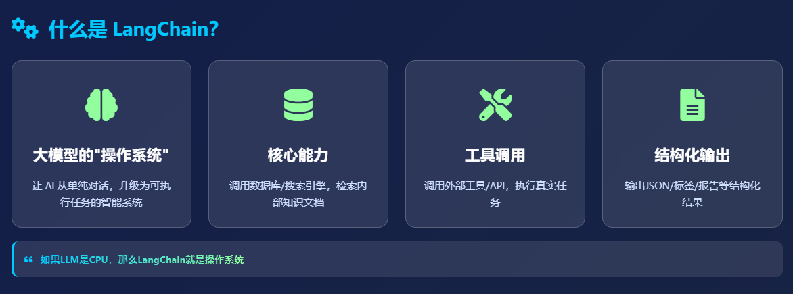
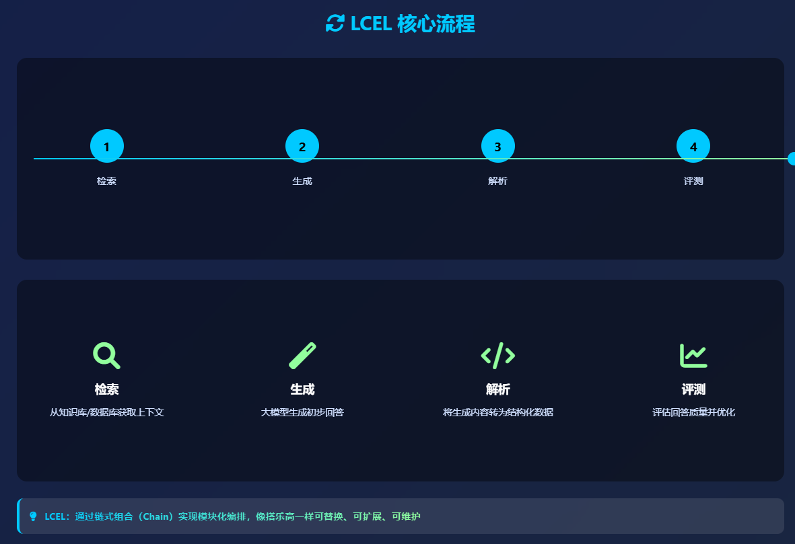
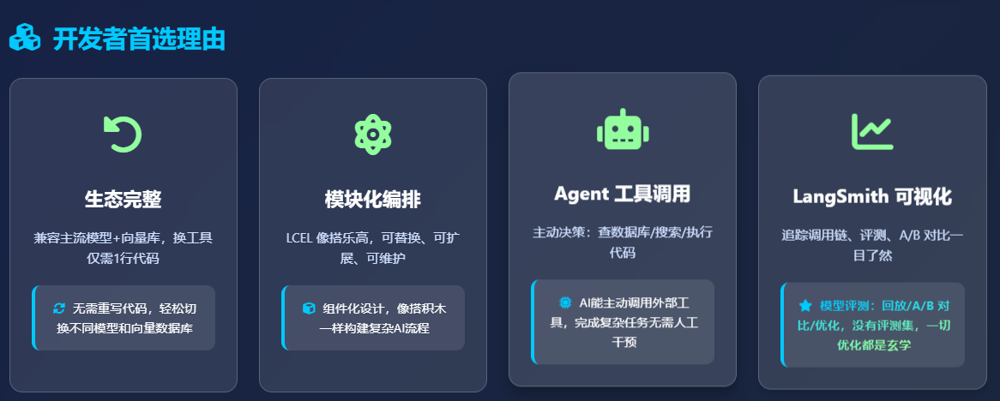
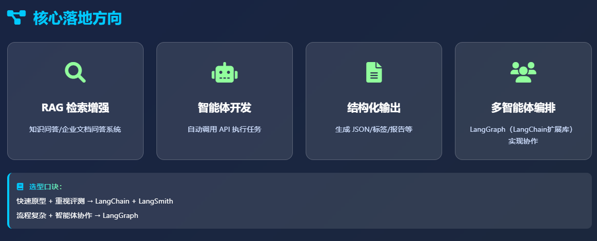
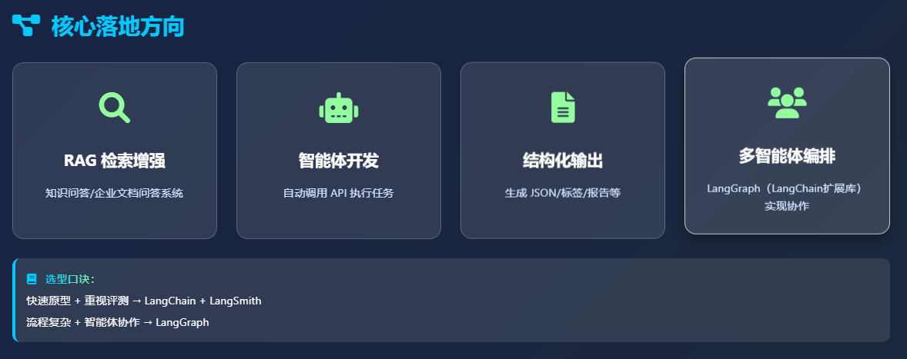
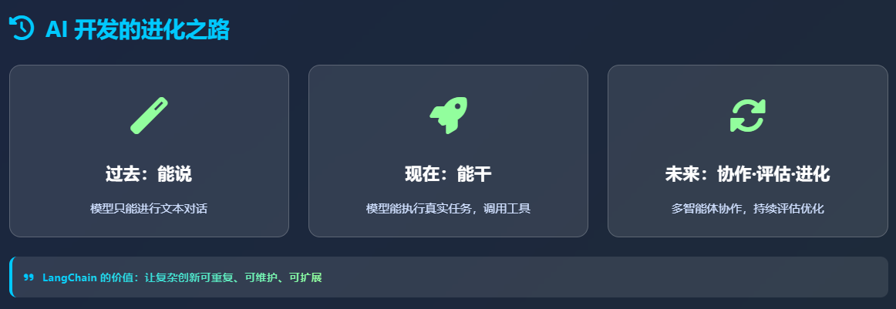

# LangChain 深度解析：大模型应用开发的 “操作系统” 与工程化实践

<font style="color:rgb(0, 0, 0);">在大模型技术爆发的初期，开发者对 AI 的使用大多停留在 “单点调用”—— 输入提示词、获取文本响应，模型仅能完成 “能说” 的基础交互。但随着企业级应用的落地，单纯的文本对话已无法满足复杂需求：如何让 AI 检索私有知识库？如何让模型自动调用工具执行任务？如何将分散的 AI 能力串联成可复用的流程？LangChain 的出现，正是为了解决这些核心痛点，它将大模型从 “孤立的对话工具” 升级为 “可工程化的智能系统”，成为连接模型、工具、数据与场景的 “操作系统”。</font>

<font style="color:rgb(0, 0, 0);">本文将从技术底层、核心组件、架构设计、实战场景、选型策略等维度，全面拆解 LangChain的核心价值与落地路径，帮助开发者从 “会用” 到 “用好” 这一主流大模型开发框架。</font>

## <font style="color:rgb(0, 0, 0);">一、LangChain 的核心定位：不止是 “工具库”，更是 “开发范式”</font>

### <font style="color:rgb(0, 0, 0);">1.1 大模型开发的核心痛点与 LangChain 的解决方案</font>

<font style="color:rgb(0, 0, 0);">在 LangChain 诞生前，大模型应用开发面临三大核心难题：</font>

* **<font style="color:rgb(0, 0, 0) !important;">能力孤立</font>**<font style="color:rgb(0, 0, 0);">：模型本身无法访问外部数据（私有文档、实时信息）、无法调用工具（API、数据库、代码解释器），仅能依赖训练数据内的知识；</font>
* **<font style="color:rgb(0, 0, 0) !important;">流程割裂</font>**<font style="color:rgb(0, 0, 0);">：复杂任务（如 “分析行业报告→生成可视化图表→输出结构化报告”）需要手动串联多个步骤，无统一的流程编排框架；</font>
* **<font style="color:rgb(0, 0, 0) !important;">工程化缺失</font>**<font style="color:rgb(0, 0, 0);">：缺乏可观测、可调试、可优化的链路管理工具，模型输出的 “黑盒问题” 导致应用难以落地生产。</font>

<font style="color:rgb(0, 0, 0);">LangChain 的核心定位是</font>**<font style="color:rgb(0, 0, 0) !important;">大模型应用的 “操作系统”</font>**<font style="color:rgb(0, 0, 0);"> </font><font style="color:rgb(0, 0, 0);">—— 它不替代大模型，而是为模型提供 “系统级能力”：</font>

* <font style="color:rgb(0, 0, 0);">数据层：连接私有文档、数据库、实时 API，让模型具备 “知识扩展” 能力；</font>
* <font style="color:rgb(0, 0, 0);">工具层：封装海量第三方工具，支持模型 “主动决策 + 调用执行”；</font>
* <font style="color:rgb(0, 0, 0);">流程层：通过模块化编排，将复杂任务拆解为可复用的链路；</font>
* <font style="color:rgb(0, 0, 0);">观测层：通过 LangSmith 实现全链路追踪、评测与优化，解决 “黑盒问题”。</font>

<font style="color:rgb(0, 0, 0);">简单来说，若将大模型比作 “电脑 CPU”，LangChain 就是 Windows/macOS—— 它让 “硬件核心”（模型）具备了 “软件生态”（工具、数据、流程），真正实现从 “能说” 到 “能干” 的跨越。</font>



## <font style="color:rgb(0, 0, 0);">二、LangChain 核心组件与技术架构</font>

<font style="color:rgb(0, 0, 0);">LangChain 1.0 的架构在 0.1 版本基础上完成了</font>**<font style="color:rgb(0, 0, 0) !important;">组件稳定化、流程标准化</font>**<font style="color:rgb(0, 0, 0);">，分为三层：</font>**<font style="color:rgb(0, 0, 0) !important;">基础设施层、核心组件层、应用层</font>**<font style="color:rgb(0, 0, 0);">，每层均遵循 “模块化设计”，支持按需组合。</font>

### <font style="color:rgb(0, 0, 0);">2.1 基础设施层：连接外部能力的 “桥梁”</font>

<font style="color:rgb(0, 0, 0);">基础设施层是 LangChain 与外部资源的接口，1.0 版本强化了生态兼容性：</font>

* **<font style="color:rgb(0, 0, 0) !important;">模型（Models）</font>**<font style="color:rgb(0, 0, 0);">：封装各类大模型的调用接口，支持 LLM（大语言模型）、ChatModel（对话模型）、EmbeddingModel（嵌入模型）三类核心模型，兼容 API 调用（OpenAI、Anthropic、通义千问等）与本地部署（LLaMA 2、Qwen、LlamaCpp 等），1.0 新增了对多模态模型（如 GPT-4V、Claude 3）的原生支持；</font>
* **<font style="color:rgb(0, 0, 0) !important;">工具（Tools）</font>**<font style="color:rgb(0, 0, 0);">：封装第三方工具的调用逻辑，包括搜索引擎（SerpAPI）、数据库（SQL、MongoDB）、代码解释器（Python REPL）、API 接口（RESTful、GraphQL）等，1.0 新增了 “工具套件”（Toolkits），支持一键集成垂直领域工具（如 GitHub 工具套件、Slack 工具套件）；</font>
* **<font style="color:rgb(0, 0, 0) !important;">数据（Data）</font>**<font style="color:rgb(0, 0, 0);">：提供数据加载器（Document Loaders）、文本分割器（Text Splitters）、向量存储适配器（Vector Store Integrations），支持从 PDF、Word、Notion、数据库等多种来源加载数据，1.0 优化了大文件加载性能与多语言文本分割策略。</font>

### <font style="color:rgb(0, 0, 0);">2.2 核心组件层：构建 AI 系统的 “积木”</font>

<font style="color:rgb(0, 0, 0);">核心组件层是 LangChain的核心能力集合，每个组件均可独立使用或组合：</font>

* **<font style="color:rgb(0, 0, 0) !important;">提示词模板（Prompts）</font>**<font style="color:rgb(0, 0, 0);">：标准化提示词设计，支持动态变量替换、Few-Shot 示例注入、提示词优化（如 RLHF 微调后的提示词模板），1.0 新增了 “提示词库”（Prompt Hub），支持共享与复用优质提示词；</font>
* **<font style="color:rgb(0, 0, 0) !important;">记忆（Memory）</font>**<font style="color:rgb(0, 0, 0);">：存储对话历史或流程中间状态，支持短期记忆（ConversationBufferMemory）、长期记忆（VectorStoreRetrieverMemory）、实体记忆（EntityMemory）等，1.0 优化了记忆的持久化能力（支持 Redis、SQL 存储）；</font>
* **<font style="color:rgb(0, 0, 0) !important;">检索器（Retrievers）</font>**<font style="color:rgb(0, 0, 0);">：负责从外部数据中检索相关信息，核心支持 RAG（检索增强生成）流程，提供 BM25、向量检索、混合检索等多种检索策略，1.0 新增了 “检索优化器”（Retriever Optimizers），自动调整检索参数提升召回率；</font>
* **<font style="color:rgb(0, 0, 0) !important;">链（Chains）</font>**<font style="color:rgb(0, 0, 0);">：1.0 版本中，Chains 已逐步被 LCEL 替代，仅保留部分经典场景的封装链（如 ConversationalRetrievalChain）；</font>
* **<font style="color:rgb(0, 0, 0) !important;">智能体（Agents）</font>**<font style="color:rgb(0, 0, 0);">：具备 “决策能力” 的高级组件，能根据任务目标自主选择工具、规划步骤、执行动作，1.0 强化了智能体的 “规划能力”，支持多轮任务拆解与动态工具选择；</font>
* **<font style="color:rgb(0, 0, 0) !important;">流程编排（LCEL）</font>**<font style="color:rgb(0, 0, 0);">：LangChain 0.1 版本引入的核心流程框架（LangChain Expression Language），在 1.0 版本中成为</font>**<font style="color:rgb(0, 0, 0) !important;">唯一的官方流程编排方案</font>**<font style="color:rgb(0, 0, 0);">，用声明式语法定义复杂流程，支持并行执行、条件分支、循环控制，比传统 Chains 更灵活、可维护。</font>

### <font style="color:rgb(0, 0, 0);">2.3 应用层：面向场景的 “解决方案”</font>

<font style="color:rgb(0, 0, 0);">应用层是基于核心组件封装的场景化解决方案，1.0 版本新增了多个垂直场景套件：</font>

* **<font style="color:rgb(0, 0, 0) !important;">RAG 检索增强</font>**<font style="color:rgb(0, 0, 0);">：提供端到端的 RAG 解决方案，支持 “数据加载→分割→向量存储→检索→生成” 全流程，1.0 新增了 “RAG 评估套件”；</font>
* **<font style="color:rgb(0, 0, 0) !important;">智能体应用</font>**<font style="color:rgb(0, 0, 0);">：快速搭建具备工具调用能力的智能体（如客服智能体、数据分析智能体），1.0 支持智能体的 “角色定义” 与 “权限控制”；</font>
* **<font style="color:rgb(0, 0, 0) !important;">结构化输出</font>**<font style="color:rgb(0, 0, 0);">：通过 Output Parsers 将模型输出转换为 JSON、Pydantic 模型、SQL 等结构化格式，1.0 新增了对复杂嵌套结构的解析支持；</font>
* **<font style="color:rgb(0, 0, 0) !important;">多智能体协作</font>**<font style="color:rgb(0, 0, 0);">：通过 LangGraph（LangChain 1.0 生态的核心扩展库）实现多个智能体分工协作，支持状态管理、循环执行、分支逻辑；</font>
* **<font style="color:rgb(0, 0, 0) !important;">批处理与评测</font>**<font style="color:rgb(0, 0, 0);">：支持批量处理文本（如批量摘要、批量翻译），配合 LangSmith 实现自动化评测，1.0 新增了批量任务的分布式执行能力。</font>

## <font style="color:rgb(0, 0, 0);">三、LCEL：LangChain的 “标准流程引擎”</font>

<font style="color:rgb(0, 0, 0);">LCEL（LangChain Expression Language）最初是 LangChain 0.1 版本的核心创新，而</font>**<font style="color:rgb(0, 0, 0) !important;">LangChain 1.0 版本将其确立为唯一的官方流程编排方案</font>**<font style="color:rgb(0, 0, 0);">，并进行了功能增强与稳定性优化。</font>

### <font style="color:rgb(0, 0, 0);">3.1 LCEL 的核心设计：“流水线式” 流程编排</font>

<font style="color:rgb(0, 0, 0);">LCEL 的本质是</font>**<font style="color:rgb(0, 0, 0) !important;">声明式的流程描述语言</font>**<font style="color:rgb(0, 0, 0);">，它将复杂流程拆解为 “步骤（Step）”，每个步骤都是一个 “可调用对象（Runnable）”，支持串联（</font><code><font style="color:rgba(0, 0, 0, 0.85) !important;">|</font></code><font style="color:rgb(0, 0, 0);">）、并行（</font><code><font style="color:rgba(0, 0, 0, 0.85) !important;">RunnableParallel</font></code><font style="color:rgb(0, 0, 0);">）、条件分支（</font><code><font style="color:rgba(0, 0, 0, 0.85) !important;">RunnableBranch</font></code><font style="color:rgb(0, 0, 0);">）等操作。</font>

<font style="color:rgb(0, 0, 0);">LangChain 1.0 中，一个典型的 LCEL 流程（多模态 RAG）示例：</font>

**<font style="color:rgba(0, 0, 0, 0.85);">python</font>**

<font style="color:rgba(0, 0, 0, 0.5);">运行</font>

```python
# 多模态检索→提示词注入→多模态生成→解析
multimodal_rag_chain = (
    {
        "context": multimodal_retriever,  # 检索文本+图片上下文
        "question": RunnablePassthrough()
    }  # 并行获取多模态上下文与问题
    | multimodal_prompt_template  # 注入多模态提示词模板
    | gpt4v_llm  # 多模态模型生成
    | pydantic_output_parser  # 结构化解析
)
```

### <font style="color:rgb(0, 0, 0);">3.2 LangChain 1.0 对 LCEL 的升级点</font>

<font style="color:rgb(0, 0, 0);">1.0 版本在 0.1 的基础上，对 LCEL 做了以下增强：</font>

* **<font style="color:rgb(0, 0, 0) !important;">类型安全</font>**<font style="color:rgb(0, 0, 0);">：新增了 Runnable 的类型注解支持，IDE 可自动提示输入 / 输出格式，减少开发错误；</font>
* **<font style="color:rgb(0, 0, 0) !important;">性能优化</font>**<font style="color:rgb(0, 0, 0);">：优化了 Runnable 的执行效率，并行任务的执行速度提升 30% 以上；</font>
* **<font style="color:rgb(0, 0, 0) !important;">组件扩展</font>**<font style="color:rgb(0, 0, 0);">：新增了</font><code><font style="color:rgb(0, 0, 0);">RunnableSequence</font></code><font style="color:rgb(0, 0, 0);">（复杂序列控制）、</font><code><font style="color:rgb(0, 0, 0);">RunnableMap</font></code><font style="color:rgb(0, 0, 0);">（键值对映射）等组件；</font>
* **<font style="color:rgb(0, 0, 0) !important;">错误处理</font>**<font style="color:rgb(0, 0, 0);">：内置了</font><code><font style="color:rgb(0, 0, 0);">RunnableTry</font></code><font style="color:rgb(0, 0, 0);">（异常捕获与重试），支持自定义错误处理逻辑；</font>
* **<font style="color:rgb(0, 0, 0) !important;">生态整合</font>**<font style="color:rgb(0, 0, 0);">：与 LangGraph 深度集成，支持将 LCEL 流程作为智能体的子任务执行。</font>

### <font style="color:rgb(0, 0, 0);">3.3 LCEL 核心流程：检索→生成→解析→评测</font>

<font style="color:rgb(0, 0, 0);">这是 LangChain 1.0 最经典的流程，也是企业级应用的核心链路：</font>

1. **<font style="color:rgb(0, 0, 0) !important;">检索（Retrieval）</font>**<font style="color:rgb(0, 0, 0);">：从向量库或数据库中检索与用户问题相关的上下文（文本、图片、音频等），解决模型 “知识过期”“无私有数据访问权” 问题；</font>
2. **<font style="color:rgb(0, 0, 0) !important;">生成（Generation）</font>**<font style="color:rgb(0, 0, 0);">：将检索到的上下文与用户问题注入提示词模板，调用大模型生成回答，1.0 支持多模态内容的生成；</font>
3. **<font style="color:rgb(0, 0, 0) !important;">解析（Parsing）</font>**<font style="color:rgb(0, 0, 0);">：将模型输出的自然语言 / 多模态内容转换为结构化格式（如 JSON、SQL），便于后续系统集成；</font>
4. **<font style="color:rgb(0, 0, 0) !important;">评测（Evaluation）</font>**<font style="color:rgb(0, 0, 0);">：通过 LangSmith 评估回答的准确性、相关性、流畅性，生成评测报告，1.0 支持多模态内容的自动化评测。</font>

**<font style="color:rgb(0, 0, 0) !important;">关键提示</font>**<font style="color:rgb(0, 0, 0);">：“评测” 是 LCEL 流程的闭环核心 ——LangChain 1.0 中，LangSmith 已与 LCEL 深度绑定，可自动采集每个步骤的评测数据，无需额外配置。</font>



## <font style="color:rgb(0, 0, 0);">四、LangChain的典型应用场景与技术实现</font>

<font style="color:rgb(0, 0, 0);">LangChain 的应用场景覆盖企业级 AI 系统的核心需求，以下是最主流的 3 个场景及技术实现思路：</font>

### <font style="color:rgb(0, 0, 0);">4.1 场景一：企业多模态知识库问答系统（RAG）</font>

**<font style="color:rgb(0, 0, 0) !important;">核心需求</font>**<font style="color:rgb(0, 0, 0);">：让 AI 能回答基于企业私有文档（PDF、Word、图片、视频脚本）的问题，支持多模态内容的检索与生成。</font>**<font style="color:rgb(0, 0, 0) !important;">技术实现步骤</font>**<font style="color:rgb(0, 0, 0);">：</font>

1. **<font style="color:rgb(0, 0, 0) !important;">数据预处理</font>**<font style="color:rgb(0, 0, 0);">：使用</font><code><font style="color:rgb(0, 0, 0);">MultiModalLoader</font></code><font style="color:rgb(0, 0, 0);">加载文本 + 图片文档，通过</font><code><font style="color:rgb(0, 0, 0);">RecursiveCharacterTextSplitter</font></code><font style="color:rgb(0, 0, 0);">分割文本，</font><code><font style="color:rgb(0, 0, 0);">ImageSplitter</font></code><font style="color:rgb(0, 0, 0);">提取图片特征；</font>
2. **<font style="color:rgb(0, 0, 0) !important;">向量存储</font>**<font style="color:rgb(0, 0, 0);">：用</font><code><font style="color:rgb(0, 0, 0);">OpenAIEmbeddings</font></code><font style="color:rgb(0, 0, 0);">（文本）+</font><code><font style="color:rgb(0, 0, 0);">CLIPEmbeddings</font></code><font style="color:rgb(0, 0, 0);">（图片）将内容转换为向量，存入</font><code><font style="color:rgb(0, 0, 0);">Milvus</font></code><font style="color:rgb(0, 0, 0);">（支持多模态向量）；</font>
3. **<font style="color:rgb(0, 0, 0) !important;">检索配置</font>**<font style="color:rgb(0, 0, 0);">：构建</font><code><font style="color:rgb(0, 0, 0);">MultiModalRetriever</font></code><font style="color:rgb(0, 0, 0);">，设置 “文本 + 图片” 混合检索策略；</font>
4. **<font style="color:rgb(0, 0, 0) !important;">流程编排</font>**<font style="color:rgb(0, 0, 0);">：用 LCEL 定义 “多模态检索→提示词注入→多模态生成→解析” 流程，加入</font><code><font style="color:rgb(0, 0, 0);">ConversationEntityMemory</font></code><font style="color:rgb(0, 0, 0);">支持实体级上下文记忆；</font>
5. **<font style="color:rgb(0, 0, 0) !important;">评测优化</font>**<font style="color:rgb(0, 0, 0);">：通过 LangSmith 构建多模态评测集（问题 - 标准答案 - 参考多模态文档），评估回答准确性。</font>

### <font style="color:rgb(0, 0, 0);">4.2 场景二：自动化数据分析智能体</font>

**<font style="color:rgb(0, 0, 0) !important;">核心需求</font>**<font style="color:rgb(0, 0, 0);">：让 AI 能自主读取数据文件（CSV、Excel）、分析数据趋势、生成可视化图表、输出结构化分析报告，并支持多轮交互调整分析维度。</font>**<font style="color:rgb(0, 0, 0) !important;">技术实现步骤</font>**<font style="color:rgb(0, 0, 0);">：</font>

1. **<font style="color:rgb(0, 0, 0) !important;">工具定义</font>**<font style="color:rgb(0, 0, 0);">：集成</font><code><font style="color:rgb(0, 0, 0);">PythonREPLTool</font></code><font style="color:rgb(0, 0, 0);">（执行代码）、</font><code><font style="color:rgb(0, 0, 0);">PandasToolkit</font></code><font style="color:rgb(0, 0, 0);">（数据分析）、</font><code><font style="color:rgb(0, 0, 0);">PlotlyTool</font></code><font style="color:rgb(0, 0, 0);">（可视化）；</font>
2. **<font style="color:rgb(0, 0, 0) !important;">智能体配置</font>**<font style="color:rgb(0, 0, 0);">：使用</font><code><font style="color:rgb(0, 0, 0);">AgentExecutor</font></code><font style="color:rgb(0, 0, 0);">，选择</font><code><font style="color:rgb(0, 0, 0);">Claude 3 Opus</font></code><font style="color:rgb(0, 0, 0);">作为决策模型，配置 “数据分析角色” 与工具权限；</font>
3. **<font style="color:rgb(0, 0, 0) !important;">记忆管理</font>**<font style="color:rgb(0, 0, 0);">：使用</font><code><font style="color:rgb(0, 0, 0);">VectorStoreRetrieverMemory</font></code><font style="color:rgb(0, 0, 0);">存储分析过程中的关键结论与数据维度；</font>
4. **<font style="color:rgb(0, 0, 0) !important;">流程编排</font>**<font style="color:rgb(0, 0, 0);">：用 LCEL 定义 “工具调用→结果解析→报告生成” 子流程，嵌入智能体的决策循环；</font>
5. **<font style="color:rgb(0, 0, 0) !important;">结果输出</font>**<font style="color:rgb(0, 0, 0);">：用</font><code><font style="color:rgb(0, 0, 0);">PydanticOutputParser</font></code><font style="color:rgb(0, 0, 0);">将分析结果转换为 “结论 + 图表 + 异常提示” 的结构化报告。</font>

### <font style="color:rgb(0, 0, 0);">4.3 场景三：多智能体协作营销系统</font>

**<font style="color:rgb(0, 0, 0) !important;">核心需求</font>**<font style="color:rgb(0, 0, 0);">：多个智能体分工协作完成 “市场调研→文案撰写→排版发布” 任务，每个智能体负责专业环节，支持任务异常回调（如文案不合格需重新调研）。</font>**<font style="color:rgb(0, 0, 0) !important;">技术实现步骤（基于 LangGraph）</font>**<font style="color:rgb(0, 0, 0);">：</font>

1. **<font style="color:rgb(0, 0, 0) !important;">智能体拆分</font>**<font style="color:rgb(0, 0, 0);">：定义三个智能体 —— 调研智能体（调用 SerpAPI + 企业数据）、文案智能体（基于调研结果写文案）、排版智能体（将文案转为公众号格式）；</font>
2. **<font style="color:rgb(0, 0, 0) !important;">流程编排</font>**<font style="color:rgb(0, 0, 0);">：使用 LangGraph 构建状态机，定义智能体交互逻辑：调研智能体→文案智能体→排版智能体，新增 “文案审核分支”（不合格则回调调研智能体）；</font>
3. **<font style="color:rgb(0, 0, 0) !important;">状态管理</font>**<font style="color:rgb(0, 0, 0);">：通过 LangGraph 的</font><code><font style="color:rgb(0, 0, 0);">State</font></code><font style="color:rgb(0, 0, 0);">存储任务中间结果（调研数据、草稿文案、排版内容）；</font>
4. **<font style="color:rgb(0, 0, 0) !important;">执行监控</font>**<font style="color:rgb(0, 0, 0);">：用 LangSmith 追踪每个智能体的调用链路、执行时间，设置 “文案审核不通过” 告警。</font>



## <font style="color:rgb(0, 0, 0);">五、LangChain 选型策略：不是 “万能药”，而是 “对症药”</font>

<font style="color:rgb(0, 0, 0);">LangChain 虽强大，但并非所有场景都适用。以下是详细的选型对比与决策指南：</font>

### <font style="color:rgb(0, 0, 0);">5.1 LangChain vs 其他主流框架</font>

| **<font style="color:rgb(0, 0, 0) !important;">框架</font>** | **<font style="color:rgb(0, 0, 0) !important;">核心优势</font>** | **<font style="color:rgb(0, 0, 0) !important;">技术侧重</font>** | **<font style="color:rgb(0, 0, 0) !important;">适用场景</font>** | **<font style="color:rgb(0, 0, 0) !important;">劣势</font>** |
| :--- | :--- | :--- | :--- | :--- |
| <font style="color:rgba(0, 0, 0, 0.85) !important;">LangChain</font> | <font style="color:rgba(0, 0, 0, 0.85) !important;">生态完整、LCEL 流程标准、多模态支持</font> | <font style="color:rgba(0, 0, 0, 0.85) !important;">流程编排、工具调用、生态兼容</font> | <font style="color:rgba(0, 0, 0, 0.85) !important;">快速原型、复杂流程、企业级应用</font> | <font style="color:rgba(0, 0, 0, 0.85) !important;">轻量场景下略显冗余</font> |
| <font style="color:rgba(0, 0, 0, 0.85) !important;">LlamaIndex</font> | <font style="color:rgba(0, 0, 0, 0.85) !important;">知识数据管理能力强、RAG 优化好</font> | <font style="color:rgba(0, 0, 0, 0.85) !important;">数据加载、检索策略、知识图谱</font> | <font style="color:rgba(0, 0, 0, 0.85) !important;">知识库问答、数据密集型应用</font> | <font style="color:rgba(0, 0, 0, 0.85) !important;">工具调用与多智能体较弱</font> |
| <font style="color:rgba(0, 0, 0, 0.85) !important;">LangGraph</font> | <font style="color:rgba(0, 0, 0, 0.85) !important;">状态管理、循环 / 分支逻辑支持好</font> | <font style="color:rgba(0, 0, 0, 0.85) !important;">多智能体协作、复杂流程编排</font> | <font style="color:rgba(0, 0, 0, 0.85) !important;">多智能体系统、长流程任务</font> | <font style="color:rgba(0, 0, 0, 0.85) !important;">单智能体场景使用成本高</font> |
| <font style="color:rgba(0, 0, 0, 0.85) !important;">Haystack</font> | <font style="color:rgba(0, 0, 0, 0.85) !important;">检索优化、管道化设计</font> | <font style="color:rgba(0, 0, 0, 0.85) !important;">RAG 流程、检索策略</font> | <font style="color:rgba(0, 0, 0, 0.85) !important;">大规模知识库问答</font> | <font style="color:rgba(0, 0, 0, 0.85) !important;">生态兼容性较弱</font> |
| <font style="color:rgba(0, 0, 0, 0.85) !important;">LlamaCpp</font> | <font style="color:rgba(0, 0, 0, 0.85) !important;">轻量、本地部署友好</font> | <font style="color:rgba(0, 0, 0, 0.85) !important;">本地模型调用</font> | <font style="color:rgba(0, 0, 0, 0.85) !important;">边缘设备、轻量应用</font> | <font style="color:rgba(0, 0, 0, 0.85) !important;">无流程编排与工具调用能力</font> |

### <font style="color:rgb(0, 0, 0);">5.2 选型口诀与决策步骤</font>

#### <font style="color:rgb(0, 0, 0);">选型口诀：</font>

* <font style="color:rgb(0, 0, 0);">快速原型 + 多能力集成：LangChain + LangSmith；</font>
* <font style="color:rgb(0, 0, 0);">数据密集 + 知识库：LlamaIndex 或 LangChain +LlamaIndex；</font>
* <font style="color:rgb(0, 0, 0);">多智能体 + 复杂流程：LangChain +LangGraph；</font>
* <font style="color:rgb(0, 0, 0);">轻量调用 + 本地部署：LlamaCpp 或直接用模型 SDK。</font>

#### <font style="color:rgb(0, 0, 0);">决策步骤：</font>

1. <font style="color:rgb(0, 0, 0);">明确核心需求：是 “单纯调用模型”“知识库问答”“工具调用” 还是 “多智能体协作”？</font>
2. <font style="color:rgb(0, 0, 0);">评估技术复杂度：是否需要流程编排、可观测性、多模态支持？</font>
3. <font style="color:rgb(0, 0, 0);">考虑部署环境：是云端部署（优先 LangChain）还是本地部署（优先轻量框架）？</font>
4. <font style="color:rgb(0, 0, 0);">权衡开发成本：是否需要快速迭代（优先 LangChain）还是极致性能（优先专用框架）？</font>



### <font style="color:rgb(0, 0, 0);">5.3 不适合使用 LangChain的场景</font>

* <font style="color:rgb(0, 0, 0);">仅需简单调用模型（如单轮文本生成、翻译）：直接使用模型 SDK（如 OpenAI Python Client）更轻量；</font>
* <font style="color:rgb(0, 0, 0);">核心需求是知识图谱构建与管理：优先选择 LlamaIndex 或 Neo4j；</font>
* <font style="color:rgb(0, 0, 0);">边缘设备部署（如手机、嵌入式设备）：优先选择 LlamaCpp、MLC-LLM 等轻量框架。</font>



## <font style="color:rgb(0, 0, 0);">六、LangChain工程化实践：从 “原型” 到 “生产”</font>

<font style="color:rgb(0, 0, 0);">要让 LangChain应用落地生产，需解决</font>**<font style="color:rgb(0, 0, 0) !important;">可观测性、性能优化、稳定性</font>**<font style="color:rgb(0, 0, 0);">三大核心问题，以下是关键实践建议：</font>

### <font style="color:rgb(0, 0, 0);">6.1 搭建可观测性体系（LangSmith）</font>

* **<font style="color:rgb(0, 0, 0) !important;">链路追踪</font>**<font style="color:rgb(0, 0, 0);">：开启 LangSmith 的</font><code><font style="color:rgb(0, 0, 0);">trace</font></code><font style="color:rgb(0, 0, 0);">功能，记录每个 Runnable 的输入 / 输出、执行时间、错误堆栈；</font>
* **<font style="color:rgb(0, 0, 0) !important;">自动化评测</font>**<font style="color:rgb(0, 0, 0);">：构建评测集，使用 LLM-as-a-Judge 自动评估回答准确性、相关性、合规性，1.0 支持多模态内容评测；</font>
* **<font style="color:rgb(0, 0, 0) !important;">版本管理</font>**<font style="color:rgb(0, 0, 0);">：对提示词、LCEL 流程、智能体配置进行版本控制，支持 A/B 测试；</font>
* **<font style="color:rgb(0, 0, 0) !important;">告警监控</font>**<font style="color:rgb(0, 0, 0);">：设置关键指标告警（如模型调用失败率、回答准确率低于阈值）。</font>

### <font style="color:rgb(0, 0, 0);">6.2 性能优化技巧</font>

* **<font style="color:rgb(0, 0, 0) !important;">缓存策略</font>**<font style="color:rgb(0, 0, 0);">：对检索结果、模型输出、Embedding 向量启用</font><code><font style="color:rgb(0, 0, 0);">RedisCache</font></code><font style="color:rgb(0, 0, 0);">，减少重复计算；</font>
* **<font style="color:rgb(0, 0, 0) !important;">检索优化</font>**<font style="color:rgb(0, 0, 0);">：使用混合检索（向量 + BM25）提升召回率，通过</font><code><font style="color:rgb(0, 0, 0);">ContextualCompression</font></code><font style="color:rgb(0, 0, 0);">压缩上下文长度；</font>
* **<font style="color:rgb(0, 0, 0) !important;">模型选型</font>**<font style="color:rgb(0, 0, 0);">：复杂决策用 GPT-4、Claude 3，简单生成用 GPT-3.5、通义千问 Lite，平衡性能与成本；</font>
* **<font style="color:rgb(0, 0, 0) !important;">异步执行</font>**<font style="color:rgb(0, 0, 0);">：对并行步骤使用</font><code><font style="color:rgb(0, 0, 0);">RunnableParallel</font></code><font style="color:rgb(0, 0, 0);">异步执行，提升流程效率。</font>

### <font style="color:rgb(0, 0, 0);">6.3 稳定性保障</font>

* **<font style="color:rgb(0, 0, 0) !important;">异常处理</font>**<font style="color:rgb(0, 0, 0);">：用</font><code><font style="color:rgb(0, 0, 0);">RunnableTry</font></code><font style="color:rgb(0, 0, 0);">捕获工具调用、模型生成的异常，设置重试逻辑；</font>
* **<font style="color:rgb(0, 0, 0) !important;">输入验证</font>**<font style="color:rgb(0, 0, 0);">：对用户输入、工具返回结果进行格式验证，避免无效数据；</font>
* **<font style="color:rgb(0, 0, 0) !important;">降级策略</font>**<font style="color:rgb(0, 0, 0);">：模型服务不可用时，自动切换为静态回复或降级为轻量模型；</font>
* **<font style="color:rgb(0, 0, 0) !important;">数据安全</font>**<font style="color:rgb(0, 0, 0);">：私有数据加密存储，优先使用本地部署的模型处理涉密数据。</font>

## <font style="color:rgb(0, 0, 0);">七、未来展望：LangChain 的发展趋势</font>

<font style="color:rgb(0, 0, 0);">LangChain的发布标志着其从 “快速迭代的工具库” 转向 “稳定的生产级框架”，未来发展趋势包括：</font>

* **<font style="color:rgb(0, 0, 0) !important;">多模态深度整合</font>**<font style="color:rgb(0, 0, 0);">：支持更多模态（音频、视频）的加载、检索与生成；</font>
* **<font style="color:rgb(0, 0, 0) !important;">Agent 能力升级</font>**<font style="color:rgb(0, 0, 0);">：从 “反应式决策” 向 “规划式决策” 进化，支持更复杂的任务拆解；</font>
* **<font style="color:rgb(0, 0, 0) !important;">低代码 / 无代码化</font>**<font style="color:rgb(0, 0, 0);">：推出可视化流程编排工具，让非技术人员通过拖拽搭建 AI 系统；</font>
* **<font style="color:rgb(0, 0, 0) !important;">行业专属套件</font>**<font style="color:rgb(0, 0, 0);">：针对金融、医疗、电商等行业推出专属工具与流程模板；</font>
* **<font style="color:rgb(0, 0, 0) !important;">开源生态完善</font>**<font style="color:rgb(0, 0, 0);">：核心组件进一步模块化，第三方开发者可贡献更多专用 Runnable。</font>



## <font style="color:rgb(0, 0, 0);">八、总结</font>

<font style="color:rgb(0, 0, 0);">LangChain的核心价值，在于它为大模型应用开发提供了一套</font>**<font style="color:rgb(0, 0, 0) !important;">标准化、工程化、可扩展</font>**<font style="color:rgb(0, 0, 0);">的解决方案。它将分散的模型、工具、数据串联成可落地的系统，让大模型从 “实验室里的技术” 变成 “企业里的生产力工具”。</font>

<font style="color:rgb(0, 0, 0);">对于开发者而言，学习 LangChain不仅是掌握一个框架，更是理解大模型应用的 “开发范式”—— 未来的 AI 系统，必然是 “模型 + 工具 + 数据 + 流程” 的协同体。结合自身场景选型、重视评测与工程化实践，才能真正发挥其核心价值。</font>

<font style="color:rgb(0, 0, 0);">最后记住：LangChain不是 “万能药”，但在大模型应用的工程化道路上，它是最值得掌握的 “对症药”。</font>
