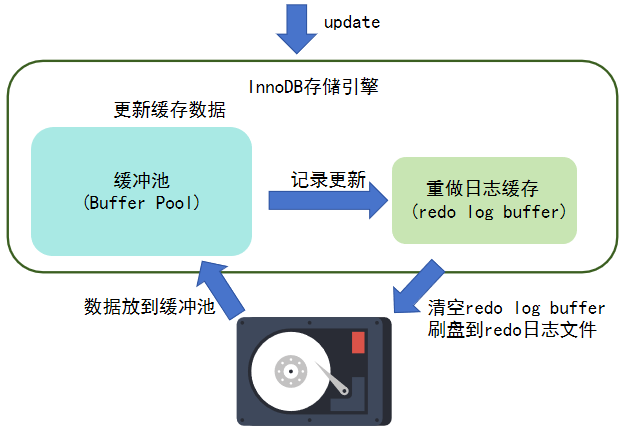
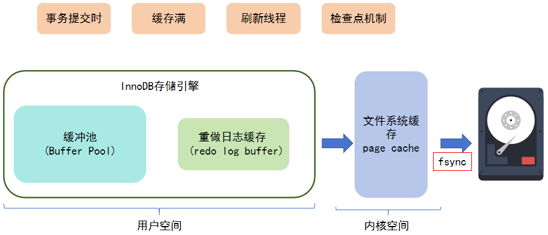
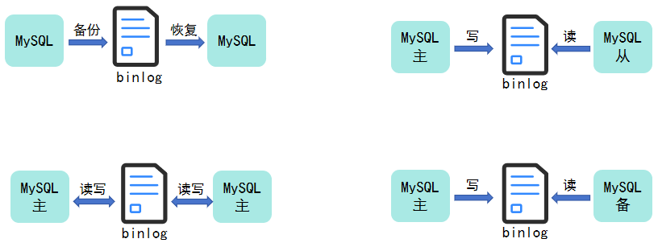
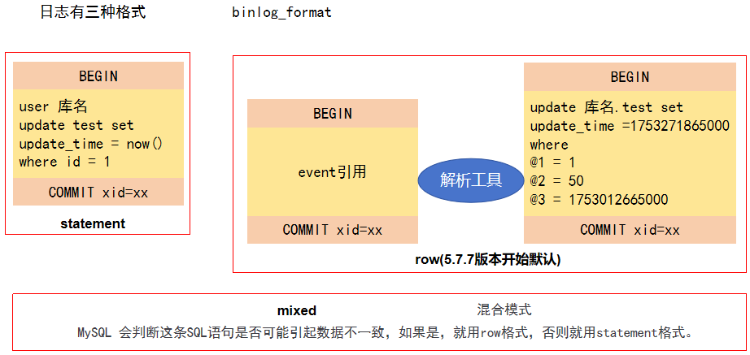
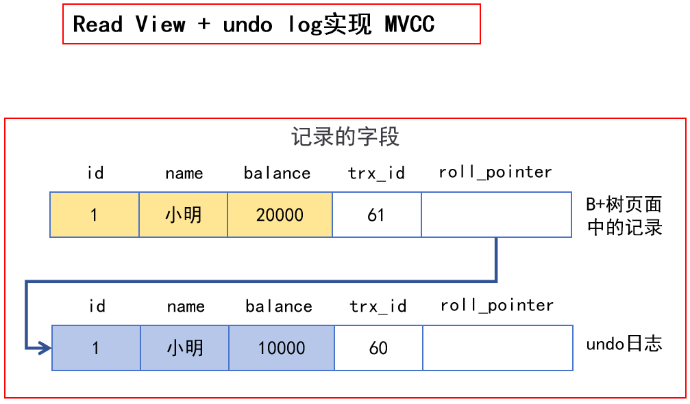
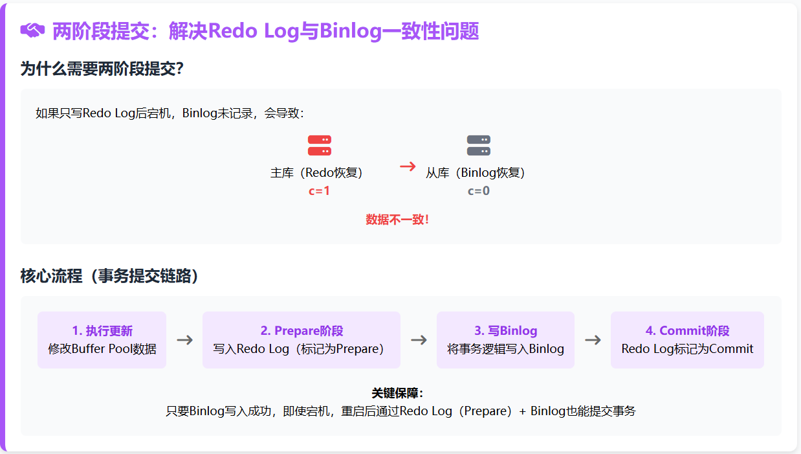

# MySQL 三大日志全景解析：从基础概念到 MVCC 协同，覆盖 ACID 与集群一致性

<font style="color:rgb(0, 0, 0);">本文档聚焦 </font>**<font style="color:rgb(0, 0, 0) !important;">MySQL 8.0+ 内核核心</font>**<font style="color:rgb(0, 0, 0);">，以 Redo Log（重做日志）、Binlog（归档日志）、Undo Log（回滚日志）为核心，剥离冗余代码与应用层逻辑，深入解析三大日志的底层机制、工作流程、参数配置及协同逻辑。适用于需掌握 MySQL 事务原理、数据恢复与集群一致性的开发、运维及架构师，同时覆盖面试高频考点与生产环境最佳实践。</font>

### <font style="color:rgb(0, 0, 0);">日志体系总览</font>

<font style="color:rgb(0, 0, 0);">MySQL 日志体系分为 “基础运维日志” 与 “核心业务日志” 两类，其中 Redo Log、Binlog、Undo Log 是保障事务 ACID 特性与集群稳定性的核心，三者定位差异如下：</font>

| **<font style="color:rgb(0, 0, 0) !important;">日志类型</font>** | **<font style="color:rgb(0, 0, 0) !important;">所属层级</font>** | **<font style="color:rgb(0, 0, 0) !important;">核心职责</font>** | **<font style="color:rgb(0, 0, 0) !important;">解决的核心问题</font>** |
| :--- | :--- | :--- | :--- |
| <font style="color:rgba(0, 0, 0, 0.85) !important;">Redo Log</font> | <font style="color:rgba(0, 0, 0, 0.85) !important;">InnoDB 引擎层</font> | <font style="color:rgba(0, 0, 0, 0.85) !important;">保障事务持久性（ACID 之 D）</font> | <font style="color:rgba(0, 0, 0, 0.85) !important;">宕机后已提交事务不丢失</font> |
| <font style="color:rgba(0, 0, 0, 0.85) !important;">Binlog</font> | <font style="color:rgba(0, 0, 0, 0.85) !important;">MySQL Server 层</font> | <font style="color:rgba(0, 0, 0, 0.85) !important;">数据同步与时间点恢复</font> | <font style="color:rgba(0, 0, 0, 0.85) !important;">主从复制、全量 + 增量备份</font> |
| <font style="color:rgba(0, 0, 0, 0.85) !important;">Undo Log</font> | <font style="color:rgba(0, 0, 0, 0.85) !important;">InnoDB 引擎层</font> | <font style="color:rgba(0, 0, 0, 0.85) !important;">事务原子性（ACID 之 A）+ MVCC</font> | <font style="color:rgba(0, 0, 0, 0.85) !important;">事务回滚、读写不冲突查询</font> |


## <font style="color:rgb(0, 0, 0);">1 Redo Log（重做日志）：InnoDB 的 “崩溃恢复保险”</font>

### <font style="color:rgb(0, 0, 0);">1.1 定义与核心特性</font>

<font style="color:rgb(0, 0, 0);">Redo Log 是</font><font style="color:rgb(0, 0, 0);"> </font>**<font style="color:rgb(0, 0, 0) !important;">InnoDB 存储引擎独有</font>**<font style="color:rgb(0, 0, 0);">的</font><font style="color:rgb(0, 0, 0);"> </font>**<font style="color:rgb(0, 0, 0) !important;">物理日志</font>**<font style="color:rgb(0, 0, 0);">，记录 “某数据页（Page）发生的具体修改”（如 “order 表数据页 123 中，行 ID=5 的 status 字段从 0 改为 1”），而非完整行数据。其核心特性决定了它在数据安全性中的核心地位：</font>

* **<font style="color:rgb(0, 0, 0) !important;">物理绑定性</font>**<font style="color:rgb(0, 0, 0);">：与数据页直接关联，不依赖表结构，恢复时直接定位数据页修改位置，效率远高于逻辑日志。</font>
* **<font style="color:rgb(0, 0, 0) !important;">顺序写优势</font>**<font style="color:rgb(0, 0, 0);">：Redo Log 文件按 “追加顺序” 写入，规避硬盘随机写的性能瓶颈（顺序写速度可达随机写的 100 倍以上）。</font>
* **<font style="color:rgb(0, 0, 0) !important;">环形复用</font>**<font style="color:rgb(0, 0, 0);">：通过日志文件组循环存储，避免日志无限膨胀，降低磁盘管理成本。</font>

### <font style="color:rgb(0, 0, 0);">1.2 工作原理与流程</font>

<font style="color:rgb(0, 0, 0);">Redo Log 的工作流程与 InnoDB 内存结构（Buffer Pool）深度耦合，完整链路需经历 “内存修改→日志缓存→日志刷盘→脏页落盘” 四步，确保性能与安全性平衡：</font>



1. **<font style="color:rgb(0, 0, 0) !important;">数据加载</font>**<font style="color:rgb(0, 0, 0);">：MySQL 从硬盘读取目标数据页（如 order 表的 Page 123），加载至内存中的</font><font style="color:rgb(0, 0, 0);"> </font>**<font style="color:rgb(0, 0, 0) !important;">Buffer Pool（缓冲池）</font>**<font style="color:rgb(0, 0, 0);">—— 这是为了避免每次修改都直接操作硬盘（硬盘 IO 速度远低于内存）。</font>
2. **<font style="color:rgb(0, 0, 0) !important;">内存修改</font>**<font style="color:rgb(0, 0, 0);">：事务在 Buffer Pool 中直接更新数据页，此时数据页变为 “脏页”（内存数据与硬盘数据不一致）。</font>
3. **<font style="color:rgb(0, 0, 0) !important;">日志缓存</font>**<font style="color:rgb(0, 0, 0);">：生成 Redo Log 记录，写入内存中的</font><font style="color:rgb(0, 0, 0);"> </font>**<font style="color:rgb(0, 0, 0) !important;">Redo Log Buffer（重做日志缓存）</font>**<font style="color:rgb(0, 0, 0);">。一条典型的 Redo Log 记录包含 “数据页 ID、页内偏移量、修改前值、修改后值、事务 ID”，确保恢复时能精准定位修改。</font>
4. **<font style="color:rgb(0, 0, 0) !important;">日志刷盘</font>**<font style="color:rgb(0, 0, 0);">：触发刷盘策略时，Redo Log Buffer 中的日志先写入</font><font style="color:rgb(0, 0, 0);"> </font>**<font style="color:rgb(0, 0, 0) !important;">文件系统缓存（Page Cache，内核空间）</font>**<font style="color:rgb(0, 0, 0);">，再通过操作系统的</font><font style="color:rgb(0, 0, 0);"> </font><code><font style="color:rgb(0, 0, 0);">fsync</font></code><font style="color:rgb(0, 0, 0);"> </font><font style="color:rgb(0, 0, 0);">命令刷入硬盘的 Redo Log 文件（如</font><font style="color:rgb(0, 0, 0);"> </font><code><font style="color:rgb(0, 0, 0);">ib_logfile_0</font></code><font style="color:rgb(0, 0, 0);">）—— 这一步是数据安全的关键。</font>
5. **<font style="color:rgb(0, 0, 0) !important;">脏页落盘</font>**<font style="color:rgb(0, 0, 0);">：InnoDB 后台线程（Page Cleaner）异步将 Buffer Pool 中的脏页刷回硬盘（与 Redo Log 刷盘独立），即使脏页未刷盘，只要 Redo Log 已刷盘，宕机后仍可通过日志恢复数据。</font>



### <font style="color:rgb(0, 0, 0);">1.3 关键刷盘策略（innodb\_flush\_log\_at\_trx\_commit）</font>

<font style="color:rgb(0, 0, 0);">刷盘策略直接决定 “事务提交时 Redo Log 的落地时机”，由参数</font><font style="color:rgb(0, 0, 0);"> </font><code><font style="color:rgba(0, 0, 0, 0.85) !important;">innodb_flush_log_at_trx_commit</font></code><font style="color:rgb(0, 0, 0);"> </font><font style="color:rgb(0, 0, 0);">控制，是 “性能” 与 “安全性” 的核心权衡点。生产环境需根据业务重要性选择：</font>

| **<font style="color:rgb(0, 0, 0) !important;">参数值</font>** | **<font style="color:rgb(0, 0, 0) !important;">写入文件系统缓存（Page Cache）</font>** | **<font style="color:rgb(0, 0, 0) !important;">刷入硬盘（fsync）</font>** | **<font style="color:rgb(0, 0, 0) !important;">安全性</font>** | **<font style="color:rgb(0, 0, 0) !important;">性能</font>** | **<font style="color:rgb(0, 0, 0) !important;">适用场景</font>** |
| :--- | :--- | :--- | :--- | :--- | :--- |
| <font style="color:rgba(0, 0, 0, 0.85) !important;">0</font> | <font style="color:rgba(0, 0, 0, 0.85) !important;">不主动写入（依赖后台线程每秒写入）</font> | <font style="color:rgba(0, 0, 0, 0.85) !important;">不主动刷盘（依赖后台线程每秒刷盘）</font> | <font style="color:rgba(0, 0, 0, 0.85) !important;">最低</font> | <font style="color:rgba(0, 0, 0, 0.85) !important;">最高</font> | <font style="color:rgba(0, 0, 0, 0.85) !important;">测试环境、非核心业务（如日志统计）</font> |
| <font style="color:rgba(0, 0, 0, 0.85) !important;">1</font> | <font style="color:rgba(0, 0, 0, 0.85) !important;">事务提交时主动写入</font> | <font style="color:rgba(0, 0, 0, 0.85) !important;">事务提交时强制刷盘</font> | <font style="color:rgba(0, 0, 0, 0.85) !important;">最高</font> | <font style="color:rgba(0, 0, 0, 0.85) !important;">最低</font> | <font style="color:rgba(0, 0, 0, 0.85) !important;">金融支付、订单提交等核心业务（默认值）</font> |
| <font style="color:rgba(0, 0, 0, 0.85) !important;">2</font> | <font style="color:rgba(0, 0, 0, 0.85) !important;">事务提交时主动写入</font> | <font style="color:rgba(0, 0, 0, 0.85) !important;">不主动刷盘（依赖 OS 异步刷盘）</font> | <font style="color:rgba(0, 0, 0, 0.85) !important;">中等</font> | <font style="color:rgba(0, 0, 0, 0.85) !important;">中等</font> | <font style="color:rgba(0, 0, 0, 0.85) !important;">非金融高并发场景（如商品库存更新）</font> |

**<font style="color:rgb(0, 0, 0);">关键提醒：参数 1 是唯一能保证 “事务提交后数据绝对不丢失” 的配置，即使服务器断电，Redo Log 已通过 </font>**<code>**<font style="color:rgba(0, 0, 0, 0.55) !important;">fsync</font>**</code>**<font style="color:rgb(0, 0, 0);"> 写入硬盘，重启后可完整恢复。</font>**

### <font style="color:rgb(0, 0, 0);">1.4 环形存储机制</font>

<font style="color:rgb(0, 0, 0);">Redo Log 通过 “日志文件组 + 双指针” 实现环形存储，既避免日志无限膨胀，又确保旧日志在安全范围内被覆盖：</font>


#### <font style="color:rgb(0, 0, 0);">1.4.1 核心组件解析</font>

* **<font style="color:rgb(0, 0, 0) !important;">日志文件组</font>**<font style="color:rgb(0, 0, 0);">：由多个大小相等的文件组成（默认</font><font style="color:rgb(0, 0, 0);"> </font><code><font style="color:rgb(0, 0, 0);">ib_logfile_0</font></code><font style="color:rgb(0, 0, 0);">、</font><code><font style="color:rgb(0, 0, 0);">ib_logfile_1</font></code><font style="color:rgb(0, 0, 0);">），单个文件大小可通过</font><font style="color:rgb(0, 0, 0);"> </font><code><font style="color:rgb(0, 0, 0);">innodb_log_file_size</font></code><font style="color:rgb(0, 0, 0);"> </font><font style="color:rgb(0, 0, 0);">配置（建议 4G~8G），总容量建议为物理内存的 10%~25%。</font>
* **<font style="color:rgb(0, 0, 0) !important;">write pos（写入指针）</font>**<font style="color:rgb(0, 0, 0);">：标记当前 Redo Log 的写入位置，每写入一条日志后向后移动；若当前文件写满，自动切换至下一个文件（如</font><font style="color:rgb(0, 0, 0);"> </font><code><font style="color:rgb(0, 0, 0);">ib_logfile_0</font></code><font style="color:rgb(0, 0, 0);"> </font><font style="color:rgb(0, 0, 0);">写满后切换至</font><font style="color:rgb(0, 0, 0);"> </font><code><font style="color:rgb(0, 0, 0);">ib_logfile_1</font></code><font style="color:rgb(0, 0, 0);">）。</font>
* **<font style="color:rgb(0, 0, 0) !important;">checkpoint（清理指针）</font>**<font style="color:rgb(0, 0, 0);">：标记当前可清理的旧日志位置 —— 当 InnoDB 将日志对应的脏页刷入硬盘后，该日志不再需要（数据已安全落地），checkpoint 向后移动，标记 “此位置前的日志可覆盖”。</font>

#### <font style="color:rgb(0, 0, 0);">1.4.2 空间管理逻辑</font>

* **<font style="color:rgb(0, 0, 0) !important;">可用空间</font>**<font style="color:rgb(0, 0, 0);">：write pos 与 checkpoint 之间的区域，是当前可写入新日志的空间。</font>
* **<font style="color:rgb(0, 0, 0) !important;">空间不足处理</font>**<font style="color:rgb(0, 0, 0);">：若 write pos 追上 checkpoint（无可用空间），MySQL 会暂停所有写操作，优先推进 checkpoint（触发 Page Cleaner 线程刷脏页 + 清理旧日志），腾出空间后再恢复写入 —— 这也是为何需合理配置日志文件大小，避免频繁暂停。</font>

#### <font style="color:rgb(0, 0, 0);">1.4.3 生产环境配置建议</font>

```yaml
# my.cnf 核心配置
innodb_log_files_in_group = 4        # 日志文件数量（建议 4~8 个，平衡切换频率）
innodb_log_file_size = 4G            # 单个文件大小（建议 4G~8G，避免频繁 checkpoint）
innodb_redo_log_capacity = 16G       # MySQL 8.0.30+ 新增参数，直接控制总容量（自动分 32 个文件，替代上述两参数）
```

## <font style="color:rgb(0, 0, 0);">2 Binlog（归档日志）：MySQL 集群的 “数据同步中枢”</font>

### <font style="color:rgb(0, 0, 0);">2.1 定义与核心特性</font>

<font style="color:rgb(0, 0, 0);">Binlog（Binary Log，二进制日志）是</font><font style="color:rgb(0, 0, 0);"> </font>**<font style="color:rgb(0, 0, 0) !important;">MySQL Server 层通用</font>**<font style="color:rgb(0, 0, 0);">的</font><font style="color:rgb(0, 0, 0);"> </font>**<font style="color:rgb(0, 0, 0) !important;">逻辑日志</font>**<font style="color:rgb(0, 0, 0);">，记录 “所有数据变更的逻辑操作”（如 “INSERT INTO order VALUES (5, 1)”“UPDATE order SET status=1 WHERE id=5”），不记录查询操作（SELECT、SHOW 等）。其 “引擎无关” 特性使其成为集群同步的核心：</font>

* **<font style="color:rgb(0, 0, 0) !important;">跨引擎支持</font>**<font style="color:rgb(0, 0, 0);">：无论使用 InnoDB、MyISAM 还是其他存储引擎，只要发生数据变更，就会生成 Binlog—— 这是 Redo Log（仅 InnoDB 支持）无法替代的。</font>
* **<font style="color:rgb(0, 0, 0) !important;">逻辑记录特性</font>**<font style="color:rgb(0, 0, 0);">：记录 SQL 操作逻辑或行级变更，不依赖数据页位置，支持跨版本、跨实例同步（如 MySQL 5.7 主库同步至 MySQL 8.0 从库）。</font>
* **<font style="color:rgb(0, 0, 0) !important;">追加轮转存储</font>**<font style="color:rgb(0, 0, 0);">：Binlog 文件按顺序追加，当文件达到</font><font style="color:rgb(0, 0, 0);"> </font><code><font style="color:rgb(0, 0, 0);">max_binlog_size</font></code><font style="color:rgb(0, 0, 0);">（默认 1G）或执行</font><font style="color:rgb(0, 0, 0);"> </font><code><font style="color:rgb(0, 0, 0);">flush logs</font></code><font style="color:rgb(0, 0, 0);"> </font><font style="color:rgb(0, 0, 0);">命令时，自动生成新文件（如</font><font style="color:rgb(0, 0, 0);"> </font><code><font style="color:rgb(0, 0, 0);">mysql-bin.000001</font></code><font style="color:rgb(0, 0, 0);">→</font><code><font style="color:rgb(0, 0, 0);">mysql-bin.000002</font></code><font style="color:rgb(0, 0, 0);">），便于备份与清理。</font>



### <font style="color:rgb(0, 0, 0);">2.2 日志格式（binlog\_format）</font>

<font style="color:rgb(0, 0, 0);">Binlog 支持三种记录格式，直接影响数据同步的一致性与日志体积，生产环境需根据 “同步场景” 选择，避免因格式问题导致数据不一致：</font>

#### <font style="color:rgb(0, 0, 0);">2.2.1 格式对比与适用场景</font>



| **<font style="color:rgb(0, 0, 0) !important;">格式类型</font>** | **<font style="color:rgb(0, 0, 0) !important;">记录内容</font>** | **<font style="color:rgb(0, 0, 0) !important;">数据一致性</font>** | **<font style="color:rgb(0, 0, 0) !important;">日志体积</font>** | **<font style="color:rgb(0, 0, 0) !important;">适用场景</font>** |
| :--- | :--- | :--- | :--- | :--- |
| <font style="color:rgba(0, 0, 0, 0.85) !important;">STATEMENT</font> | <font style="color:rgba(0, 0, 0, 0.85) !important;">记录原始 SQL 语句（如 </font><code><font style="color:rgb(0, 0, 0);">UPDATE order SET update_time=NOW() WHERE id=5</font></code><font style="color:rgba(0, 0, 0, 0.85) !important;">）</font> | <font style="color:rgba(0, 0, 0, 0.85) !important;">差</font> | <font style="color:rgba(0, 0, 0, 0.85) !important;">小</font> | <font style="color:rgba(0, 0, 0, 0.85) !important;">无函数 / 存储过程的简单场景（如批量插入固定值）</font> |
| <font style="color:rgba(0, 0, 0, 0.85) !important;">ROW</font> | <font style="color:rgba(0, 0, 0, 0.85) !important;">记录行级变更详情（含字段旧值 / 新值，默认 Base64 编码）</font> | <font style="color:rgba(0, 0, 0, 0.85) !important;">优</font> | <font style="color:rgba(0, 0, 0, 0.85) !important;">大</font> | <font style="color:rgba(0, 0, 0, 0.85) !important;">主从同步、数据恢复（5.7.7+ 默认格式）</font> |
| <font style="color:rgba(0, 0, 0, 0.85) !important;">MIXED</font> | <font style="color:rgba(0, 0, 0, 0.85) !important;">自动切换：复杂 SQL（含 NOW ()、UUID () 等函数）用 ROW，简单 SQL 用 STATEMENT</font> | <font style="color:rgba(0, 0, 0, 0.85) !important;">中</font> | <font style="color:rgba(0, 0, 0, 0.85) !important;">中</font> | <font style="color:rgba(0, 0, 0, 0.85) !important;">过渡场景、非核心业务（不推荐生产核心链路）</font> |

**<font style="color:rgb(0, 0, 0);">关键提醒：ROW 格式是唯一能保证 “主从数据绝对一致” 的格式。例如 STATEMENT 格式中</font>\*\*\*\*<font style="color:rgb(0, 0, 0);"> </font>**<code>**<font style="color:rgba(0, 0, 0, 0.55) !important;">NOW()</font>**</code>**<font style="color:rgb(0, 0, 0);"> </font>\*\*\*\*<font style="color:rgb(0, 0, 0);">函数在主库执行时是 “主库时间”，从库重放时是 “从库时间”，会导致数据偏差；而 ROW 格式直接记录 “具体时间值”，完全避免此类问题。</font>**

### <font style="color:rgb(0, 0, 0);">2.3 刷盘策略（sync\_binlog）</font>

<font style="color:rgb(0, 0, 0);">Binlog 的刷盘时机由参数</font><font style="color:rgb(0, 0, 0);"> </font><code><font style="color:rgba(0, 0, 0, 0.85) !important;">sync_binlog</font></code><font style="color:rgb(0, 0, 0);"> </font><font style="color:rgb(0, 0, 0);">控制，逻辑与 Redo Log 的</font><font style="color:rgb(0, 0, 0);"> </font><code><font style="color:rgba(0, 0, 0, 0.85) !important;">innodb_flush_log_at_trx_commit</font></code><font style="color:rgb(0, 0, 0);"> </font><font style="color:rgb(0, 0, 0);">类似，决定 “事务提交时 Binlog 是否强制落地硬盘”，是主从同步一致性的关键：</font>

| **<font style="color:rgb(0, 0, 0) !important;">参数值</font>** | **<font style="color:rgb(0, 0, 0) !important;">写入文件系统缓存（Page Cache）</font>** | **<font style="color:rgb(0, 0, 0) !important;">刷入硬盘（fsync）</font>** | **<font style="color:rgb(0, 0, 0) !important;">安全性</font>** | **<font style="color:rgb(0, 0, 0) !important;">性能</font>** | **<font style="color:rgb(0, 0, 0) !important;">适用场景</font>** |
| :--- | :--- | :--- | :--- | :--- | :--- |
| <font style="color:rgba(0, 0, 0, 0.85) !important;">0</font> | <font style="color:rgba(0, 0, 0, 0.85) !important;">事务提交时写入</font> | <font style="color:rgba(0, 0, 0, 0.85) !important;">依赖 OS 自动刷盘（无保障）</font> | <font style="color:rgba(0, 0, 0, 0.85) !important;">最低</font> | <font style="color:rgba(0, 0, 0, 0.85) !important;">最高</font> | <font style="color:rgba(0, 0, 0, 0.85) !important;">测试环境、无同步需求场景</font> |
| <font style="color:rgba(0, 0, 0, 0.85) !important;">1</font> | <font style="color:rgba(0, 0, 0, 0.85) !important;">事务提交时写入</font> | <font style="color:rgba(0, 0, 0, 0.85) !important;">事务提交时强制刷盘</font> | <font style="color:rgba(0, 0, 0, 0.85) !important;">最高</font> | <font style="color:rgba(0, 0, 0, 0.85) !important;">最低</font> | <font style="color:rgba(0, 0, 0, 0.85) !important;">主从同步、核心业务（默认值）</font> |
| <font style="color:rgba(0, 0, 0, 0.85) !important;">N</font> | <font style="color:rgba(0, 0, 0, 0.85) !important;">事务提交时写入</font> | <font style="color:rgba(0, 0, 0, 0.85) !important;">累积 N 个事务后强制刷盘</font> | <font style="color:rgba(0, 0, 0, 0.85) !important;">中等</font> | <font style="color:rgba(0, 0, 0, 0.85) !important;">中等</font> | <font style="color:rgba(0, 0, 0, 0.85) !important;">高并发非核心场景（如用户行为记录）</font> |

**<font style="color:rgb(0, 0, 0);">生产建议：主库必须配置</font>\*\*\*\*<font style="color:rgb(0, 0, 0);"> </font>**<code>**<font style="color:rgba(0, 0, 0, 0.55) !important;">sync_binlog=1</font>**</code>**<font style="color:rgb(0, 0, 0);">，否则若主库宕机，Binlog 可能停留在文件系统缓存中未刷盘，导致从库同步缺失，引发数据不一致。</font>**

### <font style="color:rgb(0, 0, 0);">2.4 主从同步中的 Binlog 作用</font>

<font style="color:rgb(0, 0, 0);">Binlog 是 MySQL 主从同步的 “数据传输载体”，主库通过 “写 Binlog”，从库通过 “读 Binlog + 重放” 实现数据一致，支撑集群读写分离与高可用：</font>

#### <font style="color:rgb(0, 0, 0);">2.4.1 主从同步核心流程</font>

1. **<font style="color:rgb(0, 0, 0) !important;">主库写 Binlog</font>**<font style="color:rgb(0, 0, 0);">：主库执行数据变更后，将操作记录写入 Binlog 文件，并维护一个</font><font style="color:rgb(0, 0, 0);"> </font><code><font style="color:rgb(0, 0, 0);">Binlog Dump 线程</font></code><font style="color:rgb(0, 0, 0);">，等待从库连接。</font>
2. **<font style="color:rgb(0, 0, 0) !important;">从库 IO 线程拉取</font>**<font style="color:rgb(0, 0, 0);">：从库启动</font><font style="color:rgb(0, 0, 0);"> </font><code><font style="color:rgb(0, 0, 0);">IO 线程</font></code><font style="color:rgb(0, 0, 0);">，连接主库的 Binlog Dump 线程，按 “当前同步位置” 拉取主库的 Binlog 日志，写入从库本地的</font><font style="color:rgb(0, 0, 0);"> </font>**<font style="color:rgb(0, 0, 0) !important;">Relay Log（中继日志）</font>**<font style="color:rgb(0, 0, 0);">——Relay Log 是 Binlog 的 “副本”，避免从库直接修改主库 Binlog。</font>
3. **<font style="color:rgb(0, 0, 0) !important;">从库 SQL 线程重放</font>**<font style="color:rgb(0, 0, 0);">：从库启动</font><font style="color:rgb(0, 0, 0);"> </font><code><font style="color:rgb(0, 0, 0);">SQL 线程</font></code><font style="color:rgb(0, 0, 0);">，读取 Relay Log 中的 Binlog 记录，逐句重放 SQL 操作，将数据更新到从库硬盘 ——IO 线程与 SQL 线程独立，避免拉取速度影响重放速度。</font>

#### <font style="color:rgb(0, 0, 0);">2.4.2 主从库关键配置</font>

* **<font style="color:rgb(0, 0, 0) !important;">主库配置（my.cnf）</font>**<font style="color:rgb(0, 0, 0);">：</font>

```yaml
server-id = 100                # 主库唯一 ID（不能与从库重复，集群内唯一）
log_bin = mysql-bin            # 启用 Binlog，文件前缀为 mysql-bin
binlog_format = ROW            # 行级格式，确保同步一致性
sync_binlog = 1                # 事务提交即刷盘，避免 Binlog 丢失
binlog_do_db = order_db        # 仅同步 order_db 库（可选，默认同步所有库）
```

* **<font style="color:rgb(0, 0, 0) !important;">从库配置（my.cnf）</font>**<font style="color:rgba(0, 0, 0, 0.85);">：</font>

```yaml
server-id = 101                # 从库唯一 ID（与主库不同）
relay_log = relay-bin          # 中继日志文件前缀，存储主库 Binlog 副本
read_only = 1                  # 从库设为只读（避免误写，超级用户除外）
log_slave_updates = 1          # 允许从库将同步的变更写入自身 Binlog（级联同步用）
```

## <font style="color:rgb(0, 0, 0);">3 Undo Log（回滚日志）：事务原子性与 MVCC 基石</font>

### <font style="color:rgb(0, 0, 0);">3.1 定义与核心作用</font>

<font style="color:rgb(0, 0, 0);">Undo Log 是</font><font style="color:rgb(0, 0, 0);"> </font>**<font style="color:rgb(0, 0, 0) !important;">InnoDB 存储引擎独有</font>**<font style="color:rgb(0, 0, 0);">的</font><font style="color:rgb(0, 0, 0);"> </font>**<font style="color:rgb(0, 0, 0) !important;">逻辑日志</font>**<font style="color:rgb(0, 0, 0);">，记录 “数据变更前的原始状态”（如 “UPDATE 前的旧值”“INSERT 前的空行”“DELETE 前的完整行数据”），核心作用是保障事务原子性与并发隔离性：</font>

1. **<font style="color:rgb(0, 0, 0) !important;">事务原子性保障</font>**<font style="color:rgb(0, 0, 0);">：事务执行失败（如抛出异常）或执行</font><font style="color:rgb(0, 0, 0);"> </font><code><font style="color:rgb(0, 0, 0);">ROLLBACK</font></code><font style="color:rgb(0, 0, 0);"> </font><font style="color:rgb(0, 0, 0);">时，InnoDB 通过 Undo Log 执行 “反向操作”，将数据恢复至事务开始前状态 —— 例如，对</font><font style="color:rgb(0, 0, 0);"> </font><code><font style="color:rgb(0, 0, 0);">INSERT</font></code><font style="color:rgb(0, 0, 0);"> </font><font style="color:rgb(0, 0, 0);">操作回滚时执行</font><font style="color:rgb(0, 0, 0);"> </font><code><font style="color:rgb(0, 0, 0);">DELETE</font></code><font style="color:rgb(0, 0, 0);">，对</font><font style="color:rgb(0, 0, 0);"> </font><code><font style="color:rgb(0, 0, 0);">UPDATE</font></code><font style="color:rgb(0, 0, 0);"> </font><font style="color:rgb(0, 0, 0);">操作回滚时恢复旧值。</font>
2. **<font style="color:rgb(0, 0, 0) !important;">MVCC 支撑</font>**<font style="color:rgb(0, 0, 0);">：通过 Undo Log 存储的数据历史版本，实现 “多版本并发控制（MVCC）”，让不同事务 “读不加锁、读写不冲突”—— 例如，事务 A 读取订单时，事务 B 可更新该订单，A 看到的是更新前的历史版本，避免读阻塞写、写阻塞读。</font>

### <font style="color:rgb(0, 0, 0);">3.2 记录逻辑与回滚流程</font>

<font style="color:rgb(0, 0, 0);">Undo Log 采用 “反向逻辑记录”，即对每类数据变更操作，记录其 “撤销操作”，回滚时通过执行反向操作恢复数据，确保逻辑清晰且恢复精准：</font>

**<font style="color:rgb(0, 0, 0) !important;">此处插入 PPT 页截图：Undo Log 回滚流程图（含事务执行、记录 Undo Log、回滚时反向操作，标注数据流向）</font>**

#### <font style="color:rgb(0, 0, 0);">3.2.1 反向记录逻辑</font>

<font style="color:rgb(0, 0, 0);">不同数据变更操作对应的 Undo Log 记录内容与回滚逻辑完全反向，确保回滚后数据与事务开始前一致：</font>

| **<font style="color:rgb(0, 0, 0) !important;">原操作</font>** | **<font style="color:rgb(0, 0, 0) !important;">Undo Log 记录内容</font>** | **<font style="color:rgb(0, 0, 0) !important;">回滚时执行的反向操作</font>** |
| :--- | :--- | :--- |
| <font style="color:rgba(0, 0, 0, 0.85) !important;">INSERT</font> | <font style="color:rgba(0, 0, 0, 0.85) !important;">记录待删除的行主键（如 </font><code><font style="color:rgb(0, 0, 0);">ROW_ID=5, TABLE=order</font></code><font style="color:rgba(0, 0, 0, 0.85) !important;">）</font> | <code><font style="color:rgb(0, 0, 0);">DELETE FROM order WHERE ROW_ID=5</font></code> |
| <font style="color:rgba(0, 0, 0, 0.85) !important;">DELETE</font> | <font style="color:rgba(0, 0, 0, 0.85) !important;">记录待插入的完整行数据（如 </font><code><font style="color:rgb(0, 0, 0);">id=5, status=0, ...</font></code><font style="color:rgba(0, 0, 0, 0.85) !important;">）</font> | <code><font style="color:rgb(0, 0, 0);">INSERT INTO order VALUES (5, 0, ...)</font></code> |
| <font style="color:rgba(0, 0, 0, 0.85) !important;">UPDATE</font> | <font style="color:rgba(0, 0, 0, 0.85) !important;">记录更新前的旧值（如 </font><code><font style="color:rgb(0, 0, 0);">id=5, old_status=0</font></code><font style="color:rgba(0, 0, 0, 0.85) !important;">）</font> | <code><font style="color:rgb(0, 0, 0);">UPDATE order SET status=0 WHERE id=5</font></code> |

#### <font style="color:rgb(0, 0, 0);">3.2.2 事务回滚完整流程</font>

1. **<font style="color:rgb(0, 0, 0) !important;">记录 Undo Log</font>**<font style="color:rgb(0, 0, 0);">：事务执行过程中，每产生一条数据变更，同步生成对应的 Undo Log 记录，存入 InnoDB 的</font><font style="color:rgb(0, 0, 0);"> </font>**<font style="color:rgb(0, 0, 0) !important;">Undo Log Segment（回滚段）</font>**<font style="color:rgb(0, 0, 0);">—— 每个事务会分配独立的回滚段，避免线程间日志冲突。</font>
2. **<font style="color:rgb(0, 0, 0) !important;">触发回滚</font>**<font style="color:rgb(0, 0, 0);">：事务执行</font><font style="color:rgb(0, 0, 0);"> </font><code><font style="color:rgb(0, 0, 0);">ROLLBACK</font></code><font style="color:rgb(0, 0, 0);"> </font><font style="color:rgb(0, 0, 0);">或抛出未捕获异常时，InnoDB 从回滚段中读取该事务的所有 Undo Log 记录，按 “生成顺序逆序” 执行（最后修改的操作先回滚，避免依赖冲突）。</font>
3. **<font style="color:rgb(0, 0, 0) !important;">日志清理</font>**<font style="color:rgb(0, 0, 0);">：事务提交后，Undo Log 不会立即删除，而是标记为 “可清理”—— 需等待所有依赖该日志的 MVCC 读事务结束后，由 InnoDB 后台</font><font style="color:rgb(0, 0, 0);"> </font>**<font style="color:rgb(0, 0, 0) !important;">Purge 线程</font>**<font style="color:rgb(0, 0, 0);"> </font><font style="color:rgb(0, 0, 0);">异步回收空间，避免影响活跃事务的历史版本读取。</font>

### <font style="color:rgb(0, 0, 0);">3.3 与 MVCC 的协同机制</font>

<font style="color:rgb(0, 0, 0);">InnoDB 的 MVCC（多版本并发控制）本质是 “Undo Log 历史版本链 + Read View 可见性判断” 的协同，实现 “读写分离” 的高并发能力：</font>



#### <font style="color:rgb(0, 0, 0);">3.3.1 行隐藏字段：版本链的基础</font>

<font style="color:rgb(0, 0, 0);">InnoDB 为每一行数据自动添加 3 个隐藏字段，用于串联 Undo Log 历史版本，是 MVCC 的 “物理基础”：</font>

* **<font style="color:rgb(0, 0, 0) !important;">DB\_TRX\_ID</font>**<font style="color:rgb(0, 0, 0);">：记录最后修改该行的事务 ID—— 用于判断修改该行的事务是否已提交。</font>
* **<font style="color:rgb(0, 0, 0) !important;">DB\_ROLL\_PTR</font>**<font style="color:rgb(0, 0, 0);">：指向该行的最新 Undo Log 记录 —— 通过该指针可遍历所有历史版本（形成 “版本链”）。</font>
* **<font style="color:rgb(0, 0, 0) !important;">DB\_ROW\_ID</font>**<font style="color:rgb(0, 0, 0);">：行唯一标识（若表无主键或唯一索引，InnoDB 自动生成）—— 确保行级定位精准。</font>

#### <font style="color:rgb(0, 0, 0);">3.3.2 MVCC 读流程：通过 Undo Log 读取历史版本</font>

<font style="color:rgb(0, 0, 0);">事务执行查询时，InnoDB 会通过 “版本链遍历 + 可见性判断” 找到符合当前事务权限的历史版本，流程如下：</font>

1. **<font style="color:rgb(0, 0, 0) !important;">生成 Read View</font>**<font style="color:rgb(0, 0, 0);">：事务开始时，生成</font><font style="color:rgb(0, 0, 0);"> </font>**<font style="color:rgb(0, 0, 0) !important;">Read View（可见性视图）</font>**<font style="color:rgb(0, 0, 0);">，记录当前活跃事务的 ID 范围 —— 包含 “当前活跃事务的最小 ID（min\_trx\_id）、下一个待分配的事务 ID（max\_trx\_id）、活跃事务 ID 列表（active\_trx\_ids）”。</font>
2. **<font style="color:rgb(0, 0, 0) !important;">检查当前行可见性</font>**<font style="color:rgb(0, 0, 0);">：读取 Buffer Pool 中的当前行，通过</font><font style="color:rgb(0, 0, 0);"> </font><code><font style="color:rgb(0, 0, 0);">DB_TRX_ID</font></code><font style="color:rgb(0, 0, 0);"> </font><font style="color:rgb(0, 0, 0);">与 Read View 对比：</font>
   * <font style="color:rgb(0, 0, 0);">若</font><font style="color:rgb(0, 0, 0);"> </font><code><font style="color:rgb(0, 0, 0);">DB_TRX_ID < min_trx_id</font></code><font style="color:rgb(0, 0, 0);">：修改该行的事务已提交，当前行可见。</font>
   * <font style="color:rgb(0, 0, 0);">若</font><font style="color:rgb(0, 0, 0);"> </font><code><font style="color:rgb(0, 0, 0);">DB_TRX_ID > max_trx_id</font></code><font style="color:rgb(0, 0, 0);">：修改该行的事务在当前事务开始后才启动，当前行不可见。</font>
   * <font style="color:rgb(0, 0, 0);">若</font><font style="color:rgb(0, 0, 0);"> </font><code><font style="color:rgb(0, 0, 0);">DB_TRX_ID</font></code><font style="color:rgb(0, 0, 0);"> </font><font style="color:rgb(0, 0, 0);">在</font><font style="color:rgb(0, 0, 0);"> </font><code><font style="color:rgb(0, 0, 0);">[min_trx_id, max_trx_id)</font></code><font style="color:rgb(0, 0, 0);"> </font><font style="color:rgb(0, 0, 0);">内：若</font><font style="color:rgb(0, 0, 0);"> </font><code><font style="color:rgb(0, 0, 0);">DB_TRX_ID</font></code><font style="color:rgb(0, 0, 0);"> </font><font style="color:rgb(0, 0, 0);">不在</font><font style="color:rgb(0, 0, 0);"> </font><code><font style="color:rgb(0, 0, 0);">active_trx_ids</font></code><font style="color:rgb(0, 0, 0);"> </font><font style="color:rgb(0, 0, 0);">中（事务已提交），则可见；否则不可见。</font>
3. **<font style="color:rgb(0, 0, 0) !important;">遍历历史版本</font>**<font style="color:rgb(0, 0, 0);">：若当前行不可见，通过</font><font style="color:rgb(0, 0, 0);"> </font><code><font style="color:rgb(0, 0, 0);">DB_ROLL_PTR</font></code><font style="color:rgb(0, 0, 0);"> </font><font style="color:rgb(0, 0, 0);">找到 Undo Log 中的上一个历史版本，重复步骤 2，直到找到可见版本或遍历至版本链末尾（返回空）。</font>

### <font style="color:rgb(0, 0, 0);">3.4 Undo Log 清理机制与配置</font>

<font style="color:rgb(0, 0, 0);">Undo Log 若长期不清理会导致磁盘膨胀，InnoDB 通过 “标记 - 清理” 机制与参数控制，平衡日志可用性与磁盘占用：</font>

* **<font style="color:rgb(0, 0, 0) !important;">清理触发条件</font>**<font style="color:rgb(0, 0, 0);">：</font>
  1. <font style="color:rgb(0, 0, 0);">事务提交后，Undo Log 标记为 “可清理”。</font>
  2. <font style="color:rgb(0, 0, 0);">当 Undo 表空间大小超过</font><font style="color:rgb(0, 0, 0);"> </font><code><font style="color:rgb(0, 0, 0);">innodb_max_undo_log_size</font></code><font style="color:rgb(0, 0, 0);"> </font><font style="color:rgb(0, 0, 0);">时，触发强制清理。</font>
  3. <font style="color:rgb(0, 0, 0);">Purge 线程定期（默认每 1 秒）清理 “所有事务都不可见” 的 Undo Log（即无任何活跃事务依赖该历史版本）。</font>
* **<font style="color:rgb(0, 0, 0) !important;">生产环境核心配置</font>**<font style="color:rgb(0, 0, 0);">：</font>

```yaml
innodb_rollback_segments = 256    # 回滚段数量（高并发场景建议 256~512，减少线程竞争）
innodb_undo_tablespaces = 4       # 独立 Undo 表空间数量（避免与系统表空间 ibdata1 共用，防止膨胀）
innodb_max_undo_log_size = 4G     # 单个 Undo 表空间最大大小（超过后触发强制清理）
innodb_purge_threads = 4          # Purge 线程数量（高并发建议 4~8，加速日志清理）
```

## <font style="color:rgb(0, 0, 0);">4 三大日志协同：两阶段提交（保障数据一致性）</font>

### <font style="color:rgb(0, 0, 0);">4.1 问题背景：为何需要协同？</font>

<font style="color:rgb(0, 0, 0);">Redo Log（InnoDB 层）与 Binlog（Server 层）独立工作时，会因 “提交时机差” 导致数据不一致，典型场景如下：</font>

1. **<font style="color:rgb(0, 0, 0) !important;">场景 1</font>**<font style="color:rgb(0, 0, 0);">：Redo Log 刷盘成功 → 宕机 → Binlog 未写入 → 主库重启后通过 Redo Log 恢复数据，但从库无对应 Binlog，导致主从数据不一致。</font>
2. **<font style="color:rgb(0, 0, 0) !important;">场景 2</font>**<font style="color:rgb(0, 0, 0);">：Binlog 刷盘成功 → 宕机 → Redo Log 未写入 → 主库重启后数据丢失，但从库已同步 Binlog，导致主从数据不一致。</font>

<font style="color:rgb(0, 0, 0);">为解决此问题，InnoDB 引入</font><font style="color:rgb(0, 0, 0);"> </font>**<font style="color:rgb(0, 0, 0) !important;">两阶段提交（Two-Phase Commit，2PC）</font>**<font style="color:rgb(0, 0, 0);">，将 Redo Log 与 Binlog 的提交绑定为 “原子操作”，确保两者要么同时成功，要么同时失败。</font>

### <font style="color:rgb(0, 0, 0);">4.2 两阶段提交流程</font>

<font style="color:rgb(0, 0, 0);">事务提交时，Redo Log 与 Binlog 分 “Prepare 阶段” 和 “Commit 阶段” 两步提交，通过 “状态标记” 确保一致性，流程如下：</font>

**<font style="color:rgb(0, 0, 0) !important;">此处插入 PPT 页截图：两阶段提交流程图（含 Prepare 阶段、Commit 阶段、异常回滚分支，标注各阶段日志状态）</font>**

1. **<font style="color:rgb(0, 0, 0) !important;">Prepare 阶段（准备阶段）</font>**<font style="color:rgb(0, 0, 0);">：</font>
   * <font style="color:rgb(0, 0, 0);">执行事务内所有 SQL，修改 Buffer Pool 中的数据页。</font>
   * <font style="color:rgb(0, 0, 0);">生成 Redo Log 记录，标记 Redo Log 状态为 “Prepare”，并按</font><font style="color:rgb(0, 0, 0);"> </font><code><font style="color:rgb(0, 0, 0);">innodb_flush_log_at_trx_commit</font></code><font style="color:rgb(0, 0, 0);"> </font><font style="color:rgb(0, 0, 0);">策略刷盘（确保 Redo Log 已落地）。</font>
   * <font style="color:rgb(0, 0, 0);">此时事务未真正提交，Redo Log 处于 “待确认” 状态，等待 Binlog 提交结果。</font>
2. **<font style="color:rgb(0, 0, 0) !important;">Commit 阶段（确认阶段）</font>**<font style="color:rgb(0, 0, 0);">：</font>
   * <font style="color:rgb(0, 0, 0);">生成 Binlog 记录，按</font><font style="color:rgb(0, 0, 0);"> </font><code><font style="color:rgb(0, 0, 0);">sync_binlog</font></code><font style="color:rgb(0, 0, 0);"> </font><font style="color:rgb(0, 0, 0);">策略刷盘（确保 Binlog 已落地）。</font>
   * <font style="color:rgb(0, 0, 0);">若 Binlog 刷盘成功，将 Redo Log 状态从 “Prepare” 更新为 “Commit”，并再次刷盘 —— 事务正式提交。</font>
   * <font style="color:rgb(0, 0, 0);">若 Binlog 刷盘失败，立即回滚事务，废弃 “Prepare” 状态的 Redo Log，确保两者状态一致。</font>

**<font style="color:rgb(0, 0, 0);">关键保障：即使在 Commit 阶段宕机，重启后 InnoDB 会检查 Redo Log 状态 —— 若为 “Prepare”，则查看对应 Binlog 是否存在：存在则将 Redo Log 标记为 “Commit”，不存在则回滚，完全避免不一致。</font>**



## <font style="color:rgb(0, 0, 0);">5 生产环境最佳实践与故障排查</font>

### <font style="color:rgb(0, 0, 0);">5.1 核心参数配置（保障稳定性与一致性）</font>

<font style="color:rgb(0, 0, 0);">生产环境需围绕 “安全性优先、性能平衡” 原则配置三大日志参数，以下为核心业务（如金融、电商）的推荐配置：</font>

```yaml
# Redo Log 配置（保障事务持久性）
innodb_flush_log_at_trx_commit = 1
innodb_log_files_in_group = 4
innodb_log_file_size = 4G
innodb_redo_log_capacity = 16G  # MySQL 8.0.30+ 适用，替代上述两参数

# Binlog 配置（保障同步一致性）
binlog_format = ROW
log_bin = mysql-bin
server_id = 100                  # 集群内唯一
sync_binlog = 1
binlog_expire_logs_seconds = 604800  # 7 天过期，避免磁盘占满

# Undo Log 配置（保障原子性与 MVCC）
innodb_undo_tablespaces = 4
innodb_rollback_segments = 256
innodb_max_undo_log_size = 4G
innodb_purge_threads = 4
```

### <font style="color:rgb(0, 0, 0) !important;background-color:rgba(0, 0, 0, 0);">5.2 常见日志相关故障排查</font>

#### <font style="color:rgb(0, 0, 0) !important;background-color:rgba(0, 0, 0, 0);">5.2.1 Redo Log 损坏（MySQL 启动失败）</font>

* **<font style="color:rgb(0, 0, 0) !important;background-color:rgba(0, 0, 0, 0);">现象</font>**<font style="color:rgb(0, 0, 0);background-color:rgba(0, 0, 0, 0);">：MySQL 启动时日志报</font><font style="color:rgb(0, 0, 0);background-color:rgba(0, 0, 0, 0);"> </font><code><font style="color:rgb(0, 0, 0);background-color:rgba(0, 0, 0, 0);">InnoDB: Error in log file ./ib_logfile_0: 28</font></code><font style="color:rgb(0, 0, 0);background-color:rgba(0, 0, 0, 0);">（日志文件损坏）。</font>
* **<font style="color:rgb(0, 0, 0) !important;background-color:rgba(0, 0, 0, 0);">排查与解决</font>**<font style="color:rgb(0, 0, 0);background-color:rgba(0, 0, 0, 0);">：</font>
  1. <font style="color:rgb(0, 0, 0);background-color:rgba(0, 0, 0, 0);">停止 MySQL 服务，备份损坏的 Redo Log 文件（</font><code><font style="color:rgb(0, 0, 0);background-color:rgba(0, 0, 0, 0);">ib_logfile_0</font></code><font style="color:rgb(0, 0, 0);background-color:rgba(0, 0, 0, 0);">、</font><code><font style="color:rgb(0, 0, 0);background-color:rgba(0, 0, 0, 0);">ib_logfile_1</font></code><font style="color:rgb(0, 0, 0);background-color:rgba(0, 0, 0, 0);"> </font><font style="color:rgb(0, 0, 0);background-color:rgba(0, 0, 0, 0);">等）—— 避免误删导致数据丢失。</font>
  2. <font style="color:rgb(0, 0, 0);background-color:rgba(0, 0, 0, 0);">删除损坏的 Redo Log 文件（InnoDB 启动时会自动重建空的 Redo Log 文件）。</font>
  3. <font style="color:rgb(0, 0, 0);background-color:rgba(0, 0, 0, 0);">启动 MySQL，InnoDB 会通过数据页的 Checksum 验证数据完整性，若数据页无损坏，可正常启动；若数据页损坏，需通过全量备份 + Binlog 恢复。</font>

#### <font style="color:rgb(0, 0, 0) !important;background-color:rgba(0, 0, 0, 0);">5.2.2 Binlog 同步失败（主从数据不一致）</font>

* **<font style="color:rgb(0, 0, 0) !important;background-color:rgba(0, 0, 0, 0);">现象</font>**<font style="color:rgb(0, 0, 0);background-color:rgba(0, 0, 0, 0);">：从库执行</font><font style="color:rgb(0, 0, 0);background-color:rgba(0, 0, 0, 0);"> </font><code><font style="color:rgb(0, 0, 0);background-color:rgba(0, 0, 0, 0);">show slave status\G;</font></code><font style="color:rgb(0, 0, 0);background-color:rgba(0, 0, 0, 0);"> </font><font style="color:rgb(0, 0, 0);background-color:rgba(0, 0, 0, 0);">显示</font><font style="color:rgb(0, 0, 0);background-color:rgba(0, 0, 0, 0);"> </font><code><font style="color:rgb(0, 0, 0);background-color:rgba(0, 0, 0, 0);">Slave_IO_Running=No</font></code><font style="color:rgb(0, 0, 0);background-color:rgba(0, 0, 0, 0);"> </font><font style="color:rgb(0, 0, 0);background-color:rgba(0, 0, 0, 0);">或</font><font style="color:rgb(0, 0, 0);background-color:rgba(0, 0, 0, 0);"> </font><code><font style="color:rgb(0, 0, 0);background-color:rgba(0, 0, 0, 0);">Slave_SQL_Running=No</font></code><font style="color:rgb(0, 0, 0);background-color:rgba(0, 0, 0, 0);">。</font>
* **<font style="color:rgb(0, 0, 0) !important;background-color:rgba(0, 0, 0, 0);">排查与解决</font>**<font style="color:rgb(0, 0, 0);background-color:rgba(0, 0, 0, 0);">：</font>
  1. **<font style="color:rgb(0, 0, 0) !important;background-color:rgba(0, 0, 0, 0);">IO 线程失败</font>**<font style="color:rgb(0, 0, 0);background-color:rgba(0, 0, 0, 0);">：通常是主从连接异常或 Binlog 文件缺失。查看从库错误日志（如</font><font style="color:rgb(0, 0, 0);background-color:rgba(0, 0, 0, 0);"> </font><code><font style="color:rgb(0, 0, 0);background-color:rgba(0, 0, 0, 0);">Last_IO_Error</font></code><font style="color:rgb(0, 0, 0);background-color:rgba(0, 0, 0, 0);">），确认主库 IP、端口、同步账号是否正确，或主库是否已删除从库需同步的 Binlog 文件（需重新配置同步起点）。</font>
  2. **<font style="color:rgb(0, 0, 0) !important;background-color:rgba(0, 0, 0, 0);">SQL 线程失败</font>**<font style="color:rgb(0, 0, 0);background-color:rgba(0, 0, 0, 0);">：通常是从库执行 Binlog 时存在 SQL 冲突（如从库有主库无的数据）。查看</font><font style="color:rgb(0, 0, 0);background-color:rgba(0, 0, 0, 0);"> </font><code><font style="color:rgb(0, 0, 0);background-color:rgba(0, 0, 0, 0);">Last_SQL_Error</font></code><font style="color:rgb(0, 0, 0);background-color:rgba(0, 0, 0, 0);">，清理冲突数据后，执行</font><font style="color:rgb(0, 0, 0);background-color:rgba(0, 0, 0, 0);"> </font><code><font style="color:rgb(0, 0, 0);background-color:rgba(0, 0, 0, 0);">stop slave; change master to ...; start slave;</font></code><font style="color:rgb(0, 0, 0);background-color:rgba(0, 0, 0, 0);"> </font><font style="color:rgb(0, 0, 0);background-color:rgba(0, 0, 0, 0);">重新同步。</font>

#### <font style="color:rgb(0, 0, 0) !important;background-color:rgba(0, 0, 0, 0);">5.2.3 Undo Log 膨胀（磁盘占用激增）</font>

* **<font style="color:rgb(0, 0, 0) !important;background-color:rgba(0, 0, 0, 0);">现象</font>**<font style="color:rgb(0, 0, 0);background-color:rgba(0, 0, 0, 0);">：Undo 表空间文件（如</font><font style="color:rgb(0, 0, 0);background-color:rgba(0, 0, 0, 0);"> </font><code><font style="color:rgb(0, 0, 0);background-color:rgba(0, 0, 0, 0);">undo001</font></code><font style="color:rgb(0, 0, 0);background-color:rgba(0, 0, 0, 0);">）大小超过</font><font style="color:rgb(0, 0, 0);background-color:rgba(0, 0, 0, 0);"> </font><code><font style="color:rgb(0, 0, 0);background-color:rgba(0, 0, 0, 0);">innodb_max_undo_log_size</font></code><font style="color:rgb(0, 0, 0);background-color:rgba(0, 0, 0, 0);">，且持续增长。</font>
* **<font style="color:rgb(0, 0, 0) !important;background-color:rgba(0, 0, 0, 0);">排查与解决</font>**<font style="color:rgb(0, 0, 0);background-color:rgba(0, 0, 0, 0);">：</font>
  1. <font style="color:rgb(0, 0, 0);background-color:rgba(0, 0, 0, 0);">查看活跃长事务：执行</font><font style="color:rgb(0, 0, 0);background-color:rgba(0, 0, 0, 0);"> </font><code><font style="color:rgb(0, 0, 0);background-color:rgba(0, 0, 0, 0);">select * from information_schema.INNODB_TRX where TIME_TO_SEC(TIMEDIFF(NOW(), trx_started)) > 3600;</font></code><font style="color:rgb(0, 0, 0);background-color:rgba(0, 0, 0, 0);">（筛选运行超 1 小时的事务）—— 长事务会导致 Undo Log 无法清理。</font>
  2. <font style="color:rgb(0, 0, 0);background-color:rgba(0, 0, 0, 0);">终止长事务：执行</font><font style="color:rgb(0, 0, 0);background-color:rgba(0, 0, 0, 0);"> </font><code><font style="color:rgb(0, 0, 0);background-color:rgba(0, 0, 0, 0);">kill trx_mysql_thread_id;</font></code><font style="color:rgb(0, 0, 0);background-color:rgba(0, 0, 0, 0);">（</font><code><font style="color:rgb(0, 0, 0);background-color:rgba(0, 0, 0, 0);">trx_mysql_thread_id</font></code><font style="color:rgb(0, 0, 0);background-color:rgba(0, 0, 0, 0);"> </font><font style="color:rgb(0, 0, 0);background-color:rgba(0, 0, 0, 0);">从上述查询结果获取）。</font>
  3. <font style="color:rgb(0, 0, 0);background-color:rgba(0, 0, 0, 0);">手动触发清理：执行</font><font style="color:rgb(0, 0, 0);background-color:rgba(0, 0, 0, 0);"> </font><code><font style="color:rgb(0, 0, 0);background-color:rgba(0, 0, 0, 0);">set global innodb_purge_batch_size=1000;</font></code><font style="color:rgb(0, 0, 0);background-color:rgba(0, 0, 0, 0);">（增大单次清理批次），加速 Undo Log 回收。</font>

## <font style="color:rgb(0, 0, 0) !important;background-color:rgba(0, 0, 0, 0);">6 总结：三大日志的协同价值</font>

<font style="color:rgb(0, 0, 0);background-color:rgba(0, 0, 0, 0);">Redo Log、Binlog、Undo Log 虽定位不同，但协同构成 MySQL 事务与集群一致性的 “铁三角”：</font>

* **<font style="color:rgb(0, 0, 0) !important;background-color:rgba(0, 0, 0, 0);">Redo Log 保安全</font>**<font style="color:rgb(0, 0, 0);background-color:rgba(0, 0, 0, 0);">：通过物理日志保障事务持久性，宕机后不丢已提交数据。</font>
* **<font style="color:rgb(0, 0, 0) !important;background-color:rgba(0, 0, 0, 0);">Binlog 保同步</font>**<font style="color:rgb(0, 0, 0);background-color:rgba(0, 0, 0, 0);">：通过逻辑日志支撑主从、备份，确保集群数据一致。</font>
* **<font style="color:rgb(0, 0, 0) !important;background-color:rgba(0, 0, 0, 0);">Undo Log 保灵活</font>**<font style="color:rgb(0, 0, 0);background-color:rgba(0, 0, 0, 0);">：通过反向逻辑日志保障事务原子性，支撑 MVCC 实现高并发读写分离。</font>

<font style="color:rgb(0, 0, 0);background-color:rgba(0, 0, 0, 0);">三者通过 “两阶段提交” 绑定 Redo Log 与 Binlog，通过 “Undo Log 版本链” 支撑 MVCC，最终实现 MySQL 的 ACID 特性与集群高可用，是理解 MySQL 内核的核心入口。</font>

## <font style="color:rgb(0, 0, 0) !important;background-color:rgba(0, 0, 0, 0);">附录：MySQL 日志常用操作命令</font>

| **<font style="color:rgb(0, 0, 0) !important;background-color:rgba(0, 0, 0, 0);">操作目的</font>** | **<font style="color:rgb(0, 0, 0) !important;background-color:rgba(0, 0, 0, 0);">命令示例</font>** |
| :--- | :--- |
| <font style="color:rgba(0, 0, 0, 0.85) !important;background-color:rgba(0, 0, 0, 0);">查看 Redo Log 配置</font> | <code><font style="color:rgb(0, 0, 0);background-color:rgba(0, 0, 0, 0);">show variables like '%innodb_log%';</font></code> |
| <font style="color:rgba(0, 0, 0, 0.85) !important;background-color:rgba(0, 0, 0, 0);">查看 Binlog 配置</font> | <code><font style="color:rgb(0, 0, 0);background-color:rgba(0, 0, 0, 0);">show variables like '%binlog%';</font></code> |
| <font style="color:rgba(0, 0, 0, 0.85) !important;background-color:rgba(0, 0, 0, 0);">查看 Binlog 文件列表</font> | <code><font style="color:rgb(0, 0, 0);background-color:rgba(0, 0, 0, 0);">show binary logs;</font></code> |
| <font style="color:rgba(0, 0, 0, 0.85) !important;background-color:rgba(0, 0, 0, 0);">解析 Binlog 内容</font> | <code><font style="color:rgb(0, 0, 0);background-color:rgba(0, 0, 0, 0);">mysqlbinlog --base64-output=DECODE-ROWS -v mysql-bin.000001;</font></code> |
| <font style="color:rgba(0, 0, 0, 0.85) !important;background-color:rgba(0, 0, 0, 0);">查看 Undo Log 配置</font> | <code><font style="color:rgb(0, 0, 0);background-color:rgba(0, 0, 0, 0);">show variables like '%innodb_undo%';</font></code> |
| <font style="color:rgba(0, 0, 0, 0.85) !important;background-color:rgba(0, 0, 0, 0);">查看 InnoDB 事务与日志状态</font> | <code><font style="color:rgb(0, 0, 0);background-color:rgba(0, 0, 0, 0);">show engine innodb status\G;</font></code> |
| <font style="color:rgba(0, 0, 0, 0.85) !important;background-color:rgba(0, 0, 0, 0);">查看从库同步状态</font> | <code><font style="color:rgb(0, 0, 0);background-color:rgba(0, 0, 0, 0);">show slave status\G;</font></code> |

**<font style="color:rgba(0, 0, 0, 0.5);background-color:rgba(0, 0, 0, 0);"></font>**
