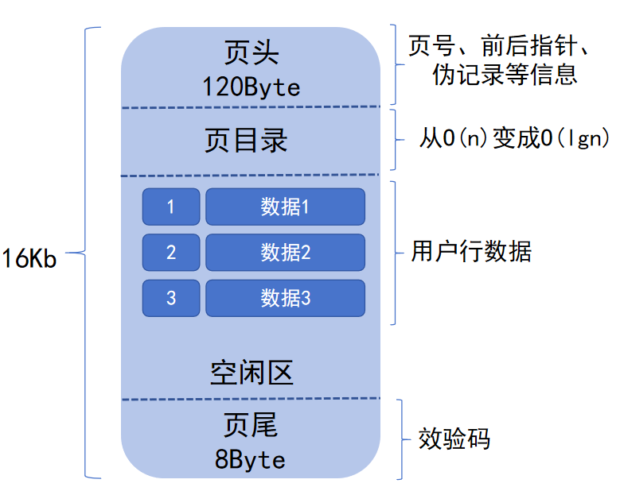
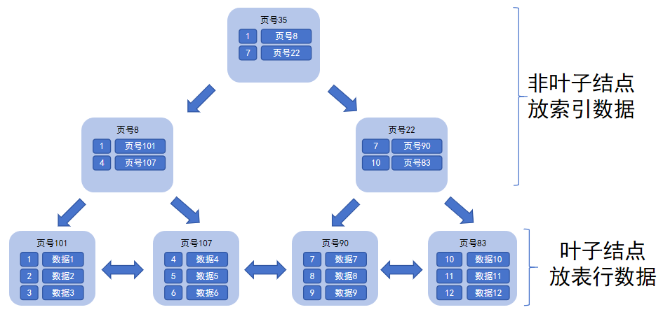
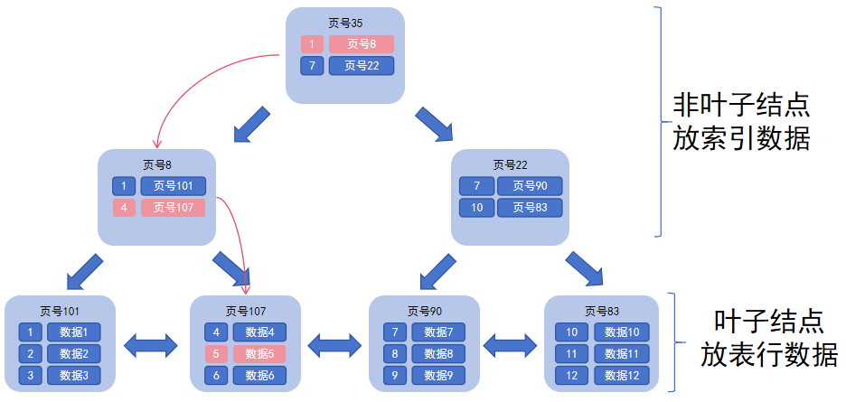
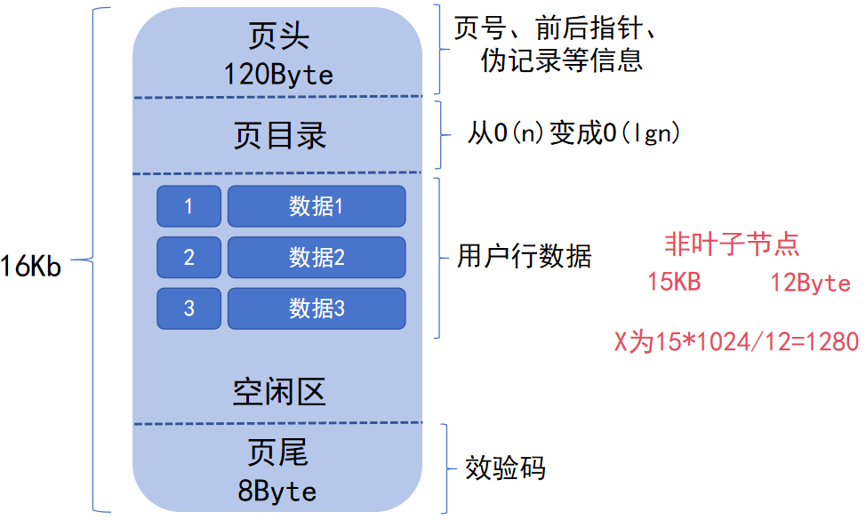
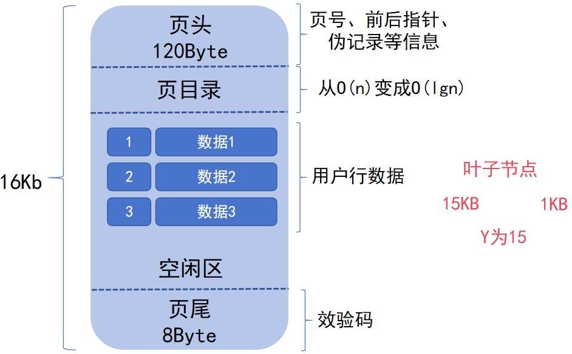
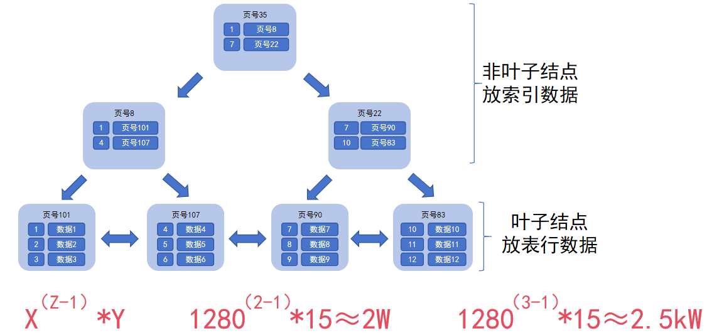
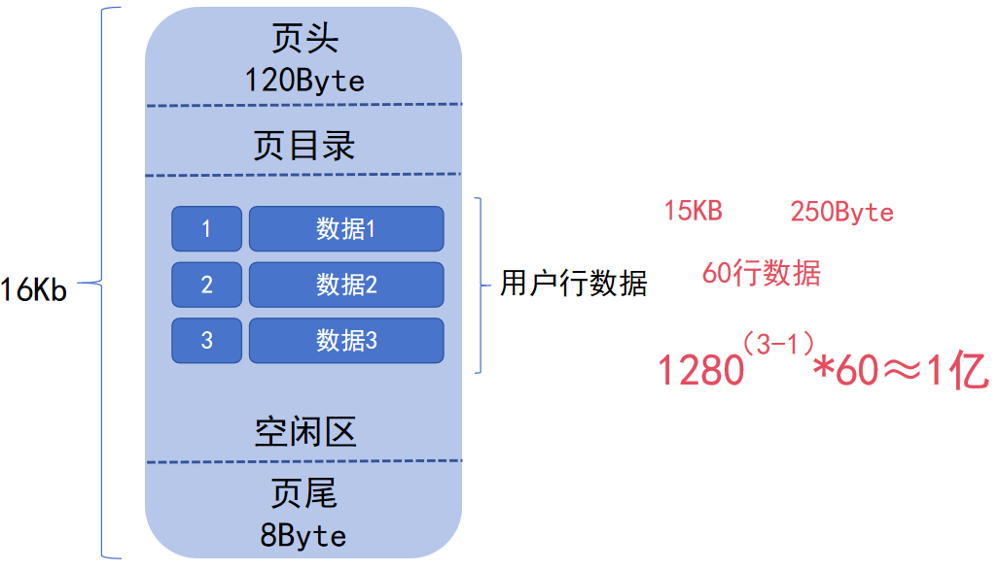

# MySQL 单表数据量 2000 万行阈值原理深度解析

## 一、引言：行业共识的背景与问题

在互联网技术领域，“MySQL 单表数据量建议不超过 2000 万行，否则性能会明显下降” 是广泛流传的共识。但该结论既无 MySQL 官方明确文档支撑，也非绝对 “铁律”—— 其本质是基于 MySQL 底层存储结构（数据页）与索引机制（B + 树）推导的 “性能最优推荐值”。

本文将从 MySQL 数据存储原理出发，逐步拆解 2000 万行阈值的由来、计算逻辑及影响因素，同时预留 PPT 截图插入位置，方便配合可视化素材讲解。

## 二、MySQL 数据存储基础：16KB 数据页

MySQL 并非按 “行” 直接存储数据，而是将数据拆分为固定大小的**数据页（Page）** ，每页默认大小为 16KB。数据页是 MySQL 磁盘 IO 的最小单位，所有行数据、索引信息均以数据页为载体组织。

### 2.1 数据页的核心结构

一个完整的数据页包含 4 个关键区域，各区域功能与占用空间如下：

| **区域名称** | **功能描述** | **预估占用空间** | **核心作用** |
| :--- | :--- | :--- | :--- |
| 页头（Page Header） | 存储数据页的元信息，包括**前后指针**（关联相邻页）、**页号**（唯一标识页）、页类型等 | 约 128 Byte | 实现页的关联与定位 |
| 页目录（Page Directory） | 为页内行数据建立 “目录”，记录每行数据的偏移量，支持**二分查找** | 约 200 Byte | 将行查询效率从 O (n) 优化为 O (lgn) |
| 行数据区（Row Data） | 存储实际业务数据（如用户表的 ID、姓名、年龄等） | 约 15KB | 核心数据存储区域 |
| 页尾（Page Trailer） | 存储**校验码**与页修改时间戳，用于校验数据页完整性（防止断电等异常导致数据损坏） | 8 Byte | 保证数据正确性 |

### 2.2 数据页的核心作用

* **磁盘 IO 最小单位**：MySQL 读取 / 写入数据时，必须整页操作（无法只读取某一行），因此页的大小与结构直接影响 IO 效率。
* **数据组织基础**：大量数据页通过页头的 “前后指针” 形成链表，通过 “页号” 实现随机定位，为后续索引结构（B + 树）提供底层支撑。

## 三、B + 树索引：MySQL 加速查询的核心机制

当单表数据量较小时（如几万行），MySQL 可通过 “遍历所有数据页” 找到目标行；但数据量达到百万、千万级时，“全表扫描” 会产生大量磁盘 IO，性能急剧下降。此时，**B + 树索引**成为解决查询效率问题的关键。

### 3.1 B + 树的结构特点

B + 树是一种 “平衡多路查找树”，其结构分为**非叶子节点**与**叶子节点**两层（或多层），核心特点如下：

* **非叶子节点**：仅存储 “索引键（如主键 ID）+ 数据页号”，不存储实际行数据，作用是 “指路”—— 通过索引键定位目标数据所在的数据页。
* **叶子节点**：存储 “完整行数据”，且所有叶子节点通过 “前后指针” 形成链表（方便范围查询，如 “查询 ID 100-200 的数据”）。
* **层数可控**：常规业务场景下，B + 树层数通常为 2-3 层（层数越多，磁盘 IO 次数越多，性能越差）。

### 3.2 B + 树的查询过程（以 “查询 ID=5” 为例）

以三层 B + 树为例，查询某一行数据的过程本质是 “通过非叶子节点定位叶子节点，再从叶子节点读取行数据”，具体步骤如下：

1. **第一层（顶层非叶子节点）**：假设顶层节点为 “页号 35”，存储 “1→页 8”“7→页 22”—— 表示 “ID≤1 的数据在页 8，1\<ID≤7 的数据在页 8，ID>7 的数据在页 22”。因目标 ID=5 落在 “1\<ID≤7” 区间，定位到下一层的 “页 8”。
2. **第二层（中间非叶子节点）**：页 8 存储 “1→页 101”“4→页 107”—— 表示 “ID≤1 的数据在页 101，1\<ID≤4 的数据在页 101，ID>4 的数据在页 107”。因目标 ID=5>4，定位到下一层的 “页 107”。
3. **第三层（叶子节点）**：页 107 存储完整行数据（如 ID=4、5、6 的行数据），通过页目录的二分查找快速定位到 ID=5 的行，完成查询。

整个过程仅需**3 次磁盘 IO**（分别读取顶层、中间层、叶子层的数据页），而磁盘 IO 是 MySQL 中耗时最长的操作，3 次 IO 可保证毫秒级查询响应；若 B + 树增至 4 层，需 4 次磁盘 IO，响应时间会显著增加。

## 四、2000 万行阈值的计算：三层 B + 树的承载极限

“2000 万行” 并非主观臆断，而是基于三层 B + 树的结构，结合数据页大小、索引键占用空间推导的 “最大推荐承载量”。

### 4.1 核心计算公式

B + 树能承载的总记录数由以下三个变量决定：

* **X**：单个非叶子节点可存储的 “索引键 + 页号” 数量（即非叶子节点能指向的下级数据页数）；
* **Y**：单个叶子节点可存储的实际行数据数量；
* **Z**：B + 树的层数（此处按性能最优的 3 层计算）。

总记录数计算公式为：**总记录数 = X^(Z-1) × Y**

### 4.2 变量 X 的计算（非叶子节点指向数）

非叶子节点存储 “主键（假设为 BIGINT 类型，8 Byte）+ 页号（4 Byte）”，单条记录占用空间为 8+4=12 Byte。结合数据页结构：

* 数据页总大小：16KB = 16×1024 = 16384 Byte；
* 非叶子节点的页头、页尾、页目录总占用约 1KB（1024 Byte，与数据页结构一致）；
* 非叶子节点可用空间：16384 - 1024 = 15360 Byte（约 15KB）。

因此，X 的计算为：**X = 非叶子节点可用空间 ÷ 单条 “索引键 + 页号” 占用空间 = 15360 ÷ 12 ≈ 1280**即单个非叶子节点可指向 1280 个下级数据页。

### 4.3 变量 Y 的计算（叶子节点行数据量）

叶子节点的可用空间与非叶子节点一致（约 15KB = 15360 Byte），Y 的值取决于 “单行数据的大小”。假设为**常规业务表**（如用户表，包含 ID、姓名、年龄、手机号、注册时间等字段），单行数据大小约为 1KB（1024 Byte）。

因此，Y 的计算为：**Y = 叶子节点可用空间 ÷ 单行数据大小 = 15360 ÷ 1024 ≈ 15**即单个叶子节点可存储 15 行实际数据。

### 4.4 三层 B + 树的总记录数

将 X=1280、Y=15、Z=3 代入公式：**总记录数 = 1280^(3-1) × 15 = 1280×1280 ×15 = 24576000 ≈ 2500 万行**

行业内为预留性能余量（如数据页碎片、索引维护开销等），将 2500 万行简化为 “2000 万行”，即单表数据量的推荐阈值。

## 五、关键变量：单行数据大小对阈值的影响

“2000 万行” 是基于 “单行数据 1KB” 的假设推导的结果，若单行数据大小变化，阈值会显著调整 ——**单行数据越小，叶子节点可存储的行数越多，总记录数阈值越高**。

以 “ID 映射表”（仅存储两个 BIGINT 类型的 ID，如 user\_id 和 order\_id）为例：

* 单行数据大小：8（user\_id）+8（order\_id）= 16 Byte（忽略字段头、NULL 标识等，实际约 250 Byte）；
* 叶子节点可用空间：15360 Byte；
* Y 的计算：15360 ÷ 250 ≈ 60（单个叶子节点可存 60 行数据）。

此时，三层 B + 树的总记录数为：**总记录数 = 1280×1280 ×60 = 98304000 ≈ 1 亿行**

即 “ID 映射表” 在保持三层 B + 树（3 次磁盘 IO）的前提下，单表可承载约 1 亿行数据，性能仍能保持稳定。

## 六、实际业务中的建议：如何判断是否需要分表

2000 万行是 “推荐值”，而非 “绝对红线”，实际业务中需结合以下维度判断是否需要分表（如水平分表）：

1. **单行数据大小**：若单行数据 <512 Byte，可放宽至 5000 万 - 1 亿行；若单行数据> 2KB，建议将阈值降至 1000 万行以内。
2. **查询频率与类型**：若表以 “主键查询” 为主，即使数据量接近 3000 万行，性能仍可接受；若存在大量 “非主键查询”（如按姓名、时间范围查询），且未建立合适索引，需提前分表。
3. **B + 树层数监控**：可通过 <code>SHOW INDEX FROM 表名</code> 查看索引的 <code>Cardinality</code>（基数），或通过工具（如 Percona Toolkit）分析 B + 树层数，若层数增至 4 层，需考虑分表。
4. **业务增长预期**：若数据增长速度快（如日均新增 10 万行），建议在数据量达到 1500 万行时提前规划分表，避免后期紧急调整。

## 七、总结

1. **阈值本质**：2000 万行是 “三层 B + 树 + 单行 1KB” 场景下的性能最优阈值，核心是避免 B + 树增至 4 层导致磁盘 IO 次数增加。
2. **关键变量**：单行数据大小决定叶子节点行数（Y），是影响阈值的核心因素；非叶子节点指向数（X）由主键类型与数据页大小决定，相对固定。
3. **实践原则**：不盲目遵循 2000 万行红线，需结合表结构、查询模式、性能监控综合判断，优先通过索引优化（如建立联合索引）提升性能，再考虑分表。

通过理解 MySQL 底层的 “数据页 + B + 树” 机制，不仅能解释 2000 万行阈值的由来，更能在实际业务中灵活调整方案，避免 “为分表而分表” 的过度设计。
