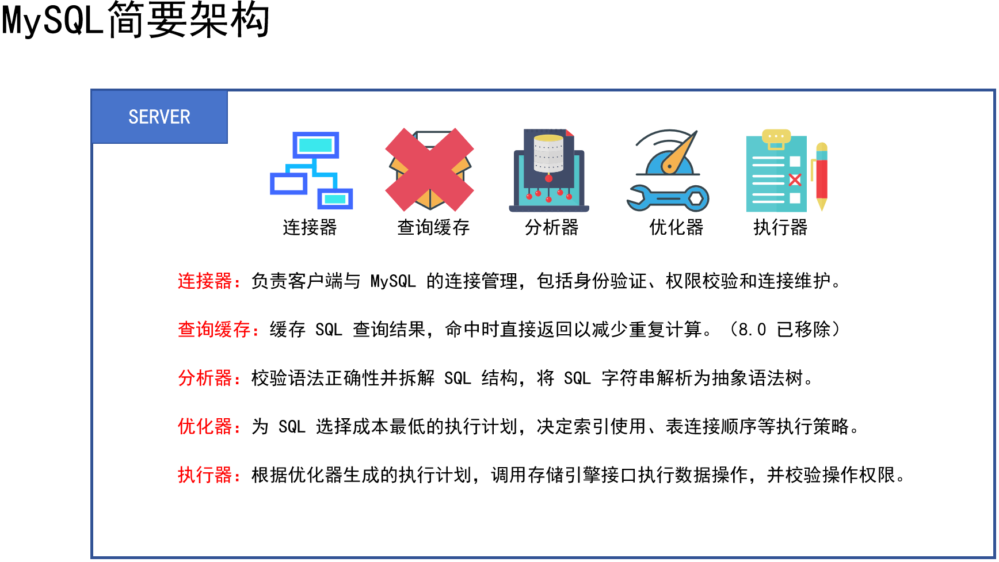
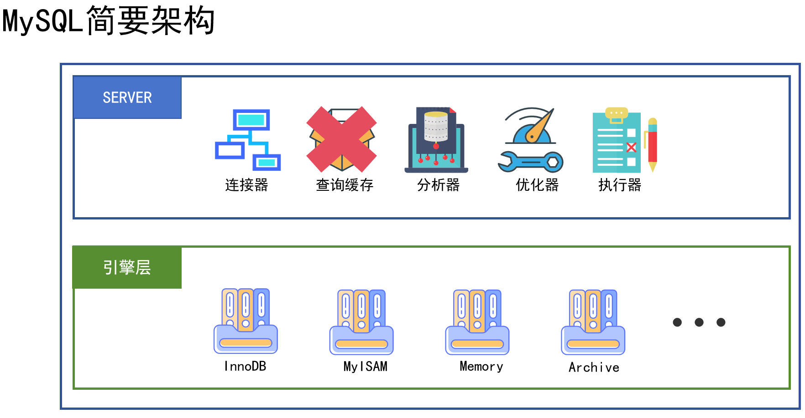
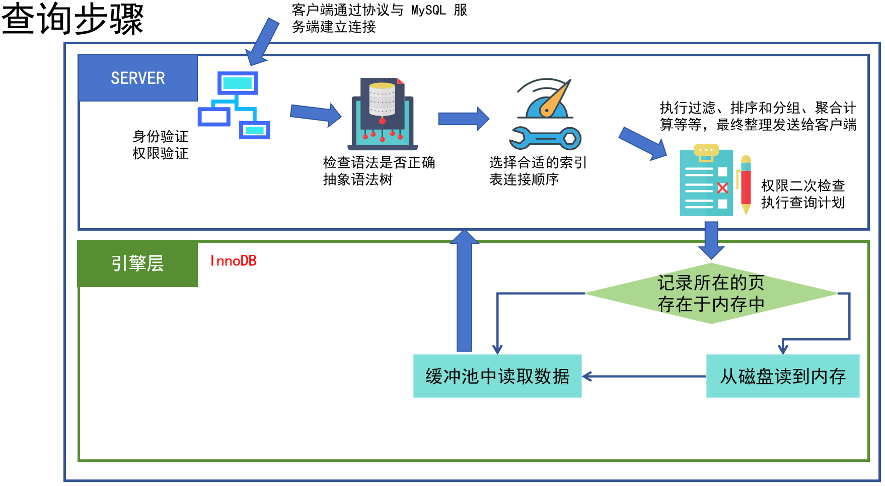
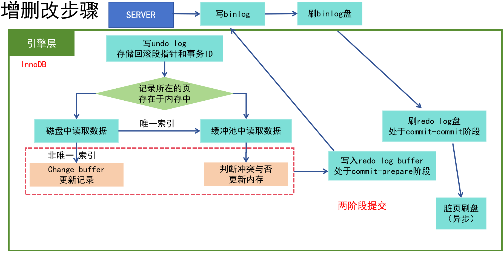

# MySQL 执行一条 SQL 语句的完整流程：从底层架构到核心步骤

面试官问 “MySQL 是怎么执行一条 SQL 语句的”，本质是考察你对 MySQL 底层架构的理解，以及能否将 “SQL 语句” 与 “数据库内部协同逻辑” 关联起来 —— 这不仅是基础理论的检验，更是后续排查 SQL 性能问题、设计优化方案的核心能力。本文结合 MySQL 架构特点，分别拆解**查询语句**与**增删改语句**的执行流程，并对比两者核心差异，帮你彻底理清底层逻辑。

## 一、先搞懂：MySQL 的两层核心架构

MySQL 整体分为**服务层**和**存储引擎层**，采用 “插件式架构” 设计，不同层各司其职，共同完成 SQL 执行。

### 1. 服务层：SQL 处理的 “中枢”

服务层是所有 SQL 语句的统一入口，负责连接管理、语法解析、执行计划优化等核心逻辑，包含 5 个关键组件：

| **组件** | **核心作用** | **关键细节** |
| :--- | :--- | :--- |
| **连接器** | 管理客户端与服务端的连接，校验身份与权限 | 验证用户名 / 密码后，为每个连接分配独立线程；断开连接时回收线程（或放入线程池） |
| **查询缓存** | 缓存 SQL 与结果的映射，命中时直接返回结果 | 8.0 版本已完全移除（因数据更新频繁，缓存命中率低，反而浪费性能） |
| **分析器** | 校验 SQL 语法正确性，拆解语句结构 | 将 SQL 字符串解析为 “抽象语法树（AST）”，同时检查表、字段是否存在 |
| **优化器** | 选择 “成本最低” 的执行计划 | 决定是否使用索引、表连接顺序（如 A JOIN B 还是 B JOIN A）、聚合逻辑等 |
| **执行器** | 调用存储引擎接口执行操作，二次校验权限 | 先确认用户对目标数据有权限，再根据优化器的计划触发引擎层的读写逻辑 |

### 2. 存储引擎层：数据的 “存储与读取中心”

存储引擎层负责数据的物理存储、读取与事务管理，采用插件式架构，支持多种引擎（如 InnoDB、MyISAM、Memory 等）。其中 **InnoDB** 是 MySQL 5.5 后的默认引擎，具备事务支持、行级锁、MVCC（多版本并发控制）等核心能力，适用于高并发、数据一致性要求高的场景。

## 二、查询语句（SELECT）的执行流程

以 <code>SELECT * FROM user WHERE id = 10;</code> 为例，完整执行流程分为 “服务层处理” 和 “引擎层处理” 两大阶段，共 7 步：

### 步骤 1：连接器建立连接并校验权限

客户端通过 TCP 协议与 MySQL 服务端建立连接，连接器做两件事：

1. **身份验证**：校验用户名、密码是否正确（如密码错误会返回 <code>Access denied for user</code> 错误）；
2. **权限校验**：确认该用户是否有权限访问 <code>user</code> 表（如无权限则后续步骤直接报错）；
3. **连接维护**：验证通过后，为当前会话分配独立线程，后续该连接的所有操作都通过此线程执行。

### 步骤 2：分析器解析 SQL 并生成抽象语法树

分析器对 SQL 进行 “词法分析” 和 “语法分析”：

1. **词法分析**：将 SQL 拆分为最小单元（如 <code>SELECT</code> 是关键字、<code>user</code> 是表名、<code>id</code> 是字段名、<code>10</code> 是值）；
2. **语法分析**：校验 SQL 语法是否正确（如少写分号、关键字拼写错误会返回 <code>You have an error in your SQL syntax</code>）；
3. **生成 AST**：将合法的 SQL 结构转化为 “抽象语法树”（便于后续优化器处理），同时确认 <code>user</code> 表、<code>id</code> 字段是否存在。

### 步骤 3：优化器选择最优执行计划

优化器基于 “成本模型”（CPU 成本 + IO 成本）选择最优执行计划：

* 对于 <code>id = 10</code>，优化器会判断：<code>id</code> 是否是主键（或有索引）？若有索引，选择 “通过索引定位数据”（成本低）；若无索引，选择 “全表扫描”（成本高）；
* 若 SQL 涉及多表连接（如 <code>A JOIN B</code>），优化器会计算 “先连 A 再连 B” 和 “先连 B 再连 A” 的成本，选择成本更低的顺序；
* 最终生成 “物理执行计划”（如 “使用主键索引 idx\_id 查找 user 表中 id=10 的行”）。

### 步骤 4：执行器二次校验权限并调用引擎接口

执行器先做 “二次权限校验”（避免连接建立后权限被修改），确认用户有权限读取 <code>user</code> 表数据后，调用 InnoDB 引擎的接口：“根据 idx\_id 索引，查询 id=10 的数据”。

### 步骤 5：InnoDB 引擎读取数据（缓冲池优先）

InnoDB 引擎通过 “缓冲池（Buffer Pool）” 管理内存数据，读取流程如下：

1. 检查缓冲池中是否存在 <code>id=10</code> 所在的数据页（InnoDB 以 “页” 为最小存储单位，默认 16KB）；
2. 若缓冲池中有该页，直接从内存中读取数据；
3. 若缓冲池中没有该页，从磁盘读取该数据页到缓冲池，再从内存中读取数据；
4. 若开启 MVCC（默认开启），会根据事务隔离级别（InnoDB 默认 REPEATABLE READ），返回当前事务可见的版本数据。

### 步骤 6：服务层整理结果并返回客户端

执行器收到 InnoDB 返回的数据后，做最后处理：

* 若 SQL 有 <code>WHERE</code>、<code>ORDER BY</code>、<code>GROUP BY</code> 或聚合函数（如 <code>COUNT</code>），执行器会进一步筛选、排序、计算；
* 整理成最终结果集，格式化后通过连接器返回给客户端。

## 三、增删改语句（INSERT/UPDATE/DELETE）的执行流程

增删改语句与查询语句的 “服务层前 5 步（连接器→执行器）” 基本一致，但**引擎层处理逻辑差异极大**—— 核心是 “事务支持” 和 “数据一致性保障”。以 <code>UPDATE user SET name = '张三' WHERE id = 10;</code> 为例，引擎层关键步骤如下：

### 步骤 1：开启事务并写入 Undo Log

InnoDB 会为当前操作开启事务，分配唯一 “事务 ID（TXID）”，同时做两件事：

1. 读取 <code>id=10</code> 的原始数据，生成 “反向回滚语句”（如 <code>UPDATE user SET name = '旧名' WHERE id = 10;</code>）；
2. 将反向语句写入 **Undo Log**（用于事务回滚或 MVCC 版本控制），并更新数据行的 “回滚指针”（指向 Undo Log 中该版本的记录）和 “事务 ID”。

### 步骤 2：更新内存数据（缓冲池 / Change Buffer）

InnoDB 优先操作内存，避免频繁磁盘 IO：

1. 若 <code>id</code> 是唯一索引（如主键）：直接从缓冲池（或磁盘读入缓冲池）找到 <code>id=10</code> 所在的数据页，更新内存中 <code>name</code> 字段的值，标记该数据页为 “脏页”（内存数据与磁盘数据不一致）；
2. 若 <code>id</code> 是非唯一二级索引：不直接更新索引页，而是将更新操作记录到 **Change Buffer**（缓冲池的特殊区域），后续空闲时异步合并到磁盘（减少磁盘 IO，提升性能）；
3. 检查数据冲突（如唯一键冲突），若冲突则直接回滚事务。

### 步骤 3：两阶段提交（保障 Redo Log 与 Binlog 一致性）

为了确保 “数据修改” 能被崩溃恢复（Redo Log）且支持主从同步（Binlog），InnoDB 采用 **两阶段提交** 机制，分 “Prepare 阶段” 和 “Commit 阶段”：

#### 阶段 1：Prepare 阶段（准备提交）

1. 将 “更新 <code>id=10</code> 数据” 的逻辑写入 **Redo Log Buffer**（内存中的 Redo Log 缓存）；
2. 标记 Redo Log 的状态为 “Prepare”，表示 “准备完成，等待确认”；
3. 通知执行器：“Prepare 阶段完成”。

#### 阶段 2：Commit 阶段（正式提交）

1. 执行器调用 Server 层的 Binlog 模块，将 “更新 <code>id=10</code> 数据” 的逻辑写入 **Binlog Cache**，再刷盘到 Binlog 文件；
2. Binlog 刷盘成功后，执行器通知 InnoDB：“Binlog 已完成”；
3. InnoDB 将 Redo Log Buffer 中的日志刷盘到 Redo Log 文件，标记 Redo Log 状态为 “Commit”；
4. 事务正式提交，标记事务状态为 “已提交”。

### 步骤 4：异步刷脏页（提升性能）

InnoDB 不会立即将 “脏页”（内存中修改后的数据页）写入磁盘，而是由后台线程在合适时机（如缓冲池满、磁盘 IO 空闲）异步刷盘 —— 即使脏页未刷盘，因 Redo Log 已持久化，数据库崩溃重启后可通过 Redo Log 恢复脏页数据。

## 四、查询与增删改的核心差异（InnoDB 默认隔离级别）

| **特性** | **SELECT（查询）** | **INSERT/UPDATE/DELETE（增删改）** |
| :--- | :--- | :--- |
| 是否需要写 Redo Log | 否 | 是（用于崩溃恢复，确保修改不丢失） |
| 是否需要写 Undo Log | 否 | 是（用于事务回滚或 MVCC 版本控制） |
| 是否使用 Change Buffer | 否 | 是（仅用于非唯一二级索引，减少磁盘 IO） |
| 是否涉及锁机制 | 一般不加锁（MVCC 快照读） | 加排他锁（X 锁）或共享锁（S 锁），避免并发修改冲突 |
| 是否提交事务 | 不涉及事务提交（读操作无需事务） | 需要提交或回滚事务（确保原子性） |
| 是否记录 Binlog | 否 | 是（开启 Binlog 后，用于主从同步或数据恢复） |
| 是否产生脏页 | 否（仅读取数据，不修改） | 是（修改内存数据后，内存与磁盘数据不一致） |
| 是否需要刷盘 | 否 | 是（Redo Log 刷盘必做，脏页刷盘异步） |

## 五、核心总结：记住 3 个关键逻辑

1. **架构分层是基础**：服务层负责 “SQL 逻辑处理”，引擎层负责 “数据物理存储”，插件式架构让 MySQL 支持多引擎；
2. **查询靠 “缓冲池” 提速**：InnoDB 优先从缓冲池读数据，减少磁盘 IO，这是查询性能的核心；
3. **增删改靠 “日志” 保一致**：Undo Log 负责回滚，Redo Log 负责崩溃恢复，Binlog 负责主从同步，两阶段提交确保三者一致性。

掌握以上流程，不仅能应对面试，更能在实际工作中快速定位问题（如慢查询可能是优化器选错索引，数据不一致可能是两阶段提交异常）。
