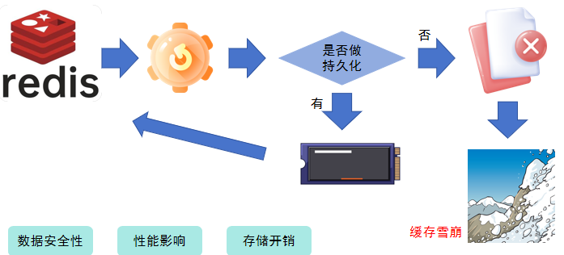
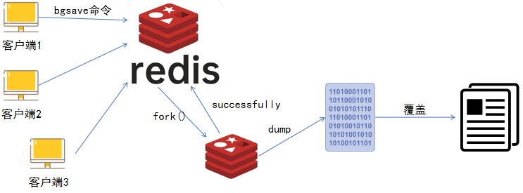
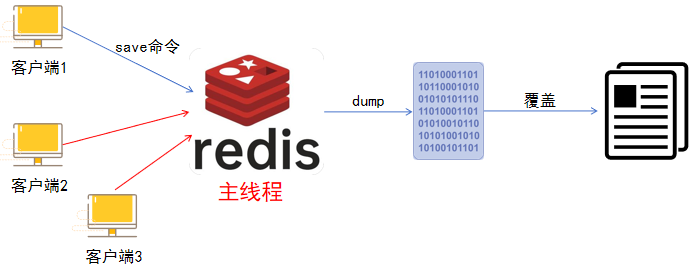
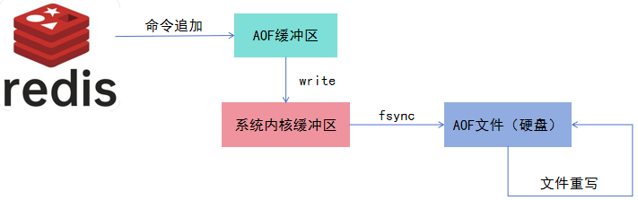
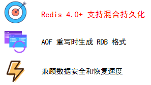

# Redis 持久化机制有哪些

## 1. 引言

Redis 作为高性能的纯内存数据库，其核心优势在于**内存级读写速度**（远超传统磁盘数据库），但这一特性也带来了 “内存数据易失性” 的天生短板 —— 当 Redis 服务崩溃、服务器断电或重启时，内存中的数据会直接丢失，可能导致业务中断（如电商购物车清空、缓存雪崩）。

为解决这一问题，Redis 提供了**持久化机制**：在数据写入内存的同时，异步或同步地将数据持久化到磁盘文件中。其核心目标是平衡 “数据安全性”（尽可能少丢数据）、“Redis 性能”（不拖慢读写速度）与 “存储开销”（避免磁盘占用过度），确保 Redis 宕机重启后可从磁盘恢复数据，降低业务损失。

## 2. 为什么需要 Redis 持久化

### 2.1 内存数据易失的风险

Redis 数据默认仅存储于内存，若未开启持久化：

* 服务异常终止（如进程崩溃、机器断电）后，所有数据直接丢失；
* 重启 Redis 后需重新加载数据（如从数据库全量同步），可能引发 “缓存雪崩”（大量请求穿透到数据库，导致数据库过载）。

### 2.2 持久化的核心价值

1. **数据恢复**：Redis 重启时自动加载磁盘中的持久化文件，无需 “从零开始”，快速恢复服务；
2. **灾备保障**：持久化文件可备份至其他服务器，应对单机硬件故障（如硬盘损坏）；
3. **避免缓存雪崩**：恢复数据后，缓存层可继续承接请求，减少对数据库的冲击。

## 3. Redis 持久化的两种核心方式

Redis 持久化分为两大类：**RDB 持久化**（默认开启）和 **AOF 持久化**（需手动开启），二者实现逻辑与适用场景差异显著。

### 3.1 RDB 持久化（Redis Database）

#### 3.1.1 定义

RDB 是**快照式持久化**：在 “特定时间点” 生成内存中所有数据的**全量二进制快照**，并保存为 <code>.rdb</code> 文件（默认文件名 <code>dump.rdb</code>）。

#### 3.1.2 触发方式

RDB 触发分为 “自动触发” 和 “手动触发”，核心依赖 <code>bgsave</code> 命令（异步无阻塞），仅 <code>save</code> 命令（同步阻塞）用于特殊场景。

| **触发类型** | **具体方式** | **核心逻辑** | **注意事项** |
| :--- | :--- | :--- | :--- |
| 手动触发 | <code>save</code>  命令 | 由 Redis 主线程直接执行快照生成，期间会**阻塞所有客户端请求** | 线上环境禁止使用（可能导致服务不可用） |
| 手动触发 | <code>bgsave</code>  命令 | 主线程 <code>fork</code>  一个子进程，由子进程执行快照生成，主线程继续处理请求 | 无阻塞，推荐线上使用 |
| 自动触发 | 配置文件规则 | 在 <code>redis.conf</code>  中预设 “时间间隔 + 写操作数” 规则，满足任一规则时自动执行 <code>bgsave</code> | 默认规则如下表 |

**RDB 自动触发默认规则**（<code>redis.conf</code> 配置）：

| **条件序号** | **时间间隔（秒）** | **最少写操作次数** | **触发逻辑** |
| :--- | :--- | :--- | :--- |
| 1 | 3600（1 小时） | 1 | 1 小时内有 1 次写操作，触发 <code>bgsave</code> |
| 2 | 300（5 分钟） | 100 | 5 分钟内有 100 次写操作，触发 <code>bgsave</code> |
| 3 | 60（1 分钟） | 10000 | 1 分钟内有 10000 次写操作，触发 <code>bgsave</code> |

#### 3.1.3 工作流程（以 <code>bgsave</code> 为例）

1. 客户端发送 <code>bgsave</code> 命令或满足自动触发规则；
2. Redis 主线程 <code>fork</code> 子进程（子进程继承父进程的内存数据段）；
3. 主线程返回 “Background saving started”，继续处理客户端请求；
4. 子进程遍历内存数据，序列化生成二进制快照，写入临时文件；
5. 临时文件生成完成后，覆盖旧的 <code>.rdb</code> 文件，持久化完成。
6. 
7. 

#### 3.1.4 优缺点

| **优点** | **缺点** |
| :--- | :--- |
| 二进制格式紧凑，<code>.rdb</code>  文件体积小，磁盘占用低 | 数据安全性低：两次快照间若宕机，会丢失这段时间的所有写数据（如 1 小时快照一次，最多丢 1 小时数据） |
| 数据恢复速度快：直接加载全量二进制文件，无需解析命令 | <code>fork</code>  子进程开销：内存数据量大时，<code>fork</code>  耗时可能短暂阻塞主线程 |
| 异步执行（<code>bgsave</code> ）对 Redis 读写性能影响极小 | 不支持实时持久化，无法满足 “零数据丢失” 需求 |

### 3.2 AOF 持久化（Append Only File）

#### 3.2.1 定义

AOF 是**日志式持久化**：记录 Redis 执行的 “每一次写操作”（如 <code>set</code>、<code>del</code>、<code>hmset</code>），以 “文本协议格式”（可直接打开查看）追加到 <code>.aof</code> 文件中。

#### 3.2.2 工作流程

AOF 核心通过 “缓冲区 + 刷盘策略” 平衡性能与安全性，流程如下：

1. **命令追加**：Redis 执行写命令后，先将命令追加到内存中的 <code>aof_buf</code> 缓冲区（避免直接写磁盘导致频繁 IO）；
2. **缓冲区刷盘**：根据配置的 <code>fsync</code> 策略，将 <code>aof_buf</code> 中的数据写入系统内核缓冲区，再由内核同步到磁盘的 <code>.aof</code> 文件；
3. **文件重写**：随着写命令累积，<code>.aof</code> 文件会越来越大（如 100 次 <code>set name</code> 会存 100 条命令），需通过 <code>bgrewriteaof</code> 命令生成 “仅包含最终数据的精简命令”（如 100 次 <code>set</code> 合并为 1 条），替换旧 <code>.aof</code> 文件。

#### 3.2.3 关键配置：<code>fsync</code> 刷盘策略

<code>fsync</code> 策略决定 AOF 的数据安全性与性能，Redis 提供 3 种选项（配置项 <code>appendfsync</code>）：

| **策略类型** | **核心逻辑** | **数据安全性** | **性能影响** | **适用场景** |
| :--- | :--- | :--- | :--- | :--- |
| <code>always</code> | 每执行 1 条写命令，立即调用 <code>fsync</code>  同步到磁盘 | 最高（几乎零数据丢失） | 最大（频繁磁盘 IO，阻塞主线程） | 金融、支付等对数据安全性要求极高的场景 |
| <code>everysec</code> | 每秒调用 1 次 <code>fsync</code>  同步到磁盘（默认策略） | 较高（最多丢失 1 秒数据） | 中等（后台线程执行 <code>fsync</code> ，不阻塞主线程） | 绝大多数业务场景（平衡安全与性能） |
| <code>no</code> | 不主动 <code>fsync</code> ，由操作系统决定何时同步到磁盘 | 最低（OS 崩溃可能丢失大量数据） | 最低（无额外 IO 开销） | 非核心缓存场景（如临时会话数据） |

#### 3.2.4 优缺点

| **优点** | **缺点** |
| :--- | :--- |
| 数据安全性高：<code>everysec</code>  策略下最多丢失 1 秒数据，支持近实时持久化 | <code>.aof</code>  文件体积大（文本格式 + 冗余命令），磁盘占用高 |
| 文件可读性强：文本格式可直接编辑（如误删数据后手动恢复特定命令） | 数据恢复速度慢：需逐行执行 <code>.aof</code>  中的所有命令 |
| 支持文件重写，可压缩冗余数据，降低存储开销 | <code>always</code>  策略会显著影响 Redis 读写性能 |

## 4. Redis 4.0+ 混合持久化（RDB + AOF）

为兼顾 RDB 的 “快速恢复” 与 AOF 的 “高安全性”，Redis 4.0 及以上版本支持**混合持久化**（默认开启，配置项 <code>aof-use-rdb-preamble yes</code>）。

### 4.1 核心逻辑

* **持久化过程**：执行 <code>bgrewriteaof</code> 重写 AOF 时，先以 RDB 格式生成内存全量快照，写入 <code>.aof</code> 文件开头；后续的写命令以 AOF 文本格式追加到文件末尾。
* **恢复过程**：Redis 重启时，先加载 <code>.aof</code> 开头的 RDB 快照（快速恢复全量数据），再执行后续的 AOF 命令（补充恢复增量数据）。

### 4.2 优势

* 数据安全性：等同于 AOF（最多丢失 1 秒数据）；
* 恢复速度：接近 RDB（避免全量解析 AOF 命令）；
* 存储开销：比纯 AOF 小（RDB 部分紧凑压缩）。

## 5. RDB 与 AOF 对比及选择建议

### 5.1 核心维度对比表

| **对比维度** | **RDB** | **AOF** | **混合持久化（RDB+AOF）** |
| :--- | :--- | :--- | :--- |
| 数据安全性 | 低（丢两次快照间数据） | 高（最多丢 1 秒） | 高（同 AOF） |
| 文件体积 | 小（二进制压缩） | 大（文本 + 冗余） | 中（RDB 紧凑 + AOF 增量） |
| 恢复速度 | 快 | 慢 | 快（同 RDB） |
| 可读性 | 无（二进制） | 高（文本可编辑） | 中（开头 RDB 不可读，结尾 AOF 可读） |
| 性能影响 | 小（仅 <code>bgsave</code>  时 <code>fork</code>  开销） | 中 / 高（<code>fsync</code>  策略决定） | 小（同 RDB） |
| 默认开启 | 是 | 否 | 是（需先开启 AOF） |

### 5.2 选择建议

1. **选择 RDB**：
   * 场景：非核心缓存（如首页商品列表、临时会话）、对性能要求极高且可接受少量数据丢失；
   * 优势：最小化性能损耗，快速备份与恢复。
2. **选择 AOF（纯）**：
   * 场景：无 RDB 版本支持（<4.0）、需手动编辑持久化文件（如数据恢复）；
   * 注意：需定期执行 <code>bgrewriteaof</code> 控制文件体积。
3. **选择混合持久化**：
   * 场景：核心业务（如用户余额、订单数据）、既需高安全性又需快速恢复；
   * 优势：兼顾所有核心需求，是 Redis 4.0+ 的最优解。

## 6. 关键配置与操作命令

### 6.1 核心配置（<code>redis.conf</code>）

| **配置项** | **说明** | **默认值** |
| :--- | :--- | :--- |
| <code>save 3600 1 300 100 60 10000</code> | RDB 自动触发规则 | 启用 |
| <code>appendonly</code> | 是否开启 AOF | <code>no</code> （需手动设为 <code>yes</code> ） |
| <code>appendfsync</code> | AOF 刷盘策略 | <code>everysec</code> |
| <code>aof-use-rdb-preamble</code> | 是否开启混合持久化 | <code>yes</code> （Redis 4.0+） |
| <code>dbfilename</code> | RDB 文件名 | <code>dump.rdb</code> |
| <code>appendfilename</code> | AOF 文件名 | <code>appendonly.aof</code> |

### 6.2 常用操作命令

| **命令** | **功能** |
| :--- | :--- |
| <code>config get save</code> | 查看 RDB 自动触发规则 |
| <code>config get appendonly</code> | 查看 AOF 是否开启 |
| <code>bgsave</code> | 手动触发 RDB 持久化（异步） |
| <code>bgrewriteaof</code> | 手动触发 AOF 重写（异步） |
| <code>redis-cli shutdown save</code> | 关闭 Redis 时强制生成 RDB 快照 |

## 7. 总结

1. Redis 持久化的本质是解决 “内存数据易失” 问题，核心目标是平衡安全、性能与存储开销；
2. RDB 是 “快照式” 持久化（默认开启），快但安全性低；AOF 是 “日志式” 持久化（需手动开启），安全但恢复慢；
3. 混合持久化（Redis 4.0+）结合二者优势，是核心业务的最优选择；
4. 选择原则：无 “最优方案”，仅 “适配业务”—— 根据数据重要性、性能要求与版本支持选择合适的持久化方式。
