# Redis 除了缓存还能做什么？10 大核心非缓存场景全解析

## <font style="color:rgb(0, 0, 0);">引言：Redis 不只是 “缓存工具”</font>

<font style="color:rgb(0, 0, 0);">提到 Redis，多数人第一反应是 “高性能缓存中间件”—— 确实，Redis 凭借内存存储实现的微秒级响应，成为缓存场景的 “标配”。但在实际开发和面试中，</font>**<font style="color:rgb(0, 0, 0) !important;">Redis 的非缓存功能才是拉开技术差距的关键</font>**<font style="color:rgb(0, 0, 0);">：从分布式锁、消息队列，到排行榜、限流，它能解决分布式系统中的多个核心痛点。</font>

<font style="color:rgb(0, 0, 0);">本文将从 “缓存原理回顾” 切入，逐步拆解 Redis 的 10 大非缓存场景，每个场景都会覆盖「业务需求→实现原理→核心命令（含代码）→实战注意事项」。</font>

## <font style="color:rgb(0, 0, 0);">一、先回顾：Redis 缓存核心原理（为非缓存功能打基础）</font>

<font style="color:rgb(0, 0, 0);">在深入非缓存场景前，先快速梳理 Redis 缓存的核心逻辑 —— 这是理解后续功能的基础。</font>

### <font style="color:rgb(0, 0, 0);">1.1 缓存工作流程</font>

<font style="color:rgb(0, 0, 0);">Redis 缓存的本质是 “内存数据库”，通过 “读取优先查缓存，缓存未命中再查数据库” 的流程，降低数据库压力、提升响应速度。</font>

* **<font style="color:rgb(0, 0, 0) !important;">缓存命中</font>**<font style="color:rgb(0, 0, 0);">：应用→Redis（命中）→直接返回（微秒级）；</font>
* **<font style="color:rgb(0, 0, 0) !important;">缓存未命中</font>**<font style="color:rgb(0, 0, 0);">：应用→Redis（未命中）→数据库→更新 Redis→返回应用。</font>

### <font style="color:rgb(0, 0, 0);">1.2 核心命令与价值</font>

* **<font style="color:rgb(0, 0, 0) !important;">核心命令</font>**<font style="color:rgb(0, 0, 0);">（String 数据结构）：</font>

```plain
# 存储缓存，设置3600秒过期
SET key value EX 3600
# 读取缓存
GET key
# 删除缓存（如数据更新时）
DEL key
```

* **<font style="color:rgb(0, 0, 0) !important;">核心价值</font>**<font style="color:rgb(0, 0, 0);">：加速访问、保护数据库、减轻服务器负载。</font>

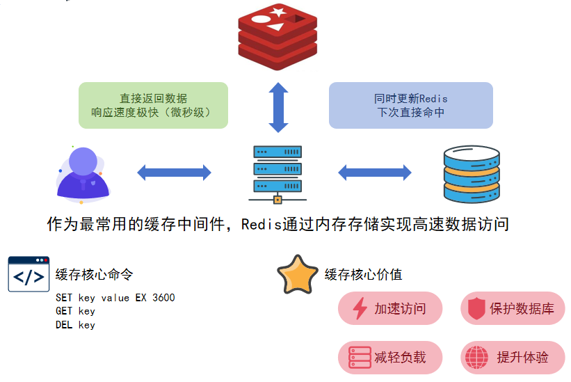

## <font style="color:rgb(0, 0, 0);">二、Redis 非缓存能力总览：10 大场景全覆盖</font>

<font style="color:rgb(0, 0, 0);">Redis 的非缓存功能并非依赖专门模块，而是通过不同数据结构（List/Stream/Sorted Set 等）实现，覆盖分布式系统的高频需求。</font>

| **<font style="color:rgb(0, 0, 0) !important;">功能场景</font>** | **<font style="color:rgb(0, 0, 0) !important;">核心数据结构</font>** | **<font style="color:rgb(0, 0, 0) !important;">解决的核心问题</font>** |
| :--- | :--- | :--- |
| <font style="color:rgba(0, 0, 0, 0.85) !important;">消息队列</font> | <font style="color:rgba(0, 0, 0, 0.85) !important;">List/Stream</font> | <font style="color:rgba(0, 0, 0, 0.85) !important;">异步解耦、流量削峰</font> |
| <font style="color:rgba(0, 0, 0, 0.85) !important;">分布式计数</font> | <font style="color:rgba(0, 0, 0, 0.85) !important;">String</font> | <font style="color:rgba(0, 0, 0, 0.85) !important;">高并发下精准统计（点赞 / 库存）</font> |
| <font style="color:rgba(0, 0, 0, 0.85) !important;">限流</font> | <font style="color:rgba(0, 0, 0, 0.85) !important;">String+TTL/ZSET</font> | <font style="color:rgba(0, 0, 0, 0.85) !important;">接口防刷、流量控制</font> |
| <font style="color:rgba(0, 0, 0, 0.85) !important;">分布式锁</font> | <font style="color:rgba(0, 0, 0, 0.85) !important;">String</font> | <font style="color:rgba(0, 0, 0, 0.85) !important;">多服务资源竞争互斥</font> |
| <font style="color:rgba(0, 0, 0, 0.85) !important;">排行榜</font> | <font style="color:rgba(0, 0, 0, 0.85) !important;">Sorted Set</font> | <font style="color:rgba(0, 0, 0, 0.85) !important;">实时排名（游戏 / 销量）</font> |
| <font style="color:rgba(0, 0, 0, 0.85) !important;">实时系统</font> | <font style="color:rgba(0, 0, 0, 0.85) !important;">Pub/Sub</font> | <font style="color:rgba(0, 0, 0, 0.85) !important;">实时广播（弹幕 / 通知）</font> |
| <font style="color:rgba(0, 0, 0, 0.85) !important;">布隆过滤器</font> | <font style="color:rgba(0, 0, 0, 0.85) !important;">Bloom Filter</font> | <font style="color:rgba(0, 0, 0, 0.85) !important;">海量数据存在性判断</font> |
| <font style="color:rgba(0, 0, 0, 0.85) !important;">会话存储</font> | <font style="color:rgba(0, 0, 0, 0.85) !important;">String/Hash</font> | <font style="color:rgba(0, 0, 0, 0.85) !important;">分布式会话共享</font> |
| <font style="color:rgba(0, 0, 0, 0.85) !important;">分布式 ID 生成</font> | <font style="color:rgba(0, 0, 0, 0.85) !important;">String</font> | <font style="color:rgba(0, 0, 0, 0.85) !important;">全局唯一 ID（订单 / 用户）</font> |
| <font style="color:rgba(0, 0, 0, 0.85) !important;">延迟队列</font> | <font style="color:rgba(0, 0, 0, 0.85) !important;">Sorted Set</font> | <font style="color:rgba(0, 0, 0, 0.85) !important;">定时任务（订单超时取消）</font> |

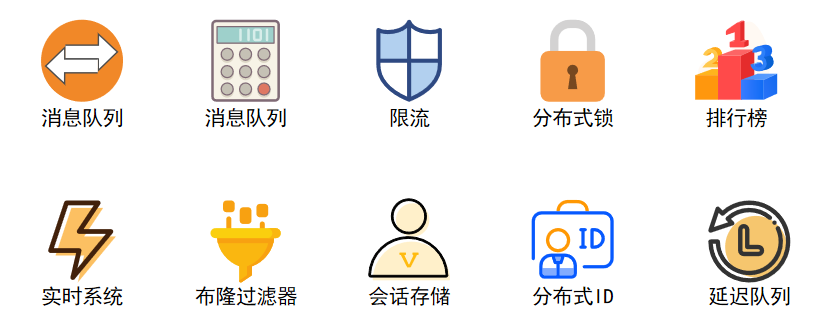

## <font style="color:rgb(0, 0, 0);">三、逐个拆解：10 大非缓存场景的实现与实战</font>

### <font style="color:rgb(0, 0, 0);">3.1 场景 1：消息队列 —— 异步解耦与流量削峰</font>

#### <font style="color:rgb(0, 0, 0);">业务需求</font>

<font style="color:rgb(0, 0, 0);">当系统存在 “非实时依赖”（如电商下单后发短信、日志异步上报），或需要应对突发流量（如秒杀）时，需通过消息队列实现 “生产者 - 消费者” 异步通信，避免同步等待导致的系统阻塞。</font>

#### <font style="color:rgb(0, 0, 0);">实现原理：两种核心方案</font>

<font style="color:rgb(0, 0, 0);">Redis 消息队列基于「List」或「Stream」实现，两者在可靠性上差异显著（面试高频考点）。</font>

| **<font style="color:rgb(0, 0, 0) !important;">实现方案</font>** | **<font style="color:rgb(0, 0, 0) !important;">数据结构</font>** | **<font style="color:rgb(0, 0, 0) !important;">持久化支持</font>** | **<font style="color:rgb(0, 0, 0) !important;">重试支持</font>** | **<font style="color:rgb(0, 0, 0) !important;">适用场景</font>** |
| :--- | :--- | :--- | :--- | :--- |
| <font style="color:rgba(0, 0, 0, 0.85) !important;">基础版</font> | <font style="color:rgba(0, 0, 0, 0.85) !important;">List</font> | <font style="color:rgba(0, 0, 0, 0.85) !important;">依赖 Redis 全局 AOF/RDB</font> | <font style="color:rgba(0, 0, 0, 0.85) !important;">需业务层手动实现</font> | <font style="color:rgba(0, 0, 0, 0.85) !important;">非核心轻量场景（日志）</font> |
| <font style="color:rgba(0, 0, 0, 0.85) !important;">专业版</font> | <font style="color:rgba(0, 0, 0, 0.85) !important;">Stream</font> | <font style="color:rgba(0, 0, 0, 0.85) !important;">原生持久化（消息落地）</font> | <font style="color:rgba(0, 0, 0, 0.85) !important;">内置 ACK+Pending 列表自动重试</font> | <font style="color:rgba(0, 0, 0, 0.85) !important;">核心业务（订单 / 支付）</font> |

#### <font style="color:rgb(0, 0, 0);">核心命令与代码</font>

##### <font style="color:rgb(0, 0, 0);">（1）List 实现基础消息队列</font>

```plain
# 生产者：向队列queue1发送消息（任务1、任务2）
LPUSH queue1 "task1:send_sms:13800138000"
LPUSH queue1 "task2:update_stock:product1001"

# 消费者：从队列尾部阻塞读取消息（0表示永久阻塞，直到有消息）
BRPOP queue1 0
# 返回结果：1) "queue1" 2) "task2:update_stock:product1001"（先进先出）
```

##### <font style="color:rgb(0, 0, 0);">（2）Stream 实现可靠消息队列</font>

<font style="color:rgb(0, 0, 0);">Stream 是 Redis 5.0 + 新增的 “消息队列专用结构”，支持消息持久化、消费组、ACK 确认，解决 List 的可靠性问题：</font>

```plain
# 1. 生产者：向Stream流mystream发送消息（*表示自动生成消息ID）
XADD mystream * type "order_pay" order_id "123456" user_id "789"

# 2. 消费者：创建消费组group1（首次需创建）
XGROUP CREATE mystream group1 0

# 3. 消费者：从消费组group1读取消息（COUNT 1表示读1条，BLOCK 0表示阻塞）
XREADGROUP GROUP group1 consumer1 COUNT 1 BLOCK 0 STREAMS mystream >

# 4. 消息处理成功后：发送ACK确认（消息ID从上述返回结果获取）
XACK mystream group1 "1693478400000-0"

# 5. 查看未确认的消息（Pending列表）
XPENDING mystream group1
```

#### <font style="color:rgb(0, 0, 0);">实战注意事项</font>

* <font style="color:rgb(0, 0, 0);">List 方案：消费者拿到消息后若崩溃，消息会永久丢失（已从 List 移除），需手动实现 “消息回队”（处理失败时 LPUSH 重新入队）；</font>
* <font style="color:rgb(0, 0, 0);">Stream 方案：未 ACK 的消息会存入 Pending 列表，可通过</font><code><font style="color:rgb(0, 0, 0);">XPENDING</font></code><font style="color:rgb(0, 0, 0);">监控，重试次数超限后可移至 “死信流” 单独处理。</font>

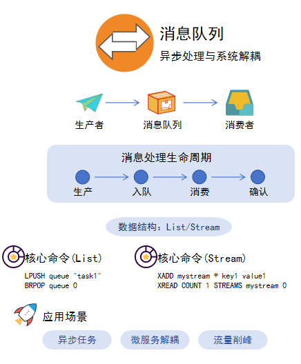

### <font style="color:rgb(0, 0, 0);">3.2 场景 2：分布式计数 —— 高并发下的精准统计</font>

#### <font style="color:rgb(0, 0, 0);">业务需求</font>

<font style="color:rgb(0, 0, 0);">在高并发场景（如点赞数、商品库存、页面访问量统计）中，需保证 “计数不重复、不遗漏”，避免数据库自增导致的并发问题。</font>

#### <font style="color:rgb(0, 0, 0);">实现原理</font>

<font style="color:rgb(0, 0, 0);">基于 Redis「String」数据结构的原子操作（INCR/DECR 系列命令），Redis 单线程模型确保计数操作的原子性，即使万级并发也能精准统计。</font>

#### <font style="color:rgb(0, 0, 0);">核心命令与代码</font>

```plain
# 1. 点赞数统计：给文章123的点赞数+1
INCRBY like:article:123 1  # 返回当前点赞数：如1001

# 2. 库存扣减：商品1001的库存-1（秒杀场景）
DECRBY stock:product:1001 1  # 返回当前库存：如998

# 3. 访问量统计：页面index的访问量+1（每天重置，Key含日期）
INCR page_view:index:20240520  # 返回当日访问量：如5000
```

#### <font style="color:rgb(0, 0, 0);">实战注意事项</font>

* <font style="color:rgb(0, 0, 0);">若需 “批量统计”（如同时统计点赞 + 收藏），可结合</font><code><font style="color:rgb(0, 0, 0);">MULTI/EXEC</font></code><font style="color:rgb(0, 0, 0);">实现事务，但需注意 Redis 事务的 “弱一致性”（不支持回滚）；</font>
* <font style="color:rgb(0, 0, 0);">对于超大计数（如千万级访问量），Redis String 支持 64 位整数，无需担心溢出。</font>

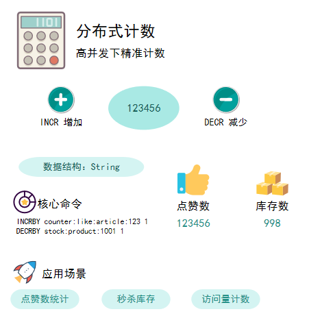

### <font style="color:rgb(0, 0, 0);">3.3 场景 3：限流 —— 接口防刷与流量控制</font>

#### <font style="color:rgb(0, 0, 0);">业务需求</font>

<font style="color:rgb(0, 0, 0);">为防止接口被恶意刷爆（如短信验证码 1 分钟内发送 100 次），或保护后端服务不被突发流量压垮，需对接口调用频率进行限制（如 “每个用户每分钟最多调用 10 次”）。</font>

#### <font style="color:rgb(0, 0, 0);">实现原理：滑动窗口算法</font>

<font style="color:rgb(0, 0, 0);">基于「String+TTL」实现固定窗口限流，或「ZSET」实现滑动窗口限流（更精准），核心逻辑是 “统计单位时间内的请求次数，超过阈值则拒绝”。</font>

#### <font style="color:rgb(0, 0, 0);">核心命令与代码</font>

##### <font style="color:rgb(0, 0, 0);">（1）String+TTL 实现固定窗口限流（简单场景）</font>

```plain
# 需求：限制用户789每分钟最多调用接口3次
user_id="789"
key="rate_limit:api:sms:${user_id}"

# 1. 计数器+1
INCR ${key}

# 2. 首次设置过期时间（60秒），避免重复设置
EXPIRE ${key} 60 NX  # NX：仅当Key不存在时执行

# 3. 检查是否超限（返回值>3则拒绝）
GET ${key}
```

##### <font style="color:rgb(0, 0, 0);">（2）ZSET 实现滑动窗口限流（精准场景）</font>

<font style="color:rgb(0, 0, 0);">固定窗口存在 “边界问题”（如 59 秒和 1 秒的请求被计入两个窗口），ZSET 通过 “时间戳作为分数” 实现滑动窗口：</font>

```plain
# 需求：用户789每60秒最多调用接口3次
user_id="789"
key="rate_limit:api:login:${user_id}"
now=$(date +%s)  # 当前时间戳（如1693478400）
window=60        # 窗口大小60秒

# 1. 记录当前请求（分数=时间戳，值=唯一请求ID）
ZADD ${key} ${now} "req:${now}:$(uuidgen)"

# 2. 删除窗口外的旧请求（保留60秒内的请求）
ZREMRANGEBYSCORE ${key} 0 $((now - window))

# 3. 统计窗口内请求数（>3则拒绝）
ZCARD ${key}
```

#### <font style="color:rgb(0, 0, 0);">实战注意事项</font>

* <font style="color:rgb(0, 0, 0);">固定窗口实现简单，但适合非精准场景；滑动窗口精准度高，但需额外删除旧数据，性能略低；</font>
* <font style="color:rgb(0, 0, 0);">分布式系统中，若需跨节点统一限流，需确保 Redis 为单实例或开启集群模式（需注意 Redis Cluster 的 Slot 分配）。</font>

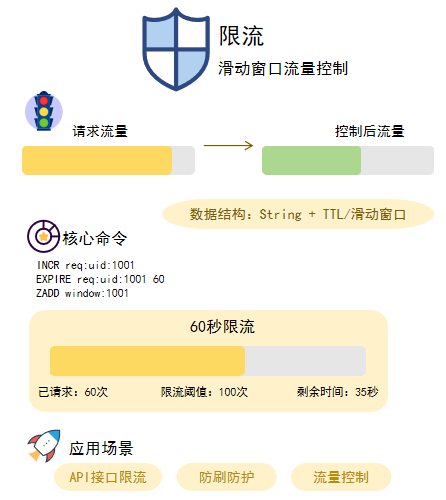

### <font style="color:rgb(0, 0, 0);">3.4 场景 4：分布式锁 —— 多服务资源互斥</font>

#### <font style="color:rgb(0, 0, 0);">业务需求</font>

<font style="color:rgb(0, 0, 0);">当多个服务（如微服务集群）竞争同一资源（如秒杀库存、定时任务执行权）时，需通过分布式锁确保 “同一时间只有一个服务能操作资源”，避免超卖、重复执行等问题。</font>

#### <font style="color:rgb(0, 0, 0);">实现原理</font>

<font style="color:rgb(0, 0, 0);">基于 Redis「String」的</font><code><font style="color:rgba(0, 0, 0, 0.85) !important;">SET</font></code><font style="color:rgb(0, 0, 0);">命令原子性，通过</font><code><font style="color:rgba(0, 0, 0, 0.85) !important;">NX</font></code><font style="color:rgb(0, 0, 0);">（仅当 Key 不存在时设置）保证互斥，</font><code><font style="color:rgba(0, 0, 0, 0.85) !important;">PX</font></code><font style="color:rgb(0, 0, 0);">（设置过期时间）防止死锁。</font>

#### <font style="color:rgb(0, 0, 0);">核心命令与代码</font>

```plain
# 1. 获取锁：lock_key为锁名称，unique_value为唯一值（如服务IP+线程ID，用于释放锁时身份验证）
# NX：仅当lock_key不存在时成功，保证互斥；PX 5000：锁5秒后自动过期，防死锁
SET lock_key "serviceA:thread123" NX PX 5000

# 2. 释放锁：需先判断unique_value是否匹配（避免误删其他服务的锁），再删除
# （需用Lua脚本保证原子性，避免“判断-删除”中间被打断）
EVAL "if redis.call('GET', KEYS[1]) == ARGV[1] then return redis.call('DEL', KEYS[1]) else return 0 end" 1 lock_key "serviceA:thread123"
```

#### <font style="color:rgb(0, 0, 0);">实战注意事项</font>

* <font style="color:rgb(0, 0, 0);">基础版分布式锁存在 “锁超时” 问题（若任务执行时间超过锁过期时间，会导致锁被释放），复杂场景需用 Redisson 框架实现 “自动续期”；</font>
* <font style="color:rgb(0, 0, 0);">集群环境下，若需更高可靠性，可使用 Redlock 算法（多节点加锁，超过半数节点成功则锁有效）。</font>

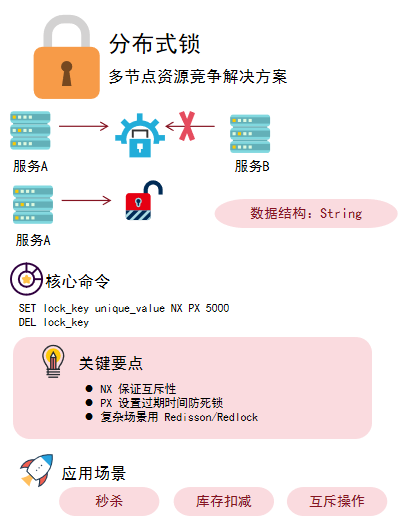

### <font style="color:rgb(0, 0, 0);">3.5 场景 5：排行榜 —— 实时排名与分数统计</font>

#### <font style="color:rgb(0, 0, 0);">业务需求</font>

<font style="color:rgb(0, 0, 0);">需实时展示 “按分数排序的列表”（如游戏积分榜、商品销量榜、用户贡献榜），支持动态更新分数和查询 Top N 排名。</font>

#### <font style="color:rgb(0, 0, 0);">实现原理</font>

<font style="color:rgb(0, 0, 0);">基于 Redis「Sorted Set（有序集合）」，每个元素包含 “成员（如用户 ID）” 和 “分数（如积分）”，Redis 自动按分数排序，支持高效的插入、更新、排序查询。</font>

#### <font style="color:rgb(0, 0, 0);">核心命令与代码</font>

```plain
# 1. 初始化排行榜：向游戏榜ranking:game添加3个玩家及分数
ZADD ranking:game 9850 "playerA" 9720 "playerB" 9580 "playerC"

# 2. 更新分数：玩家B完成任务，积分+50
ZINCRBY ranking:game 50 "playerB"  # 返回更新后分数：9770

# 3. 查询Top 3排名（ZREVRANGE：按分数降序，WITHSCORES：返回分数）
ZREVRANGE ranking:game 0 2 WITHSCORES
# 返回结果：
# 1) "playerA" 2) "9850"
# 3) "playerB" 4) "9770"
# 5) "playerC" 6) "9580"

# 4. 查询玩家C的排名
ZRANK ranking:game "playerC"  # 返回升序排名（从0开始），降序用ZREVRANK
```

#### <font style="color:rgb(0, 0, 0);">实战注意事项</font>

* <font style="color:rgb(0, 0, 0);">若排行榜数据量过大（如百万级用户），查询 Top N 时需避免使用</font><code><font style="color:rgb(0, 0, 0);">ZREVRANGE 0 -1</font></code><font style="color:rgb(0, 0, 0);">（全量返回），仅查询所需范围（如 Top 100）；</font>
* <font style="color:rgb(0, 0, 0);">可通过</font><code><font style="color:rgb(0, 0, 0);">ZREMRANGEBYRANK</font></code><font style="color:rgb(0, 0, 0);">定期清理排名过低的用户，减少内存占用。</font>

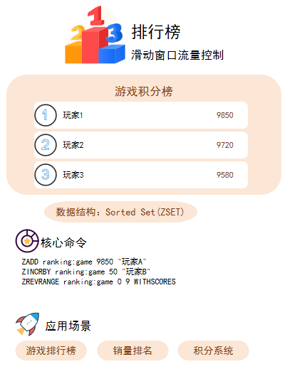

### <font style="color:rgb(0, 0, 0);">3.6 场景 6：实时系统 —— 发布订阅与即时通知</font>

#### <font style="color:rgb(0, 0, 0);">业务需求</font>

<font style="color:rgb(0, 0, 0);">需实现 “一对多实时通信”（如直播弹幕、群聊消息、系统实时通知），消息需即时推送给所有订阅者，不要求持久化（离线订阅者可错过消息）。</font>

#### <font style="color:rgb(0, 0, 0);">实现原理</font>

<font style="color:rgb(0, 0, 0);">基于 Redis「Pub/Sub（发布 - 订阅）」机制，包含 “发布者（发送消息）”“频道（消息载体）”“订阅者（接收消息）” 三个角色：发布者向频道发送消息，所有订阅该频道的订阅者会实时收到消息。</font>

#### <font style="color:rgb(0, 0, 0);">核心命令与代码</font>

```plain
# 1. 订阅者1：订阅频道chat:room1（群聊1）和news:sports（体育新闻）
SUBSCRIBE chat:room1 news:sports
# 订阅成功后，Redis会返回订阅确认：1) "subscribe" 2) "chat:room1" 3) (integer) 1

# 2. 订阅者2：订阅所有以chat:开头的频道（通配符订阅）
PSUBSCRIBE chat:*

# 3. 发布者：向chat:room1发送消息
PUBLISH chat:room1 "userA: 大家好！"
# 返回结果：(integer) 2（表示有2个订阅者收到消息：订阅者1和订阅者2）
```

#### <font style="color:rgb(0, 0, 0);">实战注意事项</font>

* <font style="color:rgb(0, 0, 0);">Pub/Sub 不支持消息持久化：若订阅者离线，期间的消息会丢失，需持久化则用 Stream；</font>
* <font style="color:rgb(0, 0, 0);">频道无 “容量限制”，但高并发下需注意 Redis 的性能瓶颈（建议单个频道订阅者不超过千级）。</font>


### <font style="color:rgb(0, 0, 0);">3.7 场景 7：布隆过滤器 —— 海量数据的高效存在性判断</font>

#### <font style="color:rgb(0, 0, 0);">业务需求</font>

<font style="color:rgb(0, 0, 0);">当需判断 “数据是否存在”（如过滤已爬取的 URL、防止缓存穿透、垃圾邮件过滤），且数据量极大（千万级以上）时，需一种 “空间效率极高” 的方案，允许少量误判（但不允许漏判）。</font>

#### <font style="color:rgb(0, 0, 0);">实现原理</font>

<font style="color:rgb(0, 0, 0);">基于 Redis「Bloom Filter」模块（需单独开启），通过 “多个哈希函数 + 比特位数组” 实现：</font>

1. <font style="color:rgb(0, 0, 0);">插入数据时：用多个哈希函数将数据映射到比特位数组，将对应位置设为 1；</font>
2. <font style="color:rgb(0, 0, 0);">判断数据时：若所有哈希映射的比特位均为 1，数据 “可能存在”（允许误判）；若任一比特位为 0，数据 “一定不存在”（无漏判）。</font>

#### <font style="color:rgb(0, 0, 0);">核心命令与代码</font>

```plain
# 1. 初始化布隆过滤器：创建名为url_filter的过滤器（误差率0.01，预计存储100万条数据）
BF.RESERVE url_filter 0.01 1000000

# 2. 向过滤器添加数据（已爬取的URL）
BF.ADD url_filter "https://example.com/article1"
BF.ADD url_filter "https://example.com/article2"

# 3. 判断数据是否存在（过滤未爬取的URL）
BF.EXISTS url_filter "https://example.com/article1"  # 返回1（可能存在）
BF.EXISTS url_filter "https://example.com/article3"  # 返回0（一定不存在）

# 4. 查看过滤器信息（比特位数量、哈希函数个数等）
BF.INFO url_filter
```

#### <font style="color:rgb(0, 0, 0);">实战注意事项</font>

* <font style="color:rgb(0, 0, 0);">布隆过滤器的 “误判率” 与 “比特位数量” 正相关：误判率越低，需占用的比特位越多（误差率 0.01 时，存储 100 万数据约需 1.44MB）；</font>
* <font style="color:rgb(0, 0, 0);">不支持 “删除数据”（因比特位是共享的，删除会影响其他数据），需删除则需重建过滤器。</font>

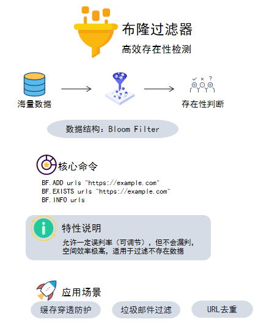

### <font style="color:rgb(0, 0, 0);">3.8 场景 8：会话存储 —— 分布式系统的会话共享</font>

#### <font style="color:rgb(0, 0, 0);">业务需求</font>

<font style="color:rgb(0, 0, 0);">在分布式集群（如多台 Web 服务器）中，用户登录状态需 “跨服务器共享”（如用户在服务器 A 登录，访问服务器 B 时仍需保持登录），避免每台服务器单独存储会话导致的状态不一致。</font>

#### <font style="color:rgb(0, 0, 0);">实现原理</font>

<font style="color:rgb(0, 0, 0);">基于 Redis「String」或「Hash」存储用户会话信息，「Hash」更适合存储多字段会话（如用户名、登录时间、权限），并通过</font><code><font style="color:rgba(0, 0, 0, 0.85) !important;">EXPIRE</font></code><font style="color:rgb(0, 0, 0);">设置会话过期时间，实现自动清理。</font>

#### <font style="color:rgb(0, 0, 0);">核心命令与代码</font>

```plain
# 1. 存储用户789的会话信息（Hash结构，多字段）
HSET session:uid:789 name "张三" login_time "2024-05-20 10:00:00" role "user"

# 2. 设置会话30分钟（1800秒）后过期
EXPIRE session:uid:789 1800

# 3. 读取用户会话的所有信息
HGETALL session:uid:789
# 返回结果：
# 1) "name" 2) "张三"
# 3) "login_time" 4) "2024-05-20 10:00:00"
# 5) "role" 6) "user"

# 4. 刷新会话过期时间（用户活跃时延长有效期）
EXPIRE session:uid:789 1800
```

#### <font style="color:rgb(0, 0, 0);">实战注意事项</font>

* <font style="color:rgb(0, 0, 0);">会话 Key 建议包含用户唯一标识（如 uid），避免 Key 冲突；</font>
* <font style="color:rgb(0, 0, 0);">若需 “会话主动注销”，直接执行</font><code><font style="color:rgb(0, 0, 0);">DEL session:uid:789</font></code><font style="color:rgb(0, 0, 0);">即可。</font>

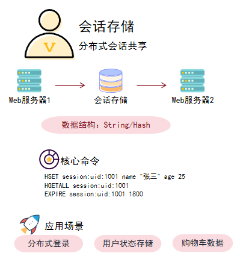

### <font style="color:rgb(0, 0, 0);">3.9 场景 9：分布式 ID 生成 —— 全局唯一标识</font>

#### <font style="color:rgb(0, 0, 0);">业务需求</font>

<font style="color:rgb(0, 0, 0);">在分布式系统中，需生成 “全局唯一、无重复” 的 ID（如订单 ID、用户 ID、日志 ID），避免数据库自增 ID 在多库分表场景下的重复问题。</font>

#### <font style="color:rgb(0, 0, 0);">实现原理</font>

<font style="color:rgb(0, 0, 0);">基于 Redis「String」的</font><code><font style="color:rgba(0, 0, 0, 0.85) !important;">INCR</font></code><font style="color:rgb(0, 0, 0);">原子命令，结合 “时间戳 + 机器 ID + 序列号” 拼接生成 ID，确保唯一性的同时，可反推 ID 生成时间和来源机器。</font>

#### <font style="color:rgb(0, 0, 0);">核心命令与代码</font>

```plain
# 1. 初始化ID生成器：按业务类型区分（如订单ID、用户ID）
# 订单ID生成器（初始值0）
SET id:generator:order 0
# 用户ID生成器（初始值10000，避免ID过小）
SET id:generator:user 10000

# 2. 生成订单ID：原子自增+拼接时间戳、机器ID
# 步骤1：获取自增序列号
INCR id:generator:order  # 返回：12345

# 步骤2：拼接ID（格式：时间戳+机器ID+序列号）
# 时间戳（秒级）：1693478400，机器ID：05，序列号：12345
final_order_id = "1693478400:05:12345"
```

#### <font style="color:rgb(0, 0, 0);">实战注意事项</font>

* <font style="color:rgb(0, 0, 0);">若需更高并发，可通过</font><code><font style="color:rgb(0, 0, 0);">INCRBY</font></code><font style="color:rgb(0, 0, 0);">实现 “批量预生成 ID”（如一次获取 100 个 ID，减少 Redis 调用次数）；</font>
* <font style="color:rgb(0, 0, 0);">时间戳建议用 “毫秒级”，避免秒内序列号耗尽导致的 ID 重复。</font>

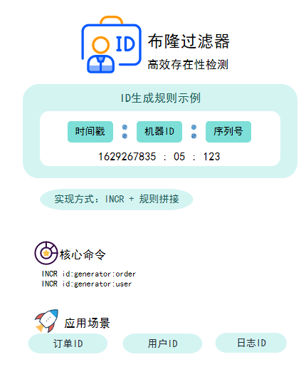

### <font style="color:rgb(0, 0, 0);">3.10 场景 10：延迟队列 —— 定时任务与延迟执行</font>

#### <font style="color:rgb(0, 0, 0);">业务需求</font>

<font style="color:rgb(0, 0, 0);">需实现 “非即时执行的任务”（如订单 10 分钟未支付自动取消、优惠券到期提醒、失败任务延迟重试），无需依赖外部定时任务框架（如 Quartz）。</font>

#### <font style="color:rgb(0, 0, 0);">实现原理</font>

<font style="color:rgb(0, 0, 0);">基于 Redis「Sorted Set」，将 “任务” 作为成员，“任务执行时间戳” 作为分数，通过以下流程实现：</font>

1. <font style="color:rgb(0, 0, 0);">生产者：将任务按 “执行时间戳” 作为分数，添加到 Sorted Set；</font>
2. <font style="color:rgb(0, 0, 0);">消费者：定时（如每 10 秒）调用</font><code><font style="color:rgb(0, 0, 0);">ZRANGEBYSCORE</font></code><font style="color:rgb(0, 0, 0);">，取出 “分数≤当前时间戳” 的任务执行；</font>
3. <font style="color:rgb(0, 0, 0);">执行完成后：删除该任务，避免重复执行。</font>

#### <font style="color:rgb(0, 0, 0);">核心命令与代码</font>

```plain
# 1. 生产者：添加延迟任务（订单123456，10分钟后执行取消操作，时间戳=当前+600）
current_ts=$(date +%s)
execute_ts=$((current_ts + 600))  # 10分钟后执行
ZADD delay:queue:order ${execute_ts} "task:cancel_order:123456"

# 2. 消费者：定时扫描并执行到期任务（每10秒执行一次）
current_ts=$(date +%s)
# 取出所有到期任务（分数≤当前时间戳）
tasks=$(ZRANGEBYSCORE delay:queue:order 0 ${current_ts})

# 3. 遍历执行任务（伪代码）
for task in $tasks; do
  # 执行取消订单逻辑（如调用接口）
  curl "http://api.example.com/order/cancel?order_id=$(echo $task | cut -d: -f3)"
  
  # 执行成功后，从队列删除任务
  ZREM delay:queue:order $task
done
```

#### <font style="color:rgb(0, 0, 0);">实战注意事项</font>

* <font style="color:rgb(0, 0, 0);">消费者需通过 “定时调度”（如 Linux Crontab、Spring Scheduled）触发，扫描间隔需根据业务精度调整（如 1 秒 / 次适合高精度场景）；</font>
* <font style="color:rgb(0, 0, 0);">若任务执行失败，可将任务重新添加到队列（设置下次执行时间，如 5 分钟后重试）。</font>

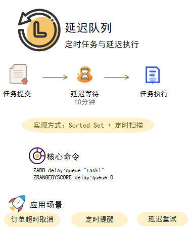

### <font style="color:rgb(0, 0, 0);">3.11 关键对比：消息队列（Stream）vs 实时系统（Pub/Sub）</font>

<font style="color:rgb(0, 0, 0);">很多开发者会混淆两者，需从 “设计目标” 和 “核心特性” 明确差异（面试必问）：</font>

| **<font style="color:rgb(0, 0, 0) !important;">对比维度</font>** | **<font style="color:rgb(0, 0, 0) !important;">消息队列（Stream）</font>** | **<font style="color:rgb(0, 0, 0) !important;">实时系统（Pub/Sub）</font>** |
| :--- | :--- | :--- |
| <font style="color:rgba(0, 0, 0, 0.85) !important;">核心定位</font> | <font style="color:rgba(0, 0, 0, 0.85) !important;">异步解耦、可靠存储</font> | <font style="color:rgba(0, 0, 0, 0.85) !important;">实时广播、即时通知</font> |
| <font style="color:rgba(0, 0, 0, 0.85) !important;">消息存储</font> | <font style="color:rgba(0, 0, 0, 0.85) !important;">原生持久化（落地磁盘）</font> | <font style="color:rgba(0, 0, 0, 0.85) !important;">无存储（内存临时转发）</font> |
| <font style="color:rgba(0, 0, 0, 0.85) !important;">消费模式</font> | <font style="color:rgba(0, 0, 0, 0.85) !important;">点对点 / 消费组（1 条消息 1 组消费）</font> | <font style="color:rgba(0, 0, 0, 0.85) !important;">订阅 - 广播（1 条消息多订阅者）</font> |
| <font style="color:rgba(0, 0, 0, 0.85) !important;">重试机制</font> | <font style="color:rgba(0, 0, 0, 0.85) !important;">内置 ACK+Pending 列表自动重试</font> | <font style="color:rgba(0, 0, 0, 0.85) !important;">无重试（离线丢失）</font> |
| <font style="color:rgba(0, 0, 0, 0.85) !important;">延迟性</font> | <font style="color:rgba(0, 0, 0, 0.85) !important;">低延迟（毫秒级，允许异步等待）</font> | <font style="color:rgba(0, 0, 0, 0.85) !important;">极低延迟（微秒级，实时推送）</font> |
| <font style="color:rgba(0, 0, 0, 0.85) !important;">典型场景</font> | <font style="color:rgba(0, 0, 0, 0.85) !important;">订单支付、物流通知</font> | <font style="color:rgba(0, 0, 0, 0.85) !important;">直播弹幕、群聊消息</font> |

## <font style="color:rgb(0, 0, 0);">四、总结：Redis 非缓存功能的选型与面试技巧</font>

### <font style="color:rgb(0, 0, 0);">4.1 10 大场景核心信息汇总</font>

| **<font style="color:rgb(0, 0, 0) !important;">功能场景</font>** | **<font style="color:rgb(0, 0, 0) !important;">数据结构</font>** | **<font style="color:rgb(0, 0, 0) !important;">核心命令</font>** | **<font style="color:rgb(0, 0, 0) !important;">核心优势</font>** |
| :--- | :--- | :--- | :--- |
| <font style="color:rgba(0, 0, 0, 0.85) !important;">消息队列</font> | <font style="color:rgba(0, 0, 0, 0.85) !important;">List/Stream</font> | <font style="color:rgba(0, 0, 0, 0.85) !important;">LPUSH/BRPOP、XADD/XREAD/XACK</font> | <font style="color:rgba(0, 0, 0, 0.85) !important;">异步解耦、可靠重试</font> |
| <font style="color:rgba(0, 0, 0, 0.85) !important;">分布式计数</font> | <font style="color:rgba(0, 0, 0, 0.85) !important;">String</font> | <font style="color:rgba(0, 0, 0, 0.85) !important;">INCRBY、DECRBY</font> | <font style="color:rgba(0, 0, 0, 0.85) !important;">高并发精准统计</font> |
| <font style="color:rgba(0, 0, 0, 0.85) !important;">限流</font> | <font style="color:rgba(0, 0, 0, 0.85) !important;">String+TTL/ZSET</font> | <font style="color:rgba(0, 0, 0, 0.85) !important;">INCR/EXPIRE、ZADD/ZCARD</font> | <font style="color:rgba(0, 0, 0, 0.85) !important;">轻量防刷、流量控制</font> |
| <font style="color:rgba(0, 0, 0, 0.85) !important;">分布式锁</font> | <font style="color:rgba(0, 0, 0, 0.85) !important;">String</font> | <font style="color:rgba(0, 0, 0, 0.85) !important;">SET NX PX、EVAL（Lua）</font> | <font style="color:rgba(0, 0, 0, 0.85) !important;">多服务互斥、防死锁</font> |
| <font style="color:rgba(0, 0, 0, 0.85) !important;">排行榜</font> | <font style="color:rgba(0, 0, 0, 0.85) !important;">Sorted Set</font> | <font style="color:rgba(0, 0, 0, 0.85) !important;">ZADD、ZREVRANGE、ZINCRBY</font> | <font style="color:rgba(0, 0, 0, 0.85) !important;">实时排序、高效更新</font> |
| <font style="color:rgba(0, 0, 0, 0.85) !important;">实时系统</font> | <font style="color:rgba(0, 0, 0, 0.85) !important;">Pub/Sub</font> | <font style="color:rgba(0, 0, 0, 0.85) !important;">PUBLISH、SUBSCRIBE</font> | <font style="color:rgba(0, 0, 0, 0.85) !important;">即时广播、低延迟</font> |
| <font style="color:rgba(0, 0, 0, 0.85) !important;">布隆过滤器</font> | <font style="color:rgba(0, 0, 0, 0.85) !important;">Bloom Filter</font> | <font style="color:rgba(0, 0, 0, 0.85) !important;">BF.ADD、BF.EXISTS</font> | <font style="color:rgba(0, 0, 0, 0.85) !important;">海量数据、空间高效</font> |
| <font style="color:rgba(0, 0, 0, 0.85) !important;">会话存储</font> | <font style="color:rgba(0, 0, 0, 0.85) !important;">String/Hash</font> | <font style="color:rgba(0, 0, 0, 0.85) !important;">HSET、HGETALL、EXPIRE</font> | <font style="color:rgba(0, 0, 0, 0.85) !important;">分布式共享、自动过期</font> |
| <font style="color:rgba(0, 0, 0, 0.85) !important;">分布式 ID</font> | <font style="color:rgba(0, 0, 0, 0.85) !important;">String</font> | <font style="color:rgba(0, 0, 0, 0.85) !important;">INCR、INCRBY</font> | <font style="color:rgba(0, 0, 0, 0.85) !important;">全局唯一、可反推信息</font> |
| <font style="color:rgba(0, 0, 0, 0.85) !important;">延迟队列</font> | <font style="color:rgba(0, 0, 0, 0.85) !important;">Sorted Set</font> | <font style="color:rgba(0, 0, 0, 0.85) !important;">ZADD、ZRANGEBYSCORE、ZREM</font> | <font style="color:rgba(0, 0, 0, 0.85) !important;">定时任务、无需外部框架</font> |

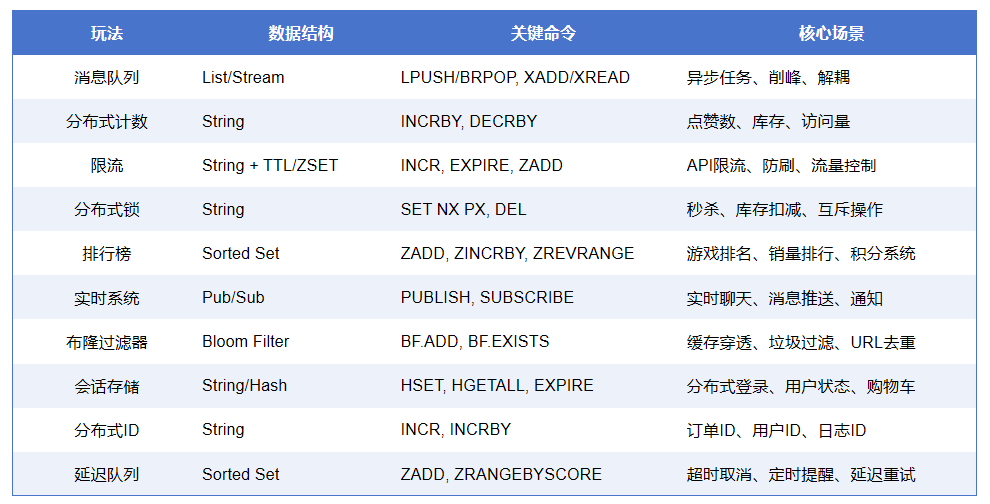

### <font style="color:rgb(0, 0, 0);">4.2 面试答题技巧</font>

<font style="color:rgb(0, 0, 0);">当面试官问 “Redis 除了缓存还能做什么” 时，建议按以下逻辑回答：</font>

1. **<font style="color:rgb(0, 0, 0) !important;">总览定位</font>**<font style="color:rgb(0, 0, 0);">：Redis 是 “多功能内存数据库”，除缓存外，可解决分布式系统的 10 大核心痛点；</font>
2. **<font style="color:rgb(0, 0, 0) !important;">分场景展开</font>**<font style="color:rgb(0, 0, 0);">：挑选 2-3 个核心场景（如消息队列、分布式锁、排行榜），讲清「业务需求→数据结构→核心命令→注意事项」（结合实战例子）；</font>
3. **<font style="color:rgb(0, 0, 0) !important;">突出差异</font>**<font style="color:rgb(0, 0, 0);">：主动对比易混淆场景（如 Stream vs Pub/Sub），体现对细节的理解；</font>
4. **<font style="color:rgb(0, 0, 0) !important;">总结价值</font>**<font style="color:rgb(0, 0, 0);">：Redis 非缓存功能的优势是 “轻量、无需额外部署”，降低系统复杂度。</font>

### <font style="color:rgb(0, 0, 0);">4.3 实战选型建议</font>

* **<font style="color:rgb(0, 0, 0) !important;">核心业务（订单 / 支付）</font>**<font style="color:rgb(0, 0, 0);">：优先选可靠方案（Stream 消息队列、Redisson 分布式锁）；</font>
* **<font style="color:rgb(0, 0, 0) !important;">非核心轻量场景（日志 / 通知）</font>**<font style="color:rgb(0, 0, 0);">：选简单方案（List 消息队列、String 限流）；</font>
* **<font style="color:rgb(0, 0, 0) !important;">海量数据场景（URL 去重）</font>**<font style="color:rgb(0, 0, 0);">：必选布隆过滤器（空间效率远超 Set）；</font>
* **<font style="color:rgb(0, 0, 0) !important;">实时性要求高的场景（弹幕）</font>**<font style="color:rgb(0, 0, 0);">：选 Pub/Sub（避免 Stream 的持久化开销）。</font>

<font style="color:rgb(0, 0, 0);">通过本文的拆解，相信你已掌握 Redis 非缓存功能的核心实现与实战要点。结合 PPT 演示时，可按 “场景需求→截图展示→代码讲解→注意事项” 的节奏，让观众快速理解每个功能的价值与用法。</font>
