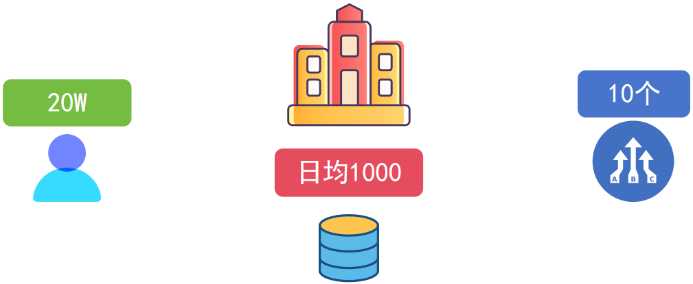
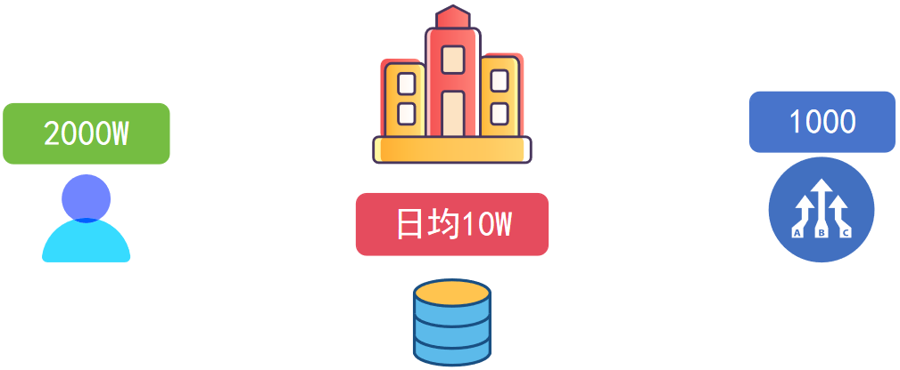
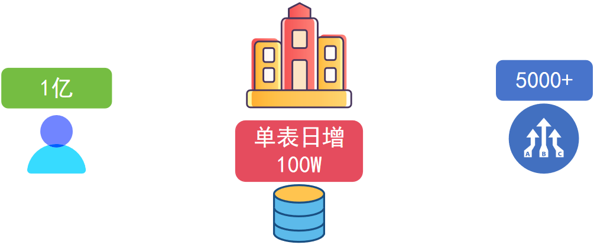
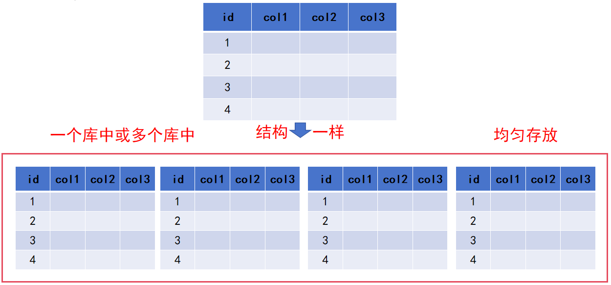
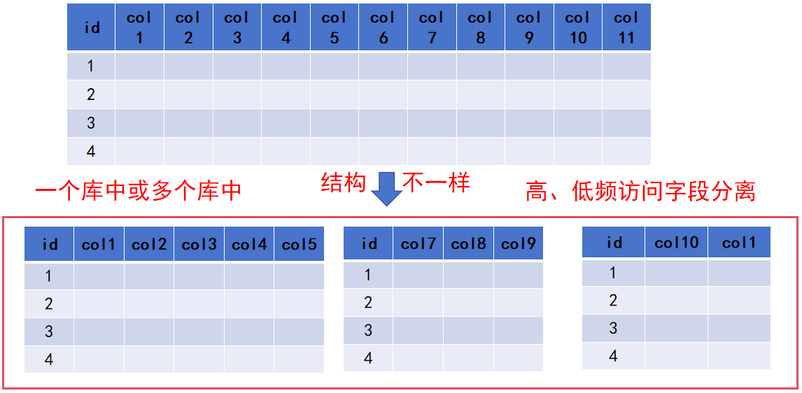

# 从业务崩掉到高可用：分库分表技术全景解析

在互联网技术领域，“分库分表” 从来不是一个 “要不要用” 的选择题，而是 “什么时候用” 的必答题。当创业公司的注册用户从 20 万飙升到 1 亿，当高峰期并发请求从 10QPS 突破 5000QPS，当单表数据量从日均 1000 条增长到 50 万条 —— 你会发现，曾经稳定运行的单机数据库，会突然变成业务增长的 “绊脚石”。本文将结合真实业务场景，从痛点出发，拆解分库分表的技术逻辑、实现方式与核心价值，帮你彻底搞懂这一高可用架构的核心技术。

## 一、业务增长下的 “数据库危机”：为什么必须分库分表？

分库分表的诞生，本质是 “业务需求倒逼技术升级” 的结果。我们从一个真实的创业公司场景说起，看看单机数据库是如何一步步陷入瓶颈的：

### 1. 初期：单机数据库 “岁月静好”

当公司刚起步时，注册用户仅 20 万，日均活跃用户 1 万，单表日均新增数据 1000 条，高峰期并发请求仅 10QPS。此时，一台普通的 MySQL 服务器就能轻松承载 ——SQL 查询毫秒级响应，磁盘空间充足，几乎不需要额外的性能优化。

### 2. 增长期：单机开始 “力不从心”

随着业务爆发，几个月后注册用户突破 2000 万，日均活跃用户 100 万，单表日均新增 10 万条数据，高峰期并发达到 1000QPS。此时：

* 单表数据量突破百万级，简单的<code>SELECT * FROM table WHERE id = ?</code>开始出现延迟；
* 数据库磁盘使用率持续攀升，每周都需要清理历史数据；
* 高峰期服务器 CPU 利用率偶尔超过 80%，出现短暂的请求超时。

### 3. 爆发期：单机数据库 “彻底崩盘”

当注册用户达到 1 亿，日均活跃用户上千万，单表日均新增 100 万条数据，高峰期并发飙升至 5000~8000QPS 时，单机数据库会彻底 “扛不住”：

* 单表数据量突破 2000 万，复杂查询（如关联、排序）耗时超过 1 秒，甚至触发数据库锁等待；
* 磁盘空间每天都在告急，删除历史数据也无法缓解；
* 高峰期并发直接打满数据库连接池，大量请求被拒绝，业务出现 “502 错误”。

**本质问题：单机数据库的三大瓶颈**无论是并发、存储还是性能，单机数据库都存在无法突破的上限：

* **并发瓶颈**：MySQL 单库的并发处理能力通常在 2000QPS 左右，超过后会出现连接超时、锁竞争加剧；
* **存储瓶颈**：单机磁盘容量有限，即使挂载云盘，也会因单库文件过大导致 IO 性能下降；
* **性能瓶颈**：单表数据量超过 1000 万后，索引查询效率会急剧下降（B + 树索引层级增加，磁盘 IO 次数增多）。

## 二、分库分表：破解单机瓶颈的 “两把钥匙”

很多人会把 “分库” 和 “分表” 混为一谈，但实际上二者解决的是完全不同的问题，既可以单独使用，也可以组合使用。

### 1. 分表：解决 “单表数据量大” 的性能困局

**核心目标**：将一张 “大表” 拆成多张 “小表”，让每张表的数据量控制在 “高效区间”（通常是百万级），从而提升 SQL 查询与写入性能。

#### 分表的必要性

当单表数据量超过 1000 万时，会出现以下问题：

* 索引文件过大，无法完全加载到内存，查询时需要频繁磁盘 IO；
* 新增数据时，索引维护（如 B + 树分裂）耗时增加，写入延迟变大；
* 执行<code>ALTER TABLE</code>等 DDL 操作时，会锁表很长时间，影响业务可用性。

#### 分表示例

假设原有一张<code>user_order</code>表，数据量 2000 万条，按 “订单创建时间” 分表后：

* <code>user_order_202401</code>：2024 年 1 月的订单（约 160 万条）；
* <code>user_order_202402</code>：2024 年 2 月的订单（约 180 万条）；
* ... 以此类推，每张表数据量控制在 200 万以内。

此时查询 “2024 年 1 月的订单”，仅需访问<code>user_order_202401</code>，SQL 执行时间从原来的 1.5 秒缩短到 100 毫秒以内。

### 2. 分库：解决 “单库并发上限” 的可用性困局

**核心目标**：将一个 “高并发库” 拆成多个 “低并发库”，分布在不同的服务器上，通过多机分担请求，突破单机的并发瓶颈。

#### 分库的必要性

单库并发超过 2000QPS 时，会出现：

* 数据库连接池满，新请求无法建立连接；
* CPU 利用率持续 100%，无法处理新的查询；
* 锁竞争激烈（如行锁、表锁），大量请求阻塞。

#### 分库的关键数据

* 单库 “健康并发”：建议控制在 1000QPS 以内，此时数据库 CPU、内存、IO 均处于稳定状态；
* 分库效果：将一个 10000QPS 的库拆成 10 个库，每个库仅需承担 1000QPS，恢复健康状态；
* 存储扩展：分库同时也会分散存储压力，比如一个 100GB 的库拆成 10 个库，每个库仅 10GB，IO 性能提升。

### 分库分表前后对比：数据说话

| **指标** | **分库分表前（单机）** | **分库分表后（多机）** |
| :--- | :--- | :--- |
| 并发支撑 | 扛不住 1000QPS 以上 | 轻松承载 5000+QPS |
| 磁盘使用 | 单机磁盘几乎撑满 | 多机分散存储，使用率降低 60% |
| SQL 执行性能 | 单表 2000 万数据，查询 1.5 秒 | 单表 200 万数据，查询 100 毫秒 |
| 可用性 | 单机故障导致业务中断 | 单库故障仅影响 1/10 业务 |

## 三、核心拆分策略：水平拆分与垂直拆分的抉择

分库分表的核心是 “拆分策略”，最常用的两种方式是**水平拆分**和**垂直拆分**，二者适用场景不同，需根据业务需求选择。

### 1. 水平拆分：按 “数据行” 拆分，结构不变

**定义**：将一张表的 “不同行数据” 分散到多个表（或多个库的表）中，所有拆分后的表结构完全一致，数据总和为原表完整数据。

#### 适用场景

* 单表数据量过大，且查询条件多基于 “行标识”（如用户 ID、订单 ID）；
* 业务需要扩容存储和并发，且数据可以按规则均匀分布。

#### 常见拆分规则

* **哈希拆分**：按用户 ID 哈希取模，如<code>user_id % 4 = 0</code>的用户放库 1，<code>=1</code>放库 2，以此类推，保证数据均匀；
* **范围拆分**：按时间范围（如订单创建时间）、数值范围（如用户 ID 1~100 万放表 1，101~200 万放表 2）；
* **地理位置拆分**：按用户所在城市（如北京用户放华北库，上海用户放华东库）。

#### 优势与注意点

* 优势：数据分布均匀，扩展性强，可无限增加分表 / 分库数量；
* 注意点：避免 “热点数据”（如某一用户订单量远超其他用户，导致单表数据倾斜），需提前评估数据分布。

### 2. 垂直拆分：按 “字段” 拆分，结构不同

**定义**：将一张表的 “不同字段” 拆分到多个表（或多个库的表）中，拆分后的表结构不同，每个表仅包含原表的部分字段，通过主键关联。

#### 适用场景

* 表中存在 “高频访问字段” 和 “低频访问字段”，且低频字段数据量大（如大文本、图片 URL）；
* 需优化缓存利用率（高频字段表更小，可缓存更多行数据）。

#### 常见拆分规则

* **按访问频率拆分**：
  * 高频表：<code>user_core</code>（id、username、phone、status，高频查询）；
  * 低频表：<code>user_extend</code>（id、avatar\_url、address、intro，低频查询）；
* 按字段大小拆分：将大字段（如<code>content</code>文本）单独拆表，避免查询时加载无用大数据。

#### 优势与注意点

* 优势：减少无效字段加载，提升缓存命中率，降低单表数据量；
* 注意点：跨表查询需通过主键关联（如查用户完整信息需关联<code>user_core</code>和<code>user_extend</code>），需控制关联次数。

## 四、落地避坑：分库分表的关键考量

分库分表不是 “拆完就万事大吉”，落地时需解决三个核心问题，否则会引入新的隐患。

### 1. 拆分策略：提前规划，避免后期重构

拆分策略一旦确定，后期修改成本极高（需迁移大量数据），需提前考虑：

* 业务增长预期：按 3 年业务量规划拆分数量（如当前 1000 万用户，按 3 亿用户设计 30 个分库）；
* 查询习惯：拆分字段需与高频查询字段一致（如高频按用户 ID 查询，就按用户 ID 拆分，避免跨表查询）；
* 避免过度拆分：拆分过多会增加运维复杂度（如拆 100 个表，运维成本呈指数级上升）。

### 2. 分布式事务：保证数据一致性

分库分表后，一次业务操作可能涉及多个库 / 表（如 “创建订单” 需操作订单表和库存表，且两表在不同库），需解决分布式事务问题：

* 常用方案：Seata（AT 模式，适合大多数业务）、TCC（强一致性，适合金融场景）、本地消息表（最终一致性，适合非核心业务）；
* 原则：能不用分布式事务就不用，优先通过业务设计简化（如 “先扣库存，再创建订单，失败则回滚库存”）。

### 3. 跨表查询：控制范围，避免 “分布式 join”

分库分表后，跨表 / 跨库查询会变得复杂，需尽量避免：

* 禁止 “全表扫描”：如 “查询所有用户的订单”，会触发所有分表查询，性能极差；
* 用 “冗余字段” 减少关联：如在订单表中冗余 “用户名”，避免查询订单时关联用户表；
* 借助中间件：使用 Sharding-JDBC、MyCat 等中间件，自动处理跨表查询（但仍需控制频率）。

## 五、总结：分库分表的本质是 “业务驱动技术”

最后，我们回归本质：分库分表不是 “银弹”，也不是 “越早用越好”。

* 小公司初期：业务量小，单机数据库完全够用，过早分库分表会增加开发和运维成本；
* 业务增长期：当单表数据量接近 1000 万、并发接近 1000QPS 时，开始规划分表；
* 业务爆发期：当并发突破 2000QPS、单库存储超 100GB 时，必须落地分库。

分库分表的核心价值，是 “通过技术手段匹配业务增长”—— 它不只是数据库的拆分，更是架构层面的扩容思维。只有理解了业务痛点，才能设计出合理的分库分表方案，让系统从 “崩溃边缘” 走向 “高可用”，支撑业务持续增长。
