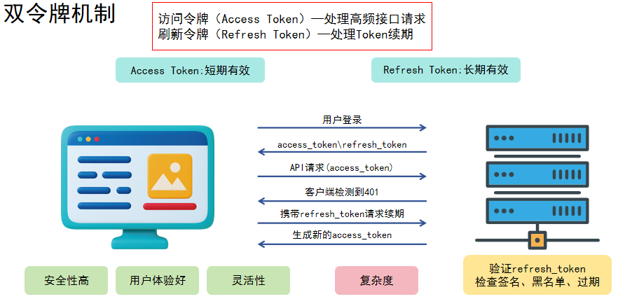
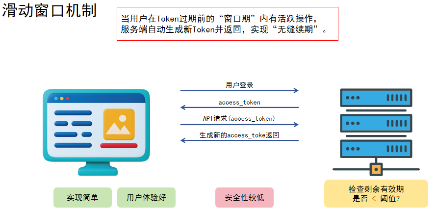
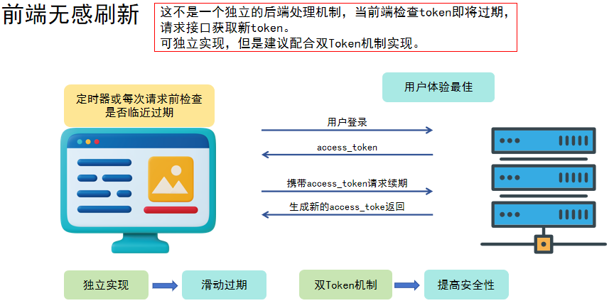
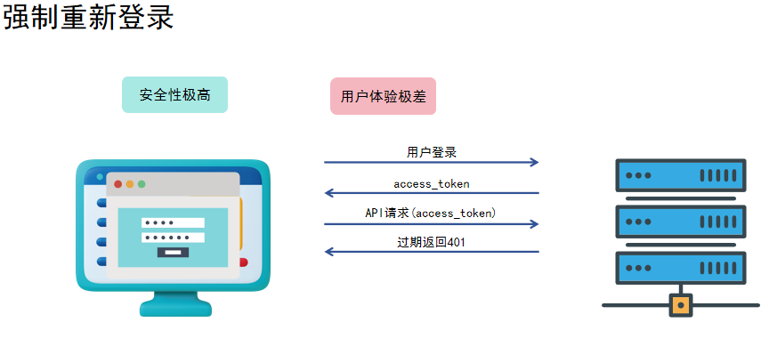

# 从安全到体验：Java Token 续期 4 种方案全攻略，覆盖面试与生产落地需求

## <font style="color:rgb(0, 0, 0);">一、引言</font>

<font style="color:rgb(0, 0, 0);">在现代系统的认证授权体系中，Token 作为用户身份的凭证，其安全性与用户体验的平衡是核心设计目标。Token 续期机制旨在解决 “Token 必须过期以保障安全” 与 “避免用户频繁登录以优化体验” 之间的矛盾，是分布式系统、前后端分离架构中不可或缺的组成部分。本文基于实际技术场景，详细拆解四种主流 Token 续期方案的原理、实现细节及适用场景，并提供可落地的代码示例。</font>

## <font style="color:rgb(0, 0, 0);">二、Token 过期的必要性与核心挑战</font>

### <font style="color:rgb(0, 0, 0);">2.1 Token 必须过期的原因</font>

<font style="color:rgb(0, 0, 0);">Token 设置过期时间是安全架构的基本原则，而非 “设计缺陷”，主要基于以下核心诉求：</font>

1. **<font style="color:rgb(0, 0, 0) !important;">降低安全风险</font>**<font style="color:rgb(0, 0, 0);">：缩短 Token 有效窗口期，即使 Token 被窃取，攻击者仅能在有限时间内滥用（如 Access Token 设为 1 小时，风险窗口远小于永久有效 Token）。</font>
2. **<font style="color:rgb(0, 0, 0) !important;">防止长期会话滥用</font>**<font style="color:rgb(0, 0, 0);">：公共设备（如网吧电脑）登录后，若 Token 永不过期，后续使用者可能非法访问原用户账户，过期机制强制定期重新认证。</font>
3. **<font style="color:rgb(0, 0, 0) !important;">支持权限动态变更</font>**<font style="color:rgb(0, 0, 0);">：用户权限调整（如角色降级、功能禁用）后，旧 Token 若未过期仍可访问资源；过期后重新获取 Token 时，系统会基于最新权限生成凭证，确保权限同步。</font>
4. **<font style="color:rgb(0, 0, 0) !important;">符合最小权限原则</font>**<font style="color:rgb(0, 0, 0);">：遵循 “按需授权、及时回收” 的安全理念，Token 过期是自动化的权限回收手段，适配零信任架构。</font>
5. **<font style="color:rgb(0, 0, 0) !important;">便于审计与监控</font>**<font style="color:rgb(0, 0, 0);">：短期 Token 促使用户频繁刷新 / 重新登录，系统可记录更多认证事件，便于异常行为检测（如异地频繁刷新 Token）。</font>

### <font style="color:rgb(0, 0, 0);">2.2 Token 过期带来的挑战</font>

<font style="color:rgb(0, 0, 0);">Token 过期虽保障安全，但会直接影响用户体验：</font>

* **<font style="color:rgb(0, 0, 0) !important;">操作中断</font>**<font style="color:rgb(0, 0, 0);">：用户在长时间操作（如表单填写、文件上传）中 Token 过期，提交时被拒绝，需重新登录后重试，体验极差。</font>
* **<font style="color:rgb(0, 0, 0) !important;">系统复杂度提升</font>**<font style="color:rgb(0, 0, 0);">：需设计额外机制实现 “续期”，包括后端续期接口、Token 状态管理（如黑名单）、前端 Token 替换逻辑等。</font>

## <font style="color:rgb(0, 0, 0);">三、主流 Token 续期方案详解</font>

### <font style="color:rgb(0, 0, 0);">3.1 方案一：双令牌机制（主流方案）</font>

#### <font style="color:rgb(0, 0, 0);">3.1.1 方案原理</font>

<font style="color:rgb(0, 0, 0);">双令牌机制通过 “短期访问令牌 + 长期刷新令牌” 的组合，在安全与体验间取得最优平衡：</font>

* **<font style="color:rgb(0, 0, 0) !important;">Access Token（访问令牌）</font>**<font style="color:rgb(0, 0, 0);">：短期有效（如 1 小时），用于调用受保护 API 资源，携带在请求头（如</font><font style="color:rgb(0, 0, 0);"> </font><code><font style="color:rgb(0, 0, 0);">Authorization: Bearer {token}</font></code><font style="color:rgb(0, 0, 0);">），不存储在服务端（通常为 JWT 格式）。</font>
* **<font style="color:rgb(0, 0, 0) !important;">Refresh Token（刷新令牌）</font>**<font style="color:rgb(0, 0, 0);">：长期有效（如 7 天），仅用于 Access Token 过期后请求新的 Access Token，存储在服务端（如 Redis），支持状态管理（黑名单、设备绑定）。</font>

#### <font style="color:rgb(0, 0, 0);">3.1.2 实现流程</font>



1. <font style="color:rgb(0, 0, 0);">用户提交用户名 / 密码登录，服务端验证通过后：</font>
   * <font style="color:rgb(0, 0, 0);">生成 Access Token（JWT 格式，有效期 1h）；</font>
   * <font style="color:rgb(0, 0, 0);">生成 Refresh Token（随机字符串，有效期 7d），并将其与用户 ID、设备信息绑定后存入 Redis（键：</font><code><font style="color:rgb(0, 0, 0);">refresh_token:{token值}</font></code><font style="color:rgb(0, 0, 0);">，值：</font><code><font style="color:rgb(0, 0, 0);">user_id:123,device:ios</font></code><font style="color:rgb(0, 0, 0);">，过期时间 7d）；</font>
   * <font style="color:rgb(0, 0, 0);">客户端接收并存储两个 Token（Access Token 存内存，Refresh Token 存 HttpOnly Cookie 或安全存储）。</font>
2. <font style="color:rgb(0, 0, 0);">客户端发起 API 请求时，在请求头携带 Access Token。</font>
3. <font style="color:rgb(0, 0, 0);">服务端拦截器验证 Access Token：</font>
   * <font style="color:rgb(0, 0, 0);">若 Token 有效且未过期，正常返回接口数据；</font>
   * <font style="color:rgb(0, 0, 0);">若 Token 过期，返回</font><font style="color:rgb(0, 0, 0);"> </font><code><font style="color:rgb(0, 0, 0);">401 Unauthorized</font></code><font style="color:rgb(0, 0, 0);">。</font>
4. <font style="color:rgb(0, 0, 0);">客户端捕获 401 错误后，携带 Refresh Token 调用</font><font style="color:rgb(0, 0, 0);"> </font><code><font style="color:rgb(0, 0, 0);">/token/refresh</font></code><font style="color:rgb(0, 0, 0);"> </font><font style="color:rgb(0, 0, 0);">接口。</font>
5. <font style="color:rgb(0, 0, 0);">服务端验证 Refresh Token：</font>
   * <font style="color:rgb(0, 0, 0);">检查 Redis 中是否存在该 Token，且未过期；</font>
   * <font style="color:rgb(0, 0, 0);">检查 Token 是否在黑名单（如用户登出时添加）；</font>
   * <font style="color:rgb(0, 0, 0);">验证 Token 绑定的设备信息是否与当前请求一致（可选，增强安全）。</font>
6. <font style="color:rgb(0, 0, 0);">验证通过后，服务端生成新的 Access Token 并返回；验证失败（如 Refresh Token 过期 / 无效），返回</font><font style="color:rgb(0, 0, 0);"> </font><code><font style="color:rgb(0, 0, 0);">401</font></code><font style="color:rgb(0, 0, 0);">，客户端引导用户重新登录。</font>
7. <font style="color:rgb(0, 0, 0);">客户端用新 Access Token 重试原 API 请求，并更新本地存储的 Access Token。</font>

#### <font style="color:rgb(0, 0, 0);">3.1.3 代码示例（Java + Spring Boot + Redis + JJWT）</font>

##### <font style="color:rgb(0, 0, 0);">1. 依赖引入（pom.xml）</font>

```xml
<!-- JJWT：生成JWT Token -->
<dependency>
    <groupId>io.jsonwebtoken</groupId>
    <artifactId>jjwt-api</artifactId>
    <version>0.11.5</version>
</dependency>
<dependency>
    <groupId>io.jsonwebtoken</groupId>
    <artifactId>jjwt-impl</artifactId>
    <version>0.11.5</version>
    <scope>runtime</scope>
</dependency>
<dependency>
    <groupId>io.jsonwebtoken</groupId>
    <artifactId>jjwt-jackson</artifactId>
    <version>0.11.5</version>
    <scope>runtime</scope>
</dependency>
<!-- Redis -->
<dependency>
    <groupId>org.springframework.boot</groupId>
    <artifactId>spring-boot-starter-data-redis</artifactId>
</dependency>
```

##### <font style="color:rgb(0, 0, 0);">2. Token 工具类（生成 / 解析 JWT）</font>

```java
import io.jsonwebtoken.*;
import org.springframework.beans.factory.annotation.Value;
import org.springframework.stereotype.Component;
import java.util.Date;
import java.util.HashMap;
import java.util.Map;

@Component
public class JwtTokenUtil {
    // 密钥（配置在application.yml中，生产环境用加密存储）
    @Value("${jwt.secret}")
    private String secret;
    // Access Token 有效期（1小时，单位：毫秒）
    @Value("${jwt.access-token-expire-ms}")
    private long accessTokenExpireMs;
    // Refresh Token 有效期（7天，单位：毫秒）
    @Value("${jwt.refresh-token-expire-ms}")
    private long refreshTokenExpireMs;

    // 生成 Access Token
    public String generateAccessToken(Long userId, String username) {
        Map<String, Object> claims = new HashMap<>();
        claims.put("userId", userId);
        claims.put("username", username);
        claims.put("tokenType", "access");

        return Jwts.builder()
                .setClaims(claims)
                .setIssuedAt(new Date())
                .setExpiration(new Date(System.currentTimeMillis() + accessTokenExpireMs))
                .signWith(SignatureAlgorithm.HS256, secret)
                .compact();
    }

    // 生成 Refresh Token（随机字符串，非JWT，便于Redis管理）
    public String generateRefreshToken() {
        return UUID.randomUUID().toString().replace("-", "");
    }

    // 解析 Access Token，获取用户ID
    public Long getUserIdFromAccessToken(String accessToken) {
        try {
            Claims claims = Jwts.parser()
                    .setSigningKey(secret)
                    .parseClaimsJws(accessToken)
                    .getBody();
            return claims.get("userId", Long.class);
        } catch (ExpiredJwtException e) {
            throw new RuntimeException("Access Token 已过期", e);
        } catch (Exception e) {
            throw new RuntimeException("Access Token 无效", e);
        }
    }

    // 检查 Access Token 是否过期
    public boolean isAccessTokenExpired(String accessToken) {
        try {
            Claims claims = Jwts.parser()
                    .setSigningKey(secret)
                    .parseClaimsJws(accessToken)
                    .getBody();
            return claims.getExpiration().before(new Date());
        } catch (Exception e) {
            return true; // 解析失败视为过期
        }
    }
}
```

##### <font style="color:rgb(0, 0, 0);">3. 登录与刷新 Token 接口</font>

```java
import org.springframework.data.redis.core.StringRedisTemplate;
import org.springframework.web.bind.annotation.*;
import javax.annotation.Resource;
import java.util.HashMap;
import java.util.Map;
import java.util.concurrent.TimeUnit;

@RestController
@RequestMapping("/auth")
public class AuthController {
    @Resource
    private JwtTokenUtil jwtTokenUtil;
    @Resource
    private StringRedisTemplate stringRedisTemplate;
    // Refresh Token 有效期（7天）
    @Value("${jwt.refresh-token-expire-ms}")
    private long refreshTokenExpireMs;

    // 登录接口：生成双令牌
    @PostMapping("/login")
    public Map<String, String> login(@RequestBody LoginDTO loginDTO) {
        // 1. 验证用户名密码（省略，实际需查数据库）
        Long userId = 123L; // 模拟用户ID
        String username = loginDTO.getUsername();

        // 2. 生成双令牌
        String accessToken = jwtTokenUtil.generateAccessToken(userId, username);
        String refreshToken = jwtTokenUtil.generateRefreshToken();

        // 3. 存储 Refresh Token 到 Redis（键：refresh_token:{token}，值：userId，过期时间7天）
        String refreshTokenKey = "refresh_token:" + refreshToken;
        stringRedisTemplate.opsForValue().set(
                refreshTokenKey,
                userId.toString(),
                refreshTokenExpireMs,
                TimeUnit.MILLISECONDS
        );

        // 4. 返回令牌
        Map<String, String> result = new HashMap<>();
        result.put("accessToken", accessToken);
        result.put("refreshToken", refreshToken);
        return result;
    }

    // 刷新 Token 接口：用 Refresh Token 获取新 Access Token
    @PostMapping("/token/refresh")
    public Map<String, String> refreshToken(@RequestParam String refreshToken) {
        // 1. 检查 Refresh Token 是否存在于 Redis
        String refreshTokenKey = "refresh_token:" + refreshToken;
        String userIdStr = stringRedisTemplate.opsForValue().get(refreshTokenKey);
        if (userIdStr == null) {
            throw new RuntimeException("Refresh Token 无效或已过期");
        }
        Long userId = Long.parseLong(userIdStr);

        // 2. 生成新的 Access Token
        String newAccessToken = jwtTokenUtil.generateAccessToken(userId, "username"); // 实际需从数据库查用户名

        // 3. 返回新 Access Token（可选：延长 Refresh Token 有效期，实现“滑动续期”）
        stringRedisTemplate.expire(refreshTokenKey, refreshTokenExpireMs, TimeUnit.MILLISECONDS);

        Map<String, String> result = new HashMap<>();
        result.put("accessToken", newAccessToken);
        return result;
    }

    // 登出接口：将 Refresh Token 加入黑名单（或直接删除）
    @PostMapping("/logout")
    public String logout(@RequestParam String refreshToken) {
        String refreshTokenKey = "refresh_token:" + refreshToken;
        stringRedisTemplate.delete(refreshTokenKey);
        return "登出成功";
    }
}
```

#### <font style="color:rgb(0, 0, 0);">3.1.4 优缺点分析</font>

| **<font style="color:rgb(0, 0, 0) !important;">优点</font>** | **<font style="color:rgb(0, 0, 0) !important;">缺点</font>** |
| :--- | :--- |
| <font style="color:rgba(0, 0, 0, 0.85) !important;">安全性高：Access Token 短期有效，风险窗口小；Refresh Token 可通过 Redis 管理（黑名单、设备绑定）</font> | <font style="color:rgba(0, 0, 0, 0.85) !important;">实现复杂度中等：需维护 Refresh Token 状态（Redis 存储），增加一次刷新请求</font> |
| <font style="color:rgba(0, 0, 0, 0.85) !important;">用户体验好：无需频繁登录，仅 Access Token 过期时静默刷新</font> | <font style="color:rgba(0, 0, 0, 0.85) !important;">需处理 Refresh Token 过期场景（需引导用户重新登录）</font> |
| <font style="color:rgba(0, 0, 0, 0.85) !important;">灵活性强：可对 Refresh Token 单独配置策略（如单设备登录、IP 限制）</font> | <font style="color:rgba(0, 0, 0, 0.85) !important;">-</font> |

### <font style="color:rgb(0, 0, 0);">3.2 方案二：滑动窗口机制</font>

#### <font style="color:rgb(0, 0, 0);">3.2.1 方案原理</font>

<font style="color:rgb(0, 0, 0);">核心思想是 “动态延长 Token 有效期”：当用户在 Token 过期前的 “窗口期”（如剩余 30 分钟）内有活跃操作，服务端自动生成新 Token 并返回，客户端替换旧 Token 后实现 “无缝续期”。此方案仅需一个 Token（如 JWT），无需 Refresh Token。</font>

#### <font style="color:rgb(0, 0, 0);">3.2.2 实现流程</font>



1. <font style="color:rgb(0, 0, 0);">用户登录，服务端生成有效期为 T（如 2 小时）的 Token，客户端存储并携带 Token 发起请求。</font>
2. <font style="color:rgb(0, 0, 0);">服务端拦截器验证 Token 有效性：</font>
   * <font style="color:rgb(0, 0, 0);">若 Token 已过期，返回 401，要求重新登录；</font>
   * <font style="color:rgb(0, 0, 0);">若 Token 未过期，计算剩余有效期（</font><code><font style="color:rgb(0, 0, 0);">过期时间 - 当前时间</font></code><font style="color:rgb(0, 0, 0);">）。</font>
3. <font style="color:rgb(0, 0, 0);">若剩余有效期 <阈值（如 30 分钟，即 “窗口期”），服务端生成新 Token（有效期仍为 T），并通过响应头（如</font><font style="color:rgb(0, 0, 0);"> </font><code><font style="color:rgb(0, 0, 0);">X-New-Token: {newToken}</font></code><font style="color:rgb(0, 0, 0);">）返回。</font>
4. <font style="color:rgb(0, 0, 0);">客户端检测到响应头中的新 Token，替换本地旧 Token，后续请求使用新 Token。</font>
5. <font style="color:rgb(0, 0, 0);">若剩余有效期 ≥ 阈值，正常返回接口数据，不生成新 Token。</font>

#### <font style="color:rgb(0, 0, 0);">3.2.3 代码示例（Java 拦截器实现）</font>

##### <font style="color:rgb(0, 0, 0);">1. 滑动窗口拦截器</font>

```java
import org.springframework.web.servlet.HandlerInterceptor;
import javax.servlet.http.HttpServletRequest;
import javax.servlet.http.HttpServletResponse;

@Component
public class SlidingWindowInterceptor implements HandlerInterceptor {
    @Resource
    private JwtTokenUtil jwtTokenUtil;
    // 滑动窗口阈值（30分钟，单位：毫秒）
    private static final long SLIDING_WINDOW_THRESHOLD = 30 * 60 * 1000;

    @Override
    public boolean preHandle(HttpServletRequest request, HttpServletResponse response, Object handler) throws Exception {
        // 1. 获取请求头中的 Token
        String accessToken = request.getHeader("Authorization");
        if (accessToken == null || !accessToken.startsWith("Bearer ")) {
            response.sendError(HttpServletResponse.SC_UNAUTHORIZED, "Token 不存在");
            return false;
        }
        accessToken = accessToken.substring(7);

        // 2. 检查 Token 是否过期
        if (jwtTokenUtil.isAccessTokenExpired(accessToken)) {
            response.sendError(HttpServletResponse.SC_UNAUTHORIZED, "Token 已过期");
            return false;
        }

        // 3. 计算剩余有效期，判断是否进入滑动窗口
        Claims claims = Jwts.parser().setSigningKey(jwtTokenUtil.getSecret()).parseClaimsJws(accessToken).getBody();
        Date expiration = claims.getExpiration();
        long remainingTime = expiration.getTime() - System.currentTimeMillis();

        if (remainingTime < SLIDING_WINDOW_THRESHOLD) {
            // 4. 生成新 Token，通过响应头返回
            Long userId = claims.get("userId", Long.class);
            String username = claims.get("username", String.class);
            String newToken = jwtTokenUtil.generateAccessToken(userId, username);
            response.setHeader("X-New-Token", newToken);
        }

        return true;
    }
}
```

##### <font style="color:rgb(0, 0, 0);">2. 配置拦截器（Spring Boot）</font>

```java
import org.springframework.context.annotation.Configuration;
import org.springframework.web.servlet.config.annotation.InterceptorRegistry;
import org.springframework.web.servlet.config.annotation.WebMvcConfigurer;
import javax.annotation.Resource;

@Configuration
public class WebMvcConfig implements WebMvcConfigurer {
    @Resource
    private SlidingWindowInterceptor slidingWindowInterceptor;

    @Override
    public void addInterceptors(InterceptorRegistry registry) {
        registry.addInterceptor(slidingWindowInterceptor)
                .addPathPatterns("/api/**") // 拦截所有API请求
                .excludePathPatterns("/auth/login"); // 排除登录接口
    }
}
```

#### <font style="color:rgb(0, 0, 0);">3.2.4 优缺点分析</font>

| **<font style="color:rgb(0, 0, 0) !important;">优点</font>** | **<font style="color:rgb(0, 0, 0) !important;">缺点</font>** |
| :--- | :--- |
| <font style="color:rgba(0, 0, 0, 0.85) !important;">实现简单：无需维护 Refresh Token，仅需一个 Token + 拦截器逻辑</font> | <font style="color:rgba(0, 0, 0, 0.85) !important;">安全性较低：Token 被窃取后，攻击者可通过频繁请求无限延长有效期</font> |
| <font style="color:rgba(0, 0, 0, 0.85) !important;">用户体验极佳：持续活跃时无感知续期，无操作中断</font> | <font style="color:rgba(0, 0, 0, 0.85) !important;">无绝对过期控制：若用户长期活跃，Token 可能永久有效，违背短期 Token 设计初衷</font> |
| <font style="color:rgba(0, 0, 0, 0.85) !important;">对客户端透明：客户端仅需监听响应头并替换 Token</font> | <font style="color:rgba(0, 0, 0, 0.85) !important;">-</font> |

### <font style="color:rgb(0, 0, 0);">3.3 方案三：前端无感刷新</font>

#### <font style="color:rgb(0, 0, 0);">3.3.1 方案原理</font>

<font style="color:rgb(0, 0, 0);">前端无感刷新并非独立的后端机制，核心是 “前端主动触发续期”：前端通过定时器或请求前检查，在 Token 过期前（如提前 10 分钟）主动调用续期接口获取新 Token，避免因 Token 过期导致请求失败。</font>**<font style="color:rgb(0, 0, 0) !important;">推荐与双令牌机制配合使用</font>**<font style="color:rgb(0, 0, 0);">（用 Refresh Token 续期，提升安全性）。</font>

#### <font style="color:rgb(0, 0, 0);">3.3.2 实现流程</font>



1. <font style="color:rgb(0, 0, 0);">用户登录，客户端获取 Token（如双令牌机制中的 Access Token + Refresh Token），并解析 Token 过期时间（如从 JWT 的</font><font style="color:rgb(0, 0, 0);"> </font><code><font style="color:rgb(0, 0, 0);">exp</font></code><font style="color:rgb(0, 0, 0);"> </font><font style="color:rgb(0, 0, 0);">字段获取）。</font>
2. <font style="color:rgb(0, 0, 0);">前端设置定时器：在 Token 过期前 N 分钟（如 10 分钟）触发续期逻辑；或在每次发起 API 请求前，检查 Token 剩余有效期。</font>
3. <font style="color:rgb(0, 0, 0);">若 Token 即将过期，前端携带续期凭证（如双令牌中的 Refresh Token）调用</font><font style="color:rgb(0, 0, 0);"> </font><code><font style="color:rgb(0, 0, 0);">/token/refresh</font></code><font style="color:rgb(0, 0, 0);"> </font><font style="color:rgb(0, 0, 0);">接口。</font>
4. <font style="color:rgb(0, 0, 0);">服务端验证续期凭证，返回新 Token（如新 Access Token）。</font>
5. <font style="color:rgb(0, 0, 0);">前端更新本地存储的 Token，并重置定时器，实现 “无感续期”。</font>
6. <font style="color:rgb(0, 0, 0);">若续期失败（如 Refresh Token 过期），前端引导用户重新登录。</font>

#### <font style="color:rgb(0, 0, 0);">3.3.3 代码示例（前端 JavaScript + Axios）</font>

```javascript
import axios from 'axios';

// 1. 创建axios实例
const request = axios.create({
  baseURL: '/api',
  timeout: 5000
});

// 2. Token 存储与解析（示例：Access Token 存内存，Refresh Token 存 HttpOnly Cookie）
let accessToken = '';
// 从登录响应中获取并存储 Token
export const setTokens = (tokens) => {
  accessToken = tokens.accessToken;
  // Refresh Token 由后端设置为 HttpOnly Cookie，前端无需存储
};

// 3. 解析 JWT 的过期时间（exp 字段：秒级时间戳）
const getTokenExpireTime = (token) => {
  if (!token) return 0;
  const base64Url = token.split('.')[1];
  const base64 = base64Url.replace(/-/g, '+').replace(/_/g, '/');
  const jsonPayload = decodeURIComponent(
    atob(base64)
      .split('')
      .map(c => '%' + ('00' + c.charCodeAt(0).toString(16)).slice(-2))
      .join('')
  );
  return JSON.parse(jsonPayload).exp * 1000; // 转为毫秒级时间戳
};

// 4. 无感刷新逻辑：定时器 + 续期请求
let refreshTimer = null;
export const startRefreshTimer = () => {
  // 清除旧定时器
  if (refreshTimer) clearTimeout(refreshTimer);
  
  const expireTime = getTokenExpireTime(accessToken);
  const currentTime = Date.now();
  const提前续期时间 = 10 * 60 * 1000; // 提前10分钟续期
  const refreshTime = expireTime - 提前续期时间 - currentTime;

  if (refreshTime > 0) {
    refreshTimer = setTimeout(async () => {
      try {
        // 调用续期接口（Refresh Token 从 Cookie 自动携带）
        const response = await axios.post('/auth/token/refresh');
        const newAccessToken = response.data.accessToken;
        // 更新本地 Access Token
        accessToken = newAccessToken;
        // 递归启动下一次续期定时器
        startRefreshTimer();
      } catch (error) {
        // 续期失败，引导用户重新登录
        window.location.href = '/login';
      }
    }, refreshTime);
  } else {
    // Token 已临近过期，直接引导登录
    window.location.href = '/login';
  }
};

// 5. 请求拦截器：携带 Access Token
request.interceptors.request.use(
  (config) => {
    if (accessToken) {
      config.headers.Authorization = `Bearer ${accessToken}`;
    }
    return config;
  },
  (error) => Promise.reject(error)
);

export default request;
```

#### <font style="color:rgb(0, 0, 0);">3.3.4 优缺点分析</font>

| **<font style="color:rgb(0, 0, 0) !important;">优点</font>** | **<font style="color:rgb(0, 0, 0) !important;">缺点</font>** |
| :--- | :--- |
| <font style="color:rgba(0, 0, 0, 0.85) !important;">用户体验最佳：完全避免请求失败，续期过程对用户无感知</font> | <font style="color:rgba(0, 0, 0, 0.85) !important;">独立实现时安全性低：若仅用 Access Token 续期，Token 被窃取后易被滥用</font> |
| <font style="color:rgba(0, 0, 0, 0.85) !important;">灵活性高：可与双令牌机制配合，通过 Refresh Token 续期提升安全性</font> | <font style="color:rgba(0, 0, 0, 0.85) !important;">前端逻辑复杂度增加：需处理定时器、Token 解析、续期失败跳转</font> |
| <font style="color:rgba(0, 0, 0, 0.85) !important;">减少后端拦截器压力：无需后端判断窗口期，前端主动触发续期</font> | <font style="color:rgba(0, 0, 0, 0.85) !important;">-</font> |

### <font style="color:rgb(0, 0, 0);">3.4 方案四：强制重新登录</font>

#### <font style="color:rgb(0, 0, 0);">3.4.1 方案原理</font>

<font style="color:rgb(0, 0, 0);">最传统的 Token 过期处理方案：Token 过期后，服务端直接返回 401，客户端不进行续期，强制引导用户重新输入用户名 / 密码登录，获取新 Token。此方案完全遵循 “Token 短期有效” 的安全原则，无续期逻辑。</font>

#### <font style="color:rgb(0, 0, 0);">3.4.2 实现流程</font>



1. <font style="color:rgb(0, 0, 0);">用户登录，服务端生成短期有效 Token（如 1 小时），客户端存储并携带 Token 发起请求。</font>
2. <font style="color:rgb(0, 0, 0);">服务端验证 Token：</font>
   * <font style="color:rgb(0, 0, 0);">若 Token 有效，返回接口数据；</font>
   * <font style="color:rgb(0, 0, 0);">若 Token 过期，返回 401。</font>
3. <font style="color:rgb(0, 0, 0);">客户端捕获 401 错误后，清空本地 Token，跳转到登录页面，提示用户 “登录已过期，请重新登录”。</font>
4. <font style="color:rgb(0, 0, 0);">用户重新输入账号密码登录，获取新 Token，恢复操作。</font>

#### <font style="color:rgb(0, 0, 0);">3.4.3 代码示例（后端拦截器 + 前端处理）</font>

##### <font style="color:rgb(0, 0, 0);">1. 后端拦截器（仅验证 Token 有效性，无续期）</font>

```java
@Component
public class ForceLoginInterceptor implements HandlerInterceptor {
    @Resource
    private JwtTokenUtil jwtTokenUtil;

    @Override
    public boolean preHandle(HttpServletRequest request, HttpServletResponse response, Object handler) throws Exception {
        String accessToken = request.getHeader("Authorization");
        if (accessToken == null || !accessToken.startsWith("Bearer ")) {
            response.sendError(HttpServletResponse.SC_UNAUTHORIZED, "请先登录");
            return false;
        }
        accessToken = accessToken.substring(7);

        // 仅验证 Token 是否过期，无续期逻辑
        if (jwtTokenUtil.isAccessTokenExpired(accessToken)) {
            response.sendError(HttpServletResponse.SC_UNAUTHORIZED, "登录已过期，请重新登录");
            return false;
        }

        return true;
    }
}
```

##### <font style="color:rgb(0, 0, 0);">2. 前端 401 处理（Axios 响应拦截器）</font>

```javascript
request.interceptors.response.use(
  (response) => response.data,
  (error) => {
    if (error.response && error.response.status === 401) {
      // 清空 Token，跳登录页
      accessToken = '';
      window.location.href = '/login?msg=' + encodeURIComponent('登录已过期，请重新登录');
    }
    return Promise.reject(error);
  }
);
```

#### <font style="color:rgb(0, 0, 0);">3.4.4 优缺点分析</font>

| **<font style="color:rgb(0, 0, 0) !important;">优点</font>** | **<font style="color:rgb(0, 0, 0) !important;">缺点</font>** |
| :--- | :--- |
| <font style="color:rgba(0, 0, 0, 0.85) !important;">安全性极高：Token 过期后必须重新验证用户身份，无续期漏洞</font> | <font style="color:rgba(0, 0, 0, 0.85) !important;">用户体验极差：频繁登录，操作中断（如表单未保存）</font> |
| <font style="color:rgba(0, 0, 0, 0.85) !important;">实现复杂度极低：无需续期接口、状态管理，仅需基础 Token 验证</font> | <font style="color:rgba(0, 0, 0, 0.85) !important;">不适用于高频操作场景（如后台管理系统、APP）</font> |
| <font style="color:rgba(0, 0, 0, 0.85) !important;">符合严格安全规范：适配金融、政务等对安全要求极高的场景</font> | <font style="color:rgba(0, 0, 0, 0.85) !important;">-</font> |

## <font style="color:rgb(0, 0, 0);">四、Token 续期方案对比与最佳实践</font>

### <font style="color:rgb(0, 0, 0);">4.1 方案对比总表</font>

| **<font style="color:rgb(0, 0, 0) !important;">方案</font>** | **<font style="color:rgb(0, 0, 0) !important;">安全性</font>** | **<font style="color:rgb(0, 0, 0) !important;">用户体验</font>** | **<font style="color:rgb(0, 0, 0) !important;">实现复杂度</font>** | **<font style="color:rgb(0, 0, 0) !important;">核心适用场景</font>** |
| :--- | :--- | :--- | :--- | :--- |
| <font style="color:rgba(0, 0, 0, 0.85) !important;">双令牌机制</font> | <font style="color:rgba(0, 0, 0, 0.85) !important;">高</font> | <font style="color:rgba(0, 0, 0, 0.85) !important;">好</font> | <font style="color:rgba(0, 0, 0, 0.85) !important;">中</font> | <font style="color:rgba(0, 0, 0, 0.85) !important;">绝大多数场景（APP、Web 应用、API 网关）</font> |
| <font style="color:rgba(0, 0, 0, 0.85) !important;">滑动窗口机制</font> | <font style="color:rgba(0, 0, 0, 0.85) !important;">中</font> | <font style="color:rgba(0, 0, 0, 0.85) !important;">极佳</font> | <font style="color:rgba(0, 0, 0, 0.85) !important;">低</font> | <font style="color:rgba(0, 0, 0, 0.85) !important;">内部系统、低安全风险场景</font> |
| <font style="color:rgba(0, 0, 0, 0.85) !important;">前端无感刷新（双令牌配合）</font> | <font style="color:rgba(0, 0, 0, 0.85) !important;">高</font> | <font style="color:rgba(0, 0, 0, 0.85) !important;">极佳</font> | <font style="color:rgba(0, 0, 0, 0.85) !important;">中</font> | <font style="color:rgba(0, 0, 0, 0.85) !important;">对体验要求高的场景（如电商 APP）</font> |
| <font style="color:rgba(0, 0, 0, 0.85) !important;">强制重新登录</font> | <font style="color:rgba(0, 0, 0, 0.85) !important;">极高</font> | <font style="color:rgba(0, 0, 0, 0.85) !important;">差</font> | <font style="color:rgba(0, 0, 0, 0.85) !important;">极低</font> | <font style="color:rgba(0, 0, 0, 0.85) !important;">金融、政务等高安全要求场景</font> |

### <font style="color:rgb(0, 0, 0);">4.2 最佳实践推荐</font>

1. **<font style="color:rgb(0, 0, 0) !important;">主流场景（90% 以上系统）</font>**<font style="color:rgb(0, 0, 0);">：</font>**<font style="color:rgb(0, 0, 0) !important;">双令牌机制 + 前端无感刷新</font>**
   * <font style="color:rgb(0, 0, 0);">优势：结合双令牌的高安全性与前端无感刷新的极佳体验，既避免 Token 滥用，又无操作中断；</font>
   * <font style="color:rgb(0, 0, 0);">落地建议：Access Token 有效期 1 小时，Refresh Token 有效期 7 天，前端提前 10 分钟触发续期，Refresh Token 绑定设备信息并存储在 Redis 黑名单。</font>
2. **<font style="color:rgb(0, 0, 0) !important;">高安全场景（金融、政务）</font>**<font style="color:rgb(0, 0, 0);">：</font>**<font style="color:rgb(0, 0, 0) !important;">双令牌机制 + 强制重新登录（Refresh Token 短期有效）</font>**
   * <font style="color:rgb(0, 0, 0);">优势：Refresh Token 设为 24 小时有效期，过期后强制重新登录，兼顾安全与短期体验；</font>
   * <font style="color:rgb(0, 0, 0);">落地建议：增加二次验证（如短信验证码），Refresh Token 仅允许单设备使用。</font>
3. **<font style="color:rgb(0, 0, 0) !important;">内部低安全场景（企业后台）</font>**<font style="color:rgb(0, 0, 0);">：</font>**<font style="color:rgb(0, 0, 0) !important;">滑动窗口机制</font>**
   * <font style="color:rgb(0, 0, 0);">优势：实现简单，员工使用频率高，无需频繁登录；</font>
   * <font style="color:rgb(0, 0, 0);">落地建议：Token 有效期 2 小时，窗口期 30 分钟，禁止外部网络访问系统。</font>

## <font style="color:rgb(0, 0, 0);">五、总结</font>

<font style="color:rgb(0, 0, 0);">Token 续期的核心是 “在安全与体验间找平衡”，不存在 “万能方案”，需根据业务场景选择：</font>

* <font style="color:rgb(0, 0, 0);">优先选择</font><font style="color:rgb(0, 0, 0);"> </font>**<font style="color:rgb(0, 0, 0) !important;">双令牌机制 + 前端无感刷新</font>**<font style="color:rgb(0, 0, 0);">，适配绝大多数互联网场景；</font>
* <font style="color:rgb(0, 0, 0);">高安全场景需缩短 Refresh Token 有效期，配合强制重新登录；</font>
* <font style="color:rgb(0, 0, 0);">内部系统可简化为滑动窗口机制，降低开发成本。</font>

<font style="color:rgb(0, 0, 0);">同时，需注意 Token 的存储安全（如 Access Token 存内存、Refresh Token 存 HttpOnly Cookie）、黑名单管理（Redis 实现）、异常监控（如异地续期告警），进一步提升系统安全性。</font>
