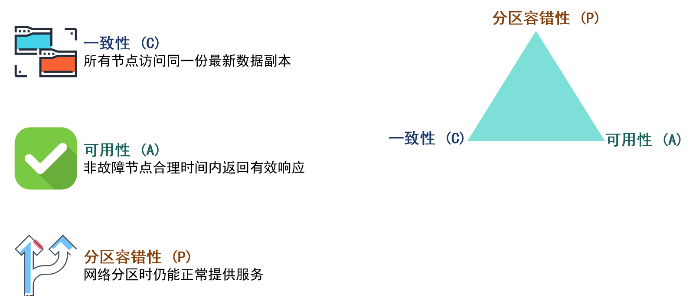
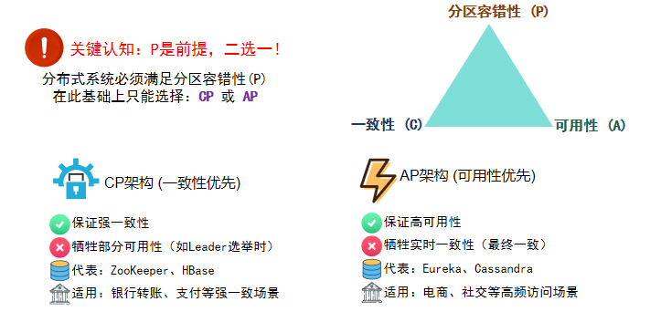
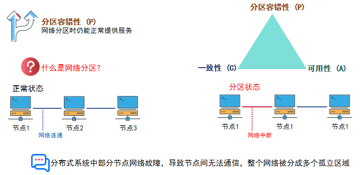
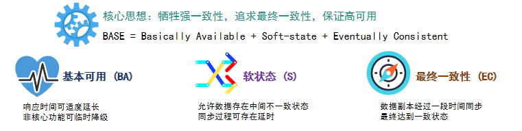
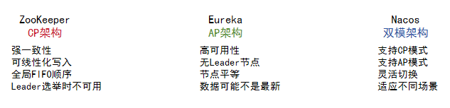
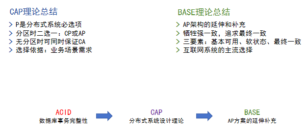

# 分布式架构核心理论：CAP 与 BASE 深度解析

## 1. 引言：为什么必须掌握 CAP&BASE 理论？
### 1.1 理论定位与学习价值
在分布式架构设计中，CAP 与 BASE 理论并非孤立的 “知识点”，而是指导技术选型、架构设计与问题排查的 “底层逻辑”。无论是微服务架构的注册中心选型、分布式数据库的一致性设计，还是缓存系统的可用性保障，都需以这两个理论为决策依据。

### 1.2 核心学习意义
+ **架构设计基石**：所有分布式系统的设计都需围绕 “一致性”“可用性”“分区容错性” 三者的平衡展开，CAP 理论明确了三者的取舍关系，BASE 理论则提供了妥协后的落地路径。
+ **业务场景匹配**：不同业务对 “数据一致性” 和 “系统可用性” 的需求差异显著（如金融交易 vs 电商商品页），掌握理论可快速匹配适合的技术方案。
+ **问题排查关键**：分布式系统中常见的 “数据不一致”“服务不可用” 问题，均可通过 CAP/BASE 理论定位根源（如 AP 架构下的临时数据延迟、CP 架构下的 Leader 选举不可用）。
+ **高级工程师必备能力**：CAP 与 BASE 是后端 / 架构师面试高频考点，也是区分 “基础开发” 与 “架构思维” 的核心标志。

## 2. CAP 理论：分布式系统的 “不可能三角”
### 2.1 理论定义与核心前提
CAP 理论由 Eric Brewer 于 2000 年提出，其核心观点为：**分布式系统无法同时满足一致性（Consistency）、可用性（Availability）和分区容错性（Partition Tolerance）三个特性，最多只能满足其中两个**。

在分布式环境中，“网络分区” 是客观存在的必然场景（如网络延迟、链路中断、节点故障），因此**分区容错性（P）是分布式系统的必选项**—— 这也是 CAP 理论 “二选一”（CP/AP）的核心前提。

### 2.2 CAP 三特性详细解析
| **特性** | **核心定义** | **核心目标** | **典型场景** |
| :--- | :--- | :--- | :--- |
| 一致性（C） | 所有节点在同一时间访问到的数据必须是 “最新且一致” 的，即写入操作后，所有读取操作都能获取到最新值 | 数据正确性 | 金融转账、订单支付 |
| 可用性（A） | 非故障节点在合理时间内（如 100ms 内）必须返回有效响应（不允许直接报错或无响应） | 系统可访问性 | 电商商品页、社交信息流 |
| 分区容错性（P） | 当网络分区发生（部分节点与其他节点断联）时，系统仍能为各分区内的用户提供正常服务 | 系统稳定性 | 跨地域分布式系统、云服务 |

### 2.3 CP 架构与 AP 架构的取舍与选型
基于 “P 必选” 的前提，分布式系统需在 “一致性（C）” 和 “可用性（A）” 之间做取舍，形成两种核心架构方向：

| **架构类型** | **核心优先级** | **一致性保障** | **可用性保障** | **典型产品** | **适用业务场景** |
| :--- | :--- | :--- | :--- | :--- | :--- |
| CP 架构 | 一致性 > 可用性 | 强一致性（写入后所有节点立即同步） | 分区或节点故障时可能短暂不可用（如 Leader 选举） | ZooKeeper、HBase、MongoDB（默认） | 金融交易、订单支付、数据对账等对数据正确性要求极高的场景 |
| AP 架构 | 可用性 > 一致性 | 最终一致性（分区恢复后数据逐步同步） | 任何情况下都保证服务可用（非故障节点均响应） | Eureka、Cassandra、Elasticsearch | 电商商品页、社交动态、缓存查询等对用户体验要求极高的场景 |

## 3. 关键概念：网络分区
### 3.1 网络分区的定义
网络分区是指分布式系统中，由于网络链路故障（如网线中断、交换机故障）、网络延迟过高或节点故障，导致部分节点与其他节点失去通信，整个系统被分割为多个 “孤立分区” 的场景。

### 3.2 网络分区的影响
+ 分区内节点无法获取其他分区的最新数据，可能导致 “数据孤岛”；
+ 若系统不具备分区容错性（P），分区后未故障的节点也可能因 “无法确认其他节点状态” 而拒绝提供服务，导致整体不可用。

### 3.3 典型场景示例
+ 跨地域部署的系统：北京节点与上海节点因骨干网络中断形成分区，两地用户仅能访问本地节点数据；
+ 容器化集群：K8s 集群中某节点网络插件故障，该节点与其他节点断联，形成独立分区。

## 4. BASE 理论：AP 架构的一致性妥协方案
### 4.1 理论背景与核心思想
CAP 理论中，AP 架构虽保障了高可用性，但牺牲了 “强一致性”，可能导致数据临时不一致（如电商商品库存延迟同步）。为解决这一问题，Amazon 团队提出了 BASE 理论，其核心思想为：**牺牲强一致性，追求 “最终一致性”，在保证高可用性的同时，通过合理设计让数据在 “可接受的时间窗口” 内达到一致**。

BASE 是 “Basically Available（基本可用）”“Soft-state（软状态）”“Eventually Consistent（最终一致性）” 的缩写，三者共同构成了 AP 架构的落地路径。

### 4.2 BASE 三要素详细解析
| **要素** | **核心定义** | **具体表现** |
| :--- | :--- | :--- |
| 基本可用（BA） | 系统在故障或高负载场景下，仍能提供 “核心功能可用” 的服务，允许非核心功能降级或响应延迟适度增加 | 1. 响应延迟延长（如正常 100ms→500ms）；2. 非核心功能降级（如双 11 隐藏商品评价功能） |
| 软状态（S） | 允许系统存在 “临时的数据不一致状态”，无需强制所有节点实时同步数据 | 1. 数据同步延迟（如朋友圈发布后 2 秒内仅自己可见）；2. 节点状态临时差异（如缓存与数据库数据暂不同步） |
| 最终一致性（EC） | 尽管存在软状态，但经过 “合理时间窗口”（如秒级、分钟级）后，所有节点的数据会自动同步至一致状态 | 1. 朋友圈发布后 10 秒内所有好友可见；2. 分布式缓存 1 分钟内与数据库数据对齐 |

## 5. 分布式一致性级别对比
在分布式系统中，一致性并非 “非黑即白”，而是存在不同级别。根据数据同步的实时性要求，可分为强一致性、弱一致性与最终一致性三类：

| **一致性级别** | **核心定义** | **数据可见性** | **响应性能** | **典型应用场景** |
| :--- | :--- | :--- | :--- | :--- |
| 强一致性 | 写入操作完成后，所有节点立即同步最新数据，任何读取操作都能获取到最新值 | 写入后立即全局可见 | 较低（需等待所有节点同步） | 金融转账、订单支付 |
| 弱一致性 | 写入操作完成后，不保证读取操作能获取到最新值，也不承诺 “何时能获取到最新值” | 可见时间不确定（可能延迟数分钟） | 较高（无需等待同步） | 早期分布式日志存储 |
| 最终一致性 | 写入操作完成后，数据存在临时不一致（软状态），但在 “可接受时间窗口” 内会自动同步至一致状态 | 延迟后全局可见（如秒级、分钟级） | 高（兼顾可用性与一致性） | 电商商品库存、社交动态 |

## 6. 最终一致性的实现方式
最终一致性的核心是 “在可接受时间内实现数据对齐”，具体落地需通过 “修复不一致数据” 的机制实现，常见方式有三类：

| **实现方式** | **核心逻辑** | **执行时机** | **优缺点分析** | **典型案例** |
| :--- | :--- | :--- | :--- | :--- |
| 读时修复 | 当用户发起数据读取请求时，检测当前节点数据与 “权威节点（如主节点）” 数据是否一致，若不一致则同步后返回最新数据 | 数据读取时触发 | 优点：读取结果必为最新；缺点：增加读取延迟，高并发场景可能导致性能瓶颈 | Cassandra Read Repair、Redis 主从同步（读时校验） |
| 写时修复 | 当用户发起数据写入请求时，在写入本地节点的同时，主动同步数据至其他关联节点（如从节点、副本节点），避免不一致扩散 | 数据写入时触发 | 优点：提前消除不一致，减少后续读取压力；缺点：轻微增加写入延迟，但整体性能优于读时修复 | Cassandra Hinted Handoff、MySQL 主从同步（写时 binlog 同步） |
| 异步修复 | 独立于 “读写操作”，通过定时任务或后台进程，周期性校验各节点数据一致性，对不一致数据进行批量同步修复 | 后台定时 / 周期性触发 | 优点：不影响读写性能，适合数据量大、一致性要求不紧急的场景；缺点：可能存在较长时间的不一致窗口 | 分布式数据库定时对账、Elasticsearch 分片同步 |

## 7. 实际案例：Dubbo 注册中心的 CAP 选型
注册中心是微服务架构的 “核心枢纽”，其 CAP 选型直接影响服务的可用性与一致性。以 Dubbo 生态常用的三种注册中心为例，其选型逻辑完全遵循 CAP/BASE 理论：

| **注册中心产品** | **CAP 选型** | **一致性级别** | **可用性保障** | **核心特性** | **适用场景** |
| :--- | :--- | :--- | :--- | :--- | :--- |
| ZooKeeper | CP | 强一致性 | 分区时可能短暂不可用（Leader 选举期间） | 基于 ZAB 协议实现数据强一致，支持分布式锁、命名服务，适合对服务列表一致性要求高的场景 | 金融级微服务、分布式事务协调 |
| Eureka | AP | 最终一致性 | 任何情况下保证可用（无 Leader 节点，节点平等） | 基于 “心跳检测 + 自我保护机制”，节点故障后其他节点仍能提供服务，数据延迟通过定时同步消除 | 互联网微服务、对可用性要求高的场景 |
| Nacos | 双模（CP/AP 可切换） | 强一致性（CP 模式）/ 最终一致性（AP 模式） | CP 模式下分区不可用，AP 模式下全局可用 | 支持动态切换模式，CP 模式适合配置中心（需强一致），AP 模式适合服务发现（需高可用） | 混合场景（如同时作为配置中心与服务注册中心） |

## 8. 核心总结与选型建议
### 8.1 理论核心结论
1. **CAP 理论**：分布式系统必选 P，CP/AP 二选一 —— 数据正确性优先选 CP，用户体验优先选 AP；
2. **BASE 理论**：AP 架构的补充方案，通过 “基本可用 + 软状态 + 最终一致性” 平衡可用性与一致性；
3. **一致性级别**：互联网系统首选 “最终一致性”，金融等核心场景可选 “强一致性”，弱一致性已极少使用；
4. **落地原则**：最终一致性的实现需结合业务场景选择 “读时修复”“写时修复” 或 “异步修复”，优先推荐写时修复（性能与一致性平衡最优）。

### 8.2 架构选型建议
+ **金融交易场景**（如转账、支付）：CP 架构 + 强一致性 + 写时修复；
+ **电商核心场景**（如商品详情、库存）：AP 架构 + 最终一致性 + 写时修复（库存）+ 异步修复（详情）；
+ **社交内容场景**（如动态、评论）：AP 架构 + 最终一致性 + 异步修复；
+ **配置中心场景**（如服务配置）：CP 架构（配置需强一致）或 Nacos 双模（兼顾配置与服务发现）。

