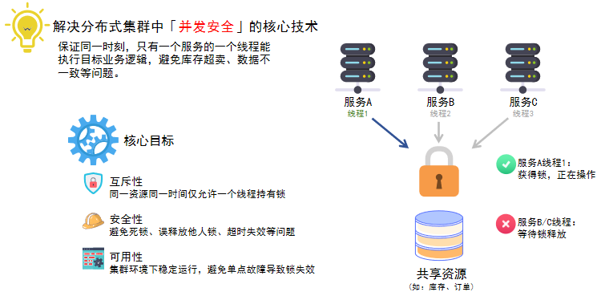
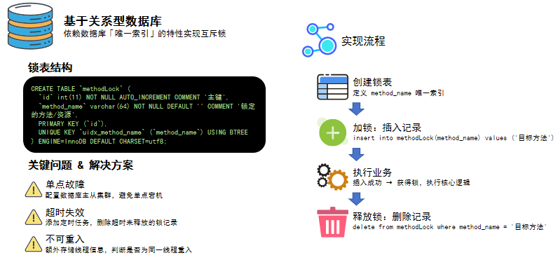
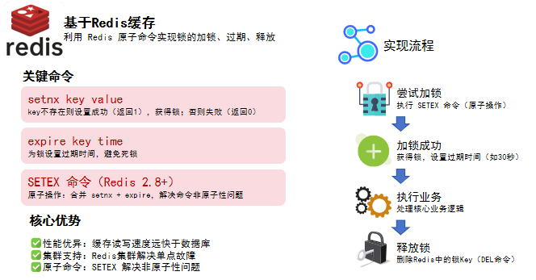
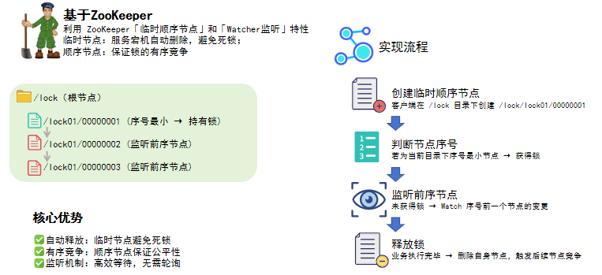
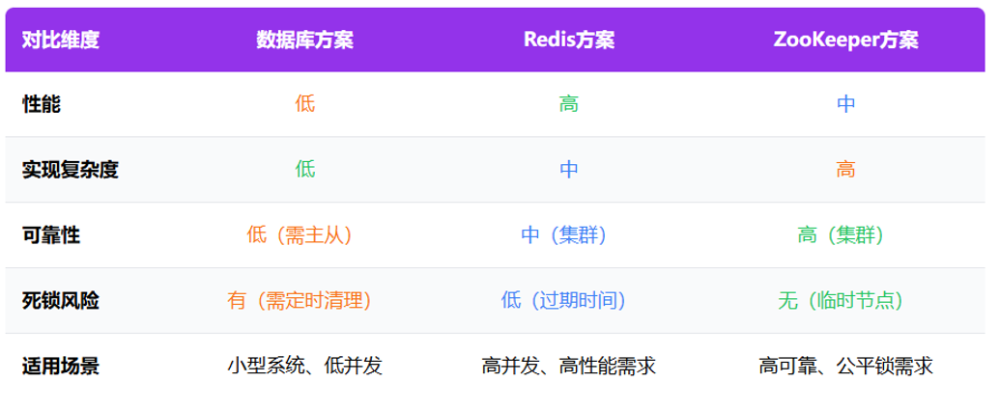

# 分布式锁深度解析：原理、实现与选型指南（附完整代码示例）

<font style="color:rgb(0, 0, 0);">在分布式系统中，多服务、多线程并发操作共享资源时，“数据一致性” 始终是核心挑战。单机环境下的</font><code><font style="color:rgba(0, 0, 0, 0.85) !important;">synchronized</font></code><font style="color:rgb(0, 0, 0);">或</font><code><font style="color:rgba(0, 0, 0, 0.85) !important;">Lock</font></code><font style="color:rgb(0, 0, 0);">无法跨进程生效，而</font>**<font style="color:rgb(0, 0, 0) !important;">分布式锁</font>**<font style="color:rgb(0, 0, 0);">正是解决这一问题的关键技术。本文将从分布式锁的核心定义出发，详细拆解三大主流实现方案（数据库、Redis、ZooKeeper），提供可落地的代码示例，并分析各方案的优缺点与选型逻辑。</font>

## <font style="color:rgb(0, 0, 0);">一、分布式锁基础：定义与核心目标</font>

<font style="color:rgb(0, 0, 0);">在深入实现前，我们需先明确分布式锁的本质与关键指标 —— 这是后续方案设计与选型的核心依据。</font>

### <font style="color:rgb(0, 0, 0);">1.1 什么是分布式锁？</font>

<font style="color:rgb(0, 0, 0);">分布式锁是</font>**<font style="color:rgb(0, 0, 0) !important;">跨进程、跨服务</font>**<font style="color:rgb(0, 0, 0);">的并发控制机制，其核心作用是：</font>**<font style="color:rgb(0, 0, 0) !important;">保证分布式集群中，同一时刻仅有一个服务的一个线程能执行目标业务逻辑</font>**<font style="color:rgb(0, 0, 0);">，从而避免库存超卖、订单重复创建、缓存一致性等问题。</font>

<font style="color:rgb(0, 0, 0);">举个典型场景：电商秒杀系统中，100 台服务器同时处理 “扣减某商品库存” 请求，若没有分布式锁，会出现 “库存为负” 的超卖问题；而通过分布式锁，仅允许一台服务器的一个线程执行 “查库存→扣库存” 的原子逻辑。</font>

### <font style="color:rgb(0, 0, 0);">1.2 分布式锁的三大核心目标</font>

<font style="color:rgb(0, 0, 0);">无论选择哪种实现方案，都需满足以下三个核心目标，否则会引入新的问题：</font>

| **<font style="color:rgb(0, 0, 0) !important;">目标</font>** | **<font style="color:rgb(0, 0, 0) !important;">核心要求</font>** |
| :--- | :--- |
| **<font style="color:rgb(0, 0, 0) !important;">互斥性</font>** | <font style="color:rgba(0, 0, 0, 0.85) !important;">同一资源在同一时间，仅允许一个线程持有锁（最基础、最核心的要求）。</font> |
| **<font style="color:rgb(0, 0, 0) !important;">安全性</font>** | <font style="color:rgba(0, 0, 0, 0.85) !important;">1. 避免死锁（如服务宕机后锁无法释放）；2. 避免误释放他人的锁；3. 支持锁超时自动释放。</font> |
| **<font style="color:rgb(0, 0, 0) !important;">可用性</font>** | <font style="color:rgba(0, 0, 0, 0.85) !important;">集群环境下，单个节点宕机不能导致锁失效（需支持集群部署）；加锁 / 释放锁操作响应迅速。</font> |



## <font style="color:rgb(0, 0, 0);">二、实现方案一：基于关系型数据库</font>

<font style="color:rgb(0, 0, 0);">基于数据库的分布式锁是最易上手的方案，无需引入额外中间件，核心依赖</font>**<font style="color:rgb(0, 0, 0) !important;">唯一索引的互斥性</font>**<font style="color:rgb(0, 0, 0);">（同一字段无法插入重复值）。</font>

### <font style="color:rgb(0, 0, 0);">2.1 原理拆解</font>

<font style="color:rgb(0, 0, 0);">数据库的唯一索引（如</font><code><font style="color:rgba(0, 0, 0, 0.85) !important;">UNIQUE KEY</font></code><font style="color:rgb(0, 0, 0);">）具有 “插入重复记录时会报错” 的特性，利用这一点：</font>

* **<font style="color:rgb(0, 0, 0) !important;">加锁</font>**<font style="color:rgb(0, 0, 0);">：向锁表插入一条包含 “资源标识” 的记录，插入成功即视为获得锁；插入失败（唯一索引冲突）则视为加锁失败。</font>
* **<font style="color:rgb(0, 0, 0) !important;">释放锁</font>**<font style="color:rgb(0, 0, 0);">：删除刚才插入的记录，释放锁资源。</font>
* **<font style="color:rgb(0, 0, 0) !important;">避免死锁</font>**<font style="color:rgb(0, 0, 0);">：通过定时任务清理超时未释放的锁记录。</font>

### <font style="color:rgb(0, 0, 0);">2.2 详细实现步骤</font>

#### <font style="color:rgb(0, 0, 0);">步骤 1：创建锁表（MySQL 示例）</font>

<font style="color:rgb(0, 0, 0);">首先创建一张用于存储锁信息的表，核心字段</font><code><font style="color:rgba(0, 0, 0, 0.85) !important;">resource_key</font></code><font style="color:rgb(0, 0, 0);">（资源标识，如 “商品 ID\_1001”）需加唯一索引：</font>

```sql
CREATE TABLE `distributed_lock` (
  `id` bigint(20) NOT NULL AUTO_INCREMENT COMMENT '主键ID',
  `resource_key` varchar(64) NOT NULL COMMENT '锁定的资源标识（如商品ID、方法名）',
  `holder_id` varchar(64) NOT NULL COMMENT '锁持有者标识（如线程ID+服务IP）',
  `create_time` datetime NOT NULL DEFAULT CURRENT_TIMESTAMP COMMENT '锁创建时间',
  `expire_time` datetime NOT NULL COMMENT '锁过期时间',
  PRIMARY KEY (`id`),
  UNIQUE KEY `uk_resource_key` (`resource_key`) USING BTREE -- 核心：唯一索引保证互斥
) ENGINE=InnoDB DEFAULT CHARSET=utf8mb4 COMMENT='分布式锁表';
```

* <code><font style="color:rgb(0, 0, 0);">holder_id</font></code><font style="color:rgb(0, 0, 0);">：用于标识锁的持有者，避免 “误释放他人锁”（如线程 A 不能释放线程 B 的锁）。</font>
* <code><font style="color:rgb(0, 0, 0);">expire_time</font></code><font style="color:rgb(0, 0, 0);">：用于判断锁是否超时，避免死锁。</font>

#### <font style="color:rgb(0, 0, 0);">步骤 2：加锁逻辑（Java 代码示例）</font>

<font style="color:rgb(0, 0, 0);">加锁时需指定 “资源标识”“持有者标识” 和 “超时时间”，通过</font><code><font style="color:rgba(0, 0, 0, 0.85) !important;">INSERT</font></code><font style="color:rgb(0, 0, 0);">语句的返回结果判断是否加锁成功：</font>

```java
import java.sql.*;
import java.util.Date;

public class DBDistributedLock {
    // 数据库连接信息（实际项目中需用连接池）
    private static final String URL = "jdbc:mysql://localhost:3306/distributed_db?useSSL=false";
    private static final String USER = "root";
    private static final String PASSWORD = "123456";

    /**
     * 加锁方法
     * @param resourceKey 资源标识（如"product_stock_1001"）
     * @param holderId 锁持有者标识（如"InetAddress.getLocalHost().getHostAddress() + '-' + Thread.currentThread().getId()"）
     * @param expireSeconds 锁超时时间（秒）
     * @return true：加锁成功；false：加锁失败
     */
    public boolean lock(String resourceKey, String holderId, int expireSeconds) {
        Connection conn = null;
        PreparedStatement pstmt = null;
        try {
            conn = DriverManager.getConnection(URL, USER, PASSWORD);
            // 计算过期时间
            Date expireTime = new Date(System.currentTimeMillis() + expireSeconds * 1000L);
            // 插入锁记录：唯一索引冲突时会抛出SQLIntegrityConstraintViolationException
            String sql = "INSERT INTO distributed_lock (resource_key, holder_id, create_time, expire_time) " +
                         "VALUES (?, ?, NOW(), ?)";
            pstmt = conn.prepareStatement(sql);
            pstmt.setString(1, resourceKey);
            pstmt.setString(2, holderId);
            pstmt.setTimestamp(3, new Timestamp(expireTime.getTime()));
            
            int affectedRows = pstmt.executeUpdate();
            return affectedRows > 0; // 插入成功 → 加锁成功
        } catch (SQLIntegrityConstraintViolationException e) {
            // 唯一索引冲突 → 锁已被持有
            return false;
        } catch (SQLException e) {
            e.printStackTrace();
            return false;
        } finally {
            // 关闭连接（实际项目中用连接池，无需手动关闭）
            try { if (pstmt != null) pstmt.close(); } catch (SQLException e) {}
            try { if (conn != null) conn.close(); } catch (SQLException e) {}
        }
    }
}
```

#### <font style="color:rgb(0, 0, 0);">步骤 3：释放锁逻辑（Java 代码示例）</font>

<font style="color:rgb(0, 0, 0);">释放锁时需同时校验 “资源标识” 和 “持有者标识”，避免误释放他人的锁：</font>

```java
/**
 * 释放锁方法
 * @param resourceKey 资源标识
 * @param holderId 锁持有者标识（需与加锁时一致）
 * @return true：释放成功；false：释放失败
 */
public boolean unlock(String resourceKey, String holderId) {
    Connection conn = null;
    PreparedStatement pstmt = null;
    try {
        conn = DriverManager.getConnection(URL, USER, PASSWORD);
        String sql = "DELETE FROM distributed_lock " +
                     "WHERE resource_key = ? AND holder_id = ?"; // 双重校验：确保释放自己的锁
        pstmt = conn.prepareStatement(sql);
        pstmt.setString(1, resourceKey);
        pstmt.setString(2, holderId);
        
        int affectedRows = pstmt.executeUpdate();
        return affectedRows > 0;
    } catch (SQLException e) {
        e.printStackTrace();
        return false;
    } finally {
        try { if (pstmt != null) pstmt.close(); } catch (SQLException e) {}
        try { if (conn != null) conn.close(); } catch (SQLException e) {}
    }
}
```

#### <font style="color:rgb(0, 0, 0);">步骤 4：解决关键问题（超时与单点故障）</font>

1. **<font style="color:rgb(0, 0, 0) !important;">锁超时失效</font>**<font style="color:rgb(0, 0, 0);">：若持有锁的服务宕机，锁无法释放，会导致死锁。需定时清理超时未释放的锁：</font>

```sql
-- 定时任务（如每10秒执行一次）：删除过期且未释放的锁
DELETE FROM distributed_lock WHERE expire_time < NOW();
```

<font style="color:rgb(0, 0, 0);">实际项目中可通过</font><code><font style="color:rgba(0, 0, 0, 0.85) !important;">Quartz</font></code><font style="color:rgb(0, 0, 0);">或 XXL-Job 实现定时任务。</font>

2. **<font style="color:rgb(0, 0, 0) !important;">数据库单点故障</font>**<font style="color:rgb(0, 0, 0);">：</font><font style="color:rgb(0, 0, 0);">若数据库单机宕机，整个锁服务失效。需部署数据库主从集群，开启主从同步，确保高可用。</font>
3. **<font style="color:rgb(0, 0, 0) !important;">不可重入问题</font>**<font style="color:rgb(0, 0, 0);">：若同一线程多次加锁，会因唯一索引冲突失败。解决方式：加锁前先查询 “是否已持有该锁且未过期”，若已持有则直接返回成功：</font>

```java
// 加锁前新增校验逻辑
private boolean isHoldLock(String resourceKey, String holderId) {
    // SQL：SELECT 1 FROM distributed_lock WHERE resource_key = ? AND holder_id = ? AND expire_time > NOW()
    // 若查询到结果 → 已持有锁，可重入
}
```

### <font style="color:rgb(0, 0, 0);">2.3 优缺点分析</font>

| **<font style="color:rgb(0, 0, 0) !important;">优点</font>** | **<font style="color:rgb(0, 0, 0) !important;">缺点</font>** |
| :--- | :--- |
| <font style="color:rgba(0, 0, 0, 0.85) !important;">实现简单，无需额外中间件</font> | <font style="color:rgba(0, 0, 0, 0.85) !important;">性能差（数据库 IO 开销大，不适合高并发）</font> |
| <font style="color:rgba(0, 0, 0, 0.85) !important;">依赖现有数据库，成本低</font> | <font style="color:rgba(0, 0, 0, 0.85) !important;">需手动处理超时、重入、单点故障问题</font> |
| <font style="color:rgba(0, 0, 0, 0.85) !important;">适合小型系统、低并发场景</font> | <font style="color:rgba(0, 0, 0, 0.85) !important;">锁释放依赖定时任务，可能存在延迟</font> |



## <font style="color:rgb(0, 0, 0);">三、实现方案二：基于 Redis（高性能首选）</font>

<font style="color:rgb(0, 0, 0);">Redis 作为内存数据库，读写性能远超关系型数据库，是高并发场景下分布式锁的首选方案。其核心依赖</font>**<font style="color:rgb(0, 0, 0) !important;">原子命令</font>**<font style="color:rgb(0, 0, 0);">和</font>**<font style="color:rgb(0, 0, 0) !important;">过期键特性</font>**<font style="color:rgb(0, 0, 0);">，避免非原子操作导致的异常。</font>

### <font style="color:rgb(0, 0, 0);">3.1 原理拆解</font>

<font style="color:rgb(0, 0, 0);">Redis 的核心优势是 “内存操作 + 原子命令”，解决了数据库方案的性能瓶颈。核心逻辑：</font>

* **<font style="color:rgb(0, 0, 0) !important;">加锁</font>**<font style="color:rgb(0, 0, 0);">：通过</font><code><font style="color:rgb(0, 0, 0);">SET resource_key holder_id NX EX expire_seconds</font></code><font style="color:rgb(0, 0, 0);">命令（原子操作），仅当</font><code><font style="color:rgb(0, 0, 0);">resource_key</font></code><font style="color:rgb(0, 0, 0);">不存在时才设置值，并指定过期时间。</font>
* **<font style="color:rgb(0, 0, 0) !important;">释放锁</font>**<font style="color:rgb(0, 0, 0);">：通过 Lua 脚本删除</font><code><font style="color:rgb(0, 0, 0);">resource_key</font></code><font style="color:rgb(0, 0, 0);">（需校验</font><code><font style="color:rgb(0, 0, 0);">holder_id</font></code><font style="color:rgb(0, 0, 0);">，避免误释放），Lua 脚本能保证操作的原子性。</font>
* **<font style="color:rgb(0, 0, 0) !important;">避免死锁</font>**<font style="color:rgb(0, 0, 0);">：利用 Redis 的</font><code><font style="color:rgb(0, 0, 0);">EX</font></code><font style="color:rgb(0, 0, 0);">过期时间，即使服务宕机，锁也会自动释放。</font>

### <font style="color:rgb(0, 0, 0);">3.2 关键命令解析</font>

<font style="color:rgb(0, 0, 0);">Redis 提供的命令是实现分布式锁的基础，需重点理解以下原子命令：</font>

| **<font style="color:rgb(0, 0, 0) !important;">命令格式</font>** | **<font style="color:rgb(0, 0, 0) !important;">含义</font>** |
| :--- | :--- |
| <code><font style="color:rgb(0, 0, 0);">SET key value NX EX ttl</font></code> | <font style="color:rgba(0, 0, 0, 0.85) !important;">原子操作：仅当 key 不存在（NX=Not Exists）时设置值，同时指定过期时间（EX=Expire，单位秒）。</font> |
| <code><font style="color:rgb(0, 0, 0);">EVAL lua_script keys args</font></code> | <font style="color:rgba(0, 0, 0, 0.85) !important;">执行 Lua 脚本，保证脚本内所有操作的原子性（避免多命令执行时的竞态条件）。</font> |
| <code><font style="color:rgb(0, 0, 0);">DEL key</font></code> | <font style="color:rgba(0, 0, 0, 0.85) !important;">删除 key（释放锁），但需配合</font><code><font style="color:rgb(0, 0, 0);">holder_id</font></code><br/><font style="color:rgba(0, 0, 0, 0.85) !important;">校验，否则会误释放他人的锁。</font> |

### <font style="color:rgb(0, 0, 0);">3.3 手动实现（Java + Jedis）</font>

#### <font style="color:rgb(0, 0, 0);">步骤 1：加锁逻辑</font>

```java
import redis.clients.jedis.Jedis;
import java.util.UUID;

public class RedisDistributedLock {
    private final Jedis jedis; // 实际项目中需用JedisPool连接池
    private final String lockPrefix = "distributed:lock:"; // 锁Key前缀，避免与其他Key冲突
    private final int defaultExpireSeconds = 30; // 默认锁超时时间（秒）

    public RedisDistributedLock(Jedis jedis) {
        this.jedis = jedis;
    }

    /**
     * 加锁方法
     * @param resourceKey 资源标识（如"product_stock_1001"）
     * @return 锁持有者标识（holderId），null：加锁失败
     */
    public String lock(String resourceKey) {
        return lock(resourceKey, defaultExpireSeconds);
    }

    public String lock(String resourceKey, int expireSeconds) {
        // 生成唯一holderId（避免误释放他人锁，如UUID+线程ID）
        String holderId = UUID.randomUUID().toString() + "-" + Thread.currentThread().getId();
        String lockKey = lockPrefix + resourceKey;

        // 原子命令：SET lockKey holderId NX EX expireSeconds
        String result = jedis.set(lockKey, holderId, "NX", "EX", expireSeconds);

        // 若返回"OK"，说明加锁成功；否则失败
        return "OK".equals(result) ? holderId : null;
    }
}
```

#### <font style="color:rgb(0, 0, 0);">步骤 2：释放锁逻辑（Lua 脚本保证原子性）</font>

<font style="color:rgb(0, 0, 0);">释放锁时需校验</font><code><font style="color:rgba(0, 0, 0, 0.85) !important;">holderId</font></code><font style="color:rgb(0, 0, 0);">，且必须用 Lua 脚本（若分两步执行 “GET holderId” 和 “DEL key”，会存在竞态条件）：</font>

```java
/**
 * 释放锁方法
 * @param resourceKey 资源标识
 * @param holderId 锁持有者标识（需与加锁时一致）
 * @return true：释放成功；false：释放失败（如锁已过期或不是自己的锁）
 */
public boolean unlock(String resourceKey, String holderId) {
    String lockKey = lockPrefix + resourceKey;
    // Lua脚本：先判断holderId是否一致，一致则删除锁
    String luaScript = "if redis.call('get', KEYS[1]) == ARGV[1] then " +
                      "return redis.call('del', KEYS[1]) " +
                      "else " +
                      "return 0 " +
                      "end";

    // 执行Lua脚本：KEYS[1] = lockKey，ARGV[1] = holderId
    Long result = (Long) jedis.eval(luaScript, 1, lockKey, holderId);
    return result != null && result > 0;
}
```

#### <font style="color:rgb(0, 0, 0);">步骤 3：解决关键问题（锁超时与可重入）</font>

1. **<font style="color:rgb(0, 0, 0) !important;">锁超时问题</font>**<font style="color:rgb(0, 0, 0);">：</font><font style="color:rgb(0, 0, 0);">若业务执行时间超过锁超时时间，锁会被自动释放，导致 “并发安全问题”。解决方案是</font>**<font style="color:rgb(0, 0, 0) !important;">看门狗机制</font>**<font style="color:rgb(0, 0, 0);">：加锁后启动一个后台线程，每隔</font><code><font style="color:rgba(0, 0, 0, 0.85) !important;">expireSeconds/3</font></code><font style="color:rgb(0, 0, 0);">秒刷新锁的过期时间（如锁超时 30 秒，每 10 秒续期一次），直到业务执行完毕。</font>
2. **<font style="color:rgb(0, 0, 0) !important;">可重入问题</font>**<font style="color:rgb(0, 0, 0);">：</font><font style="color:rgb(0, 0, 0);">手动实现可重入需存储 “锁的持有次数”，逻辑较复杂。实际项目中推荐使用</font><code><font style="color:rgba(0, 0, 0, 0.85) !important;">Redisson</font></code><font style="color:rgb(0, 0, 0);">（Redis 官方推荐客户端），其内置可重入锁、看门狗机制，无需手动处理。</font>

### <font style="color:rgb(0, 0, 0);">3.4 生产级实现（Redisson）</font>

<font style="color:rgb(0, 0, 0);">Redisson 是 Redis 官方推荐的 Java 客户端，封装了分布式锁的所有细节（可重入、看门狗、集群支持），开箱即用。</font>

#### <font style="color:rgb(0, 0, 0);">步骤 1：引入依赖</font>

```xml
<dependency>
    <groupId>org.redisson</groupId>
    <artifactId>redisson</artifactId>
    <version>3.23.5</version> <!-- 最新版本可到Maven中央仓库查询 -->
</dependency>
```

#### <font style="color:rgb(0, 0, 0);">步骤 2：Redisson 锁实现（可重入 + 自动续期）</font>

```java
import org.redisson.Redisson;
import org.redisson.api.RLock;
import org.redisson.api.RedissonClient;
import org.redisson.config.Config;

public class RedissonDistributedLock {
    private final RedissonClient redissonClient;
    private final String lockPrefix = "distributed:lock:";

    // 初始化RedissonClient（集群模式需调整config）
    public RedissonDistributedLock() {
        Config config = new Config();
        // 单机模式（生产环境建议用哨兵/集群模式）
        config.useSingleServer().setAddress("redis://localhost:6379");
        this.redissonClient = Redisson.create(config);
    }

    /**
     * 加锁（自动续期，默认30秒超时，每10秒续期一次）
     */
    public RLock lock(String resourceKey) {
        String lockKey = lockPrefix + resourceKey;
        RLock lock = redissonClient.getLock(lockKey);
        // 加锁：默认30秒超时，支持可重入（同一线程多次lock不会阻塞）
        lock.lock();
        return lock;
    }

    /**
     * 释放锁
     */
    public void unlock(RLock lock) {
        if (lock != null && lock.isHeldByCurrentThread()) {
            lock.unlock();
        }
    }

    // 业务示例
    public void deductStock(String productId) {
        RLock lock = null;
        try {
            lock = lock(productId);
            // 执行业务逻辑：查库存→扣库存
            System.out.println("扣减商品" + productId + "库存成功");
        } finally {
            // 必须在finally中释放锁，避免业务异常导致锁无法释放
            unlock(lock);
        }
    }
}
```

### <font style="color:rgb(0, 0, 0);">3.5 优缺点分析</font>

| **<font style="color:rgb(0, 0, 0) !important;">优点</font>** | **<font style="color:rgb(0, 0, 0) !important;">缺点</font>** |
| :--- | :--- |
| <font style="color:rgba(0, 0, 0, 0.85) !important;">性能极高（内存操作，QPS 支持 10 万 +）</font> | <font style="color:rgba(0, 0, 0, 0.85) !important;">需额外部署 Redis（增加运维成本）</font> |
| <font style="color:rgba(0, 0, 0, 0.85) !important;">支持集群（哨兵 / Redis Cluster），高可用</font> | <font style="color:rgba(0, 0, 0, 0.85) !important;">极端场景下（如 Redis 主从切换）可能出现 “锁丢失”（需 RedLock，但实际用得少）</font> |
| <font style="color:rgba(0, 0, 0, 0.85) !important;">Redisson 封装完善，开箱即用</font> | <font style="color:rgba(0, 0, 0, 0.85) !important;">锁超时时间需合理设置（太短续期不及时，太长影响并发）</font> |
| <font style="color:rgba(0, 0, 0, 0.85) !important;">适合高并发场景</font> | <font style="color:rgba(0, 0, 0, 0.85) !important;">——</font> |



## <font style="color:rgb(0, 0, 0);">四、实现方案三：基于 ZooKeeper（高可靠首选）</font>

<font style="color:rgb(0, 0, 0);">ZooKeeper 是分布式协调服务，基于 “临时顺序节点” 和 “Watcher 监听机制” 实现分布式锁，天然支持高可用和公平锁，适合对可靠性要求极高的场景。</font>

### <font style="color:rgb(0, 0, 0);">4.1 原理拆解</font>

<font style="color:rgb(0, 0, 0);">ZooKeeper 的节点类型是实现锁的核心，需先明确两种关键节点：</font>

1. **<font style="color:rgb(0, 0, 0) !important;">临时节点</font>**<font style="color:rgb(0, 0, 0);">：客户端与 ZooKeeper 断开连接后，节点自动删除（避免服务宕机导致死锁）。</font>
2. **<font style="color:rgb(0, 0, 0) !important;">顺序节点</font>**<font style="color:rgb(0, 0, 0);">：ZooKeeper 会为节点自动添加递增序号（如</font><code><font style="color:rgb(0, 0, 0);">lock-0000000001</font></code><font style="color:rgb(0, 0, 0);">），保证锁的有序竞争（公平锁）。</font>

<font style="color:rgb(0, 0, 0);">核心逻辑：</font>

* **<font style="color:rgb(0, 0, 0) !important;">加锁</font>**<font style="color:rgb(0, 0, 0);">：在</font><code><font style="color:rgb(0, 0, 0);">/lock</font></code><font style="color:rgb(0, 0, 0);">目录下创建 “临时顺序节点”（如</font><code><font style="color:rgb(0, 0, 0);">/lock/product_1001/lock-0000000001</font></code><font style="color:rgb(0, 0, 0);">）；创建后判断自己是否为当前目录下序号最小的节点，若是则获得锁；若不是则监听前一个节点（如</font><code><font style="color:rgb(0, 0, 0);">lock-0000000000</font></code><font style="color:rgb(0, 0, 0);">）的删除事件。</font>
* **<font style="color:rgb(0, 0, 0) !important;">释放锁</font>**<font style="color:rgb(0, 0, 0);">：业务执行完毕后，删除自己创建的节点；若服务宕机，临时节点会自动删除，触发下一个节点的监听事件，实现 “有序唤醒”。</font>

### <font style="color:rgb(0, 0, 0);">4.2 生产级实现（Java + Curator）</font>

<font style="color:rgb(0, 0, 0);">ZooKeeper 原生 API 较复杂，且需手动处理 Watcher 重连、节点创建异常等问题。推荐使用</font><code><font style="color:rgba(0, 0, 0, 0.85) !important;">Curator</font></code><font style="color:rgb(0, 0, 0);">（Apache 开源的 ZooKeeper 客户端），其</font><code><font style="color:rgba(0, 0, 0, 0.85) !important;">InterProcessMutex</font></code><font style="color:rgb(0, 0, 0);">类已封装分布式锁逻辑。</font>

#### <font style="color:rgb(0, 0, 0);">步骤 1：引入依赖</font>

```xml
<dependency>
    <groupId>org.apache.curator</groupId>
    <artifactId>curator-framework</artifactId>
    <version>5.5.0</version>
</dependency>
<dependency>
    <groupId>org.apache.curator</groupId>
    <artifactId>curator-recipes</artifactId>
    <version>5.5.0</version>
</dependency>
```

#### <font style="color:rgb(0, 0, 0);">步骤 2：Curator 锁实现（公平锁 + 自动释放）</font>

```java
import org.apache.curator.framework.CuratorFramework;
import org.apache.curator.framework.CuratorFrameworkFactory;
import org.apache.curator.framework.recipes.locks.InterProcessMutex;
import org.apache.curator.retry.ExponentialBackoffRetry;

import java.util.concurrent.TimeUnit;

public class ZkDistributedLock {
    private final CuratorFramework curatorClient;
    private final String lockPath = "/distributed/lock/"; // ZooKeeper锁根目录
    private final int sessionTimeoutMs = 60000; // 会话超时时间
    private final int connectionTimeoutMs = 15000; // 连接超时时间

    // 初始化Curator客户端
    public ZkDistributedLock() {
        this.curatorClient = CuratorFrameworkFactory.builder()
                .connectString("localhost:2181") // ZooKeeper集群地址，用逗号分隔
                .sessionTimeoutMs(sessionTimeoutMs)
                .connectionTimeoutMs(connectionTimeoutMs)
                .retryPolicy(new ExponentialBackoffRetry(1000, 3)) // 重试策略：初始1秒，重试3次
                .build();
        curatorClient.start(); // 启动客户端
    }

    /**
     * 加锁（公平锁，支持超时等待）
     * @param resourceKey 资源标识（如"product_1001"）
     * @param waitTime 等待锁的时间（秒）
     * @return InterProcessMutex锁实例，null：加锁失败
     */
    public InterProcessMutex lock(String resourceKey, int waitTime) throws Exception {
        String lockFullPath = lockPath + resourceKey;
        // 创建可重入公平锁
        InterProcessMutex lock = new InterProcessMutex(curatorClient, lockFullPath);
        // 尝试加锁：最多等待waitTime秒，超时返回false
        boolean locked = lock.acquire(waitTime, TimeUnit.SECONDS);
        return locked ? lock : null;
    }

    /**
     * 释放锁
     */
    public void unlock(InterProcessMutex lock) throws Exception {
        if (lock != null && lock.isAcquiredInThisProcess()) {
            lock.release();
        }
    }

    // 业务示例
    public void processOrder(String orderId) {
        InterProcessMutex lock = null;
        try {
            // 尝试加锁，最多等待5秒
            lock = lock(orderId, 5);
            if (lock == null) {
                throw new RuntimeException("获取锁超时，订单" + orderId + "处理失败");
            }
            // 执行业务逻辑：创建订单→扣减库存→发送通知
            System.out.println("订单" + orderId + "处理成功");
        } catch (Exception e) {
            e.printStackTrace();
        } finally {
            try {
                unlock(lock);
            } catch (Exception e) {
                e.printStackTrace();
            }
        }
    }
}
```

### <font style="color:rgb(0, 0, 0);background-color:rgba(0, 0, 0, 0);">4.3 关键特性解析</font>

1. **<font style="color:rgb(0, 0, 0) !important;background-color:rgba(0, 0, 0, 0);">公平锁</font>**<font style="color:rgb(0, 0, 0);background-color:rgba(0, 0, 0, 0);">：基于顺序节点的递增序号，保证线程按 “申请锁的顺序” 获得锁，避免饥饿问题（适合对公平性要求高的场景）。</font>
2. **<font style="color:rgb(0, 0, 0) !important;background-color:rgba(0, 0, 0, 0);">自动释放</font>**<font style="color:rgb(0, 0, 0);background-color:rgba(0, 0, 0, 0);">：临时节点特性，服务宕机后节点自动删除，无需手动处理死锁。</font>
3. **<font style="color:rgb(0, 0, 0) !important;background-color:rgba(0, 0, 0, 0);">Watcher 监听</font>**<font style="color:rgb(0, 0, 0);background-color:rgba(0, 0, 0, 0);">：无需轮询等待锁，前一个节点释放后会自动唤醒下一个节点，性能高效。</font>

### <font style="color:rgb(0, 0, 0);background-color:rgba(0, 0, 0, 0);">4.4 优缺点分析</font>

| **<font style="color:rgb(0, 0, 0) !important;background-color:rgba(0, 0, 0, 0);">优点</font>** | **<font style="color:rgb(0, 0, 0) !important;background-color:rgba(0, 0, 0, 0);">缺点</font>** |
| :--- | :--- |
| <font style="color:rgba(0, 0, 0, 0.85) !important;background-color:rgba(0, 0, 0, 0);">高可靠（ZooKeeper 集群支持 Leader 选举，无单点故障）</font> | <font style="color:rgba(0, 0, 0, 0.85) !important;background-color:rgba(0, 0, 0, 0);">性能中等（比 Redis 慢，适合中低并发）</font> |
| <font style="color:rgba(0, 0, 0, 0.85) !important;background-color:rgba(0, 0, 0, 0);">天然支持公平锁、自动释放，无需手动处理死锁</font> | <font style="color:rgba(0, 0, 0, 0.85) !important;background-color:rgba(0, 0, 0, 0);">需额外部署 ZooKeeper 集群（运维成本高）</font> |
| <font style="color:rgba(0, 0, 0, 0.85) !important;background-color:rgba(0, 0, 0, 0);">Curator 封装完善，易用性高</font> | <font style="color:rgba(0, 0, 0, 0.85) !important;background-color:rgba(0, 0, 0, 0);">节点创建 / 监听有网络开销，不适合超高频场景</font> |
| <font style="color:rgba(0, 0, 0, 0.85) !important;background-color:rgba(0, 0, 0, 0);">适合对可靠性要求极高的场景（如金融支付）</font> | <font style="color:rgba(0, 0, 0, 0.85) !important;background-color:rgba(0, 0, 0, 0);">——</font> |



## <font style="color:rgb(0, 0, 0);background-color:rgba(0, 0, 0, 0);">五、三大方案对比与选型指南</font>

<font style="color:rgb(0, 0, 0);background-color:rgba(0, 0, 0, 0);">通过前面的详细拆解，我们可以从 “性能、复杂度、可靠性” 等维度对三大方案进行对比，明确选型逻辑：</font>

| **<font style="color:rgb(0, 0, 0) !important;background-color:rgba(0, 0, 0, 0);">对比维度</font>** | **<font style="color:rgb(0, 0, 0) !important;background-color:rgba(0, 0, 0, 0);">数据库方案</font>** | **<font style="color:rgb(0, 0, 0) !important;background-color:rgba(0, 0, 0, 0);">Redis 方案</font>** | **<font style="color:rgb(0, 0, 0) !important;background-color:rgba(0, 0, 0, 0);">ZooKeeper 方案</font>** |
| :--- | :--- | :--- | :--- |
| **<font style="color:rgb(0, 0, 0) !important;background-color:rgba(0, 0, 0, 0);">性能</font>** | <font style="color:rgba(0, 0, 0, 0.85) !important;background-color:rgba(0, 0, 0, 0);">低（IO 密集，QPS≈1000）</font> | <font style="color:rgba(0, 0, 0, 0.85) !important;background-color:rgba(0, 0, 0, 0);">高（内存密集，QPS≈10 万 +）</font> | <font style="color:rgba(0, 0, 0, 0.85) !important;background-color:rgba(0, 0, 0, 0);">中（网络密集，QPS≈1 万）</font> |
| **<font style="color:rgb(0, 0, 0) !important;background-color:rgba(0, 0, 0, 0);">实现复杂度</font>** | <font style="color:rgba(0, 0, 0, 0.85) !important;background-color:rgba(0, 0, 0, 0);">低（SQL 操作，无需中间件）</font> | <font style="color:rgba(0, 0, 0, 0.85) !important;background-color:rgba(0, 0, 0, 0);">中（手动实现需处理原子性，Redisson 简化）</font> | <font style="color:rgba(0, 0, 0, 0.85) !important;background-color:rgba(0, 0, 0, 0);">低（Curator 封装，开箱即用）</font> |
| **<font style="color:rgb(0, 0, 0) !important;background-color:rgba(0, 0, 0, 0);">可靠性</font>** | <font style="color:rgba(0, 0, 0, 0.85) !important;background-color:rgba(0, 0, 0, 0);">中（需主从集群，存在锁延迟）</font> | <font style="color:rgba(0, 0, 0, 0.85) !important;background-color:rgba(0, 0, 0, 0);">高（哨兵 / 集群，极端场景锁丢失）</font> | <font style="color:rgba(0, 0, 0, 0.85) !important;background-color:rgba(0, 0, 0, 0);">极高（集群 Leader 选举，无单点故障）</font> |
| **<font style="color:rgb(0, 0, 0) !important;background-color:rgba(0, 0, 0, 0);">死锁风险</font>** | <font style="color:rgba(0, 0, 0, 0.85) !important;background-color:rgba(0, 0, 0, 0);">有（需定时清理）</font> | <font style="color:rgba(0, 0, 0, 0.85) !important;background-color:rgba(0, 0, 0, 0);">低（自动过期 + 看门狗）</font> | <font style="color:rgba(0, 0, 0, 0.85) !important;background-color:rgba(0, 0, 0, 0);">无（临时节点自动删除）</font> |
| **<font style="color:rgb(0, 0, 0) !important;background-color:rgba(0, 0, 0, 0);">公平锁支持</font>** | <font style="color:rgba(0, 0, 0, 0.85) !important;background-color:rgba(0, 0, 0, 0);">不支持（需额外开发）</font> | <font style="color:rgba(0, 0, 0, 0.85) !important;background-color:rgba(0, 0, 0, 0);">不支持（Redisson 可实现）</font> | <font style="color:rgba(0, 0, 0, 0.85) !important;background-color:rgba(0, 0, 0, 0);">天然支持</font> |
| **<font style="color:rgb(0, 0, 0) !important;background-color:rgba(0, 0, 0, 0);">适用场景</font>** | <font style="color:rgba(0, 0, 0, 0.85) !important;background-color:rgba(0, 0, 0, 0);">小型系统、低并发（如内部管理系统）</font> | <font style="color:rgba(0, 0, 0, 0.85) !important;background-color:rgba(0, 0, 0, 0);">高并发、高性能需求（如电商秒杀）</font> | <font style="color:rgba(0, 0, 0, 0.85) !important;background-color:rgba(0, 0, 0, 0);">高可靠、公平锁需求（如金融支付）</font> |



### <font style="color:rgb(0, 0, 0);background-color:rgba(0, 0, 0, 0);">选型建议</font>

1. **<font style="color:rgb(0, 0, 0) !important;background-color:rgba(0, 0, 0, 0);">小系统 / 低并发</font>**<font style="color:rgb(0, 0, 0);background-color:rgba(0, 0, 0, 0);">：优先选</font>**<font style="color:rgb(0, 0, 0) !important;background-color:rgba(0, 0, 0, 0);">数据库方案</font>**<font style="color:rgb(0, 0, 0);background-color:rgba(0, 0, 0, 0);">，无需额外中间件，成本最低。</font>
2. **<font style="color:rgb(0, 0, 0) !important;background-color:rgba(0, 0, 0, 0);">高并发 / 高性能</font>**<font style="color:rgb(0, 0, 0);background-color:rgba(0, 0, 0, 0);">：优先选</font>**<font style="color:rgb(0, 0, 0) !important;background-color:rgba(0, 0, 0, 0);">Redis 方案</font>**<font style="color:rgb(0, 0, 0);background-color:rgba(0, 0, 0, 0);">（Redisson），平衡性能与复杂度，是互联网行业的主流选择。</font>
3. **<font style="color:rgb(0, 0, 0) !important;background-color:rgba(0, 0, 0, 0);">高可靠 / 公平锁</font>**<font style="color:rgb(0, 0, 0);background-color:rgba(0, 0, 0, 0);">：优先选</font>**<font style="color:rgb(0, 0, 0) !important;background-color:rgba(0, 0, 0, 0);">ZooKeeper 方案</font>**<font style="color:rgb(0, 0, 0);background-color:rgba(0, 0, 0, 0);">（Curator），适合金融、支付等核心场景，可靠性优先于性能。</font>

## <font style="color:rgb(0, 0, 0);background-color:rgba(0, 0, 0, 0);">六、总结</font>

<font style="color:rgb(0, 0, 0);background-color:rgba(0, 0, 0, 0);">分布式锁的核心是 “跨服务互斥”，三大方案各有侧重：</font>

* <font style="color:rgb(0, 0, 0);background-color:rgba(0, 0, 0, 0);">数据库方案胜在 “简单低成本”，但性能有限；</font>
* <font style="color:rgb(0, 0, 0);background-color:rgba(0, 0, 0, 0);">Redis 方案胜在 “高性能”，是互联网场景的首选；</font>
* <font style="color:rgb(0, 0, 0);background-color:rgba(0, 0, 0, 0);">ZooKeeper 方案胜在 “高可靠”，适合对一致性要求极高的场景。</font>

<font style="color:rgb(0, 0, 0);background-color:rgba(0, 0, 0, 0);">实际项目中，无需追求 “最完美” 的方案，而是结合</font>**<font style="color:rgb(0, 0, 0) !important;background-color:rgba(0, 0, 0, 0);">并发量、可靠性要求、运维成本</font>**<font style="color:rgb(0, 0, 0);background-color:rgba(0, 0, 0, 0);">选择最适合的方案 —— 例如，电商秒杀用 Redis，金融支付用 ZooKeeper，内部系统用数据库，这才是分布式锁的正确选型逻辑。</font>

<font style="color:rgb(31, 35, 41);">  
</font>
