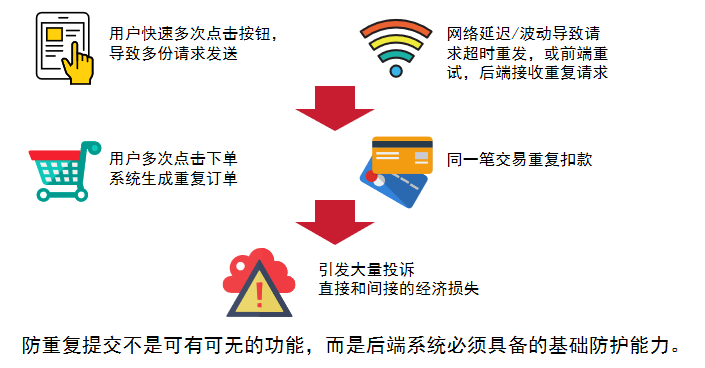
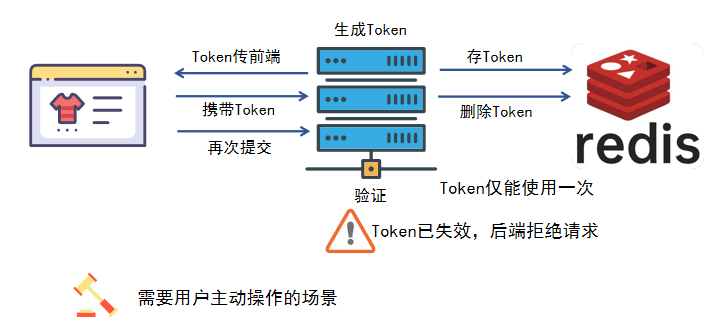
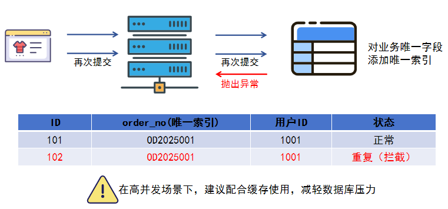
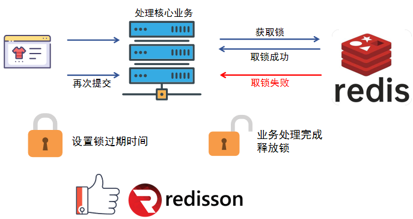
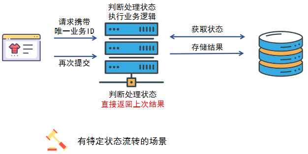
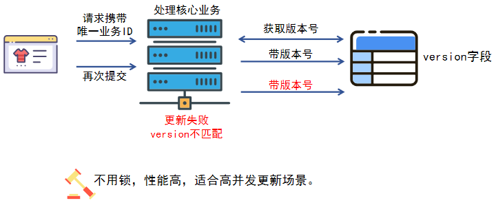
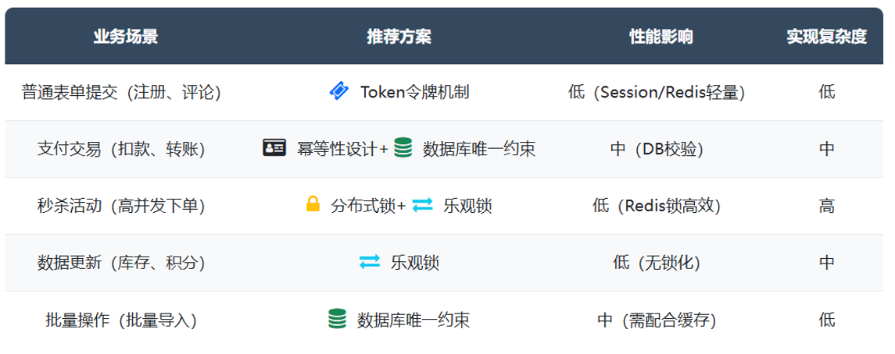
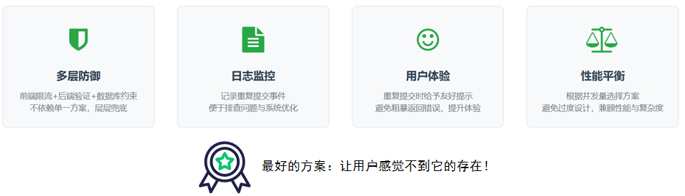

# 接口防重复提交：从原理到落地的 5 大实战方案（附完整代码）

<font style="color:rgb(0, 0, 0);">在后端开发中，“接口重复提交” 是个看似微小却能引发重大生产事故的问题 —— 用户连续点击下单按钮生成 10 条重复订单、支付超时重试导致用户被重复扣款、秒杀场景下库存被超卖…… 这些问题不仅会造成直接经济损失，还会严重影响用户体验。本文结合实战场景，从 “问题根源” 到 “方案落地”，详解 5 种接口防重复提交方案，每个方案均附原理示意、核心代码及选型建议，可直接应用于项目开发。</font>

## <font style="color:rgb(0, 0, 0);">一、先搞懂：接口重复提交的根源与危害</font>

<font style="color:rgb(0, 0, 0);">在讲解决方案前，我们必须先明确 “重复提交” 的本质 ——</font>**<font style="color:rgb(0, 0, 0) !important;">同一业务请求在短时间内被多次发送到后端，并被多次处理</font>**<font style="color:rgb(0, 0, 0);">。其根源主要有两类：</font>

### <font style="color:rgb(0, 0, 0);">1. 触发原因</font>

* **<font style="color:rgb(0, 0, 0) !important;">用户操作失误</font>**<font style="color:rgb(0, 0, 0);">：用户在网络卡顿、按钮无反馈时，快速点击提交按钮（如表单提交、支付确认），导致多份请求同步发送。</font>
* **<font style="color:rgb(0, 0, 0) !important;">网络波动 / 重试机制</font>**<font style="color:rgb(0, 0, 0);">：请求因网络延迟超时，前端重试逻辑（如 Axios 重试）、网关重发（如 Nginx 重试）或第三方回调重试（如支付回调），导致后端接收重复请求。</font>

### <font style="color:rgb(0, 0, 0);">2. 典型危害</font>

* **<font style="color:rgb(0, 0, 0) !important;">数据一致性破坏</font>**<font style="color:rgb(0, 0, 0);">：重复订单导致库存超扣、用户积分重复增加 / 减少。</font>
* **<font style="color:rgb(0, 0, 0) !important;">经济损失</font>**<font style="color:rgb(0, 0, 0);">：支付接口重复处理导致用户被重复扣款，引发投诉与退款。</font>
* **<font style="color:rgb(0, 0, 0) !important;">系统压力增大</font>**<font style="color:rgb(0, 0, 0);">：无效重复请求占用数据库连接、线程资源，高并发场景下可能引发服务过载。</font>



## <font style="color:rgb(0, 0, 0);">二、5 大实战方案：从单体到分布式，全覆盖</font>

<font style="color:rgb(0, 0, 0);">以下方案按 “实现复杂度”“适用场景” 逐步递进，覆盖单体应用、分布式系统、高并发等不同场景，每个方案均提供</font>**<font style="color:rgb(0, 0, 0) !important;">原理示意</font>**<font style="color:rgb(0, 0, 0);">（对应 PPT 截图位置）、</font>**<font style="color:rgb(0, 0, 0) !important;">核心代码</font>**<font style="color:rgb(0, 0, 0);">及</font>**<font style="color:rgb(0, 0, 0) !important;">落地注意事项</font>**<font style="color:rgb(0, 0, 0);">。</font>

### <font style="color:rgb(0, 0, 0);">方案 1：Token 令牌机制 —— 应用的 “一次性门票”</font>

#### <font style="color:rgb(0, 0, 0);">原理示意</font>

<font style="color:rgb(0, 0, 0);">Token 机制是单体应用中最常用的方案，核心逻辑是 “给每个请求发一张一次性门票”，流程如下：</font>

1. <font style="color:rgb(0, 0, 0);">用户访问表单页时，后端生成唯一 Token（如 UUID），存储到</font><code><font style="color:rgb(0, 0, 0);">Session</font></code><font style="color:rgb(0, 0, 0);">或</font><code><font style="color:rgb(0, 0, 0);">Redis</font></code><font style="color:rgb(0, 0, 0);">。</font>
2. <font style="color:rgb(0, 0, 0);">前端接收 Token，通过隐藏表单域或请求头携带。</font>
3. <font style="color:rgb(0, 0, 0);">用户提交请求时，前端携带 Token 发送到后端。</font>
4. <font style="color:rgb(0, 0, 0);">后端验证 Token 有效性：有效则处理业务，处理完成后</font>**<font style="color:rgb(0, 0, 0) !important;">立即删除 Token</font>**<font style="color:rgb(0, 0, 0);">；无效则拒绝请求。</font>



#### <font style="color:rgb(0, 0, 0);">核心代码实现（Spring Boot 示例）</font>

##### <font style="color:rgb(0, 0, 0);">1. Token 生成与返回（Controller 层）</font>

```java
import org.springframework.web.bind.annotation.GetMapping;
import org.springframework.web.bind.annotation.RestController;
import javax.servlet.http.HttpSession;
import java.util.UUID;

@RestController
public class TokenController {

    // 1. 生成Token并存储到Session
    @GetMapping("/api/form/token")
    public String getFormToken(HttpSession session) {
        // 生成唯一Token
        String token = "FORM_TOKEN_" + UUID.randomUUID().toString().replace("-", "");
        // 存储到Session（分布式场景可替换为Redis）
        session.setAttribute("FORM_TOKEN", token);
        return token; // 返回给前端，前端存储在隐藏域或localStorage
    }
}
```

##### <font style="color:rgb(0, 0, 0);">2. Token 验证与失效（拦截器 / Aspect）</font>

<font style="color:rgb(0, 0, 0);">推荐用拦截器统一处理 Token 验证，避免在业务代码中冗余：</font>

```java
import org.springframework.web.servlet.HandlerInterceptor;
import javax.servlet.http.HttpServletRequest;
import javax.servlet.http.HttpServletResponse;
import javax.servlet.http.HttpSession;

public class TokenInterceptor implements HandlerInterceptor {

    @Override
    public boolean preHandle(HttpServletRequest request, HttpServletResponse response, Object handler) throws Exception {
        // 2. 从请求中获取前端携带的Token
        String clientToken = request.getParameter("formToken");
        if (clientToken == null || clientToken.isEmpty()) {
            response.getWriter().write("非法请求：缺少Token");
            return false;
        }

        // 3. 从Session获取后端存储的Token
        HttpSession session = request.getSession();
        String serverToken = (String) session.getAttribute("FORM_TOKEN");
        if (serverToken == null || !serverToken.equals(clientToken)) {
            response.getWriter().write("请勿重复提交表单");
            return false;
        }

        // 4. 验证通过，立即删除Token（关键：确保一次性使用）
        session.removeAttribute("FORM_TOKEN");
        return true; // 放行，进入业务逻辑
    }
}
```

#### <font style="color:rgb(0, 0, 0);">适用场景</font>

* <font style="color:rgb(0, 0, 0);">单体应用中的表单提交（注册、登录、评论发布）。</font>
* <font style="color:rgb(0, 0, 0);">需要用户主动操作的场景（非异步回调）。</font>

#### <font style="color:rgb(0, 0, 0);">注意事项</font>

* <font style="color:rgb(0, 0, 0);">分布式场景下，</font><code><font style="color:rgb(0, 0, 0);">Session</font></code><font style="color:rgb(0, 0, 0);">需替换为</font><code><font style="color:rgb(0, 0, 0);">Redis</font></code><font style="color:rgb(0, 0, 0);">（确保多服务器共享 Token）。</font>
* <font style="color:rgb(0, 0, 0);">Token 需设置过期时间（如 15 分钟），避免无效 Token 占用存储。</font>

### <font style="color:rgb(0, 0, 0);">方案 2：数据库唯一约束 —— 数据的 “最后防线”</font>

#### <font style="color:rgb(0, 0, 0);">原理示意</font>

<font style="color:rgb(0, 0, 0);">Token 机制可能因缓存失效、拦截器漏判失效，此时数据库唯一约束可作为 “兜底方案”—— 通过对</font>**<font style="color:rgb(0, 0, 0) !important;">业务唯一字段</font>**<font style="color:rgb(0, 0, 0);">（如订单号、支付流水号）添加唯一索引，强制数据库拒绝重复数据插入。流程如下：</font>

1. <font style="color:rgb(0, 0, 0);">设计表结构时，对业务唯一字段（如</font><code><font style="color:rgb(0, 0, 0);">order_no</font></code><font style="color:rgb(0, 0, 0);">）添加唯一索引。</font>
2. <font style="color:rgb(0, 0, 0);">正常请求：插入数据时，唯一索引无冲突，插入成功。</font>
3. <font style="color:rgb(0, 0, 0);">重复请求：插入数据时，唯一索引冲突，数据库抛出</font><code><font style="color:rgb(0, 0, 0);">DuplicateKeyException</font></code><font style="color:rgb(0, 0, 0);">，后端捕获异常并返回 “请求已处理”。</font>



#### <font style="color:rgb(0, 0, 0);">核心代码实现</font>

##### <font style="color:rgb(0, 0, 0);">1. 数据库表设计（添加唯一索引）</font>

```sql
-- 订单表示例：对order_no添加唯一索引
CREATE TABLE `orders` (
  `id` bigint NOT NULL AUTO_INCREMENT COMMENT '订单ID',
  `order_no` varchar(64) NOT NULL COMMENT '订单号（唯一）',
  `user_id` bigint NOT NULL COMMENT '用户ID',
  `amount` decimal(10,2) NOT NULL COMMENT '订单金额',
  `status` tinyint NOT NULL COMMENT '订单状态',
  PRIMARY KEY (`id`),
  -- 核心：业务唯一字段的唯一索引
  UNIQUE KEY `uk_order_no` (`order_no`) 
) ENGINE=InnoDB DEFAULT CHARSET=utf8mb4 COMMENT='订单表';
```

##### <font style="color:rgb(0, 0, 0);">2. 后端异常处理（Service 层）</font>

```java
import org.springframework.dao.DuplicateKeyException;
import org.springframework.stereotype.Service;
import org.springframework.transaction.annotation.Transactional;

@Service
public class OrderService {

    @Autowired
    private OrderMapper orderMapper;

    @Transactional(rollbackFor = Exception.class)
    public String createOrder(OrderDTO orderDTO) {
        try {
            // 1. 生成唯一订单号（如：OD+时间戳+随机数）
            String orderNo = "OD" + System.currentTimeMillis() + (int)(Math.random()*1000);
            orderDTO.setOrderNo(orderNo);
            
            // 2. 插入订单（若order_no重复，会抛DuplicateKeyException）
            orderMapper.insert(orderDTO);
            return "订单创建成功，订单号：" + orderNo;
        } catch (DuplicateKeyException e) {
            // 3. 捕获重复键异常，返回友好提示（不暴露底层异常）
            log.warn("订单已存在，order_no: {}", orderDTO.getOrderNo());
            return "订单已提交，请稍后刷新查看";
        }
    }
}
```

#### <font style="color:rgb(0, 0, 0);">适用场景</font>

* <font style="color:rgb(0, 0, 0);">所有涉及 “唯一业务标识” 的场景（订单、支付、批量导入）。</font>
* <font style="color:rgb(0, 0, 0);">作为其他方案的 “兜底机制”，确保数据绝对不重复。</font>

#### <font style="color:rgb(0, 0, 0);">注意事项</font>

* <font style="color:rgb(0, 0, 0);">高并发场景下，需配合 Redis 缓存提前校验 “业务唯一字段是否已存在”，避免大量请求直接命中数据库（减少</font><code><font style="color:rgb(0, 0, 0);">DuplicateKeyException</font></code><font style="color:rgb(0, 0, 0);">抛出频率）。</font>
* <font style="color:rgb(0, 0, 0);">唯一索引字段需提前设计（如订单号需全局唯一，避免分布式场景下生成重复值）。</font>

### <font style="color:rgb(0, 0, 0);">方案 3：Redis 分布式锁 —— 分布式系统的 “并发控制器”</font>

#### <font style="color:rgb(0, 0, 0);">原理示意</font>

<font style="color:rgb(0, 0, 0);">分布式系统中，多台服务器无法共享本地锁，此时需用 Redis 分布式锁控制并发 —— 通过 Redis 的 “原子操作” 确保同一时间只有一个请求能处理业务。流程如下：</font>

1. <font style="color:rgb(0, 0, 0);">请求携带业务 ID（如</font><code><font style="color:rgb(0, 0, 0);">orderId</font></code><font style="color:rgb(0, 0, 0);">），尝试获取 Redis 锁（锁 Key：</font><code><font style="color:rgb(0, 0, 0);">lock:order:{orderId}</font></code><font style="color:rgb(0, 0, 0);">）。</font>
2. <font style="color:rgb(0, 0, 0);">锁获取成功：处理核心业务（如创建订单、扣库存），处理完成后释放锁。</font>
3. <font style="color:rgb(0, 0, 0);">锁获取失败：说明有其他请求正在处理，直接返回 “系统繁忙，请稍后重试”。</font>



#### <font style="color:rgb(0, 0, 0);">核心代码实现（Redisson 示例）</font>

<font style="color:rgb(0, 0, 0);">推荐使用 Redisson 框架，它封装了分布式锁的自动续期、公平锁、可重入锁等特性，避免原生 Redis 命令的 “死锁”“锁超时” 问题。</font>

##### <font style="color:rgb(0, 0, 0);">1. 引入依赖</font>

```xml
<!-- Redisson依赖 -->
<dependency>
    <groupId>org.redisson</groupId>
    <artifactId>redisson-spring-boot-starter</artifactId>
    <version>3.23.3</version>
</dependency>
```

##### <font style="color:rgb(0, 0, 0);">2. 分布式锁实现（Service 层）</font>

```java
import org.redisson.api.RLock;
import org.redisson.api.RedissonClient;
import org.springframework.stereotype.Service;
import javax.annotation.Resource;
import java.util.concurrent.TimeUnit;

@Service
public class SeckillService {

    @Resource
    private RedissonClient redissonClient;

    @Resource
    private ProductMapper productMapper;

    // 秒杀扣库存接口
    public String seckill(Long productId, Long userId) {
        // 1. 定义锁Key：按业务ID区分（避免锁竞争）
        String lockKey = "LOCK_SECKILL_PRODUCT_" + productId;
        RLock lock = redissonClient.getLock(lockKey);

        try {
            // 2. 尝试获取锁：等待1秒，10秒后自动释放（避免死锁）
            boolean isLocked = lock.tryLock(1, 10, TimeUnit.SECONDS);
            if (!isLocked) {
                // 3. 锁获取失败：返回繁忙提示
                return "系统繁忙，请稍后重试";
            }

            // 4. 锁获取成功：处理核心业务（查询库存→扣库存）
            ProductDO product = productMapper.selectById(productId);
            if (product == null || product.getStock() <= 0) {
                return "商品已售罄";
            }

            // 扣库存（实际项目需加事务）
            product.setStock(product.getStock() - 1);
            productMapper.updateById(product);
            return "秒杀成功！剩余库存：" + product.getStock();

        } catch (InterruptedException e) {
            log.error("秒杀异常", e);
            return "秒杀失败，请重试";
        } finally {
            // 5. 释放锁（必须在finally中，确保锁一定释放）
            if (lock.isHeldByCurrentThread()) {
                lock.unlock();
            }
        }
    }
}
```

#### <font style="color:rgb(0, 0, 0);">适用场景</font>

* <font style="color:rgb(0, 0, 0);">分布式系统中的高并发场景（秒杀、抢购、高并发下单）。</font>
* <font style="color:rgb(0, 0, 0);">需要控制 “同一资源同一时间仅被一个请求处理” 的场景。</font>

#### <font style="color:rgb(0, 0, 0);">注意事项</font>

* <font style="color:rgb(0, 0, 0);">锁 Key 需按 “业务维度” 设计（如</font><code><font style="color:rgb(0, 0, 0);">productId</font></code><font style="color:rgb(0, 0, 0);">），避免 “全局锁” 导致所有请求竞争同一把锁，降低性能。</font>
* <font style="color:rgb(0, 0, 0);">必须设置锁的 “等待时间” 和 “自动释放时间”：等待时间避免请求长时间阻塞，自动释放时间避免死锁（Redisson 会自动续期，无需手动延长）。</font>

### <font style="color:rgb(0, 0, 0);">方案 4：幂等性设计（状态机）—— 重复请求 “无害化”</font>

#### <font style="color:rgb(0, 0, 0);">原理示意</font>

<font style="color:rgb(0, 0, 0);">幂等性的核心定义是 “多次执行同一操作，结果与一次执行一致”。通过 “业务 ID + 状态机” 实现：</font>

1. <font style="color:rgb(0, 0, 0);">前端请求携带</font>**<font style="color:rgb(0, 0, 0) !important;">全局唯一业务 ID</font>**<font style="color:rgb(0, 0, 0);">（如支付场景的</font><code><font style="color:rgb(0, 0, 0);">outTradeNo</font></code><font style="color:rgb(0, 0, 0);">、订单场景的</font><code><font style="color:rgb(0, 0, 0);">orderNo</font></code><font style="color:rgb(0, 0, 0);">）。</font>
2. <font style="color:rgb(0, 0, 0);">后端接收请求后，先查询 “该业务 ID 的处理状态”（从 Redis / 数据库查询）。</font>
3. <font style="color:rgb(0, 0, 0);">状态判断：</font>
   * <font style="color:rgb(0, 0, 0);">未处理：执行业务逻辑，存储结果和状态（如 “处理成功”）。</font>
   * <font style="color:rgb(0, 0, 0);">已处理：直接返回历史结果，不重复执行业务。</font>



#### <font style="color:rgb(0, 0, 0);">核心代码实现（支付接口示例）</font>

##### <font style="color:rgb(0, 0, 0);">1. 幂等性验证（Service 层）</font>

```java
import org.springframework.stereotype.Service;
import org.springframework.transaction.annotation.Transactional;
import javax.annotation.Resource;
import java.util.concurrent.TimeUnit;

@Service
public class PaymentService {

    @Resource
    private RedisTemplate<String, String> redisTemplate;

    @Resource
    private PaymentMapper paymentMapper;

    // 支付接口：outTradeNo为商户唯一订单号（幂等性Key）
    @Transactional(rollbackFor = Exception.class)
    public String pay(String outTradeNo, Long userId, BigDecimal amount) {
        // 1. 定义幂等性Key：存储该业务ID的处理状态
        String idempotentKey = "IDEMPOTENT_PAY_" + outTradeNo;

        // 2. 先查Redis：判断是否已处理（避免查库，提高性能）
        String payStatus = redisTemplate.opsForValue().get(idempotentKey);
        if ("SUCCESS".equals(payStatus)) {
            // 3. 已处理：直接返回历史结果
            return "支付成功（重复请求），订单号：" + outTradeNo;
        }

        // 4. 未处理：查询数据库确认状态（Redis可能失效）
        PaymentDO payment = paymentMapper.selectByOutTradeNo(outTradeNo);
        if (payment != null && payment.getStatus() == 1) {
            // 数据库已存在成功记录：更新Redis并返回
            redisTemplate.opsForValue().set(idempotentKey, "SUCCESS", 24, TimeUnit.HOURS);
            return "支付成功（重复请求），订单号：" + outTradeNo;
        }

        // 5. 执行业务逻辑：调用第三方支付接口（如支付宝）
        String payResult = callAlipay(outTradeNo, amount); // 模拟调用支付宝
        if ("SUCCESS".equals(payResult)) {
            // 6. 支付成功：更新数据库和Redis
            if (payment == null) {
                payment = new PaymentDO();
                payment.setOutTradeNo(outTradeNo);
                payment.setUserId(userId);
                payment.setAmount(amount);
                payment.setStatus(1); // 1=支付成功
                paymentMapper.insert(payment);
            } else {
                payment.setStatus(1);
                paymentMapper.updateById(payment);
            }
            // Redis设置24小时过期（避免永久存储）
            redisTemplate.opsForValue().set(idempotentKey, "SUCCESS", 24, TimeUnit.HOURS);
            return "支付成功，订单号：" + outTradeNo;
        }

        return "支付失败，请重试";
    }

    // 模拟调用第三方支付接口
    private String callAlipay(String outTradeNo, BigDecimal amount) {
        // 实际项目中调用支付宝SDK，此处简化
        return "SUCCESS";
    }
}
```

#### <font style="color:rgb(0, 0, 0);">适用场景</font>

* <font style="color:rgb(0, 0, 0);">第三方回调接口（支付回调、消息推送回调）。</font>
* <font style="color:rgb(0, 0, 0);">有明确状态流转的业务（支付：初始化→处理中→成功 / 失败；订单：待支付→已支付→已发货）。</font>

#### <font style="color:rgb(0, 0, 0);">注意事项</font>

* <font style="color:rgb(0, 0, 0);">业务 ID 必须 “全局唯一” 且 “与业务强绑定”（如商户订单号</font><code><font style="color:rgb(0, 0, 0);">outTradeNo</font></code><font style="color:rgb(0, 0, 0);">，不可用随机 UUID）。</font>
* <font style="color:rgb(0, 0, 0);">状态判断需 “先查缓存，再查数据库”：缓存提高性能，数据库确保数据一致性（避免缓存失效导致重复处理）。</font>

### <font style="color:rgb(0, 0, 0);">方案 5：乐观锁 —— 高并发数据更新的 “无锁方案”</font>

#### <font style="color:rgb(0, 0, 0);">原理示意</font>

<font style="color:rgb(0, 0, 0);">乐观锁基于 “无锁思想”，通过 “版本号（version）” 控制数据更新，适用于 “读多写少” 的高并发场景。流程如下：</font>

1. <font style="color:rgb(0, 0, 0);">表结构添加</font><code><font style="color:rgb(0, 0, 0);">version</font></code><font style="color:rgb(0, 0, 0);">字段（初始值 0，每次更新 + 1）。</font>
2. <font style="color:rgb(0, 0, 0);">查询数据时，同时获取</font><code><font style="color:rgb(0, 0, 0);">version</font></code><font style="color:rgb(0, 0, 0);">（如：</font><code><font style="color:rgb(0, 0, 0);">SELECT id, stock, version FROM product WHERE id=1</font></code><font style="color:rgb(0, 0, 0);">）。</font>
3. <font style="color:rgb(0, 0, 0);">更新数据时，添加</font><code><font style="color:rgb(0, 0, 0);">version</font></code><font style="color:rgb(0, 0, 0);">条件（如：</font><code><font style="color:rgb(0, 0, 0);">UPDATE product SET stock=stock-1, version=version+1 WHERE id=1 AND version=5</font></code><font style="color:rgb(0, 0, 0);">）。</font>
4. <font style="color:rgb(0, 0, 0);">判断更新行数：</font>
   * <font style="color:rgb(0, 0, 0);">行数 > 0：更新成功（version 匹配，无并发冲突）。</font>
   * <font style="color:rgb(0, 0, 0);">行数 = 0：更新失败（version 不匹配，有并发冲突，需重试）。</font>



#### <font style="color:rgb(0, 0, 0);">核心代码实现（MyBatis 示例）</font>

##### <font style="color:rgb(0, 0, 0);">1. 实体类与表结构</font>

```java
// 商品实体类：添加version字段
@Data
public class ProductDO {
    private Long id;
    private String name;
    private Integer stock; // 库存
    private Integer version; // 乐观锁版本号
}
```

```sql
-- 商品表：添加version字段
ALTER TABLE `product` ADD COLUMN `version` INT NOT NULL DEFAULT 0 COMMENT '乐观锁版本号' AFTER `stock`;
```

##### <font style="color:rgb(0, 0, 0);">2. MyBatis XML 更新语句</font>

```xml
<!-- 商品库存扣减：带version条件 -->
<update id="decreaseStock">
    UPDATE product 
    SET stock = stock - 1, 
        version = version + 1  -- 版本号自增
    WHERE id = #{id} 
      AND version = #{version} -- 核心：仅当版本号匹配时更新
      AND stock > 0; -- 确保库存不为负
</update>
```

##### <font style="color:rgb(0, 0, 0);">3. Service 层调用</font>

```java
import org.springframework.stereotype.Service;
import org.springframework.transaction.annotation.Transactional;
import javax.annotation.Resource;

@Service
public class ProductService {

    @Resource
    private ProductMapper productMapper;

    // 乐观锁扣库存（支持重试）
    @Transactional(rollbackFor = Exception.class)
    public String decreaseStock(Long productId, int retryCount) {
        // 重试机制：避免因并发冲突导致一次请求失败
        for (int i = 0; i < retryCount; i++) {
            // 1. 查询商品（含version）
            ProductDO product = productMapper.selectById(productId);
            if (product == null || product.getStock() <= 0) {
                return "商品库存不足";
            }

            // 2. 尝试更新库存（带version条件）
            int rows = productMapper.decreaseStock(productId, product.getVersion());
            if (rows > 0) {
                // 3. 更新成功：返回结果
                return "库存扣减成功，剩余库存：" + (product.getStock() - 1);
            }

            // 4. 更新失败：等待100ms后重试（避免立即重试导致CPU空转）
            try {
                Thread.sleep(100);
            } catch (InterruptedException e) {
                Thread.currentThread().interrupt();
                break;
            }
        }

        // 重试次数耗尽：返回失败
        return "库存扣减失败，请稍后重试";
    }
}
```

#### <font style="color:rgb(0, 0, 0);">适用场景</font>

* <font style="color:rgb(0, 0, 0);">高并发数据更新场景（库存扣减、用户积分更新、订单状态变更）。</font>
* <font style="color:rgb(0, 0, 0);">“读多写少” 的场景（乐观锁无锁竞争，性能优于悲观锁）。</font>

#### <font style="color:rgb(0, 0, 0);">注意事项</font>

* <font style="color:rgb(0, 0, 0);">需添加 “重试机制”：单次更新失败可能是并发冲突，重试 1-3 次可提高成功率（重试间隔不宜过短，避免 CPU 空转）。</font>
* <font style="color:rgb(0, 0, 0);">不适用于 “写多” 场景：若并发更新频繁，重试多次仍失败，会影响用户体验（此时建议用分布式锁）。</font>

## <font style="color:rgb(0, 0, 0);">三、技术选型指南：按场景选方案，不做过度设计</font>

| **<font style="color:rgb(0, 0, 0) !important;">业务场景</font>** | **<font style="color:rgb(0, 0, 0) !important;">推荐方案</font>** | **<font style="color:rgb(0, 0, 0) !important;">性能影响</font>** | **<font style="color:rgb(0, 0, 0) !important;">实现复杂度</font>** |
| :--- | :--- | :--- | :--- |
| <font style="color:rgba(0, 0, 0, 0.85) !important;">普通表单提交（注册、评论）</font> | <font style="color:rgba(0, 0, 0, 0.85) !important;">Token 令牌机制</font> | <font style="color:rgba(0, 0, 0, 0.85) !important;">低（Session/Redis 轻量）</font> | <font style="color:rgba(0, 0, 0, 0.85) !important;">低</font> |
| <font style="color:rgba(0, 0, 0, 0.85) !important;">支付交易（扣款、转账）</font> | <font style="color:rgba(0, 0, 0, 0.85) !important;">幂等性设计 + 数据库唯一约束</font> | <font style="color:rgba(0, 0, 0, 0.85) !important;">中（DB 校验）</font> | <font style="color:rgba(0, 0, 0, 0.85) !important;">中</font> |
| <font style="color:rgba(0, 0, 0, 0.85) !important;">秒杀 / 高并发下单</font> | <font style="color:rgba(0, 0, 0, 0.85) !important;">Redis 分布式锁 + 乐观锁</font> | <font style="color:rgba(0, 0, 0, 0.85) !important;">低（Redis 锁高效）</font> | <font style="color:rgba(0, 0, 0, 0.85) !important;">高</font> |
| <font style="color:rgba(0, 0, 0, 0.85) !important;">库存 / 积分更新</font> | <font style="color:rgba(0, 0, 0, 0.85) !important;">乐观锁</font> | <font style="color:rgba(0, 0, 0, 0.85) !important;">低（无锁化）</font> | <font style="color:rgba(0, 0, 0, 0.85) !important;">中</font> |
| <font style="color:rgba(0, 0, 0, 0.85) !important;">批量导入 / 数据同步</font> | <font style="color:rgba(0, 0, 0, 0.85) !important;">数据库唯一约束</font> | <font style="color:rgba(0, 0, 0, 0.85) !important;">中（需配合缓存）</font> | <font style="color:rgba(0, 0, 0, 0.85) !important;">低</font> |



## <font style="color:rgb(0, 0, 0);">四、落地建议：让方案更稳、体验更好</font>

1. **<font style="color:rgb(0, 0, 0) !important;">多层防御，不依赖单一方案</font>**<font style="color:rgb(0, 0, 0);">前端做 “按钮置灰 + 防抖”（防用户手抖），后端用 “Token / 分布式锁”（防重复请求），数据库用 “唯一约束”（兜底），三层防护确保万无一失。</font>
2. **<font style="color:rgb(0, 0, 0) !important;">日志监控与告警</font>**<font style="color:rgb(0, 0, 0);">对重复请求添加日志（记录业务 ID、请求时间、处理结果），便于排查问题；同时设置告警（如短时间内重复请求超过阈值），及时发现异常。</font>
3. **<font style="color:rgb(0, 0, 0) !important;">友好的用户反馈</font>**<font style="color:rgb(0, 0, 0);">重复请求时，避免返回 “系统错误”，应返回友好提示（如 “您的请求已提交，请稍后刷新”“点击太快啦，休息一下～”），提升用户体验。</font>
4. **<font style="color:rgb(0, 0, 0) !important;">避免过度设计</font>**<font style="color:rgb(0, 0, 0);">小项目用 “Token + 数据库唯一约束” 即可，无需上来就上分布式锁；高并发场景再引入 Redis 锁，平衡性能与复杂度。</font>



## <font style="color:rgb(0, 0, 0);">五、总结</font>

<font style="color:rgb(0, 0, 0);">接口防重复提交不是 “选做功能”，而是后端系统的 “基础防护”。本文的 5 种方案覆盖了从单体到分布式、从低并发到高并发的所有场景，核心思路可总结为：</font>

* **<font style="color:rgb(0, 0, 0) !important;">短平快场景</font>**<font style="color:rgb(0, 0, 0);">：用 Token 或数据库唯一约束，简单高效。</font>
* **<font style="color:rgb(0, 0, 0) !important;">分布式高并发场景</font>**<font style="color:rgb(0, 0, 0);">：用 Redis 分布式锁 + 乐观锁，兼顾性能与一致性。</font>
* **<font style="color:rgb(0, 0, 0) !important;">第三方回调场景</font>**<font style="color:rgb(0, 0, 0);">：用幂等性设计，确保重复回调 “无害化”。</font>

<font style="color:rgb(0, 0, 0);">最好的方案永远是 “贴合业务场景” 的方案 —— 既能解决问题，又不增加不必要的复杂度，最终让用户 “感觉不到它的存在”。</font>
