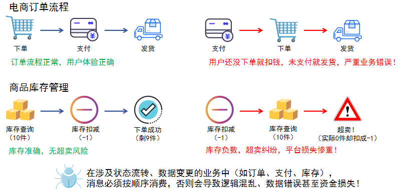
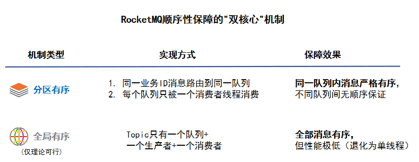
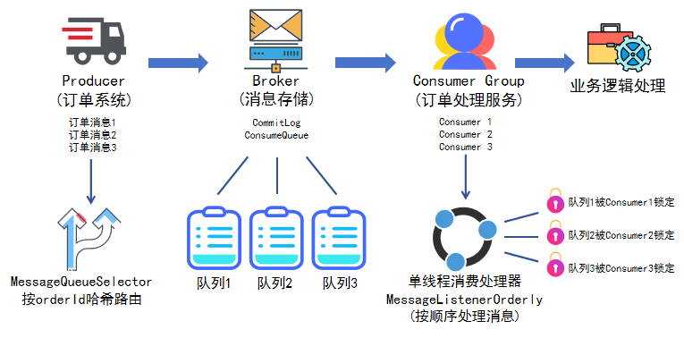
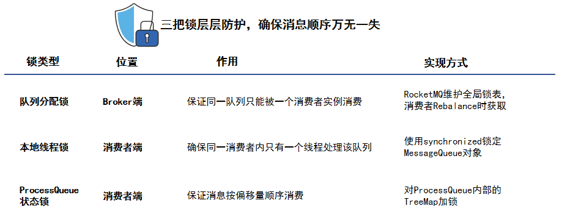
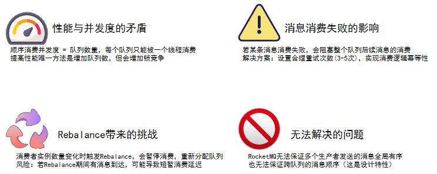
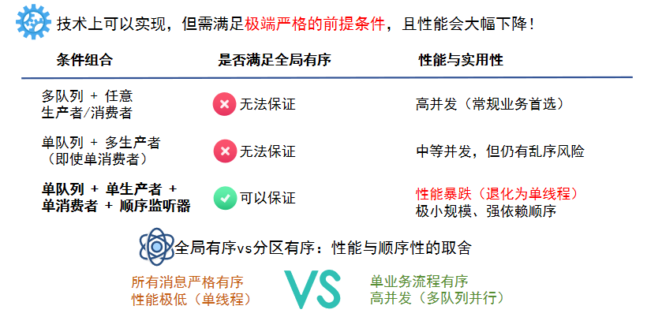
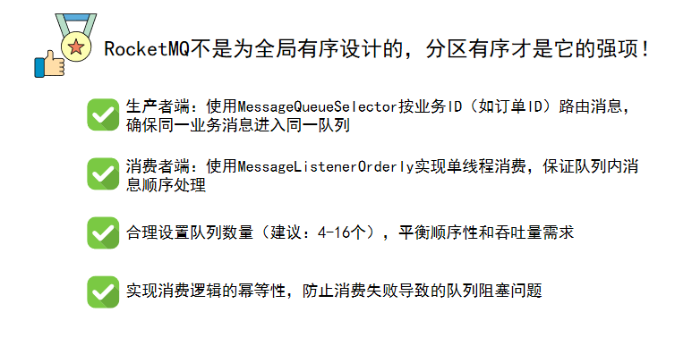

# 深度解析：RocketMQ 如何保证顺序消费？从原理到落地的完整指南

<font style="color:rgb(0, 0, 0);">在分布式系统中，消息队列的 “顺序性” 是面试官高频追问的核心考点，也是电商、金融等业务场景的 “生命线”—— 一旦订单、支付、库存等消息乱序，可能直接导致业务逻辑崩坏（如未下单先扣钱、库存超卖）。本文将从 “业务必要性” 切入，逐步拆解 RocketMQ 顺序消费的原理、架构、核心锁机制，最后给出落地代码与避坑指南，文中标注「截图位置」处可插入对应 PPT 截图，方便读者对照理解。</font>

## <font style="color:rgb(0, 0, 0);">一、为什么必须保证消息顺序？业务场景给出答案</font>

<font style="color:rgb(0, 0, 0);">消息顺序性并非所有场景都需关注（如日志收集、通知推送），但涉及「状态流转」「数据变更」的核心业务，顺序乱序直接决定系统可用性。以下两个高频场景最具代表性：</font>

### <font style="color:rgb(0, 0, 0);">场景 1：电商订单流程（下单→支付→发货）</font>

* **<font style="color:rgb(0, 0, 0) !important;">正确顺序</font>**<font style="color:rgb(0, 0, 0);">：用户下单生成订单→支付扣减金额→商家发货更新物流，整个流程符合业务逻辑，用户体验正常。</font>
* **<font style="color:rgb(0, 0, 0) !important;">乱序后果</font>**<font style="color:rgb(0, 0, 0);">：若消息顺序变为 “支付→下单→发货”，会出现 “用户未创建订单却被扣钱”“未支付却发货” 的严重问题，引发客诉与资金损失。</font>

### <font style="color:rgb(0, 0, 0);">场景 2：商品库存管理（查询→扣减→下单）</font>

* **<font style="color:rgb(0, 0, 0) !important;">正确顺序</font>**<font style="color:rgb(0, 0, 0);">：用户下单前先查询库存（如剩余 10 件）→扣减库存（10→9）→确认下单成功，确保库存准确无超卖。</font>
* **<font style="color:rgb(0, 0, 0) !important;">乱序后果</font>**<font style="color:rgb(0, 0, 0);">：若先扣减库存再查询，会出现 “库存已扣减但查询时仍显示原数量”，导致后续用户继续下单，最终库存变为负数（超卖），平台需承担赔偿责任。</font>



## <font style="color:rgb(0, 0, 0);">二、RocketMQ 顺序消费的核心原理：分区有序是唯一选择</font>

<font style="color:rgb(0, 0, 0);">RocketMQ 的顺序机制本质是 “基于队列的有序性”——</font>**<font style="color:rgb(0, 0, 0) !important;">单个队列内的消息天然按 FIFO 存储与消费，跨队列无法保证顺序</font>**<font style="color:rgb(0, 0, 0);">。基于此，它提供两种顺序模式，但实际业务中仅 “分区有序” 具备实用价值。</font>

| **<font style="color:rgb(0, 0, 0) !important;">顺序模式</font>** | **<font style="color:rgb(0, 0, 0) !important;">实现条件</font>** | **<font style="color:rgb(0, 0, 0) !important;">有序范围</font>** | **<font style="color:rgb(0, 0, 0) !important;">性能特性</font>** | **<font style="color:rgb(0, 0, 0) !important;">适用场景</font>** |
| :--- | :--- | :--- | :--- | :--- |
| <font style="color:rgba(0, 0, 0, 0.85) !important;">分区有序（推荐）</font> | <font style="color:rgba(0, 0, 0, 0.85) !important;">1. 同一业务 ID 路由到同一队列</font><br/><font style="color:rgba(0, 0, 0, 0.85) !important;">2. 单线程消费队列</font> | <font style="color:rgba(0, 0, 0, 0.85) !important;">局部有序（同一业务）</font> | <font style="color:rgba(0, 0, 0, 0.85) !important;">高并发（多队列并行）</font> | <font style="color:rgba(0, 0, 0, 0.85) !important;">99% 业务场景（订单、支付）</font> |
| <font style="color:rgba(0, 0, 0, 0.85) !important;">全局有序（理论）</font> | <font style="color:rgba(0, 0, 0, 0.85) !important;">1. Topic 仅 1 个队列</font><br/><font style="color:rgba(0, 0, 0, 0.85) !important;">2. 单生产者</font><br/><font style="color:rgba(0, 0, 0, 0.85) !important;">3. 单消费者</font> | <font style="color:rgba(0, 0, 0, 0.85) !important;">全局有序（所有消息）</font> | <font style="color:rgba(0, 0, 0, 0.85) !important;">极低（退化为单线程）</font> | <font style="color:rgba(0, 0, 0, 0.85) !important;">无实际业务（仅面试考点）</font> |

### <font style="color:rgb(0, 0, 0);">关键结论：</font>

1. **<font style="color:rgb(0, 0, 0) !important;">队列是顺序的最小单位</font>**<font style="color:rgb(0, 0, 0);">：RocketMQ 的 CommitLog（物理存储）按消息到达顺序追加写入，ConsumeQueue（逻辑队列）作为 CommitLog 的索引，也保持顺序，因此单个队列内消息必然有序。</font>
2. **<font style="color:rgb(0, 0, 0) !important;">分区有序的本质是 “业务隔离”</font>**<font style="color:rgb(0, 0, 0);">：通过业务 ID（如订单 ID、用户 ID）路由到固定队列，既保证同一业务的顺序性，又通过多队列实现并发，平衡 “顺序” 与 “性能”。</font>



## <font style="color:rgb(0, 0, 0);">三、完整架构链路：从生产到消费的顺序保障流程</font>

<font style="color:rgb(0, 0, 0);">要理解顺序消费，需跟踪消息从 “生产者发送” 到 “消费者处理” 的全链路，每个环节的设计都为 “顺序性” 服务。</font>

### <font style="color:rgb(0, 0, 0);">1. 生产者端：消息路由控制（核心是 “同业务 ID 进同队列”）</font>

<font style="color:rgb(0, 0, 0);">生产者发送消息时，需通过</font><code><font style="color:rgba(0, 0, 0, 0.85) !important;">MessageQueueSelector</font></code><font style="color:rgb(0, 0, 0);">自定义路由逻辑，将同一业务 ID 的消息路由到固定队列。核心逻辑是 “哈希取模”—— 通过业务 ID 的哈希值对队列数取模，确保同一 ID 始终映射到同一队列。</font>

#### <font style="color:rgb(0, 0, 0);">关键约束：</font>

* <font style="color:rgb(0, 0, 0);">必须使用</font>**<font style="color:rgb(0, 0, 0) !important;">同步发送</font>**<font style="color:rgb(0, 0, 0);">（</font><code><font style="color:rgb(0, 0, 0);">send()</font></code><font style="color:rgb(0, 0, 0);">方法）：异步发送可能因线程调度导致消息发送顺序乱序。</font>
* <font style="color:rgb(0, 0, 0);">避免多生产者并发发送同一业务：即使路由到同一队列，多生产者的网络延迟差异仍可能导致消息顺序混乱。</font>

### <font style="color:rgb(0, 0, 0);">2. Broker 端：顺序存储与锁保障</font>

* **<font style="color:rgb(0, 0, 0) !important;">存储层</font>**<font style="color:rgb(0, 0, 0);">：消息写入 CommitLog 后，会同步到对应 ConsumeQueue（按队列分区），ConsumeQueue 按消息偏移量排序，确保消费时按顺序读取。</font>
* **<font style="color:rgb(0, 0, 0) !important;">锁机制</font>**<font style="color:rgb(0, 0, 0);">：维护全局锁表，记录 “队列 - 消费者” 的绑定关系，防止多个消费者同时消费同一队列（后续 “三把锁” 章节详解）。</font>

### <font style="color:rgb(0, 0, 0);">3. 消费者端：单线程处理与顺序监听器</font>

<font style="color:rgb(0, 0, 0);">消费者需注册</font><code><font style="color:rgba(0, 0, 0, 0.85) !important;">MessageListenerOrderly</font></code><font style="color:rgb(0, 0, 0);">（顺序监听器），而非默认的</font><code><font style="color:rgba(0, 0, 0, 0.85) !important;">MessageListenerConcurrently</font></code><font style="color:rgb(0, 0, 0);">（并发监听器）。该监听器会：</font>

* <font style="color:rgb(0, 0, 0);">为每个队列分配独立线程，确保单线程消费。</font>
* <font style="color:rgb(0, 0, 0);">处理消息前先获取锁，防止并发操作导致乱序。</font>



#### <font style="color:rgb(0, 0, 0);">全链路流程总结：</font>



## <font style="color:rgb(0, 0, 0);">四、三把锁机制：顺序消费的 “安全防护网”</font>

**<font style="color:rgb(0, 0, 0) !important;">三把锁是 RocketMQ 在「顺序消费模式（MessageListenerOrderly）」下的专属机制</font>**<font style="color:rgba(0, 0, 0, 0.85);">，仅当消费者明确使用顺序监听器时才会全部启用；而在默认的「并发消费模式（MessageListenerConcurrently）」下，这三把锁会被完全禁用（或无需生效）。</font>

<font style="color:rgb(0, 0, 0);">RocketMQ 通过 “Broker </font><font style="color:rgba(0, 0, 0, 0.85) !important;">队列分配锁</font><font style="color:rgb(0, 0, 0);">→消费者</font><font style="color:rgba(0, 0, 0, 0.85) !important;">本地线程锁</font><font style="color:rgb(0, 0, 0);">→ProcessQueue 锁” 的三层锁机制，从 “外部防抢” 到 “内部防乱”，确保顺序性万无一失。</font>

| **<font style="color:rgb(0, 0, 0) !important;">锁类型</font>** | **<font style="color:rgb(0, 0, 0) !important;">位置</font>** | **<font style="color:rgb(0, 0, 0) !important;">核心作用</font>** | **<font style="color:rgb(0, 0, 0) !important;">实现方式</font>** | **<font style="color:rgb(0, 0, 0) !important;">解决的问题</font>** |
| :--- | :--- | :--- | :--- | :--- |
| <font style="color:rgba(0, 0, 0, 0.85) !important;">队列分配锁</font> | <font style="color:rgba(0, 0, 0, 0.85) !important;">Broker 端</font> | <font style="color:rgba(0, 0, 0, 0.85) !important;">防止多消费者抢同一队列</font> | <font style="color:rgba(0, 0, 0, 0.85) !important;">Broker 维护全局锁表（ConcurrentMap），消费者 Rebalance 时申请锁</font> | <font style="color:rgba(0, 0, 0, 0.85) !important;">避免多消费者并行消费同一队列导致乱序</font> |
| <font style="color:rgba(0, 0, 0, 0.85) !important;">本地线程锁</font> | <font style="color:rgba(0, 0, 0, 0.85) !important;">消费者端</font> | <font style="color:rgba(0, 0, 0, 0.85) !important;">防止消费者内多线程抢同一队列</font> | <font style="color:rgba(0, 0, 0, 0.85) !important;">synchronized 锁定 MessageQueue 对象</font> | <font style="color:rgba(0, 0, 0, 0.85) !important;">避免同一消费者内多线程并发处理同一队列</font> |
| <font style="color:rgba(0, 0, 0, 0.85) !important;">ProcessQueue 锁</font> | <font style="color:rgba(0, 0, 0, 0.85) !important;">消费者端</font> | <font style="color:rgba(0, 0, 0, 0.85) !important;">防止单线程内跳号处理消息</font> | <font style="color:rgba(0, 0, 0, 0.85) !important;">对 ProcessQueue 内 TreeMap 加锁，按偏移量消费</font> | <font style="color:rgba(0, 0, 0, 0.85) !important;">避免单线程内跳过未处理消息，保证顺序执行</font> |

### <font style="color:rgb(0, 0, 0);">各锁的协作流程：</font>

1. **<font style="color:rgb(0, 0, 0) !important;">消费者启动 / Rebalance 时</font>**<font style="color:rgb(0, 0, 0);">：向 Broker 申请队列锁，Broker 检查锁表，若队列未被占用则分配锁（锁有效期 60 秒）。</font>
2. **<font style="color:rgb(0, 0, 0) !important;">消费者处理消息前</font>**<font style="color:rgb(0, 0, 0);">：通过</font><code><font style="color:rgb(0, 0, 0);">synchronized</font></code><font style="color:rgb(0, 0, 0);">获取本地锁，确保同一队列仅一个线程处理。</font>
3. **<font style="color:rgb(0, 0, 0) !important;">线程处理消息时</font>**<font style="color:rgb(0, 0, 0);">：对 ProcessQueue（本地内存队列，存储待处理消息）加锁，按消息偏移量从小到大处理，处理完一条再取下一条。</font>
4. **<font style="color:rgb(0, 0, 0) !important;">锁续期与释放</font>**<font style="color:rgb(0, 0, 0);">：消费者每隔 20 秒向 Broker 续期锁；若消费者下线，Broker 在锁过期后自动释放，避免队列永久锁定。</font>



## <font style="color:rgb(0, 0, 0);">五、落地限制与避坑指南：这些问题面试必问</font>

<font style="color:rgb(0, 0, 0);">顺序消费并非 “开箱即用”，实际落地需应对性能、失败处理、Rebalance 等问题，这些也是面试官判断你是否 “实战过” 的关键。</font>

### <font style="color:rgb(0, 0, 0);">1. 性能与并发度的矛盾：并发度 = 队列数</font>

* **<font style="color:rgb(0, 0, 0) !important;">原理</font>**<font style="color:rgb(0, 0, 0);">：顺序消费的并发能力由队列数量决定（一个队列对应一个消费线程），队列越多，并发度越高。</font>
* **<font style="color:rgb(0, 0, 0) !important;">避坑方案</font>**<font style="color:rgb(0, 0, 0);">：</font>
  * <font style="color:rgb(0, 0, 0);">队列数量需提前规划：根据预估峰值 QPS 设置（建议 4-16 个），如峰值 QPS=1000，设 10 个队列，每个线程处理 100 QPS，避免线程过载。</font>
  * <font style="color:rgb(0, 0, 0);">避免过度扩容队列：队列过多会增加锁竞争与 Rebalance 耗时，反而降低性能。</font>

### <font style="color:rgb(0, 0, 0);">2. 消息消费失败：会阻塞整个队列</font>

* **<font style="color:rgb(0, 0, 0) !important;">问题</font>**<font style="color:rgb(0, 0, 0);">：若某条消息处理失败（如数据库异常），消费者会重试该消息，期间整个队列的后续消息会被阻塞（顺序消费不允许跳过失败消息）。</font>
* **<font style="color:rgb(0, 0, 0) !important;">避坑方案</font>**<font style="color:rgb(0, 0, 0);">：</font>
  * <font style="color:rgb(0, 0, 0);">设置合理重试次数：默认无限重试，需手动配置重试次数（3-5 次），避免队列长期阻塞。</font>
  * <font style="color:rgb(0, 0, 0);">实现消费幂等：即使消息重试，多次处理结果也一致（如用订单 ID 作为唯一键，数据库插入时防重复）。</font>
  * <font style="color:rgb(0, 0, 0);">失败消息转移：重试次数耗尽后，将消息转入死信队列，后续人工处理，避免阻塞正常消息。</font>

### <font style="color:rgb(0, 0, 0);">3. Rebalance 的影响：短暂暂停消费</font>

* **<font style="color:rgb(0, 0, 0) !important;">触发场景</font>**<font style="color:rgb(0, 0, 0);">：消费者实例数量变化（新增 / 下线）、队列数量变化、消费者订阅关系变更。</font>
* **<font style="color:rgb(0, 0, 0) !important;">问题</font>**<font style="color:rgb(0, 0, 0);">：Rebalance 时，消费者会先释放所有队列锁，暂停消费，重新分配队列并申请锁，期间消息会积压。</font>
* **<font style="color:rgb(0, 0, 0) !important;">避坑方案</font>**<font style="color:rgb(0, 0, 0);">：</font>
  * <font style="color:rgb(0, 0, 0);">避免频繁变更消费者数量：尽量提前规划实例数，减少 Rebalance 触发次数。</font>
  * <font style="color:rgb(0, 0, 0);">监控 Rebalance 耗时：通过 RocketMQ 控制台监控 Rebalance 时长，若耗时过长（超过 10 秒），需检查队列数与实例数是否匹配。</font>

### <font style="color:rgb(0, 0, 0);">4. 无法解决的问题：接受设计局限性</font>

* **<font style="color:rgb(0, 0, 0) !important;">多生产者全局有序</font>**<font style="color:rgb(0, 0, 0);">：即使路由到同一队列，多生产者的网络延迟差异仍可能导致消息顺序混乱（如生产者 A 发消息 1，生产者 B 发消息 2，消息 2 因网络快先到达队列）。</font>
* **<font style="color:rgb(0, 0, 0) !important;">跨队列顺序</font>**<font style="color:rgb(0, 0, 0);">：不同队列的消息无顺序关系，如队列 1 的 “下单” 消息与队列 2 的 “支付” 消息，谁先被消费不确定。</font>



## <font style="color:rgb(0, 0, 0);">六、全局有序的争议：技术可行但业务不用</font>

<font style="color:rgb(0, 0, 0);">面试官常问：“RocketMQ 能保证全局有序吗？” 答案是 “技术上能，但实际业务不会用”，核心是 “性能代价远超收益”。</font>

### <font style="color:rgb(0, 0, 0);">1. 全局有序的实现条件（四要素缺一不可）</font>

* <font style="color:rgb(0, 0, 0);">Topic 仅创建 1 个队列：消除跨队列乱序的可能。</font>
* <font style="color:rgb(0, 0, 0);">单生产者发送消息：避免多生产者网络延迟导致的乱序。</font>
* <font style="color:rgb(0, 0, 0);">单消费者实例：避免多消费者抢队列。</font>
* <font style="color:rgb(0, 0, 0);">使用</font><code><font style="color:rgb(0, 0, 0);">MessageListenerOrderly</font></code><font style="color:rgb(0, 0, 0);">：确保单线程消费。</font>

### <font style="color:rgb(0, 0, 0);">2. 性能代价：从 “并发” 退化为 “串行”</font>

* 全局有序下，RocketMQ 的处理能力等同于单线程（TPS 仅数百），无法支撑高并发业务（如电商秒杀 TPS 达 10 万 +）。与消息队列 “高可用、高并发” 的设计初衷相悖，属于 “用错工具”。

### <font style="color:rgb(0, 0, 0);">3. 对比：全局有序 vs 分区有序</font>

| **<font style="color:rgb(0, 0, 0) !important;">维度</font>** | **<font style="color:rgb(0, 0, 0) !important;">全局有序</font>** | **<font style="color:rgb(0, 0, 0) !important;">分区有序</font>** |
| :--- | :--- | :--- |
| <font style="color:rgba(0, 0, 0, 0.85) !important;">有序范围</font> | <font style="color:rgba(0, 0, 0, 0.85) !important;">所有消息</font> | <font style="color:rgba(0, 0, 0, 0.85) !important;">同一业务消息</font> |
| <font style="color:rgba(0, 0, 0, 0.85) !important;">并发能力</font> | <font style="color:rgba(0, 0, 0, 0.85) !important;">单线程（低）</font> | <font style="color:rgba(0, 0, 0, 0.85) !important;">多线程（高，= 队列数）</font> |
| <font style="color:rgba(0, 0, 0, 0.85) !important;">适用场景</font> | <font style="color:rgba(0, 0, 0, 0.85) !important;">无实际业务</font> | <font style="color:rgba(0, 0, 0, 0.85) !important;">订单、支付、库存等核心业务</font> |
| <font style="color:rgba(0, 0, 0, 0.85) !important;">落地成本</font> | <font style="color:rgba(0, 0, 0, 0.85) !important;">低（配置简单）</font> | <font style="color:rgba(0, 0, 0, 0.85) !important;">中（需路由与幂等设计）</font> |



## <font style="color:rgb(0, 0, 0);">七、落地代码实现：从生产者到消费者的完整示例</font>

<font style="color:rgb(0, 0, 0);">以下是基于 RocketMQ 4.9.x 的顺序消费核心代码，包含生产者路由配置、消费者顺序监听器、幂等处理逻辑。</font>

### <font style="color:rgb(0, 0, 0);">1. 生产者端：按订单 ID 路由消息</font>

```java
import org.apache.rocketmq.client.producer.DefaultMQProducer;
import org.apache.rocketmq.client.producer.MessageQueueSelector;
import org.apache.rocketmq.common.message.Message;
import org.apache.rocketmq.common.message.MessageQueue;

public class OrderProducer {
    public static void main(String[] args) throws Exception {
        // 1. 创建生产者实例，指定生产者组
        DefaultMQProducer producer = new DefaultMQProducer("OrderProducerGroup");
        // 2. 设置NameServer地址（集群地址用逗号分隔）
        producer.setNamesrvAddr("127.0.0.1:9876");
        // 3. 启动生产者
        producer.start();

        // 模拟3个订单，每个订单发送3条消息（下单→支付→发货）
        String[] orderIds = {"ORDER_1001", "ORDER_1002", "ORDER_1003"};
        for (String orderId : orderIds) {
            for (int i = 0; i < 3; i++) {
                String msgContent = "";
                switch (i) {
                    case 0: msgContent = "下单-" + orderId; break;
                    case 1: msgContent = "支付-" + orderId; break;
                    case 2: msgContent = "发货-" + orderId; break;
                }
                // 创建消息（Topic、Tag、Key、内容）
                Message msg = new Message(
                        "OrderTopic",          // 消息Topic
                        "OrderTag",            // 消息Tag（用于过滤）
                        orderId,               // 消息Key（订单ID，便于排查）
                        msgContent.getBytes()  // 消息内容
                );

                // 4. 同步发送消息，按订单ID路由到固定队列
                producer.send(
                        msg,
                        // 自定义队列选择器：按订单ID哈希取模
                        new MessageQueueSelector() {
                            @Override
                            public MessageQueue select(List<MessageQueue> mqs, Message msg, Object arg) {
                                String id = (String) arg;
                                // 哈希取模，确保同一订单ID路由到同一队列
                                int queueIndex = Math.abs(id.hashCode()) % mqs.size();
                                return mqs.get(queueIndex);
                            }
                        },
                        orderId  // 传递订单ID作为路由参数
                );
                System.out.println("发送消息：" + msgContent + "，路由到队列：" + 
                        Math.abs(orderId.hashCode()) % 4); // 假设Topic有4个队列
            }
        }

        // 5. 关闭生产者（实际业务中无需主动关闭，由容器管理）
        producer.shutdown();
    }
}
```

### <font style="color:rgb(0, 0, 0);">2. 消费者端：顺序监听器与幂等处理</font>

```java
import org.apache.rocketmq.client.consumer.DefaultMQPushConsumer;
import org.apache.rocketmq.client.consumer.listener.ConsumeOrderlyContext;
import org.apache.rocketmq.client.consumer.listener.ConsumeOrderlyStatus;
import org.apache.rocketmq.client.consumer.listener.MessageListenerOrderly;
import org.apache.rocketmq.common.message.MessageExt;

import java.util.List;
import java.util.concurrent.ConcurrentHashMap;

public class OrderConsumer {
    // 用于幂等：记录已处理的消息ID（实际业务用数据库/Redis存储）
    private static ConcurrentHashMap<String, Boolean> processedMsgMap = new ConcurrentHashMap<>();

    public static void main(String[] args) throws Exception {
        // 1. 创建消费者实例，指定消费者组
        DefaultMQPushConsumer consumer = new DefaultMQPushConsumer("OrderConsumerGroup");
        // 2. 设置NameServer地址
        consumer.setNamesrvAddr("127.0.0.1:9876");
        // 3. 订阅Topic（*表示所有Tag）
        consumer.subscribe("OrderTopic", "*");

        // 4. 注册顺序消费监听器（核心）
        consumer.registerMessageListener(new MessageListenerOrderly() {
            @Override
            public ConsumeOrderlyStatus consumeMessage(
                    List<MessageExt> msgs, 
                    ConsumeOrderlyContext context) {
                
                // 开启本地锁（默认开启，确保单线程处理队列）
                context.setAutoCommit(true);

                for (MessageExt msg : msgs) {
                    String msgId = msg.getMsgId();
                    String orderId = msg.getKeys();
                    String msgContent = new String(msg.getBody());

                    try {
                        // 第一步：幂等校验，避免重复处理
                        if (processedMsgMap.containsKey(msgId)) {
                            System.out.println("消息已处理，跳过：" + msgContent);
                            continue;
                        }

                        // 第二步：业务处理（模拟订单流程）
                        System.out.println("处理消息：" + msgContent + 
                                "，队列ID：" + msg.getQueueId() + 
                                "，处理线程：" + Thread.currentThread().getName());
                        
                        // 模拟业务逻辑（如下单、支付、发货）
                        handleOrderBusiness(orderId, msgContent);

                        // 第三步：标记消息已处理（实际业务写入数据库/Redis）
                        processedMsgMap.put(msgId, true);

                    } catch (Exception e) {
                        System.err.println("消息处理失败：" + msgContent + "，错误：" + e.getMessage());
                        // 重试3次后返回SUSPEND_CURRENT_QUEUE_A_MOMENT，暂停队列100ms后重试
                        if (msg.getReconsumeTimes() >= 3) {
                            System.err.println("重试3次失败，转入死信队列：" + msgContent);
                            return ConsumeOrderlyStatus.SUCCESS; // 返回成功，后续手动处理
                        }
                        // 暂停队列，避免频繁重试
                        return ConsumeOrderlyStatus.SUSPEND_CURRENT_QUEUE_A_MOMENT;
                    }
                }

                // 消息处理成功
                return ConsumeOrderlyStatus.SUCCESS;
            }
        });

        // 5. 启动消费者
        consumer.start();
        System.out.println("消费者启动成功，等待处理消息...");
    }

    // 模拟订单业务处理
    private static void handleOrderBusiness(String orderId, String msgContent) {
        if (msgContent.contains("下单")) {
            System.out.println("执行下单逻辑：创建订单记录，orderId：" + orderId);
        } else if (msgContent.contains("支付")) {
            System.out.println("执行支付逻辑：扣减用户余额，orderId：" + orderId);
        } else if (msgContent.contains("发货")) {
            System.out.println("执行发货逻辑：更新物流状态，orderId：" + orderId);
        }
    }
}
```



## <font style="color:rgb(0, 0, 0);">八、总结：顺序消费的核心认知</font>

1. **<font style="color:rgb(0, 0, 0) !important;">核心机制</font>**<font style="color:rgb(0, 0, 0);">：RocketMQ 顺序消费的本质是 “分区有序”，通过 “同业务 ID 路由到同队列 + 单线程消费 + 三把锁防护” 实现。</font>
2. **<font style="color:rgb(0, 0, 0) !important;">取舍思维</font>**<font style="color:rgb(0, 0, 0);">：顺序消费是 “顺序性” 与 “性能” 的取舍，需根据业务场景选择（核心业务用分区有序，非核心用并发消费）。</font>
3. **<font style="color:rgb(0, 0, 0) !important;">落地关键</font>**<font style="color:rgb(0, 0, 0);">：需关注路由逻辑、幂等处理、失败重试、Rebalance 影响，这些是区别 “理论派” 与 “实战派” 的关键。</font>
4. **<font style="color:rgb(0, 0, 0) !important;">面试应答</font>**<font style="color:rgb(0, 0, 0);">：被问 “全局有序” 时，需先说明 “技术可行”，再讲清实现条件与性能代价，最后推荐 “分区有序”，体现对业务与技术的平衡认知。</font>

<font style="color:rgb(0, 0, 0);">通过本文的原理拆解与代码示例，相信你已能从容应对 RocketMQ 顺序消费的面试与落地需求。实际业务中，需结合具体场景调整队列数、重试次数、幂等方案，才能让顺序消费真正服务于业务，而非成为性能瓶颈。</font>
