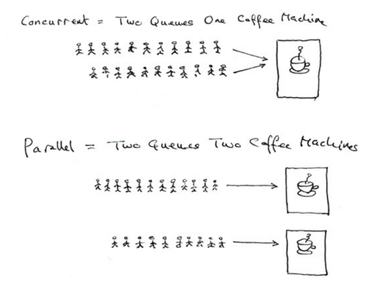
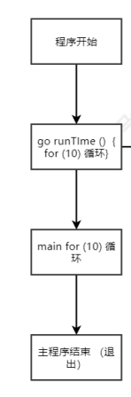

# GoLang知识汇总
---


# 进阶网络通信

#### [课程介绍](https://www.yuque.com/tianming-aroh0/sagnbd/nfkf7dvzxgp26nw4)

##### 通信的本质：

##### TCP/IP通信原理：网络分层

##### TCP如何确保可靠性传递：三次握手四次挥手

##### BIO/NIO： ServerSocket Socket 多路复用 （原理源码详细讲解Epoll）

		

#### 标准库net包的使用

Go语言标准库里提供的 net 包，支持基于 IP 层、TCP/UDP 层及更高层面（如 HTTP、FTP、SMTP）的网络操作，其中用于 IP 层的称为 Raw Socket。

重要函数：net.Listen() 服务端的监听 。 net.Dial()客户端的处理

##### 代码实现：

```plain
package main

import (
    "fmt"
    "net"
)

func main() {
    fmt.Printf("服务器准备开启。。。。")
    listener, err := net.Listen("tcp", "127.0.0.1:8081") // "0.0.0.0:8081")
    if err != nil {
        fmt.Println(err)
        return
    }
    defer listener.Close()
    for {
        conn, err := listener.Accept()
        if err != nil {
            fmt.Println(err)
            return
        } else {
            fmt.Println(conn)
        }

    }
}
```

client端

```plain
package main
import (
    "fmt"
    "net"
)

func main() {
    fmt.Printf("客户端准备开启。。。。")
    conn, err := net.Dial("tcp", "192.168.49.1:8081")
    if err != nil {
        fmt.Println(err)
    }
    defer conn.Close()
    fmt.Println("客户端连接成功", conn.RemoteAddr().String())
}
```

通过标准流 数据传递

客户端传递数据给服务端

	关键方法：os.stdin	bufio. conn.Write conn.Read

```plain
func main() {
    fmt.Printf("客户端准备开启。。。。")

    conn, err := net.Dial("tcp", "192.168.49.1:8081")
    if err != nil {
        fmt.Println(err)
    }

    go proc(conn)
}

func proc(conn net.Conn) {
    defer conn.Close()
    reader := bufio.NewReader(os.Stdin)  //标准输入流
    line, err := reader.ReadString('\n') //每次读一行
    if err != nil {
        fmt.Println(err)
    }
    len, err := conn.Write([]byte(line))
    if err != nil {
        fmt.Println(err)
    }

    fmt.Println("客户端连接成功", conn.RemoteAddr().String(), "并且写了", len, "个字节")
}
```

服务端读取 客户端数据

```plain
func main() {
    fmt.Printf("服务器准备开启。。。。")
    listener, err := net.Listen("tcp", "0.0.0.0:8081") // "0.0.0.0:8081")
    if err != nil {
        fmt.Println(err)
        return
    }
    defer listener.Close()
    for {
        conn, err := listener.Accept()

        go proc(conn)

        if err != nil {
            fmt.Println(err) // err = EOF client退出了
            return
        } else {
            fmt.Println(conn.LocalAddr())
        }
    }
}

func proc(conn net.Conn) {
    defer conn.Close()
    for {
        buf := make([]byte, 1024)
        n, err := conn.Read(buf) //返回的是 接受的字节数
        if err != nil {
            fmt.Println(err)
            return
        }
        fmt.Println(n)
        fmt.Println(string(buf[:n]))
    }
}
```

多行写 和 读 bye标志退出

```plain
func main() {
    fmt.Printf("客户端准备开启。。。。")

    conn, err := net.Dial("tcp", "192.168.49.1:8081")
    if err != nil {
        fmt.Println(err)
    }

    go proc(conn)
    if

    my html

    {{.}}

func main(){
    handle1 := handle1{}
    http.Handle("/handler1", &handle1)
    s := http.Server{
        Addr:    "127.0.0.1:8081",
        Handler: nil,
    }
    s.ListenAndServe()
}

type handle1 struct{}

func (h *handle1) ServeHTTP(w http.ResponseWriter, req *http.Request) {
    t1, err := template.ParseFiles("src/web/template/html/index.html")
    if err != nil {
        panic(err)
    }
    t1.Execute(w, "Hello MyHTML")

}
```

###### 注意1 空格

		{{ 1 }}

{{- 1 -}} -》 1

###### 注意2 注释

/\* xxoo \*/

###### 注意3 pipeline多连接传递

	unix 管道 |前面的命令将运算的结果传递给下一名的最后一个位置

比如下面都会输出 shenzhuan

	 {{"shenzhuan"}}

{{printf "%q" "shenzhuan"}}

{{"shenzhuan" | printf "%q" }}

{{"zhuan" | printf "%s%s" "shen" |printf "%q"}}

{{"shenzhuan" | printf "%s" | printf "%q"}}

###### 注意4 变量的使用

	$var := pipiline //定义一个没有定义过变量

	$var = pipilne

###### 注意5 条件判断

	

```plain
eq  ne lt le gt  ge
{{$Age := 19}}
 {{if ge $Age 18}}
恭喜你成年了！
{{end}}

{{$Age := 13}}
    {{if ge $Age 18}}
    恭喜你成年了！
    {{else if lt $Age 14}}
    远离
    {{else}}
    禁止入内
    {{end}}
```

###### 注意6 循环

```plain
strs := []string{"示例", "申专", "666"}
    t1.Execute(w, strs) ///"Hello MyHTML")

{{range $val :=.}}
{{println $val}}
{{end}}
```

###### 注意7 设置.的值

	with...end

{{with lt $Age 14}}ssssss{{else}} XXXXXXXXXXXX {{end}}

###### 总结：

可API [https://studygolang.com/pkgdoc](https://studygolang.com/pkgdoc)

当然也可以看源码 详见 template/funcs.go

##### 嵌套HTML

	define 和 template关键字

```plain
header.html中
 {{define "header"}}
    这是header>
    {{end}}

   index.html中
       {{template "header"}}

    ServeHTTP 方法中
    t1, err := template.ParseFiles("src/web/template/html/index.html", "src/web/template/html/header.html")
```

#### 多路复用器 Mux(Multiplexer)

	ServeMux的路由匹配

##### 实例代码

```plain
func newServerMux(w http.ResponseWriter, r *http.Request) {
    fmt.Println(w, "my mux ")
}

func main() {

    mux := http.NewServeMux()
    mux.HandleFunc("/", newServerMux)
    s := &http.Server{
        Addr:    ":8081",
        Handler: mux,
    }
    s.ListenAndServe()
    fmt.Println()
}

/happy  /bad   多个handler
func newServerMux(w http.ResponseWriter, r *http.Request) {
    fmt.Println(w, "my mux ")
}

func happy(w http.ResponseWriter, r *http.Request) {
    fmt.Println(w, "happy ")
}
func bad(w http.ResponseWriter, r *http.Request) {
    fmt.Println(w, "happy ")
}

func main() {

    mux := http.NewServeMux()
    mux.HandleFunc("/", newServerMux)
    mux.HandleFunc("/happy", happy)
    mux.HandleFunc("/bad", bad)
    s := &http.Server{
        Addr:    ":8081",
        Handler: mux,
    }
    s.ListenAndServe()
    fmt.Println()
}
```

#### HttpRouter高性能HTTP路由包

ServeMux 的一个缺陷是无法使用变量实现URL模式匹配。而HttpRouter可以，HttpRouter是一个高性能的第三方HTTP路由包，弥补了net/http包中的路由不足问题。

此轻量级 高性能的路由器 与默认的路由比，支持路由模式中的变量并匹配请求方法，它还可以更好的拓展。

还有就是我们接下来要讲的gin架构 就是已此作为基础开发的。

###### 实例代码

```plain
go  get github.com/julienschmidt/httprouter

func Hello(w http.ResponseWriter, r *http.Request, _ httprouter.Params) {
    w.Write([]byte("hello httpRouter！！"))
}

func Index(w http.ResponseWriter, r *http.Request, ps httprouter.Params) {

    // w.Write([]byte(ps.ByName("name")))
    fmt.Fprintf(w, "hello %s \n", ps.ByName("name"))
}
func main() {
    router := httprouter.New()
    router.GET("/", Hello)
    router.GET("/index/:name", Index)
    http.ListenAndServe(":8081", router)
    fmt.Println()
}
```

##### RestFul风格路由 完成 CRUD 的方法

```plain
func Hello(w http.ResponseWriter, r *http.Request, _ httprouter.Params) {
    w.Write([]byte("hello httpRouter！！"))
}

func Index(w http.ResponseWriter, r *http.Request, ps httprouter.Params) {
    // w.Write([]byte(ps.ByName("name")))
    fmt.Fprintf(w, "hello %s \n", ps.ByName("name"))
}

func ModifyUser(w http.ResponseWriter, r *http.Request, ps httprouter.Params) {
    uid := ps.ByName("uid")
    fmt.Fprintf(w, "修改了 用户id为 %s \n", uid)
}
func DeleteUser(w http.ResponseWriter, r *http.Request, ps httprouter.Params) {
    uid := ps.ByName("uid")
    fmt.Fprintf(w, "删除了 用户id为 %s \n", uid)
}

func main() {
    router := httprouter.New()
    router.GET("/", Hello)
    router.GET("/index/:name", Index)
    router.POST("/modifyuser/:uid", ModifyUser)
    router.DELETE("/deleteuser/:uid", DeleteUser)
    http.ListenAndServe(":8081", router)
    fmt.Println()
}
```

#### 网络通信总结：

	大纲目录结构

#### 原理流程：

	client > server (注册路由 - 根据路由规则派发 handler处理器 -处理数据 - 模板引擎 - 展示给client)

#### 源码解读：

为了新奇， 解决疑难杂症 ， 优化 面试，技术的一种深度 往后的高度

#### 网络模型

linux五种：

BIO ：阻塞IO

NIO：非阻塞IO

多路复用

Select：（多个（1024个）fd文件描述符轮询遍历就绪）

Poll ：pollfd结构表示要监听的描述符 需要将socket从用户态转换称内核态

Epoll：事件监听，三个重要方法：

poll\_create(); 创建一个epoll对象

epoll\_ctl(); 事件注册 维护一个红黑树的结构

poll\_wait(); 等待就绪的事件 已经就绪的 维护的到一个 双向链表的结构

#### goroutine+epoll网络模型流程图：

##### 源码解读：

通信原理 ：BIO NIO Selector Poll Epoll

golang网络通信 ： 多协程+Epoll

MPG调度跟Epoll的关联：

MPG模型，在IO事件中的事件与之前的G，g0协程如何获得执行权？

协程主方法mian最终调用的gopark() 关键方法与Epoll网络模型关联 让出当前协程执行权，一般是返回到g0让g0重新调度

```plain
net.Listen("tcp", "0.0.0.0:8082")

func Listen(network, address string) (Listener, error) {
    var lc ListenConfig
    //s2 listen绑定
    return lc.Listen(context.Background(), network, address)
}

func (lc *ListenConfig) Listen(ctx context.Context, network, address string) (Listener, error) {
    //根据协议名称和地址获得Internet协议族地址列表
    addrs, err := DefaultResolver.resolveAddrList(ctx, "listen", network, address, nil)
    if err != nil {
        return nil, &OpError{Op: "listen", Net: network, Source: nil, Addr: nil, Err: err}
    }
    sl := &sysListener{
        ListenConfig: *lc,
        network:      network,
        address:      address,
    }
    var l Listener
    la := addrs.first(isIPv4)
    switch la := la.(type) {
    case *TCPAddr:
        //s1 TCP监听
        l, err = sl.listenTCP(ctx, la)
    case *UnixAddr:
        // Unix
        l, err = sl.listenUnix(ctx, la)
    default:
        return nil, &OpError{Op: "listen", Net: sl.network, Source: nil, Addr: la, Err: &AddrError{Err: "unexpected address type", Addr: address}}
    }
    if err != nil {
        return nil, &OpError{Op: "listen", Net: sl.network, Source: nil, Addr: la, Err: err} // l is non-nil interface containing nil pointer
    }
    return l, nil
}

//s1 返回值可见关键的poll.FD
func (sl *sysListener) listenTCP(ctx context.Context, laddr *TCPAddr) (*TCPListener, error) {
    //s1 内部（各平台对应）调用生产socket具体描述符
    fd, err := internetSocket(ctx, sl.network, laddr, nil, syscall.SOCK_STREAM, 0, "listen", sl.ListenConfig.Control)
    if err != nil {
        return nil, err
    }
    return &TCPListener{fd: fd, lc: sl.ListenConfig}, nil
}

func internetSocket(ctx context.Context, net string, laddr, raddr sockaddr, sotype, proto int, mode string, ctrlFn func(string, string, syscall.RawConn) error) (fd *netFD, err error) {
    if (runtime.GOOS == "aix" || runtime.GOOS == "windows" || runtime.GOOS == "openbsd") && mode == "dial" && raddr.isWildcard() {
        raddr = raddr.toLocal(net)
    }
    family, ipv6only := favoriteAddrFamily(net, laddr, raddr, mode)
    //s1  返回socket描述符具体描述 此函数：
    //   1调用sysSocket生产描述符。2调用newFD封装描述符 构造netFD    3调用netFD实现bind和listen
    return socket(ctx, net, family, sotype, proto, ipv6only, laddr, raddr, ctrlFn)
}

func socket(ctx context.Context, net string, family, sotype, proto int, ipv6only bool, laddr, raddr sockaddr, ctrlFn func(string, string, syscall.RawConn) error) (fd *netFD, err error) {
    //1.根据操作系统获取对应的socket
    s, err := sysSocket(family, sotype, proto)
    if err != nil {
        return nil, err
    }
    //2.设置socket选项
    if err = setDefaultSockopts(s, family, sotype, ipv6only); err != nil {
        poll.CloseFunc(s)
        return nil, err
    }
    //3.创建fd
    if fd, err = newFD(s, family, sotype, net); err != nil {
        poll.CloseFunc(s)
        return nil, err
    }

    //4.监听
    if laddr != nil && raddr == nil {
        switch sotype {
        //windows实现在socket_windows.go   linux实现在socket_cloexec.go中
        case syscall.SOCK_STREAM, syscall.SOCK_SEQPACKET:
            //TCP  s1 次方主要负责调用系统 的bind和listen
            if err := fd.listenStream(laddr, listenerBacklog(), ctrlFn); err != nil {
                fd.Close()
                return nil, err
            }
            return fd, nil
        case syscall.SOCK_DGRAM:
            //UDP
            if err := fd.listenDatagram(laddr, ctrlFn); err != nil {
                fd.Close()
                return nil, err
            }
            return fd, nil
        }
    }
    //5.发起连接，非listen socket处理
    if err := fd.dial(ctx, laddr, raddr, ctrlFn); err != nil {
        fd.Close()
        return nil, err
    }
    return fd, nil
}

//这里一会 再过来看 FD

 先来看 client 怎么跟Service建立连接
conn, err := net.Dial("tcp", "192.168.49.254:8082")
func Dial(network, address string) (Conn, error) {
    var d Dialer
    // s1 实际调用DialContext
    return d.Dial(network, address)
}

func (d *Dialer) Dial(network, address string) (Conn, error) {
    //s1 conn用的TCPConn
    return d.DialContext(context.Background(), network, address)
}

//s1 最终的TCPConn > Conn  里面都是基于关键网络描述符 netFD
func (d *Dialer) DialContext(ctx context.Context, network, address string) (Conn, error) {
    if ctx == nil {
        panic("nil context")
    }
    deadline := d.deadline(ctx, time.Now())
    if !deadline.IsZero() {
        if d, ok := ctx.Deadline(); !ok || deadline.Before(d) {
            subCtx, cancel := context.WithDeadline(ctx, deadline)
            defer cancel()
            ctx = subCtx
        }
    }
    if oldCancel := d.Cancel; oldCancel != nil {
        subCtx, cancel := context.WithCancel(ctx)
        defer cancel()
        go func() {
            select {
            case  0 {
        c, err = sd.dialParallel(ctx, primaries, fallbacks)
    } else {
        c, err = sd.dialSerial(ctx, primaries)
    }
    if err != nil {
        return nil, err
    }

    if tc, ok := c.(*TCPConn); ok && d.KeepAlive >= 0 {
        setKeepAlive(tc.fd, true)
        ka := d.KeepAlive
        if d.KeepAlive == 0 {
            ka = defaultTCPKeepAlive
        }
        setKeepAlivePeriod(tc.fd, ka)
        testHookSetKeepAlive(ka)
    }
    return c, nil
}

//接下来重点 是 netFD 网络描述符 。 server 创建 socket的时候已经构建好

func newFD(sysfd syscall.Handle, family, sotype int, net string) (*netFD, error) {
    ret := &netFD{
        pfd: poll.FD{
            Sysfd:         sysfd,
            IsStream:      sotype == syscall.SOCK_STREAM,
            ZeroReadIsEOF: sotype != syscall.SOCK_DGRAM && sotype != syscall.SOCK_RAW,
        },
        family: family,
        sotype: sotype,
        net:    net,
    }
    return ret, nil
}

//并且 包含Conn 了此网络描述符

type conn struct {
    fd *netFD //s1 关键 网络描述符/句柄  不论net.listener还是dial都是基于此
}

// Network file descriptor.
//包含在Conn结构中，而Conn又包含在TCPConn结构中，所以此应该处于用户接口层
type netFD struct {
    //s1 包含两个重要的数据结构 Sysfd 和 pollDesc，  用户层接口调用此完成交互
    //1.前者是真正的系统文件描述符，
    //2.后者对是底层事件驱动的封装，所有的读写超时等操作都是通过调用后者的对应方法实现的
    pfd poll.FD

    // immutable until Close
    family      int
    sotype      int
    isConnected bool // handshake completed or use of association with peer
    net         string
    laddr       Addr
    raddr       Addr
}

type FD struct {
    // Lock sysfd and serialize access to Read and Write methods.
    fdmu fdMutex //读写锁  锁定sysfd并序列化对Read和Write方法的访问

    // System file descriptor. Immutable until Close.
    Sysfd syscall.Handle //关键  系统文件描述符

    // Read operation. 读操作
    rop operation
    // Write operation. 写操作
    wop operation

    // I/O poller.
    pd pollDesc //      s1 底层事件驱动的封装 所有的读写超时等操作都是通过此

    // Used to implement pread/pwrite. 用于缓存读写锁
    l sync.Mutex

    // For console I/O.
    lastbits       []byte   // first few bytes of the last incomplete rune in last write
    readuint16     []uint16 // buffer to hold uint16s obtained with ReadConsole
    readbyte       []byte   // buffer to hold decoding of readuint16 from utf16 to utf8
    readbyteOffset int      // readbyte[readOffset:] is yet to be consumed with file.Read

    // Semaphore signaled when file is closed. 关闭文件时的信号
    csema uint32

    skipSyncNotif bool //是否跳过sync

    // Whether this is a streaming descriptor, as opposed to a
    // packet-based descriptor like a UDP socket.
    IsStream bool //TCP 还是 UDP

    // Whether a zero byte read indicates EOF. This is false for a
    // message based socket connection.
    ZeroReadIsEOF bool //读取到0字节时是否为错误。基于socket时is false

    // Whether this is a file rather than a network socket.
    isFile bool //是否系统真实文件  或者网络socket连接

    // The kind of this file.
    kind fileKind //文件类型
}

type pollDesc struct {
    runtimeCtx uintptr //只包含了一个指针  指针具体内容是关键 下面会讲
    //s1 通过init初始化
}

func (pd *pollDesc) init(fd *FD) error {
    //一次 / 首次
    serverInit.Do(runtime_pollServerInit)
    //s1 关键   内核态用户态共享的关联切换
    // 注册epoll 实例到 fd  实际link到runtime包下的 poll_runtime_pollOpen 函数。具体实现在  runtime/netpoll.go
    //go:linkname poll_runtime_pollOpen internal/poll.runtime_pollOpen
    ctx, errno := runtime_pollOpen(uintptr(fd.Sysfd))
    if errno != 0 {
        return errnoErr(syscall.Errno(errno))
    }
    pd.runtimeCtx = ctx
    return nil
}

//关联到 runtime/netpoll.go
//关键 事件驱动
type pollDesc struct {
    link *pollDesc // in pollcache, protected by pollcache.lock

    // The lock protects pollOpen, pollSetDeadline, pollUnblock and deadlineimpl operations.
    // This fully covers seq, rt and wt variables. fd is constant throughout the PollDesc lifetime.
    // pollReset, pollWait, pollWaitCanceled and runtime·netpollready (IO readiness notification)
    // proceed w/o taking the lock. So closing, everr, rg, rd, wg and wd are manipulated
    // in a lock-free way by all operations.
    // TODO(golang.org/issue/49008): audit these lock-free fields for continued correctness.
    // NOTE(dvyukov): the following code uses uintptr to store *g (rg/wg),
    // that will blow up when GC starts moving objects.
    //锁  防止多线程/协程操作pollDesc并发问题
    lock mutex // protects the following fields
    //关键 描述符指针 链表结构可以减少结构大小 提高效率
    fd      uintptr
    closing bool
    everr   bool    // marks event scanning error happened
    user    uint32  // user settable cookie
    rseq    uintptr // protects from stale read timers

    //关键： 保存用户态操作的 读协程地址
    //比如：我们在用户态协程调用read阻塞时，rg设置为该协程。当内核态epoll_wait检测read就绪后会通过rg找到这个协程让其恢复运行
    //pollDesc实现用户态和内核态资源共享就在于此
    rg uintptr //取值 pdReady, pdWait, G waiting for read or nil. Accessed atomically.
    //读定时器 防止超时
    rt   timer   // read deadline timer (set if rt.f != nil)
    rd   int64   // read deadline
    wseq uintptr // protects from stale write timers
    //关键:保存用户态操作pollDesc 写协程的地址
    wg uintptr //取值 pdReady, pdWait, G waiting for write or nil. Accessed atomically.
    //写定时器
    wt timer // write deadline timer
    wd int64 // write deadline
    //接口地址
    self *pollDesc // storage for indirect interface. See (*pollDesc).makeArg.
    //epoll 网络模型具体方法在 netpoll_epoll.go 中 epollcreate  epollwait   epollctl 核心方法
}
```

```plain
//go:linkname poll_runtime_pollServerInit internal/poll.runtime_pollServerInit
//初始化
func poll_runtime_pollServerInit() {
    netpollGenericInit()
}
//上面调用此
func netpollGenericInit() {
    if atomic.Load(&netpollInited) == 0 {
        lockInit(&netpollInitLock, lockRankNetpollInit)
        lock(&netpollInitLock)
        if netpollInited == 0 {
            //真正系统调用   link 到 netpoll_epoll.go
            netpollinit()
            atomic.Store(&netpollInited, 1)
        }
        unlock(&netpollInitLock)
    }
}

//初始化网络轮询器  ，通过sync.Onec  和 netpollInited 遍历保证只一次
func netpollinit() {
    epfd = epollcreate1(_EPOLL_CLOEXEC)
    if epfd  0 {
            return gList{}
        }
        goto retry
    }
    var toRun gList
    //遍历event事件数组
    for i := int32(0); i  pdWait {
        throw("runtime: corrupted polldesc")
    }
    return old == pdReady
}
```

golang高并发 + 网络通信高性能全部串联起来

总结 GoLang 网络通信：

		1.网络通信 通过多协程+Epoll事件驱动的网络模型

		2.简单，高效应用 ，内置规范

		3.服务端 和 客户端如何关联交互

		4.网络模型 Conn > netFD > pollDesc (rg /wg) > epoll (epollcreate epollctl epollwait)

		5.详细 init > open > netPoll (wait > broke / break > read > commit ) > gopark 调度G > close > free

		6. golang协程MPG调度 跟这里的网络通信的G的调度 gopark 调度G

		7.定制化 自己封装的使用

能看到这说明你确实“够浪”，[我就给你](https://www.yuque.com/tianming-aroh0/sagnbd)再留给彩蛋吧。上述进阶并发和网路通信的笔记的

[够浪网络通信\_哔哩哔哩\_bilibili](https://www.bilibili.com/video/BV1Fg411q7s3/?spm_id_from=333.1387.upload.video_card.click\&vd_source=04d13f3e51316f05440d2eb2411de9f3)

是我已发布在B站（[够浪编程](about:blank)），还有更多架构从应用到原理和项目实战的内容。以及云原生二次开发

tips:如果不是要往go这块转或者云原生定制化，到此面个试基本就够吊打面试官了


# 进阶并发编程

#### [课程介绍](https://www.yuque.com/tianming-aroh0/sagnbd/nfkf7dvzxgp26nw4)：
	golang基本语言 编程基础 有并发经验更好

	GoLang 核心优势 高性能的支撑 高并发

	概览

##### **进程Process 与线程 Thread**
进程定义:进程 是并发执行的程序中分配和管理资源的基本单位。

线程定义：线程是进程的执行单元，是进行调度的实体，是比进程更小的独立运行单位。

##### 并行Concurrent与并发Paralled
并发定义： 多线程交替操作同一资源类

并行定义：多个线程同时操作多个资源类

##### 图解：
Erlang 之父 Joe Armstrong 用一张5岁小孩都能看懂的图解释了并发与并行的区别



#### 协程 goroutine 的引入
##### 需求 :
统计 1~2000000的数字中 哪些是素数

传统方式 ：使用循环 判断，

优化：使用并发和并行的方式

Golang：将统计分配给多个 goroutine去完成

##### 协程的基本概念：
协程：

		协程是单线程下的并发，又称微线程，纤程。它是实现多任务的另一种方式，只不过是比线程更小的执行单元。因为它自带CPU的上下文，这样只要在合适的时机，我们可以把一个协程切换到另一个协程。英文名Coroutine。

	一句话说明什么是协程：轻量级的线程 独立的栈空间 ，共享程序堆空间 调度由用户控制 是逻辑态，对资源消耗小

##### 线程和协程的区别：
		线程的切换是一个cpu在不同线程中来回切换，是从系统层面来，不止保存和恢复CPU上下文这么简单，会非常耗费性能。但是协程只是在同一个线程内来回切换不同的函数，只是简单的操作CPU的上下文，所以耗费的性能会大大减少。

	golang的协程机制，可轻松开启上万个协程。其他语言并发机制一般基于线程，开启过多资源耗费大。

##### 案例：
主线程开启一个 goroutine 每隔1s输出 "马士兵教育申专你好！"

在主线程中每隔 2s 输出 go routine 十次后退出程序

要求主线程和 goroutine同时执行

##### 流程图：


#### 百万级并发
```plain
package main

import (
    "fmt"
    "runtime"
)

var num int = 1

func main() {
    // for i := 1; i type 关键字定义接口。

4. **Go 中的 goroutine 是什么？如何启动一个 goroutine？**
   * 答：goroutine 是 Go 语言中的轻量级线程。使用 go 关键字可以启动一个新的 goroutine，例如：go myFunction()。

5. **什么是通道（channel），如何在 Go 中使用它？**
   * 答：通道是 Go 中用于 goroutine 之间通信的机制。可以使用 make 函数创建通道，例如：ch := make(chan int)。可以通过  操作符发送和接收数据。

6. **请解释一下 select 语句的用途。**
   * 答：select 语句用于等待多个通道操作，能够处理多个通道的发送和接收。它会阻塞，直到其中一个通道准备好进行操作。

7. **Go 语言是如何处理错误的？**
   * 答：Go 语言没有异常处理机制，而是通过返回值来处理错误。函数通常会返回一个错误类型的值，调用者需要检查这个值来判断是否出现了错误。

8. **如何定义一个自定义错误类型？**
   * 答：可以通过实现 Error() 方法来定义一个自定义错误类型。例如：

```go
type MyError struct {
    Message string
}

func (e *MyError) Error() string {
    return e.Message
}
```

9. **Go语言的特点是什么？**

**回答：**

* **简洁性**：Go语言的语法相对简单，易于学习和使用。
* **并发支持**：Go语言内置了goroutine和channel，使得并发编程变得简单。
* **高性能**：Go是编译型语言，性能接近C/C++。
* **垃圾回收**：Go有自动垃圾回收机制，减少内存管理的复杂性。
* **强类型**：Go是强类型语言，类型安全性高。
* **跨平台**：Go可以编译为不同平台的二进制文件，支持多种操作系统。

10. **Go语言中的数据类型有哪些？**

**回答：** Go语言中的数据类型主要分为以下几类：

* **基本数据类型**：
  * 整数类型：int, int8, int16, int32, int64
  * 无符号整数类型：uint, uint8, uint16, uint32, uint64
  * 浮点数类型：float32, float64
  * 布尔类型：bool
  * 字符串类型：string
* **复合数据类型**：
  * 数组：[n]type
  * 切片：[]type
  * 结构体：struct
  * 映射：map[keyType]valueType
  * 通道：chan type

11. **Go语言如何处理错误？**

**回答：** Go语言采用显式错误处理方式。函数通常返回一个error类型的值，表示是否发生了错误。例如：

```go
func divide(a, b int) (int, error) {
    if b == 0 {
        return 0, fmt.Errorf("division by zero")
    }
    return a / b, nil
}
```

调用时可以这样处理：

```go
result, err := divide(10, 0)
if err != nil {
    fmt.Println("Error:", err)
} else {
    fmt.Println("Result:", result)
}
```

### 什么是goroutine？

**回答：**goroutine是Go语言中的轻量级线程。通过go关键字可以轻松地创建一个新的goroutine。Go运行时会管理这些goroutine，调度它们的执行。

```go
go func() {
    fmt.Println("Hello from goroutine")
}()
```

### Go语言中的channel是什么？

**回答：**channel是Go语言中用于在goroutine之间进行通信的机制。它可以安全地传递数据，避免了使用锁的复杂性。可以使用make函数创建channel：

```go
ch := make(chan int)
```

发送数据到channel：

```go
ch defer用于注册一个函数，在包含它的函数执行完毕后执行。常用于资源清理、解锁等操作。

```go
func main() {
    defer fmt.Println("World")
    fmt.Println("Hello")
}

// 输出：
// Hello
// World
```

### Go语言中如何进行单元测试？

**回答：** Go语言使用testing包进行单元测试。测试文件以_test.go结尾，测试函数以Test开头。

```go
package main

import "testing"

func TestAdd(t *testing.T) {
    result := Add(1, 2)
    if result != 3 {
        t.Errorf("Expected 3, got %d", result)
    }
}
```

运行测试命令：

```bash
go test
```

###

