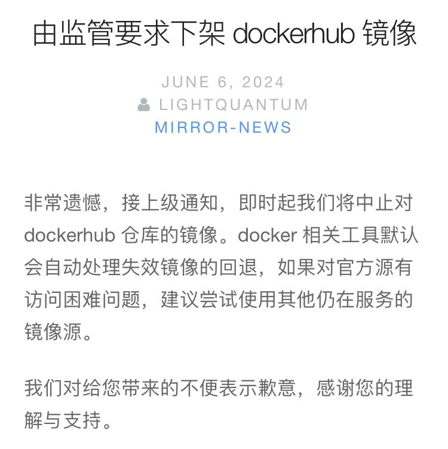
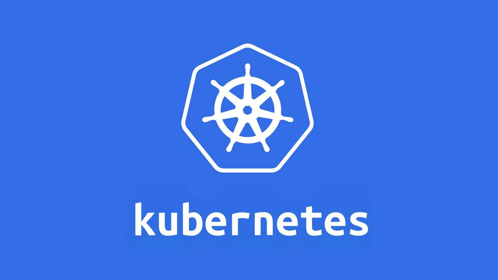
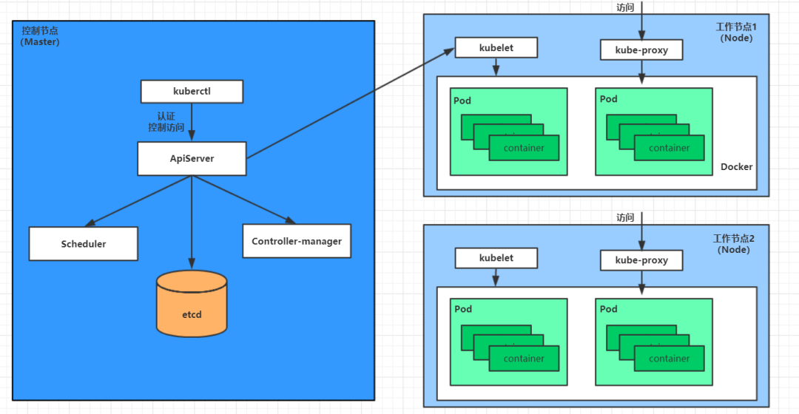

# Docker 与 Kubernetes 核心知识

这份文档把 Docker（容器运行时与镜像工具）和 Kubernetes（容器编排系统）放在一起讲：先解释"镜像、容器、编排"这些词到底指什么，再说明日常最常用的命令、配置字段和默认行为。读者假设是写过 Spring Boot 应用、能独立完成 CRUD 的开发者，但不要求了解容器底层实现。

## 本文导读

全文按"先概念、再工具、后编排"的顺序组织，可按需跳读：

+ 发布策略：灰度、蓝绿与金丝雀
+ Docker 基础：镜像、容器与仓库
+ Docker 网络与端口映射
+ 数据共享：容器之间，以及容器与宿主机之间
+ 查看容器日志与排查思路
+ 构建并推送镜像到仓库
+ Docker Compose 与 Docker Swarm
+ Kubernetes 是什么、解决什么问题
+ 集群架构与核心组件
+ Pod 与容器生命周期（含探针）
+ 工作负载控制器：Deployment、StatefulSet、DaemonSet
+ Service：稳定入口与负载均衡
+ 标签与选择器
+ 存储管理：Volume、PV、PVC
+ 调度：Pod 落在哪台机器
+ 自愈、滚动升级与回滚
+ 日志与监控
+ etcd：集群的账本
+ Docker 与 Kubernetes 的关系

## 发布策略：灰度、蓝绿与金丝雀

上线新版本最大的风险，是**把有问题的版本一次性推给所有用户**。本节介绍的三种策略都在控制这个"爆炸半径"：先用小范围验证，再逐步扩大。理解它们的差别之后，再看 Kubernetes 的滚动更新（RollingUpdate）会轻松很多。

### 灰度发布

灰度发布（Gray Release / Staged Rollout）是一种**逐步放量**的策略：先把新版本开放给一小部分用户，观察表现，没问题再扩大范围，而不是一次性替换全部用户。目标是让问题在影响面还很小的时候就被发现，从而快速回滚或修复。

特点：

+ **用户分组**：通常会先选择一小部分用户，或某个特定的用户群体体验新版本。
+ **逐步扩展**：小范围验证没问题后，逐渐扩大到更多用户，直到全量。
+ **风险控制**：在影响面最小的阶段监测并纠正新版本中的问题。

生活化比喻：新菜先在几家门店试卖，卖得好再推广到全国门店。

### 蓝绿部署

蓝绿部署（Blue-Green Deployment）会**同时维护两套几乎相同的生产环境**，分别称为"蓝色"和"绿色"。当前线上流量走蓝色环境，绿色环境用来部署并验证新版本。

特点：

+ **两套环境**：蓝色是当前生产环境，绿色用于部署新版本。
+ **快速切换**：绿色环境验证通过后，把流量整体切到绿色。
+ **轻松回滚**：新版本出问题时，把流量切回蓝色即可。
+ **无中断部署**：切换过程可以做到不中断服务。

需要注意的前提：蓝绿部署需要**双份资源**，并且流量入口（DNS、负载均衡器或网关）必须能快速改变指向，否则切换本身就会变成风险点。

生活化比喻：两间布置一样的房间，一间住人、一间翻新，翻新好了直接换房间，旧房间先留着不拆。

### 金丝雀部署

金丝雀部署（Canary Deployment）的名字来自旧时煤矿用金丝雀探测瓦斯：先让极少量流量"试毒"，确认安全再放量。它和灰度发布很像，但更强调**从小规模开始试探，并用真实指标判断是否继续**。

特点：

+ **小范围试探**：先把新版本发布给一小部分用户，观察性能和稳定性。
+ **实时监控**：对这批"金丝雀用户"重点监控，评估新版本表现。
+ **逐步推广**：根据反馈和监控数据，决定是否扩大到全体用户。
+ **灵活调整**：金丝雀用户群出现问题时可及时调整或回滚。

### 三种策略怎么选

| 策略 | 流量切换方式 | 回滚速度 | 资源成本 | 典型场景 |
| --- | --- | --- | --- | --- |
| 灰度发布 | 按用户或比例逐步放开 | 中等 | 较低 | 需要平滑过渡、边放量边看数据 |
| 蓝绿部署 | 整体切换环境 | 很快 | 约双倍 | 要求无间断服务、随时能退回旧版本 |
| 金丝雀部署 | 极小流量试探后决定是否放量 | 快 | 较低 | 想用真实流量快速验证新版本风险 |

+ **灰度发布**侧重于逐渐放量，在控制风险的同时积累数据，适合需要平滑过渡和持续监控的场景；
+ **蓝绿部署**注重快速切换与回滚能力，适合对可用性要求高、需要快速响应的场景；
+ **金丝雀部署**通过小规模探测快速发现新版本风险，可根据实况动态调整，是一种灵活且风险控制严格的策略。

这三种策略并不互斥，可以独立使用，也可以组合使用，具体取决于业务需求和技术条件。

## Docker 基础：镜像、容器与仓库

本节先把 Docker 的三个核心概念讲清楚，再说明镜像为什么"分层"、分层带来什么好处。概念没理顺就直接敲命令，很容易遇到"在容器里改的文件，重启后又变回去"这类困惑。

### 镜像、容器、仓库

1. **镜像（Image）**：一个只读模板，包含运行应用所需的文件系统与配置。例如一个镜像里可以是一套完整的 Ubuntu 环境，外加 Apache 或应用自己的程序。镜像是创建容器的依据。
2. **容器（Container）**：从镜像创建出来的运行实例，可以被启动、停止、删除。每个容器相互隔离，可以看作一个精简的 Linux 环境（含 root 权限、进程空间、用户空间、网络空间等）加上运行在其中的应用进程。
3. **仓库（Repository）**：集中存放镜像的地方。Docker Hub 是公共仓库，用户可以从中下载和存放镜像；也可以在内网自建私有仓库（企业里常用 Harbor）。

对 Java 开发者来说，最好记的类比是：**镜像像类，容器像对象**。类定义只有一份，可以 new 出很多对象；每个对象有自己独立的状态，销毁对象不会影响类本身。

### 镜像分层：为什么拉取镜像不用重新下载全部内容

**是什么**：镜像由一层层"文件系统变更"叠加而成，每层只记录相对上一层的增加、删除和修改，并且层一旦生成就**不可修改**（immutable）。

**为什么需要**：层可以在不同镜像之间复用。例如两个都基于同一个基础镜像的应用，只需要额外传输各自的应用层，构建更快、占用的磁盘和带宽也更少。

**怎么实现**：层使用内容寻址存储（content-addressable storage），配合联合文件系统（union filesystem）把多层叠成一个统一的文件视图；容器启动时，Docker 会在镜像层之上再加一个**该容器专属的可写层**。因此：

+ 镜像层始终不变，同一个镜像可以同时运行多个容器；
+ 容器内新写入的文件都在可写层，**容器删除后这些数据一并消失**——这正是后面要引入数据卷的原因。

```dockerfile
# 每条指令通常产生一层；把变化频率低的指令放前面，可以复用构建缓存
FROM eclipse-temurin:17-jre
WORKDIR /app
COPY target/app.jar app.jar
ENTRYPOINT ["java", "-jar", "/app/app.jar"]
```

镜像构建完成后，可以用 `docker image history 镜像名` 查看每一层由哪条指令产生、占多大空间。

### 安装 Docker 与配置镜像加速

不同发行版和版本的安装方式不同：CentOS 7 时代可以直接用系统源里的 `docker` 包，现在更常见的是安装官方仓库提供的 docker-ce，桌面环境则用 Docker Desktop。下面以使用 systemd 的 Linux 主机为例。

1. 安装 Docker：

```bash
[root@localhost ~]# yum -y install docker
```

2. 手动启动 Docker：

```bash
[root@localhost ~]# systemctl start docker
```

3. 查看 Docker 状态：

```bash
[root@localhost ~]# systemctl status docker
● docker.service - Docker Application Container Engine
   Loaded: loaded (/usr/lib/systemd/system/docker.service; enabled; vendor preset: disabled)
   Active: active (running) since Tue 2024-06-04 13:43:05 CST; 31min ago
     Docs: http://docs.docker.com
  Main PID: 4791 (dockerd-current)
    Tasks: 49
   Memory: 11.0M
   CGroup: /system.slice/docker.service
           ├─4791 /usr/bin/dockerd-current --add-runtime docker-runc=/usr/libexec/docker/docker-runc-current --default-runtime=docker-runc --exec-opt ...
           ├─4799 /usr/bin/docker-containerd-current -l unix:///var/run/docker/libcontainerd/docker-containerd.sock --metrics-interval=0 --start-timeo...
           ├─5098 /usr/libexec/docker/docker-proxy-current -proto tcp -host-ip 0.0.0.0 -host-port 18630 -container-ip 172.17.0.2 -container-port 18630...
           └─5105 /usr/bin/docker-containerd-shim-current f34dd9057953cd36f9548c77ff0ec413a40c75ed3be69a46f6a55e4477615565 /var/run/docker/libcontaine...
```

4. 配置镜像加速器。部分镜像源在国内访问较慢，可以在 `daemon.json` 中配置 `registry-mirrors`。注意这些加速地址的有效性会随时间变化，应以服务商当前公布的地址为准：



```bash
vim /etc/docker/daemon.json
{
  "registry-mirrors": [
    "https://registry.docker-cn.com",
    "http://hub-mirror.c.163.com",
    "https://docker.mirrors.ustc.edu.cn",
    "https://dockerhub.azk8s.cn",
    "https://mirror.ccs.tencentyun.com",
    "https://registry.cn-hangzhou.aliyuncs.com",
    "https://docker.1panel.live",
    "https://atomhub.openatom.cn/",
    "https://hub.uuuadc.top",
    "https://docker.anyhub.us.kg",
    "https://dockerhub.jobcher.com",
    "https://dockerhub.icu",
    "https://docker.ckyl.me",
    "https://docker.awsl9527.cn"
  ]
}

sudo systemctl daemon-reload
sudo systemctl restart docker
```

5. 设置 Docker 开机自启：

```bash
[root@localhost ~]# systemctl enable docker.service
Created symlink from /etc/systemd/system/multi-user.target.wants/docker.service to /usr/lib/systemd/syst
```

配置完成后，可以到 Docker Hub 的镜像页面上查找需要的镜像（例如 MySQL 官方镜像），页面上会给出拉取和运行示例。

### 常用命令速查

下面按操作类型整理日常最常用的命令，其中"容器 ID"也可以替换成容器名。

| 目的 | 命令 | 说明 |
| --- | --- | --- |
| 重启 Docker 服务 | `systemctl restart docker` 或 `service docker restart` | 两条命令等价，二选一 |
| 停止 Docker 服务 | `systemctl stop docker` 或 `service docker stop` | 不是 `docker service docker stop`，那是 Swarm 命令 |
| 查看镜像 | `docker images` | 列出本地镜像及标签、大小 |
| 搜索镜像 | `docker search 镜像名` | 在默认仓库中搜索 |
| 拉取镜像 | `docker pull 镜像名` | 可写 `docker pull nginx:1.24.0`，不写标签默认 `latest` |
| 删除镜像 | `docker rmi 镜像ID` | 有容器依赖时需先删容器或加 `-f` |
| 启动新容器 | `docker run -it ubuntu /bin/bash` | `docker run -d` 让容器在后台运行 |
| 端口映射并命名 | `docker run -p 80:80 -d --name nginx nginx:1.24.0` | 冒号前是宿主机端口，冒号后是容器端口 |
| 启动已停止的容器 | `docker start 容器ID` | 复用原容器及其可写层 |
| 停止容器 | `docker stop 容器ID` | 先发 SIGTERM，超时再强杀 |
| 重启容器 | `docker restart 容器ID` | 等价于 stop 后再 start |
| 删除容器 | `docker rm 容器ID` | 运行中的容器需先停止或加 `-f` |
| 查看运行中的容器 | `docker ps` | 加 `-a` 可看全部容器 |
| 查看所有容器 | `docker ps -a` | 包含已退出的容器 |
| 进入容器 | `docker exec -it 容器ID /bin/bash` | 推荐用法，开一个新进程 |
| 附加到容器主进程 | `docker attach 容器ID` | 见后文"退出方式"的注意事项 |
| 设置开机自启 | `docker update --restart=always 容器ID` | 先启动容器再执行 |
| 查看容器资源占用 | `docker stats -a` | 加 `-a` 显示已停止的容器 |
| 查看容器日志 | `docker logs -t -f 容器名` | `-t` 带时间戳，`-f` 持续跟随 |
| 导出镜像为文件 | `docker save 镜像名:版本 > image.tar` | 用于离线环境迁移 |
| 从文件导入镜像 | `docker load -i image.tar` | 例如 `docker load -i minio.tar` |

## Docker 网络与端口映射

容器默认与宿主机网络隔离，"容器里跑着服务但外面访问不到"是最常见的问题。本节说明 Docker 的几种网络模式、端口映射的写法，以及容器之间如何互相访问。

### 网络模式

Docker 提供多种网络驱动，最常用的几种如下：

| 模式 | 含义 | 典型用途 |
| --- | --- | --- |
| `bridge`（默认） | 每个容器分到独立 IP，通过宿主机上的网桥与外界通信 | 单机上的普通应用 |
| `host` | 容器直接使用宿主机网络，端口与宿主机冲突 | 对网络性能敏感、不想做端口映射 |
| `none` | 只有 loopback，无外部网络 | 需要完全隔离的场景 |
| `overlay` | 跨多台 Docker 主机的虚拟网络 | Swarm 集群中的跨主机通信 |

此外还有 `ipvlan`、`macvlan`，用于让容器直接出现在宿主机所在物理网络中，一般业务开发较少直接使用。

两个容易踩坑的默认行为：

+ `docker run` 不带 `--network` 参数时，容器会连到内置的**默认 bridge 网络**；
+ 默认 bridge 网络上的容器只能用 IP 互相访问，**不能用容器名**；而自定义网络（user-defined bridge）内置了 DNS，可以直接用容器名互相解析。

### 为容器创建一个可访问的网络

有两种常见做法。

1. 使用默认网络并做端口映射：

```bash
docker run --network=bridge -tid -p 8000:8000 image_name
```

这会在 bridge 网络中创建容器，并把容器的 8000 端口映射到宿主机的 8000 端口。

2. 先创建自定义网络，再让容器加入：

```bash
docker network create my_network
docker run --network=my_network -tid -p 8000:8000 image_name
```

自定义网络的好处是同一网络内的容器可以直接用容器名访问对方（例如 `app:8080`），不必关心对方 IP。

### 端口映射规则

`-p 宿主端口:容器端口` 是最常用的形式：

+ `-p 8080:80`：把宿主机 8080 映射到容器 80；
+ `-p 127.0.0.1:8080:80`：只监听宿主机回环地址，外部机器无法访问；
+ `-p 8080:80/udp`：映射 UDP 端口，默认是 TCP。

只有**需要从宿主机外部访问**时才需要映射端口；同一个自定义网络内的容器互访，走容器端口即可。用 `docker port 容器名` 可以查看已生效的映射。

## 数据共享：容器之间，以及容器与宿主机之间

容器一删，可写层里的数据就没了，所以数据库文件、上传文件、配置文件这类数据必须放到容器之外。本节先厘清"网络"和"存储"各管什么，再给出容器之间、容器与宿主机之间共享数据的具体做法。

### 先分清网络与存储

+ **网络**解决"能不能通信"：两个容器能互相发请求；
+ **存储**解决"数据放哪里、能不能共享"：同一份文件被多个容器看到。

用同一网络**并不能**共享数据，它只负责通信。共享数据要靠挂载同一份卷或同一份宿主机目录。

Docker 支持的挂载方式主要有三种：

| 方式 | 数据实际位置 | 生命周期 | 适用场景 |
| --- | --- | --- | --- |
| 数据卷（volume） | Docker 管理的目录，默认在数据目录下 | 容器删除后仍然保留 | 数据库数据、需要长期保留的业务数据 |
| 绑定挂载（bind mount） | 宿主机指定的任意目录或文件 | 跟随宿主机目录 | 开发时挂载源码、配置文件、日志目录 |
| tmpfs 挂载 | 宿主机内存 | 容器停止即丢失 | 敏感临时文件，不希望落盘 |

数据卷的数据默认存放在 Docker 数据目录中（Linux 上通常是 `/var/lib/docker/volumes/`），官方建议通过容器挂载访问，而不是直接改这个目录。

### 容器之间共享数据

1. **使用共享卷**：创建一个卷并挂载到多个容器，它们就能读写同一份数据。

```bash
docker volume create app-data
docker run -d --name writer -v app-data:/data image_name
docker run -d --name reader -v app-data:/data image_name
```

2. **使用数据卷容器**：先起一个只负责挂卷的容器，其他容器通过 `--volumes-from` 继承它的卷。这是早期常见做法，现在更推荐直接用命名卷。

```bash
docker run -d --name data-holder -v app-data:/data busybox
docker run -d --volumes-from data-holder image_name
```

### 容器与宿主机共享数据

1. **用 `-v` 做绑定挂载**：把宿主机目录挂进容器。

```bash
docker run -v /host/directory:/container/directory image_name
```

2. **用 `--mount` 显式声明**（语义更清楚，推荐）：把宿主机的目录或文件挂到容器里，其他容器再挂同一个卷即可共享。

```bash
docker run --mount type=bind,src=/host/directory,dst=/container/directory image_name
```

实际选择时：开发环境常用绑定挂载，方便改完立即生效；生产和数据持久化用数据卷，由 Docker 统一管理路径和权限。

## 查看容器日志与排查思路

容器出问题时，第一手信息几乎都在日志里。本节给出查看日志的三种方式、容器日志文件的真实位置，以及 `docker attach` 的退出注意事项。

### 用 docker logs 查看输出

```bash
docker logs my-container
```

默认会输出容器的全部日志（等价于 `--tail all`）。只看最后几行可以指定行数：

```bash
docker logs --tail 10 my-container
```

再加两个常用参数：`-f` 持续跟随输出（类似 `tail -f`），`-t` 给每行加上时间戳：

```bash
docker logs -t -f my-container
```

### 进入容器查看日志文件

先用 `docker ps` 找到容器 ID，再进入容器的命令行：

```bash
docker exec -it 容器ID /bin/bash
```

进去之后用 `cat`、`less`、`tail` 查看日志文件。应用日志通常写在 `/var/log/` 下，或者写在应用自己配置的目录里（具体要看应用的日志配置）。

### docker attach 的退出方式

```bash
docker attach my-container
```

`docker attach` 会把当前终端接到容器**主进程**的标准输出和标准错误上，因此能看到实时输出，但有两个细节需要注意：

+ 默认按键 `Ctrl-P` 再按 `Ctrl-Q` 是"分离"：终端退出，容器继续运行；也可以用 `--detach-keys` 自定义这个按键序列。
+ 直接按 `Ctrl-C` 时，由于 `--sig-proxy` 默认为 true，SIGINT 会被转发给容器主进程；如果进程没有处理 SIGINT，容器就会随之退出。

所以日常看日志推荐 `docker logs -f`，需要进容器操作时用 `docker exec`，两者都不会误停容器。

### 容器日志文件在哪里

Docker 默认的日志驱动是 `json-file`：容器的标准输出和标准错误被按行写成 JSON，保存在宿主机 Docker 数据目录下，Linux 上默认路径形如：

```text
/var/lib/docker/containers/<容器ID>/<容器ID>-json.log
```

这些文件只应由 Docker 自己访问，不建议用外部工具直接改写。另外不加限制时日志会持续增长，通常要在 `daemon.json` 里做轮转配置：

```json
{
  "log-driver": "json-file",
  "log-opts": {
    "max-size": "10m",
    "max-file": "3"
  }
}
```

也可以在启动容器时单独指定：`docker run --log-opt max-size=10m --log-opt max-file=3 ...`。生产环境一般还会用日志驱动或采集组件把日志转发到集中式平台（如 ELK、Loki 等）。

## 构建并推送镜像到仓库

把镜像推到镜像仓库，是"在别的机器上跑起来"的前提。本节按"构建 → 打标签 → 登录 → 推送"的顺序走一遍，并说明推送时按层传输的机制。

### 构建镜像并打标签

先准备一个 Dockerfile：

```dockerfile
FROM nginx:1.24.0
COPY dist/ /usr/share/nginx/html/
```

再在 Dockerfile 所在目录构建并打标签，标签格式一般是 `用户名/仓库名:版本`：

```bash
docker image build -t user_a/my-app:0.0.1 .
```

`docker build` 与 `docker image build` 等价；末尾的 `.` 表示以当前目录作为构建上下文。

### 登录并推送

```bash
docker login
docker push user_a/my-app:0.0.1
```

推送前需要先在仓库侧创建对应的仓库（在 Docker Hub 上可以点 "Create Repository"，填写名称并选择公有或私有），然后用 `docker login` 输入用户名和密码。

拉取时使用同样的名称：

```bash
docker pull user_a/my-app:0.0.1
```

### 推送时到底传了什么

由于镜像分层，推送是**按层**进行的：仓库端用内容摘要（digest，通常是 sha256）标识每一层，本地与仓库都存在的层会被复用，只上传缺失的部分。所以第二次推送同一个镜像的新版本时，通常只传变化的应用层，速度会快很多。

这也解释了一个常见现象：`docker push` 卡在某一步很久，往往是某一层体积较大或网络较慢，而不是命令出错。

## Docker Compose 与 Docker Swarm

一个应用往往不止一个容器：Web 服务、数据库、缓存要一起起来。逐个 `docker run` 既啰嗦又容易漏参数，本节介绍单机多容器最常用的 Compose，以及 Docker 官方的集群方案 Swarm。

### Docker Compose：用一份 YAML 定义多个容器

**是什么**：Compose 是定义和运行多个容器的工具，用一份 YAML 描述应用包含哪些服务、各自的镜像、端口、环境变量和依赖关系。

**为什么需要**：把一长串 `docker run` 参数固化成文件，一条命令就能起停整套环境，团队里每个人拿到的环境也一致。

**怎么用**：在项目根目录写 `compose.yaml`：

```yaml
services:
  app:
    image: user_a/my-app:0.0.1
    ports:
      - "8080:8080"
    environment:
      SPRING_DATASOURCE_URL: jdbc:mysql://db:3306/demo
    depends_on:
      db:
        condition: service_healthy
  db:
    image: mysql:8.0
    environment:
      MYSQL_ROOT_PASSWORD: example
    volumes:
      - db-data:/var/lib/mysql
    healthcheck:
      test: ["CMD", "mysqladmin", "ping", "-h", "localhost"]
      interval: 5s
      retries: 10
volumes:
  db-data:
```

常用命令：

```bash
docker compose up -d      # 后台启动全部服务
docker compose ps         # 查看服务状态
docker compose logs -f app
docker compose down       # 停止并删除容器、网络
```

需要注意：`depends_on` 的默认含义只是**启动顺序**，并不保证依赖的服务"已经可用"。要等到对方健康检查通过再启动，需要写 `condition: service_healthy`（上面示例即为此写法）。

使用场景：

+ 需要同时运行多个容器的应用，例如 Web 应用 + 数据库 + 缓存；
+ 需要在开发、测试、生产等不同环境部署同一套应用，但容器数量或镜像版本不同；
+ 需要快速启动和停止整套应用，例如开发调试、自动化测试。

Compose 面向**单机**编排；跨多台机器的集群调度，则交给 Kubernetes 或 Swarm。

### Docker Swarm：Docker 官方的集群方案

**是什么**：Swarm 是 Docker 公司推出的集群管理工具，把多个 Docker 节点组织成一个"虚拟主机"，统一管理和调度这些节点上的容器。

**作用**：

1. 集群管理：把多个 Docker 节点组成一个整体，通过一个入口统一管理。
2. 服务编排：提供声明式配置，自动完成服务部署、扩缩容和升级。
3. 跨主机网络：内置对 Docker 网络插件的支持，方便部署跨主机的容器集群。
4. 负载均衡：可在服务副本之间分发请求，并按负载调整实例数量。

**使用场景**：

1. 需要快速扩展容器规模以满足业务需求；
2. 需要高可用，要求容器服务不中断；
3. 需要跨多台主机运行容器，实现负载均衡和容灾；
4. 需要自动化部署和管理容器服务以提高效率。

定位说明：Swarm 是较早的集群方案，`docker service`、`docker node` 这类命令只在 Swarm 模式下有意义；现在新建的集群项目更多选择 Kubernetes。理解这一点，也能避免把 `docker service docker stop` 这类压根不存在的命令当成"停止 Docker 服务"。

## Kubernetes 是什么、解决什么问题

容器解决了"应用怎么打包"，但没解决"几十上百个容器怎么管"。本节先给出 Kubernetes 的一句话定义，再用几个具体问题说明它到底替开发者做了什么。

### 一句话定义



Kubernetes（常写作 K8s，"K" 和 "s" 之间有 8 个字母）是一个开源的容器编排系统，用于自动部署、扩缩和管理容器化应用。它源自 Google 长期运行大规模生产负载的经验（官方表述为"a decade and a half of experience"，约 15 年），并融合了社区的最佳实践。

### 它解决什么问题

Kubernetes 在容器部署的基础上提供了一套弹性分布式框架：服务发现与负载均衡、存储编排、自动部署与回滚、自动调度、自动扩缩容等。目标是把"服务怎么跑"的细节从开发者手里接过去。

换成几个具体问题会更直观：

+ 某个容器挂了，是不是该自动再启动一个？
+ 某台机器负载已经很高，新容器是不是不该再往这台机器上放？
+ 某个服务请求量突增，是不是该多部署几个副本？
+ 容器之间有依赖，比如容器 A 要用容器 B 的资源，A 是不是必须等 B 先就绪？
+ 同时运行多个容器时，怎么保证"要么都成功、要么都失败"，或者某个容器失败后被反复拉起直到达到预期状态？

这些问题都可以交给 Kubernetes：它通过**声明式**的方式工作——你描述"期望状态"（例如 3 个副本、镜像版本 0.0.1），控制器不断把实际状态往期望状态靠拢。

简单说：Kubernetes 让部署的服务尽可能健康地运行，同时能接入监控、日志采集等第三方组件，满足定制化需求。

## 集群架构与核心组件

Kubernetes 集群由**控制平面**（control plane，习惯上叫 master 节点）和若干**工作节点**（node）组成，每个节点上运行不同职责的组件。本节按"谁做决策、谁干活"的顺序讲清这些组件，再说明 Node、Pod、Service 这几个必须分清的概念。



### 控制平面：负责决策

控制平面是集群的"大脑"，主要组件有四个：

| 组件 | 职责 | 一句话理解 |
| --- | --- | --- |
| kube-apiserver | 资源操作的唯一入口，提供认证、授权、API 注册与发现 | 前台，所有请求都经过它 |
| kube-scheduler | 按照调度策略把新建的 Pod 分配到合适的节点 | 调度员，负责分配"停车位" |
| kube-controller-manager | 维护集群状态，如部署安排、故障检测、扩缩容、滚动更新；节点失效时发现并驱动重建其上的 Pod | 巡检员，发现不一致就去修正 |
| etcd | 存储集群中各种资源对象的信息 | 账本，记录集群"应该是什么样" |

etcd 既是控制平面的一部分，也是集群唯一的持久化数据源，因此生产环境通常要单独做高可用（一般部署 3 个或 5 个节点）。

### 工作节点：负责运行容器

每个工作节点上运行三类组件：

| 组件 | 职责 |
| --- | --- |
| kubelet | 与 apiserver 通信，管理本节点上 Pod 的生命周期，向容器运行时下发指令 |
| kube-proxy | 维护节点上的网络规则，把访问 Service 的流量转发到后端 Pod |
| 容器运行时 | 真正负责拉镜像、起停容器，如 containerd、CRI-O |

关于容器运行时有个常见过时说法需要更正：**不是"每个节点必须装 Docker 引擎"**。Kubernetes 从 v1.24 起移除了内置的 dockershim，不再直接对接 Docker Engine；标准做法是使用实现 CRI（容器运行时接口）的运行时，例如 containerd 或 CRI-O。用 Docker 构建出来的镜像遵循 OCI 镜像规范，在这些运行时上照常可以运行。

### 几个必须分清的概念

+ **集群（Cluster）**：一组机器加上 Kubernetes 软件，对外表现为一个整体。
+ **节点（Node）**：集群中的一台机器（物理机或虚拟机），负责运行 Pod。
+ **Pod**：Kubernetes 中最小的调度单元，包含一个或多个容器，这些容器运行在同一个节点上，共享网络命名空间、IP 和端口范围。
+ **Service**：为一组 Pod 提供固定访问入口的抽象对象，详见后文。

Pod 的生活化比喻：像一套**合租房**。几个容器住在一起，共用一个门牌号（IP）和一套水电（网络命名空间），在屋里互相喊话用 `localhost` 就行；但房间里的东西（文件系统）各自独立，除非显式挂载同一个卷。

### 一次创建请求的完整流程

以 `kubectl apply -f deployment.yaml` 为例，Kubernetes 内部大致经历以下步骤：

1. 准备一个包含 Deployment 的 yaml 文件，通过 kubectl 发送给 apiserver。
2. apiserver 校验请求，并把资源内容写入 etcd。
3. 各控制器（controller-manager 中的 Deployment、ReplicaSet、EndpointSlice 等控制器）监听资源变化并作出反应。
4. Deployment 控制器创建 ReplicaSet，ReplicaSet 控制器据此创建期望数量的 Pod 对象（此时 Pod 还没有分配到节点）。
5. scheduler 监听到"尚未调度"的 Pod，按过滤与打分规则选出节点，并把绑定结果写回 apiserver（这一步叫 binding）。
6. 目标节点上的 kubelet 发现分配给自己的新 Pod，调用容器运行时拉镜像、起容器，并持续上报状态。

整条链路是"声明期望状态 + 控制器循环"的典型实现：任何一环发现实际状态与期望不符，都会触发修正，这也是 Kubernetes 自愈能力的来源。

## Pod 与容器生命周期

Pod 是 Kubernetes 里真正跑应用的单元，本节讲清它的结构、官方定义的生命周期阶段，以及探针（probe）如何决定"要不要重启""能不能接流量"。

### Pod 是什么

**Pod 是资源对象的最小单位，也是运行应用容器的最小独立单位。** 一个 Pod 里可以有一个或多个容器，这些容器：

+ 共享同一个网络命名空间，因此共享 IP 和端口空间，容器之间用 `localhost` 通信；
+ 可以共享存储卷（volume），从而交换文件；
+ 总是被调度到同一个节点上，一起创建、一起销毁。

常见的多容器组合是"主容器 + 辅助容器（sidecar）"，例如主应用容器加一个日志采集容器。多数业务场景一个 Pod 只放一个业务容器。

### Pod 的生命周期阶段

Pod 的 `status.phase` 是一个高层概括，官方定义只有五个取值：

| phase | 含义 |
| --- | --- |
| `Pending` | Pod 已被集群接受，但还有容器没准备好运行；包括等待调度、拉取镜像的时间 |
| `Running` | Pod 已绑定到节点，所有容器已创建，至少一个容器在运行或正在启动/重启 |
| `Succeeded` | 所有容器都成功终止，且不会被重启 |
| `Failed` | 所有容器都已终止，且至少一个容器以失败状态结束 |
| `Unknown` | 无法获取 Pod 状态，通常是节点通信异常 |

需要区分：`kubectl get pods` 里 STATUS 列显示的 `CrashLoopBackOff`、`Terminating` 等是 kubectl 的展示信息，**不是** Pod 的 phase。排查时以 `kubectl describe pod` 中的 Events 和容器状态为准。

从使用角度看，一个 Pod 的典型经历是：

1. 创建：提交 Pod 定义（通常由 Deployment 等控制器代劳），apiserver 创建对象，控制器开始跟踪。
2. 调度与启动：scheduler 选定节点，kubelet 拉镜像、按顺序启动初始化容器（init container）和业务容器。
3. 运行：容器就绪后，Pod 进入 Ready 状态，才可能被加入 Service 的后端列表接收流量。
4. 终止：收到删除请求后进入终止流程，先发 SIGTERM 并等待宽限期（默认 30 秒），超时再强杀。

生命周期中会发生哪些事件（初始化容器运行、容器启停、存活/就绪探测等），取决于 Pod 的定义和配置。

### 探针：让集群知道容器"活着"和"能干活"

**是什么**：探针（probe）是 kubelet 周期性对容器做的健康检查，支持 httpGet、tcpSocket、exec、grpc 四种探测方式。

**为什么需要**：进程还在不等于服务可用。比如 Java 应用启动要 40 秒，期间端口已监听但接口还返回 500；又比如发生死锁，进程还在但请求全部超时。探针把这两种情况区分开。

| 探针 | 回答的问题 | 失败后的动作 |
| --- | --- | --- |
| startupProbe（启动探针） | 应用启动完了吗 | 未通过前不执行另外两种探针；超过阈值则重启容器 |
| livenessProbe（存活探针） | 容器还活着吗 | 连续失败达到阈值后**重启容器** |
| readinessProbe（就绪探针） | 现在能接流量吗 | 把 Pod 从 Service 的后端（EndpointSlice）中摘除，但不重启 |

常用参数及默认值：

| 参数 | 默认值 | 说明 |
| --- | --- | --- |
| `initialDelaySeconds` | 0 秒 | 容器启动后多久开始探测 |
| `periodSeconds` | 10 秒 | 探测间隔，最小 1 |
| `timeoutSeconds` | 1 秒 | 单次探测超时时间 |
| `successThreshold` | 1 | 连续成功几次算恢复；liveness 与 startup 必须为 1 |
| `failureThreshold` | 3 | 连续失败几次判定为失败 |

一个 Spring Boot 应用的典型配置（配合 Actuator 的健康端点）：

```yaml
containers:
  - name: app
    image: user_a/my-app:0.0.1
    ports:
      - containerPort: 8080
    startupProbe:
      httpGet:
        path: /actuator/health/liveness
        port: 8080
      periodSeconds: 10
      failureThreshold: 30
    readinessProbe:
      httpGet:
        path: /actuator/health/readiness
        port: 8080
      periodSeconds: 5
    livenessProbe:
      httpGet:
        path: /actuator/health/liveness
        port: 8080
      periodSeconds: 10
      failureThreshold: 3
```

实践建议：启动慢的应用优先用 startupProbe 争取时间，而不是把 livenessProbe 的 `initialDelaySeconds` 调得很大；readiness 失败只摘流量、不重启，适合依赖未就绪、短暂过载等场景。

## 工作负载控制器：Deployment、StatefulSet、DaemonSet

实际使用中很少直接创建裸 Pod，而是由控制器管理一批 Pod。本节对比三种最常用的控制器，说明它们各自适合什么应用。

### 三种控制器对比

| 维度 | Deployment | StatefulSet | DaemonSet |
| --- | --- | --- | --- |
| 适用场景 | 无状态应用 | 有状态应用 | 每个节点都要跑一份的守护进程 |
| Pod 身份 | 可互换，名字随机 | 稳定序号（如 `web-0`、`web-1`）与稳定网络标识 | 每个节点一个，跟随节点 |
| 扩缩容 | 随意增减副本 | 支持增减，但按序号有序进行 | 不按副本数扩缩，节点增减即 Pod 增减 |
| 存储 | 一般不需要持久卷 | 每个 Pod 独立存储（常用 volumeClaimTemplates） | 常挂载节点本地目录（如日志目录） |
| 典型例子 | Web API、前后端服务 | MySQL 主从、Kafka、ZooKeeper | 日志采集、节点监控、网络插件 |

### Deployment：无状态应用的首选

Deployment 管理 ReplicaSet，ReplicaSet 再管理 Pod。它保证"任意时刻有 N 个可用副本"，并支持滚动更新与回滚。

```yaml
apiVersion: apps/v1
kind: Deployment
metadata:
  name: my-app
spec:
  replicas: 3
  selector:
    matchLabels:
      app: my-app
  template:
    metadata:
      labels:
        app: my-app
    spec:
      containers:
        - name: app
          image: user_a/my-app:0.0.1
```

适用判断很简单：**Pod 挂掉后不需要从它自己身上恢复数据**，就用 Deployment。大多数业务服务都属于这一类。

### StatefulSet：需要稳定身份和独立存储

StatefulSet 为每个 Pod 提供稳定的序号、稳定的网络标识（配合 Headless Service）和独立的存储。启动、停止、滚动更新默认按序号顺序进行。

需要注意一个常见误解：StatefulSet **可以**扩缩容（改 `replicas` 即可），只是默认按序号有序进行（`podManagementPolicy: OrderedReady`）；需要并行创建/删除时可改为 `Parallel`。另外，缩容**不会**自动删除对应的持久卷声明，避免误删数据。

```yaml
apiVersion: apps/v1
kind: StatefulSet
metadata:
  name: db
spec:
  serviceName: db-headless
  replicas: 3
  selector:
    matchLabels:
      app: db
  template:
    metadata:
      labels:
        app: db
    spec:
      containers:
        - name: mysql
          image: mysql:8.0
          volumeMounts:
            - name: data
              mountPath: /var/lib/mysql
  volumeClaimTemplates:
    - metadata:
        name: data
      spec:
        accessModes: ["ReadWriteOnce"]
        resources:
          requests:
            storage: 10Gi
```

### DaemonSet：每个节点一份

DaemonSet 保证符合条件的节点上都运行一个 Pod 副本；节点加入集群会自动创建，节点移除则对应 Pod 被回收。默认会在所有节点上创建，但可以通过 `nodeSelector`、节点亲和性限制范围。

控制平面节点通常带有污点（taint），普通 Pod 不会被调度上去；DaemonSet 的 Pod 自带一批容忍（toleration），例如对 `node.kubernetes.io/memory-pressure` 等压力污点的容忍，因此能在资源紧张的节点上继续采集日志和指标。这也是日志、监控类组件普遍用 DaemonSet 部署的原因。

## Service：稳定入口与负载均衡

Pod 会被重建、IP 会变，前端不可能每次都去查新 IP。本节说明 Service 如何提供固定入口、四种类型的区别，以及"负载均衡"在实现层面到底是什么样。

### Service 是什么

Service 是一个抽象：它用标签选择器（selector）圈定一组 Pod，并为这组 Pod 提供一个**固定的访问入口**（虚拟 IP 加端口）。前端的应用或 Ingress 通过这个入口访问后端，不用关心后面具体是哪些 Pod。

生活化比喻：Service 像公司的**总机号码**。员工会离职、换工位，但对外公布的总机号码不变，拨过去由话务员转接到当时在岗的人。

它的主要作用：

1. **提供稳定入口**：为前端应用或 Ingress 提供稳定地址，入口拥有一个虚拟 IP（ClusterIP），前端通过它访问后端 Pod 集群。
2. **实现负载均衡**：把进入的请求分发到后端多个 Pod 副本上。
3. **实现故障隔离**：Pod 未就绪或故障时，会从后端列表中摘除，请求不再打到它身上。
4. **实现服务发现**：前端通过标签选择器找到提供特定服务的 Pod；集群内还可以直接用 `服务名.命名空间` 形式的 DNS 名称访问。

### 四种 Service 类型

| 类型 | 访问范围 | 说明 |
| --- | --- | --- |
| `ClusterIP`（默认） | 集群内部 | 分配一个仅集群内可访问的虚拟 IP |
| `NodePort` | 集群外部（通过节点 IP） | 在每个节点上开放一个端口，默认范围 30000-32767 |
| `LoadBalancer` | 集群外部 | 借助云厂商的负载均衡器暴露服务，通常同时具备 NodePort 的能力 |
| `ExternalName` | — | 把 Service 映射成外部域名，不做代理 |

一个典型的 ClusterIP Service：

```yaml
apiVersion: v1
kind: Service
metadata:
  name: my-app
spec:
  type: ClusterIP
  selector:
    app: my-app
  ports:
    - port: 80
      targetPort: 8080
```

`port` 是 Service 自己暴露的端口，`targetPort` 是容器实际监听的端口，两者可以不同。

### 负载均衡是怎么实现的

Service 的虚拟 IP 并不是某台机器上的真实网卡地址，而是由每个节点上的 kube-proxy 写下的转发规则实现的：

+ **iptables 模式**（常见默认）：为每个 Service 生成规则，命中后**随机**选择一个后端 Pod；
+ **IPVS 模式**：用内核 IPVS 做转发，支持更多调度算法，但该模式已被标记为弃用（自 v1.40 起默认关闭，官方计划在后续版本移除）。

因此"请求均匀分配给每个 Pod"只是近似说法：iptables 模式下实际是随机选择，副本数少时短期分布可能并不均匀。

后端列表来自 EndpointSlice：只有**通过 readinessProbe（或未配置探针时视为就绪）**的 Pod 才会被列入。所以"Service 自动剔除故障 Pod"依赖的是就绪探针，而不是 Service 自己能探测业务健康。

### 第三方负载均衡器与 Ingress

除了内置能力，常见的还有两类做法：

1. **Ingress + Ingress Controller**：Ingress 是一组 HTTP 路由规则（按域名、路径转发），真正干活的是 Ingress Controller（如 Nginx Ingress、Traefik），它通常以 Deployment 或 DaemonSet 的形式跑在集群里，再通过 Service 暴露出去。它适合需要按域名/路径分流、集中做 TLS 终止的场景。
2. **集群外部的负载均衡设备**：如机房里的 F5、Nginx、HAProxy，直接把流量打到 NodePort 或 LoadBalancer 类型的 Service 上。

需要澄清一个说法：Nginx、HAProxy 这类代理一般**不是**以"边车（sidecar）"方式为整个应用做负载均衡的。sidecar 指的是与主容器同处一个 Pod、辅助主容器的容器（如日志采集、代理出站流量）；作为集群入口的代理，通常是独立的控制器工作负载或集群外设备。

## 标签与选择器

Kubernetes 里的对象动辄成百上千，靠名字管理不现实。标签（Label）和选择器（Selector）是"给对象分类、再按分类找对象"的机制，Service、Deployment、NetworkPolicy 都依赖它。

### Labels：贴在对象上的键值对

Label 是附加在资源对象上的键值对，例如 `app: my-app`、`env: prod`、`version: 0.0.1`。一个对象可以有多个 Label，既可以自定义，也可以由系统自动添加。

作用：

1. **标识和组织资源**：给 Pod、Service、Node 等打上业务、环境、版本等维度的标记；
2. **关联和选择资源**：配合选择器批量筛选，做运维操作或监控聚合；
3. **用于服务发现**：Service 通过 Label Selector 找到自己要代理的那组 Pod。

Label 的键可以有前缀（如 `example.com/env`），值有长度和字符限制；需要放不适合做索引的描述性信息时，应该用注解（Annotation）而不是 Label。

### Selectors：按标签筛对象

选择器是"筛选条件"，有两种写法：

+ **基于等值**：`app=my-app`、`env!=test`，Service 的 `selector` 用的就是这种；
+ **基于集合**：`env in (prod, staging)`、`version notin (0.0.1)`、`tier`（存在该键），常用于 `matchExpressions`。

```yaml
selector:
  matchLabels:
    app: my-app
  matchExpressions:
    - key: env
      operator: In
      values: ["prod", "staging"]
```

### 实际怎么用

+ Deployment 用 `spec.selector.matchLabels` 找到自己要管理的 Pod，因此**模板里的 labels 必须能被 selector 匹配到**，否则创建会报错；
+ Service 用 `spec.selector` 找到后端 Pod，匹配不到就没有后端，表现为访问超时或 503；
+ 排查"Service 访问不通"时，第一步通常是对比 Service 的 selector 与 Pod 的实际 labels：`kubectl get pods --show-labels`。

Labels 与 Selectors 的组合使用，让资源管理从"记名字"变成"按特征筛选"，这也是后续做灰度、按版本切流量的基础。

## 存储管理：Volume、PV、PVC

容器重启后本地文件会丢，数据库、上传文件必须落到持久化存储上。本节介绍 Pod 里的 Volume、集群级的 PV/PVC，以及它们如何配合。

### Volume：Pod 级别的存储抽象

Volume 是 Pod 中可被容器挂载的目录，生命周期与 Pod 绑定（具体取决于卷类型）。常见类型：

| 类型 | 数据位置 | 生命周期 | 说明 |
| --- | --- | --- | --- |
| `emptyDir` | 节点本地磁盘（可指定内存） | 随 Pod 删除而清空 | 容器间临时交换数据 |
| `hostPath` | 节点上的指定路径 | 跟随节点目录 | 访问节点日志、设备文件 |
| `nfs` | 外部 NFS 服务器 | 独立于 Pod | 多 Pod 共享同一目录 |
| `cephfs` / `csi` 等 | 外部存储系统 | 独立于 Pod | 生产环境常用，通过 CSI 驱动接入 |
| `persistentVolumeClaim` | 由 PV 提供 | 独立于 Pod | 业务最常用的持久化方式 |

### PV、PVC 与 StorageClass

**PV（PersistentVolume）**是集群级别的存储资源，代表一块已经准备好的存储（NFS 目录、云盘等）。**PVC（PersistentVolumeClaim）**是用户对存储的"申请单"，声明需要多大容量、什么访问模式。

生活化比喻：PV 是仓库里备好的货架，PVC 是下单时的需求单，StorageClass 则像能自动补货的供应商——没有现成货架时按单新建。

三者的关系：

+ 用户创建 PVC，声明 `storageClassName`、`accessModes`、容量；
+ 如果集群配置了 StorageClass，Kubernetes 会**动态创建**匹配的 PV 并与之绑定；否则需要管理员预先创建 PV，由系统按条件匹配绑定；
+ Pod 通过 `persistentVolumeClaim` 引用 PVC，从而使用这块存储。

PVC 里声明的是容量与访问模式（如 `ReadWriteOnce`、`ReadOnlyMany`、`ReadWriteMany`），**不是**具体的卷类型——卷类型由 StorageClass 或管理员决定。

```yaml
apiVersion: v1
kind: PersistentVolumeClaim
metadata:
  name: app-data
spec:
  accessModes: ["ReadWriteOnce"]
  resources:
    requests:
      storage: 10Gi
---
apiVersion: v1
kind: Pod
metadata:
  name: app
spec:
  containers:
    - name: app
      image: user_a/my-app:0.0.1
      volumeMounts:
        - name: data
          mountPath: /data
  volumes:
    - name: data
      persistentVolumeClaim:
        claimName: app-data
```

这套机制的价值在于：应用只声明"我要 10Gi 可读写存储"，不必关心后端是 NFS 还是云盘，换环境时改 StorageClass 即可，可移植性更好。

## 调度：Pod 落在哪台机器

集群里几十台机器，Pod 该放哪一台，由调度器按规则决定，而规则里最容易被忽略的是"资源请求"。本节说明调度器的工作方式、常用的调度约束，以及 CPU/内存的单位与 requests/limits 的语义。

### kube-scheduler 怎么选节点

调度器监听 apiserver，发现"新建且尚未分配节点"的 Pod 后，做两步决策：

1. **过滤（Filter）**：筛掉不满足条件的节点，例如资源不足、节点亲和性不符、污点不容忍；
2. **打分（Score）**：给剩下的节点打分，选分数最高的，然后通知 apiserver 完成绑定（binding）。

历史文档里常把这两步称为**预选策略（Predicates）**和**优选策略（Priorities）**，它们对应现在调度框架中的 Filter 与 Score 插件。打分可以考虑节点资源余量、拓扑分布、Pod 间亲和性等因素。

如果所有节点都不满足，Pod 会停在 Pending。此外调度器支持抢占（preemption）：高优先级 Pod 可以"挤走"低优先级的 Pod；也允许同时运行多个调度器或使用自定义调度器，以满足特殊场景。

### 常用调度约束

| 机制 | 作用 | 写法要点 |
| --- | --- | --- |
| `nodeSelector` | 最简单的硬约束：节点必须有指定标签 | `nodeSelector: {disktype: ssd}` |
| 节点亲和性（nodeAffinity） | 更灵活，支持"必须满足"和"尽量满足" | `requiredDuringSchedulingIgnoredDuringExecution` / `preferred...` |
| Pod 亲和/反亲和 | 按 Pod 之间关系放置，如"和缓存同一个节点""副本分散到不同节点" | `podAffinity` / `podAntiAffinity` |
| 污点与容忍（taint/toleration） | 节点主动"拒绝"普通 Pod，只有带容忍的才能上去 | 节点打污点，Pod 配 tolerations |

```yaml
spec:
  nodeSelector:
    disktype: ssd
  containers:
    - name: app
      image: user_a/my-app:0.0.1
```

反亲和性常用于高可用：让同一 Deployment 的副本分散到不同节点，避免一台机器故障带走全部副本。

### 资源请求与限制

**单位**：

+ CPU 以"核"为单位，`0.1` 等价于 `100m`（读作 100 毫核），最小精度是 `1m`；
+ 内存用字节数表示，常用 `Mi`、`Gi`（1024 进制）；注意大小写敏感，`400m` 表示 0.4 字节而不是 400 兆，写错会导致调度异常。

**requests 与 limits**：

+ `requests` 是"保证量"，调度器按它判断节点放不放得下（节点可分配资源必须不小于各 Pod requests 之和）；
+ `limits` 是"上限"，CPU 超限会被节流（throttling），内存超限可能被内核 OOM 杀掉；
+ 只写 `limits` 不写 `requests` 时，Kubernetes 会把 limits 的值当作 requests 使用。

```yaml
resources:
  requests:
    cpu: "500m"
    memory: "512Mi"
  limits:
    cpu: "1"
    memory: "1Gi"
```

实践上，Java 应用要特别注意堆内存与 `limits` 的关系：容器内存上限是 1Gi 时，JVM 的堆加上元空间、线程栈、直接内存必须留出余量，否则容易在压力下被 OOM 杀掉（表现为 Pod 反复重启、退出码 137）。

## 自愈、滚动升级与回滚

Kubernetes 最实用的能力有两类：出问题时自动修，发版时自动换。本节说明它们各自的触发条件，以及回滚到底做了什么。

### 故障恢复与自我修复

+ **重启失败的容器**：容器进程退出后，kubelet 按重启策略（`Always`、`OnFailure`、`Never`）决定是否拉起，重启间隔会逐步退避。
+ **Pod 被删除或节点失效时补副本**：由 ReplicaSet/Deployment 控制器保证副本数；节点不可用时，控制器会在其他节点重建 Pod（需要等待节点状态被判定为 NotReady，通常有几分钟的容忍时间）。
+ **重新调度**：节点被判定不可用后，其上的 Pod 会被重新调度到其他可用节点。
+ **基础组件问题的修复**：例如网络插件组件异常时重建对应 Pod；kubelet 自身异常通常需要节点级排查。
+ **手动触发重建**：想让 Pod 重新拉起，一般用 `kubectl delete pod 名称`（由控制器补一个新 Pod），或 `kubectl rollout restart deployment/名称`。`kubectl replace -f` 是按文件整体替换对象定义，并不是专门用来"重启 Pod"的命令。
+ **借助观测定位问题**：`kubectl logs` 看容器日志，`kubectl describe pod` 看事件，`kubectl get events` 看集群事件。

需要说明的边界：自愈针对的是"Pod 层面的异常"，不会修复应用自身的逻辑错误，也不会替业务做数据恢复。有状态应用的恢复要靠 StatefulSet + 持久卷 + 应用自身的复制机制。

### 滚动升级

Deployment 更新镜像时，默认采用滚动更新（RollingUpdate）：新建一个 ReplicaSet，逐步扩容新副本、缩容旧副本，过程中始终保留一部分可用副本，因此服务不中断。

```yaml
spec:
  replicas: 3
  strategy:
    type: RollingUpdate
    rollingUpdate:
      maxSurge: 1          # 最多比期望副本多出几个（默认 25%）
      maxUnavailable: 0    # 最多允许几个副本不可用（默认 25%）
```

整个过程的实质是：新 ReplicaSet 扩容、旧 ReplicaSet 缩容，比例受上面两个参数控制；Service 的后端列表（EndpointSlice）随 Pod 就绪状态实时更新，流量自然从旧 Pod 转到新 Pod。

### 回滚

回滚不是"反向再滚一次"，而是**把旧的 ReplicaSet 重新扩起来、把新的缩下去**。Deployment 的历史版本就保存在它管理的各个 ReplicaSet 里，默认保留 10 个（由 `revisionHistoryLimit` 控制）。

```bash
kubectl rollout status deployment/my-app       # 查看升级进度
kubectl rollout history deployment/my-app      # 查看历史版本
kubectl rollout undo deployment/my-app         # 回滚到上一个版本
kubectl rollout undo deployment/my-app --to-revision=2
```

需要注意：只有 Pod 模板（`.spec.template`）变化才会产生新的 revision，单纯改副本数不会生成历史版本。

## 日志与监控

应用跑在集群里，"日志在哪、指标从哪来"和单机部署完全不同。本节说明常见的日志采集路径和监控组件组合。

### 日志管理

1. **按 Pod 查日志**：`kubectl logs pod名`，多容器 Pod 用 `-c 容器名` 指定；加 `-f` 持续跟随，`--previous` 查看上一个已退出容器的日志（排查重启原因很有用）。
2. **节点上的日志文件**：容器的 stdout/stderr 由容器运行时写到节点磁盘（例如 json-file 驱动下的 `/var/lib/docker/containers/...` 或 containerd 的对应目录），再按节点的轮转策略处理。注意这一步是**容器运行时**做的，不是 kube-proxy——kube-proxy 只负责 Service 的流量转发。
3. **sidecar + 采集 agent**：在 Pod 里加一个 sidecar 容器读取应用日志文件并转发到 stdout，节点上再由 DaemonSet 部署的采集 agent（如 Fluent Bit、Filebeat）收集并送往集中式平台（如 ELK、Loki）。

生产上通常采用第 3 种：应用只负责往 stdout 或文件写日志，采集与传输交给集群统一处理，避免登录节点逐个看。

### 监控管理

+ **metrics-server**：采集各节点 kubelet（源自 cAdvisor）上报的 CPU、内存等资源用量，供 `kubectl top` 和 HorizontalPodAutoscaler 使用；
+ **Prometheus + Grafana**：Prometheus 抓取并存储时序指标，Grafana 做可视化，是集群与应用监控最常见的组合；
+ **apiserver 的 `/metrics` 端点**：暴露的是 apiserver 自身及部分控制面指标（请求量、延迟等），可以用 Prometheus 抓取，但它不提供业务 Pod 的 CPU/内存使用率；
+ **Heapster**：早期的集群监控方案，项目已停止维护（已归档），新集群不应再使用，用 metrics-server 加 Prometheus 替代。

## etcd：集群的账本

Kubernetes 的所有对象最终都要落到一个地方，这个地方就是 etcd。本节说明它是什么、为什么必须是强一致的，以及它在集群中的三个作用。

### 是什么

etcd 是一个分布式的键值存储（key-value store），用于保存 Kubernetes 集群中所有资源对象的状态信息。它使用 Raft 一致性算法，通过选举产生领导者（leader）来保证数据的强一致性。

生活化比喻：etcd 像集群的**账本**。谁想改配置，都得记账；账本一旦记录，所有节点看到的都是同一份内容。

### 作用

1. **数据存储**：保存集群中所有资源的状态信息，也可用于服务发现、分布式锁、分布式队列、分布式通知与协调等场景；
2. **配置管理**：保存集群的各类配置信息，如 DNS、网络插件等相关配置；
3. **故障恢复**：集群状态都在 etcd 中，节点故障后可以据此重建工作负载；etcd 自身的备份（快照）也是灾难恢复的最后一道保障。

### 基本原理

1. **分布式存储**：可以部署多节点集群，通过数据同步保证可靠性（生产环境常见 3 或 5 个节点，容忍少数节点故障）；
2. **高可用**：通过选举算法保证任何时候只有一个 leader 负责写入，写请求需要多数节点确认，从而保证强一致；
3. **数据持久化**：数据定期写入磁盘（快照与 WAL 日志），系统崩溃后可以恢复到一致状态。

需要注意：etcd 保存的是"集群期望状态"，并不保存业务数据；业务数据仍然在数据库或持久卷里。

## Docker 与 Kubernetes 的关系

Docker 和 Kubernetes 经常一起出现，但它们解决的不是同一个问题。本节说明各自负责什么、有什么区别，以及容易混淆的 LXC。

### 各自的职责

**Docker** 关注**单个容器**的创建、管理和运行：把应用及其依赖打包成可移植的镜像，在任何支持的环境中以相同方式运行，从而简化开发、测试和部署，减少环境差异带来的问题。它提供标准的容器格式与镜像管理能力，并附带日志、资源限制等基础功能。

**Kubernetes** 关注**一群容器**的编排：自动化部署、扩缩和管理，在多个节点上调度容器，提供服务发现、存储编排、自动扩缩容、滚动更新等能力，让运维人员能管理大规模集群并保持稳定性。

一句话概括：Docker 解决"怎么把应用装进盒子"，Kubernetes 解决"成百上千个盒子怎么摆、怎么换、怎么扩"。实际项目中两者通常一起用：用 Docker（或等价的构建工具）做镜像，用 Kubernetes 跑集群。

### 主要区别

| 维度 | Docker | Kubernetes |
| --- | --- | --- |
| 设计理念 | 简洁易用，聚焦容器与镜像 | 聚焦编排，强调声明式与自动化 |
| 管理对象 | 单机上的容器 | 跨节点的 Pod、Service 等工作负载 |
| 核心能力 | 构建、运行、分发镜像 | 调度、扩缩容、自愈、滚动升级、服务发现 |
| 适用规模 | 单机、开发环境、小型部署 | 多节点集群、生产环境 |
| 依赖关系 | 本身即可运行容器 | 需要容器运行时（containerd、CRI-O 等） |

两者并非替代关系：Kubernetes 需要容器运行时来真正启动容器，而 Docker 也可以在单机上独立使用。

### 与 LXC 的区别

LXC（Linux Containers）是更早的 Linux 容器技术，提供的是"系统容器"，更接近轻量级虚拟机；Docker 则围绕"应用容器"和镜像分发构建生态。

1. **镜像管理**：Docker 把应用及其依赖打包成可分发、可版本化的镜像，具备可移植性；LXC 主要提供进程与资源的隔离（沙盒化），跨机器迁移需要额外手段。
2. **运行环境**：Docker 可以运行在 Linux，也可以通过虚拟化在 Windows、macOS 上使用；LXC 依赖 Linux 内核特性，只能在 Linux 上运行。
3. **生态与工具**：Docker 有成熟的镜像仓库、构建工具和编排生态（Compose、Swarm、Kubernetes 都与之配套）；LXC 的工具链相对小众。
4. **使用体验**：Docker 命令行与文档更贴近应用开发者，社区采用度更高；LXC 更偏系统管理视角。

结论上，笼统地说"Docker 更适合大规模容器管理"并不准确：**大规模集群管理是 Kubernetes 的职责**，Docker 的长处是镜像构建与单机容器运行；LXC 则在需要"接近虚拟机的系统级隔离"、且对开销敏感的场景仍有使用价值。

### 为什么总是一起出现

典型链路是：开发者用 Dockerfile 构建镜像 → 推送到镜像仓库 → Kubernetes 从仓库拉取镜像并在集群里调度运行 → 通过 Service/Ingress 对外提供服务。容器格式（OCI 镜像规范）是这条链路的共同语言，所以即使节点上换成了 containerd，Docker 构建的镜像依然能用。

### Docker 在云环境中的作用

Docker 是一个开源的应用容器引擎，让开发者把应用及其依赖打包进可移植的容器，再发布到支持容器的 Linux 机器上，同时提供一种轻量级的虚拟化方式。放到云环境中看，它的价值主要体现在三点：

+ **轻量、启动快**：容器共享宿主机内核，不像虚拟机那样需要完整的操作系统，因此启动更快、占用更少，适合按需扩缩；
+ **可移植**：同一份镜像在开发机、测试环境和不同云平台上以相同方式运行，迁移和部署成本低；
+ **生态完整**：镜像仓库、编排系统（Kubernetes）、监控与日志方案都围绕容器镜像格式建设，容易接入云平台已有的能力。

也要避免绝对化理解："容器可以运行在任何 Linux 机器上"并不代表行为完全一致——内核版本、cgroup 版本、存储驱动等仍会影响表现；Windows 容器还需要单独构建对应平台的镜像。

## 参考资料

本文涉及的可验证行为均以上述公开文档为准，条目按主题列出，不提供链接。

+ Kubernetes 项目. Kubernetes 官方文档：Pod 生命周期与探针、资源管理、工作负载控制器、Service 与网络、存储. 2026
+ Docker 公司. Docker 官方文档：镜像分层、网络驱动、存储与卷、日志驱动、Compose 文件参考. 2026
+ Docker 公司. Docker CLI 命令参考：attach、logs、run 等命令的参数与默认值. 2026
+ Kubernetes 项目. Kubernetes 发布说明与博客：dockershim 移除（v1.24）、kube-proxy IPVS 模式弃用. 2026
