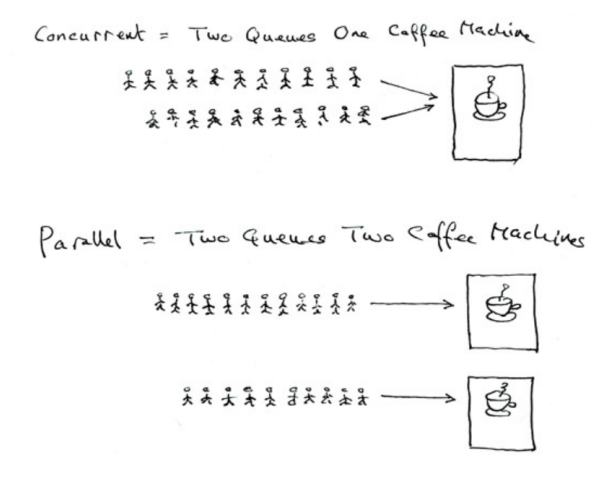
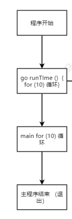

# Go 语言知识汇总：网络编程、并发与常见问题

Go 是一门编译型、强类型、自带垃圾回收的语言，内置 goroutine（由运行时调度的轻量级执行单元）和 channel（goroutine 之间传递数据的管道）。本文面向有一年 Java 经验的读者，用线程、阻塞队列、锁等 Java 概念做类比，系统梳理 Go 的网络编程、并发模型与常见问题。凡涉及行为细节的地方以 Go 官方规范与标准库文档为准，并标注适用版本；源码级分析集中在"进阶了解"小节，初学可以跳过。

## 本文导读

下面是全文的章节地图，可按需跳读。

- 一、Go 语言速览：Go 与 Java 的概念对照
- 二、进阶网络通信：`net` 包、HTTP 服务与模板、路由（`ServeMux` 与 `HttpRouter`）、Linux I/O 模型、goroutine + epoll
- 三、进阶并发编程：进程/线程/协程、GMP 调度、channel、同步原语、`defer`/`panic`/`recover`、切片与 map、垃圾回收
- 四、Go 语言常见面试题：十个高频问法与简明答案
- 五、参考资料

## 一、Go 语言速览

本节先用一张对照表把 Go 的核心概念映射到 Java 上，后面各章会反复用到这些对应关系。如果已经熟悉 Go 基本语法，可以略过本节直接看第二章。

### 1. 与 Java 的直观对照

| 维度 | Java | Go |
| --- | --- | --- |
| 运行方式 | 编译为字节码，运行在 JVM 上 | 编译为单个可执行文件，运行时随程序一起打包，无需额外安装虚拟机 |
| 并发单元 | `Thread`（通常与操作系统线程一一对应）；JDK 21 起提供虚拟线程 | goroutine，由 Go 运行时复用到少量操作系统线程上 |
| 并发通信 | 共享内存加锁，配合 `java.util.concurrent` | 首选 channel 传递数据，其次才用锁 |
| 错误处理 | 异常机制（`try` / `catch` / `finally`） | 返回值 `error`；`panic` / `recover` 只用于真正的异常场景 |
| 接口实现 | 显式 `implements` | 隐式实现：方法集满足接口即可，不需要声明 |
| 代码复用 | 类继承 | 无继承，用组合与嵌入（embedding） |
| 泛型 | 有（类型擦除） | Go 1.18 起支持类型参数 |
| 依赖管理 | Maven / Gradle | go module（`go.mod`） |
| 垃圾回收 | 多种收集器可选（G1、ZGC 等），参数丰富 | 运行时内置并发标记清扫，可调参数很少 |

### 2. 学习方法建议

对 Java 开发者来说，Go 的语法门槛不高，真正的差异在三处：**并发模型**（goroutine 取代线程池）、**错误处理**（返回值取代异常）、**类型系统**（隐式接口、无继承）。把这三处想清楚，剩下的多是记忆性内容。

## 二、进阶网络通信

Go 把网络 I/O 做进了标准库与运行时：一个 TCP 服务只需要 `net.Listen` 加 `Accept` 循环，一个 HTTP 服务只需要 `net/http`。本节从最底层的 `net` 包讲起，经由 HTTP 服务与路由，最后看 Linux 的 I/O 模型以及 Go 运行时如何用 epoll 支撑海量连接。

### 1. 标准库 net 包

`net` 包提供可移植的网络 I/O 接口，覆盖 TCP/IP、UDP、域名解析和 Unix 域套接字；IP 层也可以直接使用（`ip`、`ip4`、`ip6` 网络对应 `IPConn`，可用于 ICMP 这类需要 IP 层控制的操作，通常需要相应权限）。需要说明的是：HTTP、SMTP 等应用层协议不在 `net` 包里，而是由 `net/http`、`net/smtp` 等独立包在 `net` 之上实现；标准库并不包含 FTP 的实现。

关键函数：

- `net.Listen(network, address)`：服务端监听，返回 `Listener`。
- `net.Dial(network, address)`：客户端发起连接，返回 `Conn`。
- `net.ListenConfig` / `net.Dialer`：需要超时、上下文控制时使用。

其中 `Conn` 是双向连接接口（提供 `Read`、`Write`、`Close`、`LocalAddr`、`RemoteAddr`），可以类比 Java 的 `java.net.Socket`；`Listener` 类比 `ServerSocket`。

**服务端**

```go
package main

import (
    "fmt"
    "net"
)

func main() {
    fmt.Printf("服务器准备开启。。。。")
    listener, err := net.Listen("tcp", "127.0.0.1:8081")
    if err != nil {
        fmt.Println(err)
        return
    }
    defer listener.Close()
    for {
        conn, err := listener.Accept()
        if err != nil {
            fmt.Println(err)
            return
        }
        fmt.Println(conn)
    }
}
```

**客户端**

```go
package main

import (
    "fmt"
    "net"
)

func main() {
    fmt.Printf("客户端准备开启。。。。")
    conn, err := net.Dial("tcp", "192.168.49.1:8081")
    if err != nil {
        fmt.Println(err)
        return
    }
    defer conn.Close()
    fmt.Println("客户端连接成功", conn.RemoteAddr().String())
}
```

**客户端通过标准流发送数据**：关键方法 `os.Stdin`、`bufio`、`conn.Write`、`conn.Read`。

```go
func main() {
    fmt.Printf("客户端准备开启。。。。")
    conn, err := net.Dial("tcp", "192.168.49.1:8081")
    if err != nil {
        fmt.Println(err)
        return
    }
    proc(conn) // 这里同步调用；若改成 go proc(conn)，需保证 main 不提前返回
}

func proc(conn net.Conn) {
    defer conn.Close()
    reader := bufio.NewReader(os.Stdin)  // 标准输入流
    line, err := reader.ReadString('\n') // 每次读一行
    if err != nil {
        fmt.Println(err)
        return
    }
    n, err := conn.Write([]byte(line))
    if err != nil {
        fmt.Println(err)
        return
    }
    fmt.Println("客户端连接成功", conn.RemoteAddr().String(), "并且写了", n, "个字节")
}
```

**服务端读取数据**

```go
func main() {
    fmt.Printf("服务器准备开启。。。。")
    listener, err := net.Listen("tcp", "0.0.0.0:8081")
    if err != nil {
        fmt.Println(err)
        return
    }
    defer listener.Close()
    for {
        conn, err := listener.Accept()
        if err != nil {
            fmt.Println(err) // 常见 err 为 EOF：客户端已退出
            return
        }
        go proc(conn) // 每个连接交给一个 goroutine 处理
    }
}

func proc(conn net.Conn) {
    defer conn.Close()
    for {
        buf := make([]byte, 1024)
        n, err := conn.Read(buf) // 返回实际接收的字节数
        if err != nil {
            fmt.Println(err)
            return
        }
        fmt.Println(n)
        fmt.Println(string(buf[:n]))
    }
}
```

这里有两处容易写错的地方：一是 `err != nil` 之后要先 `return`，再 `defer conn.Close()`，否则 `conn` 为 `nil` 会在后续调用时 panic；二是 `Accept` 返回的连接一定要判错之后才能交给 goroutine 使用。示例中 `conn.Read` 读到 `EOF` 表示对端关闭了连接，属于正常退出路径，但演示代码统一打印了错误信息。

### 2. HTTP 服务与模板引擎

Go 标准库自带 HTTP 服务端和 `text/template` / `html/template` 模板引擎，不需要额外框架就能写出带页面渲染的服务。`http.Handler` 是一个只含 `ServeHTTP(w, r)` 方法的接口，任何类型只要实现它就能作为处理器，这比 Java 里继承 `HttpServlet` 更轻。

```go
func main() {
    handle1 := handle1{}
    http.Handle("/handler1", &handle1)
    s := http.Server{
        Addr:    "127.0.0.1:8081",
        Handler: nil, // 为 nil 时使用默认的 DefaultServeMux
    }
    s.ListenAndServe()
}

type handle1 struct{}

func (h *handle1) ServeHTTP(w http.ResponseWriter, req *http.Request) {
    t1, err := template.ParseFiles("src/web/template/html/index.html")
    if err != nil {
        panic(err)
    }
    t1.Execute(w, "Hello MyHTML")
}
```

模板语法要点：

- **空白**：动作 `{{ ... }}` 内部的空格只起分隔作用，不会被输出，`{{ 1 }}` 输出 `1`；文本中的空白则原样输出。若要裁剪动作两侧的空白，使用 `{{-` 和 `-}}`，例如 `{{- 1 -}}` 会去掉左侧文本末尾和右侧文本开头的空白。

- **注释**：`{{/* 注释内容 */}}`，不会出现在输出里。

- **pipeline 多级传递**：类似 Unix 管道，前一个命令的结果作为后一个命令的**最后一个参数**传入。需要留意 `printf "%q"` 会给字符串加上双引号：

```gotemplate
{{"golang"}}                                   {{/* 输出 golang */}}
{{printf "%q" "golang"}}                       {{/* 输出 "golang"，带双引号 */}}
{{"golang" | printf "%q"}}                     {{/* 输出 "golang"，带双引号 */}}
{{"lang" | printf "%s%s" "go" | printf "%q"}}  {{/* 输出 "golang"，带双引号 */}}
{{"golang" | printf "%s" | printf "%q"}}       {{/* 输出 "golang"，带双引号 */}}
```

- **变量**：`$var := pipeline` 定义新变量；`$var = pipeline` 给已存在的变量赋值。

- **条件判断**：比较用函数而非运算符，包括 `eq`（等于）、`ne`（不等于）、`lt`、`le`、`gt`、`ge`；写法是 `ge $Age 18`，而不是 `$Age >= 18`。

```gotemplate
{{$Age := 19}}
{{if ge $Age 18}}
已成年
{{end}}

{{$Age := 13}}
{{if ge $Age 18}}
已成年
{{else if lt $Age 14}}
未成年
{{else}}
禁止入内
{{end}}
```

- **循环**：`range` 遍历切片、map、channel，点号 `.` 表示当前数据。

```gotemplate
{{range $val := .}}
{{println $val}}
{{end}}
```

对应的执行代码：

```go
strs := []string{"示例", "golang", "666"}
t1.Execute(w, strs)
```

- **设置 `.` 的值**：`with ... end`，管道结果非空时把 `.` 设为该值。例如 `{{with lt $Age 14}}未成年{{else}}已成年{{end}}`。

- **自定义函数与完整函数列表**：以 `text/template` 包文档为准，标准库源码中的 `template/funcs.go` 列出了内置函数实现。

**嵌套 HTML**：使用 `define` 和 `template` 关键字，把公共片段定义成具名模板再引用。

```text
header.html 中：
{{define "header"}}
    这是header
{{end}}

index.html 中：
{{template "header"}}

ServeHTTP 方法中：
t1, err := template.ParseFiles("src/web/template/html/index.html", "src/web/template/html/header.html")
```

注意 `ParseFiles` 会把多个文件解析到同一个模板集合里，因此 `index.html` 中可以直接引用 `header.html` 里定义的 `header`。

### 3. 多路复用器 ServeMux

`ServeMux` 是标准库的 HTTP 请求多路复用器（路由器）：它按注册的 pattern 匹配请求 URL，并调用最匹配的处理器。`http.HandleFunc` 是向默认 `DefaultServeMux` 注册的快捷方式，生产代码更推荐显式创建 `ServeMux` 并赋给 `http.Server.Handler`，避免不同库争抢全局路由。

```go
func newServerMux(w http.ResponseWriter, r *http.Request) {
    fmt.Fprintln(w, "my mux")
}

func main() {
    mux := http.NewServeMux()
    mux.HandleFunc("/", newServerMux)
    s := &http.Server{
        Addr:    ":8081",
        Handler: mux,
    }
    s.ListenAndServe()
}
```

多个 handler（`/happy`、`/bad`）：

```go
func happy(w http.ResponseWriter, r *http.Request) {
    fmt.Fprintln(w, "happy")
}

func bad(w http.ResponseWriter, r *http.Request) {
    fmt.Fprintln(w, "bad")
}

func main() {
    mux := http.NewServeMux()
    mux.HandleFunc("/", newServerMux)
    mux.HandleFunc("/happy", happy)
    mux.HandleFunc("/bad", bad)
    s := &http.Server{
        Addr:    ":8081",
        Handler: mux,
    }
    s.ListenAndServe()
}
```

关于"`ServeMux` 不支持变量路由"这个说法需要加版本限定：**Go 1.22 起，`ServeMux` 的 pattern 已支持请求方法和通配符**，形如 `"GET /users/{id}"`，路径变量通过 `r.PathValue("id")` 获取。

```go
func main() {
    mux := http.NewServeMux()
    mux.HandleFunc("GET /users/{id}", func(w http.ResponseWriter, r *http.Request) {
        fmt.Fprintf(w, "user=%s\n", r.PathValue("id"))
    })
    http.ListenAndServe(":8081", mux)
}
```

在 Go 1.22 之前，标准库路由只能做前缀匹配，路径参数要么自己解析 `r.URL.Path`，要么引入第三方路由库——这正是 `HttpRouter` 流行起来的原因。

### 4. HttpRouter 高性能 HTTP 路由包

`HttpRouter` 是常用的第三方路由库，特点是支持路径变量、按请求方法注册，并且路由匹配开销小。它的接口比 `ServeMux` 更接近 Spring MVC 的 `@RequestMapping`：路径里的 `:name` 就是占位符，通过 `ps.ByName("name")` 取值。Gin 框架的路由实现即源自 `httprouter`。

```bash
go get github.com/julienschmidt/httprouter
```

```go
func Hello(w http.ResponseWriter, r *http.Request, _ httprouter.Params) {
    w.Write([]byte("hello httpRouter！！"))
}

func Index(w http.ResponseWriter, r *http.Request, ps httprouter.Params) {
    fmt.Fprintf(w, "hello %s \n", ps.ByName("name"))
}

func main() {
    router := httprouter.New()
    router.GET("/", Hello)
    router.GET("/index/:name", Index)
    http.ListenAndServe(":8081", router)
}
```

RESTful 风格路由实现 CRUD：

```go
func ModifyUser(w http.ResponseWriter, r *http.Request, ps httprouter.Params) {
    uid := ps.ByName("uid")
    fmt.Fprintf(w, "修改了 用户id为 %s \n", uid)
}

func DeleteUser(w http.ResponseWriter, r *http.Request, ps httprouter.Params) {
    uid := ps.ByName("uid")
    fmt.Fprintf(w, "删除了 用户id为 %s \n", uid)
}

func main() {
    router := httprouter.New()
    router.GET("/", Hello)
    router.GET("/index/:name", Index)
    router.POST("/modifyuser/:uid", ModifyUser)
    router.DELETE("/deleteuser/:uid", DeleteUser)
    http.ListenAndServe(":8081", router)
}
```

两种路由能力的对比：

| 能力 | `net/http` ServeMux | `httprouter` |
| --- | --- | --- |
| 路径变量 | Go 1.22 起支持 `{id}`，用 `PathValue` 取值 | 支持 `:name`，用 `ByName` 取值 |
| 请求方法匹配 | Go 1.22 起支持 `"GET /path"` | 支持 `GET` / `POST` / `PUT` / `DELETE` 等方法注册 |
| 通配后缀 | 支持 `{name...}` 匹配剩余路径 | 支持 `*name` 匹配剩余路径 |
| 依赖 | 标准库，零依赖 | 第三方包，需要 `go get` |
| 适用场景 | 中小项目、依赖越少越好 | 需要细粒度路由控制、追求匹配性能 |

### 5. Linux 网络 I/O 模型

理解 Go 的网络性能，需要先了解操作系统提供的几种 I/O 模型。它们的核心区别是：**当数据还没就绪时，程序是原地等待、反复询问，还是把这件事交给内核并在就绪后收到通知**。

- **BIO（阻塞 I/O）**：调用 `read` 后线程一直阻塞，直到数据到达。一个连接一个线程，连接数一多线程就撑不住，对应 Java 早期的 `ServerSocket` 写法。

- **NIO（非阻塞 I/O）**：fd 设为非阻塞，`read` 立即返回，没数据就返回 `EAGAIN`。程序需要自己轮询，空转浪费 CPU。

- **多路复用**：用一个系统调用同时等待多个 fd 就绪，就绪后再去读写。

  - **Select**：每次调用把 fd 集合从用户态拷贝到内核态，再由内核线性扫描；单进程可监听的 fd 数量受 `FD_SETSIZE` 限制（Linux 上通常为 1024）。
  - **Poll**：用 `pollfd` 数组表示要监听的描述符，没有了 1024 的数量上限，但每次调用仍需把整个数组拷入内核并遍历，复杂度仍是 O(n)。所谓"用户态到内核态"的开销主要就来自这次拷贝与遍历。
  - **Epoll**：内核维护一份"兴趣列表"，注册一次即可反复等待；就绪的 fd 放入就绪队列，`epoll_wait` 只返回就绪项，复杂度与就绪数量相关，而不是与监听总数相关。三个关键调用：
    - `epoll_create()` / `epoll_create1()`：创建一个 epoll 实例。
    - `epoll_ctl()`：注册、修改或删除关注的 fd（`EPOLL_CTL_ADD` / `MOD` / `DEL`）。
    - `epoll_wait()`：等待并就绪事件取回。

    关于内部结构：Linux 内核实现中通常用红黑树组织被监听的 fd、用链表组织就绪事件，这属于实现细节，不同内核版本可能调整，但"注册一次、只取就绪"的语义不变。另外 epoll 支持水平触发（LT，默认）与边沿触发（ET）两种模式，ET 要求一次把数据读干净，否则可能收不到后续通知。

| 模型 | 等待方式 | 单进程连接数 | 主要开销 |
| --- | --- | --- | --- |
| BIO | 阻塞 | 受线程数限制 | 线程切换、内存 |
| NIO | 轮询 | 较高 | 空转的 CPU |
| select | 多路等待 | 受 `FD_SETSIZE` 限制（通常 1024） | 每次全量拷贝 + 线性扫描 |
| poll | 多路等待 | 无固定上限 | 每次全量拷贝 + 线性扫描 |
| epoll | 事件通知 | 很高 | 只处理就绪事件 |

### 6. goroutine + epoll 网络模型

Go 的网络编程把上面这套机制藏在了运行时里：网络 fd 被设为非阻塞并注册到运行时的 netpoll（Linux 下基于 epoll），当某个 goroutine 读写的数据还没就绪时，运行时会调用 `gopark` 把它挂起并让出执行权；等 epoll 报告该 fd 就绪，再由 netpoll 唤醒对应 goroutine 继续执行。于是写代码时可以保持"一个连接一个 goroutine、顺序读写"的直观写法，实际却获得了事件驱动的伸缩性——这一点与 Java NIO 加线程池的效果类似，但业务代码不需要写回调或状态机。

下图概括了从应用层到内核的调用链：

```text
用户代码 Conn.Read/Write
    → netFD（系统 fd + pollDesc）
        → pollDesc.rg / wg 记录等待中的 goroutine
            → runtime netpoll（epoll_ctl 注册、epoll_wait 等待）
                → 内核就绪后唤醒 goroutine
```

#### 6.1 整体链路

**通信原理**：BIO → NIO → Selector → Poll → Epoll，逐层演进的目标都是"用更少的线程管理更多的连接"。

**Golang 网络通信**：多协程 + Epoll（Linux；其他平台由运行时替换为 kqueue、IOCP 等）。

**GMP 调度与 Epoll 的关联**：IO 事件发生时，之前挂起的 G 如何重新获得执行权？协程主方法 `main` 最终会走到 `gopark()`，该函数让出当前协程的执行权，一般返回到 g0 由调度器重新挑选可运行的 G。网络就绪时，netpoll 把对应 G 放回可运行队列，调度器再恢复它。也就是说，**GMP 的协程调度与网络 I/O 的就绪唤醒共用同一套 `gopark` 机制**。

以下源码用于说明调用链，函数签名与字段名会随 Go 版本变化，阅读时关注结构而非逐字记忆。

#### 6.2 源码解读：net.Listen

```go
net.Listen("tcp", "0.0.0.0:8082")

func Listen(network, address string) (Listener, error) {
    var lc ListenConfig
    return lc.Listen(context.Background(), network, address)
}

func (lc *ListenConfig) Listen(ctx context.Context, network, address string) (Listener, error) {
    addrs, err := DefaultResolver.resolveAddrList(ctx, "listen", network, address, nil)
    if err != nil {
        return nil, &OpError{Op: "listen", Net: network, Source: nil, Addr: nil, Err: err}
    }
    sl := &sysListener{ListenConfig: *lc, network: network, address: address}
    var l Listener
    la := addrs.first(isIPv4)
    switch la := la.(type) {
    case *TCPAddr:
        l, err = sl.listenTCP(ctx, la) // TCP 监听
    case *UnixAddr:
        l, err = sl.listenUnix(ctx, la)
    default:
        return nil, &OpError{Op: "listen", Net: sl.network, Source: nil, Addr: la, Err: &AddrError{Err: "unexpected address type", Addr: address}}
    }
    if err != nil {
        return nil, &OpError{Op: "listen", Net: sl.network, Source: nil, Addr: la, Err: err}
    }
    return l, nil
}

// listenTCP 返回值包含关键的 poll.FD
func (sl *sysListener) listenTCP(ctx context.Context, laddr *TCPAddr) (*TCPListener, error) {
    fd, err := internetSocket(ctx, sl.network, laddr, nil, syscall.SOCK_STREAM, 0, "listen", sl.ListenConfig.Control)
    if err != nil {
        return nil, err
    }
    return &TCPListener{fd: fd, lc: sl.ListenConfig}, nil
}

func socket(ctx context.Context, net string, family, sotype, proto int, ipv6only bool, laddr, raddr sockaddr, ctrlFn func(string, string, syscall.RawConn) error) (fd *netFD, err error) {
    // 1. 根据操作系统获取对应的 socket
    s, err := sysSocket(family, sotype, proto)
    if err != nil {
        return nil, err
    }
    // 2. 设置 socket 选项
    if err = setDefaultSockopts(s, family, sotype, ipv6only); err != nil {
        poll.CloseFunc(s)
        return nil, err
    }
    // 3. 创建 fd
    if fd, err = newFD(s, family, sotype, net); err != nil {
        poll.CloseFunc(s)
        return nil, err
    }
    // 4. 监听（负责调用系统的 bind 和 listen）
    if laddr != nil && raddr == nil {
        switch sotype {
        case syscall.SOCK_STREAM, syscall.SOCK_SEQPACKET:
            if err := fd.listenStream(laddr, listenerBacklog(), ctrlFn); err != nil {
                fd.Close()
                return nil, err
            }
            return fd, nil
        case syscall.SOCK_DGRAM:
            if err := fd.listenDatagram(laddr, ctrlFn); err != nil {
                fd.Close()
                return nil, err
            }
            return fd, nil
        }
    }
    // 5. 发起连接，非 listen socket 处理
    if err := fd.dial(ctx, laddr, raddr, ctrlFn); err != nil {
        fd.Close()
        return nil, err
    }
    return fd, nil
}
```

#### 6.3 源码解读：net.Dial

```go
conn, err := net.Dial("tcp", "192.168.49.254:8082")

func Dial(network, address string) (Conn, error) {
    var d Dialer
    return d.Dial(network, address) // 实际调用 DialContext
}

// 最终返回的 TCPConn 等都基于关键网络描述符 netFD
func (d *Dialer) DialContext(ctx context.Context, network, address string) (Conn, error) {
    // ...
    // 连接建立后设置 KeepAlive
    if tc, ok := c.(*TCPConn); ok && d.KeepAlive >= 0 {
        setKeepAlive(tc.fd, true)
        ka := d.KeepAlive
        if d.KeepAlive == 0 {
            ka = defaultTCPKeepAlive
        }
        setKeepAlivePeriod(tc.fd, ka)
        testHookSetKeepAlive(ka)
    }
    return c, nil
}
```

#### 6.4 netFD 与 pollDesc

**netFD 网络描述符**（服务端创建 socket 时已构建）：

```go
func newFD(sysfd syscall.Handle, family, sotype int, net string) (*netFD, error) {
    ret := &netFD{
        pfd: poll.FD{
            Sysfd:         sysfd,
            IsStream:      sotype == syscall.SOCK_STREAM,
            ZeroReadIsEOF: sotype != syscall.SOCK_DGRAM && sotype != syscall.SOCK_RAW,
        },
        family: family,
        sotype: sotype,
        net:    net,
    }
    return ret, nil
}

type conn struct {
    fd *netFD // 关键网络描述符/句柄，不论 net.Listener 还是 Dial 都基于此
}

type netFD struct {
    // 包含两个重要数据结构：Sysfd 和 pollDesc
    // 1. Sysfd 是真正的系统文件描述符
    // 2. pollDesc 是对底层事件驱动的封装，所有读写超时等操作都通过它实现
    pfd poll.FD

    family      int
    sotype      int
    isConnected bool
    net         string
    laddr       Addr
    raddr       Addr
}

type FD struct {
    fdmu  fdMutex        // 读写锁，锁定 sysfd 并序列化对 Read/Write 的访问
    Sysfd syscall.Handle // 系统文件描述符
    rop   operation      // 读操作
    wop   operation      // 写操作
    pd    pollDesc       // 底层事件驱动的封装
    l     sync.Mutex     // 用于实现 pread/pwrite

    csema         uint32   // 关闭文件时的信号
    skipSyncNotif bool     // 是否跳过 sync
    IsStream      bool     // TCP 还是 UDP
    ZeroReadIsEOF bool     // 读到 0 字节时是否为错误，基于 socket 时为 false
    isFile        bool     // 系统真实文件还是网络 socket 连接
    kind          fileKind // 文件类型
}
```

**pollDesc**（用户态与内核态协作的关键）：

```go
func (pd *pollDesc) init(fd *FD) error {
    serverInit.Do(runtime_pollServerInit) // 首次初始化
    // 注册 epoll 实例到 fd，实际 link 到 runtime 包的 poll_runtime_pollOpen，
    // 具体实现在 runtime/netpoll.go
    //go:linkname poll_runtime_pollOpen internal/poll.runtime_pollOpen
    ctx, errno := runtime_pollOpen(uintptr(fd.Sysfd))
    if errno != 0 {
        return errnoErr(syscall.Errno(errno))
    }
    pd.runtimeCtx = ctx
    return nil
}

// runtime/netpoll.go 中的 pollDesc
type pollDesc struct {
    link    *pollDesc
    lock    mutex
    fd      uintptr
    closing bool
    everr   bool
    user    uint32
    rseq    uintptr

    // 保存用户态读协程地址：
    // 用户态协程调用 read 阻塞时 rg 设为该协程，
    // 内核态 epoll_wait 检测到 read 就绪后通过 rg 找到该协程并恢复运行。
    // pollDesc 实现用户态与内核态协作的关键就在于此。
    rg uintptr // pdReady、pdWait、等待读的 G 或 nil
    rt timer   // 读定时器，防止超时
    rd int64   // read deadline
    wseq uintptr
    wg uintptr // pdReady、pdWait、等待写的 G 或 nil
    wt timer   // 写定时器
    wd int64   // write deadline
    self *pollDesc
    // epoll 网络模型具体方法在 netpoll_epoll.go 中：epollcreate、epollwait、epollctl
}
```

#### 6.5 epoll 的初始化

初始化通过原子标志保证只执行一次（早期版本用 `sync.Once`，原理相同）：

```go
func poll_runtime_pollServerInit() {
    netpollGenericInit()
}

func netpollGenericInit() {
    if atomic.Load(&netpollInited) == 0 {
        lockInit(&netpollInitLock, lockRankNetpollInit)
        lock(&netpollInitLock)
        if netpollInited == 0 {
            netpollinit() // 真正系统调用，link 到 netpoll_epoll.go
            atomic.Store(&netpollInited, 1)
        }
        unlock(&netpollInitLock)
    }
}

func netpollinit() {
    epfd = epollcreate1(_EPOLL_CLOEXEC)
    // ...
}
```

#### 6.6 进阶了解（可跳过）

以下内容涉及运行时源码，初学阶段可略过，理解"注册 → 挂起 → 就绪唤醒"的主线即可。

- 一次读操作的完整状态流转大致是：`init`（初始化 netpoll）→ `open`（注册 fd）→ `netpoll` 等待 → `gopark` 挂起 G → 就绪后 `goready` 唤醒 → `read` 提交 → `close` 关闭并释放。
- `pollDesc` 中的 `rg` / `wg` 在无等待者时取 `pdReady`、有等待者时保存 G 指针，这是用户态 goroutine 与内核事件之间"对接"的方式。
- 超时控制（`SetReadDeadline`）依赖 `pollDesc` 里的 `rt` / `wt` 定时器；定时器到期同样走 `goready` 唤醒。
- 这套实现会随版本演进（例如 netpoll 的锁与唤醒逻辑多次优化），阅读时以对应版本的源码为准。

### 7. 网络编程要点回顾

1. Go 的网络通信在 Linux 上是**多协程 + epoll 事件驱动**，其他平台由运行时换用对应机制。
2. 写法简单、内置在标准库与运行时里，不需要引入额外的 I/O 框架。
3. 服务端与客户端的关联方式：`Listener` 接受连接得到 `Conn`，双方通过 `Conn` 读写字节流。
4. 链路可以概括为：`Conn > netFD > pollDesc (rg/wg) > epoll (epollcreate / epollctl / epollwait)`。
5. 详细流程：`init > open > netpoll (wait > broke/break > read > commit) > gopark 调度 G > close > free`。
6. goroutine 的 GMP 调度与网络 I/O 的 G 唤醒都通过 `gopark` / `goready` 完成，二者共用一套调度设施。
7. 需要特殊能力（自定义协议、连接池、限流）时，可以在 `net` 之上自行封装。

## 三、进阶并发编程

并发是 Go 的招牌能力，也是 Java 开发者最容易"按旧经验写错"的地方：Go 用 goroutine 取代线程池，用 channel 取代大部分锁，用 `defer` 取代 `finally`。本节从进程与线程这些基础概念讲起，依次展开 goroutine、GMP 调度、channel、同步原语、`defer` / `panic` / `recover`、切片与 map 的语义，最后是垃圾回收与调优参数。

### 1. 进程、线程与协程

- **进程（Process）**：操作系统分配和管理资源（内存、文件句柄等）的基本单位，一个进程至少包含一个线程。
- **线程（Thread）**：进程内的执行单元，是操作系统调度的实体，比进程更轻，但创建、切换仍需陷入内核。
- **协程（Coroutine）**：用户态的轻量级执行单元，由程序自己调度，切换时只需保存少量寄存器。Go 的 goroutine 就是协程的一种实现，但它并不是"单线程下的并发"——运行时会把它复用到多个操作系统线程上（线程数量受 `GOMAXPROCS` 限制），并在阻塞时自动切换。

线程与 goroutine 的对比：

| 对比项 | 操作系统线程 | goroutine |
| --- | --- | --- |
| 调度者 | 操作系统内核 | Go 运行时（用户态） |
| 初始栈 | 通常为 MB 级，由操作系统决定 | 几 KB，按需增长与收缩 |
| 切换成本 | 需陷入内核、保存完整现场 | 用户态保存少量寄存器，成本低得多 |
| 数量级 | 数百到数千 | 可达数十万，实际上限取决于内存与栈增长 |
| 通信方式 | 共享内存 + 锁 | channel 优先 |
| 阻塞影响 | 一个线程阻塞仍占用系统线程 | 网络 I/O 阻塞只挂起 G，M 可继续跑其他 G |

对 Java 开发者而言，goroutine 的定位接近 JDK 21 的虚拟线程：都是"少量平台线程承载大量轻量任务"。区别在于 Go 从语言层面内置了这套机制，并且内置了 channel 作为配套的通信方式。

### 2. 并发与并行

- **并发（Concurrency）**：多个任务在**同一时间段内**交替推进，宏观上"同时"处理，微观上可能轮流执行。典型场景是多线程交替操作同一份资源。
- **并行（Parallelism）**：多个任务在**同一时刻**真正同时执行，需要多核支持。

Erlang 之父 Joe Armstrong 用一张图解释了二者的区别：并发是"两队列交替使用一台咖啡机"，并行是"两队列各用一台咖啡机"。



结论是：**并发是程序结构问题，并行是执行能力问题**。单核 CPU 上也能写出并发程序，只是不会真正并行；Go 的 goroutine 让并发结构写起来很便宜，至于能否并行，取决于 `GOMAXPROCS` 与机器核数。

### 3. goroutine 的基本用法

**需求**：统计 1~2000000 之间的素数。单线程循环判断能算出来，但耗时较长；并发思路是把区间切成若干段，交给多个 goroutine 分别统计，最后汇总。这正是 goroutine 最典型的用法——把一个大循环拆成可并行的任务。

启动 goroutine 只需要在函数调用前加 `go` 关键字：

```go
go myFunction()        // 启动一个具名函数
go func() {            // 启动一个匿名函数（闭包）
    fmt.Println("Hello from goroutine")
}()
```

下面是一个可直接运行的例子（用 `WaitGroup` 等待全部 goroutine 结束，用互斥锁汇总计数）：

```go
package main

import (
    "fmt"
    "sync"
)

func isPrime(n int) bool {
    if n < 2 {
        return false
    }
    for i := 2; i*i <= n; i++ {
        if n%i == 0 {
            return false
        }
    }
    return true
}

func main() {
    const total = 2000000
    const workers = 4

    var wg sync.WaitGroup
    var mu sync.Mutex
    count := 0

    for w := 0; w < workers; w++ {
        wg.Add(1) // 必须在启动 goroutine 之前 Add
        go func(start int) {
            defer wg.Done()
            local := 0
            for i := start; i <= total; i += workers {
                if isPrime(i) {
                    local++
                }
            }
            mu.Lock()
            count += local
            mu.Unlock()
        }(w + 2) // 从 2 开始，按步长 workers 分段
    }

    wg.Wait()
    fmt.Println("素数个数：", count)
}
```

**案例**：主 goroutine 每 2 秒输出一次 `main: go routine`，另一个 goroutine 每 1 秒输出一次 `goroutine: hello`，后者输出十次后通知主 goroutine 退出。要点是两个 goroutine 同时在跑，主 goroutine 不能提前结束——**main 函数返回时，所有其他 goroutine 都会被立刻终止**。



```go
package main

import (
    "fmt"
    "time"
)

func main() {
    done := make(chan struct{})

    go func() {
        ticker := time.NewTicker(time.Second)
        defer ticker.Stop()
        for i := 0; i < 10; i++ {
            <-ticker.C
            fmt.Println("goroutine: hello")
        }
        close(done) // 十次之后通知主 goroutine
    }()

    ticker := time.NewTicker(2 * time.Second)
    defer ticker.Stop()
    for {
        select {
        case <-done:
            fmt.Println("主 goroutine 退出")
            return
        case <-ticker.C:
            fmt.Println("main: go routine")
        }
    }
}
```

### 4. GMP 调度模型

goroutine 之所以"便宜"，关键在于 Go 运行时自己实现了调度器，而不是把每个 goroutine 交给操作系统。GMP 是这套调度模型的三要素：

- **G（Goroutine）**：一个 goroutine 任务，保存自己的栈、程序计数器和状态。
- **M（Machine）**：操作系统线程，真正执行代码的实体；M 必须绑定一个 P 才能执行 Go 代码。
- **P（Processor）**：调度上下文（可理解为"逻辑处理器"），持有本地可运行队列；P 的数量由 `GOMAXPROCS` 决定，这也是同时执行 Go 代码的 M 的上限。

**为什么需要它**：线程创建与切换要陷入内核，成本高；如果每个任务一个线程，几万并发就撑不住。GMP 的做法是把大量 G 复用到少量 M 上，切换在用户态完成；当某个 M 因系统调用阻塞时，它会把 P 交给其他 M，避免"一个阻塞拖住一批任务"。

**怎么用**：业务代码通常不需要关心调度器，只需注意两点：

- `GOMAXPROCS` 一般保持默认。默认值由运行时根据逻辑 CPU 数、进程 CPU 亲和性以及（Linux 上）cgroup CPU 配额综合决定；较早的语言版本（1.24 及以下）默认等于 `runtime.NumCPU`，容器场景下可能明显偏大。
- 只有在明确知道瓶颈时才用 `runtime.GOMAXPROCS(n)` 或环境变量 `GOMAXPROCS` 覆盖，覆盖后运行时的自动调整会停止。

GMP 与 Java 的对应关系：

| Go | Java | 说明 |
| --- | --- | --- |
| G | 任务（`Runnable` / 虚拟线程） | 用户态的轻量执行单元 |
| M | 平台线程 | 真正被操作系统调度的线程 |
| P | 工作线程数 / 并行度 | 决定同时执行 Go 代码的 M 上限 |
| 本地运行队列 | 工作窃取队列 | P 优先跑自己的队列，空闲时从别的 P 偷任务 |

**进阶了解（可跳过）**：调度器还包含工作窃取（work stealing）、按一定频率检查的全局运行队列、负责抢占与网络轮询的 `sysmon` 线程等机制（具体调度策略属于实现细节，版本间可能调整）；Go 1.14 起 goroutine 支持基于信号的异步抢占，长循环不会再"霸占"调度器。日常开发了解名词即可。

### 5. channel：goroutine 之间的通信管道

Go 的并发哲学是"不要通过共享内存来通信，而要通过通信来共享内存"，channel 就是这句话的落地工具。它是一条带类型的管道：一端发送、一端接收，天然完成数据传递与同步。

#### 5.1 是什么

channel 是**有类型的、先进先出（FIFO）的队列**，同一时刻可以被任意多个 goroutine 安全地发送和接收，不需要额外加锁。对 Java 开发者来说，它最接近 `java.util.concurrent.BlockingQueue`：

| channel | Java `BlockingQueue` | 说明 |
| --- | --- | --- |
| `make(chan int)` | `SynchronousQueue` | 无缓冲，发送与接收必须"手递手" |
| `make(chan int, 10)` | `ArrayBlockingQueue(10)` | 有缓冲，缓冲满才阻塞发送 |
| `close(ch)` | 放入毒丸（poison pill） | 关闭后接收方立刻知道"不会再有数据" |
| `<-ch` / `ch <- v` | `take()` / `put(v)` | 接收 / 发送 |
| `select` | 多队列轮询 | 同时等待多个 channel |

创建与基本操作：

```go
ch := make(chan int)   // 无缓冲 channel
go func() { ch <- 42 }() // 发送
v := <-ch                // 接收，得到 42
```

#### 5.2 缓冲与非缓冲

容量决定语义，这是面试与实战中最常考的点：

| 类型 | 创建方式 | 发送行为 | 接收行为 |
| --- | --- | --- | --- |
| 无缓冲 | `make(chan T)` | 阻塞，直到有接收方就绪 | 阻塞，直到有发送方就绪 |
| 有缓冲 | `make(chan T, n)` | 缓冲未满立即返回，满了阻塞 | 缓冲非空立即返回，空了阻塞 |

```go
unbuffered := make(chan int)      // 容量 0
buffered := make(chan int, 3)     // 容量 3

buffered <- 1 // 立即返回
buffered <- 2
buffered <- 3
// buffered <- 4 // 缓冲已满，会阻塞
fmt.Println(len(buffered), cap(buffered)) // 3 3
```

无缓冲 channel 的价值在于**同步**：发送方会一直等到接收方取走数据，相当于一次"交接确认"。有缓冲 channel 的价值在于**解耦**：生产快于消费时可以先用缓冲吸收抖动。

#### 5.3 关闭、遍历与取值

```go
ch := make(chan int, 3)
ch <- 1
ch <- 2
close(ch)

for v := range ch { // 收到 1、2 后循环自动结束
    fmt.Println(v)
}

v, ok := <-ch // v 为 0，ok 为 false：channel 已关闭且无数据
fmt.Println(v, ok)
```

关闭相关的规则可以整理成一张表：

| 操作 | nil channel | 已关闭的 channel | 正常的 channel |
| --- | --- | --- | --- |
| 发送 | 永久阻塞 | 触发 panic | 缓冲满则阻塞 |
| 接收 | 永久阻塞 | 立即返回零值，`ok` 为 false | 无数据则阻塞 |
| `close` | 触发 panic | 触发 panic（重复关闭） | 关闭成功 |
| `len` / `cap` | 0 | 缓冲中剩余元素数 / 容量 | 当前元素数 / 容量 |

实践中的三条纪律：

- **只由发送方关闭**，接收方不要关闭；多个发送者时，用额外的 `done` channel 或 `WaitGroup` 协调后再关闭。
- 关闭是"广播"信号，所有阻塞在该 channel 上的接收方都会立刻被唤醒并得到零值。
- 不要向已关闭的 channel 发送数据：这会直接触发 panic，属于典型的设计错误，应从流程上避免（仅在边界处用 `recover` 兜底）。

#### 5.4 select 多路复用

`select` 让一个 goroutine 同时等待多个 channel 操作，语义类似 Java NIO 的 `Selector`，但等待的是 channel 而不是 fd。

```go
// 假设 ch1、ch2 已创建
select {
case v := <-ch1:
    fmt.Println("收到 ch1：", v)
case ch2 <- 42:
    fmt.Println("写入 ch2 成功")
case <-time.After(time.Second):
    fmt.Println("超时")
default:
    fmt.Println("所有 case 都没准备好")
}
```

规则（以 Go 语言规范为准）：

- 进入 `select` 时，所有 case 的 channel 表达式与发送值只求值一次。
- 若有多个 case 同时就绪，**随机选一个**执行，不存在"优先级"。
- 有 `default` 且没有 case 就绪时，立即执行 `default`，不会阻塞。
- 没有 `default` 且所有 case 都未就绪时，阻塞直到至少一个就绪。
- 某个 case 的 channel 为 nil 时，该分支永远不会就绪，可用来动态"禁用"某个分支。

#### 5.5 常见错误与死锁

- **死锁**：所有 goroutine 都阻塞，运行时通常会输出 `all goroutines are asleep - deadlock!` 并终止程序。最常见的原因是往无缓冲 channel 发送却没有人接收。
- **goroutine 泄漏**：启动了 goroutine 却没有退出路径（例如等待一个永远不会有人发送的 channel），进程内存会缓慢增长。
- **用 channel 当锁**：能用 `sync.Mutex` 表达的互斥不要硬套 channel，后者更难读且更容易泄漏。
- **关闭后再发送**：见上一节的规则表。

#### 5.6 综合示例：工作池

下面的例子用 3 个 worker 消费任务、把结果写回结果 channel，是 channel 最典型的组合用法：

```go
package main

import (
    "fmt"
    "sync"
)

func main() {
    jobs := make(chan int, 5)
    results := make(chan int, 5)

    var wg sync.WaitGroup
    for w := 0; w < 3; w++ {
        wg.Add(1)
        go func() {
            defer wg.Done()
            for j := range jobs { // jobs 关闭后循环自动结束
                results <- j * j
            }
        }()
    }

    go func() {
        for i := 1; i <= 5; i++ {
            jobs <- i
        }
        close(jobs) // 由发送方关闭
        wg.Wait()
        close(results)
    }()

    for r := range results {
        fmt.Println(r)
    }
}
```

### 6. 同步原语：Mutex、RWMutex、WaitGroup、Once

channel 适合传递数据，但"多个 goroutine 修改同一个计数器""保护一个缓存 map"这类共享状态，用锁更直接。`sync` 包提供了这些原语，它们大多不能复制（复制会破坏内部状态），且零值通常即可使用。

| Go | Java 对应 | 适用场景 |
| --- | --- | --- |
| `sync.Mutex` | `synchronized` / `ReentrantLock` | 互斥访问共享变量 |
| `sync.RWMutex` | `ReentrantReadWriteLock` | 读多写少 |
| `sync.WaitGroup` | `CountDownLatch` | 等待一组 goroutine 结束 |
| `sync.Once` | 静态初始化 / 双重检查锁 | 只执行一次的初始化 |
| `sync.Map` | `ConcurrentHashMap` | 读多写少或键集不相交的并发 map |
| `sync/atomic` | `AtomicInteger` / `LongAdder` | 计数器、标志位等无锁操作 |
| `channel` | `BlockingQueue` | 传递数据与所有权 |

**Mutex**：

```go
var (
    mu    sync.Mutex
    count int
)

func add() {
    mu.Lock()
    defer mu.Unlock() // 用 defer 保证异常路径也能解锁
    count++
}
```

使用要点：

- 零值就是一个未加锁的互斥锁，无需显式初始化。
- 锁不与 goroutine 绑定：A 加锁、B 解锁在语法上允许，但不要这样写。
- 对未加锁的 Mutex 调用 `Unlock` 会触发运行时错误。
- Go 的 Mutex **不可重入**：同一 goroutine 重复 `Lock` 会永久阻塞（它没有"持有者"概念）。

**RWMutex**：

```go
var (
    rw   sync.RWMutex
    data = map[string]string{}
)

func read(k string) string {
    rw.RLock()
    defer rw.RUnlock()
    return data[k]
}

func write(k, v string) {
    rw.Lock()
    defer rw.Unlock()
    data[k] = v
}
```

要点：读锁可被多个 goroutine 同时持有，写锁独占；一旦有写者在等待，后续 `RLock` 会被阻塞以避免写饥饿，因此**不支持递归读锁**；读锁也不能升级为写锁。

**WaitGroup**：

```go
var wg sync.WaitGroup
for i := 0; i < 3; i++ {
    wg.Add(1) // 在启动 goroutine 之前调用
    go func() {
        defer wg.Done()
        // 业务逻辑
    }()
}
wg.Wait()
```

`Add` 必须在 `Wait` 之前、且在启动 goroutine 之前完成，否则可能与 `Wait` 产生竞争；`Done` 等价于 `Add(-1)`。较新版本的 Go 还提供了 `wg.Go(f)`，把"Add + 起 goroutine + Done"合并成一步。

**Once**：

```go
var once sync.Once

func initConfig() {
    once.Do(func() {
        // 只会执行一次，即使被多个 goroutine 同时调用
    })
}
```

**atomic**：

```go
var counter atomic.Int64 // atomic.Int64 从 Go 1.19 起提供；旧版本用 atomic.AddInt64(&n, 1)（n 为 int64 变量）

counter.Add(1)
fmt.Println(counter.Load())
```

原子操作适合简单计数与标志位，复杂不变量仍应使用锁。无论用哪种方式，都建议开启 `-race` 检测数据竞争：

```bash
go test -race ./...
go run -race main.go
```

补充一点内存可见性：Go 的内存模型不保证"随便写就能被看到"，但 channel 的发送与接收、Mutex 的解锁与加锁、`sync.Once` 的返回都建立了 happens-before 关系。也就是说，**用 channel 或锁传递数据时，前一个 goroutine 的写入对后一个 goroutine 是可见的**；裸变量共享则可能读到旧值。

### 7. defer、panic 与 recover

这三个机制分别对应 Java 的 `finally`、抛出异常和捕获异常，但规则更简单也更严格。理解它们的关键是：`defer` 是"函数返回前执行"，`panic` 是"终止当前 goroutine 的正常流程"，`recover` 是"在 defer 中截住 panic"。

#### 7.1 defer 的三条规则

`defer` 把一个函数调用压入当前函数的延迟调用栈，等外层函数返回时再执行。规则只有三条，但每条都有坑：

1. **参数在 `defer` 语句执行时求值**，之后不再变化。
2. **多个 defer 按后进先出（LIFO）顺序执行**。
3. **defer 可以读写外层函数的命名返回值**，因此能修改最终返回值。

```go
func a() {
    i := 0
    defer fmt.Println(i) // 参数此刻已确定为 0
    i++
    return // 输出 0，而不是 1
}

func b() {
    for i := 0; i < 4; i++ {
        defer fmt.Print(i) // 输出 3210
    }
}

func c() (result int) {
    defer func() { result *= 7 }()
    return 6 // 返回 42
}
```

执行时机也要说清楚：defer 在**外层函数返回之前**执行，包括三种情况——执行了 `return`、函数体自然结束、所属 goroutine 正在 panic 展开。若 `defer` 的函数值为 `nil`，panic 发生在调用时而不是注册时。

常见用途：

```go
func CopyFile(dstName, srcName string) (written int64, err error) {
    src, err := os.Open(srcName)
    if err != nil {
        return 0, err
    }
    defer src.Close() // 无论后面从哪个 return 退出，都会关闭

    dst, err := os.Create(dstName)
    if err != nil {
        return 0, err
    }
    defer dst.Close()

    return io.Copy(dst, src)
}
```

需要注意的是：**循环里的 defer 不会在每轮结束时执行**，而是攒到函数返回时统一执行。循环次数很大时应把循环体抽成函数，让 defer 跟着函数一起返回。

#### 7.2 panic 与 recover

`panic` 会立刻终止当前函数的正常执行，然后逐层执行该函数及其调用链上已注册的 defer；如果一直到 goroutine 栈顶都没有被 `recover` 拦住，程序会打印 panic 值与堆栈并以非零状态码退出。**这个终止过程只影响当前 goroutine 的调用栈，但一旦没人 recover，整个进程都会结束。**

`recover` 只有在 **defer 的函数中直接调用**时才有效：它会停止 panic 展开并返回传给 `panic` 的值。recover 之后，程序不会回到 panic 发生的那个点，而是让 defer 所在函数正常返回。

```go
func safeGo(f func()) {
    go func() {
        defer func() {
            if r := recover(); r != nil {
                fmt.Println("goroutine panic:", r) // 防止一个 goroutine 崩掉整个进程
            }
        }()
        f()
    }()
}
```

与 Java 的对应关系：

| Go | Java | 差异 |
| --- | --- | --- |
| `defer f()` | `finally` / try-with-resources | defer 在函数返回前执行，且可修改命名返回值 |
| `panic(v)` | `throw new RuntimeException(v)` | panic 无法被"上层选择性声明"，只能靠 recover 拦截 |
| `recover()` | `catch` | 必须在 defer 中直接调用，且只能捕获同一 goroutine 的 panic |
| 返回 `error` | 受检异常的替代方案 | 调用方显式判断，不会被静默忽略 |

使用建议：

- 普通业务错误一律用 `error` 返回值表达，不要用 panic 做流程控制。
- panic 留给"程序状态已不可信"的场景：初始化失败、违反不变量、不可恢复的编程错误。
- recover 只放在明确的边界上，例如 HTTP 中间件、goroutine 入口、插件加载处；不要在任意函数里随手 recover，否则会掩盖真正的 bug。
- 标准库的惯例是：内部可以用 panic 简化错误传递，但对外 API 一定返回 `error`。

### 8. 切片与 map 的语义

切片和 map 是日常使用频率最高的两种复合类型，也是"从 Java 迁移过来最容易踩坑"的地方：切片是底层数组的视图，map 是引用类型且非并发安全。

#### 8.1 切片：底层数组的视图

切片（slice）是对底层数组一段连续区域的描述，由三部分组成：指向底层数组的指针、长度 `len`、容量 `cap`。它更像 Java 中 `ArrayList.subList()` 返回的视图，而不是 `ArrayList` 本身——修改元素会反映到底层数组，但切片本身的长度是独立的。

```go
a := []int{1, 2, 3, 4}
b := a[1:3]        // len=2，cap=3，与 a 共享底层数组
b[0] = 99
fmt.Println(a)     // [1 99 3 4]

b = append(b, 5)   // 容量还有空间，直接写入 a[3]
fmt.Println(a)     // [1 99 3 5]
```

`append` 的规则是：容量足够时在底层数组上原地追加并返回新切片；容量不足时分配一个更大的新数组、把原数据复制过去。因此**必须接收 `append` 的返回值**，并且要意识到"扩容之后新旧切片不再共享数据"。

```go
s := make([]int, 0, 4) // 长度 0，容量 4，预分配可减少扩容
for i := 0; i < 4; i++ {
    s = append(s, i) // 前 4 次不会重新分配
}
fmt.Println(len(s), cap(s)) // 4 4
```

传参时的行为值得单独记一笔：切片作为参数传递的是"指针 + 长度 + 容量"的副本，所以函数内修改元素对外部可见，但函数内的 `append` 若触发扩容，调用方看不到新元素，长度也不会变。

与 Java 的对照：

| 对比项 | Go 切片 | Java 集合 |
| --- | --- | --- |
| 本质 | 底层数组的视图（指针 + len + cap） | 独立的对象，持有元素引用 |
| 扩容 | `append` 容量不足时分配新数组 | `ArrayList` 自动扩容 |
| 长度获取 | `len(s)` | `list.size()` |
| 截取 | `s[i:j]` 共享底层数组 | `subList` 是视图，但语义有差异 |
| 零值 | `nil`，`len` 为 0，可直接 `append` | `null`，直接使用会 NPE |

#### 8.2 map：哈希表

map 是键值对集合，底层是哈希表，遍历顺序是随机的（规范未规定顺序，运行时还会故意打乱），因此不能依赖遍历顺序。它是引用类型，传给函数时不会复制整个表。

```go
counts := make(map[string]int)
for _, w := range []string{"go", "java", "go"} {
    counts[w]++
}

if v, ok := counts["go"]; ok { // 用逗号 ok 形式区分"零值"与"不存在"
    fmt.Println("go 出现", v, "次")
}

delete(counts, "java") // 删除；key 不存在时是空操作
fmt.Println(len(counts))
```

几个必须记住的语义：

- **nil map**：声明但未 `make` 的 map 是 nil。读取 nil map 返回零值，`len` 为 0，`delete` 是空操作；但**向 nil map 写入会触发运行时 panic**（规范的说法是 nil map 不能添加元素）。
- **取不存在的键**：返回该类型的零值（`int` 是 0，`string` 是 `""`，指针是 `nil`），不会抛异常，所以要用 `v, ok := m[k]` 判断存在性。
- **遍历无序**：需要有序输出时要额外排序键。
- **并发不安全**：多个 goroutine 同时写同一个 map 会触发运行时的 fatal error（`concurrent map writes`），这类错误无法用 `recover` 捕获。并发场景要么加 `sync.Mutex` / `sync.RWMutex`，要么使用 `sync.Map`（适合读多写少或各 goroutine 操作不相交键集的场景）。
- **Go 1.21 起**可以用 `clear(m)` 清空 map。

与 Java 的对照：

| 对比项 | Go map | Java `HashMap` |
| --- | --- | --- |
| 取不存在的键 | 返回零值 | 返回 `null` |
| 判断存在 | `v, ok := m[k]` | `containsKey` / `get() != null` |
| 遍历顺序 | 随机 | 不保证，但同一份数据通常稳定 |
| 并发安全 | 否，并发写会 fatal error | 否，`ConcurrentHashMap` 才安全 |
| 删除 | `delete(m, k)` | `remove(k)` |

### 9. 垃圾回收与调优参数

Go 的垃圾回收（GC）自动回收堆上不再使用的对象，让开发者不必手写释放逻辑。与 JVM 提供多种收集器和大量参数不同，Go 的 GC 只有两个主要旋钮：`GOGC` 和 `GOMEMLIMIT`。

#### 9.1 是什么

Go 的 GC 是**并发的标记清扫（mark-sweep）收集器，且是非移动式的**：标记阶段从根对象出发遍历对象图，把可达对象标记为存活；清扫阶段回收未标记的内存。因为对象不会被搬动，指向对象的指针在整个过程中保持有效。当前实现不做分代，每次回收都针对整个堆。

标记与用户程序并发执行，通过写屏障保证并发标记的正确性；只有极短的阶段需要暂停所有 goroutine（STW），具体时长取决于堆大小、对象图复杂度与版本实现。

#### 9.2 为什么需要调参

GC 只消耗两种资源：**CPU 时间**和**内存**。回收越频繁，内存占用越低、CPU 开销越高；回收越少，内存占用越高、CPU 开销越低。调参的本质是在这两者之间选一个点，而不是"调得越快越好"。

#### 9.3 两个主要参数

**GOGC**：控制下一次回收的触发时机，默认值为 100。它设定的目标堆大小近似为：

```text
目标堆 = 存活堆 + (存活堆 + GC 根) * GOGC / 100
```

GOGC=100 意味着允许堆在存活数据基础上再增长一倍；调大则 GC 更少、内存更多，调小则相反。经验规律是：**GOGC 翻倍，堆内存开销大致翻倍，GC 的 CPU 开销大致减半**。设置为 `GOGC=off` 会关闭 GC（不建议在生产使用）。

**GOMEMLIMIT**（Go 1.19 起）：软性内存上限，包含 Go 堆与运行时管理的其他内存。默认值为 `math.MaxInt64`，相当于不限制。设置后，当总内存接近上限时 GC 会更积极地回收；它是"软"限制，无法阻止程序瞬时超限，因此容器场景通常设置为容器内存上限的 80%~90%。

两种设置方式：

```bash
GOGC=200 GOMEMLIMIT=1GiB ./app
```

```go
import "runtime/debug"

debug.SetGCPercent(200)               // 等价于 GOGC=200
debug.SetMemoryLimit(1 << 30)         // 等价于 GOMEMLIMIT=1GiB
```

#### 9.4 观测与减少分配

调参之前先观测，否则容易"越调越慢"：

- `GODEBUG=gctrace=1`：每轮 GC 打印一行摘要，观察频率与停顿。
- `pprof`：CPU 与堆内存分析，定位分配热点。
- `runtime/metrics`：采集 GC 次数、堆大小等指标接入监控。
- `go build -gcflags=-m`：查看逃逸分析结果，判断变量是否被分配到堆上。

减少分配往往比调参更有效：预分配切片容量、用 `strings.Builder` 拼接字符串、用 `sync.Pool` 复用临时对象、避免在热路径上创建大量小对象。逃逸分析能把生命周期确定的变量放在 goroutine 栈上，这类分配不经过 GC。

#### 9.5 与 Java GC 的对照

| 维度 | Go | Java（以 G1 为例） |
| --- | --- | --- |
| 算法 | 并发标记清扫，非移动式 | 分代、可压缩（移动式） |
| 分代 | 当前实现不分代 | 新生代 + 老年代 |
| 主要参数 | `GOGC`、`GOMEMLIMIT` | `-Xmx`、`-Xms`、`-XX:MaxGCPauseMillis` 等 |
| 调优目标 | 低延迟、参数少 | 吞吐与延迟可分别调优 |

#### 9.6 进阶了解（可跳过）

- 三色标记法配合混合写屏障：黑色对象不会被漏标，灰色对象等待扫描，白色对象可能被回收。
- 标记阶段的 CPU 消耗会通过"协助标记"（GC assist）分摊给正在分配内存的 goroutine，避免分配速度超过标记速度导致堆失控。
- pacer 负责根据分配速率预测何时启动下一轮标记，`GODEBUG=gcpacertrace=1` 可以观察其决策。
- Linux 上的透明大页（THP）对 Go 程序的吞吐与内存都有影响，生产环境可按官方 GC 指南调整内核参数。

### 10. 本章小结

| 主题 | 一句话要点 | Java 类比 |
| --- | --- | --- |
| goroutine | 用户态轻量执行单元，由运行时调度 | 虚拟线程 / 线程池任务 |
| GMP | G 复用少量 M，P 决定并行度 | 工作线程 + 任务队列 |
| channel | 有类型 FIFO 管道，兼顾通信与同步 | `BlockingQueue` |
| select | 多路等待，随机选择就绪分支 | `Selector` / 多队列轮询 |
| Mutex | 零值可用、不可重入、不可复制 | `ReentrantLock`（但不可重入） |
| WaitGroup | 等待一组 goroutine 结束 | `CountDownLatch` |
| defer | 返回前执行，LIFO，参数立即求值 | `finally` |
| panic/recover | 只在 defer 中 recover 有效 | `throw` / `catch` |
| 切片 | 底层数组的视图，append 可能换数组 | `subList` 视图 |
| map | 无序、非并发安全、取不存在键返回零值 | `HashMap` |
| GC | 并发标记清扫，`GOGC` + `GOMEMLIMIT` | G1 + `-Xmx` |

## 四、Go 语言常见面试题

本节汇总 Go 面试中最常见的十个问题，答案力求简明且可直接用于口述。每个问题都给出关键结论，需要展开时再看正文对应章节。

### 1. Go 语言的特点

- **简洁**：关键字少（25 个），语法规则少，`gofmt` 统一代码风格，团队协作时格式争论少。
- **并发支持**：goroutine 与 channel 是语言级特性，不用引入第三方库就能写并发程序。
- **部署简单**：编译为单个可执行文件，不依赖外部运行时，交叉编译方便。
- **性能较好**：编译型语言，运行开销接近 C/C++ 一类的系统语言（具体差距取决于场景，不宜绝对化）。
- **自动垃圾回收**：无需手动释放内存，降低内存管理负担。
- **强类型、静态类型**：编译期发现类型错误，类型安全性高。

### 2. Go 语言中的数据类型

**基本数据类型**：

- 整数：`int`、`int8`、`int16`、`int32`、`int64`
- 无符号整数：`uint`、`uint8`、`uint16`、`uint32`、`uint64`（`byte` 是 `uint8` 的别名，`rune` 是 `int32` 的别名）
- 浮点：`float32`、`float64`
- 布尔：`bool`
- 字符串：`string`（不可变）

**复合数据类型**：

- 数组：`[n]type`（长度是类型的一部分）
- 切片：`[]type`
- 结构体：`struct`
- 映射：`map[keyType]valueType`
- 通道：`chan type`
- 另外还有指针、函数、接口等类型

各类型的零值（声明未赋值时的默认值）：

| 类型 | 零值 |
| --- | --- |
| 数值类型 | `0` |
| `bool` | `false` |
| `string` | `""` |
| 指针、切片、map、chan、func、interface | `nil` |
| 数组、结构体 | 各元素/字段取零值 |

### 3. 如何定义接口？

使用 `type` 关键字配合 `interface` 定义，接口里只写方法签名：

```go
type Reader interface {
    Read(p []byte) (int, error)
}

type File struct{}

func (f *File) Read(p []byte) (int, error) { return 0, nil }

var _ Reader = (*File)(nil) // 编译期断言：*File 实现了 Reader
```

要点：

- **隐式实现**：不需要 `implements`，只要方法集覆盖接口的全部方法就自动满足，这一点与 Java 的显式声明不同，也让接口可以由使用方定义（"接口属于调用者"）。
- **空接口**：`interface{}`（别名 `any`）没有任何方法，所有类型都实现它，可用于泛化的容器，但会丢失类型信息。
- **接口值**：由"动态类型 + 动态值"两部分组成。一个经典陷阱是：把 `nil` 指针赋给接口变量后，接口本身并不等于 `nil`，判断 `err != nil` 会得到 `true`。

### 4. 什么是 goroutine？如何启动一个 goroutine？

goroutine 是 Go 运行时管理的轻量级线程（协程），初始栈只有几 KB 并可自动增长，因此可以同时运行大量 goroutine。启动方式是在函数调用前加 `go` 关键字：

```go
go func() {
    fmt.Println("Hello from goroutine")
}()
```

需要注意：`main` 函数返回时程序结束，所有未执行完的 goroutine 会被立即终止，所以要用 `sync.WaitGroup` 或 channel 等待它们完成。

### 5. 什么是通道（channel），如何使用？

channel 是 goroutine 之间传递数据的类型化管道，遵循先进先出，多个 goroutine 并发收发时无需额外加锁。用 `make` 创建，用 `<-` 发送和接收：

```go
ch := make(chan int)      // 无缓冲：收发双方必须同时就绪
buffered := make(chan int, 10) // 有缓冲：缓冲满/空时才阻塞

go func() { ch <- 1 }()   // 发送
v := <-ch                 // 接收
close(buffered)           // 由发送方关闭
```

补充要点：向已关闭的 channel 发送会 panic；从已关闭的 channel 接收会立刻得到零值，用 `v, ok := <-ch` 可判断是否已关闭；nil channel 的收发会永久阻塞。

### 6. select 语句的用途？

`select` 用于同时等待多个 channel 操作，哪个先就绪就执行哪个分支：

```go
// 假设 ch1、ch2 已创建
select {
case v := <-ch1:
    fmt.Println("ch1:", v)
case ch2 <- 1:
    fmt.Println("写入 ch2")
case <-time.After(time.Second):
    fmt.Println("超时")
default:
    fmt.Println("没有就绪的分支")
}
```

关键点：多个 case 同时就绪时**随机选一个**；有 `default` 时不阻塞；没有 `default` 且都未就绪时阻塞。常用于超时控制、多路事件合并、非阻塞尝试。

### 7. Go 语言如何处理错误？

Go 没有 Java 那样的 `try/catch/finally` 异常机制，错误通过**返回值**传递：函数通常把 `error` 作为最后一个返回值，调用方显式判断。

```go
func divide(a, b int) (int, error) {
    if b == 0 {
        return 0, fmt.Errorf("division by zero")
    }
    return a / b, nil
}

result, err := divide(10, 0)
if err != nil {
    fmt.Println("Error:", err)
} else {
    fmt.Println("Result:", result)
}
```

补充：`panic` / `recover` 确实存在，但定位是"处理真正的异常情况"（如不可恢复的编程错误），不用来做常规错误处理。较新版本的 Go 支持用 `%w` 包装错误，并可用 `errors.Is` / `errors.As` 判断错误链。

### 8. 如何定义一个自定义错误类型？

实现 `error` 接口的 `Error() string` 方法即可：

```go
type MyError struct {
    Code    int
    Message string
}

func (e *MyError) Error() string {
    return fmt.Sprintf("code=%d, msg=%s", e.Code, e.Message)
}
```

返回时用 `&MyError{...}`。调用方可以用类型断言或 `errors.As` 取出具体类型：

```go
var target *MyError
if errors.As(err, &target) {
    fmt.Println("业务错误码：", target.Code)
}
```

### 9. defer 的作用？

`defer` 用于注册一个延迟调用，在**包含它的函数返回前**执行，常用于资源清理、解锁、记录耗时。

```go
func main() {
    defer fmt.Println("World")
    fmt.Println("Hello")
}

// 输出：
// Hello
// World
```

三条规则：参数在 `defer` 语句执行时求值；多个 defer 逆序执行；defer 可以修改外层函数的命名返回值。此外，defer 在函数 panic 展开时同样会执行，因此常与 `recover` 配合使用。Go 1.14 起 defer 的开销已大幅降低，可以在热路径使用。

### 10. 如何进行单元测试？

使用标准库 `testing` 包：测试文件以 `_test.go` 结尾，测试函数以 `Test` 开头、参数为 `*testing.T`。

```go
package main

import "testing"

func TestAdd(t *testing.T) {
    result := Add(1, 2)
    if result != 3 {
        t.Errorf("Expected 3, got %d", result)
    }
}
```

运行测试：

```bash
go test            # 运行当前包的全部测试
go test -v         # 输出每个用例的执行过程
go test -run TestAdd ./...  # 只跑匹配的用例
go test -race ./...         # 开启数据竞争检测
```

实践建议：用表驱动测试覆盖多组输入，基准测试用 `Benchmark` 前缀，示例测试用 `Example` 前缀（可校验输出）。

## 五、参考资料

本节列出写作时核对过的官方文档与说明，便于进一步查证；文中所有版本相关的行为均以上述来源为准。

- Go 团队. The Go Programming Language Specification（Go 语言规范）. 2026
- Go 团队. A Guide to the Go Garbage Collector（Go 垃圾回收指南）. 2023
- Andrew Gerrand. Go 官方博客《Defer, Panic, and Recover》. 2010
- Go 团队. 标准库文档：net、net/http、sync、builtin、text/template. 2026
- Go 团队. Go 1.22 发行说明（ServeMux 路由增强）、Go 1.14 发行说明（异步抢占与 defer 优化）. 2024
