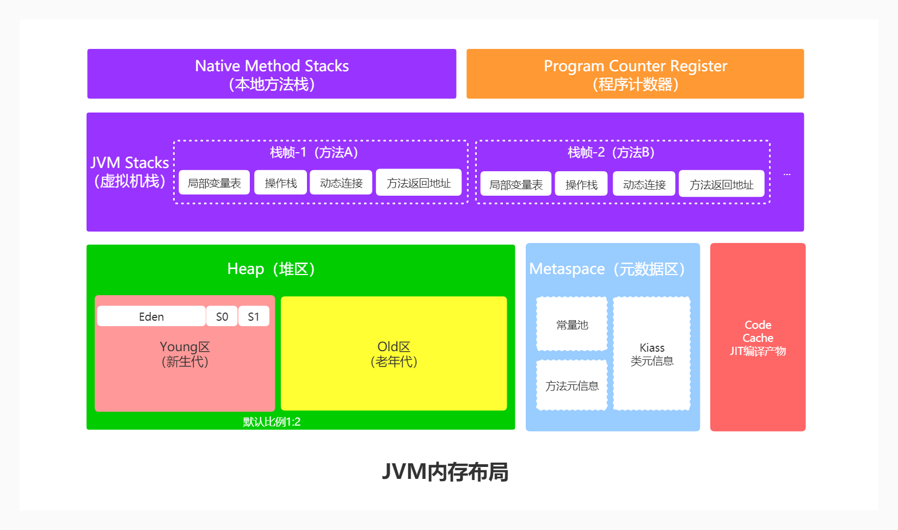
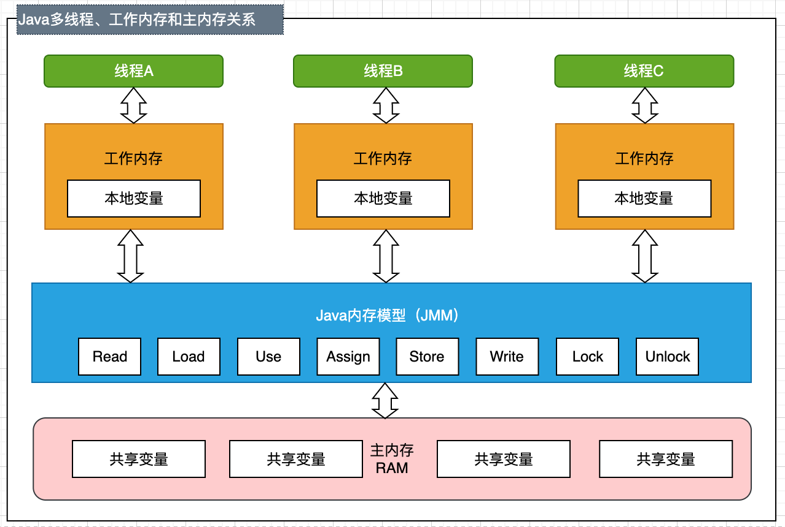
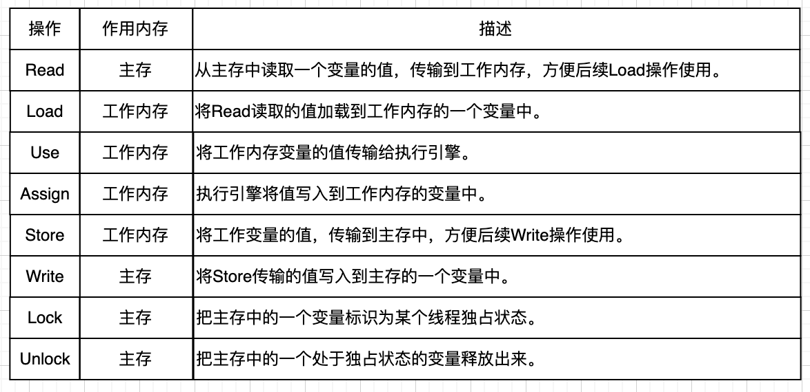
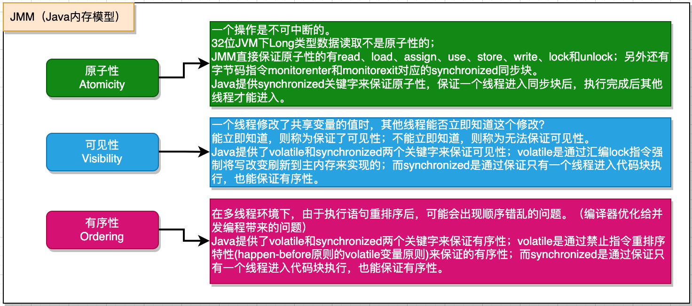
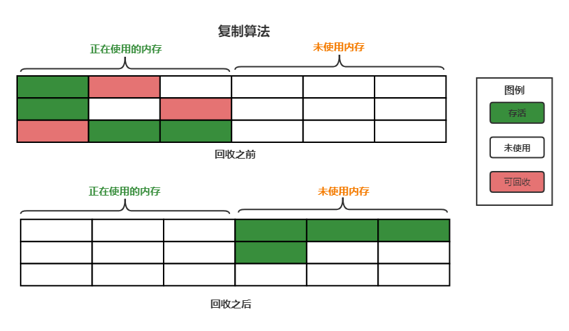
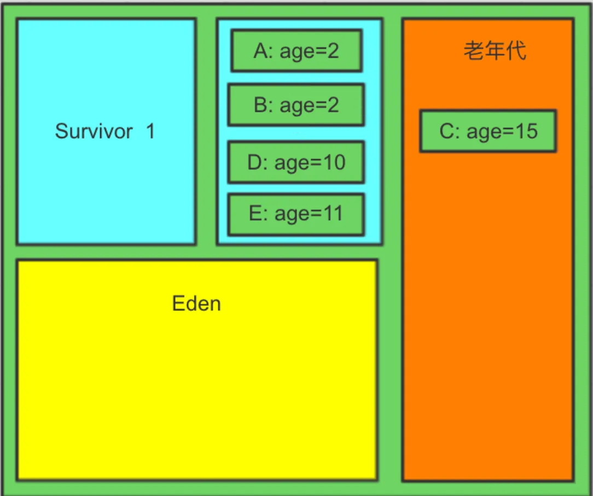
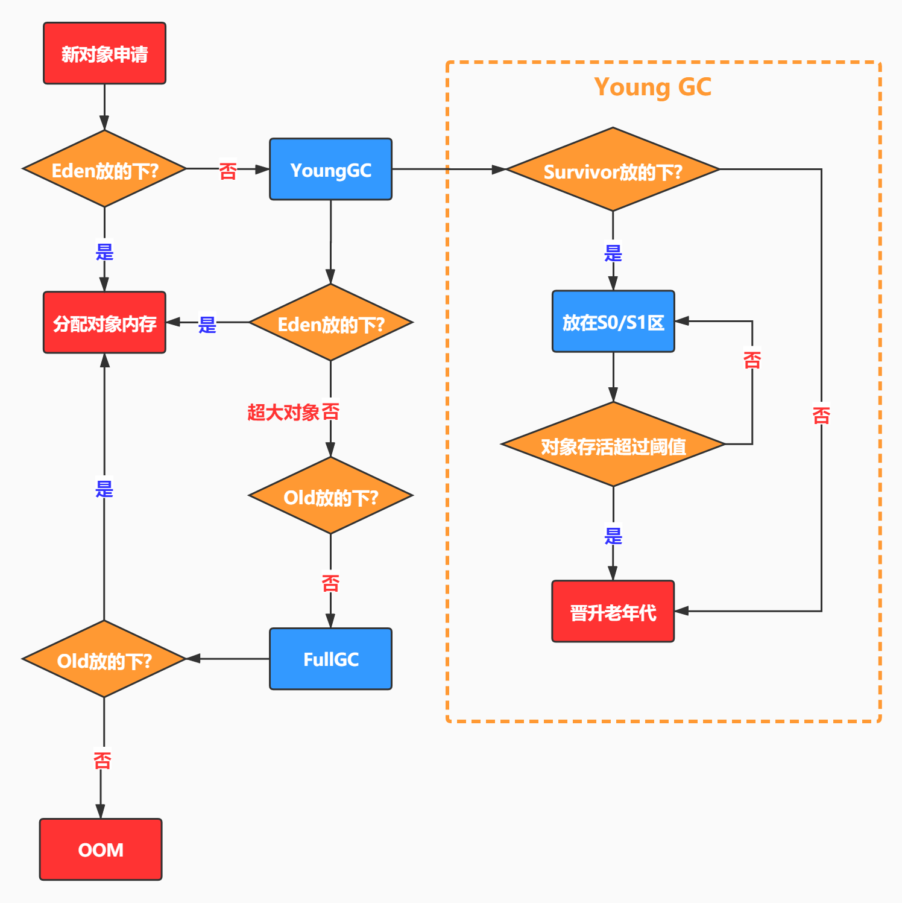
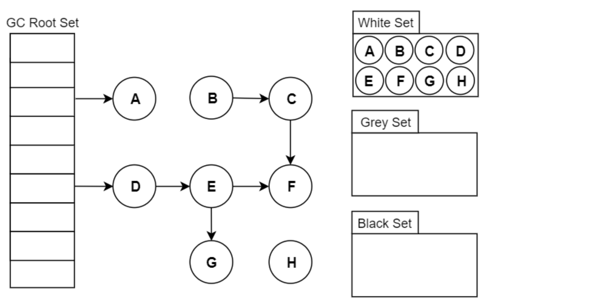
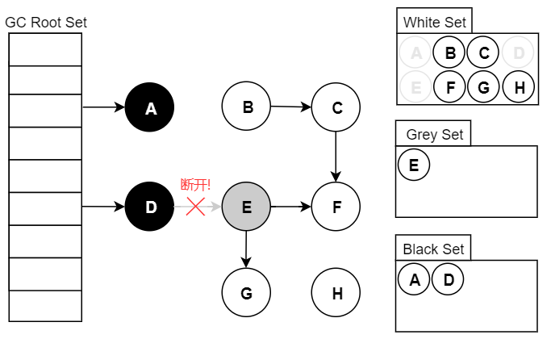
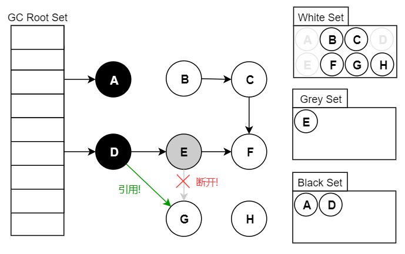

# JVM 知识汇总

本文按"内存怎么划分 → 对象怎么出生和消亡 → 垃圾怎么回收 → 收集器和参数怎么选 → 类怎么被加载 → 线上问题怎么排查"的顺序，把 JVM 的核心知识点串成一条线。读者定位是 1 年左右 Java 经验、会写 CRUD 但不熟悉虚拟机内部的开发者；凡是涉及默认值、默认行为的地方都会标注适用 JDK 版本，因为 JDK 8、11、17、21 之间有实际差异。文中未特别说明时，均指 HotSpot 虚拟机（Oracle JDK / OpenJDK 的默认实现），其他实现（如 OpenJ9）细节可能不同。

## 本文导读

- **一、JVM 内存模型与 JMM**：运行时数据区划分、多线程可见性规则、两者区别与联系
- **二、对象：结构、大小与分配**：对象头与对齐、对象大小计算、分配规则、TLAB、堆外内存
- **三、垃圾回收基础**：可达性分析、为什么要分代、两个 Survivor、三色标记、四种引用、安全点
- **四、垃圾回收器与参数**：Serial / Parallel / CMS / G1 / ZGC / Shenandoah、各版本默认收集器、常用启动参数
- **五、类加载与常量池**：类加载过程、双亲委派与打破、字符串常量池、三种常量池的区别、元空间
- **六、内存问题排查实战**：进程内存构成、内存泄漏与溢出、OOM 与 JVM 退出、老年代缓慢增长、CPU 100%

## 一、JVM 内存模型与 JMM

"JVM 内存模型"和"JMM（Java Memory Model，Java 内存模型）"名字很像，说的却是两件事：前者描述**内存被切成哪几块**，后者规定**多个线程读写共享数据时按什么规则来**。这一章先把两者分开讲清楚，再说明它们如何配合。

### 1.1 JVM 运行时数据区（内存被划成哪几块）

**是什么**：JVM 规范把运行期用到的内存划分为若干"运行时数据区"（run-time data areas）。有的区域随虚拟机启动而创建、随虚拟机退出而销毁；有的区域是每个线程一份，线程创建时创建、线程结束时销毁。



| 内存区域 | 作用 | 线程隔离性 | 可能抛出的错误 |
| --- | --- | --- | --- |
| 程序计数器（PC 寄存器） | 记录当前线程正在执行的字节码位置 | 私有 | 规范未要求该区域抛出内存错误 |
| 虚拟机栈 | 存放方法调用的栈帧（局部变量、操作数栈、动态链接、返回地址） | 私有 | StackOverflowError；栈可动态扩展且扩展失败时 OutOfMemoryError |
| 本地方法栈 | 支持 native 方法（如 C/C++ 实现的方法） | 私有 | 同虚拟机栈 |
| 堆 | 存放对象实例和数组，是 GC 的主战场 | 共享 | OutOfMemoryError |
| 方法区 | 存放类元数据、运行时常量池等类级别结构 | 共享 | OutOfMemoryError |
| 运行时常量池 | 方法区的一部分，保存字面量与符号引用，运行期可扩充 | 共享 | OutOfMemoryError |

**关键点**：

- 堆是对象分配和垃圾回收的主要区域；虚拟机栈的每个栈帧对应一次方法调用。
- **JDK 8 起**，HotSpot 用**元空间（Metaspace）**实现方法区，元空间使用**本地内存（native memory）**，默认不设上限，可用 `-XX:MaxMetaspaceSize` 限制。
- **版本差异要记牢**：JDK 8 起类元数据在元空间，而**字符串常量池**（JDK 7 起）和**类静态变量**（JDK 8 起）都在**堆**里，不再属于方法区。所以"元空间存类信息、常量、静态变量"这种说法在 JDK 8 之后是不准确的。
- JVM 规范只规定行为，不规定对象内部结构、GC 算法等实现细节，这些由各虚拟机自行决定。

### 1.2 JMM（Java 内存模型）：多线程按什么规则读写共享数据

**是什么**：JMM 是一套**规范**，规定多线程环境下共享变量的访问规则，屏蔽不同硬件和操作系统的差异，解决线程之间的**可见性、原子性、有序性**问题。



| 机制 | 作用 |
| --- | --- |
| 主内存与工作内存 | 每个线程有私有的工作内存，共享变量存放在主内存中 |
| 内存交互操作 | read/load（读到工作内存）、use/assign（使用与赋值）、store/write（写回主内存） |
| happens-before | 定义操作之间的先后可见规则（如锁释放先于获取、volatile 写先于读） |
| volatile | 保证可见性、禁止指令重排序，但不保证复合操作的原子性 |
| synchronized | 通过锁保证原子性、可见性和有序性 |

**生活化比喻**：主内存像公司公告栏，工作内存像每个人桌上的便签纸。你在便签上改了数字，同事是看不到的；只有贴到公告栏（write），同事再去公告栏抄一份（read），双方才可能看到同一个值。JMM 就是规定"什么时候必须贴公告栏、什么时候必须重新抄"的那套制度。

**三个核心问题**：

- **可见性**：一个线程修改共享变量后，其他线程能否立即看到最新值。
- **原子性**：一个操作是否不可被中断（例如 `synchronized` 代码块整体）。
- **有序性**：编译器和 CPU 的指令重排序是否会影响程序结果（由 volatile 和 happens-before 规则约束）。

### 1.3 两者的核心区别

| 维度 | JVM 内存模型（运行时数据区） | JMM（Java 内存模型） |
| --- | --- | --- |
| 定位 | 描述物理内存如何划分 | 定义多线程共享数据的访问规则 |
| 关注点 | 内存分配、垃圾回收、方法调用栈 | 共享数据的可见性、原子性、有序性 |
| 线程共享性 | 堆和方法区共享，栈和 PC 私有 | 主内存共享，工作内存私有 |
| 典型问题 | 内存溢出（OOM）、栈溢出（SOF） | 竞态条件、死锁、内存可见性问题 |
| 解决手段 | 调整堆大小（`-Xmx`）、优化代码逻辑 | volatile、synchronized、Lock 等 |

**一句话总结**：JVM 内存模型是"内存怎么用"，JMM 是"多线程怎么安全地用内存"。

### 1.4 两个典型场景

#### 场景 1：堆内存溢出

```java
// 不断创建大对象导致堆内存溢出
List<byte[]> list = new ArrayList<>();
while (true) {
    list.add(new byte[1024 * 1024]); // 每次分配 1MB
}
```

**解决**：适当增大堆内存（如 `-Xmx4G`）；更重要的是检查代码是否存在内存泄漏（对象被无意义地长期持有）。

#### 场景 2：JMM 可见性问题

```java
public class VisibilityIssue {
    private boolean flag = false; // 未使用 volatile

    public void start() {
        new Thread(() -> {
            while (!flag) {} // 可能永远无法退出循环
            System.out.println("Flag is true");
        }).start();

        new Thread(() -> {
            try { Thread.sleep(1000); }
            catch (InterruptedException e) {}
            flag = true; // 修改 flag，但其他线程可能看不到
        }).start();
    }
}
```

**解决**：把字段声明为 `private volatile boolean flag = false;`，或者改用 `AtomicBoolean`。注意空循环本身也可能被 JIT 优化，所以不要把这种写法当作可靠的同步手段。

### 1.5 两者的联系

- **底层实现依赖**：JMM 的规则（volatile、synchronized）需要 JVM 在内存操作层面提供支持（如内存屏障）。
- **协同工作**：JVM 的堆存放共享对象，JMM 保证多线程能正确地访问这些对象；JVM 的栈存放方法调用的局部变量，若局部变量被多个线程共享，同样要受 JMM 约束。

### 1.6 进阶了解（可跳过）：JMM 的八个原子操作与三大特性

初学可略过。JMM 早期用八种原子操作描述主内存与工作内存之间的交互，下图是常见面试追问点。



八种操作可以理解为一条数据的"搬运流程"：`lock`/`unlock` 锁定主内存变量，`read`/`load` 把变量读入工作内存，`use`/`assign` 在工作内存中取值和赋值，`store`/`write` 再写回主内存。JDK 5 起（JSR-133）JMM 用 happens-before 规则统一描述这些语义，实际开发中直接用 volatile、synchronized 和并发容器即可。



## 二、对象：结构、大小与分配

对象是 JVM 里最常打交道的东西。这一章回答三个问题：一个对象在内存里长什么样、它占多大、以及 `new` 一个对象时内存是怎么给的（包括多线程下如何保证安全）。

### 2.1 对象的结构

一个 Java 对象在内存中通常由三部分组成：

1. **对象头（Object Header）**
   - **Mark Word**：存放对象运行时的状态数据，如哈希码、GC 分代年龄、锁状态标志、线程持有的锁等。它是动态复用的，随对象状态变化而改变。
   - **类型指针（Class Pointer）**：指向该对象所属类的元数据，JVM 靠它判断对象是哪个类的实例。
   - **数组长度**：只有数组对象才有，HotSpot 中用 4 字节保存。
2. **实例数据（Instance Data）**：存放本类和父类定义的实例字段；实际排列顺序受字段类型、虚拟机分配策略（如内存对齐）影响，不一定是声明顺序。
3. **对齐填充（Padding）**：HotSpot 要求对象大小是 8 字节的整数倍，不足的部分补空字节。

| 组成部分 | 64 位 HotSpot 下的典型大小 | 说明 |
| --- | --- | --- |
| Mark Word | 8 字节 | 锁状态、hashCode、GC 年龄等 |
| 类型指针 | 4 字节（开启压缩指针）/ 8 字节 | 默认开启压缩指针 |
| 数组长度 | 4 字节（仅数组对象） | 非数组对象没有这一项 |
| 实例数据 | 各字段之和 | 字段可能被重排以减少填充 |
| 对齐填充 | 0~7 字节 | 补齐到 8 的整数倍 |

**版本提示**：偏向锁自 **JDK 15** 起默认关闭并废弃（可用 `-XX:+UseBiasedLocking` 重新开启），所以"Mark Word 里存偏向线程 ID"只在 JDK 8~14 的默认配置下成立。

### 2.2 一个例子：对象的内存布局

假设一个简单的类：

```java
public class Example {
    int id;
    boolean isActive;
    Object reference;
}
```

在 64 位 HotSpot、开启压缩指针时，它的布局大致如下：

- **对象头**
  - Mark Word（8 字节）
  - 类型指针（4 字节）
- **实例数据**
  - `int id`（4 字节）
  - `boolean isActive`（1 字节，通常按 1 字节存放）
  - `Object reference`（4 字节压缩引用）
- **对齐填充**
  - 视最终大小补齐到 8 的整数倍

### 2.3 对象大小怎么算

| 项目 | 32 位 JVM | 64 位 JVM（未压缩指针） | 64 位 JVM（压缩指针） |
| --- | --- | --- | --- |
| 对象头 | 8 字节 | 16 字节 | 12 字节 |
| 引用字段 | 4 字节 | 8 字节 | 4 字节 |
| 数组额外长度字段 | 4 字节 | 8 字节 | 4 字节 |

基本类型占用：`boolean`/`byte` 1 字节，`char`/`short` 2 字节，`int`/`float` 4 字节，`long`/`double` 8 字节。

计算示例：

```java
class Example {
    private int a;    // 4 字节
    private long b;   // 8 字节
    private byte c;   // 1 字节
}
```

64 位 JVM、开启指针压缩时：

- 对象头：12 字节
- 实例数据：4 + 8 + 1 = 13 字节
- 对齐填充：3 字节（补齐到 8 的倍数）
- 合计：12 + 13 + 3 = **28 字节**（与 JOL 等工具的输出一致）

**注意事项**：

1. 想精确查看对象布局，可用 JOL（Java Object Layout）或 Java Agent 工具。
2. 不同 JVM 版本和实现可能存在差异，HotSpot 会重排字段以减少填充。
3. JVM 参数（如是否开启压缩指针）会影响对象大小。
4. 有继承关系时要把父类的实例字段算进去。

**减小对象体积的常见做法**：合理排列字段顺序、用基本类型替代包装类、保留压缩指针（堆不要超过约 32GB，否则压缩指针失效）、避免过深的继承层次。

### 2.4 对象分配规则：new 一个对象发生了什么

`new` 一个对象并不只是"分一块内存"，完整顺序如下：

1. **内存分配**：在堆上为新对象分配空间（线程私有分配缓冲 TLAB 优先）。
2. **对象头初始化**：写入 Mark Word（含 hashCode、锁状态、GC 年龄等元信息）和类型指针。
3. **零值初始化**：所有成员变量先赋零值（整数 0、浮点 0.0、布尔 false、引用 null）。
4. **构造方法调用**：执行构造函数（含父类构造），此时才把代码里写的初始值赋上。
5. **返回引用**：`new` 表达式返回对象引用，赋给变量后即可访问其属性和方法。
6. **生命周期管理**：对象不再被引用后成为垃圾，由垃圾收集器在合适时机回收。

这也解释了一个常见现象：**"准备阶段赋零值、初始化阶段赋真值"**——如果构造方法抛异常，外面可能看到一个"字段全是零值"的半成品对象。

### 2.5 TLAB：把对象分配变成"各用各的"

**是什么**：TLAB（Thread Local Allocation Buffer，线程本地分配缓冲区）是 HotSpot 为每个线程在年轻代中预留的一小块私有内存，线程分配小对象时优先在这块区域里"指针碰撞"式地分配。

**为什么需要**：堆是所有线程共享的，如果每次 `new` 都要在共享的分配指针上加锁，分配就会变成瓶颈。TLAB 把"抢一个指针"变成"用自己的指针"。

**生活化比喻**：像超市结账——所有顾客挤一个收银台要排队（加锁），给每个顾客开一个专属收银台（TLAB）后就不用排队了；只有自己这台收银台用完了，才需要去申请新的。

TLAB 的优点：

- **减少线程同步**：在自己的 TLAB 内分配无需加锁，降低竞争开销。
- **提高分配速度**：分配退化为一次指针加法。
- **提高局部性**：新对象在内存上相邻，缓存命中率更高。

**怎么用/怎么配**：HotSpot 默认开启（`-XX:+UseTLAB`），大小可用 `-XX:TLABSize` 指定，也可用 `-XX:MinTLABSize`、`-XX:TLABWasteTargetPercent` 影响回收与浪费比例。TLAB 过小会导致频繁申请新 TLAB，过大则浪费堆空间（TLAB 内剩余空间在换新时会浪费）。

### 2.6 多线程下分配对象为什么是安全的

多个线程同时 `new` 对象时，JVM 通过以下机制保证分配安全：

| 机制 | 作用 | 备注 |
| --- | --- | --- |
| TLAB | 线程在自己的缓冲区里分配，天然无竞争 | 覆盖绝大多数小对象分配 |
| CAS（Compare-And-Swap） | 需要直接操作共享堆时，用 CPU 的原子指令更新分配指针 | 硬件级原子操作，避免重量级锁 |
| 分代 + 局部化 | 年轻代分配集中、回收频繁，竞争范围更小 | 属于间接优化，不直接保证线程安全 |

当 TLAB 空间不足时，线程会申请新的 TLAB（这一步需要同步），或者退回到共享堆中用 CAS 分配，因此"TLAB 用满"属于相对少见的慢路径。

### 2.7 堆一定是线程共享的吗

标准实现中，堆是线程共享的：所有对象实例和数组都分配在共享堆中，可被多个线程访问，这也是 Java 支持多线程协作的基础。但 JVM 通过几种手段在共享堆上做出了"逻辑隔离"：

- **TLAB**：分配阶段线程私有，避免竞争。
- **逃逸分析（Escape Analysis）**：JIT 编译器判断对象是否"逃逸"出当前方法或线程；对不逃逸的对象，可以做**标量替换（Scalar Replacement）**，把它拆成几个局部变量，从而**完全消除这次堆分配**；还可以做锁消除。
- **垃圾回收**：自动回收共享堆中的无用对象。

需要澄清一个常见说法：**HotSpot 并没有真的把整个对象"分配到栈上"**。所谓"栈上分配"，工程上通常指逃逸分析 + 标量替换导致的"分配被优化掉"。这属于 JIT 的实现细节，取决于代码形态和 JIT 是否已编译该方法，不能当作可依赖的语言特性。

### 2.8 进阶了解（可跳过）：堆外内存

初学可略过。堆外内存（Off-Heap Memory）指在 JVM 堆之外、由进程直接向操作系统申请的内存，常见于 NIO、Netty、缓存和序列化框架。

**特点**：

- **优点**：不参与常规 GC，减少 GC 停顿和对象搬运；可直接用于 I/O，减少一次堆内到堆外的拷贝。
- **代价**：需要手动管理生命周期，释放不当会泄漏，最终表现为进程内存涨到容器限制被杀或 `OutOfMemoryError: Direct buffer memory`。
- **典型场景**：大数据与分布式系统中处理大量数据、低延迟服务（游戏、金融）、高性能缓存。

**怎么用**：最常见的是 `ByteBuffer.allocateDirect()`；也可以使用第三方库（Netty 的 `PooledByteBufAllocator`、各种 DirectMemory 工具），由库负责池化和释放。

```java
import java.nio.ByteBuffer;

public class OffHeapMemoryExample {
    public static void main(String[] args) {
        // 分配 1KB 的直接内存（堆外）
        ByteBuffer buffer = ByteBuffer.allocateDirect(1024);

        buffer.put((byte) 'a');
        buffer.put((byte) 'b');

        buffer.flip(); // 切换到读模式
        while (buffer.hasRemaining()) {
            System.out.print((char) buffer.get());
        }

        // 释放：直接内存由 Cleaner 在 Buffer 对象被回收时释放
        // 把引用置空只是"提示"，不保证立刻回收
        buffer = null;
    }
}
```

**注意事项**：

- 优先使用成熟库管理堆外内存，不要自己拼 `Unsafe` 分配与释放。
- 显式设置上限：`-XX:MaxDirectMemorySize`（不设置时默认约等于最大堆大小）。
- 监控直接内存用量（如 `jcmd <pid> VM.native_memory`、Native Memory Tracking），避免容器内被 OOM Killer 杀掉。
- 更新版本的 JDK 在推进 Foreign Function & Memory API（JDK 21 为预览特性），提供更规范的显式释放方式，可用于替代 `Unsafe` 和反射调用 `Cleaner` 的做法。

## 三、垃圾回收基础

垃圾回收（Garbage Collection，GC）要解决两个问题：**哪些对象已经没用了**，以及**怎么把它们占的内存收回来**。这一章先讲判定方法，再讲为什么要分代、年轻代为什么这么设计，最后讲并发标记带来的麻烦和四种引用。

### 3.1 如何判断对象可以被回收

主流 JVM 使用**可达性分析（Reachability Analysis）**：从一组称为 **GC Roots** 的根引用出发，沿引用链向下遍历，凡是遍历不到的对象就认为不可达、可以被回收。

GC Roots 通常包括：

- **局部变量引用**：方法栈帧中的局部变量（含参数）指向的对象。
- **活动线程引用**：正在运行的线程对象，以及线程本地存储（ThreadLocal）中的引用。
- **静态变量引用**：类的静态字段引用（JDK 8 起静态字段值在堆中，随 Class 对象一起被当作根）。
- **JNI 引用**：通过 Java Native Interface 创建的本地代码引用。
- **虚拟机内部引用**：如基本类型对应的 Class 对象、常驻异常对象、系统类加载器加载的类等。

**引用计数为什么不用**：它无法处理循环引用（两个对象互相引用，计数都不为 0，但整体已不可达），且维护计数有额外开销。

### 3.2 一次完整的 GC 流程

**内存区域回顾**：堆（对象实例，GC 主要工作区）、栈（方法参数和局部变量，随方法进出自动释放）、方法区（类元数据、常量）、程序计数器（字节码行号）。

**回收区域**：垃圾回收主要发生在堆上。HotSpot 的分代式收集器把堆分为**年轻代（Young）**和**老年代（Old）**；JDK 8 之前还有**永久代（PermGen）**，JDK 8 起由**元空间（Metaspace）**取代。需要区分一点：永久代/元空间在逻辑上属于**方法区**的实现，不属于堆的"分代"结构；G1 则把堆切成大小相等的 Region，年轻代/老年代只是 Region 的集合。

**三个基本步骤**：

1. **标记（Marking）**：找出所有存活对象。
2. **清除（Sweeping）**：清理未被标记的对象，释放内存。
3. **压缩（Compaction）**：把存活对象挪到一起，减少碎片（标记-清除算法不做这一步）。

**三种基础算法**：

| 算法 | 做法 | 优点 | 缺点 | 典型用途 |
| --- | --- | --- | --- | --- |
| 标记-清除 | 标记存活对象后直接清除其余对象 | 实现简单，不需要搬运对象 | 产生内存碎片 | CMS 的老年代 |
| 标记-复制 | 把存活对象复制到另一块空闲区域 | 无碎片，回收速度快 | 需要额外空间，适合"存活少"的场景 | 年轻代 |
| 标记-整理 | 标记后把存活对象压缩到一端 | 无碎片，不需要双倍空间 | 需要移动对象，停顿更长 | 老年代（Serial Old、Parallel Old） |

**示例代码**：

```java
public class GCDemo {
    public static void main(String[] args) throws InterruptedException {
        System.out.println("Starting GC Demo...");

        for (int i = 0; i < 10000; i++) {
            byte[] b = new byte[1024 * 1024]; // 每次分配 1MB，很快被回收
        }

        System.gc(); // 只是"建议"回收，不保证立即执行
        System.out.println("GC requested...");
    }
}
```

- **分配内存**：循环中不断分配 `byte[]`，大部分对象立刻变成垃圾。
- **触发 GC**：`System.gc()` 会触发一次 Full GC（可用 `-XX:+DisableExplicitGC` 让它失效），生产中应避免依赖它。
- **回收过程**：Eden 区满先触发 Minor GC；若老年代空间不足，可能触发 Major GC / Full GC（回收年轻代 + 老年代 + 元空间）。
- **观察日志**：

```bash
# JDK 8：传统 GC 日志参数
java -verbose:gc -XX:+PrintGCDetails GCDemo

# JDK 9 及以上：统一日志框架（JEP 158），传统 PrintGC* 参数被取代
java -Xlog:gc* GCDemo
```

**小结**：

- 年轻代放短命对象，回收频繁（Minor GC，多用复制算法）；老年代放长命对象，回收较少但更重（Major/Full GC，多用标记-整理）。
- 优化 GC 的方向：调整堆与各代比例、选合适的收集器（G1、Parallel、ZGC 等）、减少对象创建和长生命周期持有。

### 3.3 JVM 内存为什么要分代

分代基于"**弱分代假说**"：绝大多数对象朝生夕死，只有少数对象活得久。把这两类对象放在不同区域、用不同算法回收，整体效率更高。具体好处：

1. **提高回收效率**：年轻代集中回收短命对象，只用扫描少量存活对象。
2. **降低停顿**：年轻代回收频繁但很快；老年代回收次数少，对整体停顿影响小。
3. **减少碎片**：短命对象不与长命对象混放，老年代压缩次数更少。
4. **算法可定制**：不同代可用不同算法（年轻代复制、老年代标记-整理/标记-清除）。
5. **贴合真实应用**：大多数业务系统的对象生命周期分布确实符合该假说。
6. **策略灵活**：可按对象年龄选择不同的晋升与回收策略。

### 3.4 年轻代为什么要划分两个 Survivor 区

年轻代通常划分为一个 Eden 区和两个 Survivor 区（S0、S1），目的是**用复制算法高效回收、避免内存碎片，并筛选出真正长寿的对象**。



**（1）复制算法**：每次 GC 只使用其中一块 Survivor。Minor GC 时，把 Eden 和当前使用的 Survivor 中的存活对象复制到另一块空闲 Survivor，然后整块清空 Eden 和原 Survivor。

- **优势**：内存无碎片（存活对象连续存放）；回收成本只与存活对象数量相关，而不是堆大小；存活对象集中，缓存友好。

**（2）对象年龄的渐进式晋升**：



- 对象每熬过一次 Minor GC，年龄加 1。
- 年龄达到阈值（HotSpot 中 `-XX:MaxTenuringThreshold` 默认 15，也是该参数上限）后晋升到老年代。
- 两个 Survivor 交替使用，使对象"多活几轮"才晋升，从而把短命对象挡在老年代之外。

**（3）内存利用率**：如果只有一个 Survivor，每次 GC 后存活对象仍需占满该区域，且多次 GC 后容易产生碎片；用两个 Survivor 交替复制，等于用"一块空闲区域"换取"无碎片 + 可筛选年龄"。

**（4）具体流程**：



1. 新对象分配在 Eden；Eden 满触发 Minor GC。
2. 存活对象从 Eden + 当前 Survivor 复制到另一块 Survivor，年龄 +1；达到阈值的晋升老年代；清空 Eden 与原 Survivor。
3. 下次 GC 时方向反转，两块 Survivor 循环使用。

**（5）为什么不能只有一个 Survivor**：

- 没有空闲区域可复制，只能就地清理，容易产生碎片。
- 无法通过"交替复制"逐步累加年龄，晋升机制失效，可能把大量短命对象提前推进老年代。

**小结**：两个 Survivor 的核心价值是用复制算法换取"无碎片 + 年龄筛选 + 内存利用率"的平衡，这正是分代假说的落地方式。

### 3.5 三色标记：让"标记"和"业务"同时进行

**是什么**：三色标记是可达性分析的一种实现方案，把对象按"是否检查过"分成三种颜色，从而支持**并发标记**（应用线程和 GC 线程同时跑）。

- **黑色**：自己和它的所有成员引用都检查完了。
- **灰色**：自己检查过了，但成员还没全部检查完。
- **白色**：还没检查；分析开始时全是白色，结束时仍是白色的即为不可达。

**为什么需要**：传统标记必须 Stop-The-World（STW，暂停所有应用线程），堆大时停顿不可接受。并发标记让业务继续跑，代价是引用关系会在标记过程中变化。



**标记过程**：

1. 初始时所有对象都在白色集合。
2. 把 GC Roots 直接引用的对象放入灰色集合。
3. 从灰色集合取出一个对象：把它引用的对象全部放入灰色集合，然后自己转入黑色集合。
4. 重复第 3 步，直到灰色集合为空。
5. 结束时仍在白色集合的对象不可达，可以被回收。

**带来的两个问题**：

**问题一：浮动垃圾（多标）**——并发标记期间，一个已被标成黑色/灰色的对象变成垃圾。它不是白色，本轮不会被清除，只能等下一轮，称为"浮动垃圾"。影响不大。



**问题二：对象漏标（少标）**——并发标记期间，业务线程把一个**白色对象**的引用从灰色对象上断开（删除引用），同时让**黑色对象**引用了它（新增引用）。因为黑色对象不会再被扫描，这个白色对象就"消失"在标记范围外，被错误回收，会导致程序出现严重问题。



**怎么解决**：只需破坏漏标成立的两个条件之一——要么记录"被删除的引用"（原始快照 SATB），要么记录"新增的引用"（增量更新）。具体做法见 3.8。

**小结**：三色标记是根可达算法的一种实现，会产生多标（浮动垃圾）和少标（漏标）；漏标最危险，必须用写屏障配合 SATB 或增量更新来兜底。

### 3.6 强引用、软引用、弱引用、虚引用

Java 提供四种引用强度，用来影响对象"何时可以被回收"。

**（1）强引用**：最常见的引用。只要强引用还在，GC 就不会回收该对象。

```java
Object strongRef = new Object(); // 强引用
```

**（2）软引用（SoftReference）**：只在**内存不足**时才被清除，适合做缓存。

```java
import java.lang.ref.SoftReference;

Object strongRef = new Object();
SoftReference<Object> softRef = new SoftReference<>(strongRef);
strongRef = null; // 去掉强引用，对象只剩软引用可达
```

HotSpot 中软引用的清除时机与空闲堆大小相关，可用 `-XX:SoftRefLRUPolicyMSPerMB` 调整（默认每 MB 空闲堆让软引用多存活约 1000ms）。

**（3）弱引用（WeakReference）**：只要发生 GC 就会被清除，典型用途是 `WeakHashMap` 和各类缓存/监听器表。

```java
import java.lang.ref.WeakReference;

Object strongRef = new Object();
WeakReference<Object> weakRef = new WeakReference<>(strongRef);
strongRef = null;
```

**（4）虚引用（PhantomReference）**：不能通过它访问对象（`get()` 永远返回 `null`），只用于在对象被回收时收到通知，必须配合 `ReferenceQueue` 使用。

```java
import java.lang.ref.PhantomReference;
import java.lang.ref.ReferenceQueue;

Object obj = new Object();
ReferenceQueue<Object> queue = new ReferenceQueue<>();
PhantomReference<Object> phantomRef = new PhantomReference<>(obj, queue);
obj = null;
```

典型用途是跟踪对象被回收的时机，做堆外内存等资源的清理（`Cleaner` 机制即基于此）。

| 引用类型 | 回收时机 | 典型用途 |
| --- | --- | --- |
| 强引用 | 永不回收（除非不可达） | 日常对象引用 |
| 软引用 | 内存不足时清除 | 缓存（图片、查询结果） |
| 弱引用 | 下次 GC 即清除 | WeakHashMap、监听器注册表 |
| 虚引用 | 对象被回收时入队通知 | 资源清理、回收追踪 |

### 3.7 GC 是任意时候都能进行的吗

不是。GC 只能在**安全点（Safepoint）**进行。安全点是程序执行中的特定位置，JVM 在这些位置暂停线程时，程序状态是确定且一致的（栈、寄存器都能被安全遍历）。

**作用**：

1. **垃圾收集**：需要暂停所有应用线程，确保没有线程正在改内存，同时得到确定的引用快照。
2. **栈遍历**：生成线程转储（thread dump）、做偏向锁撤销等操作，也需要安全点。
3. **控制开销**：把检查点放在方法调用/返回、循环回跳等位置，减少暂停频率。

**触发条件（常见）**：方法调用与返回、循环回跳（长循环会插入安全点轮询）、异常抛出、JNI 调用边界等。

```java
public class SafePointExample {
    public static void main(String[] args) {
        long sum = 0;
        for (int i = 0; i < Integer.MAX_VALUE; i++) {
            sum += i; // 循环回跳处会有安全点轮询
        }
        System.out.println("Sum: " + sum);
    }
}
```

**重要性**：安全点让 JVM 能在"一致状态"下暂停，从而在保证正确性的同时把暂停时间压到最小；不同 JVM 实现的安全点策略可能不同。

### 3.8 进阶了解（可跳过）：漏标的两种解法与写屏障

初学可略过。解决漏标有两条路，各收集器选择不同：

| 方案 | 思路 | 代价 | 使用者 |
| --- | --- | --- | --- |
| 增量更新（Incremental Update） | 记录**新增**的引用，重新标记时以黑色对象为根再扫一遍 | 重新标记阶段更长 | CMS |
| 原始快照（SATB，Snapshot-At-The-Beginning） | 记录**被删除**的引用，认为标记开始时活着的对象本轮都算活着 | 会产生浮动垃圾，下一轮再清 | G1、Shenandoah |

实现上依赖**写屏障（Write Barrier）**：在引用字段赋值前后插入一小段代码，把变化记录下来。G1 的 SATB 使用前置写屏障（pre-write barrier），CMS 的增量更新使用后置写屏障（post-write barrier）。这也解释了为什么 G1 官方文档说"SATB 会让部分本该死亡的对象多活一轮"——它用一点内存换更短的 Remark 停顿。

## 四、垃圾回收器与常用参数

前面的算法需要具体的"收集器"来实现。这一章先横向对比各收集器，再讲清楚**不同 JDK 版本的默认收集器差异**（这是最容易踩坑的地方），最后给出常用启动参数和调优手段。

### 4.1 六种收集器一览

| 收集器 | 工作方式 | 适用场景 | 启用参数 | 版本提示 |
| --- | --- | --- | --- | --- |
| Serial | 单线程，全程 STW | 单核、小堆（数据量约 100MB 以内）、客户端程序 | `-XX:+UseSerialGC` | 一直可用 |
| Parallel（吞吐优先） | 多线程并行，仍会 STW | 批处理、离线计算等追求吞吐、能接受较长停顿 | `-XX:+UseParallelGC` | JDK 8 服务器级机器默认 |
| CMS（并发标记清除） | 老年代并发标记与清除 | 追求低停顿的 Web 应用 | `-XX:+UseConcMarkSweepGC` | JDK 9 起废弃，**JDK 14 移除** |
| G1（Garbage First） | 分 Region、可预测停顿、部分并发 | 大堆（几 GB 到几十 GB）且要求较稳定停顿 | `-XX:+UseG1GC` | **JDK 9 起默认** |
| ZGC | 并发标记 + 并发整理，着色指针 + 读屏障 | 超大堆、极低延迟要求 | `-XX:+UseZGC`（分代模式加 `-XX:+ZGenerational`） | JDK 11 实验、JDK 15 生产可用、JDK 21 提供分代模式 |
| Shenandoah | 并发整理，低停顿 | 大堆、低延迟 | `-XX:+UseShenandoahGC` | 部分发行版（如 Red Hat 系）默认提供 |

下面逐个看要点与启用方式（示例命令用 `-jar` 方式启动一个应用）：

**Serial 收集器**：单线程完成全部回收，简单、内存开销小，没有线程间通信成本。

```bash
java -XX:+UseSerialGC -jar your-application.jar
```

**Parallel 收集器**：多线程并行回收年轻代和老年代，吞吐量高；可用 `-XX:MaxGCPauseMillis`（默认不设目标）和 `-XX:GCTimeRatio`（默认 99，即 GC 时间占比约 1%）调优。

```bash
java -XX:+UseParallelGC -XX:MaxGCPauseMillis=200 -jar your-application.jar
```

**CMS 收集器**：老年代并发标记清除，停顿短但有浮动垃圾和碎片问题，且已从 JDK 14 移除；新项目不要再选它。

```bash
# JDK 8 ~ 13 可用；JDK 14 起该参数会被忽略并打印告警
java -XX:+UseConcMarkSweepGC -jar your-application.jar
```

**G1 收集器**：把堆切成约 2048 个大小相等的 Region（每个 1MB~32MB），优先回收"垃圾最多"的 Region，通过 `-XX:MaxGCPauseMillis`（默认 200ms）设定停顿目标，年轻代大小自适应。

```bash
java -XX:+UseG1GC -XX:MaxGCPauseMillis=200 -jar your-application.jar
```

**ZGC**：标记、转移、重定位几乎全并发，官方给出的停顿是"通常不超过 1 毫秒"，且停顿与堆大小基本无关，支持从几百 MB 到 16TB 的堆（非分代版本的上限）。

```bash
# JDK 21：分代 ZGC（推荐）
java -XX:+UseZGC -XX:+ZGenerational -jar your-application.jar
```

**Shenandoah**：与 ZGC 目标类似，通过并发整理压缩停顿，是否可用取决于 JDK 发行版。

```bash
java -XX:+UseShenandoahGC -jar your-application.jar
```

### 4.2 默认收集器随版本的变化

这是实际工作中最容易出错的地方，务必按版本对号入座：

| JDK 版本 | 默认收集器 | 说明 |
| --- | --- | --- |
| JDK 8 | **Parallel**（服务器级机器）/ **Serial**（客户端级机器） | "服务器级"指 ≥2 个物理处理器且 ≥2GB 内存；服务器级默认使用吞吐量收集器 |
| JDK 9 ~ 13 | **G1** | JEP 248 将 G1 设为 32/64 位服务器配置的默认收集器 |
| JDK 14 | **G1** | JEP 363 移除 CMS，`-XX:+UseConcMarkSweepGC` 被忽略并告警 |
| JDK 15 ~ 20 | **G1** | JEP 374 起偏向锁默认关闭；JEP 377 起 ZGC 可用于生产 |
| JDK 21 | **G1** | JEP 439 引入分代 ZGC（需显式加 `-XX:+ZGenerational`） |

**实践建议**：不要靠"默认值"推理线上行为。用 `java -XX:+PrintFlagsFinal -version | grep -E "UseG1GC|UseParallelGC|UseSerialGC|UseZGC"` 确认当前 JDK 实际选中的收集器。

### 4.3 怎么选收集器

先按官方建议：**没有严格停顿要求时，先让 JVM 自己选**，再调堆大小；仍不达标才换收集器。选择时可参考以下判断：

1. **数据量与堆大小**：数据量很小（约 100MB 以内）或单核环境，Serial 往往够用且省资源。
2. **吞吐量优先**：批处理、离线任务，能接受 1 秒级停顿，选 Parallel 或直接用默认。
3. **响应时间优先**：在线服务要求停顿短，选 G1；要求极低延迟且堆很大，选 ZGC（或发行版支持的 Shenandoah）。
4. **运行环境**：容器化部署要注意容器内存/CPU 限制，JDK 10+ 已能识别容器配额，但仍建议显式设置 `-Xmx` 与 `-XX:ActiveProcessorCount`。
5. **版本约束**：JDK 8 没有 G1 的成熟默认值（需显式开启），JDK 14+ 没有 CMS。

选型应结合压测与监控数据，而不是照搬"某收集器最快"的说法。

### 4.4 常用 JVM 启动参数

| 参数 | 作用 | 示例 | 说明 |
| --- | --- | --- | --- |
| `-Xmx` | 最大堆大小 | `-Xmx512m` | 默认为物理内存的一部分，务必显式设置 |
| `-Xms` | 初始堆大小 | `-Xms512m` | 常与 `-Xmx` 设为相同值，避免反复扩缩容 |
| `-Xss` | 每个线程的栈大小 | `-Xss256k` | 平台相关，默认通常为 512KB~1MB |
| `-Xmn` | 年轻代大小 | `-Xmn256m` | 固定年轻代；G1 下不建议设置（会覆盖暂停目标） |
| `-XX:SurvivorRatio` | Eden 与单个 Survivor 的比例 | `-XX:SurvivorRatio=8` | 默认 8，即 Eden : S0 : S1 = 8 : 1 : 1 |
| `-XX:NewRatio` | 老年代与年轻代的比例 | `-XX:NewRatio=2` | 默认 2，即年轻代 : 老年代 = 1 : 2（服务端默认） |
| `-XX:MaxTenuringThreshold` | 晋升老年代的最大年龄 | `-XX:MaxTenuringThreshold=15` | 默认 15；实际晋升年龄会随 Survivor 使用情况自适应 |
| `-XX:PretenureSizeThreshold` | 超过该大小的对象直接进老年代 | `-XX:PretenureSizeThreshold=1m` | 默认 0（不启用）；部分收集器（如 G1）不使用该参数 |
| `-XX:MetaspaceSize` | 元空间首次触发 GC 的水位 | `-XX:MetaspaceSize=128m` | 默认平台相关（约 12MB~20MB） |
| `-XX:MaxMetaspaceSize` | 元空间上限 | `-XX:MaxMetaspaceSize=256m` | 默认无上限（受本地内存限制） |
| `-XX:MaxPermSize` / `-XX:PermSize` | 永久代大小 | `-XX:MaxPermSize=128m` | 仅 JDK 7 及更早；JDK 8 起被移除 |
| `-XX:MaxGCPauseMillis` | 停顿时间目标 | `-XX:MaxGCPauseMillis=100` | G1 默认 200；Parallel 默认不设目标 |
| `-XX:ParallelGCThreads` | 并行 GC 线程数 | `-XX:ParallelGCThreads=4` | 默认约等于 CPU 核数（核数 >8 时约为 5/8） |
| `-XX:InitiatingHeapOccupancyPercent` | G1 触发并发标记的堆占用比例 | `-XX:InitiatingHeapOccupancyPercent=45` | 默认 45，G1 会自适应调整 |
| `-XX:+UseG1GC` | 启用 G1 | `-XX:+UseG1GC` | JDK 9 起为默认 |
| `-XX:+UseConcMarkSweepGC` | 启用 CMS | — | JDK 9 废弃、JDK 14 移除 |
| `-Dproperty=value` | 设置系统属性 | `-Dspring.profiles.active=prod` | 代码中用 `System.getProperty("property")` 读取 |

使用原则：**一次只改一两个参数，改完压测对比**；不同 JVM 版本和供应商支持的参数不同，以 `java -XX:+PrintFlagsFinal -version` 的实际输出为准。

### 4.5 进阶了解（可跳过）：GC 日志与参数核查

初学可略过，但线上排查几乎必用。

```bash
# JDK 9+ 统一日志：输出 GC 基本信息 + 每次回收前后堆变化 + 晋升情况
java -Xlog:gc*,gc+heap=debug,gc+age=trace:file=gc.log:time,uptime,level,tags -jar app.jar

# JDK 8：传统参数
java -XX:+PrintGCDetails -XX:+PrintGCDateStamps -XX:+PrintTenuringDistribution \
     -Xloggc:gc.log -jar app.jar

# 查看某个参数的最终取值
java -XX:+PrintFlagsFinal -version | grep -E "MaxHeapSize|UseG1GC|MaxTenuringThreshold"

# 运行时查看堆与 GC 情况
jcmd <pid> GC.heap_info
jcmd <pid> GC.class_histogram
```

读日志时重点看三件事：**GC 频率**（是否过于频繁）、**单次停顿**（是否超过 SLA）、**晋升量**（每次 Minor GC 有多少对象进入老年代）。三者结合基本能判断是内存不足、泄漏还是参数不当。

## 五、类加载与常量池

类只有被加载进 JVM 才能使用；而类文件里最重要的结构之一就是常量池。这一章讲清类加载的三个阶段、双亲委派机制（以及它能否被打破），再区分三个容易混淆的"常量池"。

### 5.1 类加载过程：加载 → 链接 → 初始化

| 阶段 | 做什么 | 常见问题 |
| --- | --- | --- |
| 加载（Loading） | 通过类的全限定名获取字节码（文件、网络、动态生成），并在方法区生成类结构、在堆中生成对应 Class 对象 | 找不到类 → ClassNotFoundException / NoClassDefFoundError |
| 链接-验证（Verification） | 校验字节码格式与语义合法性 | VerifyError |
| 链接-准备（Preparation） | 为静态变量分配内存并赋**零值** | 此时静态变量还不是代码里写的值 |
| 链接-解析（Resolution） | 把符号引用替换为直接引用 | NoSuchMethodError、NoClassDefFoundError |
| 初始化（Initialization） | 执行类构造器 `<clinit>`：静态变量赋值 + 静态代码块，父类先于子类 | ExceptionInInitializerError |

**触发初始化的典型时机**：`new` 对象、访问静态字段或静态方法、反射调用、初始化子类（父类先初始化）、启动类（含 main 方法的类）。

**生活化比喻**：加载像"把书买回来"，验证像"检查书有没有缺页错印"，准备像"给书架留出位置并先摆上空盒子"，初始化才是"把真正的书放进盒子"。

### 5.2 双亲委派机制

**是什么**：类加载器在加载一个类时，先把请求**委派给父加载器**，父加载器找不到时才自己去找。`ClassLoader` 的默认实现顺序是：`findLoadedClass`（是否已加载）→ 父加载器的 `loadClass` → 自己的 `findClass`。

**为什么要**：保证核心类库不被篡改、避免类重复加载。例如 `java.lang.String` 永远由启动类加载器加载，即使你在 classpath 里放一个同名的类也不会生效。

| 类加载器 | 负责加载 | 说明 |
| --- | --- | --- |
| 启动类加载器（Bootstrap） | JDK 核心类（`java.*` 等） | C++ 实现，Java 中表示为 `null` |
| 平台类加载器（Platform） | Java SE 平台 API 及 JDK 运行时类 | JDK 9 之前叫扩展类加载器（ExtClassLoader） |
| 应用类加载器（Application/System） | classpath、module path 上的应用类 | 通常是我们接触最多的加载器 |
| 自定义类加载器 | 由开发者指定来源（插件、加密 jar 等） | 继承 `ClassLoader` |

### 5.3 可以打破双亲委派吗

可以，但要先弄清"打破"指什么。常见有三类做法：

1. **重写 `loadClass`**：跳过"先问父加载器"的步骤，直接自己加载（JDK 1.2 之前的老写法，以及部分容器/框架仍在用）。
2. **使用线程上下文类加载器（TCCL）**：父加载器加载的代码反向调用子加载器去加载实现类，典型是 JDBC 的 `DriverManager` 通过 TCCL 找到各厂商驱动。
3. **网状委派 / 模块化热部署**：如 OSGi、部分应用服务器的插件机制，加载器之间不是严格的父子关系。

**注意一个常见误解**：只重写 `findClass` **并没有打破双亲委派**。`findClass` 只在"父加载器找不到"之后才被调用，它解决的是"父加载器找不到时我该怎么找"，委派顺序完全没变。下面的自定义加载器就属于这一类：

```java
import java.io.File;
import java.io.FileInputStream;
import java.io.IOException;

public class CustomClassLoader extends ClassLoader {

    private final String classPath;

    public CustomClassLoader(String classPath) {
        this.classPath = classPath;
    }

    // 仅在父加载器找不到时才会执行：扩展"自己怎么找"，不改变委派顺序
    @Override
    protected Class<?> findClass(String name) throws ClassNotFoundException {
        byte[] classData = getClassData(name);
        if (classData == null) {
            throw new ClassNotFoundException(name);
        }
        return defineClass(name, classData, 0, classData.length);
    }

    private byte[] getClassData(String className) {
        String path = classPath + File.separatorChar
                + className.replace('.', File.separatorChar) + ".class";
        try (FileInputStream in = new FileInputStream(path)) {
            byte[] buffer = new byte[(int) new File(path).length()];
            int read = in.read(buffer);
            if (read <= 0) {
                return null;
            }
            return buffer;
        } catch (IOException e) {
            return null;
        }
    }

    public static void main(String[] args) throws Exception {
        CustomClassLoader loader = new CustomClassLoader("path/to/classes");
        Class<?> clazz = loader.loadClass("DynamicClass");
        System.out.println("Class " + clazz.getName() + " loaded successfully.");
    }
}
```

若确实要打破委派（例如实现"同一个类加载多份、彼此隔离"的插件体系），要重写 `loadClass`：

```java
public class ChildFirstClassLoader extends ClassLoader {

    @Override
    protected Class<?> loadClass(String name, boolean resolve) throws ClassNotFoundException {
        synchronized (getClassLoadingLock(name)) {
            Class<?> c = findLoadedClass(name);
            if (c == null) {
                // 先自己找（打破"先问父加载器"的顺序）
                try {
                    c = findClass(name);
                } catch (ClassNotFoundException e) {
                    // 自己找不到再交给父加载器
                    c = super.loadClass(name, false);
                }
            }
            if (resolve) {
                resolveClass(c);
            }
            return c;
        }
    }
}
```

**风险**：

- **安全性**：可能加载未经授权或被篡改的类，破坏核心类库的隔离性。
- **兼容性**：与标准类库、框架的假设冲突（如类型转换时出现 `ClassCastException`：同名类来自不同加载器就是两个类型）。
- **维护成本**：类加载逻辑复杂，出问题时排查困难（典型症状是 `NoClassDefFoundError`、`LinkageError`）。

**使用建议**：只在做插件系统、热部署、类隔离容器等明确需求时打破委派，并且优先考虑用现成框架（如 OSGi、各类插件容器）而不是自研。

### 5.4 字符串常量池是怎么实现的

字符串常量池（String Constant Pool）通过**复用不可变字符串对象**来节省内存：相同的字面量只保留一份。

```java
public class StringConstantPoolExample {
    public static void main(String[] args) {
        String str1 = "Hello";              // 字面量，进入字符串常量池
        String str2 = "Hello";              // 复用池中同一个对象
        String str3 = new String("Hello");  // 堆上新对象
        String str4 = str3.intern();        // 主动入池，返回池中引用

        System.out.println("str1 == str2: " + (str1 == str2)); // true
        System.out.println("str1 == str3: " + (str1 == str3)); // false
        System.out.println("str1 == str4: " + (str1 == str4)); // true

        String str5 = "Hel" + "lo";         // 编译期常量折叠
        System.out.println("str1 == str5: " + (str1 == str5)); // true

        String part1 = "Hel";
        String part2 = "lo";
        String str6 = part1 + part2;        // 运行时拼接，生成新对象
        System.out.println("str1 == str6: " + (str1 == str6)); // false
    }
}
```

**代码解析**：

1. **字面量**：`"Hello"` 在类加载时进入字符串常量池，`str1`、`str2` 指向同一个对象，故 `==` 为 true。
2. **new**：`new String("Hello")` 一定在堆上创建新对象，故 `str1 == str3` 为 false。
3. **intern()**：返回常量池中该字符串的引用；池中没有时才放入。故 `str1 == str4` 为 true。
4. **编译期拼接**：`"Hel" + "lo"` 在编译期折叠为 `"Hello"`，仍然指向池中对象。
5. **运行时拼接**：`part1 + part2` 由字节码在运行期生成新对象（JDK 9 起用 `invokedynamic` + `StringConcatFactory`），不在池中。

**版本要点**：JDK 7 起字符串常量池从永久代**移到堆**中；JDK 8 起永久代整体被元空间取代。所以常量池里的字符串同样会被 GC 回收（当没有任何引用时），不必担心"字符串永久占用内存"。

### 5.5 Class 常量池与运行时常量池的区别

| 维度 | Class 常量池（Constant Pool） | 运行时常量池（Run-Time Constant Pool） |
| --- | --- | --- |
| 存在形式 | `.class` 文件中的表结构（磁盘上） | 类加载后内存中的数据结构 |
| 内容 | 字面量（字符串、数值常量）+ 符号引用（类/字段/方法的名字与描述符） | Class 常量池内容 + 运行期可新增的常量（如 `intern()` 结果） |
| 可变性 | 编译期生成，只读 | 运行期可扩充、可解析 |
| 位置 | 类文件中（紧随文件头） | 方法区；JDK 8 起在元空间中 |

**关系**：Class 常量池是"编译产物"，运行时常量池是它在 JVM 中的"运行时形态"。类加载时，JVM 把 Class 常量池的内容读入运行时常量池，并在解析阶段把符号引用转为直接引用。可以说：一个在磁盘上，一个在内存里；前者静态，后者动态。

### 5.6 运行时常量池与字符串常量池的区别

| 维度 | 运行时常量池 | 字符串常量池 |
| --- | --- | --- |
| 范围 | 每个类/接口一份 | 全局一份，所有类共享 |
| 内容 | 该类的字面量、符号引用 | 只存字符串字面量与 `intern()` 驻留的字符串 |
| 位置 | 方法区（JDK 8 起为元空间） | 堆（JDK 7 起） |
| 目的 | 支撑类的解析与动态链接 | 复用相同字符串，节省内存 |

**关系**：字符串常量池可以理解为"专门管理字符串的那部分"，但它自 JDK 7 起位于堆中，与运行时常量池（元空间）已经不在同一区域。这一点是面试高频追问点。

### 5.7 JVM 为什么用元空间替换永久代

JDK 8 起用元空间（Metaspace）替代永久代（PermGen），主要解决以下问题：

1. **内存上限不好估**：永久代大小固定，需靠 `-XX:PermSize`/`-XX:MaxPermSize` 预估，估小了报 `OutOfMemoryError: PermGen space`，估大了浪费堆。元空间使用本地内存，默认不设上限，可用 `-XX:MaxMetaspaceSize` 按需限制。
2. **类与类加载器的生命周期管理**：元空间按类加载器分配内存块（chunk），类卸载时整块回收，动态生成类多的应用（如大量反射、动态代理、JSP）更不容易 OOM。
3. **性能与启动**：类元数据不再挤占堆空间，堆可以更专注于存对象，减少因元数据导致的堆压力。
4. **减少 Full GC 压力**：永久代满会触发 Full GC；元空间把元数据管理独立出来，减少了这类"为元数据做全堆回收"的情况（元空间自身达到水位时仍会触发回收）。
5. **监控与调优更简单**：`jcmd`、`jconsole`、GC 日志都能直接看到 Metaspace 的 used/capacity/committed/reserved，调优不再依赖"猜永久代多大"。

## 六、内存问题排查实战

理论最终要落到"线上出问题了怎么办"。这一章从"一个 Java 进程到底占了哪些内存"讲起，依次覆盖泄漏与溢出、OOM 与进程退出、老年代缓慢增长、Xmx 设置和 CPU 飙高排查。

### 6.1 Java 进程占用的内存有哪些部分

一个 Java 进程的内存远不止堆，常见构成如下：

| 部分 | 内容 | 相关参数 |
| --- | --- | --- |
| 堆（Heap） | 对象实例与数组，GC 主战场 | `-Xms` / `-Xmx` |
| 元空间（Metaspace） | 类元数据（JDK 8+，本地内存） | `-XX:MetaspaceSize` / `-XX:MaxMetaspaceSize` |
| 线程栈 | 每个线程的方法调用与局部变量 | `-Xss` |
| 本地方法栈 | native 方法调用所需 | 与线程栈相关 |
| 程序计数器 | 当前字节码位置 | 无（占用极小） |
| 直接内存 / 堆外内存 | NIO、Netty 等申请的本地内存 | `-XX:MaxDirectMemorySize` |
| 代码缓存（Code Cache） | JIT 编译后的机器码 | `-XX:ReservedCodeCacheSize` |
| JVM 自身结构 | GC 元数据、符号表、JIT 编译器、线程等 | 少量但不可忽略 |

> 纠正一个常见说法：JIT 编译后的**机器码存放在代码缓存（Code Cache）**中，不在方法区/元空间里；元空间存的是类元数据（含字节码）。

```java
import java.nio.ByteBuffer;

public class MemoryUsageExample {
    public static void main(String[] args) {
        // 堆：创建对象实例
        for (int i = 0; i < 100000; i++) {
            Person p = new Person("Name" + i);
        }

        // 栈：递归调用产生多个栈帧
        calculateFactorial(10);

        // 直接内存（堆外）
        ByteBuffer directBuffer = ByteBuffer.allocateDirect(1024);
    }

    static class Person {
        String name;

        Person(String name) {
            this.name = name;
        }
    }

    private static long calculateFactorial(int n) {
        if (n == 0) {
            return 1;
        }
        return n * calculateFactorial(n - 1);
    }
}
```

- **栈**：`calculateFactorial` 递归时每次调用都会创建一个新栈帧，递归过深会 `StackOverflowError`。
- **直接内存**：`allocateDirect` 分配的是堆外内存，通常用于高性能 I/O。
- **元空间与代码缓存**：`Person` 的类元数据在元空间，`"Name"` 字面量在字符串常量池（堆），热点方法被 JIT 编译后进入代码缓存。
- **程序计数器与本地方法栈**：示例未直接体现，但 JVM 运行期间一直在使用。

**排查提示**：用 `jcmd <pid> VM.native_memory summary`（需加 `-XX:NativeMemoryTracking=summary` 启动）可以看到堆、元空间、线程栈、代码缓存各占多少，从而判断"内存到底花在哪"。

### 6.2 内存泄漏与内存溢出的区别

| 维度 | 内存泄漏（Memory Leak） | 内存溢出（Out of Memory） |
| --- | --- | --- |
| 定义 | 不再使用的对象仍被引用，GC 无法回收 | 申请内存时没有足够空间，抛出 `OutOfMemoryError` |
| 表现 | 内存缓慢上涨，可能很久才出问题 | 通常立即失败，进程可能退出 |
| 原因 | 集合未清理、缓存无淘汰、监听器未注销、ThreadLocal 未 remove 等 | 堆/元空间/直接内存配置过小，或存在泄漏/大对象 |
| 关系 | 泄漏长期积累常常**导致**溢出 | 溢出不一定由泄漏引起（也可能是一次性申请过大） |

**泄漏示例**：

```java
import java.util.ArrayList;
import java.util.List;

public class MemoryLeakExample {
    private static final List<Object> CACHE = new ArrayList<>();

    public static void main(String[] args) throws InterruptedException {
        while (true) {
            CACHE.add(new Object()); // 只增不减，静态集合长期持有
            Thread.sleep(10);
        }
    }
}
```

**溢出示例**：

```java
public class MemoryOverflowExample {
    public static void main(String[] args) {
        int[] memoryFillIntVar = new int[Integer.MAX_VALUE]; // 申请过大数组
    }
}
```

运行通常抛出 `java.lang.OutOfMemoryError: Requested array size exceeds VM limit`。

**处理思路**：泄漏要用 heap dump + MAT/VisualVM 找到"谁在持有"，溢出先确认是配置问题还是泄漏。预防手段是管理好对象生命周期、给缓存设置上限与过期策略、及时注销监听器、`ThreadLocal` 用完调用 `remove()`。

### 6.3 OOM 一定会导致 JVM 退出吗

不一定。是否退出取决于**发生 OOM 的线程**以及**是否还有存活的非守护线程**：

1. **主线程未捕获 OOM**：该线程终止；若此时没有其他存活的非守护线程，JVM 退出。
2. **子线程未捕获 OOM**：只终止该子线程；只要还有其他非守护线程（包括主线程）在运行，JVM 继续运行。
3. **捕获并处理了 OOM**：JVM 可以继续执行，但此时内存状态通常已不可靠。

```java
public class OOMExample {
    public static void main(String[] args) throws InterruptedException {
        // 子线程中发生 OOM 并捕获
        Thread thread1 = new Thread(() -> {
            try {
                oomMethod();
            } catch (OutOfMemoryError e) {
                System.out.println("Handled OOM in thread. JVM will not exit.");
            }
        });

        // 子线程中发生 OOM 不捕获
        Thread thread2 = new Thread(OOMExample::oomMethod);

        thread1.start();
        Thread.sleep(3000);
        thread2.start();
        Thread.sleep(3000);

        // 主线程捕获 OOM，JVM 继续
        try {
            oomMethod();
        } catch (OutOfMemoryError e) {
            System.out.println("Handled OOM in main. JVM will continue.");
        }

        // 主线程不捕获 OOM，JVM 退出
        System.out.println("JVM退出前");
        oomMethod();
        System.out.println("JVM退出后");
    }

    public static void oomMethod() {
        int[] array = new int[Integer.MAX_VALUE]; // 申请过大数组，触发 OOM
    }
}
```

输出大致如下（栈帧中的类名已做脱敏）：

```plain
Handled OOM in thread. JVM will not exit.
Exception in thread "Thread-1" java.lang.OutOfMemoryError: Requested array size exceeds VM limit
	at com.example.demo.StockController.oomMethod(StockController.java:120)
	at com.example.demo.StockController.lambda$main$1(StockController.java:98)
	at java.lang.Thread.run(Thread.java:833)
Handled OOM in main. JVM will continue.
JVM退出前
Exception in thread "main" java.lang.OutOfMemoryError: Requested array size exceeds VM limit
	at com.example.demo.StockController.oomMethod(StockController.java:120)
	at com.example.demo.StockController.main(StockController.java:115)
```

**说明**：最后一段输出后，主线程是最后一个非守护线程，因此 JVM 随之退出，`JVM退出后` 不会打印。注意栈帧行号随 JDK 版本不同而不同。

**注意事项**：

- 不建议"捕获 OOM 后继续跑"，这通常说明内存管理已经有严重问题，继续运行可能产生更难排查的数据错误。
- 关键路径出现 OOM 时，通常应记录日志、触发告警并安全停机，而不是硬撑。

### 6.4 什么情况会导致 JVM 退出

1. **正常结束**：所有非守护线程（含 main）执行完毕，JVM 正常退出。
2. **调用 `System.exit(status)`**：显式终止虚拟机，会执行已注册的关闭钩子（shutdown hook）；非 0 状态码通常表示异常终止。
3. **未捕获的异常**：只会终止**抛出异常的那个线程**（默认打印栈信息）。只有当它是最后一个非守护线程时，JVM 才退出——异常**不会**从一个线程"传播"到主线程。
4. **`Runtime.halt(status)` 或虚拟机崩溃**：`halt` 立即终止，不执行关闭钩子；虚拟机致命错误（如本地内存访问越界、`SIGSEGV`）会生成 `hs_err_pid<pid>.log` 后退出。
5. **外部强制关闭**：`kill`、容器被驱逐、OOM Killer、任务管理器结束进程等。

```java
public class JVMExitExample {
    public static void main(String[] args) {
        System.out.println("Program starts...");

        // 情况 2：显式退出（会触发关闭钩子）
        // System.exit(0);

        // 情况 3：未捕获异常（只终止当前线程；若无线程存活则 JVM 退出）
        // willCauseException();

        // 情况 4：立即终止，不执行关闭钩子（高风险，测试环境再用）
        // Runtime.getRuntime().halt(0);

        System.out.println("Program ends...");
    }

    private static void willCauseException() {
        throw new RuntimeException("Unexpected Error!");
    }
}
```

**说明**：

- `System.exit(0)` 会走关闭钩子流程，适合"需要落盘/释放资源"的退出。
- `Runtime.halt()` 不执行关闭钩子，也不保证 finalizer 运行。
- 生产环境要避免"线程悄悄死掉但进程还活着"，可设置 `Thread.setDefaultUncaughtExceptionHandler` 统一记录。

### 6.5 没有 OOM，但老年代在缓慢增长，可能是什么原因

这道题考的是"对象是怎么进老年代的"。先看进入老年代的条件，再对照分析。


**（1）进入老年代的条件**

- **年龄阈值**：新对象在 Eden 分配；每次 Minor GC 存活则年龄 +1，达到 `-XX:MaxTenuringThreshold`（默认 15）后晋升。
- **Survivor 放不下**：Minor GC 时若存活对象超过 Survivor 容量，多出的对象会直接晋升到老年代（这一步与"空间分配担保"要区分：担保指的是 Minor GC 前检查老年代是否有足够连续空间）。
- **大对象直接进老年代**：超过 `-XX:PretenureSizeThreshold` 的对象直接分配在老年代（该参数只在部分收集器生效；G1 用"巨型对象 humongous"机制处理超大对象）。
- **动态年龄判断**：Survivor 中某年龄及更老的对象总大小超过 Survivor 的一半（`-XX:TargetSurvivorRatio`，默认约 50%），则不小于该年龄的对象整体晋升。
- **强引用长期持有**：静态集合、全局缓存等一直持有引用，对象自然会"变老"。

**（2）缓慢增长的常见原因**

1. **长生命周期对象正常晋升**：全局缓存、线程池、会话数据本来就要长期存活。
2. **内存泄漏导致对象不断晋升**：静态集合、缓存未淘汰、监听器/`ThreadLocal` 未清理，用不到的对象也被一直持有。
3. **大对象频繁直接进老年代**：某些请求会产生巨型数组、缓冲区，清理不及时就逐渐堆积。
4. **Survivor 太小**：短命对象被"挤"进老年代，加速堆积。
5. **参数不当**：`MaxTenuringThreshold` 设得过低、年轻代/Survivor 比例过小，导致提前晋升。

**（3）排查建议**

- 先确认是"正常长命对象"还是"该回收没回收"：对比多次 Full GC 后的老年代占用，若持续上涨则偏向泄漏。
- 用 `jcmd <pid> GC.heap_dump` 导出堆，再用 MAT 看 dominator tree 与引用链。
- 检查代码中的缓存、静态变量、监听器注册、`ThreadLocal`、线程池队列。
- 结合 GC 日志看晋升速率（`-Xlog:gc+age=trace`）与 Survivor 使用率，再决定是否调整 `-Xmn`、`SurvivorRatio`、`MaxTenuringThreshold`。

### 6.6 设置堆内存 Xmx 应该考虑哪些因素

1. **应用的内存需求**：数据量、并发量、对象创建速率。
2. **性能目标**：更高吞吐往往需要更多内存，但"越大越好"并不成立。
3. **物理内存与容器限制**：`-Xmx` 超过物理内存（或容器 limit）会引发 swap 甚至被 OOM Killer 杀掉；容器内要给堆外内存（元空间、线程栈、直接内存、代码缓存）留出余量，常见做法是堆占容器内存的 50%~75%。
4. **GC 开销**：堆越大，单次 Full GC 的绝对耗时通常越长；不过 G1 的停顿可控制在目标范围内，ZGC 的停顿基本与堆大小无关。
5. **分代结构**：年轻代/老年代比例会影响实际可用空间与晋升行为。
6. **监控与迭代**：先用监控数据（GC 日志、堆使用曲线）确定基线，再小步调整并压测。
7. **代码质量**：修复泄漏、减少无谓对象创建，比加内存更有效。
8. **并发度**：线程越多，栈与 TLAB 占用越多。
9. **JDK 版本与收集器**：不同版本/收集器的默认堆与行为不同（如 JDK 8 默认堆大小规则、容器感知能力自 JDK 10 起增强）。

结论：**没有通用最优值**，应结合压测与监控逐步确定；`-Xms` 与 `-Xmx` 设为相同值可以减少扩缩容带来的抖动。

### 6.7 CPU 占用 100% 如何排查

1. **看整体负载**：`top` 确认是用户态还是内核态高，是否伴随大量 swap。
2. **定位进程**：`top -Hp <pid>` 找到占用最高的线程（TID）。
3. **线程号转十六进制**：`printf '%x\n' <tid>`，用于在栈里对应 `nid`。
4. **抓线程栈**：`jstack <pid> > stack.txt`，搜索该 `nid`，看它卡在哪个方法；连续抓 3 次可判断是"一直忙"还是"锁等待"。
5. **看 GC**：`jstat -gcutil <pid> 1000`，若 Full GC 频繁且耗时长，CPU 高可能是 GC 线程造成。
6. **看日志与慢查询**：应用异常日志、数据库慢查询、下游超时重试都可能放大 CPU。
7. **看代码**：死循环、正则回溯、序列化/加密大对象、频繁字符串拼接都是常见原因。
8. **用专业工具**：Arthas（`thread -n 3`、`profiler`）、async-profiler、VisualVM 采样火焰图。
9. **修复并回归**：定位后优化算法或加缓存/限流，再用压测验证。

### 6.8 进阶了解（可跳过）：一次完整的排查动作清单

初学可略过，作为线上应急时的检查表：

```bash
# 1. 现状：进程、线程、GC、堆
jcmd <pid> VM.flags
jcmd <pid> GC.heap_info
jstat -gcutil <pid> 1000 10

# 2. 线程：谁在忙 / 谁在等锁
jstack <pid> > /tmp/stack-$(date +%s).txt

# 3. 内存：堆快照与对象分布
jcmd <pid> GC.class_histogram
jcmd <pid> GC.heap_dump /tmp/heap.hprof

# 4. 本地内存：堆外到底用了多少（需启动时开启 NMT）
jcmd <pid> VM.native_memory summary

# 5. 动态诊断：方法耗时、调用链
# Arthas: thread -n 3 / trace com.example.DemoService getById
```

判读顺序建议：**先看有没有 OOM / GC 风暴 → 再看线程是否死锁或长阻塞 → 最后看对象分布找出"谁占着内存"**。

## 附：主要参考来源

- Oracle. Java 虚拟机规范（Java SE 21），第 2 章"虚拟机结构"、第 5 章"加载、链接与初始化"。2023.
- Oracle. Java SE 8 HotSpot 虚拟机垃圾收集调优指南：Ergonomics、Sizing the Generations、The Parallel Collector、G1 调优、Other Considerations（类元数据与软引用）。2014.
- Oracle. Java SE 21 垃圾收集调优指南：Available Collectors、Garbage-First（G1）Garbage Collector。2023.
- Oracle. Java SE 8 与 Java SE 17 API 文档：java.lang.ClassLoader、java.lang.ref 包说明。
- OpenJDK JEP 122（移除永久代，JDK 8）、JEP 248（G1 成为默认收集器，JDK 9）、JEP 291 与 JEP 363（CMS 废弃与移除，JDK 9 / 14）、JEP 374（偏向锁废弃并默认关闭，JDK 15）、JEP 377（ZGC 生产可用，JDK 15）、JEP 439（分代 ZGC，JDK 21）。
