# Java 基础知识与常见面试要点

这是一份面向入门开发者的 Java 知识梳理：从语言基础、字符串、集合，到泛型、反射、并发与版本演进，最后附一份跨领域的高频问题速览。每个知识点尽量按「是什么 → 为什么需要 → 怎么用」展开，涉及多个 JDK 版本差异的地方都会标注适用版本。

阅读建议：第一次读可以跳过标有「初学可略过」的源码分析段落，先把概念和使用方式建立起来，回头再补细节。

## 本文导读

- 一、Java 语言基础：变量、基本类型、对象模型与面向对象
- 二、Java 版本演进：JDK 8 / 11 / 17 / 21 的关键差异
- 三、String 与字符串处理
- 四、集合框架
- 五、泛型、反射与序列化
- 六、Lambda 与 Stream
- 七、异常与空值处理
- 八、数值计算与 BigDecimal
- 九、并发编程
- 十、JVM 与内存
- 十一、IO 与文件拷贝
- 十二、设计模式
- 十三、框架机制与工程实践
- 十四、缓存与分布式基础
- 十五、常见面试题速览（跨领域）
- 参考资料

## 一、Java 语言基础

本章覆盖语言层面最容易被问到、也最容易踩坑的内容：变量与常量的区别、8 种基本类型、包装类与自动拆装箱、`==` 与 `equals` 的语义、对象创建与克隆，以及抽象类、接口、内部类这些面向对象的基本构件。这些概念是后面所有章节的地基，建议先弄懂「值」和「引用」的区别。

### 变量和常量有什么区别

变量（variable）是一块可以反复改写的存储空间；常量（constant）是用 `final` 修饰、赋值后不能再改的量。可以把变量想成白板，随时擦掉重写；常量则是刻好的铭牌，写上就固定了。

| 特性 | 变量 | 常量 |
|------|------|------|
| 修饰符 | 无特殊修饰 | `final` |
| 可修改 | 运行时可修改 | 赋值后不可修改 |
| 命名规范 | 小驼峰 `userName` | 全大写下划线 `MAX_SIZE` |
| 存储位置 | 栈（局部变量）/ 堆（对象字段） | 编译期常量在常量池，其余同变量 |

```java
int variable = 10;     // 变量
variable = 20;         // 可以修改

final int CONSTANT = 100;   // 常量
// CONSTANT = 200;          // 编译错误：cannot assign a value to final variable

public static final double PI = 3.14159; // 类常量
```

需要注意两点：

1. `final` 修饰引用类型时，锁定的是「引用不可变」，对象内部状态仍可能变化，例如 `final List<String> list = new ArrayList<>();` 之后仍可 `list.add(...)`。
2. 用 `static final` 修饰的基本类型或 `String` 字面量属于编译期常量，编译器会把它内联到使用处；因此修改常量值后，依赖它的类需要重新编译。

### Java 中的基本数据类型有哪些，各占多少字节

Java 有 8 种基本类型（primitive type，即语言内置、非对象的值类型）。它们的位数由 Java 语言规范固定，因此不存在「32 位机器上 int 是 4 字节、64 位机器上是 8 字节」这种差异，这也是 Java 跨平台的基础。

| 类型 | 大小 | 范围 | 默认值 |
|------|------|------|--------|
| `byte` | 1 字节 | -128 ~ 127 | 0 |
| `short` | 2 字节 | -32768 ~ 32767 | 0 |
| `int` | 4 字节 | -2^31 ~ 2^31-1 | 0 |
| `long` | 8 字节 | -2^63 ~ 2^63-1 | 0L |
| `float` | 4 字节 | IEEE 754 单精度 | 0.0f |
| `double` | 8 字节 | IEEE 754 双精度 | 0.0d |
| `char` | 2 字节 | 0 ~ 65535（UTF-16 编码单元） | `'\u0000'` |
| `boolean` | 规范未规定 | `true` / `false` | `false` |

> 关于 `boolean`：Java 语言规范只规定它有两个值，没有规定占几个字节。HotSpot 实现中，作为字段或栈上变量通常占 4 字节（按 int 处理），在 `boolean[]` 数组里占 1 字节。面试时按「规范未明确、取决于 JVM 实现」回答最准确。

### int 和 Integer 有什么区别

`int` 是基本类型，直接存值；`Integer` 是它的包装类（wrapper class），是一个对象。包装类的意义在于：集合（如 `List`）只能装对象，泛型不能写 `List<int>`；同时包装类可以提供 `parseInt`、`compare` 等工具方法，并且允许用 `null` 表示「没有值」。

| 特性 | int | Integer |
|------|-----|---------|
| 类型 | 基本类型 | 引用类型（包装类） |
| 默认值 | 0 | null |
| 存储 | 栈上的值（对象字段则在堆中） | 堆中的对象，变量持有引用 |
| 比较 | `==` 比较数值 | `==` 比较引用，`equals` 比较数值 |
| 装箱 | — | `Integer.valueOf(int)` |
| 拆箱 | — | `intValue()` |

```java
Integer a = 100;   // 自动装箱，等价于 Integer.valueOf(100)
int n = a;         // 自动拆箱，等价于 a.intValue()

Integer x = null;
int y = x;         // 运行时 NullPointerException：拆箱时调用 intValue()
```

#### Integer 缓存

`Integer.valueOf()` 会缓存 -128 ~ 127 之间的对象（JLS 5.1.7 保证这个区间内两次装箱得到同一引用；`Integer` 的 API 文档也写明会缓存该区间）。所以：

```java
Integer a = 127, b = 127;
System.out.println(a == b);   // true，来自缓存，同一对象

Integer c = 128, d = 128;
System.out.println(c == d);   // false，超出缓存，两个不同对象
System.out.println(c.equals(d)); // true，比较数值
```

缓存上界可以通过 JVM 参数 `-XX:AutoBoxCacheMax=<size>` 调大（该参数设置的就是 `java.lang.Integer.IntegerCache.high`）。但**不要依赖**这一点写业务判断，包装类的值比较统一用 `equals` 或先转成 `int`。

> 版本说明：自动装箱/拆箱与 `Integer` 缓存都是 JDK 5 引入的；`Integer` 的构造方法 `new Integer(int)` 自 JDK 9 起被标记为废弃，应改用 `Integer.valueOf`。

### char 型变量能存储一个中文汉字吗

可以。`char` 是 16 位无符号整数，表示一个 UTF-16 编码单元（code unit），中文常用字都在基本多文种平面（BMP，码点 ≤ U+FFFF）内，正好占一个 `char`。

```java
char c = '中';
System.out.println(c);        // 中
System.out.println((int) c);  // 20013，即 U+4E2D
```

限制在于「一个 `char` 只是一个编码单元」：BMP 之外的补充字符（例如 emoji）需要两个 `char` 组成的代理对（surrogate pair），单个 `char` 存不下：

```java
String emoji = "😀";                       // U+1F600
System.out.println(emoji.length());        // 2，两个 char
System.out.println(emoji.codePointCount(0, emoji.length())); // 1，一个码点
```

所以「字符串有几个字符」要区分：`length()` 返回的是编码单元数，`codePointCount()` 才是 Unicode 码点数。

### == 和 equals 的区别

`==` 是运算符，比较的是「值」：基本类型比较数值，引用类型比较引用地址（是否指向同一个对象）。`equals` 是 `Object` 定义的方法，默认实现同样是 `this == obj`，但很多类（`String`、包装类、集合）重写了它，改为比较内容。

生活化一点说：`==` 问「是不是同一个盒子」，`equals` 问「盒子里的东西是不是一样」——当然，前提是这个类重写了 `equals` 来回答后者。

```java
int a = 1, b = 1;
System.out.println(a == b);          // true，比较数值

String s1 = new String("a");
String s2 = new String("a");
System.out.println(s1 == s2);        // false，两个不同对象
System.out.println(s1.equals(s2));   // true，String 重写 equals 比较字符内容
```

`Object` 的默认实现（JDK 源码）：

```java
public boolean equals(Object obj) {
    return this == obj;
}
```

#### Integer 缓存池

```java
Integer a = 127, b = 127;
System.out.println(a == b);   // true，命中缓存

Integer c = 128, d = 128;
System.out.println(c == d);   // false，超出 -128~127，创建了两个对象
```

#### 字符串常量池

```java
String s1 = "ab";
String s2 = "ab";
System.out.println(s1 == s2);        // true，字面量指向常量池中同一对象

String s3 = new String("ab");
System.out.println(s1 == s3);        // false，new 在堆中另建对象
System.out.println(s1.equals(s3));   // true
```

> 版本说明：字符串常量池在 JDK 7 之前位于永久代（PermGen），JDK 7 起移到堆中；JDK 8 用元空间（Metaspace）取代永久代后，常量池仍在堆里。这解释了一个常被问到的现象：大量 `intern()` 会占用堆内存，而不是「方法区」。

#### hashCode 与 equals 的契约

重写 `equals` 必须同时重写 `hashCode`。原因见下一节：`HashMap` 先用 `hashCode` 定位桶，再用 `equals` 比较，两者不一致会导致「同一个 key 存进去却取不出来」。

```java
@Override
public boolean equals(Object o) {
    if (this == o) return true;
    if (o == null || getClass() != o.getClass()) return false;
    User user = (User) o;
    return age == user.age && Objects.equals(name, user.name);
}

@Override
public int hashCode() {
    return Objects.hash(name, age);
}
```

### 两个对象 hashCode() 相同，equals() 是否一定为 true

不一定。`hashCode` 相同只说明两个对象落在同一个哈希桶里，这是**哈希冲突**（hash collision），`equals` 仍可能为 false。

```java
String a = "Aa";
String b = "BB";
System.out.println(a.hashCode());   // 2112
System.out.println(b.hashCode());   // 2112
System.out.println(a.equals(b));    // false
```

`Object.hashCode` 的通用契约（Java SE API 文档）可以归纳为四条：

| 规则 | 说明 |
|------|------|
| 同对象多次调用 | 只要参与 `equals` 比较的信息没变，返回值必须一致 |
| equals 为 true | 两个对象的 `hashCode` 必须相同 |
| hashCode 相同 | `equals` 不一定为 true（允许冲突） |
| hashCode 不同 | `equals` 一定为 false |

> 提示：`"Aa"` 与 `"BB"` 的哈希值都是 2112，这是 `String.hashCode` 按 `31 * h + ch` 计算出的经典碰撞例子，JDK 各版本结果一致。

### 2 个不相等的对象有可能具有相同 hashCode 吗

可以，这就是哈希冲突。`hashCode` 返回 `int`，只有 2^32 种取值，而对象数量在理论上不受这个限制，按鸽巢原理必然存在碰撞。`HashMap` 的处理办法是把冲突的节点挂在同一个桶的链表上，链表过长（长度 ≥ 8 且桶数组长度 ≥ 64）时转成红黑树，把查找从 O(n) 降到 O(log n)。

```java
String a = "Aa", b = "BB";
System.out.println(a.hashCode() == b.hashCode()); // true
System.out.println(a.equals(b));                  // false
```

> 反过来的方向才是硬约束：`equals` 相等则 `hashCode` 必须相等。这也是「重写 `equals` 必须重写 `hashCode`」的原因。

### for-each 与常规 for 循环的效率区别

for-each（增强 for 循环）底层是迭代器（`Iterator`），常规 for 循环是按下标访问。谁快取决于数据结构的实现方式：

| 场景 | for-each | 常规 for |
|------|----------|----------|
| 数组 | 相同 | 相同 |
| `ArrayList` | 略慢（迭代器的少量开销） | 略快（下标随机访问 O(1)） |
| `LinkedList` | 快，O(n) | 慢，`get(i)` 每次从头遍历，整体 O(n²) |

```java
List<Integer> list = new LinkedList<>();
for (int i = 0; i < list.size(); i++) { list.get(i); } // O(n²)，不推荐
for (Integer i : list) { }                             // O(n)，迭代器顺序访问
```

两个实践结论：

1. 遍历 `LinkedList` 一定用 for-each 或迭代器，不要用下标循环。
2. for-each 遍历时不能直接调用集合的 `add`/`remove`，否则会因 `modCount` 变化抛 `ConcurrentModificationException`（快速失败机制）。删除元素请用 `Iterator.remove()` 或 `removeIf`。

### 构造器是否可被重写

不能。构造器（constructor）不是普通方法，它不参与继承，因此不存在重写（Override）的概念；但一个类可以有多个参数列表不同的构造器，这叫重载（Overload）。

```java
public class User {
    public User() { }
    public User(String name) { }              // 重载
    public User(String name, int age) { }     // 重载
}

class VipUser extends User {
    public VipUser() {
        super("vip");   // 调用父类构造器，但不能「重写」它
    }
}
```

补充：子类构造器默认第一行会调用 `super()`，父类如果没有无参构造器，子类必须显式调用 `super(...)`，否则编译失败。

### Java 创建对象有几种方式

严格说「创建对象」有 5 种常见方式，日常用得最多的是 `new`：

```java
// 1. new 关键字：最常用，会走完整的类初始化 + 构造流程
User user1 = new User();

// 2. 反射：Class.newInstance() 已在 JDK 9 废弃，推荐 Constructor.newInstance()
User user2 = User.class.getDeclaredConstructor().newInstance();

// 3. clone：需要实现 Cloneable，否则抛 CloneNotSupportedException
User user3 = (User) user1.clone();

// 4. 反序列化：由 ObjectInputStream 直接还原对象，不调用构造器
try (ObjectInputStream ois = new ObjectInputStream(new FileInputStream("user.dat"))) {
    User user4 = (User) ois.readObject();
}

// 5. Unsafe.allocateInstance：只分配内存，不执行构造方法（框架/底层库使用）
```

| 方式 | 是否调用构造器 | 典型场景 |
|------|---------------|---------|
| `new` | 是 | 业务代码 |
| 反射 `Constructor.newInstance` | 是 | 框架、IOC 容器 |
| `clone` | 否 | 原型模式、复制对象 |
| 反序列化 | 否 | 网络传输、缓存 |
| `Unsafe.allocateInstance` | 否 | 序列化框架、Mock 工具 |

> 提示：JDK 9 起 `Class.newInstance()` 被标记废弃，因为它会把构造器抛出的受检异常「原样」抛出而不包装，容易掩盖问题。

### 如何实现对象克隆

克隆分浅拷贝（shallow copy）和深拷贝（deep copy）：浅拷贝只复制一层，引用类型字段仍指向同一个对象；深拷贝会把引用类型字段也复制一份。

```java
public class User implements Cloneable {
    private String name;
    private Address address;

    @Override
    protected Object clone() throws CloneNotSupportedException {
        User cloned = (User) super.clone();          // 浅拷贝
        cloned.address = (Address) address.clone();  // 手动深拷贝引用字段
        return cloned;
    }
}
```

四种常见做法：

| 方式 | 说明 | 适用 |
|------|------|------|
| `Cloneable` + `super.clone()` | `Cloneable` 是标记接口，`Object.clone()` 是浅拷贝 | 字段少、结构简单 |
| 序列化/反序列化 | 先写字节再读回来，天然深拷贝 | 对象图复杂、字段都实现了 `Serializable` |
| 拷贝构造方法 | `new User(other)` 手动逐字段赋值 | 需要精确控制复制逻辑 |
| 工具类 | Spring `BeanUtils.copyProperties`（浅）、Commons `SerializationUtils.clone`（深） | 快速开发 |

```java
// 序列化实现深拷贝
public static <T extends Serializable> T deepCopy(T obj) throws Exception {
    ByteArrayOutputStream bos = new ByteArrayOutputStream();
    try (ObjectOutputStream oos = new ObjectOutputStream(bos)) {
        oos.writeObject(obj);
    }
    try (ObjectInputStream ois = new ObjectInputStream(new ByteArrayInputStream(bos.toByteArray()))) {
        return (T) ois.readObject();
    }
}
```

| 特性 | 浅拷贝 | 深拷贝 |
|------|--------|--------|
| 基本类型字段 | 复制值 | 复制值 |
| 引用类型字段 | 复制引用（共享对象） | 递归复制（独立对象） |
| 实现 | `super.clone()` | 手动克隆引用字段，或序列化 |

### 抽象类和接口有什么区别

抽象类（abstract class）是「不完整的类」，用 `abstract` 声明，可以有字段、构造器、普通方法，也可以有抽象方法；接口（interface）是一组行为约定，JDK 8 起可以有 `default` 方法和 `static` 方法，JDK 9 起可以有 `private` 方法。

可以这样理解：抽象类是「半成品」——它规定了家族共有的骨架和状态；接口是「能力证书」——它只声明「能做什么」，不关心「你是谁」。

| 特性 | 抽象类 | 接口 |
|------|--------|------|
| 关键字 | `abstract class` | `interface` |
| 继承 | 单继承 | 多实现 |
| 构造方法 | 有（供子类调用） | 没有 |
| 字段 | 任意类型、任意访问级别 | 只能是 `public static final` 常量 |
| 方法 | 任意访问级别，可含抽象方法 | 抽象方法默认 `public`（JDK 9+ 支持 `private`） |
| 默认方法 | 无此概念 | JDK 8+ 支持 `default` |
| 静态方法 | 支持 | JDK 8+ 支持 |
| 设计语义 | is-a，强调「是什么」 | can-do，强调「能做什么」 |

```java
abstract class Animal {
    protected String name;
    abstract void eat();
    void breathe() { System.out.println("breathing"); }
}

interface Flyable {
    void fly();
    default void hover() { System.out.println("hovering"); } // JDK 8+
}
```

**选择建议**：需要共享代码和状态（字段、构造逻辑）时用抽象类；只需要定义行为规范、且希望一个类能同时具备多种能力时用接口。

### 重载和重写的区别

重载（Overload）是「同名不同参」，发生在同一个类里，编译期就能确定调用哪个方法；重写（Override）是「子类改写父类实现」，方法签名必须一致，运行时根据对象的实际类型动态分派。

| 特性 | 重载 Overload | 重写 Override |
|------|---------------|---------------|
| 发生范围 | 同一个类（含继承来的方法） | 父子类之间 |
| 方法名 | 相同 | 相同 |
| 参数列表 | 必须不同（类型、个数、顺序） | 必须相同 |
| 返回类型 | 无要求 | 相同或子类型（协变返回） |
| 访问级别 | 无要求 | 不能比父类更严格 |
| 异常 | 无要求 | 不能抛出更宽的受检异常 |
| 绑定时机 | 编译期（静态分派） | 运行期（动态分派） |

```java
class Calculator {
    int add(int a, int b) { return a + b; }
    double add(double a, double b) { return a + b; }   // 重载
}

class Animal { void sound() { System.out.println("..."); } }
class Dog extends Animal {
    @Override void sound() { System.out.println("woof"); }  // 重写
}
```

> 注意：`private`、`static`、`final` 方法不能被重写；其中 `static` 方法属于「隐藏」，调用哪一个由编译期类型决定。

### Java 支持多继承吗，为什么

类不支持多继承，接口支持多实现。

类被禁止多继承的核心原因是**菱形问题**（Diamond Problem）：如果 B、C 都继承 A 并重写了同一个方法，D 同时继承 B 和 C，那么 `D.method()` 该用谁的实现就产生了歧义；其次是多个父类的构造与初始化顺序难以定义。

```text
      A (method)
     / \
    B   C       都重写了 method()
     \ /
      D          D.method() 该调用 B 还是 C 的？
```

接口本身只是规范，JDK 8 之前没有方法体，不存在状态和构造顺序的冲突。JDK 8 引入 `default` 方法后，用三条规则解决冲突：

1. 类中的方法优先于接口的 `default` 方法；
2. 子接口的 `default` 方法优先于父接口；
3. 仍然冲突时必须显式用 `接口名.super.方法()` 指定。

```java
interface A { default void hello() { System.out.println("A"); } }
interface B { default void hello() { System.out.println("B"); } }

class C implements A, B {
    @Override
    public void hello() {
        A.super.hello();   // 必须显式指定，否则编译报错
    }
}
```

### 说说你对内部类的理解

内部类（inner class）是定义在另一个类内部的类。它让「只服务于某个类的辅助逻辑」不必暴露在外，同时可以访问外部类的私有成员。

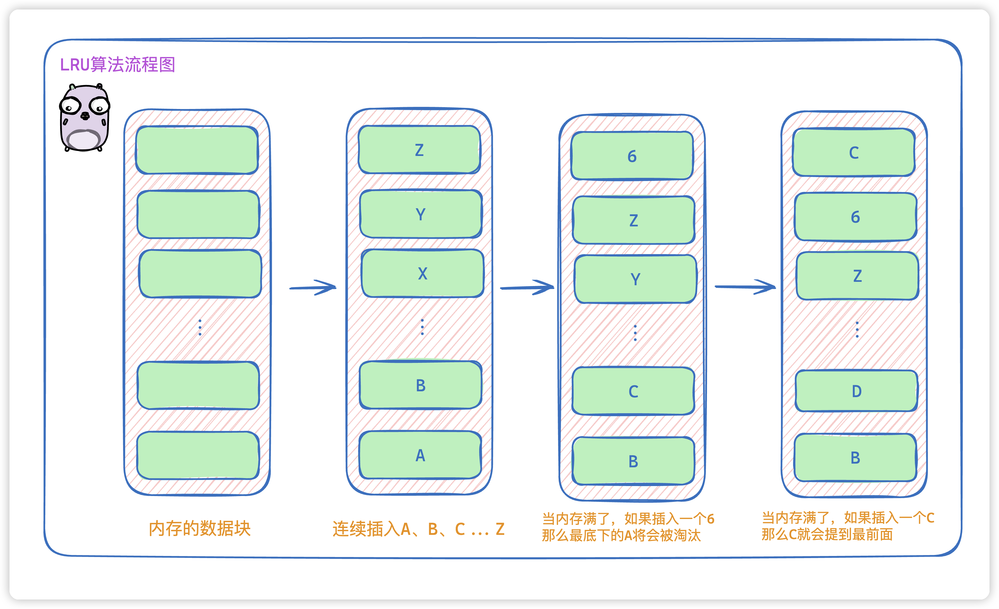

#### 1. 成员内部类

定义在类内部、方法外部，持有外部类实例的隐式引用，可访问外部类所有成员（包括 `private`）：

```java
public class Outer {
    private int x = 10;

    class Inner {
        void access() {
            System.out.println(x);   // 可以直接访问外部类私有成员
        }
    }
}

Outer.Inner inner = new Outer().new Inner();   // 必须先有外部类实例
```

#### 2. 静态内部类

用 `static` 修饰，不持有外部类实例，只能访问外部类的静态成员：

```java
public class Outer {
    private static int x = 10;
    private int y = 20;

    static class StaticInner {
        void access() {
            System.out.println(x);   // 可以访问静态成员
            // System.out.println(y); // 编译错误：不能访问非静态成员
        }
    }
}

Outer.StaticInner inner = new Outer.StaticInner();
```

#### 3. 局部内部类

定义在方法内部，作用域仅限该方法，可以访问方法中「事实上的常量」（effectively final）局部变量：

```java
public class Outer {
    public void method() {
        int factor = 2;              // 隐式 final
        class LocalInner {
            void print() { System.out.println(factor); }
        }
        new LocalInner().print();
    }
}
```

#### 4. 匿名内部类

没有类名，声明的同时创建实例，常用于接口的一次性实现或回调：

```java
Runnable runnable = new Runnable() {
    @Override
    public void run() {
        System.out.println("running");
    }
};

// JDK 8+ 可用 Lambda 替代（仅限函数式接口）
Runnable runnable2 = () -> System.out.println("running");
```

内部类的四个典型作用：

1. **封装**：只被外部类使用，隐藏实现细节；
2. **访问外部类私有成员**：省去 getter/setter；
3. **回调**：匿名内部类常见于事件监听器；
4. **变相多继承**：多个内部类分别继承不同父类，让外部类「同时拥有」多份实现。

### 静态内部类与非静态内部类有什么区别

两者最本质的差异是：非静态内部类**隐式持有一个外部类实例的引用**，静态内部类没有。

| 特性 | 静态内部类 | 非静态内部类 |
|------|-----------|-------------|
| 修饰 | 有 `static` | 无 `static` |
| 访问外部类成员 | 仅静态成员 | 所有成员（含 `private`） |
| 创建实例 | `new Outer.StaticInner()` | `new Outer().new Inner()` |
| 持有外部类引用 | 否 | 是 |
| 内存泄漏风险 | 无 | 有（外部类无法被回收） |
| 序列化 | 相对安全 | 不建议（会连带外部类） |
| 典型应用 | Builder、`Map.Entry` | 迭代器、回调 |

```java
Outer.StaticInner a = new Outer.StaticInner();   // 静态内部类
Outer.Inner b = new Outer().new Inner();         // 非静态内部类
```

> **建议**：优先用静态内部类。在 Android 等场景中，非静态内部类持有 Activity 引用是常见的内存泄漏原因。

### 谈谈自定义注解的场景及实现

注解（annotation）是贴在代码上的「标签」，本身不执行逻辑，需要由框架或反射在运行时读取后才产生作用。自定义注解就是用 `@interface` 声明一套自己的标签。

```java
@Target(ElementType.METHOD)           // 能贴在哪里
@Retention(RetentionPolicy.RUNTIME)   // 保留到什么时候
@Documented                           // 生成 javadoc 时包含
public @interface MyAnnotation {
    String value() default "";
    int timeout() default 1000;
}
```

#### 元注解

| 元注解 | 说明 |
|--------|------|
| `@Target` | 可用位置：`TYPE`、`METHOD`、`FIELD`、`PARAMETER`、`ANNOTATION_TYPE` 等 |
| `@Retention` | 保留策略：`SOURCE`（仅源码）、`CLASS`（默认，写入字节码但不加载）、`RUNTIME`（运行时可反射读取） |
| `@Documented` | 是否出现在 javadoc 中 |
| `@Inherited` | 子类是否继承父类上的该注解（只对类注解有效） |
| `@Repeatable` | JDK 8+，同一位置可重复标注 |

#### 五个典型使用场景

```java
// 1. 参数校验（配合 Spring Validation / Hibernate Validator）
@NotNull @Max(100)
private Integer age;

// 2. 权限控制
@RequiresRole("admin")
public void deleteUser(Long id) { }

// 3. 日志记录
@Log(action = "查询用户")
public User getUser(Long id) { }

// 4. 缓存
@Cacheable(key = "user:#id", expire = 300)
public User getUser(Long id) { }

// 5. 定时任务
@Scheduled(cron = "0 0 * * * ?")
public void cleanup() { }
```

#### 运行时解析注解

注解要生效，必须有代码去读它。最常见的是通过反射读取方法上的注解，然后做相应处理（这也是各类「注解 + AOP」框架的基本套路）：

```java
Method method = clazz.getMethod("getUser", Long.class);
if (method.isAnnotationPresent(Log.class)) {
    Log log = method.getAnnotation(Log.class);
    System.out.println(log.action());
}
```

> 版本说明：`@Repeatable` 与类型注解（`ElementType.TYPE_USE`）是 JDK 8 引入的；`@Retention(RUNTIME)` 是运行时反射能读到注解的前提。

### 日期格式化用 yyyy 还是 YYYY

绝大多数场景用 `yyyy`。

| 模式 | 含义 | 说明 |
|------|------|------|
| `yyyy` | year-of-era（日历年） | 1 月 1 日到 12 月 31 日 |
| `YYYY` | week-based-year（按周划分的年份） | 属于哪一年的「第几周」由周规则决定 |

`YYYY` 的取值依赖**区域（Locale）的周规则**：一周从周几开始、第一周至少要有几天。所以同一天在不同 Locale 下可能得到不同的 `YYYY` 结果：

```java
LocalDate date = LocalDate.of(2025, 12, 29);   // 周一

DateTimeFormatter cn = DateTimeFormatter.ofPattern("yyyy-MM-dd", Locale.CHINA);
DateTimeFormatter us = DateTimeFormatter.ofPattern("YYYY-MM-dd", Locale.US);

System.out.println(date.format(cn));  // 2025-12-29
System.out.println(date.format(us));  // 2026-12-29 ← 被算进了 2026 年第 1 周
```

需要特别澄清一个广为流传的例子：**`2025-12-28` 并不是在所有环境下都会格式化成 `2026-12-28`**。在 `Locale.CHINA` 下（一周从周一开始），它仍属于 2025 年；只有在 `Locale.US` 这类「一周从周日开始」的区域，它才被算作 2026 年第 1 周。用 JDK 17 / 21 实测均如此。

结论：日期格式化统一用 `yyyy`（或直接使用 `LocalDate` + `DateTimeFormatter.ISO_LOCAL_DATE`）；只有做「按周统计」时才用 `YYYY` 配合 `ww`，并且必须显式指定 `Locale`，避免服务器默认区域不同导致结果漂移。

## 二、Java 版本演进：JDK 8 / 11 / 17 / 21

Java 每半年发一个版本，每两年左右出一个长期支持版（LTS）。很多「面试题」的答案会随版本变化，因此写代码和答题时先说清版本，是更专业的习惯。本章按 LTS 版本梳理最常被问到的语法与行为差异，均以官方 JEP 与 Java 语言规范为依据。

### 四个 LTS 版本的关键差异

| 版本 | 发布时间 | 代表特性 |
|------|---------|---------|
| JDK 8 | 2014 | Lambda、Stream、`Optional`、接口 `default`/`static` 方法、新日期时间 API、永久代改为元空间 |
| JDK 11 | 2018 | `HttpClient` 标准化、`String.strip/isBlank/repeat`、单文件源码直接运行；`var` 局部变量推断由 JDK 10 引入 |
| JDK 17 | 2021 | `sealed` 密封类、`instanceof` 模式匹配（16）、`record`（16）、文本块（15）、强封装 JDK 内部 API |
| JDK 21 | 2023 | 虚拟线程、`switch` 模式匹配、记录模式、分代 ZGC、`SequencedCollection` |

```java
// JDK 8：Lambda + Stream
List<String> names = users.stream().map(User::getName).collect(Collectors.toList());

// JDK 10：局部变量类型推断（只能用于局部变量）
var list = new ArrayList<String>();

// JDK 11：字符串增强
"  x  ".strip();     // "x"（trim 只处理 <= U+0020 的字符）
"".isBlank();        // true
"ab".repeat(3);      // "ababab"
```

> 注意：`var` 只是语法糖，变量仍然是静态类型，编译后就确定了；它不能用于成员变量、方法参数和返回值。

### instanceof 模式匹配（JDK 16 正式）

**是什么**：在 `instanceof` 判断成功的同时声明一个变量，省掉显式强转。

**为什么需要**：`if (obj instanceof String) { String s = (String) obj; ... }` 这种「判断 + 强转 + 声明」的样板代码既啰嗦又容易写错类型。

```java
// JDK 16+ 写法
if (obj instanceof String s && s.length() > 5) {
    System.out.println(s.toUpperCase());
}
```

版本要点：

- JDK 14、15 为预览特性（preview），需要 `--enable-preview`；
- JDK 16 起正式可用（JEP 394），且模式变量不再是隐式 final，可以重新赋值；
- 模式变量的作用域是「流敏感」的：只有在编译器能确定匹配成功的分支里才可见；
- 如果左侧类型是右侧类型的子类（判断永远为真），编译期直接报错。

### record 记录类（JDK 16 正式）

**是什么**：一种专门用来承载不可变数据的类，编译器自动生成构造器、访问器、`equals`、`hashCode`、`toString`。

**为什么需要**：DTO、返回值包装这类「只有字段没有行为」的类，手写样板代码量大且容易漏写 `equals`/`hashCode`。

```java
public record Point(int x, int y) {
    // 紧凑构造器：用于参数校验
    public Point {
        if (x < 0) throw new IllegalArgumentException("x < 0");
    }
    public int sum() { return x + y; }   // 也可以有普通方法
}

Point p = new Point(1, 2);
System.out.println(p.x());     // 1，访问器是 x() 而不是 getX()
System.out.println(p);         // Point[x=1, y=2]
```

版本要点：JDK 14 预览、JDK 15 二次预览、JDK 16 正式（JEP 395）。`record` 隐式继承 `java.lang.Record`，不能再继承其他类，但可以实现接口；字段是 `private final`，天然不可变。

### sealed 密封类（JDK 17 正式）

**是什么**：用 `sealed` 限定「哪些类可以继承/实现我」，配合 `permits` 列出允许的子类型。

**为什么需要**：`final` 完全禁止继承，普通类又谁都能继承；当你需要「有限且已知的几种实现」时（例如表示状态的几种取值），`sealed` 正好补上中间地带，也让编译器能做穷尽性检查。

```java
public sealed interface Shape permits Circle, Square, Triangle { }

public record Circle(double r) implements Shape { }
public record Square(double side) implements Shape { }
public final class Triangle implements Shape {
    private final double a, b, c;
    public Triangle(double a, double b, double c) { this.a = a; this.b = b; this.c = c; }
}
```

版本要点：JDK 15 预览、JDK 16 二次预览、JDK 17 正式（JEP 409）。子类必须是 `final`、`sealed` 或 `non-sealed` 三者之一。

### switch 表达式（JDK 14 正式）与 switch 模式匹配（JDK 21 正式）

**是什么**：`switch` 可以作为表达式直接产生值，使用 `case ... ->` 箭头语法且不会贯穿（fall through），多分支用 `yield` 返回值。

**为什么需要**：传统 `switch` 需要 `break`、容易漏写导致贯穿，也无法直接赋值。

```java
// JDK 14+：switch 表达式
int day = 3;
String type = switch (day) {
    case 1, 7 -> "weekend";
    case 2, 3, 4, 5, 6 -> "workday";
    default -> throw new IllegalArgumentException("invalid day: " + day);
};
System.out.println(type);   // workday
```

```java
// JDK 21+：switch 模式匹配 + 记录模式（JEP 441 / JEP 440）
static String describe(Object o) {
    return switch (o) {
        case Circle(double r) -> "circle r=" + r;
        case Square(double s) -> "square side=" + s;
        case null -> "null";
        default -> "other";
    };
}
```

版本要点：

- `switch` 表达式：JDK 12/13 预览，JDK 14 正式（JEP 361）；
- `switch` 模式匹配（含 `case null`、类型模式、守卫 `when`）：JDK 17/18/19/20 均为预览，JDK 21 正式（JEP 441）；
- 实测：同样的模式匹配代码在 JDK 17 下编译会报「preview feature and are disabled by default」，必须加 `--enable-preview` 才能运行。

### 预览特性与正式特性的区别

| 状态 | 含义 | 使用要求 |
|------|------|---------|
| Preview（预览） | 设计基本定型，等待反馈，后续可能调整 | 编译和运行都要加 `--enable-preview`，且 class 文件版本与 JDK 绑定 |
| Final（正式） | 进入语言规范，长期兼容 | 无附加参数 |

面试回答版本类问题时，建议句式是「这个特性在 JDK X 正式可用；在 JDK Y 里还是预览，需要 `--enable-preview`」。这样既准确，也顺带展示了对版本演进的理解。

## 三、String 与字符串处理

`String` 是 Java 中使用频率最高的类，也是面试区分度最高的一块：不可变性、常量池、`intern()`、`String`/`StringBuilder`/`StringBuffer` 的选择，几乎每场面试都会涉及。本章先讲清「不可变」这个前提，再解释由它衍生出的常量池与拼接行为。

### String 能存储多少个字符

这个问题的答案要分三层看：语言层的长度上限、JVM 数组的实际上限、以及堆内存。

| 层次 | 限制 | 说明 |
|------|------|------|
| `String` 长度语义 | 最多 2^31-1 个 `char`（编码单元） | 长度由 `int` 表示，理论极限是 `Integer.MAX_VALUE` |
| 底层数组上限 | 约 `Integer.MAX_VALUE - 8` | HotSpot 中数组长度受对象头与对齐影响，是**实现细节**，不同 JVM、不同元素类型可能不同 |
| 实际可用 | 受堆大小限制 | `-Xmx` 不足时直接抛 `OutOfMemoryError: Java heap space` |

```java
// 理论极限，实际几乎必然 OOM
int max = Integer.MAX_VALUE;        // 2147483647
char[] arr = new char[Integer.MAX_VALUE];
```

这里要更正一个在旧资料里常见的说法：**JDK 8 及以后的 `String` 并没有 `int count` 字段**。JDK 6 时代 `String` 用 `offset + count + char[]` 表示子串；JDK 7 去掉了 `offset/count`，`length()` 直接返回 `char[]` 的长度；JDK 9 改为 `byte[] + coder` 后，长度按编码计算：

```java
// JDK 9+ 的 length() 实现（简化）
public int length() {
    return value.length >> coder();   // Latin-1: 每字符 1 字节；UTF-16: 每字符 2 字节
}
```

内存估算：JDK 8 中一个 `char` 占 2 字节，20 亿字符理论上需要约 4 GB 连续空间；JDK 9+ 若全是 Latin-1 字符，只需约 2 GB。实际能创建多长，取决于堆大小和内存是否连续。

### JDK 9 为何要把 String 的底层实现由 char[] 改成 byte[]

**改动内容**：

```java
// JDK 8
public final class String {
    private final char[] value;
    private int hash;
}

// JDK 9+
public final class String {
    private final byte[] value;
    private final byte coder;   // 0 = LATIN1，1 = UTF16
    private int hash;
}
```

**原因**：

1. **省内存**：绝大多数字符串只含 Latin-1 范围内的字符（英文、数字、常见符号），每个字符 1 字节即可，比 `char[]` 的 2 字节省一半。JDK 团队在调研中发现堆中 `String` 对象占用相当可观的比例，这项优化收益明显。
2. **间接提升性能**：内存占用下降意味着 GC 压力更小、CPU 缓存命中率更高。

**`coder` 字段的作用**：构造 `String` 时检测内容，全部 ≤ 0xFF 就用 `LATIN1`（1 字节/字符），否则用 `UTF16`（2 字节/字符）。相关方法根据 `coder` 走不同分支，例如 `charAt`、`length`、`indexOf` 都有两套实现。

> 版本说明：该改动自 JDK 9 起生效（JEP 254 的紧凑字符串）。它属于内部实现，对使用者透明，但会影响内存占用估算和某些依赖反射改 `value` 字段的「黑科技」（JDK 17 起强封装后会直接失败）。

### String、new String 与 intern 有什么区别

```java
String s1 = "abc";              // 字面量：直接指向字符串常量池
String s2 = "abc";              // 复用常量池中的同一对象
String s3 = new String("abc");  // 堆中新对象；字面量 "abc" 仍在常量池
String s4 = new String("abc");  // 又一个堆中新对象

System.out.println(s1 == s2);       // true
System.out.println(s1 == s3);       // false
System.out.println(s3 == s4);       // false
System.out.println(s1.equals(s3));  // true
```

| 写法 | 存储位置 | 创建对象数 |
|------|---------|-----------|
| `String s = "abc"` | 常量池 | 1 个（池中已有则为 0） |
| `new String("abc")` | 堆 + 常量池 | 1~2 个（堆对象，必要时还在池中建字面量） |

`intern()` 的作用是「把字符串登记到常量池，并返回池中的那个引用」：

```java
String s3 = new String("abc");
String s5 = s3.intern();
System.out.println(s1 == s5);   // true，s5 是常量池中的引用
```

> 版本说明：JDK 7 起字符串常量池从永久代移到堆中，`intern()` 在池中没有对应字符串时，会把**堆中对象的引用**记入池中（而不是复制一份字符内容）。因此 JDK 7+ 大量 `intern()` 占用的是堆内存，且仍可能 OOM。

### String 类能被继承吗，为什么

不能。`String` 被声明为 `final`：

```java
public final class String
    implements java.io.Serializable, Comparable<String>, CharSequence,
               Constable, ConstantDesc {
    ...
}
```

原因有三点：

1. **安全性**：`String` 被大量核心 API 使用（类名、文件路径、网络地址、SQL 等）。如果允许继承并重写方法，恶意子类可以伪装成合法字符串绕过校验。
2. **保证不可变**：`final` 类无法被继承，子类就不可能破坏「值不可变」这一契约，常量池共享才是安全的。
3. **性能优化**：不可变使 `String` 可以安全共享、缓存 `hashCode`（`hash` 字段懒计算）、被 JVM 做常量折叠等优化。

### String、StringBuffer、StringBuilder 的区别

| 特性 | String | StringBuffer | StringBuilder |
|------|--------|--------------|---------------|
| 可变性 | 不可变 | 可变 | 可变 |
| 线程安全 | 安全（不可变，天然共享） | 安全（方法加 `synchronized`） | 不安全 |
| 性能 | 频繁拼接差（每次生成新对象） | 中 | 最快 |
| 引入版本 | JDK 1.0 | JDK 1.0 | JDK 5 |

**String 不可变**：`value` 是 `final` 数组且不对外暴露，任何「修改」都是创建新对象。

```java
String s = "ab";
s = s + "c";   // 生成新对象 "abc"，原 "ab" 仍存在于常量池
```

**StringBuffer / StringBuilder 可变**：两者都继承 `AbstractStringBuilder`，内部是可扩容的字符缓冲区，`append` 在原对象上修改。JDK 9 起 `AbstractStringBuilder` 同样改为 `byte[] + coder`。

```java
StringBuilder sb = new StringBuilder("ab");
sb.append("c");           // 原对象被修改，没有创建新的 StringBuilder
```

**使用建议**：

| 场景 | 选择 |
|------|------|
| 少量、编译期可确定的拼接 | 直接用 `String`，编译器会用 `StringBuilder`（或 JDK 9+ 的 `StringConcatFactory`）优化 |
| 单线程循环内大量拼接 | `StringBuilder` |
| 多线程共享同一缓冲区 | `StringBuffer`，或改为每个线程各自 `StringBuilder` |

> 注意：`String s = "a" + "b" + "c";` 这种字面量拼接在编译期就合并为 `"abc"`；而循环里的 `s += x` 每次都会新建对象，是常见的性能陷阱。

## 四、集合框架

集合（Collection）是「一组对象的容器」。Java 的集合体系围绕两棵接口树展开：`Collection`（单个元素的容器）和 `Map`（键值对容器）。本章先建立整体地图，再逐个对比高频实现类的差异与坑点。

### Java 中的集合框架有哪些核心接口

```text
Collection（单元素容器）
├── List（有序、可重复、有下标）
│   ├── ArrayList          动态数组，随机访问快
│   ├── LinkedList         双向链表，也实现了 Deque
│   └── Vector             遗留的同步实现，不推荐新代码使用
├── Set（不重复）
│   ├── HashSet            基于 HashMap，无序
│   ├── LinkedHashSet      保持插入顺序
│   └── TreeSet            基于 TreeMap，按自然顺序/比较器排序
└── Queue / Deque（队列、双端队列）
    ├── PriorityQueue      优先队列（小顶堆）
    ├── ArrayDeque         数组实现的双端队列
    └── LinkedList         也实现了 Deque

Map（键值对容器，不属于 Collection）
├── HashMap                数组 + 链表 + 红黑树
├── LinkedHashMap          保持插入顺序或访问顺序
├── TreeMap                按 key 排序
├── Hashtable              遗留的同步实现，不允许 null
└── ConcurrentHashMap      线程安全，分段/CAS + synchronized
```

记忆要点：

- `List` 关心「顺序和下标」，`Set` 关心「去重」，`Queue` 关心「进出规则」，`Map` 关心「key → value 映射」。
- `HashSet` 内部就是一个 `HashMap`，把元素当 key、用一个常量对象当 value，所以「HashSet 的去重逻辑」就是「HashMap 的 key 判重逻辑」。
- `Vector`、`Hashtable` 是 JDK 1.0 的遗留类，虽然没有被标记 `@Deprecated`，但官方文档明确建议新代码改用 `ArrayList`、`HashMap` 或 `ConcurrentHashMap`。

### ArrayList 和 LinkedList 有什么区别

| 特性 | ArrayList | LinkedList |
|------|-----------|------------|
| 底层结构 | 动态数组 | 双向链表 |
| 随机访问 `get(i)` | O(1) | O(n)，需要从头/尾遍历 |
| 头部插入/删除 | O(n)，要移动元素 | O(1) |
| 尾部插入 | 均摊 O(1) | O(1) |
| 中间插入 | O(n) | 查找 O(n) + 插入 O(1) |
| 内存占用 | 紧凑（可能有预留容量） | 每个节点多两个引用 |
| 实现的接口 | `List`、`RandomAccess` | `List`、`Deque` |

```java
// ArrayList：默认构造时是空数组，第一次 add 才分配容量 10；扩容为 1.5 倍
// newCapacity = oldCapacity + (oldCapacity >> 1)

// LinkedList：节点结构
// private static class Node<E> { E item; Node<E> next; Node<E> prev; }
```

**选择建议**：绝大多数场景用 `ArrayList`。它内存连续、缓存友好，即使中间插入也因为 `System.arraycopy` 很快；`LinkedList` 的优势主要在「频繁在头部插入/删除」以及需要当双端队列用时。所谓「LinkedList 插入比 ArrayList 快」是有前提的——你已经持有了目标位置的节点，否则查找成本仍是 O(n)。

### 什么是 CopyOnWriteArrayList

`CopyOnWriteArrayList` 是 `java.util.concurrent` 包下线程安全的 `List`。它的策略叫**写时复制**（Copy-On-Write）：读操作完全不加锁，写操作先复制一份新数组，在新数组上修改，最后把内部引用指向新数组。

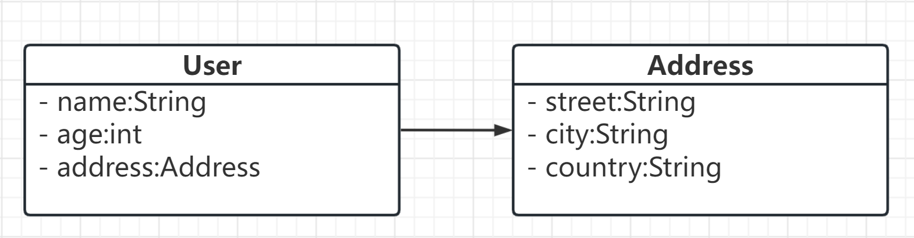


```java
// JDK 8+ 的实现用 ReentrantLock，而不是 synchronized
private transient volatile Object[] array;

public boolean add(E e) {
    final ReentrantLock lock = this.lock;
    lock.lock();
    try {
        Object[] elements = getArray();
        int len = elements.length;
        Object[] newElements = Arrays.copyOf(elements, len + 1);
        newElements[len] = e;
        setArray(newElements);
        return true;
    } finally {
        lock.unlock();
    }
}

public E get(int index) {
    return elementAt(getArray(), index);   // 无锁读，直接读 volatile 数组
}
```

> 说明：上面是简化示意。实际源码用 `ReentrantLock` 保证写互斥，`array` 用 `volatile` 保证可见性；早期资料里常见的 `synchronized (lock)` 写法并不准确。

**适用场景**：

- **读多写少**：读完全无锁，性能接近普通 `ArrayList`。
- **弱一致性**：迭代器拿到的是创建那一刻的快照，遍历期间即使有写入也看不到，因此不会抛 `ConcurrentModificationException`。
- **不适合频繁写**：每次写都要复制整个数组，元素多、写入频繁时开销很大。

#### 与 Collections.synchronizedList 对比

| 特性 | CopyOnWriteArrayList | Collections.synchronizedList |
|------|---------------------|------------------------------|
| 读性能 | 无锁，较快 | 每次读都要加锁 |
| 写性能 | 复制整个数组，元素多时慢 | 加锁，单次写开销小 |
| 迭代器 | 快照，允许并发修改 | 需手动同步，否则可能抛 CME |
| 一致性 | 弱一致（看到旧快照） | 强一致（加锁期间互斥） |
| 适用场景 | 读多写少、监听器列表、配置缓存 | 读写相对均衡 |

### List 操作的一些常见问题

三个最常踩的坑，几乎都源于「返回的不是你以为的那个 List」。

#### 1. Arrays.asList 返回的 List 不能修改大小

```java
List<String> list = Arrays.asList("a", "b", "c");
list.set(0, "x");   // 可以：替换元素
list.add("d");      // UnsupportedOperationException
list.remove(0);     // UnsupportedOperationException
```

`Arrays.asList` 返回的是 `java.util.Arrays` 的私有内部类 `Arrays$ArrayList`（不是 `java.util.ArrayList`），底层直接复用传入的数组，长度固定。需要可变列表时套一层：`new ArrayList<>(Arrays.asList(...))`。

> 补充：JDK 9 新增的 `List.of(...)`、`Set.of(...)`、`Map.of(...)` 返回的是**真正不可变**的集合，连 `set` 都不允许，任何修改都抛 `UnsupportedOperationException`。

#### 2. subList 返回的是视图

```java
List<Integer> list = new ArrayList<>(Arrays.asList(1, 2, 3, 4, 5));
List<Integer> sub = list.subList(1, 4);   // [2, 3, 4]
sub.set(0, 99);
System.out.println(list);                 // [1, 99, 3, 4, 5]，原列表被改了
```

`subList` 不复制数据，返回的是原列表的一个「窗口」。对原列表做结构性修改（增删）后，再操作 `subList` 会抛 `ConcurrentModificationException`。

#### 3. 批量操作可能 OOM

```java
List<Integer> big = IntStream.range(0, 10_000_000).boxed().collect(Collectors.toList());
target.addAll(big);   // 目标列表扩容 + 装箱对象，内存可能直接翻倍
```

`addAll` 会拷贝引用，但源集合本身、装箱后的 `Integer` 对象、目标数组扩容都需要内存。批量合并大集合时，优先考虑分批处理或使用流式处理，避免同时驻留多份大数据。

### 如何优雅地删除 HashMap 元素

**为什么不能边遍历边删**：`HashMap` 的迭代器是快速失败（fail-fast）的，遍历过程中只要 `modCount` 变化（增、删都会），下一次 `next()` 就抛 `ConcurrentModificationException`。

**五种可行方式**：

```java
// 1. entrySet + iterator.remove：最经典，边遍历边安全删除
Iterator<Map.Entry<String, Integer>> it = map.entrySet().iterator();
while (it.hasNext()) {
    Map.Entry<String, Integer> entry = it.next();
    if (entry.getValue() < 0) {
        it.remove();
    }
}

// 2. keySet + iterator.remove：逻辑同上，value 需要再 get 一次
Iterator<String> keyIt = map.keySet().iterator();
while (keyIt.hasNext()) {
    String key = keyIt.next();
    if (map.get(key) < 0) {
        keyIt.remove();
    }
}

// 3. JDK 8+ removeIf：最简洁，内部仍是迭代器删除
map.entrySet().removeIf(entry -> entry.getValue() < 0);

// 4. 先收集 key，再批量删除：逻辑最直观，但要额外内存
List<String> toRemove = map.entrySet().stream()
        .filter(e -> e.getValue() < 0)
        .map(Map.Entry::getKey)
        .collect(Collectors.toList());
toRemove.forEach(map::remove);

// 5. 构建新 Map：函数式风格，适合需要保留原 Map 的场景
Map<String, Integer> newMap = map.entrySet().stream()
        .filter(e -> e.getValue() >= 0)
        .collect(Collectors.toMap(Map.Entry::getKey, Map.Entry::getValue));
```

| 方式 | 需要额外内存 | 可读性 | 推荐度 |
|------|-------------|--------|--------|
| `iterator.remove` | 否 | 中 | 高（通用） |
| `removeIf` | 否 | 高 | 最高（JDK 8+） |
| 收集 key 后删除 | 是 | 高 | 中 |
| 构建新 Map | 是 | 高 | 看场景 |

> 注意：`map.keySet().removeIf(...)` 与 `map.entrySet().removeIf(...)` 都可以，但不要用 `map.forEach((k, v) -> map.remove(k))`，那会在遍历中修改结构而抛异常。并发场景请用 `ConcurrentHashMap`，它允许并发删除。

### HashMap 底层原理常见面试题

`HashMap` 是「数组 + 链表 + 红黑树」实现的哈希表：数组负责 O(1) 定位，链表/红黑树处理哈希冲突。

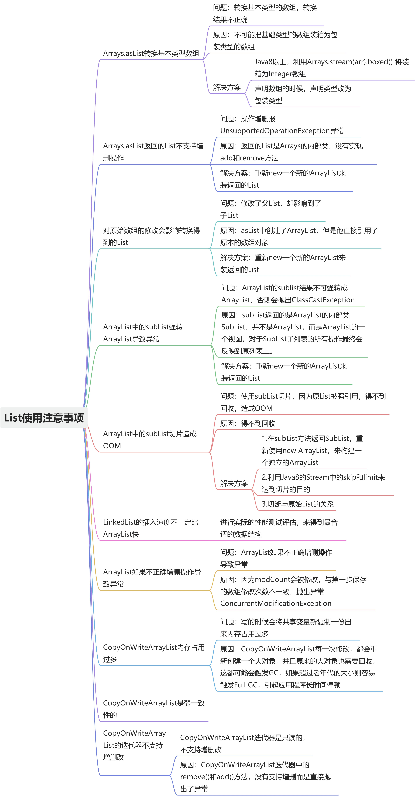

#### 数据结构

```text
table[0] → null
table[1] → Node(k1,v1) → Node(k2,v2) → ...   // 链表，长度 ≥ 8 且桶数 ≥ 64 时树化
table[2] → TreeNode(...)                      // 红黑树
...
table[n-1] → null
```

```java
static class Node<K,V> implements Map.Entry<K,V> {
    final int hash;
    final K key;
    V value;
    Node<K,V> next;
}
```

#### put 流程

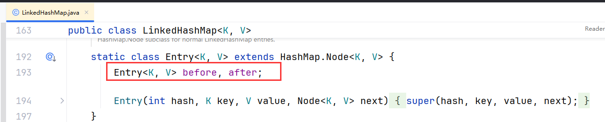

步骤可以概括为 7 步：

1. 计算扰动后的 hash：`(h = key.hashCode()) ^ (h >>> 16)`，让高位也参与定位，减少碰撞；
2. 用 `(n - 1) & hash` 定位桶（要求容量 n 是 2 的幂，等价于取模但更快）；
3. 桶为空，直接放入新节点；
4. 桶非空，先比首节点：hash 相同且（引用相同或 `equals` 为 true）则替换 value；
5. 首节点是 `TreeNode`，走红黑树插入；
6. 否则遍历链表，找到相同 key 则替换，否则尾插（JDK 8 尾插，JDK 7 是头插）；
7. 插入后 `size > threshold` 则扩容为 2 倍；链表长度 ≥ 8 且容量 ≥ 64 时树化（容量不足 64 时优先扩容而不是树化）。

> 初学可略过：下面是 JDK 8 的 `putVal` 核心源码，读懂它能解释上面每一步「为什么这么写」，但不影响日常使用。

```java
public V put(K key, V value) {
    return putVal(hash(key), key, value, false, true);
}

static final int hash(Object key) {
    int h;
    return (key == null) ? 0 : (h = key.hashCode()) ^ (h >>> 16);   // 扰动
}

final V putVal(int hash, K key, V value, boolean onlyIfAbsent, boolean evict) {
    Node<K,V>[] tab; Node<K,V> p; int n, i;
    if ((tab = table) == null || (n = tab.length) == 0)
        n = (tab = resize()).length;                       // 懒初始化 / 扩容
    if ((p = tab[i = (n - 1) & hash]) == null)
        tab[i] = newNode(hash, key, value, null);          // 桶为空，直接放
    else {
        Node<K,V> e; K k;
        if (p.hash == hash && ((k = p.key) == key || (key != null && key.equals(k))))
            e = p;                                         // 首节点命中
        else if (p instanceof TreeNode)
            e = ((TreeNode<K,V>)p).putTreeVal(this, tab, hash, key, value);
        else {
            for (int binCount = 0; ; ++binCount) {
                if ((e = p.next) == null) {
                    p.next = newNode(hash, key, value, null);   // 尾插
                    if (binCount >= TREEIFY_THRESHOLD - 1)
                        treeifyBin(tab, hash);                  // 链表达到阈值，尝试树化
                    break;
                }
                if (e.hash == hash && ((k = e.key) == key || (key != null && key.equals(k))))
                    break;                                      // 找到相同 key
                p = e;
            }
        }
        if (e != null) {                                        // 覆盖旧值
            V oldValue = e.value;
            if (!onlyIfAbsent || oldValue == null)
                e.value = value;
            return oldValue;
        }
    }
    ++modCount;
    if (++size > threshold)
        resize();
    return null;
}
```

#### get 流程

```java
public V get(Object key) {
    Node<K,V> e;
    return (e = getNode(hash(key), key)) == null ? null : e.value;
}

final Node<K,V> getNode(int hash, Object key) {
    Node<K,V>[] tab; Node<K,V> first, e; int n; K k;
    if ((tab = table) != null && (n = tab.length) > 0 &&
        (first = tab[(n - 1) & hash]) != null) {
        if (first.hash == hash && ((k = first.key) == key || (key != null && key.equals(k))))
            return first;                                   // 首节点命中
        if ((e = first.next) != null) {
            if (first instanceof TreeNode)
                return ((TreeNode<K,V>)first).getTreeNode(hash, key);
            do {
                if (e.hash == hash && ((k = e.key) == key || (key != null && key.equals(k))))
                    return e;
            } while ((e = e.next) != null);
        }
    }
    return null;
}
```

注意比较顺序：先比 hash（int 比较，很快），再用 `==` 比引用，最后才 `equals`，这是为了尽量减少开销较大的 `equals` 调用。

#### 扩容 resize

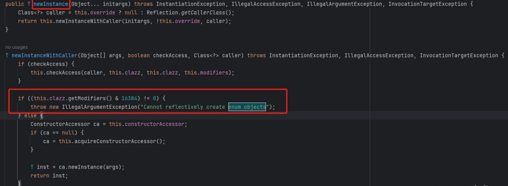

- 触发条件：`size > threshold`，其中 `threshold = capacity × loadFactor`；
- 每次扩容为原来的 2 倍，并重新分布元素；
- JDK 8 的优化：容量始终是 2 的幂，元素的新位置只可能是「原位置」或「原位置 + 旧容量」，只需判断 `hash & oldCap` 这一位，不必重新计算 hash。

#### 核心参数

| 参数 | 默认值 | 说明 |
|------|--------|------|
| 初始容量 | 16 | 桶数组大小，必须是 2 的幂 |
| 负载因子 | 0.75 | 空间与冲突概率的折中 |
| 树化阈值 | 8 | 链表长度 ≥ 8 **且** 桶数组长度 ≥ 64 时转红黑树 |
| 退化阈值 | 6 | 红黑树节点 ≤ 6 时退化为链表 |
| 最大容量 | 2^30 | 超过后不再扩容 |

#### 线程安全问题

`HashMap` 非线程安全，多线程并发写入可能出现：

- **JDK 7**：扩容时头插法可能让链表形成环，后续 `get` 命中环会死循环、CPU 打满；
- **JDK 8**：改为尾插后不再成环，但仍可能丢失数据（两个线程同时往同一个空桶写，后写的覆盖先写的）、`size` 计数不准。

多线程场景请用 `ConcurrentHashMap`：JDK 7 用分段锁（Segment），JDK 8 改为 CAS + `synchronized` 锁单个桶的头节点，并发度更高。

### HashMap 和 Hashtable 有什么区别

| 特性 | HashMap | Hashtable |
|------|---------|-----------|
| 线程安全 | 不安全 | 安全（方法级 `synchronized`） |
| null 支持 | 允许 1 个 null key、多个 null value | 都不允许（抛 NPE） |
| 初始容量 | 16 | 11 |
| 扩容 | 2 倍 | 2 倍 + 1 |
| 父类 | `AbstractMap` | `Dictionary`（已过时） |
| 性能 | 好 | 差（整表锁） |
| 建议 | 单线程首选 | 不要用，改用 `ConcurrentHashMap` |

`Hashtable` 是 JDK 1.0 的遗留实现，所有公开方法都加了 `synchronized`，等于锁住整个表，并发度极低；`Dictionary` 类也早已被标记为过时。新代码如果需要线程安全，用 `ConcurrentHashMap`；如果只是需要不可变或同步包装，可用 `Collections.unmodifiableMap`、`Collections.synchronizedMap`。

### Comparator 与 Comparable 有什么区别

两者都用于「比较大小」，区别在于比较逻辑放在哪：

| 特性 | Comparable | Comparator |
|------|-----------|------------|
| 所在包 | `java.lang` | `java.util` |
| 方法 | `int compareTo(T o)` | `int compare(T a, T b)` |
| 语义 | 自然排序（类自己定义） | 外部比较器（可定义多种） |
| 是否修改类 | 需要 | 不需要 |
| 灵活性 | 一种默认顺序 | 可随时新增排序规则 |

```java
// Comparable：类自身实现自然排序
public class User implements Comparable<User> {
    private int age;
    @Override
    public int compareTo(User o) {
        return Integer.compare(this.age, o.age);
    }
}
Collections.sort(users);

// Comparator：外部定义，可组合、可复用
Comparator<User> byName = Comparator.comparing(User::getName);
Comparator<User> byAgeDesc = Comparator.comparing(User::getAge).reversed();
users.sort(byAgeDesc);
```

补充：`Comparator` 在 JDK 8 增加了大量默认方法（`comparing`、`thenComparing`、`reversed`、`nullsFirst`），比较时要注意返回值约定——负数表示小于、0 表示相等、正数表示大于；用减法 `a - b` 实现比较存在整数溢出风险，推荐 `Integer.compare`。

## 五、泛型、反射与序列化

这三项是「框架为什么能工作」的底层支撑：泛型让编译期就能发现类型错误，反射让程序在运行时操作类和对象，序列化让对象可以落盘或跨网络传输。理解它们，也就能理解 Spring、MyBatis、RPC 框架的大部分魔法。

### 说说你对泛型的理解

**是什么**：泛型（generics）是 JDK 5 引入的「参数化类型」——把类型当成参数传给类、接口或方法。

**为什么需要**：没有泛型时，集合只能存 `Object`，取出来必须强转，类型错误只能在运行时暴露：

```java
List list = new ArrayList();
list.add("abc");
Integer i = (Integer) list.get(0);   // 运行时 ClassCastException
```

**怎么用**：泛型的好处是类型安全（编译期检查）、免强转、代码复用。

```java
public class Box<T> {
    private T data;
    public T getData() { return data; }
    public void setData(T data) { this.data = data; }
}

Box<String> box = new Box<>();
box.setData("hello");
String s = box.getData();   // 不需要强转
```

#### 泛型方法

类型参数声明在返回值之前，只作用于该方法：

```java
public <T> T print(T item) {
    System.out.println(item);
    return item;
}

public <K, V> void print(K key, V value) {
    System.out.println(key + "=" + value);
}
```

#### 泛型接口

```java
public interface Repository<T> {
    T findById(Long id);
    List<T> findAll();
    void save(T entity);
}

public class UserRepository implements Repository<User> {
    @Override public User findById(Long id) { return null; }
    @Override public List<User> findAll() { return List.of(); }
    @Override public void save(User entity) { }
}
```

#### 类型擦除

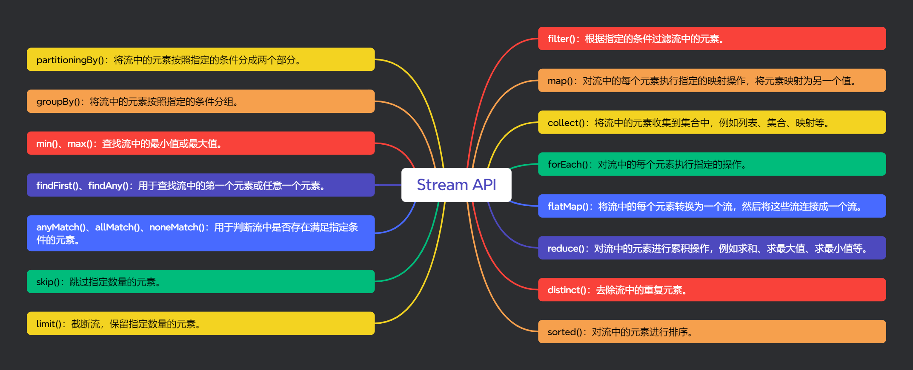

泛型只在**编译期**有效，编译后类型参数会被「擦除」（type erasure），运行时不存在 `List<String>` 和 `List<Integer>` 的区别：

```java
List<String> strings = new ArrayList<>();
List<Integer> integers = new ArrayList<>();
System.out.println(strings.getClass() == integers.getClass());   // true
```

擦除规则：

| 声明 | 擦除后 |
|------|--------|
| `<T>`（无界） | `Object` |
| `<T extends Number>` | `Number` |
| `<T extends Comparable<T>>` | `Comparable` |

编译器会在需要的地方自动插入强制转换，并在子类重写泛型方法时生成**桥接方法**（bridge method）来保证多态正确。

擦除带来的三个限制：

1. 不能 `new T()`、不能 `new T[]`（运行时不知道 T 是什么）；
2. 不能对泛型类型用 `instanceof`（`list instanceof List<String>` 编译错误）；
3. 静态成员不能使用类的类型参数。

> 提示：正因为擦除，`List<String>` 与 `List<Integer>` 在运行时是同一个类，所以「重载 `method(List<String>)` 和 `method(List<Integer>)`」会编译报错——签名擦除后冲突。

#### 泛型通配符与 PECS 原则

```java
// 无界通配符：只读遍历
void print(List<?> list) { list.forEach(System.out::println); }

// 上界通配符：可以读，不能写（除了 null）
double sum(List<? extends Number> list) {
    return list.stream().mapToDouble(Number::doubleValue).sum();
}

// 下界通配符：可以写，读出来只能当 Object
void addNumbers(List<? super Integer> list) {
    for (int i = 1; i <= 10; i++) list.add(i);
}
```

**PECS 原则**（Producer Extends, Consumer Super）：

| 用途 | 写法 | 记忆 |
|------|------|------|
| 主要从中读取数据（生产者） | `<? extends T>` | 读得到 T |
| 主要往里写入数据（消费者） | `<? super T>` | 写得进 T |
| 既读又写 | 不要用通配符，直接用 `<T>` | — |

### 谈谈你对反射的理解

**是什么**：反射（reflection）是程序在**运行时**检查类、创建对象、调用方法、访问字段的能力。入口是 `Class` 对象——每个被加载的类在 JVM 中都有一个对应的 `Class` 实例。

**为什么需要**：编译期不知道具体类型时（框架要处理任意用户类），只能靠运行时信息来操作。Spring 扫描注解、MyBatis 映射结果、Jackson 序列化对象，本质上都依赖反射。

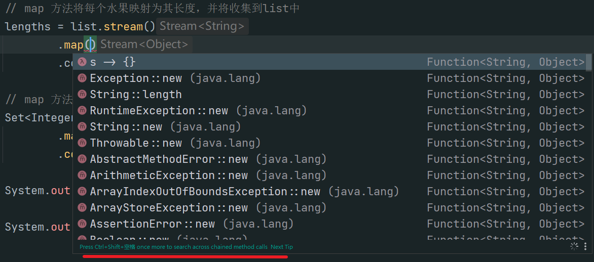

#### 获取 Class 对象的三种方式

```java
// 1. 类名.class：编译期已知类型，最安全
Class<String> clazz1 = String.class;

// 2. 对象.getClass()：已有实例时使用
String str = "hello";
Class<?> clazz2 = str.getClass();

// 3. Class.forName(全限定名)：字符串驱动，可动态加载，会触发类初始化
Class<?> clazz3 = Class.forName("java.lang.String");
```

#### 核心操作

```java
// 创建实例（JDK 9+ 推荐，替代已废弃的 Class.newInstance）
Class<?> clazz = Class.forName("com.example.User");
Object obj = clazz.getDeclaredConstructor().newInstance();

// 调用方法
Method method = clazz.getDeclaredMethod("setName", String.class);
method.setAccessible(true);       // 允许访问 private（受模块封装限制）
method.invoke(obj, "user_a");

// 读写字段
Field field = clazz.getDeclaredField("name");
field.setAccessible(true);
field.set(obj, "user_b");
Object value = field.get(obj);

// 获取构造器
Constructor<?> constructor = clazz.getDeclaredConstructor(String.class, int.class);
Object obj2 = constructor.newInstance("user_c", 25);

// 读取注解
if (method.isAnnotationPresent(Deprecated.class)) {
    Deprecated annotation = method.getAnnotation(Deprecated.class);
}
```

> 版本说明：JDK 9 引入模块系统后，`setAccessible(true)` 默认无法穿透「未开放（not open）」的包；JDK 17 起强封装 JDK 内部 API，对 `java.base` 内部类做反射会抛 `InaccessibleObjectException`。访问自己的类不受影响。

#### 应用场景

1. **Spring IoC**：扫描、实例化 Bean、注入依赖；
2. **Spring AOP**：JDK 动态代理通过反射调用目标方法；
3. **JSON 序列化**：读取字段/Getter 生成 JSON；
4. **ORM 框架**：MyBatis、Hibernate 把结果集映射到对象；
5. **注解处理**：运行时读取注解并执行逻辑；
6. **动态代理**：`Proxy.newProxyInstance` + `InvocationHandler`。

#### Spring 中反射的具体应用

| 场景 | 反射做了什么 |
|------|-------------|
| IoC 容器 | 扫描类路径，`Class.forName` 加载类，`Constructor.newInstance` 创建 Bean，`Field.set` 注入依赖 |
| AOP | `Proxy.newProxyInstance` 生成代理对象，拦截后通过 `Method.invoke` 调用目标方法 |
| Spring MVC | 启动时扫描 `@RequestMapping` 建立「URL → 方法」映射，请求到达时用 `Method.invoke` 执行 Controller 方法 |
| 声明式事务 | 反射判断方法/类上是否有 `@Transactional`，据此决定是否开启事务 |
| 参数绑定 | 读取方法参数名与注解，把请求参数反射赋值到对象 |

#### 优缺点

**优点**：灵活、动态，是绝大多数框架的基础能力。

**缺点**：

| 缺点 | 说明 |
|------|------|
| 性能开销 | 反射调用比直接调用慢（方法查找、参数装箱、无法内联）；JIT 优化后差距会缩小，但高频路径仍应缓存 `Method`/`Field` |
| 破坏封装 | 可以访问 private 成员，绕过访问控制 |
| 丢失编译期检查 | 类名、方法名写错只能在运行时暴露 |
| 模块化限制 | JDK 9+ 受模块封装约束 |

### 反射中，Class.forName 和 ClassLoader 有什么区别

核心差异在于**是否执行类的初始化**（也就是是否执行静态代码块）。

| 特性 | `Class.forName(name)` | `ClassLoader.loadClass(name)` |
|------|----------------------|-------------------------------|
| 是否初始化 | 是，执行静态代码块 | 否，只完成加载（部分实现含链接） |
| 重载 | `forName(name, initialize, loader)` | 只有 `loadClass(name)` |
| 典型场景 | JDBC 驱动注册 | 延迟加载、框架按需加载 |

```java
// 会执行静态代码块（等价于 forName(name, true, 当前类加载器)）
Class<?> c1 = Class.forName("com.example.MyClass");

// 不会执行静态代码块
Class<?> c2 = ClassLoader.getSystemClassLoader().loadClass("com.example.MyClass");

// 手动触发初始化
c2.getDeclaredConstructor().newInstance();

// 显式不初始化
Class<?> c3 = Class.forName("com.example.MyClass", false, clazzLoader);
```

一个经典用途是 JDBC：早期写法 `Class.forName("com.mysql.cj.jdbc.Driver")` 的目的不是拿到 `Class` 对象，而是触发 `Driver` 的静态代码块，让它把自己注册到 `DriverManager`。

> 版本说明：JDBC 4.0（JDK 6）起支持 SPI 自动发现驱动，`Class.forName` 已不是必需；但很多老代码和教程仍保留这一行。

### 谈谈你对 Java 序列化的理解

**是什么**：序列化（serialization）是把对象转换成字节序列的过程，反序列化是反过来把字节还原成对象。用途是持久化和网络传输。

**为什么需要**：对象活在堆内存里，进程一停就没了；要写文件、走网络、进缓存，就必须先把对象变成字节。

```java
// 序列化
try (ObjectOutputStream oos = new ObjectOutputStream(new FileOutputStream("obj.dat"))) {
    oos.writeObject(user);
}

// 反序列化
try (ObjectInputStream ois = new ObjectInputStream(new FileInputStream("obj.dat"))) {
    User user = (User) ois.readObject();
}
```

#### Serializable 接口

`Serializable` 是一个**标记接口**（marker interface，没有任何方法），实现它只是告诉 JVM「这个类允许被序列化」：

```java
public class User implements Serializable {
    private static final long serialVersionUID = 1L;
    private String name;
    private transient String password;   // transient 字段不参与序列化
}
```

#### serialVersionUID

`serialVersionUID` 是序列化版本号。反序列化时 JVM 会比对字节流里的 UID 和本地类的 UID，不一致就抛 `InvalidClassException`。

要更正一个常见说法：**它并不是「编译器」根据类结构生成的**。如果你没有显式声明，运行时由 `ObjectStreamClass` 依据类的结构（类名、修饰符、接口、字段、方法、构造器等）计算出一个哈希值作为默认 UID。也正因如此，类结构一改，默认 UID 就会变，旧的序列化数据就反序列化失败。所以**建议显式声明**。

#### transient 关键字

```java
private transient String password;   // 反序列化后该字段为默认值（对象为 null，int 为 0）
```

`transient` 用于标记「不需要持久化」的字段，例如密码、缓存、连接对象。

#### 序列化的注意事项

| 注意点 | 说明 |
|--------|------|
| 静态字段不序列化 | `static` 属于类不属于对象，反序列化后取的是当前类的值 |
| 父类 | 父类若未实现 `Serializable`，则父类字段不会被序列化，但父类必须有无参构造器 |
| 引用类型 | 被引用的对象也必须可序列化，否则抛 `NotSerializableException` |
| 安全风险 | 原生反序列化会按字节流构造对象，历史上有大量反序列化漏洞（如 Commons Collections 链），不可信数据不要用原生反序列化 |
| 性能 | 体积大、速度慢，跨语言支持差 |

#### 替代方案

| 方式 | 特点 |
|------|------|
| Java 原生序列化 | 兼容性好、零依赖，但体积大、慢、不安全、不跨语言 |
| JSON（Jackson / Gson） | 可读性好、跨语言、生态成熟，最常用 |
| Protobuf | 二进制、体积小、性能高、跨语言，需要 schema |
| Hessian | 二进制、跨语言，Dubbo 等 RPC 框架曾广泛使用 |

> 版本说明：`Object.finalize()` 自 JDK 9 起被标记废弃，JDK 18 起标记为「for removal」，说明依赖「对象销毁时执行清理」的思路已不被推荐；序列化体系本身也在演进，JDK 17 起可通过 `jdk.serialFilter` 配置反序列化过滤器来降低风险。

## 六、Lambda 与 Stream

JDK 8 引入的 Lambda 表达式和 Stream 彻底改变了集合的处理方式：从「怎么循环」变成「要什么结果」。本章先讲 Lambda 的语法与函数式接口，再讲方法引用，最后用两个清单覆盖最常用的 Stream 与 Lambda 写法。

### 说说你对 Lambda 表达式的理解

**是什么**：Lambda 是一段可以传递的匿名函数，用来简洁地实现函数式接口（只有一个抽象方法的接口）。

**为什么需要**：以前给接口传行为只能写匿名内部类，样板代码多；Lambda 把「方法体」直接当值传递。

```java
// 匿名内部类
Runnable r1 = new Runnable() {
    @Override public void run() { System.out.println("hi"); }
};

// Lambda
Runnable r2 = () -> System.out.println("hi");
```

#### 语法

```java
(parameters) -> expression
(parameters) -> { statements; }

() -> System.out.println("hello")          // 无参数
x -> x * x                                 // 单参数，类型可推断
(x, y) -> x + y                            // 多参数
(x, y) -> { int sum = x + y; return sum; } // 多语句，需要 return
```

#### 函数式接口

Lambda 必须有「目标类型」，这个类型就是函数式接口——**只有一个抽象方法**的接口（可以同时有多个 `default`/`static` 方法）。`@FunctionalInterface` 注解不是必需的，但加上后编译器会帮你检查是否只有一个抽象方法。

```java
@FunctionalInterface
interface MyFunction<T, R> {
    R apply(T t);

    default <V> MyFunction<T, V> andThen(MyFunction<R, V> after) {
        return t -> after.apply(this.apply(t));   // default 方法不影响函数式接口的判定
    }
}
```

#### 变量捕获

Lambda 可以访问外部的局部变量，但该变量必须是 `final` 或「事实上 final」（effectively final，即声明后没有再赋值）：

```java
int factor = 2;                                  // 事实上 final
Function<Integer, Integer> multiply = x -> x * factor;
// factor = 3;                                   // 编译错误，Lambda 捕获后不能再改
```

原因是 Lambda 捕获的是变量值的副本，如果允许修改，副本与原变量就会不一致。成员变量和静态变量不受此限制（它们存在堆/方法区，Lambda 里访问的是同一份）。

#### 方法引用

Lambda 体只调用一个已存在的方法时，可以写成方法引用（`::`），见下一节。

#### 性能

- Lambda 通过 `invokedynamic` 指令实现，首次执行时由 `LambdaMetafactory` 生成实现类，之后可被 JIT 内联；
- 非捕获型 Lambda 通常会被缓存复用，捕获型每次调用可能新建实例；
- 与匿名内部类相比，两者性能差异在现代 JVM 上通常不是瓶颈，**不要为性能而刻意选 Lambda 或匿名类**，按可读性选择即可；
- 真正需要注意的是 Stream 中的装箱/拆箱（用 `IntStream`、`mapToInt` 等原始类型流规避）。

#### 限制

| 限制 | 说明 |
|------|------|
| 不能修改捕获的局部变量 | 只能读，且必须是 effectively final |
| 不能抛受检异常 | 除非函数式接口的抽象方法声明了该异常 |
| `this` 指向外部类 | Lambda 没有自己的 `this`，不像匿名内部类那样指向自身 |
| 不能引用自身 | 递归要用方法引用或先把 Lambda 赋给变量 |
| 只能用于函数式接口 | 抽象类、多个抽象方法的接口都不行 |

### 怎么理解 Java 里的双冒号 `::`

`::` 是方法引用运算符，是 Lambda 的简写：当 Lambda 体只是「调用一个已有方法」时，可以省略参数列表。

```java
Function<String, Integer> f1 = Integer::parseInt;          // 方法引用
Function<String, Integer> f2 = s -> Integer.parseInt(s);   // 等价的 Lambda
```

#### 四种形式

```java
// 1. 静态方法引用：类名::静态方法
Function<String, Integer> parser = Integer::parseInt;

// 2. 特定类型的实例方法引用：类名::实例方法（第一个参数作为调用者）
Function<String, String> upper = String::toUpperCase;

// 3. 特定对象的实例方法引用：对象::方法
String prefix = "Hello: ";
Function<String, String> greet = prefix::concat;

// 4. 构造方法引用：类名::new
Supplier<ArrayList<String>> factory = ArrayList::new;
Function<Integer, ArrayList<String>> sizedFactory = ArrayList::new;
```

#### 与 Lambda 的等价关系

| 方法引用 | 等价 Lambda |
|---------|-------------|
| `Integer::parseInt` | `s -> Integer.parseInt(s)` |
| `String::toUpperCase` | `s -> s.toUpperCase()` |
| `System.out::println` | `x -> System.out.println(x)` |
| `ArrayList::new` | `() -> new ArrayList<>()` |
| `String[]::new` | `n -> new String[n]`（数组构造引用） |

> 判断技巧：看「参数由谁接收」。`String::toUpperCase` 的参数是调用者本身；`prefix::concat` 的参数是 `concat` 的入参。

### JDK 8 提升代码优雅技巧

#### 常用函数式接口

| 接口 | 抽象方法 | 语义 | 示例 |
|------|---------|------|------|
| `Supplier<T>` | `T get()` | 无参有返回值（生产者） | `() -> new ArrayList<>()` |
| `Function<T,R>` | `R apply(T)` | 一参有返回值（转换） | `s -> s.length()` |
| `Consumer<T>` | `void accept(T)` | 一参无返回值（消费者） | `s -> System.out.println(s)` |
| `Predicate<T>` | `boolean test(T)` | 一参返回布尔（判断） | `s -> s.isEmpty()` |
| `BiFunction<T,U,R>` | `R apply(T,U)` | 两参有返回值 | `(a, b) -> a + b` |
| `UnaryOperator<T>` | `T apply(T)` | 参数与返回同类型 | `s -> s.trim()` |
| `BinaryOperator<T>` | `T apply(T,T)` | 两参一返回，同类型 | `(a, b) -> a + b` |

##### Supplier

```java
Supplier<String> supplier = () -> "hello";
String result = supplier.get();

// 延迟初始化：真正需要时才创建昂贵对象
Supplier<ExpensiveObject> lazy = ExpensiveObject::new;
ExpensiveObject obj = lazy.get();
```

##### Function

```java
Function<String, Integer> toLength = String::length;
Function<Integer, String> toString = Object::toString;
Function<String, String> composed = toLength.andThen(toString);
System.out.println(composed.apply("hello"));   // "5"
```

##### Consumer

```java
Consumer<String> printer = System.out::println;
Consumer<String> logger = s -> log.info(s);
Consumer<String> combined = printer.andThen(logger);
combined.accept("message");   // 先打印，再记日志
```

##### Runnable

```java
Runnable task = () -> System.out.println("running");
new Thread(task).start();
```

#### 三个实用小技巧

```java
// 1. 参数校验代替 if + throw
Objects.requireNonNull(obj, "obj 不能为 null");
Assert.notNull(obj, "obj 不能为 null");        // Spring 提供，可抛业务异常

// 2. 简化 if-else 赋值
String result = condition ? "A" : "B";

// 3. 存在值才消费
Optional.ofNullable(user)
        .map(User::getName)
        .ifPresent(System.out::println);
```

### 提升编码效率的 15 种 Stream API

Stream（流）是对集合的「声明式处理管道」：`集合.stream()` 得到流，中间操作（`filter`/`map`/`sorted`）返回新流且惰性执行，终止操作（`collect`/`forEach`/`count`）才真正触发计算。

| 分类 | 方法 |
|------|------|
| 中间操作（惰性） | `filter`、`map`、`flatMap`、`distinct`、`sorted`、`limit`、`skip`、`peek` |
| 终止操作 | `collect`、`forEach`、`reduce`、`count`、`anyMatch`/`allMatch`/`noneMatch`、`findFirst`/`findAny`、`min`/`max` |

```java
// 1. collect：收集为集合
List<String> list = stream.collect(Collectors.toList());
Set<String> set = stream.collect(Collectors.toSet());
Map<String, Integer> map = stream.collect(Collectors.toMap(User::getName, User::getAge));

// 2. filter：过滤
List<User> adults = users.stream().filter(u -> u.getAge() >= 18).collect(Collectors.toList());

// 3. map：映射转换
List<String> names = users.stream().map(User::getName).collect(Collectors.toList());

// 4. forEach：遍历（终止操作）
users.forEach(System.out::println);

// 5. flatMap：把「多个小集合」摊平成一个大流
List<String> allTags = articles.stream()
        .flatMap(a -> a.getTags().stream())
        .distinct()
        .collect(Collectors.toList());

// 6. reduce：归约
int sum = numbers.stream().reduce(0, Integer::sum);
Optional<Integer> max = numbers.stream().reduce(Integer::max);

// 7. distinct：去重（依赖 equals/hashCode）
List<Integer> unique = numbers.stream().distinct().collect(Collectors.toList());

// 8. sorted：排序
List<User> sorted = users.stream()
        .sorted(Comparator.comparing(User::getAge).reversed())
        .collect(Collectors.toList());

// 9. limit：取前 N 个
List<User> top3 = users.stream().sorted(Comparator.comparing(User::getScore).reversed())
        .limit(3).collect(Collectors.toList());

// 10. skip：跳过前 N 个（配合 limit 做分页）
List<User> page = users.stream().skip(offset).limit(pageSize).collect(Collectors.toList());

// 11. anyMatch / allMatch / noneMatch：匹配判断
boolean hasAdult = users.stream().anyMatch(u -> u.getAge() >= 18);
boolean allAdult = users.stream().allMatch(u -> u.getAge() >= 18);
boolean noMinor = users.stream().noneMatch(u -> u.getAge() < 18);

// 12. findFirst / findAny：查找
Optional<User> first = users.stream().filter(u -> u.getAge() > 18).findFirst();
Optional<User> any = users.parallelStream().filter(u -> u.getAge() > 18).findAny();

// 13. min / max：最值
Optional<User> youngest = users.stream().min(Comparator.comparing(User::getAge));
Optional<User> oldest = users.stream().max(Comparator.comparing(User::getAge));

// 14. groupingBy：分组
Map<String, List<User>> byDept = users.stream()
        .collect(Collectors.groupingBy(User::getDepartment));

// 多级分组
Map<String, Map<String, List<User>>> byDeptAndLevel = users.stream()
        .collect(Collectors.groupingBy(User::getDepartment,
                Collectors.groupingBy(User::getLevel)));

// 分组并计数
Map<String, Long> countByDept = users.stream()
        .collect(Collectors.groupingBy(User::getDepartment, Collectors.counting()));

// 15. partitioningBy：按布尔条件分成两组
Map<Boolean, List<User>> partition = users.stream()
        .collect(Collectors.partitioningBy(u -> u.getAge() >= 18));
```

三个常见坑：

1. **流只能用一次**：终止操作后流就关闭了，再次使用抛 `IllegalStateException`；
2. **惰性执行**：没有终止操作时，`filter`、`map` 里的代码一行都不会执行；
3. **并行流慎用**：`parallelStream` 默认使用公共 `ForkJoinPool`，在 Web 应用中可能与其他任务抢线程，且要求操作无状态、可结合。

> 版本说明：`Stream`、`Collectors` 均为 JDK 8 引入；JDK 9 增加了 `takeWhile`、`dropWhile`、`ofNullable`；JDK 16 新增 `Stream.toList()`（返回不可变列表），可以少写一个 `Collectors.toList()`。

### 提高生产力：这 10 个 Lambda 表达式必须掌握

```java
// 1. 遍历集合
list.forEach(item -> System.out.println(item));
list.forEach(System.out::println);            // 方法引用更简洁

// 2. 创建线程（替代匿名 Runnable）
new Thread(() -> System.out.println("running")).start();

// 3. 集合排序
list.sort((a, b) -> a.compareTo(b));
list.sort(Comparator.naturalOrder());

// 4. 自定义函数式接口
@FunctionalInterface
interface Converter<F, T> {
    T convert(F from);
}
Converter<String, Integer> converter = Integer::valueOf;

// 5. 过滤集合
List<Integer> evens = numbers.stream().filter(n -> n % 2 == 0).collect(Collectors.toList());

// 6. 映射转换
List<String> names = users.stream().map(User::getName).collect(Collectors.toList());

// 7. 归约计算
int sum = numbers.stream().reduce(0, Integer::sum);

// 8. 分组统计
Map<String, Long> count = items.stream()
        .collect(Collectors.groupingBy(Item::getCategory, Collectors.counting()));

// 9. 链式调用
String result = users.stream()
        .filter(u -> u.getAge() > 18)
        .map(User::getName)
        .filter(n -> n.startsWith("A"))
        .findFirst()
        .orElse("none");

// 10. Optional 组合，避免多层判空
String city = Optional.ofNullable(user)
        .map(User::getAddress)
        .map(Address::getCity)
        .orElse("unknown");
```

## 七、异常与空值处理

异常是程序出错时的「标准汇报方式」，而空指针是 Java 中最常见的运行时异常。本章先讲异常体系的分类与处理方式，再专门讲如何从写法上减少 NPE。

### Java 中的异常处理机制是怎样的

**是什么**：异常（exception）是程序运行中出现的非正常情况，用 `Throwable` 及其子类表示。Java 用「抛出—传播—捕获」的机制把错误处理与正常流程分开。

**为什么需要**：如果每步操作都返回错误码，正常逻辑会被大量判断淹没，而且很容易被忽略。异常强制调用方处理或声明，且不会被静默丢弃。

```text
Throwable
├── Error（系统级错误，程序通常无法处理）
│   ├── OutOfMemoryError
│   ├── StackOverflowError
│   └── NoClassDefFoundError
└── Exception
    ├── RuntimeException（非受检异常，编译器不强制处理）
    │   ├── NullPointerException
    │   ├── IllegalArgumentException
    │   ├── ArrayIndexOutOfBoundsException
    │   └── ClassCastException
    └── 其他 Exception（受检异常，必须 try-catch 或 throws）
        ├── IOException
        ├── SQLException
        └── InterruptedException
```

| 分类 | 是否受检 | 处理要求 | 典型例子 |
|------|---------|---------|---------|
| `Error` | 不检查 | 不建议捕获，应让进程退出 | `OutOfMemoryError`、`StackOverflowError` |
| `RuntimeException` | 非受检 | 可不处理，通常说明代码有 bug | `NullPointerException`、`IllegalArgumentException` |
| 其他 `Exception` | 受检（checked） | 必须捕获或声明 `throws` | `IOException`、`SQLException` |

```java
try {
    // 可能抛异常的代码
} catch (SpecificException e) {
    // 处理具体异常
} catch (Exception e) {
    // 兜底处理（注意：不要只写 e.printStackTrace()）
} finally {
    // 无论是否异常都执行，用于释放资源
}
```

#### JDK 7+ 的两个语法糖

```java
// try-with-resources：自动关闭实现 AutoCloseable 的资源
try (BufferedReader reader = new BufferedReader(new FileReader(path))) {
    return reader.readLine();
}   // 退出时自动调用 reader.close()，即使抛异常也会关闭

// multi-catch：多个异常同样处理
try {
    doSomething();
} catch (IOException | SQLException e) {
    log.error("操作失败", e);
}
```

#### 自定义异常

```java
public class BusinessException extends RuntimeException {
    private final int code;

    public BusinessException(int code, String message) {
        super(message);
        this.code = code;
    }

    public int getCode() { return code; }
}
```

自定义异常的选择原则：业务可预期的错误（参数不合法、余额不足）继承 `RuntimeException`，避免污染方法签名；确实需要调用方强制处理的（如外部资源失败）才继承 `Exception`。

> 版本说明：`try-with-resources` 与 multi-catch 都是 JDK 7 引入的；JDK 9 起 try-with-resources 可以直接使用已声明的 effectively final 变量，例如 `try (reader)`。

### 如何优雅地避免空指针异常

NPE（`NullPointerException`）是最常见的运行时异常，常见来源有三类：

1. 对象未初始化（字段默认是 null，忘记赋值）；
2. 方法返回 null（尤其是第三方 API、`Map.get`）；
3. 外部数据缺失（数据库字段、JSON 反序列化结果、请求参数）。

完全「避免」是不现实的，能做的是**让 null 尽早暴露、让判空不污染主流程**。下面五种方式按推荐度排列。

#### 1. Optional（JDK 8+）

`Optional` 是一个「可能为空」的容器：有值就包着值，没值就是 `Optional.empty()`。它把「可能没有值」写进类型签名，强迫调用方考虑缺失的情况。

```java
// 传统写法
String name = user.getName();
if (name != null) {
    System.out.println(name.length());
}

// Optional 写法
Optional.ofNullable(user.getName())
        .ifPresent(name -> System.out.println(name.length()));

// 提供默认值
String name = Optional.ofNullable(user.getName()).orElse("unknown");

// 链式取值，任意一环为 null 都返回默认值
int length = Optional.ofNullable(user)
        .map(User::getName)
        .map(String::length)
        .orElse(0);
```

> 使用提醒：`Optional` 设计上用于「返回值」，不建议作为字段类型或方法参数；也尽量不要用 `optional.get()` 而不判断，那等于换一种方式写 NPE。

#### 2. 断言（Assert）

Spring 的 `Assert` 适合在方法入口做参数校验，失败时抛出带业务信息的异常：

```java
Assert.notNull(user, "user 不能为 null");
Assert.hasText(name, "name 不能为空");
Assert.notEmpty(list, "list 不能为空集合");
```

#### 3. @Nullable / @NonNull 注解

用注解声明「可能为空」，再配合 IDE、FindBugs、Sonar 等静态检查工具，在编译期或代码扫描阶段发现风险：

```java
public void process(@NonNull String input) { ... }

@Nullable
public String getName() { ... }
```

> 注意：这类注解本身不改变运行时行为（除非配合 Lombok、Checker Framework 等工具生成校验代码），它的价值在于「让工具和读代码的人知道契约」。

#### 4. 空对象模式（Null Object Pattern）

用一个「什么都不做」的对象代替 null，调用方就不需要判空：

```java
public class NullUser extends User {
    public static final NullUser INSTANCE = new NullUser();

    @Override public String getName() { return ""; }
    @Override public boolean isNull() { return true; }
}
```

#### 5. 其他工程习惯

| 习惯 | 示例 |
|------|------|
| 集合返回空集合而不是 null | `return Collections.emptyList();` |
| 字符串比较把常量写在前面 | `"constant".equals(variable)` |
| 使用工具方法 | `StringUtils.isNotBlank(str)`、`Objects.equals(a, b)` |
| 用 `Objects.requireNonNull` 做入口校验 | `Objects.requireNonNull(id, "id")` |

> 版本说明：JDK 14 起（JEP 358）NPE 的异常信息会给出「帮助信息」，指出到底是哪个变量/方法返回值为 null，JDK 15 起默认开启，排查效率明显提升。

### 有哪些常见的运行时异常

运行时异常（`RuntimeException` 及其子类）属于非受检异常，编译器不强制处理，通常意味着代码逻辑有问题。

| 异常 | 触发原因 |
|------|---------|
| `NullPointerException` | 对 null 调用方法、访问字段、拆箱 |
| `ArrayIndexOutOfBoundsException` | 数组下标越界 |
| `StringIndexOutOfBoundsException` | 字符串下标越界 |
| `ClassCastException` | 类型强转失败 |
| `NumberFormatException` | 字符串转数字格式不合法 |
| `IllegalArgumentException` | 传入了不合法参数 |
| `IllegalStateException` | 对象状态不允许当前操作 |
| `ArithmeticException` | 算术错误，如整数除以 0 |
| `ConcurrentModificationException` | 遍历集合时结构性修改 |
| `UnsupportedOperationException` | 调用了不支持的操作（如不可变集合的 add） |
| `ArrayStoreException` | 向对象数组存入不兼容类型 |

## 八、数值计算与 BigDecimal

`double` 用二进制表示小数，天生无法精确表示 0.1 这类十进制小数；金额、利率、税费一旦用 `double`，误差会随运算累积。本章讲清误差从哪来、`BigDecimal` 怎么用，以及「金额用 long 还是 BigDecimal」的取舍。

### 为什么说 BigDecimal 适合数值计算

#### 浮点数的精度问题

```java
System.out.println(0.1 + 0.2);   // 0.30000000000000004
System.out.println(1.0 - 0.9);   // 0.09999999999999998
```

`float`/`double` 遵循 IEEE 754 标准，用「符号位 + 指数 + 尾数」的二进制形式表示数值。0.1 的二进制是无限循环小数，只能截断存储，所以从第一步就存在误差，运算后误差还会放大。

#### BigDecimal 的原理

`BigDecimal` 用「未缩放整数 + 小数位数」表示一个十进制数：

```text
值 = unscaledValue × 10^(-scale)
```

例如 `1.23` 表示为 `unscaledValue = 123`、`scale = 2`。因为整数部分是精确存储的，十进制小数就不会出现二进制舍入误差。

> 初学可略过：下面是 JDK 8 的字段与核心方法（简化），能帮助你理解「为什么它精确、为什么它慢」。

```java
public class BigDecimal extends Number implements Comparable<BigDecimal> {
    private final BigInteger intVal;          // 未缩放值（超出 long 范围时使用）
    private final int scale;                  // 小数位数
    private final transient long intCompact;  // 未缩放值（long 范围内直接存，省内存）
    private transient int precision;          // 有效位数
    private transient String stringCache;     // toString 缓存

    public BigDecimal add(BigDecimal augend) {
        if (this.intCompact != INFLATED && augend.intCompact != INFLATED) {
            long s = this.intCompact + augend.intCompact;
            if (s != INFLATED) return BigDecimal.valueOf(s, this.scale);
        }
        return addAugend(augend);             // 大数走 BigInteger 路径
    }
}
```

#### 舍入模式

除法可能产生无限小数（如 1/3），必须指定精度和舍入模式，否则抛 `ArithmeticException`。

| 模式 | 说明 |
|------|------|
| `UP` | 远离零方向舍入 |
| `DOWN` | 向零方向舍入（截断） |
| `CEILING` | 向正无穷方向舍入 |
| `FLOOR` | 向负无穷方向舍入 |
| `HALF_UP` | 四舍五入（最常用） |
| `HALF_DOWN` | 五舍六入 |
| `HALF_EVEN` | 银行家舍入：向最近的偶数舍入（金额统计常用，可减少累计偏差） |

#### 性能对比

`BigDecimal` 的运算比 `double` 慢，经验上在一到两个数量级（具体倍数取决于运算类型、数值大小和 JVM，不宜作为固定结论）。优化建议：

1. 复用常量（如 `BigDecimal.ZERO`、税率常量），避免重复创建；
2. 优先用 `BigDecimal.valueOf(long)` 或字符串构造，避免 `new BigDecimal(double)`；
3. 能用整数（以分为单位）表达的场合，优先用 `long`。

### 使用 BigDecimal 注意的几个坑

#### 1. new BigDecimal(double) 会保留二进制误差

```java
BigDecimal a = new BigDecimal(0.1);
System.out.println(a);   // 0.1000000000000000055511151231257827021181583404541015625

BigDecimal b = BigDecimal.valueOf(0.1);
System.out.println(b);   // 0.1
```

原因：`double` 传入时，0.1 已经是近似值，构造器把这个近似值原样精确展开。正确做法是用 `BigDecimal.valueOf(double)`（内部走 `Double.toString`）或 `new BigDecimal("0.1")`。

#### 2. 除法不指定精度会抛异常

```java
BigDecimal a = BigDecimal.valueOf(1);
BigDecimal b = BigDecimal.valueOf(3);

a.divide(b);                                  // ArithmeticException: Non-terminating decimal expansion
a.divide(b, 2, RoundingMode.HALF_UP);         // 0.33
```

#### 3. 比较用 compareTo 而不是 equals

```java
BigDecimal a = new BigDecimal("1.0");
BigDecimal b = new BigDecimal("1.00");

System.out.println(a.equals(b));            // false
System.out.println(a.compareTo(b) == 0);    // true
```

`BigDecimal.equals` 会同时比较「值」和「scale」（小数位数），`1.0` 与 `1.00` 值相等但 scale 不同，因此不 equals。API 文档对此有明确说明：`2.0` 与 `2.00` 用 `equals` 比较不相等。判断数值是否相等请用 `compareTo == 0`。

#### 4. BigDecimal 是不可变对象

```java
BigDecimal a = BigDecimal.valueOf(1);
a.add(BigDecimal.valueOf(2));                  // 返回值被丢弃，a 仍是 1
a = a.add(BigDecimal.valueOf(2));              // 必须接收返回值，a 变成 3
```

所有运算方法都返回新对象，原对象不变。这一点与 `String` 一致，忘记接收返回值是常见 bug。

### 金额到底用 Long 还是 BigDecimal

| 场景 | 推荐 | 原因 |
|------|------|------|
| 金融、支付、账务等要求精确的场景 | `BigDecimal` | 十进制精确，可控制舍入 |
| 金额以「分」为单位存储 | `long` | 整数运算无误差，性能好、省内存 |
| 统计、报表等允许微小误差的场景 | `double` | 性能最好，但不应用于结算 |

**long 方案（以分为单位）**：

```java
long price = 1999;                 // 19.99 元
long total = price * 3;            // 5997 分 = 59.97 元
String display = String.format("%.2f", total / 100.0);   // 仅用于展示
```

优点是性能好、无精度问题、存储紧凑；缺点是需要自己维护「分/元」的换算，接口与数据库字段的单位必须统一。

**BigDecimal 方案**：

```java
BigDecimal price = new BigDecimal("19.99");
BigDecimal total = price.multiply(new BigDecimal("3"));
System.out.println(total);         // 59.97
```

优点是精确、API 丰富（舍入、缩放、比较）；缺点是运算慢、占用内存更多。

**四条注意事项**：

1. 不要用 `double` 表示金额；
2. 数据库用 `DECIMAL(10,2)` 等定点类型，不要用 `FLOAT`/`DOUBLE`；
3. 用 long 方案时全局统一最小单位（分），并在字段名/接口文档中写清楚；
4. 构造 `BigDecimal` 用字符串或 `valueOf`，不要用 `new BigDecimal(double)`。

## 九、并发编程

并发是 Java 面试的「深水区」，但入门阶段只需要抓住三条主线：**怎么让线程停下来**、**怎么让多个线程安全地共享数据**、**怎么让线程之间协作**。本章按这三条线组织，先讲线程的基本控制，再讲 `synchronized` 与各种同步工具，最后讲 `ThreadLocal` 这类「避免共享」的思路。

### Java 中止线程的三种方式

Java 没有提供「安全地立刻杀死线程」的官方手段，因为强杀会让对象处于不一致状态。正确思路是**协作式中止**：由外部发出信号，线程自己在安全点退出。

#### 1. 使用退出标志（推荐）

```java
public class Worker extends Thread {
    private volatile boolean running = true;

    public void shutdown() { running = false; }

    @Override
    public void run() {
        while (running) {
            // 执行任务，注意每次循环都能检查到标志
        }
    }
}
```

用 `volatile` 保证标志的可见性。适合「循环处理任务」的线程，能保证当前这轮工作做完再退出。

#### 2. 使用 interrupt（标准做法）

```java
Thread thread = new Thread(() -> {
    while (!Thread.currentThread().isInterrupted()) {
        try {
            Thread.sleep(1000);
        } catch (InterruptedException e) {
            Thread.currentThread().interrupt();   // 恢复中断标志
            break;                                // 退出循环
        }
    }
});
thread.start();
thread.interrupt();
```

关键点：

- `interrupt()` 只是设置中断标志，不会强制停止线程；
- 如果线程正阻塞在 `sleep`/`wait`/`join`/`Lock.lockInterruptibly()` 上，会抛 `InterruptedException`，**并清除中断标志**；
- 捕获 `InterruptedException` 后要么继续向上抛，要么调用 `interrupt()` 恢复标志再退出，不要吞掉异常。

#### 3. 使用 stop()（禁止使用）

```java
thread.stop();   // 已废弃，不要使用
```

`Thread.stop()` 会立即终止线程并释放它持有的所有锁，可能导致：

- 锁释放后其他线程看到「改到一半」的数据；
- 业务操作执行到一半被中断，数据不一致；
- 无法保证 `finally` 中的清理逻辑可靠执行。

> 版本说明：`stop()`、`suspend()`、`resume()` 早已被标记废弃；在 JDK 21 上实测调用 `stop()` 会直接抛 `UnsupportedOperationException`，且方法已被标记为 for removal。新代码不要出现这些 API。

| 方式 | 安全性 | 推荐度 | 说明 |
|------|--------|--------|------|
| 退出标志 | 安全 | 高 | 线程完成当前工作后自行退出 |
| `interrupt` | 安全 | 高 | 标准方式，需正确处理 `InterruptedException` |
| `stop()` | 不安全 | 禁止 | 已废弃，新版 JDK 直接抛异常 |

### 什么是守护线程，与普通线程有什么区别

守护线程（daemon thread）是「后台服务线程」：当所有**非守护线程**都结束时，JVM 会直接退出，不会等待守护线程跑完。

> 比喻：普通线程是「正式员工」，必须等他们下班公司才关门；守护线程是「保洁」，公司一关门就立刻停止工作。

```java
Thread t = new Thread(() -> { while (true) { /* 后台任务 */ } });
t.setDaemon(true);   // 必须在 start() 之前调用，否则抛 IllegalThreadStateException
t.start();
```

| 特性 | 守护线程 | 用户线程（普通线程） |
|------|---------|---------------------|
| 是否阻止 JVM 退出 | 否 | 是（JVM 等所有用户线程结束） |
| 生命周期 | 随 JVM 退出被强制终止 | 自己运行结束 |
| 典型应用 | GC、JIT 编译、监控心跳 | 业务线程、`main` 线程 |
| 默认值 | 继承父线程（`main` 是用户线程，所以默认 false） | false |

> **注意**：守护线程被强制终止时，`finally` 块不保证执行，因此不要在其中做「必须完成」的资源释放。它也不适合做需要保证一致性的业务逻辑。

### synchronized 的实现原理

`synchronized` 是 Java 内置的互斥锁，用来保证同一时刻只有一个线程进入临界区，同时提供可见性（解锁前的写对随后加锁的线程可见）。

#### 基本用法

```java
// 1. 同步代码块：锁是括号里的对象
synchronized (obj) { /* 临界区 */ }

// 2. 同步实例方法：锁是 this
public synchronized void method() { }

// 3. 同步静态方法：锁是当前类的 Class 对象
public static synchronized void method() { }
```

#### 底层原理

**同步代码块**编译后生成 `monitorenter` 和 `monitorexit` 两条字节码指令，必须成对出现（编译器会保证异常路径也有 `monitorexit`）：

```text
monitorenter    // 尝试获取对象的 monitor
  ... 代码块 ...
monitorexit     // 释放 monitor
```

每个对象都关联一个 monitor（HotSpot 中叫 `ObjectMonitor`），其核心字段可以简化理解为：

```text
ObjectMonitor {
    _owner;       // 当前持有锁的线程
    _count;       // 重入次数
    _WaitSet;     // 调用 wait() 的线程
    _EntryList;   // 等待获取锁的线程
}
```

**同步方法**没有 `monitorenter`，而是方法访问标志里带 `ACC_SYNCHRONIZED`，JVM 在方法调用和返回时自动加锁/释放。

#### 锁升级过程（JDK 6+ 的优化）

```text
无锁 → 偏向锁 → 轻量级锁 → 重量级锁
```

| 锁状态 | 原理 | 适用场景 |
|--------|------|---------|
| 偏向锁 | 在对象头 Mark Word 记录线程 ID，同一线程再次进入只需比较 ID | 单线程反复进入同一锁 |
| 轻量级锁 | 在栈帧建 Lock Record，用 CAS 把对象头指向它，失败则自旋 | 多线程交替执行、竞争不激烈 |
| 重量级锁 | 依赖 `ObjectMonitor`，未获取锁的线程进入 `_EntryList` 阻塞 | 高竞争 |

锁升级是单向的（偏向锁可以被撤销），目的是「没有竞争时不付出加锁成本」。

> 版本说明：偏向锁自 JDK 15 起默认关闭（JEP 374），因为维护成本高、收益在现代应用中有限；如需开启要显式加 `-XX:+UseBiasedLocking`。所以在 JDK 17/21 上讨论锁升级，通常直接从「无锁 → 轻量级锁 → 重量级锁」讲起。

### synchronized 锁优化

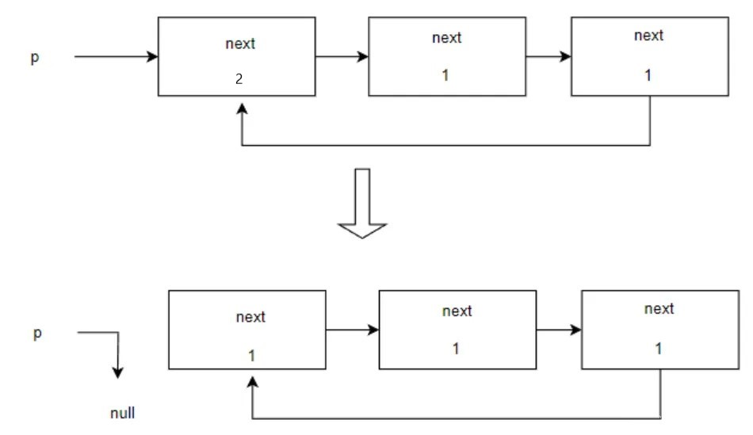

#### 偏向锁

- 对象头 Mark Word 记录线程 ID；
- 同一线程再次进入只需比较线程 ID，连 CAS 都省了；
- 适合「一直是同一个线程访问」的场景；
- JDK 15 起默认关闭。

#### 轻量级锁

- 偏向锁遇到竞争时升级为轻量级锁；
- 线程在自己的栈帧中创建 Lock Record，用 CAS 把对象头指向该记录；
- 失败后自旋等待（自适应自旋），不立即阻塞线程；
- 适合多线程交替执行、临界区很短的场景。

#### 重量级锁

- 自旋超过阈值仍未拿到锁，升级为重量级锁；
- 通过 `ObjectMonitor` 实现，未获取锁的线程进入 `_EntryList` 阻塞，由操作系统调度；
- 适合高竞争、临界区较长的场景。

#### 其他编译期优化

| 优化 | 说明 |
|------|------|
| 自适应自旋 | 根据上一次在同一锁上的自旋成功率动态调整自旋次数 |
| 锁消除 | JIT 通过逃逸分析发现锁对象不会逃逸出方法，直接消除加锁 |
| 锁粗化 | 连续多次对同一对象加解锁，JIT 合并为一次更大范围的锁 |

> 提示：锁升级、锁消除属于 JVM 实现细节，不同 JDK 版本（尤其是 JDK 15 之后偏向锁默认关闭）表现不同，回答时最好说明版本。

### 如何实现线程的同步

「同步」在这里指「协调多个线程对共享资源的访问」。常用手段有 7 种，按「是否阻塞」和「适用场景」区分：

| 方式 | 作用 | 说明 |
|------|------|------|
| `synchronized` | 互斥 + 可见性 | 最简单，自动释放 |
| `Lock`（`ReentrantLock`） | 互斥 + 可见性 | 可中断、可超时、可公平、多条件变量 |
| `volatile` | 可见性 + 有序性 | 不保证原子性，适合状态标志 |
| 原子类（`AtomicInteger` 等） | 无锁原子操作 | 基于 CAS，适合计数器 |
| 并发集合 | 容器级线程安全 | `ConcurrentHashMap`、`CopyOnWriteArrayList` |
| 同步工具 | 线程协作 | `CountDownLatch`、`CyclicBarrier`、`Semaphore` |
| `ThreadLocal` | 线程隔离 | 不共享，从根上避免竞争 |

```java
// 1. synchronized
synchronized (lock) { /* 临界区 */ }

// 2. ReentrantLock：注意 unlock 必须放 finally
lock.lock();
try { /* 临界区 */ } finally { lock.unlock(); }

// 3. volatile：状态标志
volatile boolean running = true;

// 4. 原子类
AtomicInteger count = new AtomicInteger(0);
count.incrementAndGet();

// 5. 并发集合
ConcurrentHashMap<String, Integer> map = new ConcurrentHashMap<>();
CopyOnWriteArrayList<String> list = new CopyOnWriteArrayList<>();

// 6. 信号量：限制同时访问的线程数
Semaphore semaphore = new Semaphore(3);
semaphore.acquire();
try { /* 最多 3 个线程同时进入 */ } finally { semaphore.release(); }

// 7. ThreadLocal：每个线程一份，互不干扰
ThreadLocal<SimpleDateFormat> tl =
        ThreadLocal.withInitial(() -> new SimpleDateFormat("yyyy-MM-dd"));
```

选择建议：能不用共享状态就不用（`ThreadLocal`、无状态设计）；必须共享时优先用现成的并发容器和原子类；需要多个条件协作时用 `Lock` + `Condition`；只在「一个线程等另一个线程完成」时用 `CountDownLatch`。

### 讲讲你对 ThreadLocal 的理解

**是什么**：`ThreadLocal` 提供「线程本地变量」——同一个 `ThreadLocal` 对象，在不同线程中 `get()` 到的是各自独立的值。

**为什么需要**：有些数据需要在整个调用链中传递（当前登录用户、traceId、事务连接），但又不适合作为参数层层传递；用共享变量加锁又太重。`ThreadLocal` 的思路是「不共享」，从根上消除竞争。

**怎么用**：

```java
ThreadLocal<String> threadLocal = new ThreadLocal<>();
threadLocal.set("value");            // 只对当前线程可见
String value = threadLocal.get();
threadLocal.remove();                // 用完清理，避免内存泄漏
```

#### 实现原理

每个 `Thread` 对象内部有一个 `ThreadLocalMap`，key 是 `ThreadLocal` 实例（弱引用），value 是实际的值：

```java
class Thread {
    ThreadLocal.ThreadLocalMap threadLocals;   // 每个线程独有
}

static class Entry extends WeakReference<ThreadLocal<?>> {
    Object value;
    Entry(ThreadLocal<?> k, Object v) { super(k); value = v; }
}
```

- `set(v)`：拿到当前线程的 `ThreadLocalMap`，以 `this`（当前 ThreadLocal）为 key 存入 v；
- `get()`：从当前线程的 map 里取 `this` 对应的 value；
- 因为每个线程操作自己的 map，天然线程安全，无需加锁。

#### 内存泄漏问题

```text
Thread → ThreadLocalMap → Entry(key = null(弱引用被回收), value = 大对象) → value 无法回收
```

key 是弱引用，`ThreadLocal` 对象被回收后 key 变成 null，但 value 仍被 Entry 强引用。如果线程长期存活（线程池），这些 value 就永远无法回收。

`ThreadLocalMap` 在 `get`/`set` 时会顺带清理 key 为 null 的 Entry，但**不保证一定清理到**。所以规范做法是：用完必须 `remove()`，尤其是在线程池环境下。

#### InheritableThreadLocal

普通 `ThreadLocal` 的值不能被子线程继承；`InheritableThreadLocal` 可以：

```java
InheritableThreadLocal<String> itl = new InheritableThreadLocal<>();
itl.set("parent");
new Thread(() -> System.out.println(itl.get())).start();   // 输出 parent
```

原理：创建子线程时，如果父线程的 `inheritableThreadLocals` 非空，会拷贝一份给子线程。注意这是**创建时拷贝**，之后父线程再改，子线程看不到；线程池中的线程是复用的，所以 `InheritableThreadLocal` 在线程池里往往不生效，需要配合 `TransmittableThreadLocal`（阿里开源）这类方案。

#### 应用场景

1. **用户上下文**：保存当前请求的登录用户，避免参数层层传递；
2. **数据库连接/事务**：同一线程绑定同一连接，保证事务内操作在同一连接上；
3. **`SimpleDateFormat`**：它非线程安全，用 `ThreadLocal` 给每个线程一份实例；
4. **MDC 日志链路追踪**：把 traceId 放进 MDC，日志框架自动输出；
5. **请求上下文**：保存 Request ID、租户 ID 等。

> 版本说明：JDK 8 提供了 `ThreadLocal.withInitial(Supplier)`，可以省去重写 `initialValue()`；`ThreadLocal` 本身自 JDK 1.2 就存在。

### ThreadLocal 有哪些应用场景

`ThreadLocal` 的本质是「用空间换隔离」，只要满足「每个线程需要独立副本」且「生命周期与线程/请求绑定」，就适合使用：

1. **用户上下文传递**：

```java
ThreadLocal<User> userHolder = new ThreadLocal<>();
userHolder.set(currentUser);
User user = userHolder.get();     // 任意层获取，无需传参
```

2. **数据库连接管理**：每个线程独占一个连接，事务内所有操作共用它，避免连接被其他线程抢走。
3. **`SimpleDateFormat` 线程安全**：

```java
ThreadLocal<SimpleDateFormat> formatHolder = ThreadLocal.withInitial(
        () -> new SimpleDateFormat("yyyy-MM-dd HH:mm:ss"));
```

4. **MDC 日志链路追踪**：把 traceId 放进 MDC，日志模板里直接引用。
5. **请求上下文**：保存 Request ID、租户 ID、灰度标记等。
6. **避免参数传递**：跨层调用时减少「穿透参数」。

> 共同前提：使用完必须 `remove()`。在 Web 容器/线程池中，线程是被复用的，不清理会导致「上一个请求的数据泄漏到下一个请求」，这既是内存泄漏，也是数据串号的隐患。

### 讲讲你对 CountDownLatch 的理解

**是什么**：`CountDownLatch` 是一个倒计数门闩：初始化时给定计数 N，`countDown()` 让计数减 1，`await()` 让当前线程阻塞直到计数归零。

**为什么需要**：主线程要等多个子任务全部完成后才能汇总，用 join 只能等单个线程，用轮询又浪费 CPU。

```java
CountDownLatch latch = new CountDownLatch(3);

for (int i = 0; i < 3; i++) {
    new Thread(() -> {
        try {
            doWork();
        } finally {
            latch.countDown();     // 放在 finally，保证异常也能减计数
        }
    }).start();
}

latch.await();                     // 阻塞直到 3 个线程都 countDown
System.out.println("all done");
```

#### 原理

基于 AQS（`AbstractQueuedSynchronizer`）的共享模式：`state` 就是计数，`await()` 在 `state != 0` 时入队阻塞，`countDown()` 用 CAS 递减，减到 0 时唤醒所有等待线程。

#### 应用场景

1. **主线程等待多个子线程完成**：并行计算后汇总结果；
2. **多个线程同时开始**：`new CountDownLatch(1)`，所有子线程先 `await()`，主线程 `countDown()` 后一起起跑（压测常用）；
3. **资源初始化等待**：等多个服务/连接就绪后再对外提供服务。

#### 与 CyclicBarrier 的区别

| 特性 | CountDownLatch | CyclicBarrier |
|------|----------------|---------------|
| 能否重用 | 不能，归零后失效 | 能，自动重置（也可 `reset()`） |
| 计数方式 | 减法（`countDown`） | 加法（`await` 到达） |
| 谁在等 | 调用 `await()` 的线程等计数归零 | 线程之间互相等待 |
| 回调 | 无 | 支持 `barrierAction` |
| 实现基础 | AQS 共享模式 | `ReentrantLock` + `Condition` |

### 讲讲你对 CyclicBarrier 的理解

`CyclicBarrier` 是「循环栅栏」：一组线程各自到达屏障后互相等待，直到所有线程都到达，才一起继续执行；并且可以重复使用。

```java
CyclicBarrier barrier = new CyclicBarrier(3, () -> {
    System.out.println("所有线程都已到达，进入下一阶段");
});

for (int i = 0; i < 3; i++) {
    new Thread(() -> {
        System.out.println(Thread.currentThread().getName() + " 到达");
        try {
            barrier.await();          // 等待其他线程
            System.out.println(Thread.currentThread().getName() + " 继续");
        } catch (Exception e) {
            Thread.currentThread().interrupt();
        }
    }).start();
}
```

#### 原理

内部用 `ReentrantLock` + `Condition`，维护 `count`（还需到达的线程数）和 `generation`（代，用于区分轮次）。最后一个到达的线程负责执行 `barrierAction`，然后 `signalAll` 唤醒其他线程并重置计数。

#### 与 CountDownLatch 的区别

| 特性 | CyclicBarrier | CountDownLatch |
|------|---------------|----------------|
| 可重用 | 可（自动重置/`reset`） | 不可 |
| 等待方式 | 线程互相等待 | 线程等待计数器归零 |
| 计数 | 加法（`await` 到达 N） | 减法（`countDown` 到 0） |
| 屏障动作 | 支持 `barrierAction` | 不支持 |
| 异常 | 超时/中断会抛 `BrokenBarrierException` | 无「破损」概念 |

#### 应用场景

1. **多线程分片计算后合并**：各线程算完自己那部分，到屏障后统一汇总；
2. **并发测试**：让所有线程在同一时刻开始压测；
3. **分阶段任务**：每一阶段所有线程完成后，才进入下一阶段。

### notify() 和 notifyAll() 有什么区别

两者都必须在持有该对象 monitor 的 `synchronized` 块中调用，用于唤醒在 `wait()` 上等待的线程：

| 特性 | `notify()` | `notifyAll()` |
|------|-----------|---------------|
| 唤醒数量 | 任意一个等待线程（由 JVM 选择，不保证公平） | 全部等待线程 |
| 风险 | 可能唤醒「条件不满足」的线程，导致有效线程继续等待（信号丢失） | 所有线程争抢锁，有一定开销 |
| 推荐 | 只有在「所有等待线程条件相同且只需一个继续」时才用 | 通常更安全，配合 `while` 循环使用 |

```java
synchronized (lock) {
    while (!condition) {      // 必须用 while，不能用 if
        lock.wait();
    }
    // 条件满足，执行操作
    lock.notifyAll();
}
```

三个必须记住的点：

1. `wait()` 会释放锁并进入等待，被唤醒后需要**重新竞争锁**；
2. 用 `while` 而不是 `if` 检查条件，防止「虚假唤醒」（spurious wakeup）和被唤醒后条件又变了；
3. `wait`/`notify`/`notifyAll` 必须在 `synchronized` 块内调用，否则抛 `IllegalMonitorStateException`。

## 十、JVM 与内存

入门阶段不需要读 HotSpot 源码，但有两个问题必须能答清楚：**内存为什么会不够**（OOM 的几种形态）和**对象什么时候能被回收**（可达性分析）。这两块也是排查线上问题的基础。

### OOM 类型

`OutOfMemoryError` 是 `Error` 的子类，表示 JVM 内存不足。但「内存不足」有很多种，异常信息里的后缀就是线索。

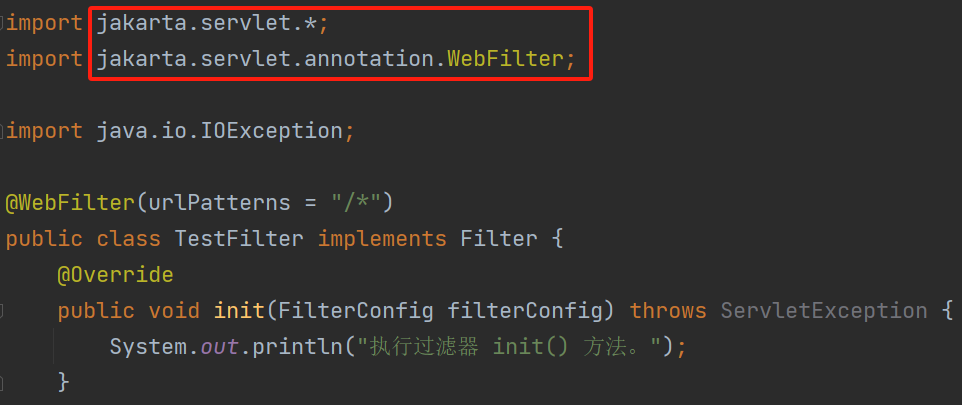

#### 1. 堆内存 OOM

```text
java.lang.OutOfMemoryError: Java heap space
```

原因：堆中对象占满且 GC 无法回收，常见于内存泄漏（集合只增不减、缓存无上限）或一次加载超大对象。

处理：先用 `-XX:+HeapDumpOnOutOfMemoryError` 导出堆快照，用 MAT 分析支配树；确认是泄漏就修代码，是容量不足再调大 `-Xmx`。

#### 2. 无法创建本地线程

```text
java.lang.OutOfMemoryError: unable to create new native thread
```

原因：线程数超过系统限制（`ulimit -u`、`/proc/sys/kernel/threads-max`），或每个线程栈太大（`-Xss`）导致本地内存耗尽。

处理：排查线程泄漏（线程池是否被无限制创建）、适当减小 `-Xss`、调整系统限制。

#### 3. 栈内存溢出

```text
java.lang.StackOverflowError
```

注意它是 `StackOverflowError` 而不是 `OutOfMemoryError`。原因：调用深度超过栈容量，典型是递归没有终止条件。

处理：检查递归的终止条件；确实需要深递归时改用迭代；调大 `-Xss` 只能缓解。

#### 4. 直接内存 OOM

```text
java.lang.OutOfMemoryError: Direct buffer memory
```

原因：NIO 的 `DirectByteBuffer` 分配的是堆外内存，不受 `-Xmx` 限制，但受 `-XX:MaxDirectMemorySize`（默认约等于最大堆）限制。

处理：检查 Netty/NIO 的缓冲区释放（`ByteBuf.release()`）、调大上限。

#### 5. GC 开销超限

```text
java.lang.OutOfMemoryError: GC overhead limit exceeded
```

原因：GC 花了大量时间却只回收了很少内存（HotSpot 默认阈值约为「98% 时间用于 GC，回收不到 2% 堆空间」），说明存活对象太多、回收几乎无收益。

处理：本质仍是内存不足或泄漏，先分析堆快照，再考虑扩容。该检查可通过 `-XX:-UseGCOverheadLimit` 关闭，但不建议作为解决方案。

#### 6. 元空间 OOM

```text
java.lang.OutOfMemoryError: Metaspace
```

原因：类元数据占用超过 `-XX:MaxMetaspaceSize`。常见于动态生成类过多（CGLIB 代理、Groovy 脚本、热部署反复加载类）或类加载器泄漏。

处理：调大上限只是缓解；根本要排查「类为什么一直被加载却不卸载」（类加载器是否被强引用）。

> 版本说明：JDK 8 起永久代（PermGen）被元空间（Metaspace）取代，元空间使用本地内存，默认不设上限（受机器内存限制）。所以 JDK 8+ 不会再看到 `PermGen space`，取而代之的是 `Metaspace`。

### 如何判断一个对象是否可以被回收

JVM 判断对象「已死」有两种思路，实际使用的是第二种。

#### 1. 引用计数法

每个对象维护一个计数器：被引用 +1，引用失效 -1，计数为 0 即可回收。

**优点**：实现简单、回收及时。

**缺点**：无法处理循环引用（A 引用 B、B 引用 A，两者计数都不为 0，但外部已无法访问）。Python、Objective-C 使用引用计数，但都需要额外机制（如分代/标记清除）来解决循环引用。

#### 2. 可达性分析（Java 采用）

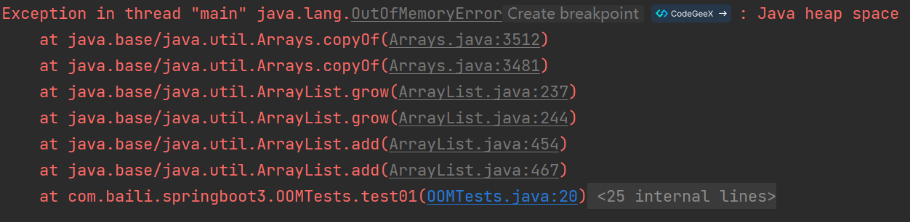

从一组称为 **GC Roots** 的根对象出发，沿引用链向下搜索，能被遍历到的对象是「存活」的，遍历不到的就是「不可达」，可以被回收。

```text
GC Roots → A → B → C
              ↘ D → E

F → G        （F 不是 GC Roots，F、G 均不可达，可回收）
```

**GC Roots 包括**：

- 虚拟机栈（栈帧中的局部变量表）引用的对象；
- 方法区中类静态属性引用的对象；
- 方法区中常量引用的对象（如字符串常量池里的引用）；
- 本地方法栈中 JNI（Native 方法）引用的对象；
- 被 `synchronized` 持有的对象（监视器锁住的對象）；
- JVM 内部引用（基本类型的 Class 对象、常驻异常对象、系统类加载器等）。

#### 3. 引用的分类

| 引用类型 | 回收时机 | 典型用途 |
|---------|---------|---------|
| 强引用（Strong） | 只要可达就永不回收，宁可 OOM | 普通对象引用 |
| 软引用（Soft） | 内存不足时回收 | 内存敏感的缓存 |
| 弱引用（Weak） | 下一次 GC 就回收 | `ThreadLocalMap` 的 key、`WeakHashMap` |
| 虚引用（Phantom） | 随时可能回收，`get()` 永远返回 null | 配合 `ReferenceQueue` 跟踪回收时机、管理堆外内存 |

```java
SoftReference<byte[]> soft = new SoftReference<>(new byte[1024 * 1024]);
WeakReference<Object> weak = new WeakReference<>(new Object());
```

#### 4. finalize 方法

对象被判定不可达后，如果它重写了 `finalize()` 且从未执行过，会被放入 F-Queue，由 Finalizer 线程调用；如果在 `finalize()` 中重新建立了到 GC Roots 的引用，对象可以「自救」。

**不推荐使用**：执行时机不确定、不保证执行、可能拖慢 GC（Finalizer 线程是单线程），而且异常会被吞掉。

> 版本说明：`Object.finalize()` 自 JDK 9 起被标记 `@Deprecated`，JDK 18 起标记为 for removal。需要清理资源时请用 `try-with-resources` 或 `Cleaner`。

## 十一、IO 与文件拷贝

IO 的核心区分是「字节流 vs 字符流」和「阻塞 IO（BIO）vs 非阻塞 IO（NIO）」。文件拷贝是最能体现这些差异的场景：同样是复制一个文件，写法不同，性能可能差一个数量级。

### Java 五种文件拷贝方式

#### 1. 传统字节流拷贝

```java
try (InputStream in = new FileInputStream(src);
     OutputStream out = new FileOutputStream(dst)) {
    byte[] buffer = new byte[8192];
    int len;
    while ((len = in.read(buffer)) != -1) {
        out.write(buffer, 0, len);
    }
}
```

特点：最基础、最通用。一定要用数组缓冲，逐字节 `read()` 会产生大量系统调用，慢得离谱。

#### 2. 缓冲流拷贝

```java
try (BufferedInputStream in = new BufferedInputStream(new FileInputStream(src));
     BufferedOutputStream out = new BufferedOutputStream(new FileOutputStream(dst))) {
    byte[] buffer = new byte[8192];
    int len;
    while ((len = in.read(buffer)) != -1) {
        out.write(buffer, 0, len);
    }
}
```

特点：`Buffered*Stream` 内部再包一层缓冲区，减少系统调用次数，比裸流快。注意：既然已经手动用了 8KB 数组，再加缓冲层的收益有限，主要收益在「小批量多次读写」的场景。

#### 3. NIO 的 Files.copy

```java
Files.copy(Paths.get(src), Paths.get(dst), StandardCopyOption.REPLACE_EXISTING);
```

特点：一行代码，JDK 7+ 提供。底层会尽量使用操作系统的原生拷贝能力（如 `copy_file_range`），是**日常最推荐**的方式。

#### 4. FileChannel 的 transferTo

```java
try (FileChannel in = FileChannel.open(Paths.get(src), StandardOpenOption.READ);
     FileChannel out = FileChannel.open(Paths.get(dst),
             StandardOpenOption.WRITE, StandardOpenOption.CREATE)) {
    long position = 0;
    long size = in.size();
    while (position < size) {
        position += in.transferTo(position, size - position, out);   // 可能一次传不完
    }
}
```

特点：`transferTo` 在支持的操作系统上可以走「零拷贝」（如 Linux 的 `sendfile`），数据不经过用户态缓冲区，大文件性能好。要注意循环调用，单次 `transferTo` 不保证传输完所有字节。

#### 5. MappedByteBuffer 内存映射

```java
try (FileChannel in = FileChannel.open(Paths.get(src), StandardOpenOption.READ);
     FileChannel out = FileChannel.open(Paths.get(dst),
             StandardOpenOption.WRITE, StandardOpenOption.CREATE)) {
    MappedByteBuffer mapped = in.map(FileChannel.MapMode.READ_ONLY, 0, in.size());
    out.write(mapped);
}
```

特点：把文件映射到进程的虚拟地址空间，读写像访问内存一样，适合大文件的随机访问。缺点是内存映射的释放依赖 GC（`Unmap` 不保证立即发生），超大文件可能触发缺页中断或占用过多虚拟内存。

#### 性能对比

| 方式 | 小文件 | 大文件 | 代码复杂度 | 推荐场景 |
|------|--------|--------|-----------|---------|
| 传统流 | 慢（无缓冲时） | 慢 | 中 | 教学、特殊流处理 |
| 缓冲流 | 中 | 中 | 中 | 需要边读边处理 |
| `Files.copy` | 快 | 快 | 低 | 默认首选 |
| `FileChannel.transferTo` | 快 | 最快（零拷贝） | 中 | 大文件、追求吞吐 |
| `MappedByteBuffer` | 快 | 快 | 高 | 大文件随机读写 |

> 说明：表中「快/慢」是相对定性描述，实际性能受操作系统、文件系统、磁盘类型、缓冲区大小影响，不要当作固定倍数。要做压测请在自己的目标环境实测。

## 十二、设计模式

设计模式（design pattern）是针对「反复出现的设计问题」的可复用解法，它不是可以照抄的代码，而是一套命名和协作约定。本章先给分类地图，再讲原则与两个高频对比（工厂方法 vs 抽象工厂、懒汉 vs 饿汉）。

### 设计模式是如何分类的

按《设计模式》（GoF）的划分，23 种模式分为三大类：

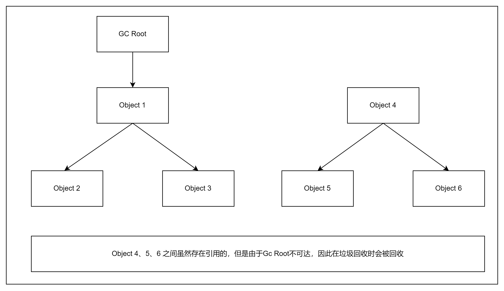

#### 创建型（5 种）

关注「对象怎么创建」，把创建与使用解耦。

| 模式 | 一句话说明 |
|------|-----------|
| 单例（Singleton） | 保证全局唯一实例 |
| 工厂方法（Factory Method） | 定义创建接口，由子类决定实例化哪个类 |
| 抽象工厂（Abstract Factory） | 创建一系列相关对象（产品族） |
| 建造者（Builder） | 分步构建复杂对象 |
| 原型（Prototype） | 通过克隆已有对象来创建新对象 |

#### 结构型（7 种）

关注「类和对象怎么组合成更大的结构」。

| 模式 | 一句话说明 |
|------|-----------|
| 适配器（Adapter） | 转换接口，让不兼容的类能合作 |
| 装饰器（Decorator） | 动态给对象添加职责 |
| 代理（Proxy） | 控制对对象的访问 |
| 外观（Facade） | 为子系统提供统一入口 |
| 桥接（Bridge） | 分离抽象部分与实现部分 |
| 组合（Composite） | 用树形结构表示「整体-部分」 |
| 享元（Flyweight） | 共享细粒度对象，节省内存 |

#### 行为型（11 种）

关注「对象之间怎么通信、职责怎么分配」。

| 模式 | 一句话说明 |
|------|-----------|
| 策略（Strategy） | 封装可互换的算法 |
| 模板方法（Template Method） | 定义算法骨架，部分步骤交给子类 |
| 观察者（Observer） | 一对多依赖，状态变化时通知 |
| 责任链（Chain of Responsibility） | 请求沿链传递，直到被处理 |
| 命令（Command） | 把请求封装成对象 |
| 状态（State） | 状态变化驱动行为变化 |
| 迭代器（Iterator） | 顺序访问聚合对象元素 |
| 中介者（Mediator） | 集中管理对象间的交互 |
| 备忘录（Memento） | 保存与恢复对象状态 |
| 访问者（Visitor） | 分离数据结构与操作 |
| 解释器（Interpreter） | 定义语言的文法并解释句子 |

> 记忆技巧：创建型管「生」，结构型管「拼」，行为型管「动」。

### 说说你对设计模式的理解

设计模式是对「在特定场景下反复出现的设计问题」的**可复用解决方案**。它描述的是类与对象之间的关系和职责分配，而不是某段具体代码。

它的价值在于：提供一套共同词汇（说「这里用策略模式」比解释半天更快）、降低沟通成本、避免重复踩坑。但滥用设计模式会让代码过度抽象，所以判断标准始终是「是否解决了当下的实际问题」。

#### 六大设计原则

| 原则 | 含义 |
|------|------|
| 单一职责（SRP） | 一个类只承担一个职责，只有一个变化的理由 |
| 开闭（OCP） | 对扩展开放，对修改关闭 |
| 里氏替换（LSP） | 子类对象必须能替换父类对象而不破坏程序 |
| 接口隔离（ISP） | 客户端不应被迫依赖它不需要的方法 |
| 依赖倒置（DIP） | 高层模块依赖抽象，不依赖具体实现 |
| 迪米特法则（LoD） | 最少知识原则，只与「直接朋友」通信 |

#### 实际应用

| 模式 | 应用场景 | 框架实例 |
|------|---------|---------|
| 单例 | 全局唯一对象 | Spring Bean（默认单例）、`Runtime` |
| 工厂 | 创建逻辑解耦 | `BeanFactory`、`Calendar.getInstance` |
| 代理 | AOP、远程调用 | Spring AOP、MyBatis Mapper 代理 |
| 观察者 | 事件通知 | Spring `ApplicationEvent` |
| 模板方法 | 固定流程、可变步骤 | `JdbcTemplate`、`RestTemplate` |
| 策略 | 算法可切换 | Spring 的 `Resource` 加载策略 |
| 装饰器 | 功能增强 | Java IO 的 `BufferedInputStream` |
| 责任链 | 请求链式处理 | Spring `FilterChain`、Netty `Pipeline` |

### 抽象工厂和工厂方法模式的区别

| 特性 | 工厂方法 | 抽象工厂 |
|------|---------|---------|
| 产品粒度 | 单一产品 | 产品族（多个相关产品） |
| 方法数量 | 一个工厂方法创建一个产品 | 多个工厂方法创建多个产品 |
| 扩展方向 | 新增产品 → 新增工厂类，不改旧代码 | 新增产品 → 需要修改抽象工厂接口，所有实现类都受影响 |
| 语义 | 「创建一种产品」 | 「创建一族配套产品」 |

```java
// 工厂方法：每个产品对应一个工厂
interface ButtonFactory { Button createButton(); }

class WindowsButtonFactory implements ButtonFactory {
    public Button createButton() { return new WindowsButton(); }
}

// 抽象工厂：一个工厂创建一族产品（按钮 + 文本框 + 复选框）
interface UIFactory {
    Button createButton();
    TextField createTextField();
    Checkbox createCheckbox();
}

class WindowsUIFactory implements UIFactory {
    public Button createButton() { return new WindowsButton(); }
    public TextField createTextField() { return new WindowsTextField(); }
    public Checkbox createCheckbox() { return new WindowsCheckbox(); }
}
```

选择标准：如果产品是「单个维度」的，用工厂方法；如果必须保证一组产品「风格一致、配套使用」（如换主题时整套控件一起换），用抽象工厂。

### 说说你对懒汉模式和饿汉模式的理解

两者都是单例（Singleton）的实现方式，区别在于**实例什么时候创建**。单例的目标是「一个类只有一个实例，并提供全局访问点」。

#### 饿汉模式

类加载时就创建实例：

```java
public class Singleton {
    private static final Singleton INSTANCE = new Singleton();
    private Singleton() {}
    public static Singleton getInstance() { return INSTANCE; }
}
```

优点：实现简单，由 JVM 类加载机制保证线程安全。
缺点：类一加载就创建，即使从未使用也占用资源；构造过程耗时或依赖外部配置时尤其不合适。

#### 懒汉模式

第一次使用时才创建：

```java
// 线程不安全版：多线程可能创建多个实例
public class Singleton {
    private static Singleton instance;
    private Singleton() {}
    public static Singleton getInstance() {
        if (instance == null) instance = new Singleton();
        return instance;
    }
}

// 双重检查锁（DCL）：既延迟又线程安全
public class Singleton {
    private static volatile Singleton instance;
    private Singleton() {}
    public static Singleton getInstance() {
        if (instance == null) {
            synchronized (Singleton.class) {
                if (instance == null) instance = new Singleton();
            }
        }
        return instance;
    }
}
```

**为什么必须加 `volatile`**：`new Singleton()` 不是原子操作，它包含「分配内存 → 初始化对象 → 把引用赋给变量」三步。如果发生指令重排序（1→3→2），另一个线程可能在外层判断时看到一个「非 null 但尚未初始化完成」的引用，从而拿到半成品对象。`volatile` 禁止这种重排序。

#### 两种更推荐的写法

```java
// 静态内部类：延迟加载 + 线程安全（利用类加载机制在首次访问时初始化）
public class Singleton {
    private Singleton() {}
    private static class Holder {
        static final Singleton INSTANCE = new Singleton();
    }
    public static Singleton getInstance() { return Holder.INSTANCE; }
}

// 枚举：最简洁，天然线程安全，且能防反射、防反序列化破坏单例
public enum Singleton {
    INSTANCE;
}
```

> 补充：`Holder` 方式之所以线程安全，是因为 JVM 保证类的初始化是串行且只执行一次；枚举方式之所以能防反射，是因为 `Constructor.newInstance()` 对枚举类型会直接抛 `IllegalArgumentException`（`Enum` 的构造器不允许反射调用）。

## 十三、框架机制与工程实践

框架之所以「看起来像魔法」，靠的是几个固定套路：SPI 做扩展点、拦截器/过滤器做横切处理、注解 + 反射做声明式配置。本章把这三类机制放在一起，帮助你在读框架源码时找到入口。

### Java、Spring、Dubbo 三者的 SPI 机制对比

SPI（Service Provider Interface，服务提供者接口）是一种「接口由框架定义、实现由第三方提供、运行时自动发现」的扩展机制。

#### Java SPI

**使用步骤**：

1. 定义接口；
2. 在 classpath 的 `META-INF/services/` 下创建文件，文件名为接口全限定名，内容为实现类全限定名（一行一个）；
3. 用 `ServiceLoader` 加载。

```java
public interface Serialization {
    byte[] serialize(Object obj);
}

// 文件：META-INF/services/com.example.Serialization
// 内容：
// com.example.JsonSerialization
// com.example.XmlSerialization

ServiceLoader<Serialization> loader = ServiceLoader.load(Serialization.class);
for (Serialization s : loader) {
    byte[] data = s.serialize(obj);
}
```

**特点与缺点**：实现简单、零依赖；但会一次性实例化所有实现，无法按名获取单个实现，也不支持注入和包装。

> 说明：JDBC 驱动、SLF4J 绑定、Servlet 容器初始化都用到了 Java SPI。

#### Spring SPI

Spring 的 `spring.factories` 是「一个文件描述多个接口的实现」的机制，格式是 properties：

```properties
# META-INF/spring.factories
com.example.MyInterface=com.example.Impl1,com.example.Impl2
```

```java
List<MyInterface> impls = SpringFactoriesLoader.loadFactories(MyInterface.class, classLoader);
```

Spring Boot 的自动配置大量依赖它：`EnableAutoConfiguration` 这个 key 对应一长串自动配置类，启动时被批量加载。

> 版本说明：Spring Boot 2.7 起引入 `META-INF/spring/org.springframework.boot.autoconfigure.AutoConfiguration.imports` 作为自动配置的新入口，Spring Boot 3.x 已不再使用 `spring.factories` 注册自动配置（但 `SpringFactoriesLoader` 本身仍存在）。

#### Dubbo SPI

Dubbo 在 Java SPI 基础上做了增强，配置文件放在 `META-INF/dubbo/`（也兼容 `META-INF/dubbo/internal/`、`META-INF/services/`），内容为 `key=实现类`：

```properties
# META-INF/dubbo/com.example.Serialization
json=com.example.JsonSerialization
xml=com.example.XmlSerialization
```

```java
ExtensionLoader<Serialization> loader = ExtensionLoader.getExtensionLoader(Serialization.class);
Serialization json = loader.getExtension("json");          // 按 key 懒加载
Serialization adaptive = loader.getAdaptiveExtension();    // 自适应扩展
```

**Dubbo SPI 的特性**：

| 特性 | 说明 |
|------|------|
| 按需加载 | 通过 key 获取，用到才实例化 |
| IOC | 扩展类中的 setter 可以自动注入其他扩展（`ExtensionFactory`） |
| AOP | 构造器参数为同类型的类会被当作 Wrapper 自动包装 |
| 自适应扩展 | `@Adaptive` 标注的类/方法在运行时根据 URL 参数选择实现 |

#### 三者对比

| 特性 | Java SPI | Spring SPI | Dubbo SPI |
|------|----------|------------|-----------|
| 配置文件 | `META-INF/services/接口全名` | `META-INF/spring.factories` | `META-INF/dubbo/接口全名` |
| 文件格式 | 一行一个实现类 | `key=impl1,impl2` | `name=实现类` |
| 加载方式 | 全部加载 | 全部加载 | 按 key 懒加载 |
| 获取单个实现 | 不支持 | 不支持 | 支持 |
| IOC / AOP | 不支持 | 不支持 | 支持 |
| 自适应扩展 | 不支持 | 不支持 | 支持 |

### 过滤器和拦截器有什么区别

两者都能在请求前后插入逻辑，但处在不同的规范层。

#### Filter（过滤器）

属于 **Servlet 规范**，由 Servlet 容器（Tomcat）调用，能拿到原始的 `ServletRequest`/`ServletResponse`：

```java
public class MyFilter implements Filter {
    @Override
    public void doFilter(ServletRequest request, ServletResponse response,
                         FilterChain chain) throws IOException, ServletException {
        // 前置处理
        chain.doFilter(request, response);   // 放行到下一个 Filter 或 Servlet
        // 后置处理
    }
}
```

#### Interceptor（拦截器）

属于 **Spring MVC**，由 `DispatcherServlet` 在调用 Controller 方法前后回调，能拿到 Handler 信息（哪个 Controller、哪个方法）：

```java
public class MyInterceptor implements HandlerInterceptor {
    @Override
    public boolean preHandle(HttpServletRequest request, HttpServletResponse response,
                             Object handler) {
        return true;   // 返回 false 则中断请求
    }

    @Override
    public void postHandle(HttpServletRequest request, HttpServletResponse response,
                           Object handler, ModelAndView modelAndView) { }

    @Override
    public void afterCompletion(HttpServletRequest request, HttpServletResponse response,
                                Object handler, Exception ex) { }
}
```

> 需要澄清一个常见说法：拦截器**并不是**「基于 Java 反射/AOP」实现的。它就是 Spring MVC 内部的一组回调接口，`DispatcherServlet` 按顺序调用 `preHandle`、`postHandle`、`afterCompletion`。它之所以能拿到 `handler`，是因为请求已经被 `HandlerMapping` 解析过。真正基于动态代理的是 AOP，两者不是一回事。

#### 主要区别

| 特性 | Filter | Interceptor |
|------|--------|-------------|
| 所属规范 | Servlet 规范 | Spring MVC |
| 管理者 | Servlet 容器 | `DispatcherServlet` |
| 实现方式 | 责任链回调 | 框架回调（`HandlerInterceptor`） |
| 执行顺序 | 请求时 Filter 先于 Interceptor | 响应时 Interceptor 先于 Filter |
| 拦截范围 | 所有请求（含静态资源，可配置） | 仅进入 DispatcherServlet 的请求 |
| 能否拿到 Bean | 默认不能（可借助容器） | 能（本身是 Spring Bean） |
| 典型用途 | 编码、跨域、请求日志、鉴权 | 权限校验、参数预处理、统一响应 |

#### 执行顺序

```text
请求 → Filter1 → Filter2 → Interceptor1.preHandle → Interceptor2.preHandle → Controller
     ← Filter1 ← Filter2 ← Interceptor1.postHandle ← Interceptor2.postHandle
     ← Filter1 ← Filter2 ← Interceptor1.afterCompletion ← Interceptor2.afterCompletion （逆序）
```

需要注意 `postHandle` 与 `afterCompletion` 的顺序是**逆序**的（栈式），且 `preHandle` 返回 false 时，只会触发已成功执行过 `preHandle` 的那些拦截器的 `afterCompletion`。

### 程序员必懂的权限模型：RBAC

RBAC（Role-Based Access Control，基于角色的访问控制）的核心思想是：**不直接把权限授予用户，而是授予角色，再把角色授予用户**。这样人员变动时只需调整角色关系。

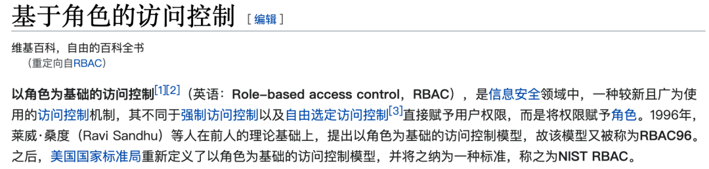

#### RBAC0：基础模型

```text
用户(User) → 角色(Role) → 权限(Permission) → 资源(Resource)
```

最简实现就是三张关联表：

```sql
CREATE TABLE user_role (
    user_id BIGINT NOT NULL,
    role_id BIGINT NOT NULL
);

CREATE TABLE role_permission (
    role_id BIGINT NOT NULL,
    permission_id BIGINT NOT NULL
);

CREATE TABLE permission (
    id BIGINT PRIMARY KEY,
    name VARCHAR(64),
    resource VARCHAR(128),
    action VARCHAR(32)
);
```

#### RBAC1：角色继承

角色之间可以有层级，子角色继承父角色的权限：

```text
管理员 → 编辑 → 普通用户
```

实现上给 `role` 表加 `parent_id`，查询权限时向上递归（或用闭包表、路径枚举优化）。

#### RBAC2：角色约束

在 RBAC0 基础上增加约束规则：

| 约束 | 说明 |
|------|------|
| 互斥角色 | 同一用户不能同时拥有互斥角色（如「申请人」与「审批人」，防止自审） |
| 基数约束 | 一个角色最多分配给 N 个用户 |
| 先决条件 | 拥有角色 A 前必须先拥有角色 B |

#### RBAC3：RBAC1 + RBAC2

同时支持角色继承与约束，是理论上最完整的 RBAC 模型。

#### 用户组与权限组

实际系统常再加两层，降低授权维护成本：

```text
用户组(UserGroup) → 用户(User)
权限组(PermissionGroup) → 权限(Permission)
用户组(UserGroup) → 角色(Role)
角色(Role) → 权限组(PermissionGroup)
```

#### 功能权限与数据权限

| 类型 | 控制内容 | 示例 |
|------|---------|------|
| 功能权限 | 能否访问某个菜单/按钮/接口 | 没有「删除用户」权限则按钮不显示、接口返回 403 |
| 数据权限 | 能看到哪些数据 | 销售只能看自己名下的订单 |

数据权限的三种实现：

1. **行级过滤**：在 SQL 上追加 `WHERE dept_id = ?`（MyBatis 拦截器常用）；
2. **列级过滤**：对敏感字段脱敏或直接不返回；
3. **基于规则**：配置「本人 / 本部门 / 本部门及下级 / 全部」等数据范围规则。

#### 其他权限模型

| 模型 | 说明 | 典型场景 |
|------|------|---------|
| ACL（访问控制列表） | 直接维护「主体 → 资源」的许可列表 | 文件系统 |
| DAC（自主访问控制） | 资源所有者自行决定谁能访问 | Linux 文件权限 |
| MAC（强制访问控制） | 系统按安全等级统一管控，用户不能自主授权 | 军事、政务 |
| ABAC（基于属性的访问控制） | 根据主体、资源、环境属性动态计算 | 规则复杂的业务系统 |

## 十四、缓存与分布式基础

缓存解决「读得太慢/太贵」的问题，分布式解决「一台机器扛不住」的问题。两者都会引入新的取舍：缓存要决定「满了淘汰谁」，分布式要决定「一致性和可用性选哪个」。

### 缓存淘汰机制 LRU 和 LFU 的区别

缓存容量有限，满了必须淘汰一些数据。选谁淘汰，就是淘汰策略。

#### LRU（Least Recently Used，最近最少使用）

淘汰「最久没有被访问」的数据，依据是**访问时间**。

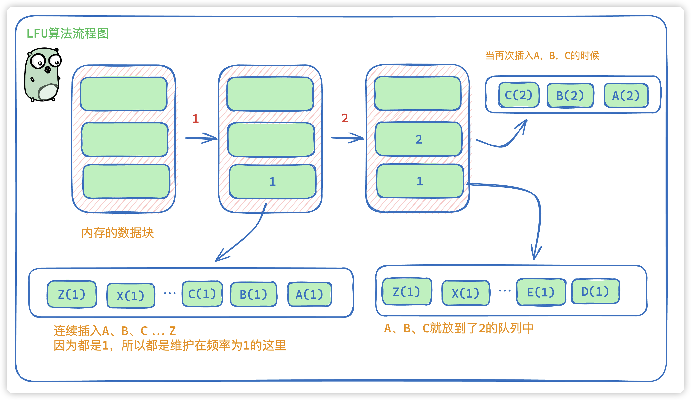

```java
public class LRUCache<K, V> extends LinkedHashMap<K, V> {
    private final int capacity;

    public LRUCache(int capacity) {
        super(capacity, 0.75f, true);   // accessOrder = true，按访问顺序排序
        this.capacity = capacity;
    }

    @Override
    protected boolean removeEldestEntry(Map.Entry<K, V> eldest) {
        return size() > capacity;       // 超过容量时淘汰最久未访问的
    }
}
```

#### LFU（Least Frequently Used，最不经常使用）

淘汰「访问次数最少」的数据，依据是**访问频率**。

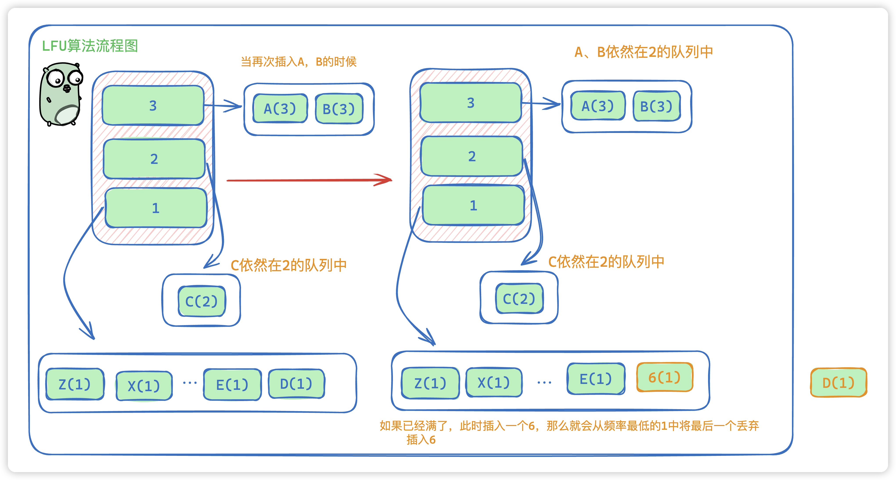

```java
public class LFUCache<K, V> {
    private final int capacity;
    private final Map<K, V> cache = new HashMap<>();
    private final Map<K, Integer> freq = new HashMap<>();
    private final Map<Integer, LinkedHashSet<K>> freqList = new HashMap<>();
    private int minFreq = 0;

    public V get(K key) {
        if (!cache.containsKey(key)) return null;
        increaseFreq(key);
        return cache.get(key);
    }

    public void put(K key, V value) {
        if (cache.containsKey(key)) {
            cache.put(key, value);
            increaseFreq(key);
            return;
        }
        if (cache.size() >= capacity) evict();
        cache.put(key, value);
        freq.put(key, 1);
        freqList.computeIfAbsent(1, k -> new LinkedHashSet<>()).add(key);
        minFreq = 1;
    }

    private void increaseFreq(K key) {
        int f = freq.get(key);
        freq.put(key, f + 1);
        freqList.get(f).remove(key);
        if (freqList.get(f).isEmpty()) {
            freqList.remove(f);
            if (minFreq == f) minFreq++;
        }
        freqList.computeIfAbsent(f + 1, k -> new LinkedHashSet<>()).add(key);
    }

    private void evict() {
        K evictKey = freqList.get(minFreq).iterator().next();
        freqList.get(minFreq).remove(evictKey);
        cache.remove(evictKey);
        freq.remove(evictKey);
    }
}
```

#### 对比

| 特性 | LRU | LFU |
|------|-----|-----|
| 淘汰依据 | 最后访问时间 | 累计访问次数 |
| 优势 | 能快速反映「当前热点」 | 能保护「长期热点」，不受偶发访问影响 |
| 劣势 | 一次全表扫描可能把热点全部挤掉 | 旧热点频率只增不减，难以淘汰（需要衰减机制） |
| 实现 | `LinkedHashMap` 或 双向链表 + `HashMap` | 双 `HashMap` + 频率链表（或小顶堆） |
| 适用 | 通用缓存、页面置换 | 热点相对稳定的场景 |

#### 电商场景怎么选

- **商品详情缓存**：LRU。热点商品频繁访问会被保留，冷门商品自然淘汰；
- **搜索热词缓存**：LFU。避免偶发热词把长期热词挤掉；
- **混合策略**：LRU-K（参考最近 K 次访问时间）、W-TinyLFU（Caffeine 采用，兼顾频率与新鲜度）。

> 说明：Redis 提供的 `allkeys-lru`、`volatile-lru`、`allkeys-lfu`、`volatile-lfu` 是近似实现（采样 + 淘汰），不是严格意义的全局 LRU/LFU，这是为了控制内存和 CPU 开销。

### CAP 定理与 BASE 理论

CAP 是分布式系统的基本取舍：**一致性**（Consistency）、**可用性**（Availability）、**分区容错性**（Partition tolerance）三者最多同时满足两个。

| 要素 | 含义 |
|------|------|
| 一致性 C | 所有节点在同一时刻看到相同的数据（线性一致性） |
| 可用性 A | 每个请求都能在有限时间内得到非错误响应（不保证是最新数据） |
| 分区容错 P | 网络分区（节点之间失联）时系统仍能继续运行 |

关键结论：**网络分区在分布式系统中不可避免**，所以 P 必须保留，真正的选择是「分区发生时选 C 还是选 A」。

| 选择 | 特点 | 典型系统 |
|------|------|---------|
| CP | 分区时拒绝部分请求，保证一致性 | ZooKeeper、etcd、HBase |
| AP | 分区时继续服务，接受暂时不一致 | Cassandra、Eureka、DynamoDB |
| CA | 单机系统（不存在分区问题） | 单机关系型数据库 |

> 常见误区：CAP 讨论的是「分区发生期间」的取舍，不是「永远只能选两个」。系统在正常运行时可以同时提供一致性和可用性。

#### BASE 理论

BASE 是对 AP 路线的工程化延伸，用于指导最终一致性系统的设计：

| 要素 | 含义 |
|------|------|
| Basically Available（基本可用） | 允许损失部分可用性：降级、限流、延迟响应 |
| Soft State（软状态） | 允许存在中间状态（如「支付中」），不要求时刻一致 |
| Eventually Consistent（最终一致） | 经过一段时间后，所有副本达到一致 |

### 有限内存如何读取超限数据并统计数字重复次数

**问题**：内存 1 GB，文件 100 GB，每行一个数字，统计每个数字出现的次数。核心矛盾是「数据量 > 内存」，解法都是「分而治之」或「用近似结构换空间」。

#### 方案一：分治 + 外排序（通用解）

1. **分片**：顺序读文件，按 `hash(数字) % N` 把数字写到 N 个小文件。同一数字一定落到同一个分片，且每个分片能装进内存；
2. **统计**：对每个分片单独用 `HashMap` 计数；
3. **合并**：不同分片之间不会有相同数字，直接汇总结果即可。

```java
// 分片：按 hash 取模，保证相同数字进入同一分片
List<BufferedWriter> writers = createWriters(100);
try (BufferedReader reader = new BufferedReader(new FileReader(bigFile))) {
    String line;
    while ((line = reader.readLine()) != null) {
        long num = Long.parseLong(line);
        int shard = (int) Math.floorMod(num, 100);
        writers.get(shard).write(num + "\n");
    }
}

// 统计单个分片
Map<Long, Long> countMap = new HashMap<>();
Files.lines(shardFile).forEach(line -> {
    long num = Long.parseLong(line);
    countMap.merge(num, 1L, Long::sum);
});
```

> 注意：用 `num % 100` 对负数会得到负下标，`Math.floorMod` 可以避免数组越界。

#### 方案二：位图（BitMap，适合范围已知且密集）

如果数字范围不大（如 0 ~ 1 亿），用位图只记录「是否出现」，空间是 `范围 / 8` 字节；需要计数时用 `int[]` 或 `long[]` 数组：

```java
BitSet bitSet = new BitSet();   // 1 亿位约 12 MB
bitSet.set(num);                // 存在性统计
boolean exists = bitSet.get(num);

int[] count = new int[MAX_VALUE + 1];   // 计数需要每格 4 字节
count[num]++;
```

#### 方案三：Bloom Filter + 外部存储（只判断「是否出现过」）

Bloom Filter（布隆过滤器）用多个哈希函数把元素映射到位数组，空间极小，但有**假阳性**（可能误判「存在」，不会误判「不存在」），且不支持删除和精确计数：

```java
BloomFilter<Long> filter = BloomFilter.create(Funnels.longFunnel(), expectedInsertions);
filter.put(num);
boolean maybe = filter.mightContain(num);   // 可能存在，需要回源确认
```

| 方案 | 精度 | 空间 | 适用 |
|------|------|------|------|
| 分治 + HashMap | 精确 | 需要磁盘暂存 | 通用，最稳妥 |
| 位图/计数数组 | 精确 | 与取值范围成正比 | 范围小且密集 |
| Bloom Filter | 有假阳性 | 极小 | 只需「是否出现过」 |

## 十五、常见面试题速览（跨领域）

这一章把 Java 之外、但经常和 Java 一起被问到的题目集中列出，适合面试前快速过一遍。每一条都只给结论和关键点，深入内容请回到对应专题。

### 1. 说说你对 Java 异常体系的理解

`Throwable` 分两支：`Error`（系统级错误，不应捕获）和 `Exception`。`Exception` 又分受检异常（编译期强制处理，如 `IOException`）和非受检异常（`RuntimeException` 及其子类，编译器不强制处理）。处理手段是 `try-catch-finally`，JDK 7+ 可用 try-with-resources 自动关闭资源、multi-catch 合并分支。

### 2. HashMap 的 put 流程

计算扰动 hash → `(n-1) & hash` 定位桶 → 空桶直接插入 → 非空则比较首节点 → 树节点走红黑树 → 否则遍历链表尾插 → 链表长度 ≥ 8 且容量 ≥ 64 时树化 → `size > threshold` 时扩容为 2 倍。

### 3. ConcurrentHashMap 如何保证线程安全

- **JDK 7**：Segment 分段锁，默认 16 段，每段一把锁，并发度等于段数；
- **JDK 8**：取消 Segment，改为「CAS 插入空桶 + `synchronized` 锁桶头节点」，并发粒度细到单个桶，并用 `baseCount + CounterCell` 分散计数。

```java
// JDK 8 put 的关键分支（简化）
if ((f = tabAt(tab, i = (n - 1) & hash)) == null) {
    if (casTabAt(tab, i, null, new Node<>(hash, key, value, null))) { /* 成功 */ }
} else {
    synchronized (f) {
        // 链表或红黑树插入
    }
}
```

### 4. ThreadLocal 原理

每个 `Thread` 持有 `ThreadLocalMap`，key 是 `ThreadLocal` 的弱引用，value 是强引用。`get/set` 操作的都是当前线程自己的 map，因此天然隔离。key 被回收后 value 仍被引用，线程池场景下必须 `remove()`。

### 5. volatile 的作用

- **可见性**：写操作立即刷回主内存并使其他 CPU 缓存行失效，读操作从主内存读取；
- **有序性**：通过内存屏障禁止指令重排序；
- **不保证原子性**：`i++` 是「读-改-写」三步，仍会丢失更新，需要 `AtomicInteger` 或加锁。

```java
volatile boolean flag = true;

// 线程 A
flag = false;
// 线程 B
while (flag) { ... }   // 能及时看到变化
```

内存屏障的准确说法（JSR-133 内存模型）：volatile 写之前插入 StoreStore、写之后插入 StoreLoad；volatile 读之后插入 LoadLoad 和 LoadStore。不必死记指令名，但要记住「它解决的是可见性和重排序，不解决复合操作的原子性」。

### 6. synchronized 和 Lock 的区别

| 特性 | synchronized | Lock（ReentrantLock） |
|------|--------------|----------------------|
| 层次 | JVM 关键字（`monitorenter`/`monitorexit`） | Java API（基于 AQS） |
| 释放 | 自动释放（异常也会释放） | 必须 `finally` 中 `unlock()` |
| 可中断 | 不支持 | `lockInterruptibly()` 支持 |
| 公平性 | 非公平 | 可选公平/非公平 |
| 条件变量 | 一个（`wait`/`notify`） | 多个 `Condition` |
| 尝试获取 | 不支持 | `tryLock()` / `tryLock(timeout)` |
| 性能 | JDK 6 优化后与 Lock 接近 | 功能更灵活，开销略高 |

### 7. AQS 原理

AQS（`AbstractQueuedSynchronizer`）是 `ReentrantLock`、`CountDownLatch`、`Semaphore` 等同步器的骨架：

- `state`：`volatile int`，表示同步状态（重入次数、剩余许可、计数等）；
- CLH 变体队列：双向链表，存放等待的线程节点；
- 独占模式：`ReentrantLock`、`ReadWriteLock` 的写锁；
- 共享模式：`CountDownLatch`、`Semaphore`、`CyclicBarrier`（内部用 `ReentrantLock`）。

```java
public final void acquire(int arg) {
    if (!tryAcquire(arg) &&
        acquireQueued(addWaiter(Node.EXCLUSIVE), arg))
        selfInterrupt();
}
```

获取失败则封装为 Node 入队并 `park` 阻塞；前驱释放锁时 `unpark` 后继节点。

### 8. 线程池核心参数

```java
new ThreadPoolExecutor(
    corePoolSize,      // 核心线程数
    maximumPoolSize,   // 最大线程数
    keepAliveTime,     // 非核心线程空闲存活时间
    unit,              // 时间单位
    workQueue,         // 任务队列
    threadFactory,     // 线程工厂（命名、是否守护）
    handler            // 拒绝策略
);
```

执行流程：核心线程未满 → 新建核心线程；核心线程已满 → 入队；队列已满且线程数 < 最大线程数 → 新建非核心线程；队列满且已达最大线程数 → 执行拒绝策略。

| 拒绝策略 | 行为 |
|---------|------|
| `AbortPolicy`（默认） | 抛 `RejectedExecutionException` |
| `CallerRunsPolicy` | 由提交任务的线程自己执行（天然限流） |
| `DiscardPolicy` | 静默丢弃 |
| `DiscardOldestPolicy` | 丢弃队列中最旧的任务再重试 |

> 实践提醒：`Executors.newFixedThreadPool` 使用无界队列，任务堆积时可能 OOM；`newCachedThreadPool` 最大线程数为 `Integer.MAX_VALUE`，可能创建过多线程。生产环境建议手动 `new ThreadPoolExecutor` 并指定有界队列。

### 9. GC Roots 有哪些

虚拟机栈中局部变量引用的对象、方法区中静态属性引用的对象、方法区中常量引用的对象、本地方法栈中 JNI 引用的对象、被 `synchronized` 持有的对象，以及 JVM 内部引用（基本类型对应的 Class 对象、常驻异常对象、系统类加载器等）。

### 10. CMS 和 G1 的区别

| 特性 | CMS | G1 |
|------|-----|-----|
| 回收算法 | 标记-清除 | 标记-复制（Region 间复制）+ 标记-整理 |
| 内存划分 | 连续的新生代 + 老年代 | 堆划分为多个大小相等的 Region（1~32 MB，2 的幂） |
| 碎片 | 会产生内存碎片 | 整体上不产生 CMS 那样的连续碎片（大对象 humongous 仍可能有问题） |
| 停顿 | 初始标记、重新标记阶段 STW | 可设定目标停顿 `-XX:MaxGCPauseMillis`，按收益优先回收 |
| 回收范围 | 只负责老年代（年轻代需搭配 ParNew 等） | 年轻代 + 老年代，可混合回收 |
| 适用 | 老年代大、追求低延迟 | 大堆、可预测停顿 |

> 版本说明：CMS 在 JDK 9 被标记废弃（JEP 291），JDK 14 移除；G1 自 JDK 9 起成为默认垃圾收集器（JEP 248）。JDK 17/21 上默认就是 G1。

### 11. 如何排查线上 CPU 飙高

1. `top` 找到 CPU 高的 Java 进程 PID；
2. `top -Hp <PID>` 找到占用高的线程 TID；
3. `printf "%x\n" <TID>` 转成十六进制；
4. `jstack <PID> > stack.txt` 导出线程栈；
5. 在 `stack.txt` 中搜索该十六进制 TID，定位到具体代码行。

也可以直接用 Arthas 的 `thread -n 3` 查看最忙的 3 个线程及其栈。

### 12. 如何排查线上 OOM

1. 启动参数加 `-XX:+HeapDumpOnOutOfMemoryError -XX:HeapDumpPath=/path/dump.hprof`，让 JVM 在 OOM 时自动 dump；
2. 用 MAT 或 JProfiler 打开 hprof，看 dominator tree（支配树）找出占用最大的对象；
3. 查看 GC Roots 到该对象的引用链，判断是「正常的容量不足」还是「意外的强引用导致泄漏」；
4. 结合业务日志确认泄漏发生的时间点与操作。

### 13. MySQL 索引失效场景

| 场景 | 示例 | 原因 |
|------|------|------|
| 索引列参与函数/计算 | `WHERE YEAR(create_time) = 2025` | 无法使用索引的有序性 |
| 隐式类型转换 | 字符串列 `WHERE phone = 13800000000` | 列被转成数字，等价于对列做函数 |
| 不满足最左前缀 | 联合索引 `(a,b,c)` 只查 `b` | B+ 树按 a 有序，跳过 a 无法定位 |
| 左模糊 | `LIKE '%abc'` | 前缀不确定，无法二分 |
| `OR` 中含非索引列 | `WHERE a = 1 OR b = 2`（b 无索引） | 只能全表扫描 |
| `!=`、`NOT IN` | `WHERE status != 1` | 优化器评估回表成本高，常放弃索引 |
| 索引列使用 `IS NOT NULL` | 视数据分布而定 | 选择性差时不如全表扫描 |

> 注意：是否走索引最终由优化器根据「选择性、回表成本、数据分布」决定，上表是常见倾向，不是绝对规则；用 `EXPLAIN` 看实际执行计划才可靠。

### 14. MySQL 事务隔离级别

| 隔离级别 | 脏读 | 不可重复读 | 幻读 |
|---------|------|-----------|------|
| READ UNCOMMITTED | 可能 | 可能 | 可能 |
| READ COMMITTED | 不会 | 可能 | 可能 |
| REPEATABLE READ（InnoDB 默认） | 不会 | 不会 | 快照读不会；当前读由 next-key lock 防止 |
| SERIALIZABLE | 不会 | 不会 | 不会 |

需要澄清一个常见简化说法：InnoDB 的 RR 并不是「靠 MVCC 解决幻读」这么一句能概括的。准确地说，**快照读**（普通 `SELECT`）通过 MVCC 读到事务开始时的快照，看不到新插入的行；**当前读**（`SELECT ... FOR UPDATE`、`UPDATE`、`DELETE`）通过 next-key lock（记录锁 + 间隙锁）阻止其他事务在范围内插入。两者配合才避免了幻读。

### 15. Redis 持久化方式

| 方式 | 原理 | 优点 | 缺点 |
|------|------|------|------|
| RDB | 定时生成全量快照（`fork` 子进程） | 文件紧凑、恢复快 | 两次快照之间的数据可能丢失 |
| AOF | 追加写命令，可配置 `appendfsync` 为 `always`/`everysec`/`no` | 数据更安全、可读 | 文件大、恢复慢 |
| 混合持久化（4.0+） | AOF 文件前半段是 RDB、后半段是增量命令 | 兼顾恢复速度与数据安全 | 兼容性要求 Redis 4.0+ |

### 16. Kafka 如何保证消息不丢

| 环节 | 措施 |
|------|------|
| 生产者 | `acks=all`（所有 ISR 副本确认）、失败重试、开启幂等 `enable.idempotence=true` |
| Broker | `replication.factor >= 3`、`min.insync.replicas >= 2`、`unclean.leader.election.enable=false` |
| 消费者 | 关闭自动提交 offset，业务处理成功后再手动提交 |

### 17. 分布式锁的实现方式

| 方案 | 实现 | 注意点 |
|------|------|--------|
| Redis | `SET key value NX PX timeout`，释放时用 Lua 脚本校验 value 再删除 | 必须设过期时间防死锁；value 用唯一标识防误删他人的锁 |
| ZooKeeper | 创建临时顺序节点，监听前一个节点删除事件 | 天然公平锁；会话断开自动释放 |
| Redisson | 封装 Redis，提供看门狗自动续期、可重入、`RedLock` | 看门狗要配合合理的 `leaseTime`，避免续期线程拖住应用 |

> 提示：分布式锁的难点不在「加锁」，而在「锁的持有者崩溃后如何安全释放」和「主从切换时锁是否会丢」。面试时能说清这两点，比背 API 更有说服力。

## 参考资料

- Oracle. Java SE 21 API 文档（`String`、`Object`、`Integer`、`BigDecimal`、`DateTimeFormatter`）. 2023
- Oracle. Java 语言规范（JLS）SE 21：第 4.2 节基本类型、第 5.1.7 节装箱转换. 2023
- OpenJDK. JEP 254: Compact Strings. 2016
- OpenJDK. JEP 374: Deprecate and Disable Biased Locking. 2020
- OpenJDK. JEP 361: Switch Expressions. 2019
- OpenJDK. JEP 394: Pattern Matching for instanceof. 2020
- OpenJDK. JEP 395: Records. 2020
- OpenJDK. JEP 409: Sealed Classes. 2021
- OpenJDK. JEP 440: Record Patterns. 2023
- OpenJDK. JEP 441: Pattern Matching for switch. 2023
- GoF. Design Patterns: Elements of Reusable Object-Oriented Software. 1994
