# Apache Kafka 核心知识整理

本文把 Kafka 的核心概念、存储机制、副本一致性、可靠性与消费者组这几条主线整理成一份可以独立阅读的资料，面向有一年左右 Java 开发经验、已经会写 CRUD、但还没有深入用过消息中间件的读者。

章节顺序遵循"是什么 → 为什么需要 → 怎么用/怎么配"的思路：先建立整体模型，再逐层拆解存储、副本、可靠性、生产者、消费者这几个主题，最后补充零拷贝这类偏底层的知识。

**版本基线**：文中默认值、配置项与行为描述以 Apache Kafka 4.x 官方文档为准（参考版本 4.4），凡是不同大版本之间有差异的地方，都会标注适用版本。Kafka 从 4.0 起只支持 KRaft 模式，ZooKeeper 模式已被移除；如果你维护的是 3.x 或更早的集群，请注意文中标注的版本差异。

## 本文导读

- 一、从消息队列到 Kafka：MQ 是什么、为什么需要、Kafka 的定位与横向对比
- 二、架构与核心术语：Broker、Topic、Partition、Offset、消费者组，以及一次生产的完整链路
- 三、消息存储机制：日志目录、Segment、索引文件、Page Cache 与日志清理策略
- 四、副本、ISR 与数据一致性：AR/ISR/OSR、LEO 与 HW、故障恢复、控制器选举
- 五、可靠性：acks、幂等、事务、位移提交与端到端 Exactly-Once
- 六、生产者：发送主流程、分区选择、RecordAccumulator 与自定义分区器
- 七、消费者与消费者组：再平衡协议、四种分配策略、积压处理
- 八、零拷贝：传统 I/O 的 4 次拷贝、sendfile、Kafka 中的实际应用
- 九、速查与出处：常用配置表和参考来源

## 一、从消息队列到 Kafka

本节先回答三个最基础的问题：消息队列是什么、系统里为什么需要它、Kafka 在其中扮演什么角色。概念清楚之后，后面讨论分区、副本、可靠性才有落脚点。

### 1.1 什么是消息队列

消息队列（Message Queue，简称 MQ）是保存消息的容器，本质是一个队列；消息则是应用之间传送的数据。

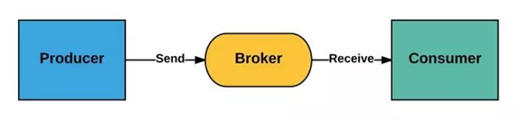

围绕这个队列有三个角色：

- **Producer（生产者）**：消息的发送方，把消息写入 Broker。
- **Broker（消息代理）**：消息处理中心，负责消息的存储、确认与重试。
- **Consumer（消费者）**：消息的接收方，从 Broker 拉取消息并处理。

可以把它想成小区的快递驿站：寄件人（生产者）不需要知道收件人（消费者）此刻在不在家，只要把包裹放到驿站（Broker）；驿站负责保管，收件人有空再来取。寄件人和收件人因此不必同时在线，也不必互相认识。

### 1.2 为什么需要消息队列

引入 MQ 通常是为了解决下面五类问题：

1. **解耦**：发送方和接收方不需要直接了解对方，只要约定好消息格式和主题即可。
2. **异步**：借助 MQ 的消息堆积能力，把耗时操作从主链路中剥离，起到削峰填谷的作用。
3. **复用**：一条消息发出后，可以被多个下游各自消费一次。
4. **可靠**：接收方暂时不可用时，消息仍保留在队列中，等它恢复后再投递。
5. **路由**：发送方无需与接收方建立直接连接，由 MQ 按主题分发。

### 1.3 消息队列的代价

任何架构选择都有成本，MQ 也不例外：

| 维度 | 收益 | 代价 |
| --- | --- | --- |
| 耦合度 | 上下游解耦，可独立演进 | 调用链变长，问题定位更麻烦 |
| 响应时间 | 主链路异步化，响应更快 | 结果最终一致，不再是同步返回 |
| 可用性 | 削峰填谷，抗流量突刺 | 多了一个外部依赖，MQ 挂了会影响业务 |
| 复杂度 | 流量可缓冲、可重放 | 需要处理重复消费、消息顺序、消息积压 |
| 一致性 | 便于做最终一致 | 部分成功、部分失败时要有补偿机制 |

一句话总结：**优点**是解耦、异步、削峰；**缺点**是系统可用性降低（外部依赖增多）、系统复杂度提高，以及需要额外处理一致性问题（部分执行成功、部分失败）。

### 1.4 Kafka 是什么

Kafka 是一个分布式事件流平台（distributed event streaming platform），支持发布/订阅式的消息传递，具备容错能力，并支持并发的消息处理。它既可以当作消息中间件使用，也常用于日志采集、埋点收集和实时计算的数据管道。

### 1.5 Kafka 的核心特点

- **高吞吐**：通过顺序读写、批量发送和零拷贝等手段，单机每秒可处理十万到百万量级的消息（**经验量级，取决于硬件、消息大小与配置**）。
- **高性能**：单节点可支撑大量客户端连接；配合多副本与合理的 acks 配置，可以在不中断服务的前提下完成滚动升级（"零停机"），并通过副本冗余尽量避免数据丢失。
- **持久化**：消息落盘保存，并有副本机制防止单点丢失。
- **零拷贝**：消费时通过 `sendfile` 把数据从页缓存直接送到网卡，减少内存拷贝。
- **可靠与可扩展**：分布式、分区、复制和容错，集群可水平扩展。

此外还有几个常被提到的设计特点：顺序读写磁盘、充分利用 Linux 页缓存（Page Cache）、分区天然支持水平扩展、消费进度由客户端维护、同时支持在线（online）与离线（offline）场景、提供多语言客户端。

### 1.6 与其他消息队列的对比

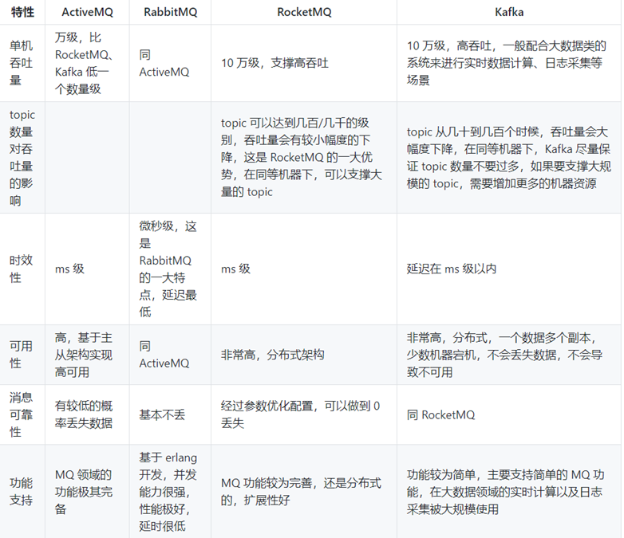

不同 MQ 的定位差异较大，选型时通常按场景而不是按"谁更好"来判断：

| 产品 | 常见定位 | 适用场景 |
| --- | --- | --- |
| ActiveMQ | 老牌 JMS 实现，社区活跃度较低 | 遗留系统维护、简单的 JMS 需求 |
| RabbitMQ | 功能完善、路由灵活、管理界面友好 | 中小规模业务解耦、复杂路由、低延迟场景 |
| RocketMQ | 国内互联网公司开源，事务消息、顺序消息支持较好 | 电商交易链路、需要事务消息的业务 |
| Kafka | 高吞吐日志型消息系统，生态与流处理能力强 | 大数据实时计算、日志采集、埋点、流式处理 |

## 二、架构与核心术语

本节建立 Kafka 的整体模型。只要把 Broker、Topic、Partition、Offset、消费者组这几个概念的关系理清楚，后面所有机制都是它们的组合。

### 2.1 整体架构

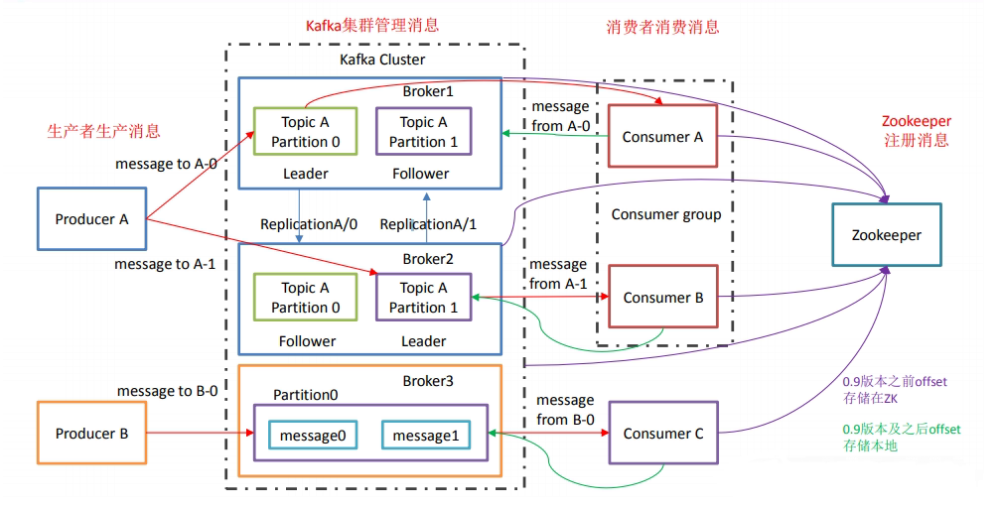

### 2.2 核心术语表

| 术语 | 含义 |
| --- | --- |
| Producer | 向 Broker 发送消息的客户端 |
| Consumer | 消息的使用方，从 Broker 拉取消息 |
| Topic | 主题，建立生产者与消费者之间的订阅关系，也是消息的逻辑分类 |
| Partition | 分区，一个 Topic 可分为多个 Partition，每个 Partition 是一个有序队列，消息有唯一 offset |
| Broker | 一台 Kafka 服务器；一个集群由多个 Broker 组成 |
| Consumer Group | 消费者组，把同类消费者归为一组，组内每个分区只被一个消费者消费 |
| Offset | 位移/偏移量，消息在 Partition 中的位置编号 |
| Replica | 副本，分区的冗余拷贝，分为 Leader 与 Follower |

### 2.3 消息、批次、主题与分区

**消息**是 Kafka 里的数据单元，由字节数组组成，可以携带一个键（key，用于决定进入哪个分区）。**批次**是一组属于同一主题和分区的消息，成批传输可以显著减少网络开销。

消息用**主题**分类，主题下再分为若干**分区**。分区本质上是一个提交日志（commit log）文件，消息以追加（append）方式写入。**单个分区内保证消息顺序，整个主题不保证顺序**——这是 Kafka 顺序性语义的边界。

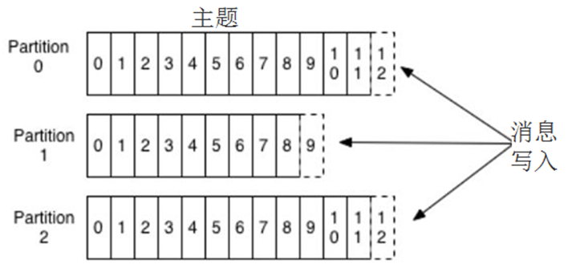

分区可以类比成超市的多个收银台：顾客（消息）被分散到不同队列，每个队列内部先来先服务（分区内有序），但不同队列之间谁先结账并不确定（跨分区无序）。多加收银台就能提高整体吞吐（并发度提升）。

### 2.4 生产者、消费者、位移与消费者组

生产者默认把消息均衡分布到所有分区，也可以通过消息键指定分区。消费者按顺序读取，并用位移（offset）区分哪些消息已经读过。多个消费者可构成一个消费者组，组内保证**每个分区只被一个消费者使用**。

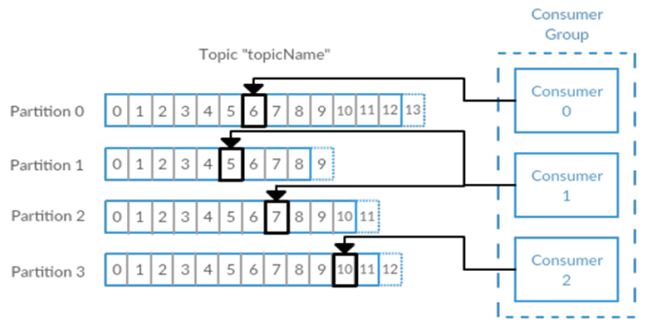

### 2.5 Broker 与集群

单个 Broker 可以承载上千个分区、每秒处理百万量级消息（经验量级，受硬件与消息大小影响）。多个 Broker 组成集群，由控制器（Controller）负责分区分配与 Broker 监控，分区可以复制到多个 Broker 上提供冗余。

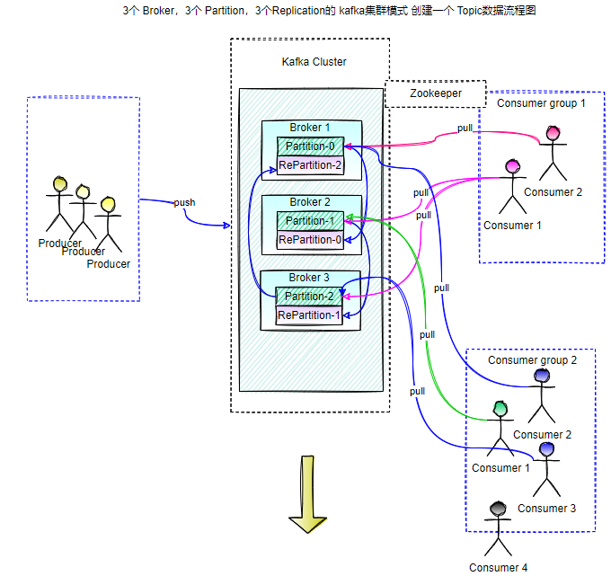

### 2.6 一次消息生产的完整流程

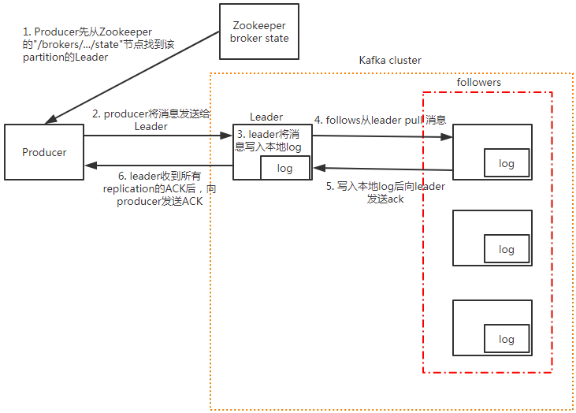

1. 生产者从 Broker 获取元数据，找到目标分区的 Leader。
2. 生产者把消息发送给该 Leader。
3. Leader 把消息写入本地日志（log）。
4. Follower 从 Leader 拉取（pull）消息。
5. Follower 写入本地日志后向 Leader 发送 ACK。
6. Leader 收到 ISR 中副本的确认后推进 HW，并向生产者返回 ACK。

> **更正说明（版本差异）**：早期资料常写"生产者从 ZooKeeper 找到分区 Leader"。这一点只对很老的实现成立：现代客户端（0.8 之后的 Java 客户端）是从 `bootstrap.servers` 连上任意 Broker 后，通过元数据请求（Metadata）拿到分区与 Leader 信息的；元数据由控制器维护，客户端并不直接访问 ZooKeeper。Kafka 3.3 起 KRaft 模式被宣布可用于生产，4.0 起 ZooKeeper 模式被移除，集群元数据由控制器仲裁（Raft）管理。

### 2.7 消息保留策略

Kafka 不是"消费完就删"的队列，消息按保留策略清理。默认策略是**按时间保留**：`retention.ms` 默认 604800000（7 天）；**按大小保留**默认关闭（`retention.bytes` 默认 -1，即不限制）。每个主题都可以单独覆盖这两个配置。

> **更正说明**：早期资料里"默认保留 7 天或 1G"的说法把两件事混在了一起。`log.segment.bytes` 的默认值才是 1 GiB（单个日志段文件的大小上限），而按大小删除的保留上限默认是 -1（无限制）。

## 三、消息存储机制

Kafka 的存储设计是它能同时做到高吞吐和持久化的根本原因。本节依次说明日志目录、Segment、索引与数据文件、读写路径，以及日志清理策略。

### 3.1 目录结构：Topic + Partition 对应一个文件夹

Topic 与 Partition 的组合对应磁盘上的一个文件夹；Kafka 采用 **Segment File（日志段）** 的方式存储消息，把大文件拆成多个小文件段，便于加载、删除与查找。

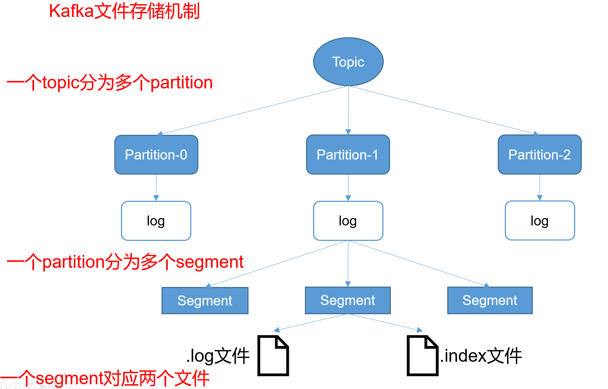


一个分区的目录里主要包含三类文件：

| 文件 | 作用 |
| --- | --- |
| `.log` | 数据文件，按顺序存放消息 |
| `.index` | 偏移量索引，offset → 物理位置 |
| `.timeindex` | 时间索引，时间戳 → offset |

示例目录结构：

```text
/kafka-data/
├── topic-name-0/                       # 分区 0
│   ├── 00000000000000000000.log        # 第 1 个日志段
│   ├── 00000000000000000000.index      # 对应的偏移量索引
│   ├── 00000000000000000000.timeindex  # 对应的时间索引
│   ├── 00000000000000100000.log        # 第 2 个日志段
│   └── leader-epoch-checkpoint         # Leader Epoch 记录（0.11+）
├── topic-name-1/                       # 分区 1
└── topic-name-2/                       # 分区 2
```

**文件命名规则**：文件名等于该 Segment 中第一条消息的 offset，固定 20 位十进制数字、左补零。

**Segment 的作用**：把日志切成有大小上限的段，删除旧数据时以段为单位整段删掉，避免在大文件中做随机修改。

### 3.2 索引文件

索引文件名表示该文件存储的第一条消息的偏移量。索引项格式为「N, Position」：N 表示第几条消息（相对 offset），Position 表示该消息在数据文件中的物理偏移地址。

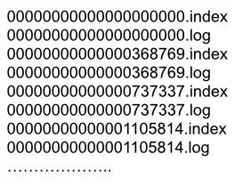

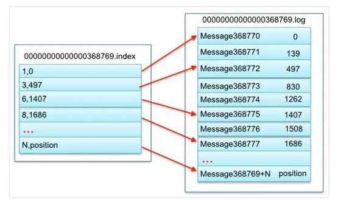

索引是**稀疏索引**：默认每写入约 4 KiB 数据才记一条索引项（`index.interval.bytes` 默认 4096）。这样索引文件很小，可以常驻内存，代价是定位到大致位置后还要在数据文件里顺序扫描一小段。

### 3.3 数据文件与消息格式

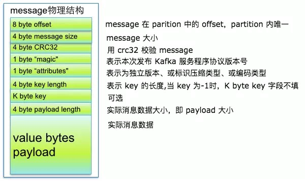

一条消息（Record）在磁盘上的组成大致包括：offset（位移）、消息大小、CRC 校验、版本号（Magic）、属性（压缩类型等）、时间戳，以及 Key 与 Value。

> **更正说明（版本差异）**：网传"消息固定头部 26 字节 + Key + Value"描述的是 0.11 之前的旧消息格式（v0/v1：offset 8 字节 + size 4 字节 + CRC 4 字节 + magic 1 字节 + attributes 1 字节 + timestamp 8 字节）。0.11 起默认使用 v2 格式的 Record Batch，长度类字段改用变长编码（varint），头部不再是固定的 26 字节，因此不要再按"26 字节"估算消息体积。

### 3.4 写入与读取

- **写入**：消息追加到当前活跃 Segment 的 `.log` 末尾，同时按需更新 `.index` 与 `.timeindex`。活跃段达到 `segment.bytes`（默认 1 GiB，对应 Broker 级配置 `log.segment.bytes`）或超过滚动时间（`log.roll.ms` / `log.roll.hours`，默认 7 天，对应主题级配置 `segment.ms`）时滚动出新段。
- **读取**：先按 offset 定位所属 Segment（文件名做二分查找），再在 `.index` 中二分找到不大于目标 offset 的索引项，得到物理位置，最后从 `.log` 顺序扫描读取。

### 3.5 Page Cache 与文件存储优势

Kafka 很少出现大量磁盘读操作，主要工作是**定期批量顺序写盘**，并大量依赖操作系统的页缓存（Page Cache）：

- **写消息**：消息从 JVM 堆转入 Page Cache，由操作系统异步刷盘。
- **读消息**：消息直接从 Page Cache 转入 socket 发送；未命中时才从磁盘加载到 Page Cache。

这样做的好处是避免在 JVM 堆里维护大数据结构，减少 GC 压力，并且进程重启后 Page Cache 里的数据依然有效。值得注意的是，Kafka 通常不建议开启强制 fsync（`log.flush.interval.messages` 默认为极大值，即不强制刷盘），官方建议用**副本机制**来保证持久性，把刷盘交给操作系统批处理更高效。

### 3.6 日志清理：delete 与 compact

主题的 `cleanup.policy` 决定日志如何清理，默认值为 `delete`：

| 策略 | 行为 | 典型场景 |
| --- | --- | --- |
| `delete` | 按时间（`retention.ms`，默认 7 天）和/或大小（`retention.bytes`，默认 -1 不限）整段删除旧 Segment | 日志、埋点等流式数据 |
| `compact` | 日志压缩：对每个 key 只保留最新 value，更早的同类记录被清理 | 状态变更、配置同步、CDC 场景 |
| `delete,compact` | 两者同时生效：旧段按时间/大小删除，保留段再做压缩 | 既要控总量又要保留最新状态 |

日志压缩（Log Compaction）的适用前提是**消息有 key**：没有 key 的消息无法判断"哪些是同一条记录的新旧版本"。此外，删除标记（tombstone，value 为 null 的消息）会保留一段时间（`delete.retention.ms`，默认 1 天），以便消费者感知"这个 key 被删除了"。

### 3.7 存储相关配置与检查清单

```properties
# 高吞吐量场景
log.segment.bytes=1073741824        # 单段 1 GiB（默认值）
log.retention.hours=168             # 保留 7 天（默认值）
log.flush.interval.messages=10000   # 每 1 万条强制刷盘（默认不强制，一般不建议开启）

# 低延迟/更高持久性场景
log.flush.interval.ms=1000          # 最多 1 秒刷一次盘（默认不开启）

# 归档场景
log.retention.hours=-1              # 永久保留
compression.type=lz4                # 使用 LZ4 压缩
```

上线前可以按这份清单过一遍：

- `log.dirs`：配置多块磁盘以分散 I/O。
- `log.flush.interval.messages` / `log.flush.interval.ms`：刷盘策略，一般交给操作系统。
- `log.retention.hours`（或 `retention.ms`）/ `log.retention.bytes`：保留策略，决定磁盘水位。
- `log.segment.bytes`：段大小，影响删除粒度。
- `compression.type`：压缩算法（gzip、snappy、lz4、zstd）。
- `num.recovery.threads.per.data.dir`：启动时的日志恢复线程数。

## 四、副本、ISR 与数据一致性

单机存储解决的是"消息不丢在内存里"，副本解决的是"机器坏了消息还在不在"。本节说明副本如何同步、ISR 是什么、HW 与 LEO 的区别，以及各类故障后的恢复动作。

### 4.1 副本机制

每个分区可以配置多个副本（`replication.factor`），分布在不同 Broker 上：一个 Leader 加若干 Follower。生产环境通常把副本因子设为 3，这样允许挂掉一台 Broker 而不影响读写。

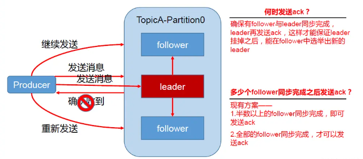

副本机制可以理解为"多人同时抄写同一本账本"：Leader 是主笔，Follower 按顺序照抄；只要还有人抄完，账本就不会因为一个人请假而丢失。

### 4.2 AR、ISR 与 OSR

| 概念 | 含义 |
| --- | --- |
| AR（Assigned Replicas） | 分区的所有副本集合 |
| ISR（In-Sync Replicas） | 与 Leader 保持同步的副本集合，包含 Leader 自身 |
| OSR（Out-of-Sync Replicas） | 同步落后、被踢出 ISR 的副本集合 |

关系是 `AR = ISR + OSR`。Leader 负责维护 ISR：Follower 超过 `replica.lag.time.max.ms` 没有追上 Leader 的日志末端，就会被移出 ISR；追上来之后可以重新加入。Leader 故障时，只会从 ISR 中选举新 Leader。

### 4.3 LEO 与 HW

- **LEO（Log End Offset）**：日志末端位移，即"下一条待写入消息"的 offset。
- **HW（High Watermark）**：高水位，等于 ISR 中最小的 LEO；消费者只能消费到 HW 之前的消息。

HW 的意义在于：一条消息只有在**所有 ISR 副本都写入之后**才算"已提交"（committed），才对消费者可见。这样可以避免消费者读到一条随后因为 Leader 切换而消失的消息。

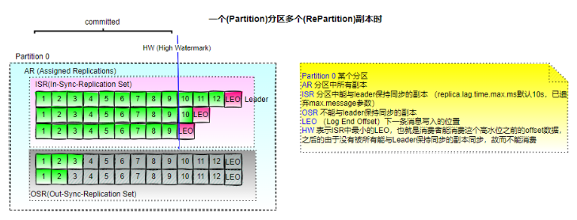

### 4.4 Follower 故障恢复

Follower 故障的处理流程是：

1. 该 Follower 长时间未同步，被移出 ISR；
2. 恢复后读取本地记录的 HW，把高于 HW 的未确认部分截断；
3. 从 HW 位置开始向 Leader 重新同步；
4. 当 LEO ≥ HW（追平 Leader）后，重新加入 ISR。

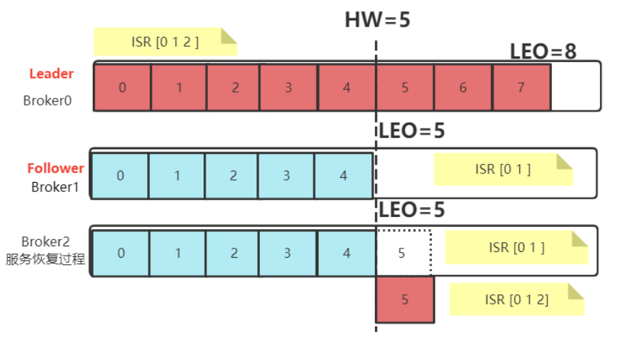

### 4.5 Leader 故障与选举

Leader 故障的处理流程是：

1. 控制器从 ISR 中选出新 Leader；
2. 其余 Follower 截断高于 HW 的部分，向新 Leader 同步；
3. 旧 Leader 恢复后作为 Follower 加入，同样先截断再追平。

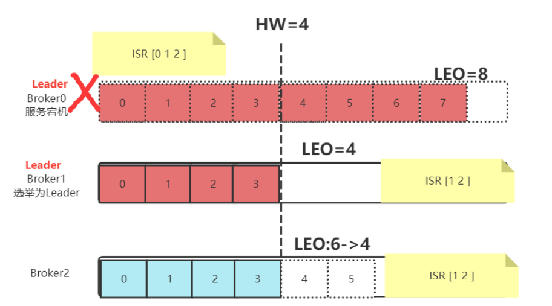

### 4.6 为什么 acks=all 仍可能不一致

即使配置了 `acks=all`，也可能出现副本间不一致：Leader 挂掉的瞬间，ISR 中各 Follower 的同步进度并不相同，新 Leader 只保证"HW 之前"的数据完整，HW 之后的未提交数据可能被截断。

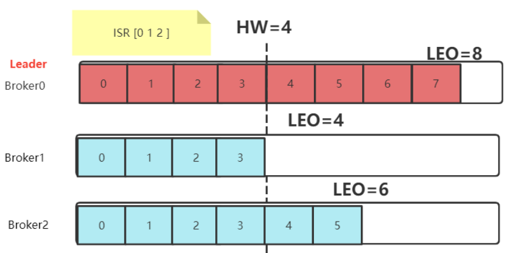

因此实际工程中常用的组合是：`acks=all` + `min.insync.replicas=2` + `replication.factor=3` + `unclean.leader.election.enable=false`（默认值）。前两项保证"至少两份副本确认才算成功"，后两项保证"不会为了可用性牺牲一致性"：ISR 不足时直接拒绝写入（生产者会收到 `NotEnoughReplicas` 一类异常），而不是让落后的副本当 Leader。

### 4.7 控制器选举与元数据：从 ZooKeeper 到 KRaft

- **控制器（Controller）**：集群中负责分区分配、Leader 选举、Broker 上下线感知的角色。
  - ZooKeeper 模式（Kafka 3.x 及更早）：Broker 启动时争抢 ZooKeeper 上的临时节点，抢到的成为控制器。
  - KRaft 模式（2.8 起作为早期预览引入，3.3 起宣布可用于生产，4.0 起是唯一支持的模式）：由一组控制器节点用 Raft 协议选出 active controller，元数据也以日志形式在控制器仲裁中复制，不再依赖 ZooKeeper。
- **分区 Leader 选举**：由控制器执行——读取该分区的 ISR，按选举算法（通常是列表中的第一个存活副本，即 preferred leader）选出新 Leader。
- **ZooKeeper 曾经承担的工作**：集群元数据存储、消费者状态、消费者组管理与位移存储。需要注意，位移从 0.9 起改由内部主题 `__consumer_offsets` 保存，不再是 ZooKeeper；元数据在 KRaft 模式下也改由控制器仲裁管理。

### 4.8 进阶了解：Leader Epoch（可跳过）

初学可以略过这一小节。仅靠 HW 截断在极端场景下可能截多或截少：旧 Leader 恢复后如果只按 HW 截断，可能把新 Leader 已经提交的数据也截掉，或者保留了本该丢弃的数据。0.11 起引入 **Leader Epoch**（KIP-101）：每次 Leader 变更都递增一个 epoch 编号，Follower 记录自己每个 epoch 的起始位移（保存在 `leader-epoch-checkpoint` 文件中），恢复时先向新 Leader 询问 epoch 边界，再做精确截断。这也是为什么现在查看分区目录会看到 `leader-epoch-checkpoint` 文件。

## 五、可靠性：如何保证消息不丢失

"消息不丢"不是单个开关，而是生产、存储、消费三个环节共同保证的结果。本节按链路顺序说明每个环节该配什么、为什么会丢。

### 5.1 可靠性的四个维度

- **不丢失（At-least-once）**：消息至少被成功投递一次。
- **不重复（At-most-once）**：消息至多被投递一次。
- **精确一次（Exactly-once）**：不丢也不重。
- **有序性（Ordering）**：同一分区内按发送顺序存储和消费。

### 5.2 Producer 端：acks 与重试

| acks | 含义 | 可靠性 | 吞吐 |
| --- | --- | --- | --- |
| `0` | 不等待任何确认，写入 socket 缓冲区即认为成功 | 最低，网络抖动即丢 | 最高 |
| `1` | Leader 写入本地日志即返回，不等 Follower | 中等，Leader 故障且未复制时丢 | 中等 |
| `all`（等价 `-1`） | 等待**所有 ISR 副本**确认 | 最高，只要还有一个 ISR 存活就不丢 | 最低 |

```java
props.put(ProducerConfig.ACKS_CONFIG, "all");
props.put(ProducerConfig.RETRIES_CONFIG, 3);
```

`acks=all` 的准确语义是"ISR 中每个副本都要确认"，而不是"所有副本"。它必须和 `min.insync.replicas` 一起看：若 ISR 数量小于 `min.insync.replicas`，生产者会收到 `NotEnoughReplicas` 或 `NotEnoughReplicasAfterAppend` 异常。

**retries**：发送失败时的重试次数。不开启幂等性时，重试可能导致重复消息。

### 5.3 幂等生产者

Kafka 0.11 起支持幂等生产者，解决"重试导致的重复写入"：

- Broker 为每个生产者分配 **PID**（Producer ID）；
- 每条消息携带单调递增的 **Sequence Number**；
- Broker 按 PID + Sequence Number 去重。

```java
props.put(ProducerConfig.ENABLE_IDEMPOTENCE_CONFIG, "true");
// 开启后 acks 必须为 all、retries 必须非 0、max.in.flight.requests.per.connection ≤ 5
```

> **版本差异**：`enable.idempotence` 从 Kafka 3.0 起默认就是 `true`，同时 `acks` 默认 `all`、`retries` 默认 `Integer.MAX_VALUE`、`max.in.flight.requests.per.connection` 默认 5。0.11～2.8 需要显式开启；显式开启时若 `acks`、`retries` 与之冲突，客户端会抛出 `ConfigException`（未显式开启则自动关闭幂等）。

### 5.4 事务

Kafka 0.11 起支持跨分区、跨主题的事务，与幂等配合可实现"要么全部写入，要么全部不生效"：

```java
props.put(ProducerConfig.TRANSACTIONAL_ID_CONFIG, "my-transactional-id");
producer.initTransactions();
producer.beginTransaction();
producer.send(record1);
producer.send(record2);
producer.commitTransaction();
```

事务依赖内部的 `__transaction_state` 主题与事务协调器（Transaction Coordinator），生产环境需要为该内部主题配置足够的副本数与 `min.insync.replicas`。消费者侧只有设置 `isolation.level=read_committed`，才会过滤掉已中止事务的消息。

### 5.5 Broker 端：副本与持久化

- **副本因子（`replication.factor`）**：每个分区复制多份，放在不同 Broker 上（1 Leader + N Follower），建议 3。
- **ISR**：与 Leader 保持同步的副本集合，落后超过 `replica.lag.time.max.ms` 会被踢出。
- **Leader 选举**：故障时从 ISR 中选新 Leader；`unclean.leader.election.enable=false`（默认）保证不会用落后副本顶上，避免数据不一致。
- **持久化**：消息先写入 Page Cache，由操作系统异步刷盘；可通过 `log.flush.interval.messages` / `log.flush.interval.ms` 调整强制刷盘节奏。

### 5.6 Consumer 端：位移提交

- **自动提交**：`enable.auto.commit=true`（客户端默认值），后台周期性提交，可能重复消费或丢消息。
- **手动提交**：`enable.auto.commit=false`，处理成功后调用 `commitSync()` / `commitAsync()`。

```java
// 手动提交位移：处理成功后再提交
props.put(ConsumerConfig.ENABLE_AUTO_COMMIT_CONFIG, "false");
while (true) {
    ConsumerRecords<String, String> records = consumer.poll(Duration.ofMillis(1000));
    for (ConsumerRecord<String, String> record : records) {
        processMessage(record);
    }
    consumer.commitSync();
}
```

另外三个和"不丢/不重"相关的点：

- **位移重置策略**：`auto.offset.reset=earliest` 表示没有可用位移时从最早开始（客户端默认是 `latest`，Spring Boot 的 `spring.kafka.consumer.auto-offset-reset` 默认是 `earliest`）。
- **消费者组**：通过分区分配实现负载均衡，新消费者加入会自动接管部分分区。
- **先处理再提交**：提交晚了最多重复消费（至少一次），提交早了则可能丢消息。

### 5.7 端到端 Exactly-Once

实现"精确一次"通常有三种思路：

1. **消费端幂等**：业务逻辑自身幂等（如唯一键约束、状态机校验），重复消费结果不变。
2. **事务 API**：consume-transform-produce 闭环，把"写结果"和"提交位移"放进同一个事务。
3. **位移与业务数据同库同事务**：把 offset 存进业务数据库，与业务写入在同一本地事务里完成。

```java
// consume-transform-produce：Kafka 内闭环的 Exactly-Once
props.put(ConsumerConfig.ISOLATION_LEVEL_CONFIG, "read_committed");
props.put(ConsumerConfig.ENABLE_AUTO_COMMIT_CONFIG, "false");
props.put(ProducerConfig.TRANSACTIONAL_ID_CONFIG, "my-tx-id");

producer.initTransactions();
while (true) {
    ConsumerRecords<String, String> records = consumer.poll(Duration.ofMillis(1000));
    producer.beginTransaction();
    try {
        for (ConsumerRecord<String, String> record : records) {
            producer.send(new ProducerRecord<>("output-topic", process(record)));
        }
        // 把消费位移作为同一个事务的一部分提交
        producer.sendOffsetsToTransaction(currentOffsets(records), consumer.groupMetadata());
        producer.commitTransaction();
    } catch (Exception e) {
        producer.abortTransaction();
    }
}
```

### 5.8 可靠性配置速查表

| 环节 | 关键配置 | 作用 |
| --- | --- | --- |
| Producer | `acks=all`、`retries>0`、`enable.idempotence=true` | 不丢、重试不重 |
| Broker | `replication.factor=3`、`min.insync.replicas=2`、`unclean.leader.election.enable=false` | 副本冗余、拒绝降级写入 |
| Consumer | `enable.auto.commit=false` + 手动提交 | 处理成功后再提交位移 |
| 端到端 | 事务 API + `isolation.level=read_committed` | Exactly-Once |

## 六、生产者：发送流程与分区选择

本节从客户端视角看"一条消息是怎么发出去的"，重点在两条线索：发送主流程（元数据 → 序列化 → 分区 → 缓冲 → 发送）和分区选择规则。

### 6.1 发送主流程

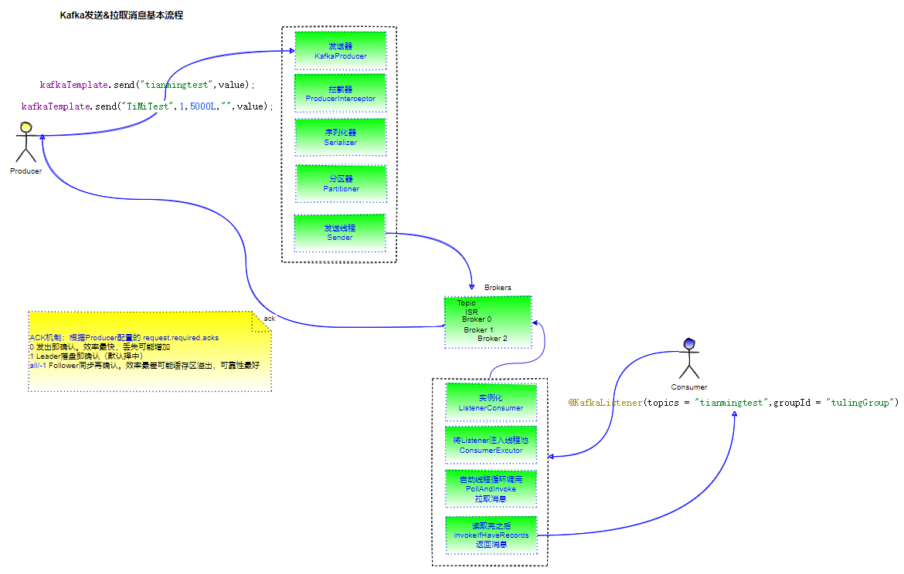

`KafkaProducer.send()` 的核心步骤：

1. 确保主题元数据可用（`waitOnMetadata`）。
2. 序列化 key 与 value。
3. 计算分区号（`partition()` 方法）。
4. 估算序列化后的大小，校验是否合法。
5. 追加到 `RecordAccumulator`（`accumulator.append`）。
6. 批次满或新建批次时，唤醒 Sender 线程。
7. Sender 线程通过 `NetworkClient.poll()` 用 NIO 发送请求。

### 6.2 分区选择

`DefaultPartitioner` 的规则：

- **指定了 partition**：直接使用。
- **key 不为空**：`Utils.toPositive(Utils.murmur2(keyBytes)) % numPartitions`，同一 key 永远落到同一分区。
- **key 为空**：2.4 起默认使用**粘性分区（Sticky Partitioner）**——先把一批消息发往同一个分区，凑满批次后再切换，以提升批量效率；更早的版本（0.11 之前）则是轮询。

> **更正说明（版本差异）**："无 key 时轮询"是旧版行为。Kafka 2.4 起默认分区器改为粘性策略，目的是减少小批次、提升吞吐；这属于实现细节，业务上不应依赖"无 key 就一定轮询"。

### 6.3 RecordAccumulator 与批量

每个主题分区在客户端都有一个 `ProducerBatch` 双端队列：消息先追加到队尾的批次中，批次满（`batch.size`，默认 16384 字节）或等待时间到（`linger.ms`，4.0 起默认 5 ms，之前默认 0）就"封箱"发送，同时新建批次放入队尾。

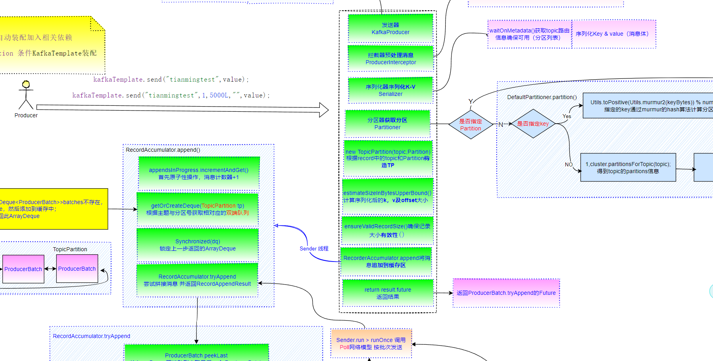

批量的作用类似货车装货：一件一件送成本太高，凑满一车再发，单位时间的运输量（吞吐）就上去了，代价是部分货物要等一会儿（延迟上升）。

### 6.4 自定义分区器

实现 `Partitioner` 接口并在 `partitioner.class` 中指定即可接管分区计算：

```java
public int partition(String topic, Object key, byte[] keyBytes,
                     Object value, byte[] valueBytes, Cluster cluster) {
    List<PartitionInfo> partitions = cluster.partitionsForTopic(topic);
    int numPartitions = partitions.size();
    if (keyBytes == null) {
        // 无 key：轮询返回分区
        int nextValue = nextValue(topic);
        return Utils.toPositive(nextValue) % numPartitions;
    }
    // 有 key：murmur2 哈希取模，保证同 key 同分区
    return Utils.toPositive(Utils.murmur2(keyBytes)) % numPartitions;
}
```

## 七、消费者与消费者组

消费者是"拉模型"：主动向 Broker 发 fetch 请求，因此消费速率由自己控制，不会被 Broker 压垮。消费者组则决定了多个实例如何分工。

### 7.1 消费主流程（Spring Kafka）

以 Spring Kafka 为例，一个 `@KafkaListener` 从注解到消费经历这些步骤：

1. `KafkaListenerAnnotationBeanPostProcessor` 扫描 `@KafkaListener` 注解。
2. 封装成 `MethodKafkaListenerEndpoint`，注册到 `KafkaListenerEndpointRegistry`。
3. `KafkaMessageListenerContainer.doStart()` 创建 `ListenerConsumer` 线程。
4. `ListenerConsumer.run()` 循环调用 `pollAndInvoke()`。
5. `poll` 拉到一批消息 → `invokeIfHaveRecords` → `invokeListener` 反射调用业务方法。

```java
@KafkaListener(topics = "order-events", groupId = "order-processors")
public void onMessage(String msg) {
    System.out.println("收到消息：" + msg);
}
```

```properties
# 每个 @KafkaListener 方法会创建 concurrency 个消费线程
spring.kafka.listener.concurrency=3
```

两个 `@KafkaListener` 方法 + `concurrency=3`，通常会得到 2×3=6 个消费者线程。另有三个常用参数：`concurrency` 控制 listener 线程数、`max.poll.records` 控制单次 poll 返回条数（默认 500）、`fetch.max.wait.ms` 控制拉取的等待时间。

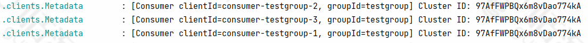

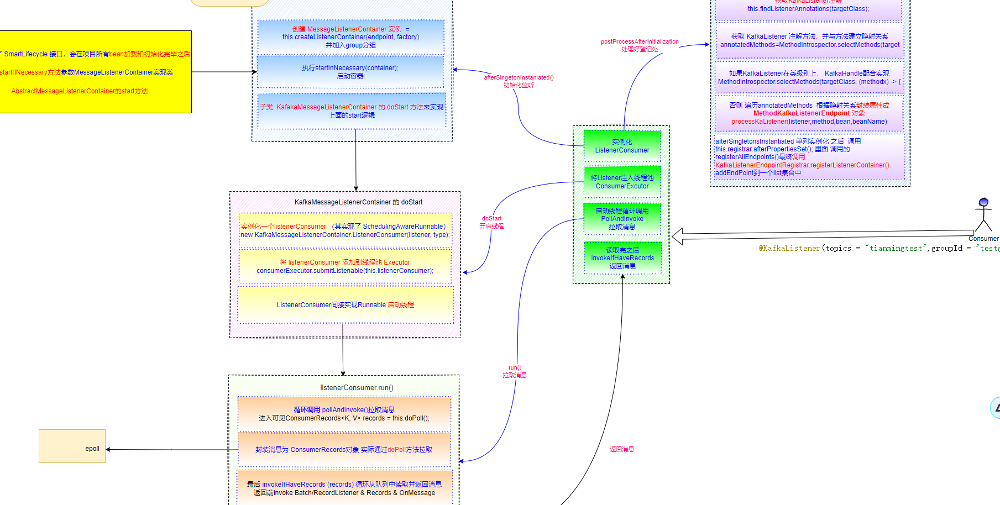

### 7.2 并发度公式

**并发度 = min(分区数, 消费者实例数)**

分区数是并发消费的硬上限：消费者数超过分区数时，多出来的消费者分不到分区，只能空闲。

### 7.3 消费者组为什么存在

- **负载均衡**：多个消费者分担消费压力。
- **弹性扩展**：增减消费者时自动重新分配分区。
- **故障恢复**：消费者宕机后其分区自动转移给其他成员。

约束条件有三条：

1. 一个分区同一时刻只能被组内一个消费者消费（保证分区内顺序）。
2. 同一消费者组内，一个消费者可以分到多个分区。
3. 空闲的消费者不应分到分区（分不到就没得消费）。

### 7.4 再平衡（Rebalance）流程

再平衡就是"重新分工"。触发条件包括：消费者加入或离开组、消费者心跳超时（`session.timeout.ms`）、消费者处理超时（两次 `poll` 间隔超过 `max.poll.interval.ms`）、订阅的主题变化、主题分区数增加。

传统（Eager，急切式）协议的流程：

```text
1. 触发事件 → 成员发现需要重新分配
2. JoinGroup → 所有消费者暂停消费，向 Coordinator 发送 JoinGroup
3. 选举 Group Leader → Coordinator 从成员中选一个，由它执行分配算法
4. SyncGroup → Leader 把方案经 Coordinator 转发给所有成员
5. 恢复消费 → 各消费者按新方案开始消费
```

消费组协调器（Group Coordinator）是 Broker 端的一个组件，负责管理组成员与位移。Eager 协议的问题是**Stop-the-World**：所有成员先放弃全部分区，再重新分配，期间消费完全停止；实际耗时受组规模、成员数量影响很大（常见为秒级到十几秒，属经验值）。

**增量协作式再平衡（Cooperative Rebalance，KIP-429，Kafka 2.4 引入）** 把一次再平衡拆成两轮：

1. 第一轮只撤销"确实需要转移"的分区；
2. 第二轮把新分区分配给成员。

成员在未被撤销的分区上可以继续消费，因此停顿时间大幅缩短。使用 `CooperativeStickyAssignor` 即可启用该协议。

### 7.5 四种内置分配策略

**RangeAssignor（范围分配）**：按主题逐个分配，把每个主题的分区按范围平均切给消费者。

```text
Topic A：6 个分区，Topic B：4 个分区，3 个消费者
C0：A[P0,P1,P2] + B[P0,P1] = 5 个分区
C1：A[P3,P4]    + B[P2]    = 3 个分区
C2：A[P5]       + B[P3]    = 2 个分区
```

特点：实现简单，但多主题场景下排序靠前的消费者总是多分到分区。

**RoundRobinAssignor（轮询分配）**：把所有主题的所有分区混在一起，按字典序轮询分配给消费者。特点：整体更均匀；但成员变动时，分区转移范围较大。

**StickyAssignor（粘性分配）**：在尽量均衡的前提下，尽可能保留成员原有的分区，减少再平衡时的迁移量。

```text
C2 宕机时：
RangeAssignor：需要迁移 4 个分区
StickyAssignor：只需迁移 2 个分区（保留 C0、C1 的原有分配）
```

**CooperativeStickyAssignor（合作型粘性分配）**：沿用粘性算法，但采用上面说的增量协作式协议，分两阶段完成再平衡，未受影响的分区不停消费。

> **更正说明（版本差异）**：早期资料常写"StickyAssignor 是 0.11+ 默认策略"。实际客户端默认值是 `[RangeAssignor, CooperativeStickyAssignor]`（2.4 起的默认列表，默认仍先用 RangeAssignor，可通过一次滚动重启把 RangeAssignor 从列表里去掉以启用协作式再平衡）；0.11～2.3 的默认是 `[RangeAssignor, RoundRobinAssignor]`。StickyAssignor 从未成为默认值，但至今仍是"减少分区迁移"的常用选择。

### 7.6 分配策略对比

| 策略 | 原理 | 优点 | 缺点 | 适用场景 |
| --- | --- | --- | --- | --- |
| RangeAssignor | 按主题按范围切分 | 实现简单、可预测 | 多主题时分配不均 | 单主题、分区数能被消费者数整除 |
| RoundRobinAssignor | 全部主题分区轮询 | 分配更均匀 | 成员变动时迁移多 | 分区数多、订阅主题多 |
| StickyAssignor | 保留原有分配并尽量均衡 | 迁移少、消费连续 | 算法较复杂 | 需要减少迁移、但可接受短暂停顿 |
| CooperativeStickyAssignor | 粘性 + 增量协作式 | 迁移少且停顿短 | 需 Kafka 2.4+ | 生产环境推荐 |

### 7.7 再平衡相关配置

```properties
# 分配策略：2.4+ 推荐协作式粘性分配
partition.assignment.strategy=org.apache.kafka.clients.consumer.CooperativeStickyAssignor

# 再平衡相关
session.timeout.ms=10000        # 会话超时（客户端默认 45000，3.0 起；旧版默认 10000）
heartbeat.interval.ms=3000      # 心跳间隔，通常不超过 session.timeout.ms 的 1/3
max.poll.interval.ms=300000     # 两次 poll 的最大间隔
max.poll.records=500            # 单次 poll 最大记录数

# 消费相关
auto.offset.reset=earliest      # 无可用位移时从最早开始（客户端默认 latest）
enable.auto.commit=false        # 手动提交位移
```

> **版本差异**：`session.timeout.ms` 的客户端默认值在 Kafka 3.0 由 10000 提升到 45000，以降低因 GC 或短暂卡顿导致的误判踢人。旧资料里"默认 10 秒"对应 2.x 及更早版本。

### 7.8 常见问题与排查

| 问题 | 常见原因 | 处理方式 |
| --- | --- | --- |
| 频繁 Rebalance | 单批处理耗时超过 `max.poll.interval.ms` | 增大 `max.poll.interval.ms` 或减小 `max.poll.records`，把耗时逻辑异步化 |
| 分配不均 | 多主题场景使用 RangeAssignor | 改用 Sticky/CooperativeSticky 分配器 |
| Rebalance 停顿长 | Eager 协议的 Stop-the-World | 使用 CooperativeStickyAssignor（2.4+） |
| 消费者空闲 | 消费者数 > 分区数 | 减少消费者，或先扩分区 |
| 消费 Lag 持续增长 | 消费能力不足或下游变慢 | 优化消费逻辑（批量、异步、去掉慢 SQL），再评估扩分区/扩消费者 |

### 7.9 案例：订单处理扩容

```text
Topic：order-events，12 个分区
Consumer Group：order-processors，4 个消费者
→ 每个消费者分到 3 个分区

扩容到 12 个消费者 → 每人 1 个分区 → 并发度达到上限
扩容到 15 个消费者 → 3 个空闲 → 没有收益
```

**关键原则**：消费者数 ≤ 分区数，否则多出的实例只会空转。

### 7.10 消息积压真的靠加消费者解决吗

很多人第一反应是"积压了加消费者"，但公式已经说明：**并发度 = min(分区数, 消费者数)**，分区数不够时加消费者没有意义。

更稳妥的处理顺序是：

1. **先诊断瓶颈**：是消费逻辑慢（慢 SQL、同步调用）、还是分区数不足、还是下游限流。
2. **优化消费逻辑**：批量处理、异步化、减少网络往返。
3. **检查分区数**：分区太少会卡住并发上限。
4. **在分区数支撑的前提下扩消费者**。
5. **建立监控**：持续观察消费 Lag（堆积量）趋势，而不是等告警了才处理。

## 八、零拷贝

前面提到 Kafka 高吞吐依赖"零拷贝"。本节说明它到底省掉了什么，以及在 Kafka 里用在哪里。

### 8.1 什么是零拷贝

**零拷贝（Zero-Copy）** 指在数据传输过程中避免数据在内存中被多次拷贝，尤其是避免数据在内核态与用户态之间来回搬运。

- 它不是"一次拷贝都没有"，而是"消除不必要的拷贝"；
- 目标是降低 CPU 消耗、减少上下文切换、提升 I/O 吞吐。

### 8.2 传统数据传输的 4 次拷贝

以"把文件内容通过 socket 发出去"为例，传统 `read` + `write` 路径是：

1. DMA 把数据从磁盘读到内核页缓存（Page Cache）；
2. CPU 把数据从内核缓冲区拷贝到用户缓冲区（`read` 返回）；
3. CPU 把数据从用户缓冲区拷贝回内核的 socket 缓冲区（`write`）；
4. DMA 把数据从 socket 缓冲区送到网卡。

合计 4 次拷贝（2 次 DMA + 2 次 CPU），加 2 次系统调用与 4 次上下文切换。其中第 2、3 步在"只是转发、不改内容"的场景下完全是浪费。

### 8.3 三种实现方式

| 方式 | 原理 | 拷贝次数 | 说明 |
| --- | --- | --- | --- |
| `mmap` + `write` | 把文件映射到用户地址空间，用户态直接读内核页缓存 | 3 次（2 DMA + 1 CPU） | 适合需要访问数据内容的场景，Kafka 写日志、读索引时使用 |
| `sendfile` | 数据全程在内核空间流动，直接由页缓存送到 socket | 官方设计文档表述为"只剩最后发送到网卡缓冲区的一次拷贝" | 最高效，但只能用于"文件 → 网络"，不能修改数据 |
| `splice` | 用内核管道做中转，传递页描述符而非数据本身 | 取决于实现 | 更通用（可接管道），仅 Linux 支持 |

> **表述修正**：网上常见"sendfile 是 3 次拷贝"的说法，源自把"内核缓冲区 → socket 缓冲区"也算作一次 CPU 拷贝的旧实现。Kafka 官方设计文档的描述是：使用 sendfile 后，数据可以直接从页缓存发往网络，"只需要最后一次到网卡缓冲区的拷贝"。具体剩余次数与内核版本、网卡是否支持 scatter-gather 有关，讨论时建议直接引用这一官方表述，而不是给出固定数字。

### 8.4 Java NIO 与 Kafka 中的落点

Java NIO 的 `FileChannel.transferTo()` / `transferFrom()` 内部会使用 `sendfile` 系统调用：

```java
// 零拷贝传输：文件通道直接写入 socket 通道
fileChannel.transferTo(position, count, socketChannel);
```

Kafka 中的三处应用：

- **Consumer Fetch**：Broker 用 `FileRecords.transferTo` 把日志段直接送到网卡（走 sendfile）。
- **Producer Write / 读索引**：用 mmap 把日志与索引文件映射进内存，避免 read 拷贝。
- **Page Cache**：配合零拷贝，数据留在操作系统缓存里，可直接 DMA 发送，命中缓存时几乎不产生磁盘读。

### 8.5 使用限制与最佳实践

- 大文件"原样转发"优先用 `sendfile`（`transferTo`）；需要读取或修改内容时不能用零拷贝。
- **启用 SSL 时不走 sendfile**：TLS 加解密在用户态完成，数据必须经过用户空间，官方文档明确说明这种情况下不会使用 sendfile。
- 消息格式需要转换（如老版本格式升级）或需要解压重压时，也会绕过零拷贝路径。
- 零拷贝效果依赖 Page Cache 命中率，消费者跟得上生产进度时收益最明显。
- 关于"吞吐量提升 2～3 倍"之类的数字属于特定环境下的经验值，会随硬件、消息大小、是否压缩而差别很大，不宜当作通用结论。

## 九、速查与出处

本节把前文出现的关键默认值集中成一张速查表，并列出核实事实时参考的官方文档页面，方便日后按版本对照查证。

### 9.1 关键配置速查

| 配置 | 默认值（4.x） | 作用 |
| --- | --- | --- |
| `acks` | `all` | 生产者要求的确认级别 |
| `enable.idempotence` | `true`（3.0+） | 幂等写入，重试不重复 |
| `retries` | `Integer.MAX_VALUE` | 发送失败重试次数 |
| `batch.size` / `linger.ms` | 16384 / 5 | 批量大小与等待时间（`linger.ms` 4.0 起默认 5） |
| `replication.factor` | 由创建主题时指定 | 分区副本数，生产建议 3 |
| `min.insync.replicas` | 1 | `acks=all` 时要求的最小同步副本数 |
| `unclean.leader.election.enable` | `false` | 是否允许非 ISR 副本当 Leader |
| `retention.ms` / `retention.bytes` | 604800000（7 天）/ -1 | 按时间/大小的日志保留 |
| `segment.bytes` / `segment.ms` | 1073741824 / 604800000 | 日志段滚动条件 |
| `cleanup.policy` | `delete` | 清理策略（delete / compact / 两者） |
| `session.timeout.ms` | 45000（3.0+） | 消费者会话超时 |
| `max.poll.interval.ms` | 300000 | 两次 poll 的最大间隔 |
| `max.poll.records` | 500 | 单次 poll 最大条数 |
| `partition.assignment.strategy` | RangeAssignor + CooperativeStickyAssignor | 分区分配策略 |
| `auto.offset.reset` | `latest` | 无位移时的重置策略 |
| `isolation.level` | `read_uncommitted` | 是否只读已提交事务消息 |

### 9.2 参考出处

本文的默认值、配置语义与机制描述，均以 Apache Kafka 官方文档为准，主要参考以下页面（版本 4.4）：

- Apache Kafka 官方文档《Design》：持久化、效率与零拷贝、消息投递语义、事务、复制与日志压缩。
- Apache Kafka 官方文档《Implementation / Log》：日志段、索引与顺序读写。
- Apache Kafka 官方文档《Configuration / Producer Configs》《Configuration / Consumer Configs》《Configuration / Topic Configs》：`acks`、`enable.idempotence`、`session.timeout.ms`、`partition.assignment.strategy`、`min.insync.replicas`、`retention.ms`、`segment.bytes` 等默认值。
- Apache Kafka 官方文档《Getting Started / Upgrading》《Getting Started / KRaft vs ZooKeeper》：KRaft 生产可用版本与 ZooKeeper 模式移除情况。
- Apache Kafka 源码 `ProducerConfig.java`：参数默认值与幂等相关校验逻辑。
- Apache Kafka KIP-429（Consumer Incremental Rebalance Protocol）、KIP-101（Leader Epoch）。

补充说明：文中的"每秒几十万到百万消息""单机上千分区""再平衡耗时数秒到十几秒""零拷贝提升 2～3 倍吞吐"等数字均为特定环境下的经验量级，会随硬件、消息大小、压缩方式、网络条件显著变化，正式评估请以自身压测结果为准。
