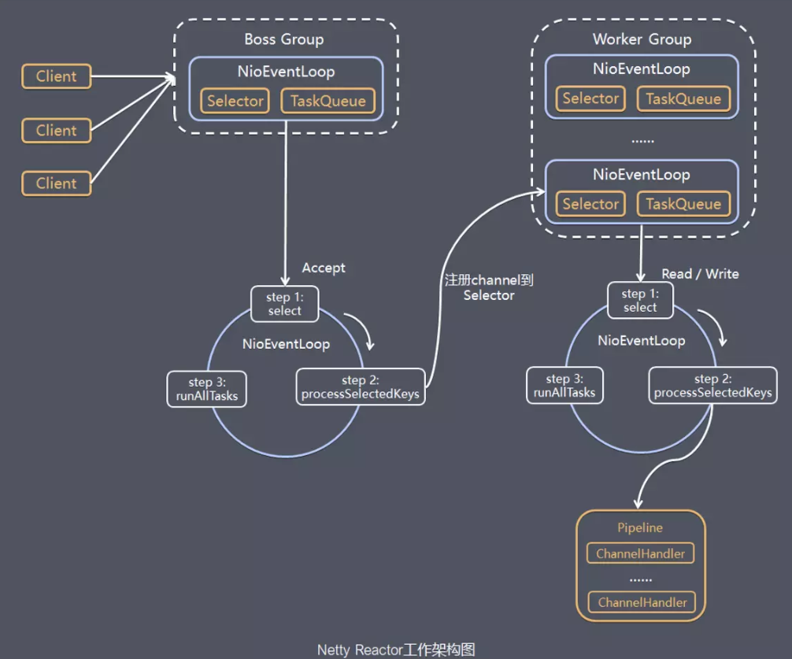

# Netty 知识汇总

Netty 是一个异步事件驱动（asynchronous event-driven）的网络应用框架，用来快速开发可维护、高性能的协议服务器与客户端。在 Java 中间件领域，Dubbo、RocketMQ、Zookeeper、Spark、Elasticsearch、gRPC 的通信层几乎都建立在 Netty 之上。

本文从"为什么需要 Netty"讲起，依次拆开它的线程模型、零拷贝、内存管理、粘包拆包处理、心跳与闲置检测、调优手段和常见设计模式，面向有一年左右 Java 经验、写过 CRUD 但没读过框架源码的开发者。每个抽象概念先给一句话定义和比喻，再讲"为什么需要"，最后讲"怎么用"。

## 本文导读

- 第二章 I/O 模型与 Reactor 线程模型：Netty 的"发动机"
- 第三章 无锁串行化设计：为什么不用锁也线程安全
- 第四章 零拷贝：三种层面的"不复制"
- 第五章 ByteBuf 与内存管理：缓冲区、内存池、引用计数
- 第六章 TCP 粘包与拆包：四种解码器与自定义协议
- 第七章 心跳与闲置连接：IdleStateHandler 的用法
- 第八章 性能调优实践：线程、内存、编解码、TCP 参数
- 第九章 Netty 中的设计模式
- 第十章 Netty 4.1 与 4.2 的差异
- 第十一章 小结与参考资料

## 一、Netty 是什么，为什么需要它

本节给出 Netty 的定位，以及它相对 JDK 原生 NIO 解决了哪些麻烦。先弄清这一点，后面所有机制的设计动机都会更自然。

### 1.1 一句话定位

Netty 是一个基于 NIO（Non-blocking I/O，非阻塞 I/O）的客户端/服务端框架。它把"多路复用 + 事件驱动 + 编解码 + 内存管理 + 连接管理"这些重复劳动封装好，开发者只需要写业务处理器（Handler）。

### 1.2 直接用 JDK 原生 NIO 的四个麻烦

| 麻烦 | 具体表现 | Netty 的对策 |
| --- | --- | --- |
| API 繁琐 | Selector、Channel、ByteBuffer 要手工组合，读写边界容易写错 | 用 Channel + Pipeline 封装，事件回调代替手工轮询 |
| 半包/粘包 | TCP 是字节流，一次 read 可能拿到半个包或两个半包 | 提供一系列解码器（见第六章） |
| 缓冲区管理 | ByteBuffer 用完要自己复用，否则频繁分配触发 GC | ByteBuf + 内存池 + 引用计数（见第五章） |
| 可靠性杂活 | 断线重连、心跳、空闲检测、优雅关闭都要自己写 | 提供 IdleStateHandler 等开箱组件（见第七章） |

### 1.3 谁会用到它

- 中间件与 RPC 框架的通信层（Dubbo、RocketMQ 等）。
- 需要长连接的推送服务、即时通讯、游戏服务器。
- 自定义二进制协议的服务端，或需要对接老旧私有协议的系统。
- 大文件、流媒体等对吞吐和内存敏感的场景。

## 二、I/O 模型与 Reactor 线程模型

本节讲 Netty 用什么 I/O 模型、线程如何分工、连接和线程如何绑定。这是理解后续"无锁串行化""少量线程扛住大量连接"的前提。

### 2.1 BIO 的痛点：一个连接一个线程

BIO（Blocking I/O，阻塞 I/O）模型下，每个连接都要分配一个独立线程，线程在 read 时一直阻塞等待数据。连接数达到数万时，线程上下文切换（Context Switch，CPU 在多个线程之间保存和恢复现场）的开销会吃掉大量 CPU 时间，系统很快就撑不住。

### 2.2 Reactor 模式：把"等数据"和"处理数据"分开

Reactor 模式的核心是：由一个或少量线程专门负责"等"（监听哪些连接有数据到达），事件就绪后再分发给处理逻辑。可以把它想成餐厅：迎宾只负责把客人带到座位，服务员只负责已就座客人的点单和上菜，没有人站在门口干等某一位客人。

Netty 采用的是**主从 Reactor 多线程模型**（Main-Sub Reactor）：

- **BossGroup（Main Reactor）**：负责"接待客人"，只处理 OP_ACCEPT 事件（即新连接请求）。连接建立后立刻注册到 WorkerGroup 的某个线程，然后返回继续接收新连接。
- **WorkerGroup（Sub Reactor）**：负责"服务客人"，处理 OP_READ / OP_WRITE 事件。每个 Worker 线程绑定一个 Selector（多路复用器，一个线程靠它同时监听多个连接），并在一个死循环（EventLoop，事件循环）里不断轮询自己管理的连接是否有数据就绪。

带来的两个直接好处：

- **线程数极少**：少量线程即可管理成千上万个连接（默认数量见 2.5 节）。
- **非阻塞**：读写不再阻塞线程，CPU 时间尽量花在真正的数据处理上。

### 2.3 EventLoop 与 Channel 的绑定关系

先解释两个词：

- **Channel**：一条连接的抽象，可以理解为"一个 socket 的句柄"，读、写、关闭都通过它发起。
- **EventLoop**：事件循环，内部持有"一个线程 + 一个 Selector"，负责轮询 I/O 事件并执行提交给它的任务。

两者的绑定规则是 Netty 线程安全的基础：

| 规则 | 说明 |
| --- | --- |
| 一个 Channel 只注册到一个 EventLoop | 注册之后在 Channel 的整个生命周期内不再改变，该 Channel 的所有 I/O 事件都由这个 EventLoop 的线程处理 |
| 一个 EventLoop 通常服务多个 Channel | 官方 API 文档的表述是"一个 EventLoop 实例通常处理多个 Channel"，具体取决于实现 |
| 一个 EventLoop 对应一个线程 | NioEventLoop 内部绑定一个 Thread 和一个 Selector，串行执行所有事件与任务 |

这就像银行只开固定几个窗口：一位客户（Channel）从取号起就固定在某个窗口（EventLoop）办理，不必担心两个窗口同时改自己的账户，也就省掉了加锁。

### 2.4 线程模型的三个组成部分



Netty 的线程模型由三类线程组成：

- **Boss 线程池（BossGroup）**：负责监听端口、接收新连接，并把连接分发给 Worker。职责单一，通常只需要 1 个线程即可处理所有监听端口。
- **Worker 线程池（WorkerGroup）**：负责已建立连接的读写、解码、编码等 I/O 操作。默认线程数为 `max(1, CPU 核心数 × 2)`，可通过构造函数或系统属性 `io.netty.eventLoopThreads` 调整。
- **用户自定义线程**：业务逻辑里耗时的操作（查库、调远程接口、读写文件）应放到自己的业务线程池，避免阻塞 Worker 线程。

### 2.5 线程数怎么定

| 线程组 | 常用配置 | 说明 |
| --- | --- | --- |
| BossGroup | 1 | 只做 accept，1 个线程足够；多端口监听也通常够用 |
| WorkerGroup | 默认 `max(1, CPU × 2)` | 这是 Netty 的默认值，不是"最优值"；如果 Handler 里有阻塞调用，盲目加大线程数只会让问题更隐蔽 |

```java
// Boss 只留 1 个线程，Worker 用默认值（CPU 核心数 × 2）
EventLoopGroup bossGroup = new NioEventLoopGroup(1);
EventLoopGroup workerGroup = new NioEventLoopGroup();
```

### 2.6 一个最小的服务端例子

```java
import io.netty.bootstrap.ServerBootstrap;
import io.netty.buffer.ByteBuf;
import io.netty.buffer.Unpooled;
import io.netty.channel.ChannelFuture;
import io.netty.channel.ChannelHandlerContext;
import io.netty.channel.ChannelInitializer;
import io.netty.channel.EventLoopGroup;
import io.netty.channel.SimpleChannelInboundHandler;
import io.netty.channel.nio.NioEventLoopGroup;
import io.netty.channel.socket.SocketChannel;
import io.netty.channel.socket.nio.NioServerSocketChannel;
import io.netty.util.CharsetUtil;

public class NettyServer {

    public static void main(String[] args) throws InterruptedException {
        // bossGroup 只负责接收连接，workerGroup 负责读写
        EventLoopGroup bossGroup = new NioEventLoopGroup(1);
        EventLoopGroup workerGroup = new NioEventLoopGroup();
        try {
            ServerBootstrap b = new ServerBootstrap();
            b.group(bossGroup, workerGroup)
             .channel(NioServerSocketChannel.class) // 使用 NIO 传输
             .childHandler(new ChannelInitializer<SocketChannel>() {
                 @Override
                 protected void initChannel(SocketChannel ch) {
                     ch.pipeline().addLast(new SimpleChannelInboundHandler<ByteBuf>() {
                         @Override
                         protected void channelRead0(ChannelHandlerContext ctx, ByteBuf msg) {
                             System.out.println("Received: " + msg.toString(CharsetUtil.UTF_8));
                             ctx.writeAndFlush(Unpooled.copiedBuffer("Hello, client!", CharsetUtil.UTF_8));
                         }
                     });
                 }
             });

            ChannelFuture f = b.bind(8080).sync();
            f.channel().closeFuture().sync();
        } finally {
            // 优雅退出，释放线程资源
            bossGroup.shutdownGracefully();
            workerGroup.shutdownGracefully();
        }
    }
}
```

在这个示例里，bossGroup 负责接收新连接，workerGroup 负责读写，ServerBootstrap 负责把通道类型、事件循环组和处理器粘起来。

### 2.7 NIO 与 epoll 的差异

Netty 的"传输"（transport）是可替换的，同一套 Handler 代码可以跑在不同的 I/O 实现上：

| 对比项 | NIO 传输 | 原生 epoll 传输 |
| --- | --- | --- |
| 实现方式 | 基于 JDK 的 Selector，纯 Java，跨平台 | JNI 调用 Linux 的 epoll，工作于边缘触发（edge-triggered）模式 |
| 依赖 | 无额外依赖 | 需引入 `netty-transport-native-epoll` 及对应 classifier（如 `linux-x86_64`） |
| 平台 | 全平台 | 仅 Linux（macOS/BSD 对应 kqueue 传输） |
| 特点 | 通用、稳定 | 官方说明：提供平台特有功能、产生更少垃圾对象，通常比 NIO 传输性能更好 |
| 切换成本 | — | 类名替换即可，如 `NioEventLoopGroup` 换成 `EpollEventLoopGroup` |

需要注意：JDK 在 Linux 上的 Selector 内部同样会用 epoll 实现，所以"epoll 传输"的收益主要来自绕过 JDK 抽象层、支持边缘触发和更多 socket 选项，而不是"用了 epoll 就快十倍"。是否切换到原生传输，应结合压测结果决定。

```java
// 通用写法（4.1 风格）
EventLoopGroup nioGroup = new NioEventLoopGroup();

// Linux 原生 epoll（需引入 netty-transport-native-epoll）
// EventLoopGroup epollGroup = new EpollEventLoopGroup();
```

### 2.8 进阶了解（可跳过）

初学可略过。NioEventLoop 的 `run()` 循环大体做三件事：`select` 出就绪事件、处理 I/O 事件、执行任务队列（普通任务与定时任务），并用 `ioRatio` 控制 I/O 与任务执行的时间配比。读源码时抓住"一个线程串行处理所有事"这一条，细节就不会乱。

### 2.9 Netty 高性能的五个层级

后面的章节基本沿着这张表展开：

| 优化层级 | 关键技术 | 带来的价值 | 对应章节 |
| --- | --- | --- | --- |
| I/O 模型 | NIO、Reactor 模式、epoll 传输 | 用少量线程支撑大量连接 | 第二、三章 |
| 内存层 | 零拷贝、直接内存 | 减少 CPU 拷贝开销，降低 GC 压力 | 第四章 |
| 分配层 | 内存池（Jemalloc 思路）、对象池 | 分配快、减少内存碎片 | 第五章 |
| 线程层 | 串行化设计、无锁化 | 消除锁竞争与上下文切换 | 第三章 |
| 微观层 | FastThreadLocal、MPSC 队列 | 把单次操作的开销压到更低 | 第三章 |

### 2.10 这些设计为什么更快（小结）

- **非阻塞 + 事件驱动**：基于 NIO（Selector）实现，线程不会因为等某个连接的 I/O 而挂起，而是由事件循环统一轮询就绪事件。
- **事件循环**：一个线程反复"取事件—处理事件"，避免为每次 I/O 创建线程，也最大化单线程的 CPU 利用率。
- **线程与通道绑定**：一个 Channel 固定由一个 EventLoop 处理，省掉了多线程访问同一连接时的同步成本。
- **线程池复用**：EventLoop 本身就是常驻线程，避免频繁创建销毁线程。
- **连接管理与 I/O 分离**：Boss 只接连接，Worker 只做读写，业务逻辑再交给用户线程，各段可以独立伸缩，避免单点成为瓶颈。

## 三、无锁串行化设计

本节讲 Netty 为什么在很多场景下不需要加锁也能保证线程安全。这是它高吞吐的重要来源，也是使用 Netty 时最容易踩坑的地方（在 I/O 线程里做阻塞操作）。

### 3.1 是什么

无锁串行化（lock-free serialization）的设计思想是：与其给共享数据加锁，不如让可能冲突的操作根本不并发。每条连接对应一个 ChannelPipeline，Pipeline 上的所有事件都由同一个 EventLoop 的同一个线程串行处理。

### 3.2 为什么需要

锁的代价不只是"加锁那几行代码"：线程会被挂起和唤醒（上下文切换），竞争激烈时 CPU 大量时间花在调度而不是干活上，还可能引入死锁。Netty 的答案是"不共享"，从源头上取消了竞争。

### 3.3 怎么做到的

1. **每个 Channel 绑定一个固定的 EventLoop**：该 Channel 的读、写、连接、关闭等事件都在这个 EventLoop 中执行，同一个 Channel 的操作永远不会并行。
2. **事件队列**：外部线程提交的任务（包括其他线程调用的 `writeAndFlush`）会被包装成任务放进 EventLoop 的队列，由 EventLoop 线程取出执行。
3. **单线程依次处理**：队列中的任务和 I/O 事件按顺序执行，天然没有并发修改的问题。

因此，在 `channelRead` 里处理同一个 Channel 的业务数据时，不需要 `synchronized`。

### 3.4 使用时的三条纪律

- **不要在 I/O 线程里做阻塞操作**：数据库查询、同步 RPC、大文件读写都应丢到业务线程池，否则这个 EventLoop 管理的其他连接会一起被卡住。
- **跨线程写数据用 `channel.writeAndFlush(...)` 或 `ctx.executor().execute(...)`**：它们内部会把操作转成任务提交给 EventLoop，而不是直接操作 Channel。
- **Handler 加了 `@Sharable` 就要考虑并发**：同一个 Handler 实例被多个 Channel 复用时，可能同时被不同 EventLoop 线程调用，实例字段不再安全。

### 3.5 示例代码

```java
import io.netty.bootstrap.ServerBootstrap;
import io.netty.channel.ChannelHandlerContext;
import io.netty.channel.ChannelInboundHandlerAdapter;
import io.netty.channel.ChannelInitializer;
import io.netty.channel.ChannelOption;
import io.netty.channel.EventLoopGroup;
import io.netty.channel.nio.NioEventLoopGroup;
import io.netty.channel.socket.SocketChannel;
import io.netty.channel.socket.nio.NioServerSocketChannel;

public class NettyServer {
    public static void main(String[] args) throws Exception {
        EventLoopGroup bossGroup = new NioEventLoopGroup();   // 接收连接
        EventLoopGroup workerGroup = new NioEventLoopGroup(); // 处理读写
        try {
            ServerBootstrap b = new ServerBootstrap();
            b.group(bossGroup, workerGroup)
             .channel(NioServerSocketChannel.class)
             .option(ChannelOption.SO_BACKLOG, 128)
             .childOption(ChannelOption.SO_KEEPALIVE, true)
             .childHandler(new ChannelInitializer<SocketChannel>() {
                 @Override
                 protected void initChannel(SocketChannel ch) {
                     // 每个新连接都有自己的 ChannelPipeline
                     ch.pipeline().addLast(new MyChannelHandler());
                 }
             });
            b.bind(8080).sync().channel().closeFuture().sync();
        } finally {
            workerGroup.shutdownGracefully();
            bossGroup.shutdownGracefully();
        }
    }
}

class MyChannelHandler extends ChannelInboundHandlerAdapter {
    @Override
    public void channelRead(ChannelHandlerContext ctx, Object msg) {
        // 这里的代码始终在同一个 EventLoop 线程中执行，因此无需加锁
        System.out.println("Received message: " + msg);
        ctx.writeAndFlush(msg);
    }

    @Override
    public void exceptionCaught(ChannelHandlerContext ctx, Throwable cause) {
        cause.printStackTrace();
        ctx.close();
    }
}
```

### 3.6 配套的两个高性能数据结构

- **FastThreadLocal**：Netty 重新实现的 ThreadLocal。JDK 的 ThreadLocal 用哈希表存储、用线性探测解决冲突；FastThreadLocal 直接把值放在数组的固定下标上，读写近似 O(1)，且没有哈希冲突。
- **MPSC 队列**：EventLoop 的任务队列使用 JCTools 的 `MpscArrayQueue`（Multi-Producer Single-Consumer，多生产者单消费者），针对"多个线程提交任务、一个线程取任务"的场景做了底层优化，通常比 JDK 的 `LinkedBlockingQueue` 开销更小。

## 四、零拷贝

本节讲"零拷贝"到底零掉了什么。这是被说得最含糊的概念之一，分清操作系统层与应用层，才不会把三种机制混为一谈。

### 4.1 先搞清楚"拷贝"贵在哪

一次普通的"读文件再写 socket"要经过：磁盘 → 内核缓冲区 → 用户缓冲区 → socket 缓冲区 → 网卡。按常见的教材描述，这条路径包含 4 次数据拷贝和 4 次用户态/内核态切换（每次系统调用两次）。数据像搬家时被要求先搬进中转仓库再搬出去，而仓库其实没必要存在。

零拷贝（Zero-Copy）就是尽量减少甚至取消这种"不必要的中转复制"。

### 4.2 操作系统层：sendfile 与 FileRegion

操作系统层面常见的零拷贝手段有三类：

- **sendfile 系统调用**：文件数据在内核空间直接被送到 socket，不经过用户态。
- **内存映射文件（mmap）**：把文件映射到进程地址空间，像访问内存一样访问文件内容，省掉一次 read 拷贝。
- **DMA（Direct Memory Access，直接内存访问）**：硬件级别的技术，磁盘控制器、网卡可以直接读写主存，不必由 CPU 逐字节搬运。

发送文件时（例如静态资源服务器），Netty 提供 `FileRegion`，底层调用 Java NIO 的 `transferTo`，在 Linux 上对应 `sendfile` 系统调用。

| 方式 | 数据路径 | 拷贝次数（常见描述） |
| --- | --- | --- |
| 传统 read + write | 磁盘 → 内核缓冲 → 用户缓冲 → socket 缓冲 → 网卡 | 4 次 |
| sendfile / FileRegion | 磁盘 → 内核缓冲 → 网卡 | 2 次（磁盘→内核、socket 缓冲→网卡由 DMA 完成，中间 1 次 CPU 拷贝；支持 scatter-gather DMA 时可省去这次拷贝） |

关键收益是**数据不再经过 JVM 堆内存**，因此既降低了 GC 压力，也减少了 CPU 搬运。

```java
File file = new File("path/to/yourfile.txt");
RandomAccessFile raf = new RandomAccessFile(file, "r");
FileChannel fileChannel = raf.getChannel();

// 直接把文件区域写给对端，数据不落到用户态
ChannelFuture future = channel.writeAndFlush(
        new DefaultFileRegion(fileChannel, 0, file.length()));
future.addListener((ChannelFutureListener) f -> raf.close());
```

### 4.3 应用层：CompositeByteBuf

`CompositeByteBuf` 是一个"虚拟缓冲区"，官方文档的说法是"把多个缓冲区呈现为一个合并后的缓冲区"。假设协议由 Header 和 Body 两部分组成：

- 普通做法：新建一个大数组，把 Header 和 Body 拷贝进去，多了一次内存复制。
- Netty 做法：把两个 ByteBuf 的引用组合起来，物理上没有复制任何字节，逻辑上却是一个完整的数据包。

```java
CompositeByteBuf compositeBuffer = Unpooled.compositeBuffer();
ByteBuf header = Unpooled.copiedBuffer("Header".getBytes(StandardCharsets.UTF_8));
ByteBuf body = Unpooled.copiedBuffer("Body".getBytes(StandardCharsets.UTF_8));

// 只是把两个缓冲区的引用拼在一起，不发生字节复制
compositeBuffer.addComponents(true, header, body);
```

### 4.4 应用层：切片、复制引用与包装

`slice()`、`duplicate()` 创建的是"派生缓冲区"，与原缓冲区共享同一块内存，不复制数据；`Unpooled.wrappedBuffer(...)` 则把已有的数组或 ByteBuffer 直接包装成 ByteBuf。

```java
ByteBuf buf = Unpooled.copiedBuffer("Netty Zero-Copy Example".getBytes(StandardCharsets.UTF_8));

ByteBuf sliced = buf.slice(0, 5);   // 切片：共享同一块内存
ByteBuf duplicated = buf.duplicate(); // 复制引用：读写指针独立，内存共享

byte[] array = new byte[1024];
ByteBuf wrappedBuffer = Unpooled.wrappedBuffer(array); // 包装：不复制数组内容
```

注意：派生缓冲区与原缓冲区**共享引用计数**，创建时计数不会加 1；如果要把派生缓冲区交给别的组件使用，必须先 `retain()`（见 5.5 节）。

### 4.5 直接内存：DirectByteBuf

Netty 的池化分配器默认优先分配堆外内存（Direct Memory），即 `DirectByteBuf`。

- **好处**：写到 socket 时，JVM 堆内的数据通常要先复制到堆外临时缓冲区才能交给系统调用；使用直接内存省去了这次"堆内 → 堆外"的拷贝。
- **代价**：堆外内存的分配和回收比堆内贵，所以必须配合内存池与引用计数使用；排查内存问题时也不能只看堆 dump。

```java
ByteBuf directBuffer = Unpooled.directBuffer(1024);
```

### 4.6 三种"零拷贝"的边界

| 机制 | 省掉的是哪一次拷贝 | 数据是否经过 JVM 堆 |
| --- | --- | --- |
| FileRegion / sendfile | 省掉用户态中转 | 不经过 |
| CompositeByteBuf、slice、duplicate、wrappedBuffer | 省掉应用层的字节复制 | 仍在原内存中（堆内或堆外） |
| DirectByteBuf（直接内存） | 省掉"堆内 → 堆外"的那次复制 | 数据本来就在堆外 |

所以 Netty 说的"零拷贝"是这三个层面的集合，而不是某一个系统调用。

### 4.7 三个常见误区

- 用了 `CompositeByteBuf` 只代表应用层没有复制字节，并不代表网络传输过程零拷贝。
- 启用 SSL/TLS 后，数据必须先解密/加密，必然经过用户态，`FileRegion` 的零拷贝发送无法直接使用；这类场景通常改用 `ChunkedWriteHandler` 分块写出。
- 内存映射文件（`mmap`）本身是操作系统层的零拷贝手段，但 Netty 并没有为"发送文件"提供基于 mmap 的 API，`FileRegion` 走的是 `transferTo`（sendfile）路线。

## 五、ByteBuf 与内存管理

本节讲 Netty 自研缓冲区 `ByteBuf` 的设计，以及它背后的内存池与引用计数机制。写 Netty 代码时最常见的线上问题（内存泄漏）就出在这一章。

### 5.1 ByteBuf 是什么

`ByteBuf` 是 Netty 提供的字节容器，用来替代 JDK 的 `ByteBuffer`。它在保持高性能的同时，解决了 `ByteBuffer` 用起来别扭的地方。

### 5.2 与 ByteBuffer 的四个差异

| 差异 | ByteBuffer | ByteBuf |
| --- | --- | --- |
| 读写指针 | 只有一个 position，读写切换要 `flip()` | 独立的 `readerIndex` / `writerIndex`，无需 flip |
| 容量 | 固定，超出要自己新建并迁移 | 可自动扩容（有 `maxCapacity` 上限） |
| 内存复用 | 无池化 | 支持池化分配器，缓冲区可复用 |
| API | 较基础 | 提供 mark/reset、按类型读写、随机访问等 |

#### 读写指针分离

```java
ByteBuf byteBuf = Unpooled.buffer(256);
byteBuf.writeInt(42);          // 写入：writerIndex 前移，readerIndex 不动
int value = byteBuf.readInt(); // 读取：readerIndex 前移，无需 flip()
```

#### 容量自动扩展

```java
ByteBuf byteBuf = Unpooled.buffer(256);
for (int i = 0; i < 1000; i++) {
    byteBuf.writeInt(i); // 容量不足时自动扩容，直到 maxCapacity
}
```

#### 池化复用

```java
ByteBufAllocator allocator = PooledByteBufAllocator.DEFAULT;
ByteBuf pooledBuf = allocator.buffer(256); // 从内存池中获取，用完需 release()
```

#### 更丰富的 API

```java
ByteBuf byteBuf = Unpooled.buffer(256);
byteBuf.writeInt(42);
byteBuf.markReaderIndex();
int value = byteBuf.readInt();
byteBuf.resetReaderIndex(); // 读指针回到标记位置，可重复读取
```

### 5.3 完整对比示例

```java
import io.netty.buffer.ByteBuf;
import io.netty.buffer.Unpooled;

import java.nio.ByteBuffer;

public class ByteBufVsByteBuffer {

    public static void main(String[] args) {
        // ByteBuffer：写完必须 flip() 才能读
        ByteBuffer byteBuffer = ByteBuffer.allocate(256);
        byteBuffer.putInt(42);
        byteBuffer.flip();
        int value = byteBuffer.getInt();
        System.out.println("ByteBuffer value: " + value);

        // ByteBuf：读写指针分离，写完直接读
        ByteBuf byteBuf = Unpooled.buffer(256);
        byteBuf.writeInt(42);
        value = byteBuf.readInt();
        System.out.println("ByteBuf value: " + value);
        byteBuf.release();
    }
}
```

从对比可以看出，ByteBuf 省掉了 `flip()` 这一步，读写语义更直观；再加上自动扩容、池化与更丰富的 API，它在高并发网络编程中比 `ByteBuffer` 更省心，也更省 CPU。

### 5.4 内存池：为什么需要、怎么设计

高并发下频繁创建和销毁缓冲区会给 GC 带来巨大压力。Netty 参考 FreeBSD 的 **Jemalloc** 分配算法实现了可复用的内存分配器，思路是"预支一大块、切碎后再分"，像图书馆一次购入一批书，读者借还循环使用，而不是每人每次现买一本。

设计上有三条原则：

- **内存重用**：回收的内存不还给操作系统，而是回到池中等待下次分配。
- **分级分配**：按请求大小分级，小块从 SubPage 取，大块从 Chunk / Page 取。
- **线程本地缓存**：每个线程有自己的缓存（`PoolThreadCache`），减少多线程竞争。

核心组件：

| 组件 | 作用 |
| --- | --- |
| Arena | 内存池的核心，负责分配与释放；内部再按内存块大小（Tiny / Small / Normal）划分子区域 |
| PoolChunk | 一大块连续内存，是向操作系统申请的基本单位，内部再划分为多个 Page |
| PoolSubpage | 更小的分配单元，用于满足细粒度的小内存请求 |
| PoolThreadCache | 线程私有缓存，存放最近常用的小块内存，避免跨线程竞争 |
| ByteBufAllocator | 用户与内存池交互的入口，主要实现是 `PooledByteBufAllocator` 与 `UnpooledByteBufAllocator` |

分配流程大致是：

1. 判断请求大小落在哪一档（Tiny / Small / Normal）。
2. 先看 `PoolThreadCache` 里有没有可用的块，有就直接取。
3. 缓存不满足时，进入 Arena 按大小选择合适的子区域分配。
4. 返回封装好内存地址与操作接口的 `ByteBuf`。

回收方式有两种：引用计数归零时自动回收，或显式调用 `ByteBuf.release()`。

```java
import io.netty.buffer.ByteBuf;
import io.netty.buffer.PooledByteBufAllocator;
import io.netty.util.CharsetUtil;

public class NettyMemoryPoolExample {

    public static void main(String[] args) {
        PooledByteBufAllocator allocator = PooledByteBufAllocator.DEFAULT;

        ByteBuf byteBuf = allocator.buffer(100); // 从池中分配 100 字节
        try {
            byteBuf.writeBytes("Hello, Netty!".getBytes(CharsetUtil.UTF_8));
            // 注意：无参 toString() 打印的是缓冲区摘要（ridx/widx/cap），要取内容必须指定字符集
            System.out.println("content: " + byteBuf.toString(CharsetUtil.UTF_8));
            System.out.println("allocator metrics: " + allocator.metric());
        } finally {
            byteBuf.release(); // 归还内存池
        }
    }
}
```

小结：Arena、Page/SubPage、线程本地缓存三层配合，把内存分配与回收压到接近"指针操作"的成本，同时减少碎片——这是 Netty 在高并发下 GC 表现稳定的重要原因。

### 5.5 引用计数：谁最后用，谁负责释放

Netty 从 4.x 开始用引用计数管理 ByteBuf 等对象，好处是"不用等 GC"，内存能立刻回到池中。规则很简单：

- 对象创建时引用计数为 1。
- `retain()` 让计数加 1，`release()` 让计数减 1；计数归零时对象被回收或归还内存池。
- 计数为 0 后继续访问会抛 `IllegalReferenceCountException`。
- **谁最后访问，谁负责释放**：把对象传给下一个组件时不要释放；自己消费完且不再往下传时释放。

派生缓冲区（`slice`、`duplicate`、`order`）和 `ByteBufHolder` 共享父缓冲区的引用计数，创建时不增加计数，需要交给别的组件时先 `retain()`。

```java
// 入站消息：消费方负责释放
@Override
public void channelRead(ChannelHandlerContext ctx, Object msg) {
    try {
        // 处理 msg
    } finally {
        ReferenceCountUtil.release(msg); // 不确定类型时用它，非引用计数对象会被忽略
    }
}
```

如果处理器继承的是 `SimpleChannelInboundHandler`，它在 `channelRead0` 执行完后会自动释放消息，此时不要再手动 `release()`。

忘记释放会怎样？Netty 默认按约 1% 的采样率做泄漏检测，日志里会出现：

```text
LEAK: ByteBuf.release() was not called before it's garbage-collected.
```

需要定位来源时，把检测级别调到 `advanced`（`-Dio.netty.leakDetection.level=advanced`），就能看到最近一次访问该缓冲区的调用栈。

### 5.6 五个常见坑

- 手动 `release()` 了由 `SimpleChannelInboundHandler` 自动释放的消息，导致重复释放。
- 把入站 ByteBuf 直接存到成员变量里异步使用，回调执行时它早已被释放。
- 把派生缓冲区交给其他线程却没 `retain()`。
- 只盯着堆内存排查内存问题，忽略了堆外内存（直接内存）也会耗尽。
- 在 `channelRead` 里做耗时操作，让整个 EventLoop 上的所有连接一起变慢。

### 5.7 进阶了解（可跳过）

初学可略过。Jemalloc 式的分层尺寸（Chunk、Page、SubPage 的具体字节数、Tiny/Small 的档位划分）属于实现细节，不同版本可能调整，不建议背数字；需要调优时关注 `PooledByteBufAllocator` 的构造参数（如 `pageSize`、`maxOrder`）即可。

## 六、TCP 粘包与拆包

本节讲 TCP 为什么会"粘"和"拆"，以及 Netty 提供的四种现成解法。这是写自定义协议时绕不开的一步。

### 6.1 是什么

- **粘包**：发送方连续发了几段数据，接收方一次 read 把它们当成一段收到。
- **拆包**：发送方一次发出的数据，被接收方分几次 read 到。

用生活场景理解：TCP 像一根水管，你往里倒了三杯水，接水的人只会看到"一股水流"，无法凭水流本身判断这是几杯。

### 6.2 为什么会发生

TCP 是面向字节流的协议，只保证字节顺序，不保留"消息边界"。发送端有 Nagle 算法合并小包，接收端有接收缓冲区，加上 MSS/MTU 限制，都会让"发送次数"和"接收次数"对不上。

### 6.3 四种现成的解码器

| 解码器 | 适用场景 | 关键参数 |
| --- | --- | --- |
| `FixedLengthFrameDecoder` | 每条消息长度固定 | 帧长度 |
| `LineBasedFrameDecoder` | 以换行符分隔（文本协议） | 单行最大长度，超长抛 `TooLongFrameException` |
| `DelimiterBasedFrameDecoder` | 自定义分隔符 | 最大长度 + 分隔符 |
| `LengthFieldBasedFrameDecoder` | 消息头里带长度字段（最常见） | 最大长度、长度字段偏移、长度字段字节数、长度调整值、跳过的头字节数 |

```java
// 1. 固定长度：每帧 10 字节
pipeline.addLast(new FixedLengthFrameDecoder(10));

// 2. 行分隔符：单行最长 1024，超长且找不到分隔符时抛 TooLongFrameException
pipeline.addLast(new LineBasedFrameDecoder(1024));

// 3. 自定义分隔符：以 "||" 作为消息边界
ByteBuf delimiter = Unpooled.copiedBuffer("||".getBytes(StandardCharsets.UTF_8));
pipeline.addLast(new DelimiterBasedFrameDecoder(1024, delimiter));

// 4. 长度字段：前 4 字节是长度，解码后把这 4 字节去掉
pipeline.addLast(new LengthFieldBasedFrameDecoder(
        1024, // maxFrameLength：帧的最大长度，超出抛 TooLongFrameException
        0,    // lengthFieldOffset：长度字段的起始偏移
        4,    // lengthFieldLength：长度字段占几个字节（常见 1/2/4/8）
        0,    // lengthAdjustment：长度修正值（长度字段若包含头部，需要相应修正）
        4));  // initialBytesToStrip：解码后跳过几个字节（通常是头部）
```

### 6.4 自定义"长度字段"协议

假设协议规定：每条消息前 4 个字节是消息体长度，后面是消息内容。

```java
// 解码器：处理半包，攒够一条再交给下一个 Handler
public class CustomDecoder extends ByteToMessageDecoder {
    @Override
    protected void decode(ChannelHandlerContext ctx, ByteBuf in, List<Object> out) {
        if (in.readableBytes() < 4) {
            return; // 长度字段还没收全，等下一次数据
        }
        in.markReaderIndex();
        int length = in.readInt();
        if (in.readableBytes() < length) {
            in.resetReaderIndex(); // 消息体没收全，读指针回退
            return;
        }
        byte[] bytes = new byte[length];
        in.readBytes(bytes);
        out.add(new String(bytes, StandardCharsets.UTF_8));
    }
}

// 编码器：先写长度，再写内容
public class CustomEncoder extends MessageToByteEncoder<String> {
    @Override
    protected void encode(ChannelHandlerContext ctx, String msg, ByteBuf out) {
        byte[] bytes = msg.getBytes(StandardCharsets.UTF_8);
        out.writeInt(bytes.length);
        out.writeBytes(bytes);
    }
}
```

```java
public class MyChannelInitializer extends ChannelInitializer<SocketChannel> {
    @Override
    protected void initChannel(SocketChannel ch) {
        ChannelPipeline pipeline = ch.pipeline();
        // 用内建的长度字段解码器切帧，它会剥掉 4 字节长度字段再往下传
        pipeline.addLast(new LengthFieldBasedFrameDecoder(1024, 0, 4, 0, 4));
        pipeline.addLast(new CustomEncoder());
        pipeline.addLast(new MyBusinessLogicHandler());
    }
}
```

如果不想依赖内建解码器，也可以把 `LengthFieldBasedFrameDecoder` 换成上面自己写的 `CustomDecoder`。注意两者**只选其一**：`initialBytesToStrip = 4` 已经把长度字段剥掉，若再叠加一个会读长度字段的自定义解码器，就会把消息体的前 4 个字节当成新的长度，解析必然错位。

### 6.5 选择建议

- 协议由自己设计：优先用"长度字段"方案，解析成本最低、边界最明确。
- 对接文本协议（如 Redis、SMTP 风格）：用行分隔符或自定义分隔符。
- 定长报文（如某些硬件协议）：用 `FixedLengthFrameDecoder`。
- 无论用哪种，解码器都要放在业务 Handler **之前**。
- 现成解码器覆盖不了的协议，可以继承 `ByteToMessageDecoder` 自己实现 `decode`；编码侧则继承 `MessageToByteEncoder` 实现 `encode`。解码器只负责"切出完整消息"，业务 Handler 只处理完整消息，职责分清后代码才好维护。

## 七、心跳与闲置连接

本节讲长连接为什么需要心跳、Netty 的 `IdleStateHandler` 怎么用，以及如何关掉已经"假死"的连接。

### 7.1 为什么需要心跳

长连接在空闲一段时间后，可能被中间的 NAT、防火墙或负载均衡静默断开，双方都收不到 FIN。心跳就是定期发一条小消息，证明"我还活着"，同时也能及时发现对端已经不可用。

### 7.2 IdleStateHandler 的三个参数

`IdleStateHandler` 是一个 ChannelHandler（处理器），负责检测读空闲、写空闲或读写都空闲，并在超时时触发 `IdleStateEvent` 事件。官方文档明确：三个时间参数传 0 表示关闭该项检测。

| 参数 | 触发条件 | 触发的事件 |
| --- | --- | --- |
| readerIdleTime | 指定时间内没有读到数据 | `IdleState.READER_IDLE` |
| writerIdleTime | 指定时间内没有写出数据 | `IdleState.WRITER_IDLE` |
| allIdleTime | 指定时间内既没读也没写 | `IdleState.ALL_IDLE` |

### 7.3 实现心跳的三个步骤

1. 在 Pipeline 中加入 `IdleStateHandler`，设定空闲判定时间。
2. 写一个处理器继承 `ChannelInboundHandlerAdapter`（或 `ChannelDuplexHandler`），重写 `userEventTriggered`，捕获 `IdleStateEvent` 并发送心跳或关闭连接。
3. 把两个处理器按顺序加入 `ChannelPipeline`。

### 7.4 服务端示例

```java
import io.netty.bootstrap.ServerBootstrap;
import io.netty.buffer.Unpooled;
import io.netty.channel.ChannelHandlerContext;
import io.netty.channel.ChannelInboundHandlerAdapter;
import io.netty.channel.ChannelInitializer;
import io.netty.channel.ChannelOption;
import io.netty.channel.ChannelPipeline;
import io.netty.channel.EventLoopGroup;
import io.netty.channel.nio.NioEventLoopGroup;
import io.netty.channel.socket.SocketChannel;
import io.netty.channel.socket.nio.NioServerSocketChannel;
import io.netty.handler.timeout.IdleState;
import io.netty.handler.timeout.IdleStateEvent;
import io.netty.handler.timeout.IdleStateHandler;
import io.netty.util.CharsetUtil;

import java.util.concurrent.TimeUnit;

public class NettyServer {
    public static void main(String[] args) throws InterruptedException {
        EventLoopGroup bossGroup = new NioEventLoopGroup(1);
        EventLoopGroup workerGroup = new NioEventLoopGroup();
        try {
            ServerBootstrap b = new ServerBootstrap();
            b.group(bossGroup, workerGroup)
             .channel(NioServerSocketChannel.class)
             .childHandler(new ChannelInitializer<SocketChannel>() {
                 @Override
                 protected void initChannel(SocketChannel ch) {
                     ChannelPipeline p = ch.pipeline();
                     // 参数依次为：读空闲、写空闲、读写空闲
                     p.addLast(new IdleStateHandler(5, 0, 0, TimeUnit.SECONDS));
                     p.addLast(new ServerHeartbeatHandler());
                 }
             })
             .childOption(ChannelOption.SO_KEEPALIVE, true); // 开启 TCP Keepalive

            b.bind(8080).sync().channel().closeFuture().sync();
        } finally {
            workerGroup.shutdownGracefully();
            bossGroup.shutdownGracefully();
        }
    }
}

class ServerHeartbeatHandler extends ChannelInboundHandlerAdapter {
    @Override
    public void userEventTriggered(ChannelHandlerContext ctx, Object evt) throws Exception {
        if (evt instanceof IdleStateEvent) {
            IdleStateEvent event = (IdleStateEvent) evt;
            if (event.state() == IdleState.READER_IDLE) {
                System.out.println("No read activity, sending heartbeat to client...");
                // 注意：写出字符串需要编码器；这里直接写 ByteBuf 更稳妥
                ctx.writeAndFlush(Unpooled.copiedBuffer("HEARTBEAT", CharsetUtil.UTF_8));
            }
        } else {
            super.userEventTriggered(ctx, evt);
        }
    }

    @Override
    public void exceptionCaught(ChannelHandlerContext ctx, Throwable cause) {
        cause.printStackTrace();
        ctx.close();
    }
}
```

服务端这段代码的要点：`IdleStateHandler(5, 0, 0)` 表示"5 秒没读到数据就触发读空闲事件"；处理器收到事件后回写一条心跳；发生异常时关闭连接。

### 7.5 客户端示例

```java
import io.netty.bootstrap.Bootstrap;
import io.netty.buffer.Unpooled;
import io.netty.channel.ChannelHandlerContext;
import io.netty.channel.ChannelInboundHandlerAdapter;
import io.netty.channel.ChannelInitializer;
import io.netty.channel.ChannelOption;
import io.netty.channel.EventLoopGroup;
import io.netty.channel.nio.NioEventLoopGroup;
import io.netty.channel.socket.SocketChannel;
import io.netty.channel.socket.nio.NioSocketChannel;
import io.netty.handler.timeout.IdleState;
import io.netty.handler.timeout.IdleStateEvent;
import io.netty.handler.timeout.IdleStateHandler;
import io.netty.util.CharsetUtil;

import java.util.concurrent.TimeUnit;

public class NettyClient {
    public static void main(String[] args) throws InterruptedException {
        EventLoopGroup group = new NioEventLoopGroup();
        try {
            Bootstrap b = new Bootstrap();
            b.group(group)
             .channel(NioSocketChannel.class)
             .handler(new ChannelInitializer<SocketChannel>() {
                 @Override
                 protected void initChannel(SocketChannel ch) {
                     // 客户端关心的是"既没读也没写"的空闲
                     ch.pipeline().addLast(new IdleStateHandler(0, 0, 5, TimeUnit.SECONDS));
                     ch.pipeline().addLast(new ClientHeartbeatHandler());
                 }
             })
             .option(ChannelOption.SO_KEEPALIVE, true);

            b.connect("localhost", 8080).sync().channel().closeFuture().sync();
        } finally {
            group.shutdownGracefully();
        }
    }
}

class ClientHeartbeatHandler extends ChannelInboundHandlerAdapter {
    @Override
    public void userEventTriggered(ChannelHandlerContext ctx, Object evt) throws Exception {
        if (evt instanceof IdleStateEvent) {
            IdleStateEvent event = (IdleStateEvent) evt;
            if (event.state() == IdleState.ALL_IDLE) {
                System.out.println("No write activity, sending heartbeat to server...");
                ctx.writeAndFlush(Unpooled.copiedBuffer("HEARTBEAT", CharsetUtil.UTF_8));
            }
        } else {
            super.userEventTriggered(ctx, evt);
        }
    }

    @Override
    public void channelRead(ChannelHandlerContext ctx, Object msg) {
        System.out.println("Received message: " + msg);
    }

    @Override
    public void exceptionCaught(ChannelHandlerContext ctx, Throwable cause) {
        cause.printStackTrace();
        ctx.close();
    }
}
```

客户端这段代码的要点：`IdleStateHandler(0, 0, 5)` 表示 5 秒内既没读也没写就触发全空闲事件；处理器收到事件后向服务端发心跳，`channelRead` 打印收到的消息，异常时关闭连接。服务端与客户端的差别，只在于检测的是"读空闲"还是"全空闲"。

### 7.6 用闲置检测关闭"死连接"

服务端检测到读空闲时，既可以发心跳，也可以直接断开。下面是最简单的写法——读空闲一次就关闭；生产环境更稳妥的做法是"两次容忍"，即先发一条探测消息，再空闲一次才关闭。

```java
class MyIdleStateHandler extends ChannelInboundHandlerAdapter {
    @Override
    public void userEventTriggered(ChannelHandlerContext ctx, Object evt) throws Exception {
        if (evt instanceof IdleStateEvent) {
            IdleStateEvent event = (IdleStateEvent) evt;
            if (event.state() == IdleState.READER_IDLE) {
                System.out.println("读空闲超时，关闭连接");
                ctx.close();
            } else if (event.state() == IdleState.WRITER_IDLE) {
                System.out.println("写空闲超时");
            } else if (event.state() == IdleState.ALL_IDLE) {
                System.out.println("读写空闲超时");
            }
        } else {
            super.userEventTriggered(ctx, evt);
        }
    }
}
```

```java
public class MyChannelInitializer extends ChannelInitializer<SocketChannel> {
    @Override
    protected void initChannel(SocketChannel ch) {
        // 读超时 60 秒，写超时 30 秒
        ch.pipeline().addLast(new IdleStateHandler(60, 30, 0));
        ch.pipeline().addLast(new MyIdleStateHandler());
    }
}
```

```java
public class IdleServer {
    public static void main(String[] args) throws Exception {
        NioEventLoopGroup bossGroup = new NioEventLoopGroup();
        NioEventLoopGroup workerGroup = new NioEventLoopGroup();
        try {
            ServerBootstrap b = new ServerBootstrap();
            b.group(bossGroup, workerGroup)
             .channel(NioServerSocketChannel.class)
             .childHandler(new MyChannelInitializer())
             .option(ChannelOption.SO_BACKLOG, 128)
             .childOption(ChannelOption.SO_KEEPALIVE, true);

            b.bind(8080).sync().channel().closeFuture().sync();
        } finally {
            workerGroup.shutdownGracefully();
            bossGroup.shutdownGracefully();
        }
    }
}
```

客户端同理，只需在客户端 Pipeline 里加 `IdleStateHandler` 和对应处理器：

```java
b.handler(new ChannelInitializer<SocketChannel>() {
    @Override
    protected void initChannel(SocketChannel ch) {
        ch.pipeline().addLast(new IdleStateHandler(0, 30, 0)); // 只设置写超时
        ch.pipeline().addLast(new MyIdleStateHandler());
    }
});
```

### 7.7 参数怎么配

| 关注点 | 建议 |
| --- | --- |
| 检测"对端还活着没" | 用读空闲（readerIdleTime），超时后先探测、再关闭 |
| 主动发心跳的一方 | 用写空闲（writerIdleTime）或全空闲（allIdleTime）触发发送 |
| 心跳间隔 | 常见经验是把心跳间隔设为中间设备空闲超时的三分之一左右，并留出重试余量；具体数值应结合业务与压测确定 |
| 与 TCP Keepalive 的关系 | `SO_KEEPALIVE` 由操作系统按小时级默认值探测，粒度粗、可调性差；应用层心跳可自定义消息和周期，两者常配合使用 |

## 八、性能调优实践

本节从线程、内存、编解码、连接、TCP 参数、可观测性六个方面给出可落地的调优手段与常见坑。调优前请先压测并定位瓶颈，"凭感觉调参数"往往适得其反。

### 8.1 线程模型

**策略**：

- 线程池大小与业务匹配：Worker 默认 `CPU × 2`，确实需要时可显式指定。
- 业务逻辑与 I/O 线程分离，耗时操作放到独立业务线程池。

```java
int bossGroupSize = 1;
int workerGroupSize = Runtime.getRuntime().availableProcessors() * 2;

EventLoopGroup bossGroup = new NioEventLoopGroup(bossGroupSize);
EventLoopGroup workerGroup = new NioEventLoopGroup(workerGroupSize);
```

**常见的坑**：线程数过大反而增加切换开销；在 I/O 线程里执行数据库查询、文件读写等阻塞操作。

### 8.2 内存管理

**策略**：

- 使用池化分配器（4.1 中为默认行为），减少分配与回收开销。
- 尽量复用对象，降低 GC 频率。

```java
ServerBootstrap b = new ServerBootstrap();
b.option(ChannelOption.ALLOCATOR, PooledByteBufAllocator.DEFAULT);
```

**常见的坑**：忘记释放 ByteBuf 导致内存泄漏；频繁 Full GC 说明对象创建过多，应检查是否在热路径上反复 `Unpooled.buffer()`。

### 8.3 编解码与压缩

**策略**：

- 选择高效的编解码方案（如 Protobuf 等二进制协议）。
- 对大块数据传输启用压缩，节省带宽。

```java
pipeline.addLast("compressor", new JdkZlibEncoder(ZlibWrapper.GZIP));
pipeline.addLast("decompressor", new JdkZlibDecoder(ZlibWrapper.GZIP));
```

**常见的坑**：编解码器与数据格式不匹配，序列化开销反而更大；压缩率与 CPU 开销需要权衡，小报文压缩可能得不偿失。

### 8.4 连接管理

**策略**：

- 用空闲检测维持长连接（见第七章）。
- 客户端使用连接池，提高连接复用率。

```java
pipeline.addLast("idleStateHandler", new IdleStateHandler(60, 30, 0));
pipeline.addLast("heartbeatHandler", new HeartbeatHandler());
```

**常见的坑**：没有处理断线重连，连接静默失效后请求全部失败。

### 8.5 TCP 参数

**策略**：

- 按带宽时延积调整 `SO_RCVBUF`、`SO_SNDBUF`。
- 延迟敏感场景（实时聊天、行情推送）开启 `TCP_NODELAY`，禁用 Nagle 算法（Nagle 算法会缓存小包，等攒够或等到 ACK 才发送）。

```java
b.childOption(ChannelOption.SO_RCVBUF, 1024 * 1024);
b.childOption(ChannelOption.SO_SNDBUF, 1024 * 1024);
b.childOption(ChannelOption.TCP_NODELAY, true);
```

**常见的坑**：缓冲区设得过大浪费内存，过小导致频繁收发；不在意延迟的场景没必要为 `TCP_NODELAY` 付出额外小包开销。

### 8.6 日志与监控

**策略**：

- 借助 JMX、Grafana、Prometheus 等观察连接数、吞吐、队列积压。
- 生产环境控制日志级别，避免打日志成为瓶颈。

```java
pipeline.addLast("logger", new LoggingHandler(LogLevel.INFO));
```

**常见的坑**：只看 CPU 不看事件循环队列与内存指标，问题暴露得太晚；`LoggingHandler` 用了 `INFO` 级别还留在生产环境。

### 8.7 综合示例

```java
EventLoopGroup bossGroup = new NioEventLoopGroup(1);
EventLoopGroup workerGroup = new NioEventLoopGroup();
try {
    ServerBootstrap b = new ServerBootstrap();
    b.group(bossGroup, workerGroup)
     .channel(NioServerSocketChannel.class)
     .option(ChannelOption.SO_BACKLOG, 1024)
     .childOption(ChannelOption.ALLOCATOR, PooledByteBufAllocator.DEFAULT)
     .childOption(ChannelOption.SO_RCVBUF, 1024 * 1024)
     .childOption(ChannelOption.SO_SNDBUF, 1024 * 1024)
     .childOption(ChannelOption.TCP_NODELAY, true)
     .childHandler(new ChannelInitializer<SocketChannel>() {
         @Override
         protected void initChannel(SocketChannel ch) {
             ChannelPipeline pipeline = ch.pipeline();
             pipeline.addLast("idleStateHandler", new IdleStateHandler(60, 30, 0));
             pipeline.addLast("compressor", new JdkZlibEncoder(ZlibWrapper.GZIP));
             pipeline.addLast("decompressor", new JdkZlibDecoder(ZlibWrapper.GZIP));
             pipeline.addLast("businessLogicHandler", new MyBusinessLogicHandler());
         }
     });

    ChannelFuture f = b.bind(8080).sync();
    f.channel().closeFuture().sync();
} finally {
    workerGroup.shutdownGracefully();
    bossGroup.shutdownGracefully();
}
```

调优参数之间会相互影响，务必配合压测与监控验证效果，而不是一次性全量上线。

## 九、Netty 中的设计模式

本节把 Netty 里最常被问到的七个设计模式列出来。理解它们，读 Netty 源码和写自己的 Handler 都会更顺手。

### 9.1 责任链模式

`ChannelPipeline` 与 `ChannelHandler` 是责任链的典型实现：所有 Handler 串成一条链，每个 Handler 处理自己关心的部分，再把事件传给下一个。

```java
ChannelPipeline pipeline = channel.pipeline();
pipeline.addLast(new LoggingHandler(LogLevel.INFO));
pipeline.addLast(new HttpRequestDecoder());
pipeline.addLast(new HttpResponseEncoder());
pipeline.addLast(new MyBusinessLogicHandler());
```

### 9.2 观察者模式

异步操作的完成通知由 `ChannelFuture` + `ChannelFutureListener` 实现：操作完成后回调所有注册的监听器。

```java
ChannelFuture future = channel.writeAndFlush(msg);
future.addListener((ChannelFutureListener) f -> {
    if (f.isSuccess()) {
        System.out.println("Write successful");
    } else {
        System.err.println("Write failed");
        f.cause().printStackTrace();
    }
});
```

### 9.3 Reactor 模式

Reactor 模式负责事件的分发与处理，`EventLoopGroup` 与 `Channel` 是其落地形态（见第二章）。

```java
EventLoopGroup bossGroup = new NioEventLoopGroup();
EventLoopGroup workerGroup = new NioEventLoopGroup();
ServerBootstrap b = new ServerBootstrap();
b.group(bossGroup, workerGroup)
 .channel(NioServerSocketChannel.class)
 .childHandler(new ChannelInitializer<SocketChannel>() {
     @Override
     protected void initChannel(SocketChannel ch) {
         ch.pipeline().addLast(new MyServerHandler());
     }
 });
```

### 9.4 工厂模式

Bootstrap 上调用 `channel(NioServerSocketChannel.class)` 时并不会直接 new，而是把类型交给 `ReflectiveChannelFactory`，由它反射创建 Channel 实例；`EventLoopGroup` 则通过 `newChild()` 创建具体的 EventLoop。这正是"把对象创建延迟到子类/工厂"的工厂模式。

```java
EventLoopGroup group = new NioEventLoopGroup();
ServerBootstrap bootstrap = new ServerBootstrap();
bootstrap.group(group)
         .channel(NioServerSocketChannel.class) // 由工厂反射创建 Channel
         .childHandler(new ChannelInitializer<SocketChannel>() {
             @Override
             protected void initChannel(SocketChannel ch) {
                 ch.pipeline().addLast(new MyServerHandler());
             }
         });
```

### 9.5 模板方法模式

`ChannelInitializer` 就是模板方法：父类规定"通道注册后执行初始化"的流程，把 `initChannel` 这个可变步骤留给子类实现。

```java
public class MyChannelInitializer extends ChannelInitializer<SocketChannel> {
    @Override
    protected void initChannel(SocketChannel ch) {
        ch.pipeline().addLast(new MyHandler());
    }
}
```

### 9.6 单例模式

`PooledByteBufAllocator.DEFAULT` 是全局共享的分配器实例，避免为每个连接重复创建分配器。

```java
ByteBufAllocator allocator = PooledByteBufAllocator.DEFAULT;
ByteBuf buffer = allocator.buffer();
// 使用完记得 buffer.release()
```

### 9.7 装饰者模式

Handler 链同时也是装饰者模式：编码、压缩、日志等能力在不修改业务 Handler 的前提下逐层"套"上去。

```java
ChannelPipeline pipeline = channel.pipeline();
pipeline.addLast("decoder", new MyDecoder());
pipeline.addLast("encoder", new MyEncoder());
pipeline.addLast("handler", new MyBusinessLogicHandler());
```

## 十、Netty 4.1 与 4.2 的差异

本节说明两个仍在维护的大版本有什么不同，帮助你在引入依赖时做出选择。以下内容依据 Netty 官方 4.2.0.Final 发布公告与 API 文档。

### 10.1 一张表看差异

| 维度 | 4.1.x | 4.2.x |
| --- | --- | --- |
| 维护策略 | 只合入 bug 修复，不再加新特性 | 新特性只进 4.2 与 main 分支 |
| JDK 要求 | 各小版本要求不同，以对应版本文档为准 | 最低 JDK 8；io_uring 传输需要 JDK 9+ |
| 默认分配器 | `PooledByteBufAllocator`（池化，默认优先堆外） | `AdaptiveByteBufAllocator`（4.1 中为实验特性，4.2 起成为默认） |
| EventLoopGroup | 与传输绑定，如 `NioEventLoopGroup`、`EpollEventLoopGroup` | 统一为 `MultiThreadIoEventLoopGroup` + 传输对应的 `IoHandler` 工厂；旧的 `NioEventLoopGroup` 已标记 `@Deprecated` |
| io_uring | 仅以 incubator 模块提供 | 升级为一等传输模块，与 incubator 版本不兼容 |
| 升级成本 | — | 官方说明 4.1 升 4.2 无 API 破坏；但使用原生传输时对 GLIBC 版本要求更高 |

### 10.2 升级时要注意

- 写法变化：`new EpollEventLoopGroup()` 在 4.2 中改为 `new MultiThreadIoEventLoopGroup(EpollIoHandler.newFactory())`；旧的组类仍可用但已废弃。
- 默认分配器变化会改变内存占用曲线，压测对比后再上线。
- 若使用原生传输，注意基础镜像的 GLIBC 版本（官方构建基于 GLIBC，Musl 环境需自行编译）。
- 新项目建议直接用 4.2；存量项目可先升到 4.1 的最新补丁版本，再评估迁移。

## 十一、小结

### 11.1 一张表记住 Netty 的设计

| 问题 | Netty 的答案 | 关键类 |
| --- | --- | --- |
| 连接太多、线程太少 | 主从 Reactor + 事件循环 | `NioEventLoopGroup`、`EventLoop` |
| 并发加锁太贵 | 一个 Channel 绑定一个 EventLoop，串行执行 | `ChannelPipeline`、`EventLoop` |
| 数据被反复复制 | 三层零拷贝 | `FileRegion`、`CompositeByteBuf`、直接内存 |
| 频繁分配内存 | 内存池 + 引用计数 | `PooledByteBufAllocator`、`ByteBuf` |
| TCP 没有消息边界 | 一系列解码器 | `LengthFieldBasedFrameDecoder` 等 |
| 连接静默失效 | 空闲检测 + 心跳 | `IdleStateHandler` |

### 11.2 参考资料

- Netty 项目官方文档：User guide for 4.x
- Netty API 参考 4.1 / 4.2：`EventLoop`、`IdleStateHandler`、`FileRegion`、`CompositeByteBuf`、`ByteBuf`
- Netty Wiki：Reference counted objects、Native transports
- Netty 官方发布公告：Netty 4.2.0.Final（2025 年 4 月）
- Netty 源码 4.1 分支：`MultithreadEventLoopGroup`、`ByteBufUtil`、`AbstractByteBuf`、`PooledByteBufAllocator`
