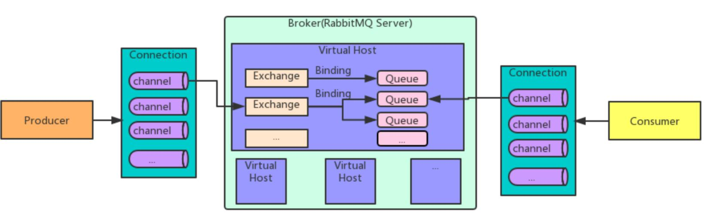
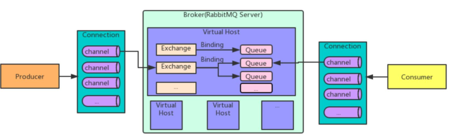

# RabbitMQ 知识汇总

RabbitMQ 是一个开源的消息中间件（message broker）：它接收应用发来的消息，先按规则存放，再转交给其他应用。它使用 Erlang 语言开发，主要实现 AMQP 0-9-1 协议，也支持 AMQP 1.0、MQTT、STOMP 等协议。本文按"是什么 → 为什么需要 → 怎么用"的顺序，讲清它的核心组件、四种交换机、消息可靠性与常见运维问题。

## 本文导读

本文篇幅较长，可按需跳读：

- 一、RabbitMQ 是什么：定位、最小示例、与 AMQP 的关系、默认端口
- 二、核心架构：生产者、交换机、队列、消费者、绑定、虚拟主机、连接与信道、消息
- 三、四种交换机类型：direct、fanout、topic、headers 的路由规则与对比
- 四、如何保证消息不丢失：发布确认、持久化、手动 ACK
- 五、如何解决消息堆积：原因分析与九类处理手段、预取数量
- 六、如何避免重复消费：重复来源与幂等方案
- 七、集群与高可用：普通集群、镜像队列的历史、仲裁队列
- 八、常见问题速查：交换机、插件、集群、事务、死信队列、持久化
- 九、参考资料

## 一、RabbitMQ 是什么

在写第一行业务代码之前，先弄清它解决什么问题、由哪些概念组成，后面配置交换机与队列时才不会照抄。本节给出整体定位、一个可直接运行的最小示例，以及与 AMQP 协议的关系。

### 1.1 一句话理解消息中间件

可以把 RabbitMQ 想成一个**快递分拣中心**：寄件人（生产者）把包裹交给分拣中心，分拣中心按地址（路由规则）把包裹放进对应的货架（队列），收件人（消费者）再到货架上取件。寄件人和收件人不必同时在场，也不必认识对方，这就是"异步"和"解耦"。

它通常解决三类问题：

1. **异步**：下单后发短信、发邮件这类操作不必卡住主流程，丢给消息队列慢慢做。
2. **解耦**：订单服务只管发消息，库存、积分、物流各自订阅，新增下游不用改上游代码。
3. **削峰**：瞬时流量先进入队列排队，消费者按自己的速度处理，避免数据库被打挂。

### 1.2 最小可用示例：发一条、收一条

以 Spring Boot 为例，加入依赖后配置连接信息：

```yaml
spring:
  rabbitmq:
    host: localhost
    port: 5672
    username: guest
    password: guest
```

声明交换机、队列和绑定关系（应用启动时会自动创建）：

```java
@Configuration
public class RabbitConfig {

    public static final String EXCHANGE = "demo.exchange";
    public static final String QUEUE = "demo.queue";
    public static final String KEY = "demo.key";

    @Bean
    public DirectExchange demoExchange() {
        // 参数依次为：名称、是否持久化、是否自动删除
        return new DirectExchange(EXCHANGE, true, false);
    }

    @Bean
    public Queue demoQueue() {
        return QueueBuilder.durable(QUEUE).build();
    }

    @Bean
    public Binding demoBinding(Queue demoQueue, DirectExchange demoExchange) {
        return BindingBuilder.bind(demoQueue).to(demoExchange).with(KEY);
    }
}
```

发送消息与接收消息：

```java
@Service
public class DemoProducer {

    private final RabbitTemplate rabbitTemplate;

    public DemoProducer(RabbitTemplate rabbitTemplate) {
        this.rabbitTemplate = rabbitTemplate;
    }

    public void send(String text) {
        rabbitTemplate.convertAndSend(RabbitConfig.EXCHANGE, RabbitConfig.KEY, text);
    }
}
```

```java
@Component
public class DemoConsumer {

    @RabbitListener(queues = RabbitConfig.QUEUE)
    public void onMessage(String text) {
        System.out.println("收到消息：" + text);
    }
}
```

这段代码体现了 RabbitMQ 的基本模型：生产者不直接操作队列，而是把消息交给交换机，由交换机根据绑定规则决定投递到哪些队列。

### 1.3 RabbitMQ 与 AMQP 的关系

两者关系密切，但属于不同层面的东西：

- **AMQP**（Advanced Message Queuing Protocol，高级消息队列协议）是一套**协议规范**，定义客户端与消息中间件之间如何通信，本身不是某个具体产品。
- **RabbitMQ** 是一个**具体的软件产品**，实现了 AMQP 0-9-1（官方文档也说明，新项目可考虑使用它同样支持的 AMQP 1.0）。

因此 AMQP 可以被多个产品实现，同一套协议下不同中间件的行为更接近；而 RabbitMQ 是最有影响力的实现之一。除 AMQP 外，它还能通过插件支持 MQTT、STOMP 等协议。

需要注意版本差异：RabbitMQ 长期以 AMQP 0-9-1 为主，协议里的概念（exchange、queue、binding、basic.ack 等）都来自这份规范；而 AMQP 1.0 是另一套模型（基于 link 与 settlement），两者并不完全兼容。

### 1.4 默认端口速查

排查连通性问题时，先确认端口是否放行：

| 端口 | 用途 |
| --- | --- |
| 5672 | AMQP 0-9-1 与 AMQP 1.0 客户端连接（默认端口） |
| 5671 | 同上，走 TLS 加密 |
| 15672 | 管理插件的 Web 界面与接口（需启用 management 插件） |
| 4369 | epmd，集群节点与命令行工具互相发现 |
| 25672 | 集群节点间通信（默认取 AMQP 端口 + 20000） |

## 二、核心架构：一条消息的旅程

RabbitMQ 的内部结构可以用"分拣中心"来理解：交换机是分拣台，绑定是分拣规则，队列是货架，虚拟主机是彼此隔离的仓库分区。下面这张图给出整体关系。



各组件职责一览：

| 组件 | 职责 |
| --- | --- |
| 生产者 Producer | 产生并发送消息，通常发送到交换机 |
| 交换机 Exchange | 消息的分发中心，按路由规则把消息投递到一个或多个队列 |
| 队列 Queue | 消息的存储区，等待消费者取走 |
| 消费者 Consumer | 订阅队列并处理消息 |
| 绑定 Binding | 交换机与队列之间的关联规则 |
| 虚拟主机 Virtual Host | 逻辑隔离单元，内部有独立的交换机、队列、权限 |
| 连接 Connection | 客户端与 Broker 之间的 TCP 连接 |
| 信道 Channel | 连接内的轻量级会话通道，可多个并存 |

### 2.1 生产者与消费者

生产者（Producer）是消息的发送方；消费者（Consumer）是消息的接收方，通过订阅队列获取消息。两者通常运行在不同进程甚至不同机器上，彼此只依赖"消息格式"这一个契约，这也是消息队列能解耦系统的原因。

### 2.2 交换机（Exchange）与绑定（Binding）

交换机负责"往哪儿送"，它本身不存消息。交换机与队列之间的关联叫绑定（Binding）：队列绑定到交换机时通常要给出一个绑定键（binding key），交换机再拿消息的路由键（routing key）去和绑定键比较，决定投递目标。

一个队列可以绑定多个交换机，一个交换机也可以绑定多个队列，这正是 RabbitMQ 路由灵活的来源。

### 2.3 队列（Queue）

队列是真正存消息的地方，有名字，可设置是否持久化、是否自动删除、最大长度、过期时间等属性。多个消费者可以同时订阅同一个队列，此时消息会在消费者之间分摊（竞争消费），一条消息只会被其中一个消费者拿到。

### 2.4 虚拟主机（Virtual Host）

虚拟主机是 RabbitMQ 的多租户隔离单位：不同 vhost 里的交换机、队列、绑定互不可见，适合区分开发、测试、生产等环境。

这里有一个容易说错的点：**用户是全局的，权限是按 vhost 授予的**。同一个用户可以被授权访问多个 vhost，也可以只被授权访问其中一个；并不存在"每个 vhost 拥有独立用户"这回事。vhost 之间的资源不能直接互联，需要应用分别连接两个 vhost 自行转发。

### 2.5 连接（Connection）与信道（Channel）

连接是客户端到 Broker 的 TCP 连接，开销较大；信道是在一条连接上复用的轻量级会话通道，发布、消费、声明队列等操作都在信道上完成。一个连接可以开多个信道，实践中通常"一个线程一个信道"，不要多线程共享同一个信道。

### 2.6 消息（Message）

消息由消息体（payload，字节数组）和一组属性组成，常用属性包括：

- `routing_key`：路由键，交换机据此选队列。
- `delivery_mode`：1 表示非持久化，2 表示持久化。
- `headers`：自定义键值对，headers 交换机据此路由。
- `expiration`：消息过期时间。
- `message_id`、`correlation_id`、`reply_to`：用于标识消息和实现请求响应模式。

Broker 只把消息体当作不透明字节，不会解析业务内容。

### 2.7 一次完整的投递过程

1. 生产者与 Broker 建立连接，打开信道。
2. 生产者把消息发布到某个交换机，并带上路由键。
3. 交换机按绑定规则计算出目标队列；没有匹配则丢弃（或按设置退回给生产者）。
4. 消息进入队列，若队列有消费者且有可用额度，则推送给消费者。
5. 消费者处理完成后确认（ACK），Broker 才把消息从队列删除。
6. 若消费者连接断开且未确认，消息会重新投递给其他消费者。

## 三、四种交换机类型

交换机类型决定了"路由键怎么用来选队列"。RabbitMQ 内置四种常用类型，理解它们的差异，基本就掌握了消息该往哪里发。

| 类型 | 路由依据 | 典型场景 |
| --- | --- | --- |
| direct | 路由键与绑定键完全相等 | 点对点、按业务键精确投递 |
| fanout | 忽略路由键，投递给所有绑定队列 | 广播通知、缓存刷新 |
| topic | 路由键按 `.` 分段后与通配符模式匹配 | 按类型、区域分类订阅 |
| headers | 消息 headers 的键值对匹配 | 多条件匹配，使用较少 |

### 3.1 direct（直连交换机）

direct 交换机按路由键**完全匹配**投递：队列绑定时要求路由键为 `key`，则只有路由键恰好是 `key` 的消息会进来，`key1`、`key.1` 都不会被投递。它是最常用的类型之一。

同一个绑定键可以绑定多个队列，此时这些队列都会收到同一条消息，因此 direct 既能单播也能多播。

需要澄清一个常见说法：direct **不是**"默认交换机"，二者不是一回事。RabbitMQ 另外预置了一个**无名默认交换机**（名字为空字符串，类型为 direct），见 3.5。

### 3.2 fanout（扇型交换机，广播）

fanout 交换机忽略路由键，把消息复制给所有绑定到它的队列。发送一条消息，无论路由键是什么，queue1、queue2、queue3、queue4 都会收到。适合"一处发生、多处关心"的场景，例如配置变更通知。

### 3.3 topic（主题交换机）

topic 也按路由键分发，但支持**通配符匹配**。路由键用 `.` 分成若干段，绑定模式里有两个通配符：

1. `*`：恰好匹配一段。
2. `#`：匹配零段或多段（绑定为 `#` 时等价于接收所有消息）。

例如发送路由键 `key1.key2.key3.key4`（共 4 段），以下绑定都能命中：

1. `key1.key2.key3.*`：成功，`*` 顶替最后一段。
2. `key1.#`：成功，`#` 覆盖剩余三段。
3. `*.key2.*.key4`：成功，第一、三段分别是 key1、key3，段数也正好是 4。
4. `#.key3.key4`：成功，`#` 覆盖前两段。

若发送路由键只有 `key1`，则只能匹配 `key1.#`（`#` 可以代表零段）。注意 `key1.*` 要求至少两段，因此匹配不上。

### 3.4 headers（头部交换机）

headers 交换机不看路由键，而是比较消息 headers 与绑定参数。队列绑定时必须给出 `x-match` 参数：

1. `x-match = all`：所有键值对都匹配才投递。
2. `x-match = any`：只要有一组键值对匹配就投递。

例如消息 headers 为 `{"name": "user_a"}`，queue2 绑定 `x-match=any` 且要求 `name=user_a`，能收到；queue1 绑定 `x-match=all` 且要求 `name=user_a` 与 `city=hangzhou` 两个条件，收不到。

另有两个细节：`x-match` 取 `any` / `all` 时，以 `x-` 开头的 header 不参与匹配；若要连 `x-` 开头的 header 一起比较，需使用 `any-with-x` / `all-with-x`。

关于性能，官方文档没有给出"比 direct 慢很多"的定量结论，但 headers 需要逐条比较绑定参数，实践中在高吞吐场景很少使用。是否选用应以压测结果为准，不要仅凭印象下结论。

### 3.5 默认交换机（default exchange）

RabbitMQ 在每个 vhost 中预置一个名字为空字符串的默认交换机，类型是 direct，并有一条特殊规则：**队列声明后会自动以队列名作为绑定键绑定到它**。因此发布到默认交换机、路由键写队列名，就能把消息直接送进该队列。

它适合简单场景。默认交换机不允许手动 bind / unbind，也不建议当作普通交换机来设计路由，需要自定义拓扑时应另外声明一个 direct 交换机。

## 四、如何保证消息不丢失

消息从生产者到消费者要经过两次网络传输和一次 Broker 内部路由，任一环节出问题都可能丢消息。本节按"哪里会丢 → 怎么补"的顺序展开。



### 4.1 三个可能丢消息的环节

- **生产者到 Broker**：网络中断导致消息没送到，或 Broker 尚未处理就宕机。
- **Broker 内部**：消息还没落盘就宕机重启；或者交换机没有匹配的绑定，消息被直接丢弃。
- **Broker 到消费者**：传输途中连接断开；或消费者拿到消息后处理失败、进程崩溃。

对应三类手段：生产者的**发布确认（publisher confirms）**、Broker 侧的**持久化**、消费者的**手动 ACK**。

### 4.2 生产者侧：发布确认（Publisher Confirms）

**是什么**：发布确认是 AMQP 0-9-1 的一个扩展机制，生产者把信道切换为 confirm 模式后，Broker 会对每条消息回一个确认，告诉生产者"这条我接手了"。

**为什么需要**：TCP 只保证字节送达，不保证 Broker 处理成功。没有确认，生产者根本不知道自己发的消息是否真的进了 Broker。

**怎么用**：先开启 confirm，再注册回调；若还关心"消息有没有进队列"，再配合 mandatory 与退回回调。

```yaml
spring:
  rabbitmq:
    # 开启发布确认，correlated 表示回调中可拿到 CorrelationData
    # 较新的 Spring Boot 使用 publisher-confirm-type，
    # 早期版本中的 publisher-confirms 已不再推荐
    publisher-confirm-type: correlated
    # 允许 Broker 把无法路由的消息退回给生产者
    publisher-returns: true
    template:
      # 发布时设置 mandatory=true，无法路由才会退回
      mandatory: true
```

```java
@Configuration
public class ConfirmConfig {

    @Bean
    public RabbitTemplate confirmRabbitTemplate(ConnectionFactory connectionFactory) {
        RabbitTemplate template = new RabbitTemplate(connectionFactory);
        template.setMandatory(true);

        // 确认回调：ack 为 true 表示 Broker 已接手该消息
        template.setConfirmCallback((correlationData, ack, cause) -> {
            if (ack) {
                System.out.println("Broker 已接手：" + correlationData);
            } else {
                System.out.println("Broker 未确认，原因：" + cause + "，需要重发");
            }
        });

        // 退回回调：消息到了交换机，但没有匹配到任何队列
        template.setReturnsCallback(returned ->
                System.out.println("消息无法路由，已被退回：" + returned.getReplyText()));
        return template;
    }
}
```

**语义要点（容易理解错）**：

- `ack` 只说明 Broker 已经接手并处理了这条消息，**不等于**消息一定进了队列。若交换机没有匹配的绑定且未设置 `mandatory`，消息会被静默丢弃。
- `nack` 表示 Broker 明确拒收，属于少数情况（例如内部处理失败），此时应安排重发。
- 因此"confirm + mandatory + 退回回调"三者要一起用，才能覆盖"没送到"和"送到了但没路由出去"两种情况。
- 发布到不存在的交换机会直接抛出信道级异常（404），信道被关闭，这类错误要靠异常捕获处理，而不是等确认。

**失败补偿（重试）**：确认失败或超时后需要重发。生产者侧的重试在 Spring Boot 中由 `spring.rabbitmq.template.retry.*` 控制：

```yaml
spring:
  rabbitmq:
    template:
      retry:
        enabled: true
        max-attempts: 3
        initial-interval: 1s
        multiplier: 2
```

注意不要和消费者侧的重试配置混为一谈，后者位于 `spring.rabbitmq.listener.simple.retry.*`，处理的是"消费方法抛异常"。

### 4.3 Broker 侧：持久化

**是什么**：把消息写入磁盘，使 Broker 重启后消息还在。

**为什么需要**：默认消息只存在内存里，进程一停就没了。

**怎么用**：需要同时满足三个条件，缺一不可。

1. **消息持久化**：发布时把 `delivery_mode` 设为 2（Spring AMQP 默认使用 `MessageDeliveryMode.PERSISTENT`，值即 2）。
2. **队列持久化**：声明队列时 `durable=true`，并配合 `autoDelete=false`、`exclusive=false`，否则队列本身会被删除。
3. **交换机持久化**：声明交换机时 `durable=true`，保证重启后路由规则还在。

```java
@Bean
public Queue orderQueue() {
    // durable=true，非独占，非自动删除
    return QueueBuilder.durable("order.queue").build();
}

@Bean
public DirectExchange orderExchange() {
    return new DirectExchange("order.exchange", true, false);
}
```

需要区分队列类型：

- **经典队列（classic）**：是否持久化由声明参数决定，消息是否落盘还取决于 `delivery_mode`。
- **仲裁队列（quorum）**：本身就是持久化、可复制的队列，消息一律落盘，与 `delivery_mode` 无关；声明时也不能声明为非持久化。
- **流式队列（stream）**：面向大吞吐的追加日志结构，同样是持久化的。

**代价**：持久化意味着磁盘写入，吞吐和延迟都会受影响。可靠性要求不高的场景（如日志采集）可以不持久化，用性能换吞吐。

### 4.4 消费者侧：手动 ACK

**是什么**：消费者处理完消息后显式告诉 Broker"可以删了"，这个动作叫确认（acknowledgement）。

**为什么需要**：若 Broker 一发出消息就删除，消费者处理到一半崩溃，这条消息就永久丢了。

**两种模式**：

- **自动确认（autoAck=true）**：消息一发出就视为送达并删除。吞吐高，但消费者崩溃会丢消息，官方文档明确提示这种模式不安全。
- **手动确认**：处理成功后由应用调用 `basicAck`；失败可调用 `basicNack` / `basicReject`，并选择是否重回队列。

Spring AMQP 还有第三种容易混淆的设置：`acknowledge-mode` 取 `auto`（默认）时，并不是"投递即删除"，而是**监听方法正常返回后由容器代为 ack**，抛异常则不 ack。它与 AMQP 层的 `autoAck=true` 不是同一件事。

```yaml
spring:
  rabbitmq:
    listener:
      simple:
        # 手动签收：由业务代码决定何时 ack
        acknowledge-mode: manual
        # 每个消费者最多同时持有 1 条未确认消息
        prefetch: 1
```

```java
@Component
public class ManualAckConsumer {

    @RabbitListener(queues = "demo.queue")
    public void receive(String body,
                        @Header(AmqpHeaders.DELIVERY_TAG) long deliveryTag,
                        Channel channel) throws IOException {
        try {
            System.out.println(body);
            // 处理成功：确认这一条，multiple=false 表示不批量确认
            channel.basicAck(deliveryTag, false);
        } catch (Exception e) {
            // 处理失败：requeue=true 表示重回队列，稍后重新投递
            // 若配置了死信队列，通常改为 requeue=false，让消息进入死信队列
            channel.basicNack(deliveryTag, false, true);
        }
    }
}
```

**注意事项**：

- 重回队列可能导致同一条消息被反复投递（死循环），建议限制重试次数，超过后转入死信队列。
- 消费者未 ack 就断开连接，消息会自动重新投递给其他消费者，因此"至少一次"投递是常态，重复消费要靠业务幂等兜底（见第六节）。
- 确认必须发在收到消息的同一个信道上，否则会报 unknown delivery tag 并关闭信道。

### 4.5 三者组合后仍是"至少一次"

发布确认 + 持久化 + 手动 ACK 组合起来，能保证消息**至少被处理一次**，但无法保证"恰好一次"。原因是确认与业务处理之间没有分布式事务：处理成功但 ack 丢失，消息会重投；ack 成功但业务回滚，消息也不会再来。所以可靠性设计的终点是"幂等消费"，而不是追求零重复。

## 五、如何解决消息堆积问题

队列里的消息只增不减，就是堆积。轻则延迟升高，重则触发内存告警、阻塞生产者。本节先找原因，再给对策。

### 5.1 常见的堆积原因

- 消费者处理慢（业务逻辑重、下游接口慢、单条消息太大）。
- 生产速度长期大于消费速度（流量突增、批量导入）。
- 消费者实例太少，或消费者频繁重启。
- 队列容量、内存、文件句柄等资源限制。
- 网络故障导致消费者与 Broker 断连，消息无人消费。
- 队列配置不当（如预取过大、确认模式不合适）。
- 消息本身过大，序列化与传输耗时。
- 消费者故障后消息反复重回队列，形成无效循环。

### 5.2 按原因对症下药

| 原因 | 主要手段 |
| --- | --- |
| 消费者处理慢 | 增加消费者实例、优化代码、限制预取数量 |
| 生产快于消费 | 生产端限流、错峰、扩容消费者 |
| 队列容量不足 | 调整队列长度限制与内存水位，必要时分流到多个队列 |
| 网络/节点故障 | 监控告警、持久化、使用可复制的队列类型 |
| 消费失败反复重投 | 死信队列兜底、限制重试次数 |
| 消息过大 | 拆分消息，大对象放对象存储，消息只带引用 |
| 业务逻辑复杂 | 拆分消费者职责，异步化下游调用 |

展开说明：

1. **消费者处理消息太慢**
    - 增加消费者数量：水平扩展，提高整体处理能力。
    - 优化消费者性能：减少数据库往返、批量写入、增加资源。
    - 消息预取限制（prefetch count）：限制每个信道同时未确认的消息数，避免一次拉太多把内存撑爆，也让多个消费者更公平地分摊。
2. **队列容量太小**
    - 调整队列设置（如最大长度、溢出策略），或按业务拆分多个队列分流。
3. **网络故障**
    - 监控和告警：监控连接数、网络状况，尽早发现断连。
    - 持久化和高可用：消息与队列持久化，并使用仲裁队列等可复制类型提高可用性。
4. **消费者故障**
    - 使用死信队列：把无法处理的消息转走，避免堵住主队列。
    - 容错机制：消费者自动重启、异常捕获与告警。
5. **队列配置不当**
    - 检查确认模式、预取数量、队列长度限制、消息 TTL 等配置是否合理。
6. **消息大小**
    - 消息分片：把大消息拆成小片段，或改为传引用，加快处理与传输。
7. **业务逻辑复杂或耗时**
    - 优化业务逻辑：把非核心步骤异步化，缩短单条消息处理时间。
8. **消息产生速度快于消费速度**
    - 使用消息限流：控制生产速度，不超过消费者的处理能力。
    - 负载均衡：确保消息在消费者之间公平分配，避免个别实例过载。
9. **其他配置优化**
    - 消息优先级：让高优先级消息先处理（经典队列需声明 `x-max-priority`）。
    - 调整 Broker 配置：文件描述符上限、内存水位、磁盘告警阈值等。

### 5.3 预取数量（prefetch）怎么设

预取数量由 `basic.qos` 设置，含义是**一个信道上允许同时存在多少条未确认消息**；达到上限后 Broker 会暂停向该信道推送，直到有消息被确认。取值 `0` 表示不限制。

需要注意：RabbitMQ 只支持信道级预取，不支持连接级或按消息大小预取。预取太小会频繁等待网络往返，吞吐上不去；预取太大则单实例囤积大量消息，故障时重投压力大，负载也不均衡。常见做法是从较小值（如 1~10）起步，压测后逐步调整。

## 六、如何保证消息不被重复消费

"不丢"和"不重"在分布式场景下是一对矛盾：为了保证不丢，失败就要重投，重投就可能重复。工程上的答案不是消灭重复，而是让重复**无害**，也就是幂等。

### 6.1 什么情况会导致重复消费

1. **生产者重复发送**：例如接口被重复调用两次，而上游没做幂等控制，于是产生两条业务上等价的消息。
2. **Broker 侧重投**：消费者处理完、正要回 ack 时 Broker 宕机，Broker 认为消息未被消费，恢复后再次投递。
3. **消费者侧重投**：消费者处理完、正要回 ack 时自己崩溃，重启后 Broker 认为未消费，再次投递。

### 6.2 四种常见方案对比

| 方案 | 思路 | 主要缺点 |
| --- | --- | --- |
| 数据库唯一键 | 依赖唯一索引挡住重复插入 | 只适合新增场景，性能较低 |
| 乐观锁 | 更新时带上版本号，版本不符则失败 | 字段与场景增多后维护成本高，同版本消息可能互相阻塞 |
| 消费记录表 | 消费前查、消费后写记录 | 并发下有检查空窗，可能穿透 |
| 幂等表 + 过期时间 | 记录消费状态并设置最长消费时间 | 实现复杂，异常时状态可能长期停在"消费中" |

### 6.3 方案细节

**使用数据库唯一键约束**

给业务表加唯一索引（如订单号），重复消息插入时直接失败。缺点是局限性很大，**仅适用于数据新增场景**，更新类业务无能为力，而且依赖数据库约束，性能也比较低。

**使用乐观锁**

假设要更新订单状态，**发送消息时带上修改字段的版本号**，更新语句形如 `update ... set status=?, version=version+1 where id=? and version=?`。版本不匹配则更新 0 行，说明已被处理过。

缺点是：更新字段多、更新场景多时，数据库字段会不断膨胀；另外多条消息同时在队列中且版本号一致时，排在后面的消息可能永远更新不到。

**插入消费记录，消费前先判断**

思路是维护一张消息消费表，处理前查是否已消费，处理完写入记录。

优点是实现简单，很多场景下确实能起到不错的效果。缺点有两个：

1. 存在检查空窗：消费者处理需要 1 秒，重复消息若在这 1 秒内（例如 100 毫秒时）到达（生产者快速重发、Broker 重启等），查询时上一条还没写完记录，于是判定为"未消费"。
2. 会穿透检查的挡板，让重复消息进入非幂等安全的业务代码，引发重复消费。

**并发消息去重：基于消息幂等表**

用"插入唯一记录"来抢占消费权：插入成功者才执行业务。

- 缺点：若第一次投递异常未消费成功，又没有把状态置为成功或删除记录，后续每次重试都看到"消费中"，最终被当作消费失败投递到死信队列。
- 方案：插入的消息记录必须带一个最长消费过期时间，例如 10 分钟，超时后可被重新抢占。

上述方案都需要一个存储中心，可以把介质换成更灵活的 Redis：

- 性能损耗更低。
- 超时时间可直接利用 Redis 的 TTL 实现，不必自己写清理任务。

### 6.4 小结

1. 利用数据库唯一键约束（仅适合新增）。
2. 利用乐观锁（适合状态更新）。
3. 插入消费记录或幂等表（通用，但要处理空窗与超时）。
4. 更彻底的做法是把消费逻辑本身写成幂等：重复执行结果一致，就不必再纠结去重。

不丢和不重（在分布式场景下）是矛盾的，开发者根据业务实际需求选择相应方式即可。

## 七、集群与高可用

单节点宕机就意味着服务不可用，因此生产环境通常部署集群。本节说明集群复制了什么、没复制什么，以及镜像队列为什么不再是推荐方案。

### 7.1 集群复制的是元数据

RabbitMQ 集群由多个节点组成，节点之间共享用户、虚拟主机、交换机、队列定义、绑定等**元数据**。但默认情况下，队列里的**消息**只存在一个节点上（经典队列），其他节点只知道这个队列"在哪里"。

客户端可以连接任意节点，Broker 会把操作转发到队列所在节点。因此"集群"本身并不等于"消息有多份"。

补充两点实践建议：官方推荐使用奇数个节点（1、3、5、7），两节点集群在失去连接时无法形成多数派，被明确不推荐；跨机房部署要评估节点间延迟。

### 7.2 普通集群（Classic Cluster）

普通集群利用 Erlang 自带的分布式能力搭建，各节点之间只有相同的元数据，消息不冗余，只存在一个节点中。

消费时，如果消费者连接的节点不是存有数据的节点，RabbitMQ 会临时在节点之间传输数据。这种模式可靠性有限：

- 某节点宕机后，其上的消息无法消费，需等节点恢复。
- 恢复过程中消费者端已消费过的消息可能拿不到正确应答，恢复后会再次投递，造成重复消费。
- 消息未持久化则重启即丢失。
- 不具备自动故障转移，节点挂了往往需要人工介入。

它只适合对消息安全性要求不高的场景。使用时可以让消费者尽量连接每一个节点，减少消息在集群内的搬运。

### 7.3 镜像队列的历史与仲裁队列

**镜像队列（Mirrored Queue）** 曾在普通集群之上提供高可用：队列在多个节点上保存副本，主副本故障后从副本接管。它的代价是每次写入都要同步到所有镜像，占用大量集群内网络带宽，队列数量多时性能下降明显。

需要更新一个常见说法：**经典队列镜像已被官方标记为废弃，并在 RabbitMQ 4.0 中被移除**。因此"镜像集群是官方高可用方案"已经过时，新项目不应再按这种方式设计。

现在官方推荐的可复制队列是**仲裁队列（Quorum Queue）**：基于 Raft 一致性算法实现，队列内容在多个节点上复制，多数副本在线即可继续服务，leader 故障会自动选举新 leader。它以持久化为前提（消息一律落盘），因此延迟高于经典队列，适合订单、支付这类不能丢消息的场景；临时队列、超低延迟、超大积压（数百万条以上）等场景则要谨慎选择。

### 7.4 怎么选

| 场景 | 建议 |
| --- | --- |
| 本地开发、临时队列 | 单节点 + 经典队列即可 |
| 消息可丢、追求吞吐 | 经典队列 + 普通集群，接受节点故障时的不可用 |
| 消息不能丢、需要自动故障转移 | 仲裁队列（3 个或 5 个节点） |
| 海量积压、需要重复读取 | 流式队列（Stream） |
| 跨机房、跨集群分发 | Shovel 或 Federation 插件，而不是拉伸单个集群 |

## 八、常见问题速查

本节汇总高频问题，可作为复习清单。每条都给出可直接用于回答的要点。

### 8.1 RabbitMQ 有哪几种交换机类型？

1. **Direct Exchange**：路由键与绑定键完全相等才投递，适合点对点。
2. **Topic Exchange**：路由键按 `.` 分段后与模式匹配，`*` 匹配一段、`#` 匹配零或多段，适合发布订阅与分类路由。
3. **Fanout Exchange**：忽略路由键，广播给所有绑定队列，适合通知类场景。
4. **Headers Exchange**：按消息 headers 匹配，绑定参数用 `x-match` 控制 all / any，适合复杂条件匹配。
5. **Default Exchange**：预置的无名 direct 交换机，路由键即队列名，队列声明时自动绑定，不能手动 bind。

### 8.2 什么是 RabbitMQ？有什么显著特点？

RabbitMQ 是一个开源消息中间件，使用 Erlang 开发，适合分布式场景下应用之间的异步通信。显著特点：

1. **消息模式丰富**：支持发布订阅、点对点、工作队列等。
2. **路由灵活**：通过交换机与绑定实现按内容、按路由键分发。
3. **确认机制**：消费者 ACK 与生产者发布确认，保证消息不轻易丢失。
4. **可扩展**：可通过增加节点组建集群提升吞吐与可用性。
5. **多语言客户端**：Java、Python、Ruby、Node.js 等均有成熟客户端。
6. **持久化**：消息、队列、交换机都可持久化，重启不丢。
7. **插件体系**：管理、联邦、Shovel、延迟消息等能力以插件形式提供。
8. **管理界面**：自带 Web 管理界面，可查看队列、交换机、连接、权限等。

### 8.3 常用的 RabbitMQ 插件

1. **Management Plugin**：提供 Web 管理界面与接口，查看并操作队列、交换机、连接、信道。
2. **Shovel Plugin**：在多个 Broker 之间搬运消息，可用于数据复制、故障恢复、跨机房同步。
3. **Federation Plugin**：让不同集群之间建立联邦，按需转发消息，适合跨地域部署。
4. **STOMP Plugin**：支持 STOMP 协议，方便非 AMQP 客户端（如浏览器场景）接入。
5. **Prometheus Plugin**：暴露监控指标，接入 Prometheus 做告警。
6. **Delayed Message Plugin**：提供延迟投递能力，适合定时任务、延迟重试。

### 8.4 RabbitMQ 如何构建集群？

传统上分为两种形态：

- **普通集群**：共享元数据，消息只存一份。可靠性一般，节点故障时其上的消息不可用，适合对安全性要求不高的场景。
- **镜像集群（历史方案）**：在普通集群之上做队列镜像，每个镜像节点保存全量消息，可靠性更高，但同步会消耗大量网络带宽。该方案已被官方废弃，并在 4.0 起移除。

当前推荐做法是：搭建普通集群保证元数据一致，再使用**仲裁队列**获得消息级复制与自动故障转移。节点数建议为奇数（3、5、7），跨机房场景应使用 Federation 或 Shovel 连接多个集群，而不是把单个集群拉到广域网。

### 8.5 RabbitMQ 的核心组件有哪些？

1. **Broker**：RabbitMQ 服务端进程，负责接收、路由、存储与投递消息。
2. **Virtual Host**：逻辑隔离单元，内部有独立的交换机、队列、绑定与权限。
3. **Connection**：客户端与 Broker 之间的 TCP 连接。
4. **Channel**：连接内的轻量级会话通道，一个连接可开多个信道。
5. **Exchange**：消息中转站，按类型与绑定规则路由消息。
6. **Queue**：消息存储位置，等待消费者取走。
7. **Binding**：交换机与队列之间的关联规则。

此外，生产者负责发送消息到交换机，消费者负责订阅队列并处理消息。

### 8.6 RabbitMQ 中如何进行事务处理？

AMQP 0-9-1 提供信道级事务，把一组发布或确认操作打包成一个原子单元：

1. **开启事务**：调用 `tx.select`（Java 客户端为 `channel.txSelect()`）。
2. **发送消息**：在事务内正常发布。
3. **提交事务**：调用 `tx.commit` 提交，Broker 统一处理。
4. **回滚**：捕获异常后调用 `tx.rollback()`，撤销事务内未提交的操作。

```java
channel.txSelect();
try {
    channel.basicPublish("demo.exchange", "demo.key", null, body);
    channel.txCommit();
} catch (Exception e) {
    channel.txRollback();
}
```

注意两点：事务是**同步**的，每次提交都要等待 Broker 响应，吞吐下降明显；实践中更推荐用发布确认替代事务，因为确认是异步的、开销更小，事务一般只在特殊场景使用。另外，AMQP 事务只覆盖消息的发布与确认，与数据库事务无关，不能靠它实现"发消息 + 写库"的原子性，这类需求要用本地消息表或事务消息等方案。

### 8.7 RabbitMQ 支持哪些消息模式？

- **workQueue 工作队列**：多个消费者竞争同一个队列，消息被分摊处理。
- **Publish/Subscribe 发布订阅**：生产者发给 fanout 交换机，交换机把消息复制给所有绑定队列。
- **Routing 基于内容路由**：在发布订阅基础上增加 routingKey，按精确匹配决定投递目标。
- **Topic 基于话题路由**：在路由基础上支持 `*`、`#` 通配符，实现模糊匹配。
- **RPC 远程调用**：借助 `reply_to` 与 `correlation_id` 实现请求响应，一般使用较少。

### 8.8 RabbitMQ 和 AMQP 是什么关系？

- **AMQP** 是协议规范，定义消息中间件与客户端之间的通信标准，不是具体产品。
- **RabbitMQ** 是具体产品，实现了 AMQP 0-9-1，并通过插件支持 AMQP 1.0、MQTT、STOMP 等协议。

AMQP 是开放标准，理论上可被任何产品实现，因此基于该标准编写的客户端有较强的可移植性。目前实现该标准的产品不多，RabbitMQ 是最有影响力的一个，常被视为 AMQP 的代表实现。Spring Boot 的 `spring-boot-starter-amqp` 默认就是通过 AMQP 0-9-1 与 RabbitMQ 通信。

### 8.9 RabbitMQ 是如何实现死信队列的？

死信队列（Dead Letter Queue）用于接收"无法被正常消费"的消息。严格来说它不是一个特殊类型的队列，而是一套转发机制：给普通队列配置死信交换机（DLX），消息在满足条件时被重新发布到该交换机，再由它路由到死信队列。

**四种情况会产生死信**（以官方文档为准）：

1. 消息被消费者拒绝（`basic.reject` 或 `basic.nack`，且 `requeue=false`）。
2. 消息到达过期时间（TTL）仍未被消费。
3. 队列达到最大长度限制，消息被丢弃或拒绝。
4. 仲裁队列中消息重回次数超过投递上限（`delivery-limit`）。

注意：整个队列过期时，队列里的消息**不会**变成死信。

**配置方式**：给正常队列增加三个参数（队列声明参数需带 `x-` 前缀）：

1. `x-dead-letter-exchange`：死信要转发到的交换机。
2. `x-dead-letter-routing-key`：转发时使用的路由键（不设置则沿用原路由键）。
3. `x-message-ttl`：消息在队列中的存活时间（也可用 `x-max-length` 限制长度）。

```java
Map<String, Object> args = new HashMap<>();
args.put("x-dead-letter-exchange", "dlx.exchange");
args.put("x-dead-letter-routing-key", "dlx.key");
args.put("x-message-ttl", 60000);          // 60 秒未消费即成为死信
args.put("x-max-length", 10000);            // 超过 1 万条后按策略丢弃

return QueueBuilder.durable("order.queue").withArguments(args).build();
```

也可以用策略统一配置，避免把参数写死在代码里：

```bash
rabbitmqctl set_policy DLX ".*"   '{"dead-letter-exchange":"dlx.exchange","dead-letter-routing-key":"dlx.key"}'   --apply-to queues --priority 7
```

**转发后的消息**：Broker 会在消息头里补充死信信息，如 `x-death`（记录原队列、原因、次数）、`x-first-death-*`、`x-last-death-*`。应用可以据此判断失败原因，做补偿、告警或人工处理。

**注意事项**：死信交换机必须在需要转发时已存在，否则消息会被静默丢弃；死信转发默认不开启发布确认，集群环境下仍有丢失风险，仲裁队列支持"至少一次"的死信转发，可另行开启。

### 8.10 RabbitMQ 如何实现消息的持久化？

1. **消息持久化**：发布时把 `delivery_mode` 设为 2。
2. **队列持久化**：声明队列时 `durable=true`；经典队列、仲裁队列、流式队列的规则不同——经典队列由声明参数决定，仲裁队列与流式队列本身就必须持久化，不能声明为非持久化。
3. **交换机持久化**：声明交换机时 `durable=true`，保证重启后路由关系还在。

持久化会影响性能，需要按业务权衡：核心交易类消息必须持久化，日志、埋点类消息可以只做有限持久化甚至不持久化。

## 九、参考资料

以下为撰写时查阅的公开资料，仅列出名称与年份，便于进一步核对细节。

- RabbitMQ 官方文档. Exchanges（交换机类型、默认交换机、绑定）. 2026
- RabbitMQ 官方文档. AMQP 0-9-1 Model Explained（协议模型、确认模式、预取）. 2026
- RabbitMQ 官方文档. Consumer Acknowledgements and Publisher Confirms（ACK 与发布确认）. 2026
- RabbitMQ 官方文档. Publishers（不可路由消息与 mandatory）. 2026
- RabbitMQ 官方文档. Dead Letter Exchanges（死信条件与配置）. 2026
- RabbitMQ 官方文档. Quorum Queues（仲裁队列、镜像队列移除）. 2026
- RabbitMQ 官方文档. Clustering（集群复制范围、节点数建议）. 2026
- RabbitMQ 官方文档. Networking（默认端口与节点间通信）. 2026
- RabbitMQ 官方文档. Virtual Hosts（用户与权限的作用域）. 2026
- Spring Boot 官方文档. AMQP（spring.rabbitmq 配置项与重试）. 2026
