# Redis 知识体系：数据结构、持久化与高可用实践

Redis（REmote DIctionary Server）是一个开源的、把数据放在内存里的键值数据库，常被用作缓存、计数器、排行榜、分布式锁和轻量消息队列。本文面向有一年左右 Java 经验、会写 CRUD 但不熟悉中间件内部的开发者，按"是什么 → 为什么需要 → 怎么用"的顺序，把数据类型、持久化、过期淘汰、缓存问题、高可用和分布式锁串成一条线。凡是与版本相关的结论都会标注适用版本，未标注的以 Redis 7.x 为准。

## 本文导读

- 第一章：Redis 概览、为什么快、适用场景，以及 6.0 / 7.0 等版本的差异
- 第二章：五种基本数据类型与 Bitmaps、HyperLogLog、GEO，以及底层编码（7.0 起 ziplist 换成 listpack）
- 第三章：持久化机制 RDB、AOF、混合持久化，以及 7.0 的多文件 AOF
- 第四章：过期策略、内存淘汰策略与 LFU/LRU 的实现思路
- 第五章：缓存穿透、击穿、雪崩与缓存数据库一致性
- 第六章：主从复制、哨兵、Cluster 分片与槽位
- 第七章：分布式锁的六种写法、看门狗、Redlock 及其局限
- 第八章：单线程模型、6.0 的多线程 I/O、事务与 Pipeline
- 第九章：大 key、热 key 与键值设计原则
- 第十章：性能调优与线上排障清单
- 第十一章：访问量统计、幂等、延时任务、SCAN 遍历等工程实践

## 一、Redis 概览与版本演进

这一章先建立整体印象：Redis 解决什么问题、为什么它比直接查数据库快、它能承担哪些业务，以及不同版本之间有哪些容易踩坑的差异。后面的章节都建立在这些概念之上。

### 1.1 Redis 是什么

Redis 是一个键值（key-value）数据库：key 是二进制安全的字符串，value 可以是字符串、哈希、列表、集合、有序集合等结构。它把数据放在内存中，因此读写延迟远低于访问磁盘的关系型数据库。

可以这样理解：内存像办公桌面，常用资料随手可取；磁盘像档案柜，容量大但要走过去翻。Redis 就是那张桌面，MySQL 是那个柜子。桌面空间有限，所以 Redis 需要过期策略、淘汰策略和分片来管理容量（见第四章、第六章）。

部署形态上，Redis 支持单机、主从、哨兵（Sentinel）、集群（Cluster）四种，后三种用于高可用与横向扩展。

### 1.2 为什么 Redis 快

常见原因可以归为四点：

1. **纯内存操作**：命令执行不涉及磁盘 I/O，只做内存读写。
2. **命令执行单线程**：不存在多线程争抢同一份数据，省掉了加锁、解锁和线程上下文切换。
3. **I/O 多路复用 + 事件驱动**：一个线程借助 epoll 这类机制同时管理大量连接，不必为每个连接开线程。
4. **数据结构为场景定制**：简单动态字符串（SDS）、哈希表、跳表、listpack、quicklist 都在内存与时间复杂度上做过取舍。

需要提醒的是，"快"是相对的：它取决于网络往返、命令复杂度、value 大小和实例负载。网上常见的"单机十万级 QPS"属于特定压测环境下的经验值，不能当作容量规划依据。

### 1.3 为什么把数据放内存

1. **读写快**：内存访问比磁盘寻址快若干数量级，适合高频小数据读写。
2. **结构直接映射**：哈希表、跳表等结构可以直接在内存中维护，不需要像磁盘数据库那样做页管理和复杂转换。
3. **有持久化兜底**：RDB / AOF 让内存数据在重启后仍可恢复（见第三章）。
4. **内存可控**：`maxmemory`、过期策略、淘汰策略、集群分片共同约束内存占用。

### 1.4 与 Memcached 的对比

| 维度 | Redis | Memcached |
| --- | --- | --- |
| value 类型 | String、Hash、List、Set、ZSet、Bitmaps、HLL、GEO、Stream 等 | 只有字符串（二进制） |
| 单个 value 上限 | 512 MB（受 `proto-max-bulk-len` 限制） | 默认 1 MB，可通过启动参数调大 |
| 持久化 | 支持 RDB / AOF | 不支持 |
| 脚本 | 支持 Lua 脚本、7.0+ 支持 Functions，可原子执行多步逻辑 | 不支持 |
| 分布式 | 原生 Cluster 分片 | 一般靠客户端做一致性哈希 |
| 过期与淘汰 | 支持过期、多种淘汰策略 | 支持过期（LRU 语义） |

结论：需要丰富结构、持久化或原子多步操作时选 Redis；只做纯字符串缓存且希望极简时 Memcached 仍可用，但社区使用面已明显偏向 Redis。

### 1.5 常用应用场景

- **缓存**：热点数据、页面数据、会话（Session）共享
- **计数与限流**：`incr` / `decr`、令牌桶
- **排行榜**：ZSet 按分数排序
- **分布式锁**：`SET NX PX` + Lua 释放（见第七章）
- **地理位置**：GEO 存储门店、计算距离
- **去重与 UV 统计**：Set、Bitmaps、HyperLogLog
- **轻量消息**：List 做队列、Pub/Sub 做广播、Stream 做可回溯的消息流
- **签到、活跃标记**：Bitmaps 按位记录

### 1.6 一个实例能放多少 key（常见误区）

Redis 官方没有给出"key 数量硬上限"的配置项，实际容量由内存决定。历史上官方 FAQ 提到过"最多约 2^32 个 key、实践中测试过 2.5 亿个"，这属于经验数据，不同版本与硬件下差异很大，不应作为容量规划依据。

工程上的判断标准是：先算单个 key 的平均内存占用（`MEMORY USAGE` 可估算），再乘以 key 数量，与 `maxmemory` 对比。key 数量到千万级后，`KEYS`、全量 RDB、fork 都会明显变慢，此时应改用 Cluster 分片（见 6.3）。

### 1.7 版本演进与本文的版本标注

| 版本 | 与本文相关的关键变化 |
| --- | --- |
| 3.2 | 引入 GEO 地理位置类型 |
| 4.0 | 引入 lazyfree（`UNLINK`）、LFU 淘汰、混合持久化选项、`MEMORY USAGE` |
| 5.0 | 引入 Stream 类型；`slave` 相关配置逐步改名为 `replica` |
| 6.0 | ACL 用户权限、SSL、RESP3、客户端缓存；**可选的多线程 I/O（`io-threads`）** |
| 6.2 | `GEOSEARCH` 取代 `GEORADIUS` 系列；哨兵支持主机名 |
| 7.0 | **Hash/List/ZSet 用 listpack 取代 ziplist**；**多文件 AOF（manifest）**；Functions；ACL 支持 key 粒度权限与选择器；RDB 格式升到 v10 |
| 7.2 | Set 也支持 listpack 编码 |
| 8.x | 持续增强；8.4 起提供 `DELEX`、`SET ... IFEQ` 等原子比较命令；8.6 新增 LRM 淘汰策略 |

## 二、数据类型与底层编码

这一章讲 Redis 能存什么、每种类型的常用命令和典型场景，并解释"同一种类型为什么会有不同编码"。理解编码很重要，因为它直接决定内存占用和某些命令的耗时。

### 2.1 类型总览

| 类型 | 结构语义 | 典型命令 | 典型场景 |
| --- | --- | --- | --- |
| String | 单个值，可为文本、数字或二进制 | `set` `get` `incr` `mset` | 缓存对象、计数、锁 |
| Hash | field-value 映射，类似 Java 的 `HashMap` | `hset` `hget` `hgetall` | 存对象属性、购物车 |
| List | 按插入顺序排列的字符串列表 | `lpush` `rpop` `lrange` | 队列、栈、时间线 |
| Set | 无序、去重的字符串集合 | `sadd` `sinter` `spop` | 去重、共同好友、抽奖 |
| ZSet | 带分数的有序集合，按分数排序 | `zadd` `zrange` `zincrby` | 排行榜、延时队列 |
| Bitmaps | 以位为单位操作的字符串 | `setbit` `bitcount` | 签到、活跃统计 |
| HyperLogLog | 基数估算结构，底层仍是字符串 | `pfadd` `pfcount` | UV 估算 |
| GEO | 经纬度索引，底层用 ZSet | `geoadd` `geosearch` | 附近的人/店 |

### 2.2 String

字符串是 Redis 最基础的类型，其他结构在实现上都建立在字符串与集合语义之上。value 可以是文本、整数或二进制数据，单个 value 最大 512 MB（由 `proto-max-bulk-len` 控制，默认 `512mb`）。

**常用命令：**

- 读写：`set key value [ex seconds] [px milliseconds] [nx|xx]`、`get`、`getset`、`append`、`strlen`
- 批量：`mset` / `mget`
- 计数：`incr` / `decr` / `incrby`
- 区间：`setrange` / `getrange`

**两个选项要记牢：**

- `nx`：key 不存在时才设置成功，分布式锁的基础
- `xx`：key 存在时才设置成功

`setnx` 可以看作 `set ... nx` 的早期写法，单线程执行命令保证了并发下只有一个客户端能设置成功。但 `setnx` 与 `expire` 是两条命令，中间异常会导致锁不过期，正确写法见 7.3。

**批量操作为什么重要：** 执行 n 次 `get` 的耗时约为"n 次网络往返 + n 次命令执行"；执行 1 次 `mget` 约为"1 次网络往返 + n 次命令执行"。网络往返往往是主要开销，所以批量接口能显著降低总延迟。

**三种编码：**

| 编码 | 触发条件 | 特点 |
| --- | --- | --- |
| `int` | 值是 8 字节长整型范围内的整数 | 直接把数值存在指针位置，最省内存 |
| `embstr` | 长度 ≤ 44 字节的短字符串 | 对象头与内容一次分配、内存连续 |
| `raw` | 长度 > 44 字节，或 `embstr` 被修改 | 对象头与内容分两次分配 |

`embstr` 是只读优化的编码，一旦被 `append`、`setrange` 等命令修改，就会升级成 `raw`，且不会自动降级。

**SDS（简单动态字符串，Simple Dynamic String）：** Redis 没有直接用 C 字符串，而是自己封装了 SDS，原因有四条：

1. 取长度为 O(1)，C 字符串要遍历到 `\0`
2. 支持动态扩容，不会缓冲区溢出
3. 预分配减少内存分配次数：新长度 < 1 MB 时按翻倍扩容，≥ 1 MB 时每次多分配 1 MB
4. 二进制安全：以长度而不是 `\0` 判断结尾，可以存图片、序列化对象

**使用场景：** 缓存对象（配合 JSON）、计数器、共享 Session、限速、分布式锁。

### 2.3 Hash

Hash 是 field-value 的映射，可以理解为"一个 key 下挂了一张小表"，适合存对象的多个属性，避免把整个对象序列化成一个字符串后反复读写。

**常用命令：** `hset` / `hget` / `hdel` / `hlen` / `hmset` / `hmget` / `hexists` / `hkeys` / `hvals` / `hgetall` / `hincrby`。

两个注意点：

- `hgetall` 在 field 很多时会一次性返回全部数据，阻塞其他命令；遍历应改用 `hscan` 渐进式扫描
- 单个 Hash 最多可存约 2^32 - 1 个 field（实现相关的理论上限，实际受内存限制）

**存储结构：** Hash 底层是字典（dict），字典由哈希表（dictht）与哈希节点（dictEntry）组成。字典内部维护 `ht[0]` 和 `ht[1]` 两张哈希表，rehash 时两张表同时存在，这是渐进式 rehash 的基础。

**哈希冲突怎么解决：** 采用链式哈希（拉链法）——同一个桶内的节点用链表串起来。冲突过多时链表变长、查询退化，所以需要扩容。

**渐进式 rehash：** 如果一次性把几百万个节点从 `ht[0]` 搬到 `ht[1]`，主线程会卡住。Redis 的做法是把搬迁成本摊到每次请求上：

1. 每次增删改查时检查 `rehashidx`，顺带把一部分节点搬到 `ht[1]`
2. rehash 期间新增的节点直接写入 `ht[1]`
3. 查询、删除等操作先在 `ht[0]` 找，找不到再去 `ht[1]`

可以类比搬家：不是请假一天把家搬完，而是每天下班顺路搬两箱，直到搬空。代价是这期间两套房都要能查。

**扩容时机：** 当负载因子 `loadFactor = used / size` 满足条件时触发扩容：

- 没有正在执行 `bgsave` / `bgrewriteaof` 时，`loadFactor >= 1` 即扩容
- 正在执行上述后台任务时，阈值提高到 `>= 5`（尽量不额外占用内存）
- 扩容目标是大于 `used + 1` 的最小 2 的 n 次幂

### 2.4 List

List 是按插入顺序排列的字符串序列，支持两端插入和弹出，可以当队列（`lpush` + `rpop`）或栈（`lpush` + `lpop`）使用。

**常用命令：** `lpush` / `rpush` / `lpop` / `rpop` / `lrange` / `llen` / `lrem` / `ltrim` / `lindex` / `blpop` / `brpop`（阻塞版，适合做简易队列）。

**底层结构：** quicklist，即"由 listpack 节点组成的双向链表"。每个节点内部是一段连续内存（listpack），节点之间用指针相连，兼顾了内存紧凑与两端操作效率。`list-max-listpack-size -2` 表示每个节点约 8 KB；`list-compress-depth 0` 表示默认不压缩中间节点。

版本提示：7.0 之前 quicklist 的节点是 ziplist，7.0 起换成 listpack；7.0 还放开了单个元素超过 4 GB 的限制。

### 2.5 Set

Set 是无序、自动去重的字符串集合，适合做去重、交并差和随机抽取。

**常用命令：** `sadd` / `srem` / `sismember` / `scard` / `smembers` / `sinter` / `sunion` / `sdiff` / `spop` / `srandmember`。

**编码：** 元素全是整数且数量不超过 `set-max-intset-entries`（默认 512）时用 intset（整数集合）；元素较多或含非整数时用 hashtable；7.2 起在元素较短时还会用 listpack。

注意：`smembers` 会返回全部元素，大集合上会阻塞，遍历应使用 `sscan`。

### 2.6 ZSet

ZSet（sorted set）是带分数（score）的有序集合，元素按分数升序排列，分数相同则按字典序。它是排行榜、延时队列的常用结构。

**常用命令：** `zadd` / `zrange` / `zrevrange` / `zrangebyscore` / `zrank` / `zscore` / `zincrby` / `zrem` / `zcard` / `zcount`。

**底层结构：** 元素少且短时用 listpack（7.0 前是 ziplist，阈值 `zset-max-listpack-entries 128`、`zset-max-listpack-value 64`）；超过阈值后改为"跳表 + 字典"：跳表负责按分数范围查询和排序，字典负责 O(1) 查分数。

**为什么用跳表而不是红黑树或 B+ 树：** 跳表实现简单、范围查询友好（找到起点后顺着底层链表走即可），且不需要在插入删除时做复杂的平衡旋转。Redis 数据量远小于 MySQL，内存随机访问又快，多跳几层的开销可以接受。

### 2.7 Bitmaps

Bitmaps 不是独立类型，而是在字符串上按位操作，每一位代表一个二值状态（是否签到、是否活跃）。

**常用命令：** `setbit key offset 1`、`getbit`、`bitcount`（统计 1 的个数）、`bitop`（按位与/或/异或）、`bitpos`。

**容量估算：** 按 offset 表示用户编号时，1 亿个用户约占 1 亿 bit ≈ 12 MB，非常省内存。

**优点与缺点：**

- 优点：按位存储，相比用 Set 存用户 ID（每个 ID 至少若干字节）内存差距通常在数量级以上
- 缺点：用户编号稀疏（比如只有几个很大的 ID）时，位图会按最大 offset 分配，反而更占内存

**适用：** 日活/月活统计、签到、布尔型标记。

### 2.8 HyperLogLog

HyperLogLog（HLL）是基数估算结构，用于统计"有多少个不同的元素"，只给近似值，但内存极小。

**特点：** 标准误差约 0.81%，内存最多约 12 KB（稀疏编码时更小），底层类型仍是字符串。命令为 `pfadd` / `pfcount` / `pfmerge`。

**原理简版：**

1. 基于伯努利试验：不断抛硬币，记录"第一次出现正面时抛了多少次"，用最大值 k 估算总次数 n ≈ 2^k
2. 单点估算误差太大，于是分成 16384 个桶分别估计，再用调和平均数汇总，过滤掉个别极端值
3. 每个桶用 6 bit 存计数，16384 × 6 / 8 ≈ 12 KB


**适用与不适用：** 适合 UV 这类"105 万和 106 万差别不大"的统计；不适合需要判断"某个用户是否在集合里"或要求精确计数的场景。

### 2.9 GEO

GEO 从 Redis 3.2 开始提供，用于存储经纬度并做距离计算、范围查询。底层用 ZSet 实现：把二维经纬度通过 GeoHash 算法编码成一个 52 位整数，作为 ZSet 的 score。

**常用命令：** `geoadd` / `geopos` / `geodist` / `geohash`，范围查询用 `geosearch`（6.2+）。

版本提示：`georadius` / `georadiusbymember` 自 6.2 起被标记为废弃，新项目应使用 `geosearch` / `geosearchstore`。GEO 没有专门的删除命令，用 `zrem` 删除成员即可。

### 2.10 编码对照表与 7.0 的变化

| 类型 | 小数据量编码 | 大数据量编码 | 相关配置（7.0 默认值） |
| --- | --- | --- | --- |
| String | `int` / `embstr` | `raw` | 无 |
| Hash | listpack（≤512 项且单值 ≤64 字节） | hashtable | `hash-max-listpack-entries 512`、`hash-max-listpack-value 64` |
| List | quicklist（节点为 listpack，约 8 KB/节点） | 同左，仅节点数变化 | `list-max-listpack-size -2`、`list-compress-depth 0` |
| Set | intset（全整数且 ≤512） | hashtable | `set-max-intset-entries 512`；7.2+ 增加 listpack |
| ZSet | listpack（≤128 项且单值 ≤64 字节） | skiplist + dict | `zset-max-listpack-entries 128`、`zset-max-listpack-value 64` |

**7.0 的关键变化（容易答错的地方）：**

- Hash、List、ZSet 内部不再使用 ziplist，改为 listpack；配置项也由 `*-max-ziplist-*` 改名为 `*-max-listpack-*`（旧名保留为别名）
- quicklist 仍是双向链表，但节点从 ziplist 变成 listpack
- 可以用 `object encoding key` 查看实际编码，7.0 起返回 `listpack` 而不是 `ziplist`

## 三、持久化：RDB、AOF 与混合持久化

Redis 的数据在内存里，进程退出或机器断电就会丢。持久化要解决的就是"重启后数据还能不能回来、能回来多少"。这一章讲三种方式的原理、配置与取舍。

### 3.1 为什么需要持久化

- 宕机恢复：避免缓存全冷导致数据库被瞬间打穿
- 备份与迁移：RDB 文件可以直接拷贝、归档
- 主从全量同步：从节点首次同步依赖 RDB

### 3.2 RDB

RDB（Redis Database）是在指定时间点把整个数据集做一次快照，写成二进制文件（默认 `dump.rdb`）。

**执行流程：**

1. 主进程 `fork` 出子进程（`fork` 会复制页表，内存越大越慢）
2. 子进程把数据写入临时文件，期间主进程继续处理请求，靠写时复制（COW）保证一致性
3. 子进程写完后原子替换旧 RDB 文件

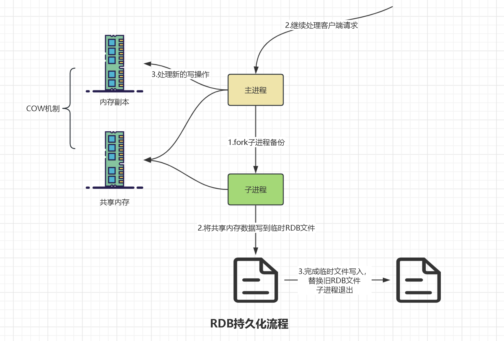


**触发方式：**

- 手动：`save`（阻塞主线程，生产不建议）、`bgsave`（fork 子进程，主线程仅短暂阻塞）
- 自动：配置 `save <秒> <变更次数>`，例如 `save 60 1000` 表示 60 秒内至少 1000 次写就落盘
- 其他：`shutdown`（未开启 AOF 时）、`flushall` 之后

7.0 的 `redis.conf` 内置默认保存点为：3600 秒内至少 1 次修改、300 秒内至少 100 次、60 秒内至少 10000 次。

**文件与校验：** RDB 使用 LZF 压缩字符串对象，可用 `redis-check-rdb` 检测与修复。7.0 使用 RDB 格式 v10，旧版本无法直接加载新格式文件。

**优点：** 文件紧凑、恢复速度快（直接加载二进制）、适合做冷备与异地归档。

**缺点：** 无法做到实时持久化，两次快照之间的数据会丢；`fork` 是重量级操作，内存大时会造成毫秒级甚至更长的卡顿。

补充：若开启了 RDB 且最近一次 `bgsave` 失败，默认 `stop-writes-on-bgsave-error yes` 会让实例拒绝写入，这是为了避免"以为在持久化其实没有"。

### 3.3 AOF

AOF（Append Only File）记录每一条写命令，重启时按顺序重放来恢复数据。它比 RDB 更接近"实时"，代价是文件更大、恢复更慢。

**开启：** `appendonly yes`（默认 no）。

**刷盘策略（`appendfsync`）：**

| 取值 | 行为 | 安全性 | 性能 |
| --- | --- | --- | --- |
| `always` | 每条写命令都 fsync | 最高，几乎不丢 | 最差 |
| `everysec`（默认） | 每秒 fsync 一次 | 最多丢约 1 秒数据 | 较好 |
| `no` | 交给操作系统决定何时刷盘 | 最差，通常几十秒 | 最好 |

**重写（rewrite）：** AOF 会不断追加，文件越来越大。重写不是读旧文件，而是根据当前内存数据生成"能重建现状的最短命令序列"：过期数据不写入、被覆盖的写命令只保留最后一次、多条命令合并（如 100 次 `incr` 合并成 1 次 `set`）。

- 手动：`bgrewriteaof`
- 自动：`auto-aof-rewrite-percentage 100` 且 `auto-aof-rewrite-min-size 64mb`（7.0 默认值）同时满足时触发

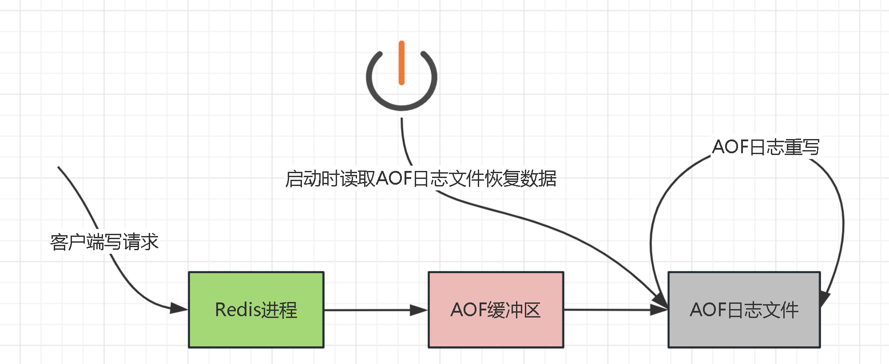


**加载顺序：** 同时开启 RDB 与 AOF 时，重启优先用 AOF 恢复，因为 AOF 通常更完整。

**损坏与截断：** 磁盘满或进程被杀可能导致文件尾部命令不完整。默认 `aof-load-truncated yes`，会丢弃最后一条不完整命令并继续启动；若文件中间损坏，可用 `redis-check-aof --fix` 修复，但可能丢失损坏点之后的数据。

**优点：** 数据更可靠、保留完整写命令历史、格式接近 Redis 协议便于人工排查。

**缺点：** 文件通常比 RDB 大、恢复时逐条重放较慢。

### 3.4 7.0 的多文件 AOF

Redis 7.0 起（7.0.0+）AOF 不再是一个大文件，而是"一个目录 + 多个文件 + 一份清单"：

- **base 文件**：重写时生成的全量基准（RDB 或 AOF 格式），最多一个
- **incr 文件**：基准生成之后新增的增量命令，可以有多个
- **manifest 文件**：记录当前哪些 base/incr 文件有效；重写完成时通过原子替换 manifest 让新组合生效

目录由 `appenddirname` 指定（默认 `appendonlydir`）。重写时父进程立刻打开一个新的 incr 文件继续写入，子进程生成新的 base 文件，两者就绪后再切换 manifest，因此重写期间不需要把增量命令缓冲在内存里，也不会出现"同一批写命令写两遍"的问题（这是 7.0 之前 AOF 重写的两个主要开销）。

升级提示：7.0 启动时会自动把旧的单文件 AOF 迁移到多文件结构，回退到 6.x 需要额外处理，升级前应先验证。

### 3.5 混合持久化

混合持久化把 RDB 的全量紧凑与 AOF 的增量安全结合起来：AOF 文件的前半部分是 RDB 格式的全量快照，后半部分是重写之后的增量命令，加载时先读 RDB 部分再重放增量。

配置项是 `aof-use-rdb-preamble`：4.0 引入该选项，7.0 默认值为 `yes`。也就是说"4.0 起可用、较新版本默认开启"，不能简单说"4.0 就默认开启"。

### 3.6 怎么选

- 想要接近关系型数据库的安全性：RDB + AOF 同时开启
- 能接受丢失几分钟数据、更看重恢复速度与备份便利：只用 RDB
- 不建议只用 AOF：缺少紧凑的全量快照，备份和快速重启都吃亏
- 纯缓存且数据可从数据库重建：可以都不开，但要接受重启后缓存全冷

### 3.7 常见疑问

**主从复制为什么用 RDB 而不是 AOF？** 全量同步传输的是 RDB 二进制流，体积小、从节点加载快，网络与 CPU 开销都更低。

**`fork` 到底慢在哪？** `fork` 本身要复制页表，耗时可近似看作与实例内存量成正比。经验做法是把单实例内存控制在 10 GB 以内，并把 RDB 放到从节点执行，避免影响主节点延迟。

**AOF 重写会不会阻塞？** 重写由子进程完成，主进程只在 `fork` 瞬间短暂阻塞；但如果重写期间磁盘 I/O 打满，主进程的写操作也会被拖慢（见 10.7）。

## 四、过期策略与内存淘汰

这一章回答两个高频问题：key 过期了会立刻被删掉吗？内存满了 Redis 会怎么办？前者关乎"过期是否精准"，后者关乎"缓存会不会把实例撑爆"。

### 4.1 过期 key 不会立即删除

给 key 设置 `expire` 只是记录了一个到期时间戳，Redis 并不会为每个 key 设定时器。真正删除依靠两种机制配合：惰性删除和定期删除。因此过期 key 在短时间内仍可能占用内存。

### 4.2 惰性删除

客户端访问某个 key 时，Redis 先检查它是否过期：过期就删除（并返回空），没过期才正常返回。

- 优点：只处理被访问到的 key，不浪费 CPU
- 缺点：再也不被访问的 key 会一直占内存

在复制链路中，过期删除由主节点发起：主节点删除后会向从节点和 AOF 传播一条 `DEL`，从节点自己不主动删除过期 key，只等主节点的 `DEL`。这样过期判断集中在一处，避免主从数据不一致；从节点被提升为主节点后，才重新具备独立过期能力。

### 4.3 定期删除

为了清理"再也不会被访问"的过期 key，Redis 会周期性抽样检查：

1. 按 `hz` 配置的频率触发（默认 `hz 10`，即每秒 10 次；范围 1~500，官方建议不要超过 100）
2. 每次从设置了过期时间的 key 中随机抽取一批（实现中每次约 20 个）检查
3. 删除其中已过期的 key；如果这一批里过期比例超过 25%，说明过期 key 还很密集，继续抽下一批
4. 单轮有时间上限（实现中约 25 毫秒）和循环次数上限，避免长时间占用主线程

需要注意：抽样数量、循环次数、时间上限这些具体数字属于实现细节，不同版本可能调整，官方文档只保证"被动 + 主动"两种机制并存。原始资料中"过期比例超过 10% 继续"的说法与实现不符，实现判断的是 25%。

相关配置：

- `hz`：基础频率，默认 10
- `dynamic-hz yes`（默认）：连接数变多时临时提高实际频率，空闲时降低以省 CPU
- `active-expire-effort`：6.0 起提供，取值 1~10，默认 1，越大越积极（更耗 CPU）

两者结合的效果是：定期删除负责兜底清理，惰性删除负责访问时的即时清理。如果仍有大量过期 key 堆积，最终会由内存淘汰策略接手（见 4.5）。

### 4.4 lazyfree：把删除放到后台

删除大 key 时，释放内存（尤其是释放大量小对象）可能阻塞主线程几百毫秒。Redis 4.0 引入 lazyfree：把"释放内存"这一步交给后台线程，主线程只做解除引用。

- `unlink key`：语义同 `del`，但异步释放内存
- 配置项（7.0 默认均为 `no`，需要显式开启）：
  - `lazyfree-lazy-eviction`：淘汰 key 时异步释放
  - `lazyfree-lazy-expire`：过期删除时异步释放
  - `lazyfree-lazy-server-del`：内部隐式删除（如 `rename` 覆盖）时异步释放
  - `replica-lazy-flush`：从节点全量同步前清空数据库时异步释放
- 6.0 起还有 `lazyfree-lazy-user-del`（让 `del` 也走异步）和 `lazyfree-lazy-user-flush`

名词更正：早期版本该配置叫 `slave-lazy-flush`，5.0 起随术语调整改名为 `replica-lazy-flush`，旧名作为兼容别名存在。新配置应写 `replica-lazy-flush`。

### 4.5 内存淘汰策略

当写入导致内存超过 `maxmemory` 时，Redis 按 `maxmemory-policy` 选择 key 删除。`maxmemory` 默认是 0（64 位系统表示不限制），`maxmemory-policy` 默认是 `noeviction`。

| 策略 | 说明 |
| --- | --- |
| `noeviction` | 不淘汰，写入类命令直接报错（默认） |
| `allkeys-lru` | 所有 key 中按最近最少使用淘汰 |
| `allkeys-lfu` | 所有 key 中按访问频率最低淘汰（4.0+） |
| `allkeys-random` | 所有 key 中随机淘汰 |
| `volatile-lru` | 只在设置了过期时间的 key 中按 LRU 淘汰 |
| `volatile-lfu` | 只在设置了过期时间的 key 中按 LFU 淘汰（4.0+） |
| `volatile-random` | 只在设置了过期时间的 key 中随机淘汰 |
| `volatile-ttl` | 只在设置了过期时间的 key 中优先淘汰剩余 TTL 最短的 |

补充说明：

- `volatile-*` 系列在没有 key 设置过期时间时，行为等同于 `noeviction`
- LRU/LFU/TTL 都是近似算法，通过 `maxmemory-samples` 采样实现，默认 5，调到 10 更接近真实 LRU 但更耗 CPU
- 8.6 起新增 `allkeys-lrm` / `volatile-lrm`（按最近修改时间淘汰），属于较新版本特性

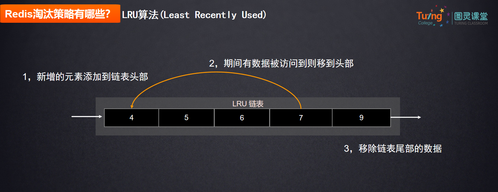


### 4.6 进阶了解（可跳过）：LRU 与 LFU 的实现

初学可以略过这一节，不影响使用；需要回答"Redis 的 LRU 是不是真 LRU"时再看。

**LRU：**

- `redisObject` 中有一个 24 bit 的 `lru` 字段，记录最近一次访问的时间（秒级精度）
- 淘汰时随机采样若干个 key，用 `estimateObjectIdleTime` 估算空闲时长，挑最久未访问的删除
- 因此它是"近似 LRU"，不做全局排序，也不维护双向链表

**LFU（4.0+）：**

- 复用同一块 24 bit：高 16 bit 存"最近一次衰减的时间"，低 8 bit 存访问计数（counter）
- counter 不是简单加一，而是概率递增：值越大越难增加，增长速度由 `lfu-log-factor`（默认 10）控制
- 新 key 的初始 counter 为 5（`LFU_INIT_VAL`），避免刚写入就被淘汰
- 计数会随时间衰减：每 `lfu-decay-time` 分钟（默认 1）未访问就减一，设为 0 表示永不衰减
- counter 上限为 255

LFU 解决的是 LRU 的"时效性"问题：一个曾经很热但已经过时的数据，LRU 仍会保护它；LFU 通过衰减机制逐渐降低它的权重。

### 4.7 只缓存 20 万条时如何保住热点

如果数据库有 2000 万条数据而 Redis 只能放 20 万条，淘汰策略应选 `allkeys-lfu`（或 `volatile-lfu`，前提是 key 都设置了 TTL）。原因是 LFU 在 LRU 的"最近访问"之外还统计了访问频次，能让长期高频的热点数据在内存中留存更久，而不是被一次性的批量扫描数据挤掉。

## 五、缓存三大问题与缓存数据库一致性

这一章是缓存设计的核心：请求打不到缓存时会怎样、缓存和数据库谁先更新、出现不一致怎么补救。三个问题的成因不同，方案也不能混用。

### 5.1 三个问题速览

| 问题 | 触发条件 | 表现 | 主要方案 |
| --- | --- | --- | --- |
| 缓存穿透 | 查询的数据在缓存和数据库都不存在 | 每次都打到数据库 | 参数校验、布隆过滤器、缓存空值 |
| 缓存击穿 | 某个热点 key 突然失效 | 瞬时大量请求打向数据库同一行 | 互斥锁/单飞、逻辑过期、热点不过期 |
| 缓存雪崩 | 大量 key 同时失效或 Redis 整体不可用 | 数据库瞬间被打满 | TTL 加随机值、多级缓存、高可用、限流降级 |

### 5.2 缓存穿透

攻击者或错误参数请求一个根本不存在的 ID，缓存不命中，数据库也查不到，于是每次请求都落到数据库。

**方案：**

1. **参数校验**：在网关或应用入口拦截明显非法的 ID（负数、超长、格式错误）
2. **缓存空值**：数据库查不到也写入缓存，值设为空标记，TTL 设短一些（如 3~5 分钟），避免长期占用内存
3. **布隆过滤器**：在缓存前加一层"是否存在"的判断

**布隆过滤器（Bloom Filter）要点：**

- 用多个哈希函数把元素映射到位数组的多个 bit 上；判断时只要有一个 bit 为 0，就**一定不存在**
- 全部 bit 为 1 时只能说明"可能存在"，存在误判，但不会漏判
- 不支持删除元素（删除会影响其他元素的判断），需要删除时可用计数布隆或定期重建
- 生产上可以调大位数组容量、增加哈希函数个数来降低误判率；也可用 Redis Bitmap 实现分布式布隆过滤器

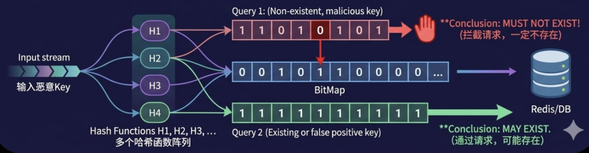


**三层防护的组合方式：** 入口参数校验 → 布隆过滤器拦截不存在的 key → 缓存空值兜底。同时监控空值缓存的命中频率，异常升高往往说明正在被穿透。

### 5.3 缓存击穿

某个被高频访问的 key 到期失效，重建缓存需要查库并计算，这段时间内大量并发请求全部打到数据库同一行。

**方案：**

1. **互斥重建**：只让一个线程去查库并回填缓存，其他线程短暂等待或返回旧值（可用 `SET NX` 实现，见第七章）
2. **逻辑过期**：缓存值里带一个逻辑过期时间，物理上永不过期；发现逻辑过期后由后台线程异步重建，读请求继续返回旧值
3. **热点数据不设过期或设长 TTL**，通过后台任务主动刷新

### 5.4 缓存雪崩

大量 key 在同一时刻失效，或者 Redis 实例/集群整体不可用，请求全部涌向数据库。

**方案：**

1. TTL 加随机值，把失效时间打散
2. 多级缓存（本地缓存 + Redis），减少对单点的依赖
3. Redis 高可用（主从 + 哨兵或 Cluster），缩短故障恢复时间
4. 互斥锁 + 限流降级：数据库前加保护，宁可让部分请求快速失败
5. 缓存预热：发布或重启后先加载热点数据，避免冷启动打穿

### 5.5 一致性问题的来源

缓存与数据库是两份数据，读写并发时必然存在时间窗：先更新数据库再删缓存，删缓存到数据库提交之间若有读请求，就会把旧值重新写回缓存。这不是"配置问题"，而是并发模型决定的，只能缩小窗口、兜底修正。

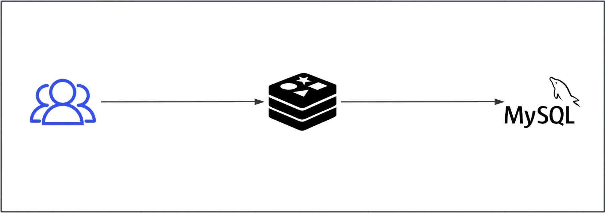


### 5.6 Cache Aside 模式

最常用的读写策略：

- **读**：先查缓存，命中直接返回；未命中查数据库，再写入缓存
- **写**：先更新数据库，再删除缓存（注意是删除而不是更新缓存）

为什么删除而不是更新缓存：并发写场景下，两次更新缓存的顺序可能和数据库提交顺序不一致，反而写入旧值；删除更简单，下次读时自然重建。

### 5.7 其他一致性方案

1. **延时双删**：先删缓存 → 更新数据库 → 延迟几百毫秒再删一次缓存。第二次删除用于清掉并发读回填的旧值，延迟时间要覆盖一次读库 + 写缓存的时间
2. **删除失败重试**：删除缓存失败时投递到消息队列，由消费者重试直到成功（配合幂等）
3. **订阅 binlog 异步更新**：用 canal 等组件订阅 MySQL binlog，解析后更新或删除缓存，相当于把缓存当作数据库的一个"异步从库"
4. **加分布式锁**：更新操作串行化，简单但吞吐下降，只适合低并发写
5. **TTL 兜底**：无论用哪种方案，都应给缓存设置过期时间，作为最终一致性的保底手段

选型建议：绝大多数业务用"Cache Aside + 合理 TTL + 删除失败重试"即可；对一致性要求高的场景再引入 binlog 订阅。

## 六、高可用：主从、哨兵与 Cluster

单机 Redis 有两个硬伤：挂了就不可用、内存有限无法扩容。这一章讲三种部署形态分别解决什么问题，以及它们各自残留的风险。

### 6.1 主从复制

主从（master-replica）通过 `replicaof <ip> <port>` 让从节点复制主节点数据，可以提供读扩展和数据冗余。

**复制过程：**

1. 从节点首次连接时发送 `PSYNC`，主节点执行 `bgsave` 生成 RDB 发给从节点
2. 从节点加载 RDB 期间，主节点把新的写命令缓存到该从节点的复制输出缓冲区（复制积压缓冲区 repl backlog 主要用于断线后的部分重同步）
3. 从节点加载完成后，主节点补发缓冲区中的增量命令；之后持续异步传播写命令

**关键特征与风险：**

- 复制是**异步**的：主节点写完就返回成功，不等从节点确认
- 主节点故障后**不会自动切换**，需要人工介入或引入哨兵
- 主节点宕机时，尚未同步到从节点的写会丢失

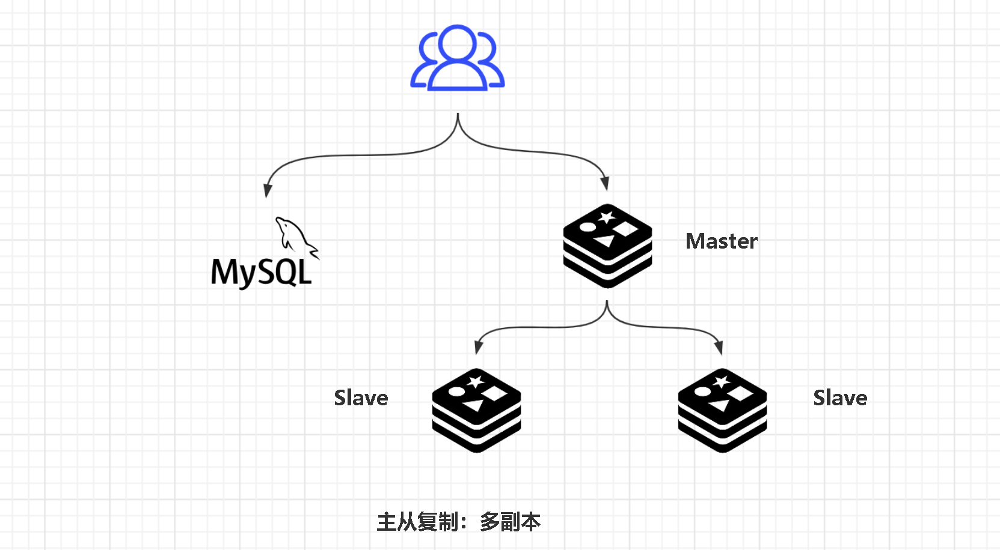


### 6.2 哨兵

哨兵（Sentinel）是独立进程，负责监控主从、自动故障转移，并给客户端提供"当前主节点是谁"的查询服务。

**能力：** 监控、故障通知、自动故障转移、配置中心（客户端向哨兵询问主节点地址）。

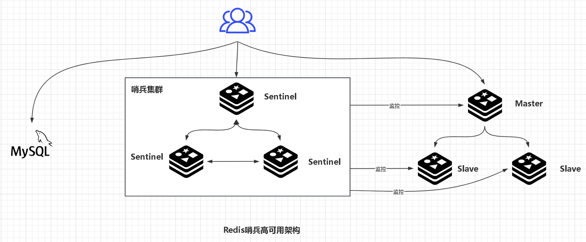


**工作流程：**

1. **监控**：每个哨兵周期性 `PING` 主从节点
2. **主观下线（sdown）**：单个哨兵在 `down-after-milliseconds` 内收不到有效响应，主观认为该节点不可用
3. **客观下线（odown）**：认为下线的哨兵数量达到 `quorum`，判定主节点确实不可用
4. **选举 leader 哨兵**：由**多数派**（超过哨兵总数的一半）投票选出，只有 leader 才能执行故障转移
5. **选新主**：在从节点中按"优先级高 → 复制偏移量大（数据更新）→ runid 小"的顺序挑选，然后执行 `replicaof no one` 提升为主
6. **通知与重配置**：其余从节点改为复制新主，客户端通过哨兵获取新地址

三个容易混淆的点：

- `quorum` 只用于**判定下线**，不用于授权故障转移；授权需要多数派
- 哨兵至少要部署 3 个且分布在不同机器上，否则无法形成多数派
- 哨兵同样不保证强一致：故障切换仍可能丢掉主节点尚未同步的写

**减少丢写的配置：** `min-replicas-to-write 1` + `min-replicas-max-lag 10`，让主节点在"至少 1 个从节点且延迟不超过 10 秒"不满足时拒绝写入，从而限制孤立主节点继续接收写的时间窗。

### 6.3 Cluster 分片与槽位

Cluster 解决单机内存上限和写扩展问题，把数据分散到多个主节点。

**分片规则：**

- 固定 **16384 个哈希槽**，槽号 = `CRC16(key) mod 16384`
- 每个主节点负责一部分槽（例如 3 个主节点可分成 0-5500、5501-11000、11001-16383）
- 每个主节点可挂多个从节点，主节点故障时由从节点选举接管其槽位
- 客户端缓存"槽 → 节点"映射；访问错节点时会收到 `MOVED` 重定向

**多 key 操作限制：** 同一命令（或事务、Lua 脚本）涉及的 key 必须落在同一个槽，否则报 CROSSSLOT。可以用 hash tag 强制同槽：`user:{123}:profile` 与 `user:{123}:account` 中只有 `123` 参与哈希，因此必然同槽。

**其他要点：**

- 节点间通过 cluster bus 通信，端口默认是数据端口 + 10000
- `cluster-require-full-coverage yes`（默认）：只要有槽无人负责，整个集群停止接受写请求
- 扩容/缩容通过迁移槽完成，迁移过程无需停机

**客户端路由：** 必须使用支持 Cluster 的客户端（如 Lettuce、Redisson、Jedis 的 cluster 模式），普通单机客户端连上去会不断收到重定向。

### 6.4 集群整体不可用的情形

1. 多个主节点同时故障，且它们没有可提升的从节点（或从节点也不可达），对应槽位无人负责
2. 集群中多数主节点不可达，剩余节点无法形成多数派，故障检测与选举都无法进行
3. 网络分区导致脑裂：少数派一侧的主节点在 `cluster-node-timeout` 后停止接受写，避免双写
4. 配置错误：如各节点 `nodes.conf` 不一致、cluster bus 端口未放行、混用不同集群的节点
5. 内存不足且策略为 `noeviction`，写入持续报错，业务侧表现为"不可用"

名词更正：Redis Cluster 是**去中心化**的，没有独立的"集群管理节点"。原始资料把"集群管理节点故障"列为不可用原因并不准确；真正的原因是多数派失效或槽位无人负责。

**应对措施：** 每个主节点至少配 1 个从节点并跨机房部署、放行两个端口的网络策略、监控 `cluster_state` 与槽位覆盖、设置合理的 `maxmemory` 与告警。

### 6.5 集群会丢写吗

会。原因是复制是异步的：客户端写入主节点，主节点返回成功后尚未把该写同步到从节点就宕机，从节点被提升后这条写就永久丢失。官方文档明确指出 Cluster 不保证强一致性。

主节点挂掉会导致超卖吗？在"库存扣减依赖 Redis 锁或 Redis 计数"的方案下，风险来自两点：

1. 主从异步同步：主节点写入未同步即宕机，新主节点是旧数据
2. 分布式锁失效：锁 key 未同步到从节点，新主节点上不存在该锁，另一个客户端可以立刻加锁成功

缓解手段：使用 Redlock（多主多数派加锁）、把扣减做成单命令或 Lua 原子操作、数据库层加乐观锁（版本号/CAS）或唯一约束兜底、用消息队列削峰并串行化同一商品的扣减。工程上通常以"数据库最终校验"为最后防线，不把正确性完全寄托在缓存层。

### 6.6 高可用方案怎么选

| 方案 | 解决 | 不解决 | 适用 |
| --- | --- | --- | --- |
| 主从 | 读扩展、数据冗余 | 自动故障转移 | 读多写少、可接受人工切换 |
| 主从 + 哨兵 | 自动故障转移、配置发现 | 单机内存上限、写扩展 | 数据量可控、要求自动恢复 |
| Cluster | 分片扩容、写扩展、自动故障转移 | 强一致、跨槽多 key 事务 | 大数据量、高吞吐 |

## 七、分布式锁

这一章讲多进程互斥。核心不是"怎么加锁"，而是"锁什么时候会失效、失效后会不会出现两个持有者"。

### 7.1 为什么需要分布式锁

单机 `synchronized` 只能锁住同一个 JVM 内的线程。服务多实例部署后，需要一把所有实例都能看到的锁，这就是分布式锁。

一个好的分布式锁要满足：

- **互斥**：同一时刻只有一个持有者
- **防死锁**：持有者崩溃后锁能自动释放（靠过期时间）
- **防误删**：只能释放自己加的锁（靠唯一标识）
- **可重入**（可选）：同一线程可重复加锁
- **高可用**：锁服务本身不能是单点

### 7.2 六种方案演进

| 方案 | 做法 | 主要问题 |
| --- | --- | --- |
| 一、`setnx` + `expire` | 先 `setnx`，成功后再 `expire` | 两条命令非原子，中间异常会死锁 |
| 二、`setnx` + value 存过期时间 | 把过期时间写进 value，加锁失败时检查是否已过期 | 判断与删除仍需额外逻辑，时钟依赖强 |
| 三、Lua 脚本 | 用 Lua 把"判断 + 设置过期"打包成原子操作 | 需自己维护脚本，可读性差 |
| 四、`SET key value NX PX` | 一条命令完成"不存在则设置 + 过期时间" | 业务超时后锁提前释放、可能误删他人锁 |
| 五、Redisson | 框架封装，带看门狗自动续期、可重入 | 引入额外依赖，需理解其续期机制 |
| 六、Redlock + Redisson 多机 | 向 N 个独立主节点加锁，多数成功才算成功 | 依赖时钟与网络，仍非强一致 |

**方案一的问题（常见错误写法）：**

```java
// 反例：加锁与过期不是原子操作
if (jedis.setnx(key, value) == 1) {
    jedis.expire(key, 100);   // 若此处抛异常或进程崩溃，锁永不过期
    try {
        // 业务逻辑
    } finally {
        jedis.del(key);       // 还可能误删别人的锁
    }
}
```

**方案四的正确形态：**

```java
String requestId = UUID.randomUUID().toString();
String result = jedis.set(lockKey, requestId, "NX", "PX", 30000);
if ("OK".equals(result)) {
    try {
        // 业务逻辑
    } finally {
        // 释放时必须校验 value，避免删掉别人的锁
        jedis.eval("if redis.call('get', KEYS[1]) == ARGV[1] then " +
                   "return redis.call('del', KEYS[1]) else return 0 end",
                   Collections.singletonList(lockKey),
                   Collections.singletonList(requestId));
    }
}
```

### 7.3 正确的加锁与解锁写法

官方推荐的加锁命令只有一条：

```bash
SET resource_name my_random_value NX PX 30000
```

- `NX`：只有 key 不存在时才设置成功，保证互斥
- `PX 30000`：30 秒后自动过期，保证持有者崩溃后锁能释放
- `my_random_value`：每个客户端、每次请求都不同的随机串，用于识别"锁是我的"

解锁必须"先比较再删除"，且比较与删除要原子完成：

```lua
if redis.call("get", KEYS[1]) == ARGV[1] then
    return redis.call("del", KEYS[1])
else
    return 0
end
```

为什么要这么麻烦：如果客户端 A 的业务执行超过了锁的 TTL，锁已自动释放并被 B 获取，此时 A 执行完直接 `del` 就会删掉 B 的锁，互斥被破坏。用随机串做签名后，A 的删除会因为 value 不匹配而失败。

版本提示：Redis 8.4 起提供 `DELEX key IFEQ value` 和 `SET key value IFEQ old` 等原子比较命令，可以替代上面的 Lua 脚本；更早版本仍需使用 Lua。

### 7.4 Redisson 看门狗

`SET NX PX` 的遗留问题是"TTL 到了但业务没跑完"。Redisson 的解决方式是看门狗（watchdog）：

- 加锁成功且未显式指定 `leaseTime` 时，Redisson 启动一个定时任务，默认每 10 秒（租期的 1/3）检查一次并续期到 30 秒
- 只要持有锁的 JVM 还活着，锁就不会因为超时被释放
- 显式指定了 `leaseTime` 时不会续期，到期即释放

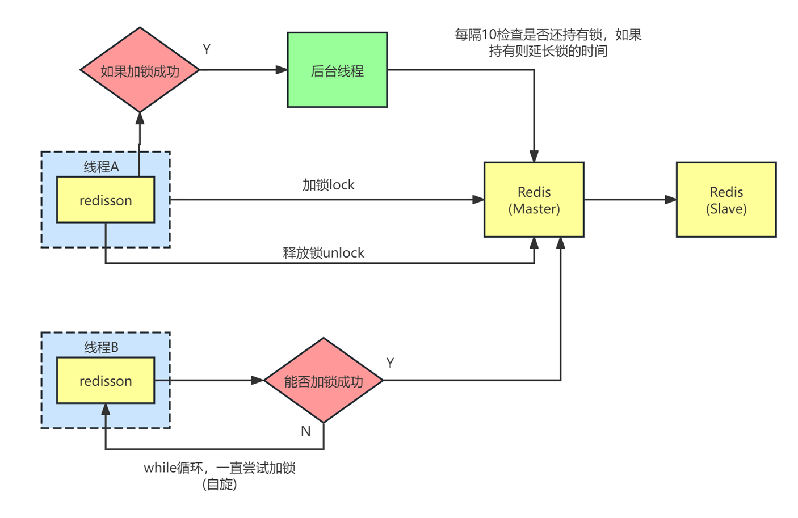


使用建议：不要完全依赖看门狗，仍应设置合理的 `leaseTime` 并为业务超时设计补偿。

### 7.5 Redlock

单实例锁在主节点宕机、从节点提升时可能失效（锁没同步过去）。Redlock 的思路是用多个独立主节点投票：

1. 记录开始时间
2. 向 N 个独立主节点并行地用相同的 key 和随机值加锁，每个节点设置很短的超时（远小于锁有效期），避免被某个不可用节点拖住
3. 统计成功节点数与总耗时：只有**超过半数（N/2+1）**加锁成功，且总耗时小于锁有效期，才算加锁成功
4. 锁的实际有效期 = 原有效期 − 加锁耗时
5. 失败则向所有节点发送解锁（包括没加成功的）

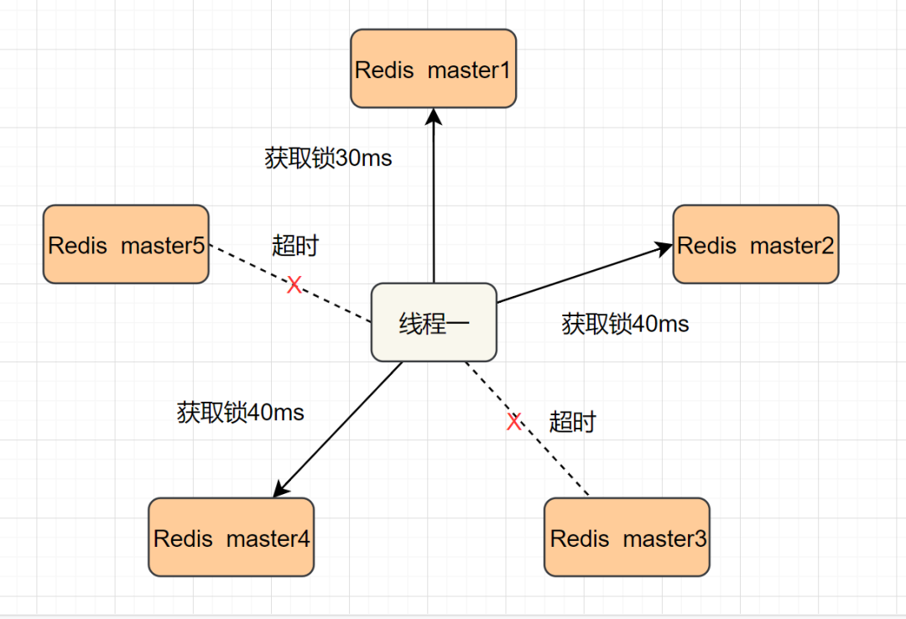

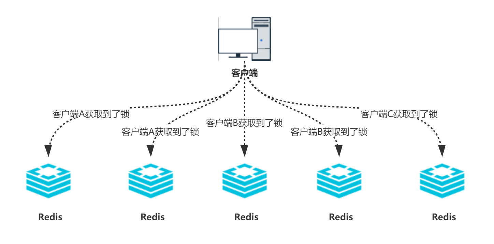


**局限性（必须知道）：**

- 依赖各节点的本地时钟近似同步，时钟跳变可能让两个客户端同时持锁
- 网络延迟与 GC 停顿会让"耗时判断"失真
- 仍然不是强一致：进程暂停超过锁有效期时，互斥依旧可能被破坏
- 因此对正确性要求极高的场景，需要额外的 fencing token（单调递增的令牌，由下游资源校验），或改用 ZooKeeper/etcd 这类有共识协议的协调服务

### 7.6 续锁失败怎么办

看门狗续期失败通常有三种原因：与 Redis 的连接断开、客户端进程被冻结（长 GC、容器被挂起）、网络抖动导致请求超时。

后果是锁提前释放，其他客户端拿到锁，出现并发写入，甚至因为互相等待而形成死锁。

应对措施：

1. 设置合理的过期时间，不把正确性完全押在看门狗上
2. 业务侧加补偿与对账，发现不一致能修复
3. 监控锁的 TTL 与续期失败次数，及时告警
4. Redis 侧做高可用（哨兵/Cluster），减少因实例故障导致的续期失败
5. 优化 JVM（避免长 GC）与线程池（避免业务线程被占满）
6. 设计合理的重试与退避策略，避免大量客户端同时抢锁


### 7.7 主从切换下的锁安全

单主 + 哨兵的结构里，主节点在"加锁成功后、同步到从节点前"宕机，从节点提升后锁不存在，另一个客户端可立即加锁。这是架构层面的窗口，不是代码 bug。

可选缓解：使用 Redlock 多主部署、开启 `min-replicas-to-write` 限制孤立主节点写入、在下游用唯一约束或版本号做最终校验。绝对安全的分布式锁在异步复制模型下不存在。

## 八、单线程模型、事务与 Pipeline

这一章澄清三个常被误解的概念：Redis 到底是不是单线程、单个命令的原子性边界在哪、事务为什么不支持回滚。

### 8.1 单线程到底指什么

准确说法是：**处理客户端请求的主流程（网络读写 + 命令执行）是单线程的**，但 Redis 进程内还有别的线程：

- 持久化：`bgsave`、`bgrewriteaof` 由 fork 出的子进程完成
- 异步删除：lazyfree 用后台线程释放内存
- 关闭文件、AOF fsync 等阻塞操作由后台线程（bio）处理
- 6.0 起可选的多线程 I/O 线程，只负责读写 socket 与协议解析

所以严格说 Redis 不是"完全单线程"，而是"命令执行单线程"。

### 8.2 6.0 为什么引入多线程 I/O

随着 QPS 提高，瓶颈从 CPU 转移到了网络读写：单线程要读数据、解析协议、执行命令、写回响应，网络 I/O 占用的时间越来越显著。

6.0 的做法是把"读 socket、解析协议、写响应"分给多个 I/O 线程并行处理，**命令执行仍然是单线程**，因此不会引入并发读写同一份数据的问题。

配置：

```ini
io-threads 4          # 建议为 CPU 核数的一半到 3/4，1 表示不启用（默认）
io-threads-do-reads no # 是否让 I/O 线程也负责读和协议解析，默认 no
```

官方 6.0 发布说明的表述是：在无法使用 pipeline 的场景下，启用 I/O 线程后单实例每秒可处理的操作数最多可提升约一倍。这是官方给出的量级，实际收益取决于负载形态，不应直接套用到容量规划。

### 8.3 原子性怎么理解

- **单命令原子**：命令在主线程中一次执行完，中间不会插入其他客户端的命令。所以 `incr`、`setnx`、`hincrby` 本身是原子的
- **多命令不原子**：`get` 后 `set` 是两次独立操作，中间可能被其他请求插入，需要用事务、Lua 脚本或单命令改写来实现
- **事务与 Lua**：把多条命令打包后连续执行，执行期间不处理其他客户端请求，因此具备"隔离性"，但不等于关系型数据库的原子性（见 8.4）

### 8.4 事务

Redis 支持事务，但语义与关系型数据库不同。

**命令：** `multi`（开启）、`exec`（执行）、`discard`（放弃）、`watch key`（乐观锁监控）。

**三个阶段：** 开启 → 命令入队（返回 `QUEUED`）→ `exec` 一次性执行。

**特点：**

- 事务中的命令连续执行，不会被其他客户端命令插入
- 没有隔离级别概念（因为命令串行执行）
- **不支持回滚**：`exec` 之后某条命令运行出错（如对字符串执行 `lpop`），其他命令照常执行，也不会撤销已执行的命令。官方解释是回滚会显著增加复杂度并影响性能
- **入队阶段的错误**：命令名或参数个数错误会在入队时被检测到，2.6.5 起服务端会拒绝执行整个事务（`exec` 报错）
- **`watch`**：监控一个或多个 key，若在 `exec` 之前被修改（包括被其他客户端修改、被过期或淘汰修改），整个事务放弃执行，`exec` 返回空。这是乐观锁（CAS）思路

**关于 ACID：**

| 特性 | 结论 |
| --- | --- |
| 原子性 | 不保证（运行期错误不回滚）；入队期错误会整体放弃 |
| 一致性 | 保证（命令要么全部入队成功，要么整体不执行） |
| 隔离性 | 命令串行执行，无隔离级别概念 |
| 持久性 | 由 RDB/AOF 的刷盘策略决定，与事务本身无关 |

需要真正"要么全做要么全不做"时，用 Lua 脚本把校验与写入放在一起，并在脚本内主动返回错误。

### 8.5 Pipeline

Pipeline（管道）把多条命令一次性发出、一次性读回，把 n 次网络往返压缩成 1 次。

- 适用：批量写入、批量查询、初始化数据
- 不适用：命令之间有依赖（后一条依赖前一条的结果）
- 注意：Pipeline 只是减少往返，**不保证原子性**，中间可能插入其他客户端的命令；一次打包过多命令会占用大量客户端输出缓冲区，需要分批

## 九、大 key、热 key 与键值设计

这一章讲"数据摆放"的问题：单个 key 太大或太热，都会让集群出现短板。设计阶段的取舍，往往比上线后调参更有效。

### 9.1 大 key 的判定

"大"没有官方统一阈值，通常按经验判断：

- String 类型的 value 达到数 MB（例如 5 MB 以上）
- ZSet / List / Set 的成员数达到万级
- Hash 的 field 数量很多，或总大小达到上百 MB

判断应以"操作这个 key 的耗时与网络传输量是否明显影响其他请求"为准，而不是死守某个数字。

### 9.2 大 key 的危害

- 内存占用高，容易触发淘汰或 OOM
- 单次操作耗时长，阻塞主线程（尤其是 `del`、`hgetall`、`lrange` 全量）
- 网络拥塞：一次读取几十 MB 会占满带宽，拖慢同实例的其他请求
- 持久化与主从同步变慢：RDB 文件大、fork 与传输耗时增加
- Cluster 下造成数据倾斜，某个槽所在节点内存远高于其他节点

### 9.3 怎么排查

1. `redis-cli --bigkeys`：扫描各类型最大的 key（可加 `-i 0.01` 控制扫描频率）
2. `SCAN` 渐进遍历 + `strlen` / `llen` / `hlen` / `scard` / `zcard` 判断大小
3. `MEMORY USAGE key`（4.0+）：估算某个 key 占用的字节数
4. `DEBUG OBJECT key`：查看编码、长度等内部信息（生产环境注意权限，7.0 起 `DEBUG` 默认被保护）
5. 离线分析 RDB 文件（如 RDB 解析工具），适合做全量盘点

### 9.4 怎么治理

1. 拆分：把一个大 Hash 按业务维度拆成多个小 key，读取时用 `mget` 或 `hmget` 批量取
2. 换结构：能用 Hash 分字段存就不要拼成一个巨大 JSON；能压缩就压缩
3. 控制生命周期：设置合理 TTL，避免历史数据无限堆积
4. 启用淘汰策略，防止内存被慢慢吃满
5. 数据分片：用 Cluster 把大 key 分散到不同节点
6. 用 `unlink` 替代 `del` 异步删除（4.0+），并开启 `lazyfree-lazy-*`
7. 扩容内存，作为兜底而非首选

### 9.5 热 key

热 key 是"访问量集中在少数 key 上"，与大小无关。它会让单个节点 CPU 或带宽打满，Cluster 下也会造成倾斜。

**方案：**

1. **本地缓存**：用 Caffeine 等在应用侧缓存热点数据，减少对 Redis 的访问
2. **请求分摊**：把热 key 复制成多个子 key（如 `hot:1`、`hot:2`…），读请求随机选一个
3. **限流**：对热点接口做限流，保护后端
4. **热点探测**：采集 key 访问频次（客户端埋点或代理层统计），发现热点后主动通知各节点构建本地缓存

### 9.6 key 设计

1. **短小但可读**：在含义清晰的前提下尽量短，减少内存与网络开销；避免把整段 JSON 当 key
2. **命名空间用冒号分隔**：如 `user:1001:profile`，便于按前缀扫描与权限控制
3. **避免热 key**：设计时考虑分布是否均匀，必要时加随机后缀分片
4. **全局唯一**：用业务主键（用户 ID、订单号）构成 key，避免不同业务互相覆盖

### 9.7 value 设计

1. **选对结构**：对象属性用 Hash，列表用 List，排行榜用 ZSet，不要一律序列化成字符串
2. **控制单个 value 大小**：大对象分片存储，图片、文件等二进制内容放对象存储，只在 Redis 存引用
3. **利用压缩**：文本类 value 可在应用层压缩后再存
4. **设置 TTL**：控制数据生命周期，避免无限增长

## 十、性能调优与线上排障

这一章是一份排查清单：先确认"是不是真的慢了"，再按常见原因逐项排除。不要凭感觉调参，每一步都要有指标支撑。

### 10.1 先确认是否真的变慢

1. 在 Redis 所在服务器上测基准延迟：`redis-cli --intrinsic-latency 60`
2. 与同规格、同负载的正常实例对比
3. 若业务观测到的延迟达到基准延迟的 2 倍以上，才认为实例确实变慢，需要继续排查

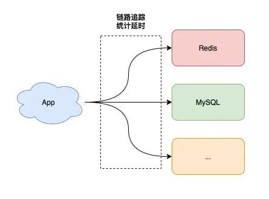

### 10.2 慢查询与高复杂度命令

- 查看慢日志：`SLOWLOG GET 5`；阈值用 `CONFIG SET slowlog-log-slower-than 5000` 调整（单位微秒，5000 即 5 毫秒；默认 10000）
- 避免 O(N) 及以上复杂度的命令：`keys`、`sort`、`sunion`、`smembers`、`hgetall`、`lrange 0 -1`
- O(N) 命令要保证 N 足够小，例如用 `lrange` 分页而不是一次取完
- 聚合类计算尽量放到客户端，或提前算好写入结果

### 10.3 大 key 与集中过期

- 大 key：写入/删除耗时高，用 `redis-cli --bigkeys -i 0.01` 扫描并治理（见第九章）
- 集中过期：大量 key 在同一时刻过期，主动过期逻辑在主线程执行，会造成周期性延迟抖动
- 集中过期的解决：TTL 加随机值打散；开启 `lazyfree-lazy-expire`；监控 `expired_keys` 指标
- 大 key 删除：4.0+ 用 `unlink`；6.0+ 可开启 `lazyfree-lazy-user-del`

### 10.4 内存到达上限

每次写入前都要先淘汰数据，会明显增加单次命令耗时。

解决：避免大 key；`maxmemory` 预留余量（复制缓冲区不计入 `maxmemory`，需要额外留内存）；必要时把随机淘汰策略用于纯缓存场景（随机淘汰通常比 LRU 采样更快）；拆分实例；开启 `lazyfree-lazy-eviction yes`。

### 10.5 fork 耗时

RDB 与 AOF 重写都要 fork，fork 需要复制页表，实例越大越慢。可查看 `INFO stats` 中的 `latest_fork_usec`。

解决：单实例内存控制在 10 GB 以下；把 RDB 放到从节点执行；使用物理机而非共享型云主机；适当调大 `repl-backlog-size` 减少全量同步。

### 10.6 透明大页

开启透明大页（THP）后，COW 期间以 2 MB 为单位复制内存，会显著放大写延迟。

解决：关闭 THP。

```bash
echo never > /sys/kernel/mm/transparent_hugepage/enabled
```

7.0 起 `disable-thp` 变为不可动态修改的配置项，需要在启动前设置好。

### 10.7 AOF fsync 阻塞

在 `appendfsync everysec` 下，如果后台线程正在执行 fsync（磁盘慢时可能很久），主线程的 write 也可能被阻塞。

解决：`no-appendfsync-on-rewrite yes`（重写期间不 fsync，牺牲一点安全性换延迟稳定）；使用 SSD；避免与其他高 I/O 进程混部。

### 10.8 CPU 绑定

把 Redis 绑定到单个逻辑核会让 fork 出的子进程与主进程争抢同一个核。

6.0+ 可以分别绑定：`server_cpulist`、`bio_cpulist`、`aof_rewrite_cpulist`，把后台任务与主线程分到不同核上。

### 10.9 Swap

内存被换到磁盘后，访问延迟会上升几个数量级。可查看 `/proc/<pid>/smaps` 中的 Swap 字段。

解决：增加内存、释放 Swap（`swapoff` 需谨慎）、设置 `vm.swappiness` 较低值、避免与内存占用大的进程混部。

### 10.10 内存碎片

`mem_fragmentation_ratio`（`used_memory_rss / used_memory`）明显大于 1.5 时说明碎片较多。

解决：4.0+ 可开启 `activedefrag yes` 自动整理（默认关闭，整理在主线程执行，会消耗 CPU）；或在低峰期重启实例。

### 10.11 网络带宽

监控实例的入出带宽与 `instantaneous_ops_per_sec`。带宽打满时表现为延迟上升、超时增多。

解决：治理大 key、减少返回数据量、读写分离、扩容或迁移实例。

### 10.12 实例抖动

**常见原因：** 内存使用率过高（接近 `maxmemory` 后每次写入都要淘汰，运维上常以 70%~80% 作为预警线）、网络抖动、持久化压力（fork 或 AOF 重写）、慢命令。

**诊断：** 看 `INFO` 的延迟与内存指标、`SLOWLOG`、`LATENCY` 系列命令、大 key 扫描。

**优化：** 合理设置 `maxmemory` 与淘汰策略、避免 O(N) 命令、用 Pipeline 批量、调整持久化频率、完善监控告警。

### 10.13 线上操作最佳实践

1. 优化数据结构，避免大 key
2. 给缓存设置合理 TTL，避免无限增长
3. RDB + AOF 结合使用，并定期备份
4. 建立监控告警：`INFO` 关键指标、慢查询、`LATENCY`、Prometheus + Grafana
5. 生产使用哨兵或 Cluster，避免单点
6. 规范命名空间，识别并治理热 key
7. 批量操作减少网络往返，优先 `mget` / Pipeline
8. 参数调优：`maxmemory`、`maxclients`、`timeout`、`tcp-keepalive`
9. 合理重试与熔断，避免故障时把 Redis 压垮
10. 开启密码与 ACL 做访问控制（ACL 为 6.0+），禁用或重命名高危命令

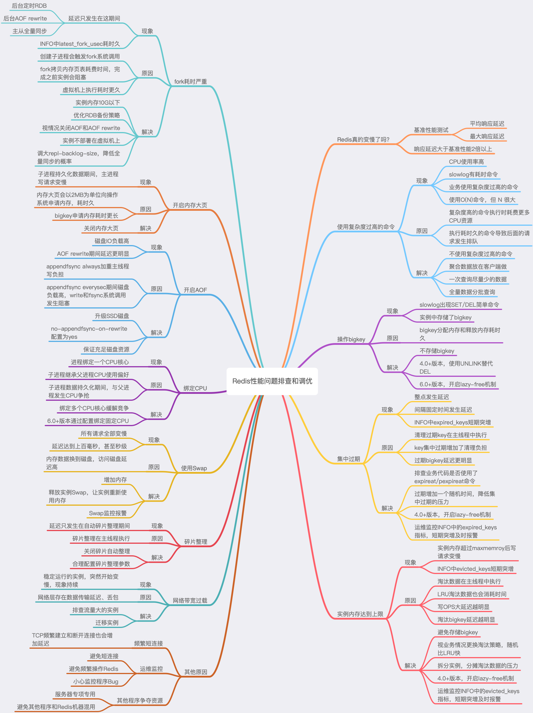


## 十一、工程实践

这一章把前面分散的知识点落到具体业务问题上：怎么统计访问量、怎么保证幂等、为什么不能用过期监听做定时任务、怎么安全遍历 key。

### 11.1 统计用户访问量

| 方案 | 做法 | 内存 | 精度 | 适用 |
| --- | --- | --- | --- | --- |
| Hash | `hset {uri}:{date} {userId} 1`，用 `hlen` 统计 | 高（每个用户一个 field） | 精确 | 数据量小、要求精确 |
| Bitmaps | `setbit` 按用户 ID 置位，`bitcount` 统计 | 低（1 亿用户约 12 MB） | 精确 | 用户 ID 连续、规模固定 |
| HyperLogLog | `pfadd` / `pfcount` | 极低（每个 key 最多约 12 KB） | 近似（误差约 0.81%） | 超大规模 UV，允许误差 |

### 11.2 幂等

幂等的含义是"同一请求执行多次，结果与执行一次相同"。常见实现：

1. **数据库唯一约束**：用业务唯一键（订单号、请求号）建唯一索引，重复插入直接失败
2. **乐观锁**：带版本号更新，`update ... where version = ?`
3. **分布式锁**：同一业务键加锁串行化（注意第七章的失效场景）
4. **Token 机制**：先申请 Token 存入 Redis，请求携带 Token，服务端用 `del` 或 Lua 校验并删除，删除成功才处理

其中 Token 方案依赖"删除的原子性"，应使用 `del` 的返回值或 Lua 脚本，避免并发下两个请求都判断成功。

### 11.3 为什么不要用过期监听做过期订单

常见但不推荐的做法是开启 keyspace notification，监听 key 过期事件来关闭订单。问题在于：

1. 过期事件是在 key **被删除时**产生的，而不是 TTL 到点那一刻。若 key 一直没被访问，要等定期删除扫到它才触发，延迟可能是分钟级
2. Redis 的 Pub/Sub 是"发送即忘"，不保证送达；客户端断线期间的事件直接丢失
3. 事件通知需要显式开启 `notify-keyspace-events`（默认空字符串，即关闭），本身也有额外开销

同样不推荐的还有：RabbitMQ 死信队列做精确定时（不保证投递时间）、纯内存时间轮（进程崩溃任务全丢）。

**推荐方案：**

- 专业延时消息：RocketMQ 延时消息、Pulsar 等，提供可靠投递与重试
- Redisson 的 `DelayedQueue`：基于 ZSet 实现，Redis 稳定时可用，但需要自己设计补偿与对账
- 数据库轮询/分片扫描：简单可靠，适合对实时性要求不高的场景

结论：定时任务不要依赖 Redis 过期监听；Redis 可以作为"触发信号"，但必须有兜底扫描。

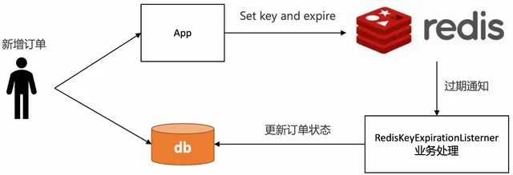


### 11.4 安全遍历所有 key

不要用 `keys *`：它会一次性遍历整个键空间并返回全部结果，在千万级 key 的实例上会阻塞主线程数秒。

应使用 `SCAN`：基于游标的渐进式遍历，每次返回少量元素，不阻塞。

```java
String cursor = ScanParams.SCAN_POINTER_START;
ScanParams params = new ScanParams().match("user:*").count(100);
do {
    ScanResult<String> result = jedis.scan(cursor, params);
    for (String key : result.getResult()) {
        // 处理 key，不要在这里执行 keys、hgetall 这类耗时命令
    }
    cursor = result.getCursor();
} while (!cursor.equals(ScanParams.SCAN_POINTER_START));
```

注意点：`SCAN` 保证"从开始到结束一直在集合中的元素一定会被返回"，但可能返回重复元素，需要业务侧去重；遍历期间新增或删除的元素可能返回也可能不返回。

### 11.5 常见问法速查

| 问题 | 一句话回答 | 详见 |
| --- | --- | --- |
| Redis 是单线程还是多线程 | 命令执行单线程；6.0+ 可选多线程 I/O，持久化/异步删除用后台线程 | 8.1、8.2 |
| 为什么单线程还这么快 | 纯内存、无锁无切换、I/O 多路复用、高效数据结构 | 1.2 |
| 为什么不用 B+ 树 | 数据量小于数据库、内存随机访问快，跳表实现更简单且范围查询友好 | 2.6 |
| key 过期会立即删除吗 | 不会，惰性删除 + 定期删除，可能短暂滞留 | 4.1 |
| 内存满了怎么办 | 按 `maxmemory-policy` 淘汰，默认 `noeviction` 直接报错 | 4.5 |
| 事务支持 ACID 吗 | 不保证原子性（不回滚），保证一致性与隔离（串行），持久性看持久化配置 | 8.4 |
| 持久化选哪个 | 重要数据 RDB + AOF；能接受丢几分钟可只用 RDB | 3.6 |
| 主从会丢数据吗 | 会，复制是异步的，故障切换可能丢未同步的写 | 6.1、6.5 |
| 分布式锁怎么写 | `SET key value NX PX` + Lua 校验删除，或直接用 Redisson | 7.3 |
| 大 key 怎么处理 | 拆分、改结构、设 TTL、`unlink` 异步删除、分片 | 9.4 |
| 热 key 怎么处理 | 本地缓存、多副本分摊、限流、热点探测 | 9.5 |

## 参考资料

- Redis 官方文档：数据类型与编码、持久化（RDB/AOF/多文件 AOF）、键淘汰、Cluster 规范、Sentinel、分布式锁（Redlock）等章节
- Redis 官方 7.0 发布说明：listpack 取代 ziplist、多文件 AOF、Functions、ACL 增强
- Redis 官方 6.0 发布说明：ACL、多线程 I/O、SSL、RESP3
- Redis 源码发行包中的 `redis.conf` 示例配置（默认值与配置说明）
- Martin Kleppmann 关于 Redlock 的分布式锁分析文章，以及 Redis 作者对其的回应
