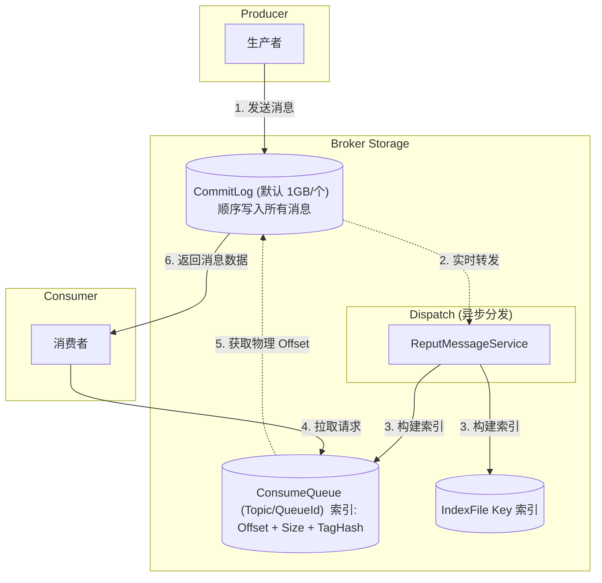
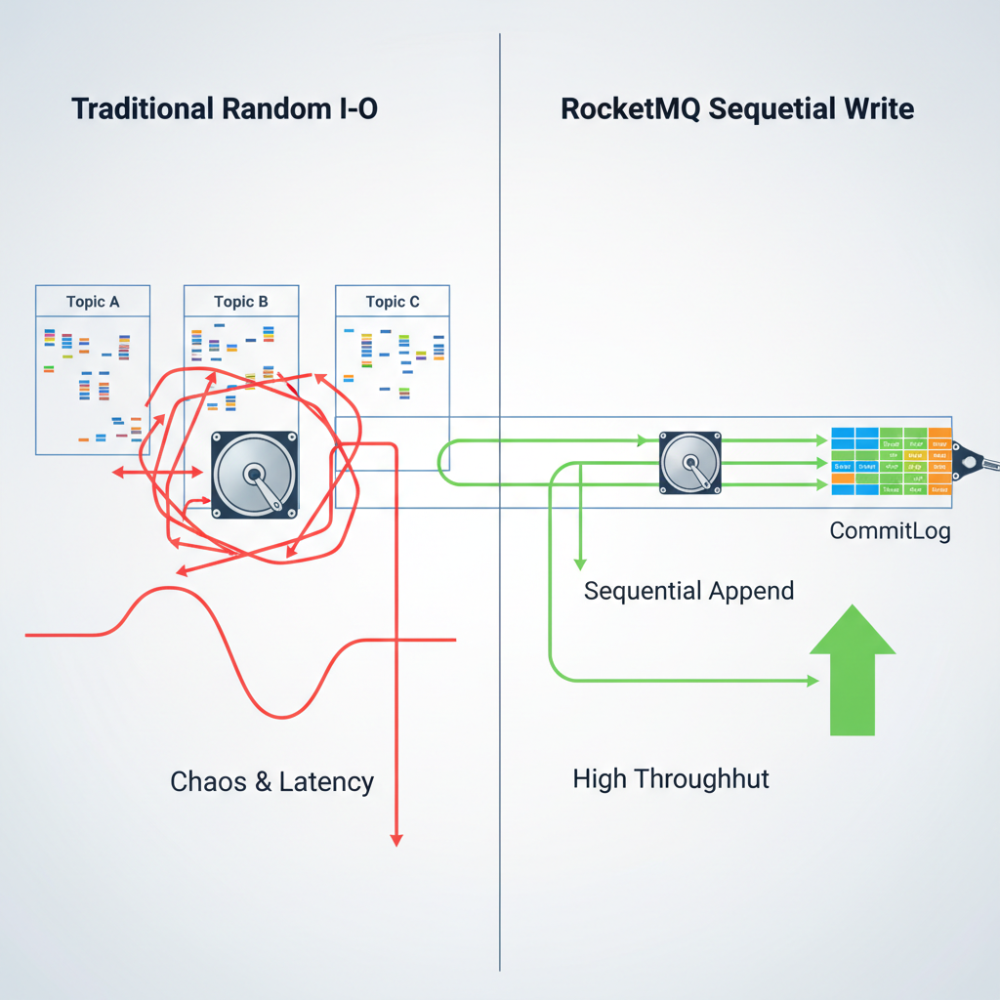
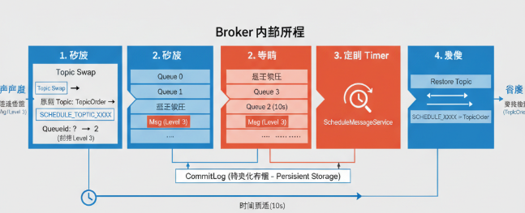
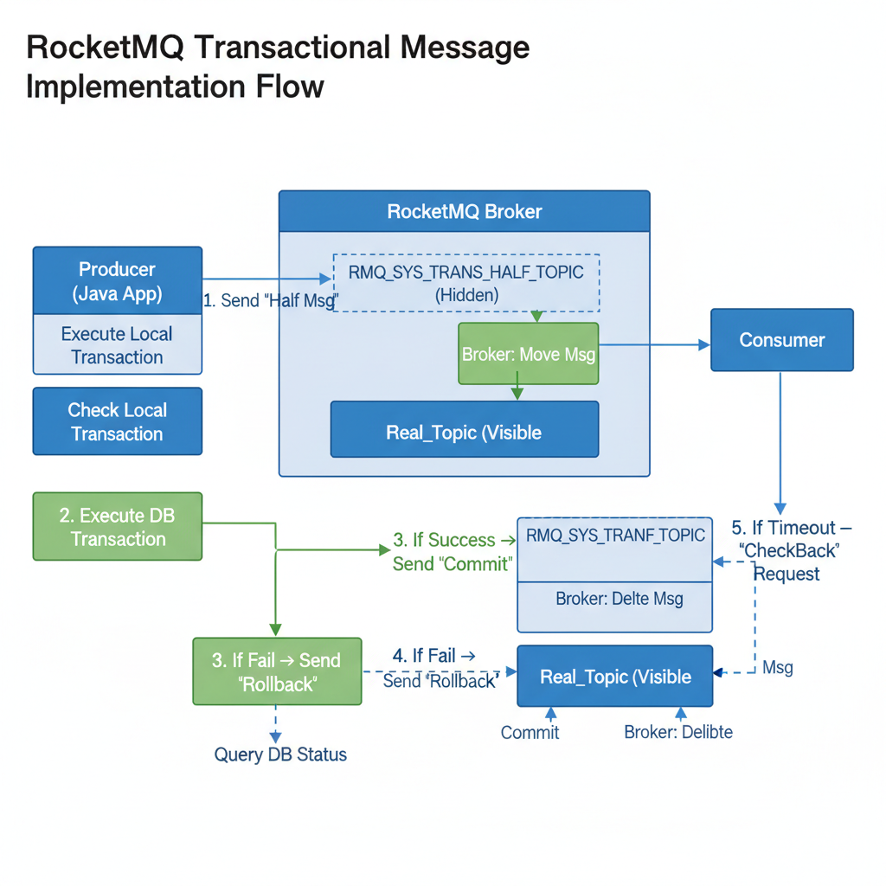
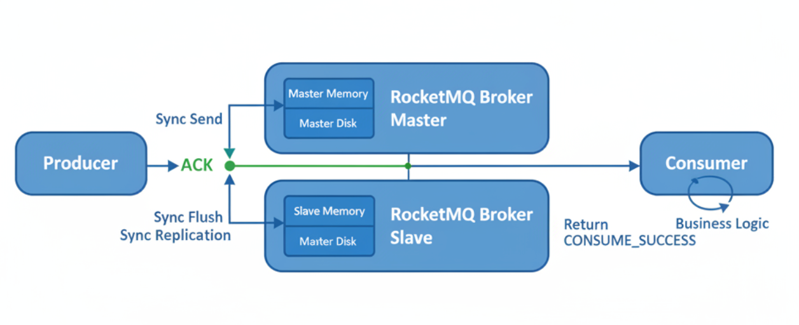

# RocketMQ 核心知识手册（面向 Java 开发者）

> 阅读约定：本文事实基准为 Apache RocketMQ 官方文档（5.0 与 4.x 两套文档）。凡是默认值、参数行为、能力边界这类会随版本变化的内容，都会标注「4.x」或「5.x」；未标注处表示两个大版本行为一致。性能数字属于经验量级，会单独标注，不作为承诺。

## 本文导读

这是一篇按主题重排的 RocketMQ 学习材料：从概念与架构讲起，依次覆盖存储、发送、消费、顺序、延迟、事务、过滤、高可用、可靠性、运维优化，最后给出一张参数速查表和一份纠错清单。

- 第一章 认识 RocketMQ：核心概念与整体架构
- 第二章 存储模型：CommitLog、ConsumeQueue 与 IndexFile
- 第三章 消息发送：Producer 的三种方式与批量发送
- 第四章 消息消费：推拉模式、消费组与位点提交
- 第五章 顺序消息：全局顺序与分区顺序
- 第六章 延迟消息：4.x 的 18 个等级与 5.x 的任意定时
- 第七章 事务消息：两阶段提交与回查
- 第八章 消息过滤：Tag 与 SQL92
- 第九章 高可用与集群部署
- 第十章 消息不丢失：生产端、存储端、消费端三道防线
- 第十一章 生产环境优化与运维
- 第十二章 参数速查、常见误区更正与参考资料

建议阅读顺序：先看第一、二章建立模型，再看第三、四章动手写代码，其余章节按需查阅。

## 一、认识 RocketMQ：核心概念与整体架构

本章先回答"RocketMQ 是什么、由哪些部件组成、一条消息怎么走完全程"。把这套模型记牢，后面所有特性（顺序、延迟、事务、重试）都只是在同一条链路上加规则。

RocketMQ 是阿里巴巴开源、后捐赠给 Apache 基金会的分布式消息中间件（message-oriented middleware，简称 MQ：专门在各系统之间可靠传递消息的中间层软件），现为 Apache 顶级项目。它最初用于电商交易链路，因此设计上很强调"消息不丢、可堆积、可回查"这类金融级诉求。

### 1.1 用"邮局"理解整体模型

可以把 RocketMQ 想成一家邮局：

- 寄信人（Producer）把信交给邮局，信封上写明业务分类（Topic）和子类型（Tag）；
- 邮局（Broker）负责保管信件，按分类放进不同的投递格（Message Queue）；
- 地址簿（NameServer）不存信，只告诉寄信人和收信人"哪个邮局在哪个位置"；
- 收信人（Consumer）按自己的节奏到投递格取信，取到哪一封就记下"下一封的编号"（消费位点）。

这个比喻能解释后面很多设计：同一个投递格里的信是排队有序的（顺序消息），信件可以在邮局暂存到某个时间点再放出来（延迟消息），邮局可以先收下一个"待定信封"、等寄信人确认后再真正投递（事务消息）。

### 1.2 四个核心角色

| 角色 | 作用 | 关键点 |
| --- | --- | --- |
| NameServer | 路由注册中心，保存 Topic 与 Broker 的对应关系 | 节点之间不通信，几乎无状态，可多机部署；客户端定时拉取路由 |
| Broker | 接收、存储、投递消息的主体 | 分 Master / Slave（brokerId 为 0 是 Master，大于 0 是 Slave）；负责刷盘、主从复制、位点管理 |
| Producer | 消息生产者 | 支持同步、异步、单向发送；同一 Producer Group 内实例可共享 |
| Consumer | 消息消费者 | 支持推、拉两种使用方式；集群消费与广播消费两种模式 |

除角色外，还有几个必须分清的名词：

| 名词 | 含义 |
| --- | --- |
| Topic（主题） | 一类消息的逻辑分类，例如 `OrderTopic`；不同类型消息（普通、顺序、延迟、事务）应使用不同 Topic |
| Message Queue（消息队列） | Topic 在 Broker 上的物理分片，是并行与顺序的最小单位；同一队列内消息有序 |
| Tag（标签） | 消息的子分类，用于服务端过滤；一条消息只能设置一个 Tag |
| Key（业务键） | 消息的业务唯一标识（如订单号），Broker 会为其建哈希索引，便于排查与检索 |
| Consumer Group（消费组） | 一组承担相同角色的消费者实例；集群消费时组内分摊队列 |
| Offset（位点） | 消费者在某队列上"消费到哪一条"的位置编号，是消费进度的载体 |

### 1.3 一条消息的完整旅程

1. Producer 从 NameServer 拿到 Topic 的路由，选一个 Message Queue，把消息发给对应 Broker。
2. Broker 把消息顺序追加写入 CommitLog（所有 Topic 共用的大文件）。
3. 后台分发线程把消息的"索引"写进该队列对应的 ConsumeQueue，可检索 Key 时再写 IndexFile。
4. Consumer 向 Broker 发起拉取请求（推模式在客户端内部也是拉），Broker 依据位点返回一批消息。
5. 业务处理成功后，Consumer 提交新的位点；失败则走重试，超过上限进入死信队列。
6. 消息不会因为"被消费"而立刻删除，而是按存储时长滚动清理。

这六步在后续章节会被反复展开；第二章讲第 2、3 步，第三、四章讲第 1、4、5 步。

### 1.4 典型使用场景与主要特性

MQ 的价值集中在四件事：解耦、异步、削峰、事件驱动。

| 场景 | 说明 | 典型例子 |
| --- | --- | --- |
| 系统解耦 | 上游只发消息，不关心下游有几个、怎么实现 | 下单成功后通知积分、物流、购物车 |
| 异步处理 | 非实时任务挪出主链路，缩短响应时间 | 注册后异步发欢迎邮件 |
| 流量削峰 | 突发流量先落到 MQ，下游按能力匀速消费 | 秒杀下单请求排队 |
| 事件驱动 | 以"事件"驱动业务阶段流转 | 支付成功事件触发发货流程 |
| 日志与数据集成 | 采集大批量日志、监控数据再落地 | 前端埋点日志汇总入仓 |

主要特性可以概括为：高吞吐、消息持久化与多副本、点对点与发布订阅两种模型、顺序消息、事务消息、Tag 与属性过滤、延迟/定时消息、消息回溯（按时间或位点重置）。

最小可运行示例如下（4.x 客户端 API，后文示例同风格）。

生产者：

```java
import org.apache.rocketmq.client.producer.DefaultMQProducer;
import org.apache.rocketmq.common.message.Message;

public class ProducerExample {
    public static void main(String[] args) throws Exception {
        // 创建生产者实例并指定生产者组
        DefaultMQProducer producer = new DefaultMQProducer("ProducerGroupName");
        // 设置 NameServer 地址
        producer.setNamesrvAddr("localhost:9876");
        // 启动生产者实例
        producer.start();

        // 发送 10 条消息
        for (int i = 0; i < 10; i++) {
            Message msg = new Message("TopicTest", ("Hello RocketMQ " + i).getBytes());
            producer.send(msg);
        }

        producer.shutdown();
    }
}
```

消费者：

```java
import org.apache.rocketmq.client.consumer.DefaultMQPushConsumer;
import org.apache.rocketmq.client.consumer.listener.ConsumeConcurrentlyContext;
import org.apache.rocketmq.client.consumer.listener.ConsumeConcurrentlyStatus;
import org.apache.rocketmq.client.consumer.listener.MessageListenerConcurrently;
import org.apache.rocketmq.common.message.MessageExt;

import java.util.List;

public class ConsumerExample {
    public static void main(String[] args) throws Exception {
        DefaultMQPushConsumer consumer = new DefaultMQPushConsumer("ConsumerGroupName");
        consumer.setNamesrvAddr("localhost:9876");
        consumer.subscribe("TopicTest", "*");

        consumer.registerMessageListener(new MessageListenerConcurrently() {
            @Override
            public ConsumeConcurrentlyStatus consumeMessage(List msgs, ConsumeConcurrentlyContext context) {
                for (MessageExt msg : msgs) {
                    System.out.printf("%s Receive New Messages: %s %n",
                            Thread.currentThread().getName(), new String(msg.getBody()));
                }
                return ConsumeConcurrentlyStatus.CONSUME_SUCCESS;
            }
        });

        // 启动消费者实例
        consumer.start();
        System.out.printf("Consumer started.%n");
    }
}
```

## 二、存储模型：CommitLog、ConsumeQueue 与 IndexFile

本章讲消息落在磁盘上的样子。理解这一层，才能解释"为什么写一个文件反而更快"、"消费为什么不会越积越慢"、"磁盘满了会删什么"。

### 2.1 三个核心文件

RocketMQ 的存储设计遵循一个原则：**写入极致顺序，读取尽量轻量**。

| 文件类型 | 作用 | 图书馆类比 | 关键特性 |
| --- | --- | --- | --- |
| CommitLog | 消息主体存储。所有 Topic 的消息混在一起顺序追加 | 按入库时间堆放的书库 | 顺序写；单个文件默认 1GB（4.x 参数 `mappedFileSizeCommitLog`），文件名是起始偏移量 |
| ConsumeQueue | 逻辑消费队列。只存"消息在 CommitLog 里的位置"，供消费者定位 | 分类索引卡片，指向书的位置 | 定长记录，每条 20 字节；路径形如 `store/consumequeue/{topic}/{queueId}` |
| IndexFile | 哈希索引。支持按 Key 或时间区间反查消息 | 书名/作者检索台 | 哈希结构，主要用于运维排查与消息轨迹 |

存储结构可以这样理解：



### 2.2 一条消息是怎么写进去的

1. **接收**：Broker 收到消息，先落在内存缓冲区，等待追加。
2. **写 CommitLog**：追加到当前活跃的 CommitLog 文件末尾；写满 1GB 就滚动到下一个文件。
3. **分发到 ConsumeQueue**：异步分发服务（ReputMessageService）从 CommitLog 读出刚写入的消息，把偏移量、消息长度、Tag 哈希值写进对应 Topic/Queue 的 ConsumeQueue。
4. **更新 IndexFile（可选）**：消息带 Key 时，把 Key 的哈希与物理偏移写入 IndexFile，之后可按 Key 查消息。

注意第 3 步是**异步**的：CommitLog 写完消息就对生产者可见，ConsumeQueue 稍后跟上。这也是"消息堆积时消费端看到的是索引而不是海量正文"的原因。

### 2.3 ConsumeQueue 为什么只用 20 字节

每个 ConsumeQueue 条目固定 20 字节，结构如下：

| 字段 | 长度 | 含义 |
| --- | --- | --- |
| CommitLog Offset | 8 字节 | 消息在 CommitLog 中的物理地址 |
| Message Size | 4 字节 | 消息长度 |
| Tags HashCode | 8 字节 | Tag 的哈希值，用于服务端过滤 |

这样设计带来三个好处：

1. **随机读变顺序读**：定长意味着第 N 条记录的位置可以直接算出来，`Pos = N * 20`，不需要遍历。
2. **服务端过滤省 IO**：消费者带 Tag 订阅时，Broker 只比对 Tag 哈希就能过滤，不必把消息正文从 CommitLog 读出来。
3. **索引极小、易驻留内存**：单个 ConsumeQueue 文件默认容纳 30 万条索引，约 30 万 × 20 字节 ≈ 5.7MB，很容易被页缓存（PageCache）整体缓存。

### 2.4 为什么单个 CommitLog 也能支撑高吞吐

常见疑问是：磁盘读写并不快，把所有消息写进同一个文件，凭什么能抗住高并发写入？答案是把"随机写"改造成了"顺序写"，并且把"写磁盘"变成了"写内存"。

RocketMQ 与 Kafka 的一个显著差异在于文件组织方式：

- Kafka 每个 Topic 的每个 Partition 一个（组）文件，Topic 多时是大量文件的随机 IO。
- RocketMQ 无论多少 Topic，消息都追加写入同一个 CommitLog，把随机 IO 收敛成顺序 IO。

磁盘最怕随机 IO（磁头频繁寻道），顺序 IO 则几乎没有寻道开销。官方与社区常引用的经验值是：机械盘顺序写吞吐可达数百 MB/s 量级，远高于随机写；具体数值取决于硬件，仅作量级参考。



上图左边是"每个 Topic 一个文件"带来的随机 IO，右边是 RocketMQ 所有消息排队进入 CommitLog 的"单行道"。极致的写性能就来自这里。

#### 进阶了解（可跳过）：mmap 与 MappedFile

即便是顺序写，如果每次写都要在用户态与内核态之间切换，性能同样会被拖垮。RocketMQ 用 Java NIO 的 `MappedByteBuffer`（底层是操作系统的 mmap，内存映射文件）绕过这一层。

- **写数据**：直接写进映射区，也就是操作系统的页缓存，由后台线程异步刷盘。
- **读数据**：命中页缓存时完全不用读盘；未命中时由缺页中断把文件页加载进来。
- **收益**：省掉一次"内核缓冲区到用户缓冲区"的拷贝，也减少了系统调用。
- **限制**：单个 `MappedByteBuffer` 的容量受 Java 索引类型限制（约 2GB 上限），所以 RocketMQ 把单个文件定为 1GB 作为工程折中。

```java
import java.io.File;
import java.io.RandomAccessFile;
import java.nio.MappedByteBuffer;
import java.nio.channels.FileChannel;

public class MappedFileDemo {

    // 1GB
    public static final int FILE_SIZE = 1024 * 1024 * 1024;

    public static void main(String[] args) throws Exception {
        File file = new File("00000000000000000000"); // 文件名通常是起始偏移量

        // 1. 获取 FileChannel
        FileChannel fileChannel = new RandomAccessFile(file, "rw").getChannel();

        // 2. 执行 mmap 映射：读写模式、起始位置 0、映射大小 1GB
        MappedByteBuffer mappedByteBuffer =
                fileChannel.map(FileChannel.MapMode.READ_WRITE, 0, FILE_SIZE);

        // 3. 写入数据（像写内存数组一样，没有磁盘 IO 阻塞）
        String msg = "Hello RocketMQ High Performance!";
        mappedByteBuffer.put(msg.getBytes());

        // 4. 强制刷盘由刷盘线程负责，通常不需要业务代码调用
        // mappedByteBuffer.force();
    }
}
```

#### 进阶了解（可跳过）：文件预热与内存锁

写到 1GB 边界时创建新文件会产生抖动，RocketMQ 用"预热"化解：

1. **预分配**：Broker 启动或文件快满时，后台线程提前创建好下一个 1GB 文件。
2. **逐页写零**：在文件里每隔 4KB（一个内存页）写入一个 `0`，强制操作系统分配物理页，避免首次写入时大量缺页中断。
3. **锁定内存**：部分版本会尝试调用 `mlock` 类系统调用，减少热数据被换出（是否可用取决于版本与平台）。

#### 进阶了解（可跳过）：并发写入与 TransientStorePool

高并发写入同一个映射区，必须解决"既要快又要不乱"的问题。RocketMQ 在 CommitLog 写入路径上使用自旋锁（SpinLock）配合 `ReentrantLock` 控制并发，并提供了可选的堆外内存池。

开启 `transientStorePoolEnable=true` 后（通常只在 Master 上开），写入路径变成三段：

1. **Write**：消息先写进堆外内存（DirectByteBuffer），纯内存操作，极快。
2. **Commit**：后台线程把堆外内存的数据提交到页缓存（MappedByteBuffer）。
3. **Flush**：由操作系统或刷盘线程把页缓存落到磁盘。

好处是"写入"和"页缓存"解耦：生产者写内存，消费者读页缓存，两者不再争抢同一份页缓存的锁。代价是数据在刷盘前只存在堆外内存中，进程崩溃会丢数据，属于"用可靠性换吞吐"的开关。

#### 小结：为什么快

$ 高吞吐 = 顺序写(CommitLog) + 零拷贝(mmap) + 堆外内存池(TransientStorePool) $

$ 低延迟 = 页缓存热读 + 极简索引(ConsumeQueue) + 服务端过滤 $

用一句话概括：RocketMQ 并不是真的在"拼命写磁盘"，而是在并发写内存（页缓存/堆外内存），再由后台异步落盘。

### 2.5 存储清理与归档

消息不是"消费完就删"，而是按**存储时长**滚动清理。这一点常被误解，需要单独说明。

- **判定标准是时间，不是消费状态**：Broker 按文件最后一次修改时间加保留时长来判断是否过期；消息是否被消费与是否清理无关（5.x 官方文档明确说明）。
- **清理粒度是 Broker 节点**：因为所有 Topic 共用 CommitLog，无法按 Topic/Queue 精确删除某段数据。
- **4.x 常用配置**：`fileReservedTime`（保留小时数，默认 72）、`deleteWhen`（每天几点执行删除，默认 `04` 即凌晨 4 点）、`diskMaxUsedSpaceRatio`（磁盘使用率超过该比例，默认 75，触发提前删除）、`cleanFileForciblyEnable`（是否允许强制删除未过期文件）。
- **磁盘不足时的兜底**：磁盘空间紧张时会强制删除最旧的文件，实际保留时间可能短于配置值。
- **归档**：RocketMQ 自身没有内置的"冷归档"开关，常见做法是把 CommitLog 文件搬运到对象存储或 HDFS，需要回溯时再导回或离线解析。历史消息的访问能力依赖这份外部归档。
- **纠错提示**：并不存在"只删除某个时间段消息"的配置项，能控制的是保留时长、删除时间点与磁盘水位；原文中"指定时间段删除策略"的表述已按官方机制更正。

## 三、消息发送：Producer 的三种方式与批量发送

本章讲消息怎么发出去：如何初始化 Producer、如何组织消息、同步/异步/单向该如何选，以及发送阶段真正要关注的参数。

### 3.1 初始化 Producer

```java
import org.apache.rocketmq.client.producer.DefaultMQProducer;
import org.apache.rocketmq.client.exception.MQClientException;

public class RocketMQProducerExample {
    public static void main(String[] args) throws MQClientException {
        // 创建生产者实例，并指定生产者组名
        DefaultMQProducer producer = new DefaultMQProducer("ProducerGroupName");

        // 设置 NameServer 地址，多个地址用分号分隔
        producer.setNamesrvAddr("localhost:9876");

        // 启动 Producer 实例
        producer.start();

        // ... 消息发送逻辑

        // 使用完毕后关闭 Producer
        producer.shutdown();
    }
}
```

这段代码做了三件事：创建实例并声明生产者组（同一组用于标识同类生产者）、配置 NameServer（服务发现与路由）、启动客户端（建立连接、拉取路由、启动定时任务）。

### 3.2 组织一条消息

```java
import org.apache.rocketmq.common.message.Message;

// ... 在 main 方法中
String topic = "TopicTest";
String tags = "TagA";
String keys = "OrderID_100";
String messageBody = "Hello RocketMQ";

Message msg = new Message(topic, tags, keys, messageBody.getBytes());
```

`Message` 的四个要素：Topic（分类）、Tag（子分类，一条消息只能有一个）、Key（业务唯一标识，便于检索）、Body（字节数组）。生产环境建议每条消息都设置业务 Key，出问题时可按 Key 反查。

### 3.3 三种发送方式

| 方式 | 是否等回执 | 可靠性 | 适用场景 |
| --- | --- | --- | --- |
| 同步发送 `send` | 等待 Broker 响应 | 最高，可知成功/失败 | 重要通知、订单、资金类消息 |
| 异步发送 `send(msg, callback)` | 不阻塞，回调通知 | 较高，异常可在回调处理 | 对响应时间敏感、希望提高吞吐 |
| 单向发送 `sendOneway` | 不等回执 | 最低，失败无感知 | 日志采集等可容忍丢失的场景 |

同步发送：

```java
import org.apache.rocketmq.client.producer.SendResult;

try {
    SendResult sendResult = producer.send(msg);
    System.out.printf("同步发送结果：%s%n", sendResult);
} catch (Exception e) {
    e.printStackTrace();
}
```

异步发送：

```java
import org.apache.rocketmq.client.producer.SendCallback;

producer.send(msg, new SendCallback() {
    @Override
    public void onSuccess(SendResult sendResult) {
        System.out.printf("异步发送成功：%s%n", sendResult);
    }

    @Override
    public void onException(Throwable e) {
        System.out.printf("异步发送异常：%s%n", e);
    }
});
```

单向发送：

```java
producer.sendOneway(msg);
```

### 3.4 批量发送

把多条消息合并成一次网络请求，可以明显减少网络开销、提升吞吐。

```java
import java.util.ArrayList;
import java.util.List;

List messages = new ArrayList<>();
messages.add(new Message("TopicTest", "TagA", "Hello RocketMQ 1".getBytes()));
messages.add(new Message("TopicTest", "TagA", "Hello RocketMQ 2".getBytes()));
messages.add(new Message("TopicTest", "TagA", "Hello RocketMQ 3".getBytes()));

try {
    SendResult sendResult = producer.send(messages);
    System.out.printf("批量发送结果：%s%n", sendResult);
} catch (Exception e) {
    e.printStackTrace();
}
```

批量发送的限制需要留意（4.x 客户端）：同一批消息应使用同一个 Topic、不支持延迟消息与事务消息、总大小受最大消息尺寸约束。

### 3.5 发送阶段必须关注的参数

1. **消息大小**：客户端默认上限 4MB（`maxMessageSize`），仅计算消息体；大消息建议先自行压缩，不要把 MQ 当文件传输通道。
2. **发送超时**：默认 3000ms（`sendMsgTimeout`）。

```java
producer.setSendMsgTimeout(3000);  // 发送超时 3 秒
```

3. **失败重试**：同步发送默认重试 2 次（`retryTimesWhenSendFailed`，4.x）；5.x 文档给出发送重试默认 3 次，且策略对应用不可见，具体以客户端版本为准。

```java
producer.setRetryTimesWhenSendFailed(3);       // 同步发送失败重试 3 次
producer.setRetryTimesWhenSendAsyncFailed(3);  // 异步发送失败重试 3 次
```

4. **发送结果状态**：同步发送不抛异常不代表绝对可靠，要检查 `SendResult` 的状态。`SEND_OK` 表示写入成功；`FLUSH_DISK_TIMEOUT`（同步刷盘超时，4.x 默认超时约 5 秒）、`FLUSH_SLAVE_TIMEOUT`（同步复制到 Slave 超时）、`SLAVE_NOT_AVAILABLE`（配置了 SYNC_MASTER 但没有可用 Slave）都意味着消息只在内存中，此时 Broker 宕机就会丢。

### 3.6 发送端最佳实践

1. 合理使用 Tag：用于服务端过滤，减少无关消息的传输。
2. 必须设置业务 Key：便于按 Key 查询消息、排查丢失。
3. 按业务选发送方式：重要消息用同步并检查状态，日志类可用单向。
4. 异常要落地：捕获异常后写入本地库或重试表，由后台任务补偿，不要只打日志。
5. Producer 实例线程安全，可在多线程环境共享，避免频繁创建。
6. 不同消息类型（普通、顺序、延迟、事务）使用不同 Topic，不要用 Tag 区分类型。

## 四、消息消费：推拉模式、消费组与位点提交

本章讲消息怎么被消费掉：推模式与拉模式的真实关系、消费组如何分工、位点由谁保存、失败后如何重试与进入死信队列。

### 4.1 推模式与拉模式：其实都是拉

RocketMQ 提供两类消费方式：

- **推模式（Push Consumer）**：注册监听器，消息"自动"送到监听器里。
- **拉模式（Pull Consumer）**：业务代码主动拉取一批消息，自己控制节奏与位点。

关键事实是：`DefaultMQPushConsumer` 内部仍是"拉"，只是把拉取封装成了**长轮询**（long polling，请求在 Broker 端挂起等待，有消息立即返回，没消息等到超时再返回）。对开发者而言体验像推送，对服务端而言仍是拉取，因此不会因推送压垮消费者。

| 维度 | 推模式 | 拉模式 |
| --- | --- | --- |
| 使用复杂度 | 低，注册监听器即可 | 高，需自行管理位点与批次 |
| 消费节奏控制 | 弱，由 SDK 调度 | 强，可精确控制速度与批量 |
| 位点管理 | SDK 自动提交 | 需自行提交 |
| 适用场景 | 绝大多数业务 | 流处理框架、需要精细控制的场景 |

### 4.2 推模式的标准写法

```java
import org.apache.rocketmq.client.consumer.DefaultMQPushConsumer;
import org.apache.rocketmq.client.consumer.listener.ConsumeConcurrentlyContext;
import org.apache.rocketmq.client.consumer.listener.ConsumeConcurrentlyStatus;
import org.apache.rocketmq.client.consumer.listener.MessageListenerConcurrently;
import org.apache.rocketmq.common.message.MessageExt;
import org.apache.rocketmq.common.consumer.ConsumeFromWhere;

import java.util.List;

public class SimplePushConsumer {
    public static void main(String[] args) throws Exception {
        // 创建 Consumer 实例，并指定 Consumer Group
        DefaultMQPushConsumer consumer = new DefaultMQPushConsumer("ConsumerGroupName");

        // 设置 NameServer 地址
        consumer.setNamesrvAddr("localhost:9876");

        // 设置消费起始位置（4.x API）
        consumer.setConsumeFromWhere(ConsumeFromWhere.CONSUME_FROM_FIRST_OFFSET);

        // 订阅主题，并指定标签过滤表达式
        consumer.subscribe("TopicTest", "*");

        // 注册回调函数处理消息
        consumer.registerMessageListener(new MessageListenerConcurrently() {
            @Override
            public ConsumeConcurrentlyStatus consumeMessage(List msgs,
                                                            ConsumeConcurrentlyContext context) {
                for (MessageExt msg : msgs) {
                    System.out.printf("Received message: %s%n", new String(msg.getBody()));
                }
                // 标记消息消费成功
                return ConsumeConcurrentlyStatus.CONSUME_SUCCESS;
            }
        });

        // 启动 Consumer 实例
        consumer.start();

        System.out.printf("Consumer started.%n");
    }
}
```

逐项解释：

1. **实例化**：`DefaultMQPushConsumer` 的第一个参数是消费组名，同组实例共同分摊消息。
2. **NameServer 地址**：客户端据此获取 Topic 路由与 Broker 列表。
3. **消费起始位置**：`CONSUME_FROM_FIRST_OFFSET` 表示从最小位点（最早可用消息）开始；`CONSUME_FROM_LAST_OFFSET` 表示从最新消息开始。4.x 客户端默认是 `CONSUME_FROM_LAST_OFFSET`，只有新消费组首次启动时该设置才生效。
4. **订阅**：第一个参数是 Topic，第二个是 Tag 表达式，`"*"` 表示全部。
5. **注册监听器**：`MessageListenerConcurrently` 是并发消费，消息之间不保证顺序。
6. **消息处理**：遍历消息列表处理业务，返回 `CONSUME_SUCCESS` 表示成功。
7. **启动**：`start()` 之后开始拉取并回调。

### 4.3 消费组、集群消费与广播消费

消费模式决定"一条消息被组内几个实例消费"：

| 模式 | 行为 | 位点管理 | 适用场景 |
| --- | --- | --- | --- |
| 集群消费（CLUSTERING，默认） | 同一消费组内一条消息只被一个实例消费，队列在实例间分摊 | Broker 端统一管理，较严格，重启后可从上次位点继续 | 订单、库存等要求消息不重复处理的业务 |
| 广播消费（BROADCASTING） | 每个实例都收到全量消息副本 | 各实例本地管理，可靠性较弱，本地进度丢失后只能从启动后的消息开始 | 日志记录、本地缓存刷新、通知类场景 |

需要强调两点：集群消费的位点存在 Broker 上，所以实例扩缩容后进度仍连续；广播消费的位点存在消费者本地文件里，本地进度丢失就会漏消息，因此对"消息连续性"要求高的业务不要用广播模式。

集群消费同时意味着负载均衡：同一消费组内的实例会自动分摊队列，4.x 及更早版本按队列分配，5.x 的 PushConsumer 改为消息级分配。实例上下线会触发重新分配（rebalance），重分配过程中可能出现短暂重复消费，这也是业务需要幂等的原因之一。

### 4.4 拉模式与轻量拉取

老版本的 `DefaultMQPullConsumer` 需要自己维护位点、自己 sleep 控制节奏：

```java
import org.apache.rocketmq.client.consumer.DefaultMQPullConsumer;
import org.apache.rocketmq.client.consumer.PullResult;
import org.apache.rocketmq.common.message.MessageExt;
import org.apache.rocketmq.common.message.MessageQueue;

import java.util.Set;

public class PullConsumerExample {
    public static void main(String[] args) throws Exception {
        DefaultMQPullConsumer consumer = new DefaultMQPullConsumer("PullConsumerGroup");
        consumer.setNamesrvAddr("localhost:9876");
        consumer.start();

        Set mqs = consumer.fetchSubscribeMessageQueues("TestTopic");

        for (MessageQueue mq : mqs) {
            long offset = consumer.fetchConsumeOffset(mq, true);

            while (true) {
                PullResult pullResult = consumer.pull(mq, "*", offset, 32);
                offset = pullResult.getNextBeginOffset();

                switch (pullResult.getPullStatus()) {
                    case FOUND:
                        for (MessageExt msg : pullResult.getMsgFoundList()) {
                            System.out.println("Received message: " + new String(msg.getBody()));
                        }
                        break;
                    case NO_NEW_MSG:
                    case NO_MATCHED_MSG:
                    case OFFSET_ILLEGAL:
                    default:
                        break;
                }

                // 更新消费位点
                consumer.updateConsumeOffset(mq, offset);

                Thread.sleep(1000);
            }
        }
    }
}
```

版本提示（重要）：`DefaultMQPullConsumer` 在新版本中已不推荐使用。4.x 提供 `DefaultLitePullConsumer`（可自动提交位点、支持 `poll` 式拉取）；5.x 则明确建议只在流处理框架集成时使用 PullConsumer，普通业务用 PushConsumer 或 SimpleConsumer，并且**同一消费组内严禁混用拉、推两种类型**。

### 4.5 消费位点（Offset）是怎么提交的

位点是"消费到哪"的记账本，四种位点概念要分清：

| 概念 | 含义 |
| --- | --- |
| MinOffset | 队列中最早可用消息的位点 |
| MaxOffset | 队列中最新消息的位点，与消费位点之差就是堆积量 |
| 消费位点（Consumer Offset） | 某消费组在该队列上已消费到的位置 |
| 初始位点 | 消费组第一次消费该队列时的起点 |

提交规则（4.x/5.x 通用部分）：推模式消费成功后由 SDK 异步提交位点；集群消费的位点保存在 Broker，广播消费保存在本地。位点提交意味着"至少一次"语义——先处理业务再提交位点，进程在两者之间崩溃就会重复消费，所以业务必须做幂等。

初始位点的版本差异需要注意：

- 4.x/3.x：初始位点由 `ConsumeFromWhere` 与队列消息状态决定，可选最早、最新、指定时间戳。
- 5.x：初始位点取"消费者开始接收消息时队列的最大位点"，即默认从最新消息开始；如需历史消息要显式重置位点。

重置位点（回溯消费）在 4.x/5.x 都支持按偏移量或按时间点重置，但要注意两点：重置后读的是冷数据，会给磁盘和下游带来压力；只能对可见消息重置，处于延迟调度或重试待投递状态的消息不能重置。

### 4.6 消费失败：重试阶梯与死信队列

消费失败（返回失败状态、抛异常、或超过消费超时）会触发服务端重试，重试有固定的时间阶梯，而不是指数退避。

并发消费的重试间隔（5.x 官方文档，4.x 同阶梯）：第 1 次 10 秒、第 2 次 30 秒、第 3 次 1 分钟、第 4 次 2 分钟……第 8 次 6 分钟、第 9 次 7 分钟、第 10 次 8 分钟、第 11 次 9 分钟、第 12 次 10 分钟、第 13 次 20 分钟、第 14 次 30 分钟、第 15 次 1 小时、第 16 次 2 小时；超过 16 次后每次间隔 2 小时。

| 项目 | 说明 |
| --- | --- |
| 最大重试次数 | 默认 16 次（可在消费组元数据中配置） |
| 有序消息重试间隔 | 固定值（5.x 默认 3000ms），不是阶梯 |
| 死信队列（DLQ） | 达到最大重试次数后消息进入死信队列，Topic 形如 `%DLQ%` + 消费组名（`%DLQ%` 是系统保留前缀），不再自动重试 |
| 处理建议 | 监控死信队列并人工/定时消费；对可预期的业务失败优先做幂等与状态机，而不是依赖重试 |

两条使用建议：不要用"返回失败"来做限流，限流应该延后拉取或降低并发；重试次数不宜设得过大，否则故障消息会长期占压系统资源。

纠错提示：原文所说"RocketMQ 会自动进行指数退避重试（1s、5s、10s...）"与官方阶梯不符，已按 10 秒起步的固定阶梯更正。

## 五、顺序消息：全局顺序与分区顺序

本章讲"消息按顺序被消费"这件事：RocketMQ 的顺序到底保证在哪一层、怎么用代码实现、以及为什么全局顺序要慎用。

顺序消息是指消息的发送、存储、投递都遵循同一顺序，消费者按发送顺序处理。它常用于状态同步、交易撮合、数据库变更同步等"顺序错乱就会算错"的场景。

### 5.1 两种顺序级别

| 级别 | 保证范围 | 实现方式（4.x） | 代价 |
| --- | --- | --- | --- |
| 全局顺序 | 整个 Topic 内所有消息严格有序 | 所有消息都发到同一个队列，消费端单线程有序消费 | 吞吐受单队列单线程限制 |
| 分区顺序 | 同一分区键（如同一订单号）内有序 | 按分区键选择队列，相同键进同一队列 | 热点键会造成队列倾斜 |

生活化理解：全局顺序像"只有一个窗口的银行"，绝对先来先办但排队长；分区顺序像"按业务分多个窗口"，同一客户的业务总在同一窗口，窗口之间可以并行。

### 5.2 全局顺序的完整写法

```java
import org.apache.rocketmq.client.producer.DefaultMQProducer;
import org.apache.rocketmq.client.producer.SendResult;
import org.apache.rocketmq.common.message.Message;
import org.apache.rocketmq.common.message.MessageQueue;

import java.util.List;

public class GlobalOrderProducer {
    public static void main(String[] args) throws Exception {
        DefaultMQProducer producer = new DefaultMQProducer("global_order_producer_group");
        producer.setNamesrvAddr("localhost:9876");
        producer.start();

        String topic = "TopicTest";
        List<MessageQueue> mqs = producer.fetchPublishMessageQueues(topic);

        for (int i = 0; i < 100; i++) {
            Message msg = new Message(topic, ("order_" + i).getBytes());
            // 始终选择第一个队列，牺牲并行度换取全局顺序
            SendResult sendResult = producer.send(msg, mqs.get(0), null);
            System.out.printf("%s%n", sendResult);
        }

        producer.shutdown();
    }
}
```

配套的消费者必须使用有序监听器：

```java
import org.apache.rocketmq.client.consumer.DefaultMQPushConsumer;
import org.apache.rocketmq.client.consumer.listener.ConsumeOrderlyContext;
import org.apache.rocketmq.client.consumer.listener.ConsumeOrderlyStatus;
import org.apache.rocketmq.client.consumer.listener.MessageListenerOrderly;
import org.apache.rocketmq.common.message.MessageExt;

import java.util.List;

public class GlobalOrderConsumer {
    public static void main(String[] args) throws Exception {
        DefaultMQPushConsumer consumer = new DefaultMQPushConsumer("global_order_consumer_group");
        consumer.setNamesrvAddr("localhost:9876");
        consumer.subscribe("TopicTest", "*");

        consumer.registerMessageListener(new MessageListenerOrderly() {
            @Override
            public ConsumeOrderlyStatus consumeMessage(List msgs, ConsumeOrderlyContext context) {
                for (MessageExt msg : msgs) {
                    System.out.printf("Consume message: %s%n", new String(msg.getBody()));
                }
                return ConsumeOrderlyStatus.SUCCESS;
            }
        });

        consumer.start();
        System.out.println("Consumer Started.");
    }
}
```

### 5.3 分区顺序的完整写法

```java
import org.apache.rocketmq.client.producer.DefaultMQProducer;
import org.apache.rocketmq.client.producer.SendResult;
import org.apache.rocketmq.common.message.Message;
import org.apache.rocketmq.common.message.MessageQueue;

import java.util.List;

public class PartitionOrderProducer {
    public static void main(String[] args) throws Exception {
        DefaultMQProducer producer = new DefaultMQProducer("partition_order_producer_group");
        producer.setNamesrvAddr("localhost:9876");
        producer.start();

        String topic = "TopicTest";
        List<MessageQueue> mqs = producer.fetchPublishMessageQueues(topic);

        for (int i = 0; i < 100; i++) {
            Integer orderId = i;
            Message msg = new Message(topic, ("order_" + i).getBytes());
            // 自定义队列选择：同一分区键必然落到同一队列
            SendResult sendResult = producer.send(msg, (mqsArg, arg, index) -> {
                Integer id = (Integer) arg;
                return mqsArg.get(id % mqsArg.size());
            }, orderId);
            System.out.printf("%s%n", sendResult);
        }

        producer.shutdown();
    }
}
```

分区顺序的消费者与全局顺序相同，同样使用 `MessageListenerOrderly`：

```java
import org.apache.rocketmq.client.consumer.DefaultMQPushConsumer;
import org.apache.rocketmq.client.consumer.listener.ConsumeOrderlyContext;
import org.apache.rocketmq.client.consumer.listener.ConsumeOrderlyStatus;
import org.apache.rocketmq.client.consumer.listener.MessageListenerOrderly;
import org.apache.rocketmq.common.message.MessageExt;

import java.util.List;
import java.util.concurrent.atomic.AtomicLong;

public class PartitionOrderConsumer {
    public static void main(String[] args) throws Exception {
        DefaultMQPushConsumer consumer = new DefaultMQPushConsumer("partition_order_consumer_group");
        consumer.setNamesrvAddr("localhost:9876");
        consumer.subscribe("TopicTest", "TagA");

        consumer.registerMessageListener(new MessageListenerOrderly() {
            AtomicLong consumeTimes = new AtomicLong(0);

            @Override
            public ConsumeOrderlyStatus consumeMessage(List msgs, ConsumeOrderlyContext context) {
                context.setAutoCommit(true);
                for (MessageExt msg : msgs) {
                    System.out.printf("Thread: %s, Consume message: %s%n",
                            Thread.currentThread().getName(), new String(msg.getBody()));
                }
                this.consumeTimes.incrementAndGet();
                return ConsumeOrderlyStatus.SUCCESS;
            }
        });

        consumer.start();
        System.out.println("Consumer Started.");
    }
}
```

### 5.4 顺序是怎么被保证的

1. **队列选择**：全局顺序把所有消息发到同一队列；分区顺序用自定义选择器，让相同分区键进同一队列。
2. **存储有序**：同一队列的消息在 CommitLog 与 ConsumeQueue 中都按到达顺序追加。
3. **消费有序**：`MessageListenerOrderly` 让 Broker 端对队列加锁（ConsumeQueue 锁），同一队列同一时刻只交给一个消费线程处理，处理完再取下一条。
4. **失败处理**：有序消费失败时不建议抛异常，应返回 `SUSPEND_CURRENT_QUEUE_A_MOMENT` 让当前队列"暂停一下"，避免跳过消息破坏顺序；返回 `ConsumeOrderlyStatus.SUCCESS` 表示本批已成功。
5. **重试影响**：有序消息重试间隔是固定值，且重试会阻塞后续消息，这是保证顺序的必然代价。

### 5.5 使用注意事项

1. 全局顺序会显著限制吞吐，因为只有一个队列、一个消费线程在跑，只在确实需要时使用。
2. 分区顺序在保证局部顺序的同时提供并行度，是大多数业务的正确选择。
3. 分区键要选得均匀（订单号、用户 ID 都可以），避免出现"超级热键"把单个队列压满。
4. 消费者端要正确处理异常与重试，任何"跳过失败消息继续处理"的逻辑都会破坏顺序。
5. 生产端要保证单生产者、串行发送：多线程并发发送或多生产者同时写同一分区键时，RocketMQ 无法判定先后。

### 5.6 5.x 的顺序消息写法（版本差异）

5.x 把顺序消息建模为"消息组"：发送时设置 `messageGroup`（如订单号），同一组内 FIFO。同时要求 Topic 与消费组都声明为有序类型，例如：

```bash
# 创建 FIFO Topic 与有序消费组（5.x）
sh mqadmin updateTopic -c DefaultCluster -t FIFOTopic -n 127.0.0.1:9876 -o true -a +message.type=FIFO
sh mqadmin updateSubGroup -c DefaultCluster -g FIFOGroup -n 127.0.0.1:9876 -o true
```

与 4.x 的差别：4.x 靠"队列选择器 + 有序监听器"实现分区顺序；5.x 靠"消息组 + 有序订阅"实现组内顺序，并且不同消息组之间、未设置消息组的消息之间不保证顺序。若消费组未配置为有序，则会退化为并发投递，顺序不再保证。

## 六、延迟消息：4.x 的 18 个等级与 5.x 的任意定时

本章讲"现在别投，过一会儿再投"。这是最容易踩版本坑的一节：4.x 只支持固定等级，5.x 才支持任意时间点，两者 API 与上限都不同。

典型场景是订单超时关闭：下单后 30 分钟未支付则关闭。用 `ScheduledExecutorService` 重启即丢，用数据库轮询在数据量大时压力大，延迟消息把这件事交给 MQ 的存储与调度能力。

### 6.1 4.x：18 个固定延迟等级

4.x 不支持任意时间，只能选预设等级，默认 18 个（对应 `messageDelayLevel` 配置）：

`1s 5s 10s 30s 1m 2m 3m 4m 5m 6m 7m 8m 9m 10m 20m 30m 1h 2h`

```java
import org.apache.rocketmq.client.producer.DefaultMQProducer;
import org.apache.rocketmq.common.message.Message;

public class DelayProducer {
    public static void main(String[] args) throws Exception {
        DefaultMQProducer producer = new DefaultMQProducer("delay_group");
        producer.setNamesrvAddr("127.0.0.1:9876");
        producer.start();

        Message msg = new Message("TopicOrder", "TagA", "订单号123".getBytes());

        // 【关键点】设置延迟等级（4.x API）
        // level=1 -> 1s，level=2 -> 5s，level=3 -> 10s ...
        // level=16 -> 30m（可覆盖 30 分钟未支付关单）
        msg.setDelayTimeLevel(3);

        producer.send(msg);

        System.out.println("消息已发送，10 秒后消费者才能收到");
        producer.shutdown();
    }
}
```

### 6.2 4.x 的实现原理：换个 Topic 先"藏起来"

Broker 收到消息后发现 `delayTimeLevel > 0`，会做三件事：

1. **备份原信息**：把原始 Topic 与 QueueId 写入消息属性（`REAL_TOPIC`、`REAL_QUEUE_ID`）。
2. **改写 Topic 与队列**：Topic 改成系统内置的 `SCHEDULE_TOPIC_XXXX`，队列号按 `queueId = delayLevel - 1` 计算。于是所有 1s 延迟的消息都在 Queue-0，5s 的都在 Queue-1，依此类推。同一队列内延迟时长相同，天然有序，扫描效率极高。
3. **写入 CommitLog**：消费者订阅的是原 Topic，此时完全看不到这条消息。

随后由 `ScheduleMessageService` 为每个等级维护一个定时任务，只扫描自己的队列，判断"当前时间 ≥ 存储时间 + 延迟时长"：没到时间就停下（队列内有序，头部没到期，后面必然没到期）；到了时间就还原——取回原 Topic 与原 QueueId、清除延迟属性、重新写入 CommitLog。此时消息变成普通消息，消费者立即可见。



看图要点：中间橙色区域是消息"隐身"阶段，被存放在 `SCHEDULE_TOPIC_XXXX` 的特定队列；Level 3 的消息放在 Queue 2，靠"队列归类"替代"全局按时间排序"，写入与扫描都极快。

### 6.3 5.x：任意时间点的定时消息

5.x 新增定时消息（官方文档把"定时消息"与"延迟消息"视为同一能力），按**毫秒级 Unix 时间戳**指定投递时刻，不再受固定等级限制：

```java
// 5.x 新客户端 API：指定投递时间戳
long deliverTimeStamp = System.currentTimeMillis() + 10L * 60 * 1000; // 10 分钟后
Message message = messageBuilder.setTopic("DelayTopic")
        .setKeys("messageKey")
        .setTag("messageTag")
        .setDeliveryTimestamp(deliverTimeStamp)
        .setBody("messageBody".getBytes())
        .build();
producer.send(message);
```

5.x 定时消息的边界（官方文档明确）：

| 项目 | 规则 |
| --- | --- |
| 时间表示 | 毫秒级 Unix 时间戳，不是"多久之后"的相对时长 |
| 最大范围 | 默认最大 24 小时，且官方说明该默认值不可修改；超出范围则定时不生效，消息立即投递 |
| 时间粒度 | 精确到毫秒，默认粒度 1000ms |
| 过去时间 | 指定时间早于当前时间则不生效，消息立即投递 |
| 持久化 | 定时状态持久化，重启后仍按指定时间投递；存储层异常时可能有延迟 |
| Topic 类型 | 只能发往 `MessageType=DELAY` 的 Topic |

### 6.4 4.x 与 5.x 对照

| 维度 | 4.x | 5.x |
| --- | --- | --- |
| 延迟表达 | 延迟等级 `setDelayTimeLevel(n)` | 投递时间戳 `setDeliveryTimestamp(ms)` / 延迟时长 API |
| 时间精度 | 18 个固定档位（可改配置但仍是枚举档位） | 任意时间点，默认粒度 1 秒 |
| 上限 | 最大档位 2 小时（默认配置） | 默认 24 小时，不可修改该默认上限 |
| 实现 | `SCHEDULE_TOPIC_XXXX` + 18 个扫描任务 | 时间轮/时序存储，到期转入普通存储 |
| 迁移注意 | 老代码 `setDelayTimeLevel` 在 5.x 仍可兼容运行 | 新代码建议直接用时间戳 API |

纠错提示：原文"5.0 引入时间轮，支持任意精度的定时消息"表述过于绝对。按官方文档，5.x 支持任意时间点，但**默认时间粒度为 1000ms、最大提前量为 24 小时且默认不可改**，并非"任意精度、任意时长"。

### 6.5 选型讨论：订单到期一定要用 MQ 吗

延迟消息能解决订单超时关闭，但它不是唯一方案，也不总是最优方案。争议点集中在三处：

- **时间精度与可靠性**：MQ 是异步系统，投递时刻会受网络、队列长度、调度精度影响；极端情况下消息可能重复投递。订单关闭通常要求"不早关、不晚太多、不能重复关"，业务侧仍需幂等与状态校验。
- **系统复杂度与成本**：引入 MQ 意味着多一套需要运维的中间件；大量定时消息也会给 Broker 带来额外负载。
- **需求变更的灵活性**：已经投递出去（已进入调度）的消息，其触发时间不易修改，"下单后 30 分钟关单"改成"45 分钟"往往要靠版本号或取消标记绕开。

替代方案（按适用性排列）：

1. **数据库轮询 + 定时任务**：精度可控、实现简单，适合单库中小数据量。

```java
@Service
public class OrderService {

    @Autowired
    private OrderRepository orderRepository;

    // 每 5 分钟扫描一次
    @Scheduled(fixedRate = 300000)
    public void closeExpiredOrders() {
        LocalDateTime expiryTime = LocalDateTime.now().minusMinutes(30);
        List expiredOrders = orderRepository.findOrdersBefore(expiryTime, OrderStatus.PENDING);

        expiredOrders.forEach(order -> {
            order.setStatus(OrderStatus.CLOSED);
            orderRepository.save(order);
        });
    }
}
```

2. **Redis 过期通知/TTL**：延迟低、开销小，但过期事件不保证可靠，需配合兜底扫描，并注意数据一致性。
3. **分布式调度平台**（如 XXL-JOB、ElasticJob 一类）：分片、重试、可视化都现成，适合任务量大且需要统一治理的场景。
4. **自建延迟服务**：消息先落 MySQL/Redis，用 Quartz 扫表或时间轮驱动，到期再投回 MQ。灵活可控，但要自己处理可靠性与扩容。
5. **MQ 定时消息**：适合"量大、精度要求秒级、希望削峰解耦"的场景；5.x 的任意定时让它的适用范围明显变宽。

结论：方案选择取决于精度要求、数据量、团队运维能力。把"必须精确到秒且绝不能漏"的强一致任务完全托付给 MQ 是有风险的；但在 5.x 支持任意定时之后，"MQ 完全不能做定时"的说法同样不成立。

## 七、事务消息：两阶段提交与回查

本章讲如何让"本地数据库操作"和"发消息"这两件事要么都成功、要么都失败。这是 RocketMQ 区别于普通 MQ 的关键能力之一。

### 7.1 要解决的痛点

微服务里常见的场景是转账：A 账户扣钱（数据库操作），同时要通知 B 账户加钱（发消息）。两种顺序都有坑：

- 先扣钱再发消息：消息发送失败，钱扣了但对方没收到，账不平。
- 先发消息再扣钱：消息发出去了，本地事务回滚，对方收到钱但本方没扣，公司亏空。

问题的本质是：本地事务和消息发送是两个独立系统，无法用一把数据库事务锁住。RocketMQ 的思路是把消息发送做成**两阶段提交**（two-phase commit），由 Broker 充当协调者。

### 7.2 整体流程

1. 生产者发送"半消息"（half message），Broker 存储但**不投递**，并返回确认。
2. 生产者执行本地事务（如写订单表）。
3. 生产者根据本地事务结果，向 Broker 发送 Commit 或 Rollback。
4. Commit：Broker 把半消息标记为可投递，消费者可见；Rollback：Broker 丢弃半消息。
5. 如果 Broker 迟迟收不到第二次确认（网络断开、应用重启），会定时向生产者**回查**（check）本地事务状态。
6. 生产者查询本地事务结果并返回，Broker 据此提交或回滚。



上图包含 Topic 内部视角，重点区分图中的 **Real Topic** 与 **Half Topic**，这是理解"消息如何先隐身再出现"的钥匙。

### 7.3 代码：一个三状态的本地事务

事务消息在代码层就是一个状态机，核心是 `LocalTransactionState` 的三个取值：`COMMIT_MESSAGE`（提交）、`ROLLBACK_MESSAGE`（回滚）、`UNKNOW`（未知，等待回查）。

```java
import org.apache.rocketmq.client.producer.LocalTransactionState;
import org.apache.rocketmq.client.producer.TransactionListener;
import org.apache.rocketmq.client.producer.TransactionMQProducer;
import org.apache.rocketmq.common.message.Message;
import org.apache.rocketmq.common.message.MessageExt;

import java.util.concurrent.ConcurrentHashMap;

public class TransactionService {

    private TransactionMQProducer producer;
    // 模拟本地事务结果存储（实际业务中是数据库）
    private ConcurrentHashMap localTransStore = new ConcurrentHashMap<>();

    public void start() throws Exception {
        producer = new TransactionMQProducer("tx_group");
        producer.setNamesrvAddr("localhost:9876");

        // 关键：注册事务监听器
        producer.setTransactionListener(new TransactionListenerImpl());
        producer.start();
    }

    public void sendOrder(String orderId) throws Exception {
        Message msg = new Message("OrderTopic", "TagA", orderId, ("Order: " + orderId).getBytes());

        // 1. 发送 Half 消息（此时 Consumer 收不到）
        // 第二个参数会原样传给 executeLocalTransaction
        producer.sendMessageInTransaction(msg, orderId);
        System.out.println("Half 消息发送成功，开始执行本地逻辑...");
    }

    private boolean saveOrderToDB(String orderId) {
        // 模拟数据库操作
        return true;
    }

    /**
     * 内部类：事务核心逻辑
     */
    class TransactionListenerImpl implements TransactionListener {

        // 【阶段一】执行本地事务：Half 消息发送成功后由客户端回调
        @Override
        public LocalTransactionState executeLocalTransaction(Message msg, Object arg) {
            String orderId = (String) arg;
            System.out.println("执行本地事务 for Order: " + orderId);

            try {
                // --- 核心业务：开启数据库事务 -> 写订单 -> 提交 ---
                boolean success = saveOrderToDB(orderId);
                // --- 核心业务结束 ---

                if (success) {
                    // 本地成功，告诉 Broker 可以投递
                    localTransStore.put(orderId, 1);
                    return LocalTransactionState.COMMIT_MESSAGE;
                } else {
                    // 本地失败，告诉 Broker 丢弃消息
                    return LocalTransactionState.ROLLBACK_MESSAGE;
                }
            } catch (Exception e) {
                System.err.println("本地事务异常");
                // 异常时返回 UNKNOW，交给回查兜底
                return LocalTransactionState.UNKNOW;
            }
        }

        // 【阶段二】回查：本地事务结果未知时，Broker 主动来问
        @Override
        public LocalTransactionState checkLocalTransaction(MessageExt msg) {
            String orderId = msg.getKeys();
            System.out.println("触发回查 checkLocalTransaction for Order: " + orderId);

            Integer status = localTransStore.get(orderId);

            if (status != null && status == 1) {
                // 本地事务确实成功了，补交 Commit
                return LocalTransactionState.COMMIT_MESSAGE;
            } else {
                // 没查到，说明本地事务回滚或未执行，补交 Rollback
                return LocalTransactionState.ROLLBACK_MESSAGE;
            }
        }
    }
}
```

### 7.4 Broker 端：半消息存在哪里

以 4.x 实现为例，Broker 收到半消息后会"偷梁换柱"：

1. **改 Topic**：不写入 `OrderTopic`，而写入系统 Topic `RMQ_SYS_TRANS_HALF_TOPIC`，队列号置为 0；原 Topic 与原 QueueId 存入消息属性的 `REAL_TOPIC`、`REAL_QUEUE_ID`。
2. **落盘**：写入 CommitLog。因为 Topic 变了，订阅 `OrderTopic` 的消费者自然看不到，消息处于"隐身"状态。
3. **Commit**：收到提交请求后，从 Half Topic 取出半消息，还原原 Topic/QueueId，重新构造一条新消息写入 CommitLog。此时消费者才真正可见。
4. **Op 标记**：无论提交还是回滚，都会往另一个系统 Topic `RMQ_SYS_TRANS_OP_HALF_TOPIC` 写一条"已处理"标记，内容指向半消息的物理偏移。它的作用是告诉后台线程"这条别再回查了"。

5.x 沿用同样的系统 Topic 命名（`RMQ_SYS_TRANS_HALF_TOPIC`、`RMQ_SYS_TRANS_OP_HALF_TOPIC` 在 5.x 参数约束文档中被列为系统保留名），但消息存储与索引实现有调整，细节可不必深究。

### 7.5 回查机制的参数与边界

Broker 有后台线程周期性比对 Half Topic 与 Op Topic，找出"悬而未决"的半消息并发起 RPC 回查。

| 参数/边界 | 4.x | 5.x |
| --- | --- | --- |
| 首次回查延迟 | `transactionTimeOut`，默认 6 秒 | 由事务异常检查间隔与检查次数决定 |
| 回查间隔 | `transactionCheckInterval`，默认 60 秒 | 默认 60 秒 |
| 半消息最长存活 | 受检查次数与间隔约束 | 默认 4 小时，超时未决则强制回滚 |

要点：回查次数与超时是"兜底"，不是流程的一部分。官方建议尽量避免大量半消息进入回查（会让性能下降），并且在事务仍在进行时应返回"未知"而不是急着提交或回滚。

一句话总结这套机制：对消费者而言消息被"藏"进了 Half Topic 看不见；对存储层而言，同一条消息的内容其实写了两遍——半消息一次，提交后重建的正式消息再一次。

### 7.6 事务消息的边界

- 只保证"本地事务"与"消息发送"的最终一致，**不保证**下游消费结果一致；消费端仍需重试与幂等。
- 只保证最终一致，中间状态下上下游数据可能暂时不一致，因此只适合可接受异步的业务。
- 半消息超时后会被强制回滚，长事务要评估这个上限。

## 八、消息过滤：Tag 与 SQL92

本章讲"订阅了 Topic 之后，怎么只收自己关心的消息"。过滤在 Broker 端完成，能显著减少无效网络传输。

### 8.1 Tag 过滤：最常用也最快

- 一条消息**只能设置一个 Tag**（早期文档中"可设置多个 Tag"的说法不准确，已更正），推荐长度不超过 128 字符。
- 消费者用表达式订阅：单 Tag（`TagA`）、多 Tag（`TagA || TagB`）、全部（`*`）。
- 服务端过滤依赖 ConsumeQueue 中的 Tag 哈希值，不需要读消息正文，所以性能最好。

生产者发送带 Tag 的消息：

```java
import org.apache.rocketmq.client.producer.DefaultMQProducer;
import org.apache.rocketmq.common.message.Message;

public class ProducerWithTagExample {
    public static void main(String[] args) throws Exception {
        DefaultMQProducer producer = new DefaultMQProducer("ProducerGroupName");
        producer.setNamesrvAddr("localhost:9876");
        producer.start();

        String[] tags = {"TagA", "TagB", "TagC"};
        for (int i = 0; i < 10; i++) {
            Message msg = new Message("TopicTest", tags[i % tags.length],
                    ("Hello RocketMQ " + i).getBytes());
            producer.send(msg);
        }

        producer.shutdown();
    }
}
```

消费者订阅指定 Tag：

```java
import org.apache.rocketmq.client.consumer.DefaultMQPushConsumer;
import org.apache.rocketmq.client.consumer.listener.ConsumeConcurrentlyContext;
import org.apache.rocketmq.client.consumer.listener.ConsumeConcurrentlyStatus;
import org.apache.rocketmq.client.consumer.listener.MessageListenerConcurrently;
import org.apache.rocketmq.common.message.MessageExt;

import java.util.List;

public class ConsumerWithTagExample {
    public static void main(String[] args) throws Exception {
        DefaultMQPushConsumer consumer = new DefaultMQPushConsumer("ConsumerGroupName");
        consumer.setNamesrvAddr("localhost:9876");
        // 只订阅 TagA 和 TagB
        consumer.subscribe("TopicTest", "TagA || TagB");

        consumer.registerMessageListener(new MessageListenerConcurrently() {
            @Override
            public ConsumeConcurrentlyStatus consumeMessage(List msgs, ConsumeConcurrentlyContext context) {
                for (MessageExt msg : msgs) {
                    System.out.printf("Received message: %s, Tag: %s%n",
                            new String(msg.getBody()), msg.getTags());
                }
                return ConsumeConcurrentlyStatus.CONSUME_SUCCESS;
            }
        });

        consumer.start();
        System.out.println("Consumer started.");
    }
}
```

### 8.2 SQL92 属性过滤：更灵活，但要开开关

基于消息自定义属性做条件过滤，语法遵循 SQL92 子集。它也在 Broker 端执行，但需要 Broker 显式开启：`enablePropertyFilter=true`（4.x 默认 false）。

第一步，生产者设置属性：

```java
import org.apache.rocketmq.client.producer.DefaultMQProducer;
import org.apache.rocketmq.common.message.Message;

public class ProducerWithPropertyExample {
    public static void main(String[] args) throws Exception {
        DefaultMQProducer producer = new DefaultMQProducer("ProducerGroupName");
        producer.setNamesrvAddr("localhost:9876");
        producer.start();

        for (int i = 0; i < 10; i++) {
            Message msg = new Message("TopicTest", ("Hello RocketMQ " + i).getBytes());
            // 设置消息属性
            msg.putUserProperty("key", String.valueOf(i));
            producer.send(msg);
        }

        producer.shutdown();
    }
}
```

第二步，消费者用 SQL92 表达式订阅：

```java
import org.apache.rocketmq.client.consumer.DefaultMQPushConsumer;
import org.apache.rocketmq.client.consumer.MessageSelector;
import org.apache.rocketmq.client.consumer.listener.ConsumeConcurrentlyContext;
import org.apache.rocketmq.client.consumer.listener.ConsumeConcurrentlyStatus;
import org.apache.rocketmq.client.consumer.listener.MessageListenerConcurrently;
import org.apache.rocketmq.common.message.MessageExt;

import java.util.List;

public class ConsumerWithSqlFilterExample {
    public static void main(String[] args) throws Exception {
        DefaultMQPushConsumer consumer = new DefaultMQPushConsumer("ConsumerGroupName");
        consumer.setNamesrvAddr("localhost:9876");
        // 使用 SQL92 语法过滤属性
        consumer.subscribe("TopicTest", MessageSelector.bySql("key between 0 and 5"));

        consumer.registerMessageListener(new MessageListenerConcurrently() {
            @Override
            public ConsumeConcurrentlyStatus consumeMessage(List msgs, ConsumeConcurrentlyContext context) {
                for (MessageExt msg : msgs) {
                    System.out.printf("Received message: %s, Property key: %s%n",
                            new String(msg.getBody()), msg.getUserProperty("key"));
                }
                return ConsumeConcurrentlyStatus.CONSUME_SUCCESS;
            }
        });

        consumer.start();
        System.out.println("Consumer started.");
    }
}
```

使用限制（易踩坑）：数值比较运算符（`>`、`BETWEEN` 等）不能用于字符串，用字符串比较会在消费者启动时报错；表达式结果为 NULL 或非布尔值时，Broker 默认丢弃该消息；属性值类型不一致（浮点与整数混比）也会被丢弃。

### 8.3 两种过滤方式对比

| 项目 | Tag 过滤 | SQL92 属性过滤 |
| --- | --- | --- |
| 过滤依据 | 消息 Tag | 自定义属性与系统属性（Tag 也是系统属性 `TAGS`） |
| 表达能力 | 精确匹配、多值或 | 支持比较、区间、集合、逻辑组合 |
| 性能 | 最好（只比对哈希） | 需要解析表达式，开销更高 |
| 开启成本 | 无需额外配置 | Broker 需 `enablePropertyFilter=true` |
| 适用场景 | 按消息子类型分流 | 需要按业务属性做复杂筛选 |

同组消费者的订阅关系必须一致（包括过滤表达式），否则会出现"部分消息没人消费"的问题。此外，不同消息类型要用不同 Topic 区分，不要用 Tag 表达"这是顺序消息还是事务消息"。

## 九、高可用与集群部署

本章讲集群怎么搭、故障时会发生什么。核心结论先给：经典主从架构能提升可用性，但**不会自动切主**；需要自动故障转移，得用 DLedger（4.x）或 Controller 模式（5.x）。

### 9.1 集群组成

| 组件 | 职责 | 高可用要点 |
| --- | --- | --- |
| NameServer | 路由注册与发现 | 节点间不通信、无状态，可部署多台；客户端轮询其中一台 |
| Broker Master | 接收写入与读取 | 单点是风险点，需配 Slave 或使用自动故障转移方案 |
| Broker Slave | 同步数据、分担读请求 | brokerId 大于 0；可一台 Master 挂多台 Slave |
| Producer / Consumer | 客户端 | 从 NameServer 拉路由，Broker 切换对应用基本透明 |

### 9.2 Broker 的几种部署形态

| 形态 | 数据可靠性 | 服务可用性 | 说明与纠错 |
| --- | --- | --- | --- |
| 单 Master | 低 | 低 | 只有一台 Master，没有 Slave；重启或宕机即整体不可用，仅适合本地测试 |
| 多 Master（无从） | 中（配合 RAID10 更稳） | 中 | 任一 Master 宕机只影响该机上的未消费消息，配置简单、性能最高 |
| 多 Master 多 Slave（异步复制） | 较高 | 中 | Master 返回成功后异步复制；Master 宕机时消费者可从 Slave 读，但可能丢少量消息 |
| 多 Master 多 Slave（同步双写） | 高 | 中 | Master 与 Slave 都写成功才返回；性能略低（官方描述约低 10%）；4.x/5.x 官方文档明确：**当前版本主节点宕机后从节点不能自动切换为主** |
| DLedger（Raft，4.x） | 高 | 高 | 基于 Raft 的副本组，至少 3 节点，自动选主、自动故障转移；`enableDLegerCommitLog=true` |
| Controller 模式（5.x） | 高 | 高 | 新增 Controller 组件负责选主，Broker 设置 `enableControllerMode=true`；可内嵌于 NameServer 或独立部署，Controller 建议 3 副本 |

纠错提示：原文"Master-Slave 模式下 Master 宕机后 Slave 会自动升级为 Master"不成立——那是 DLedger / Controller 模式的能力；同时"Master 和 Slave 都是独立的 NameServer"也不成立，NameServer 是与 Broker 主从无关的独立组件。

### 9.3 部署与配置示例

启动 NameServer（多台机器重复执行即可，节点之间无需配置彼此）：

```bash
nohup sh mqnamesrv &
```

Broker 配置文件示例（`broker-a.properties`）：

```properties
brokerClusterName=DefaultCluster
brokerName=broker-a
brokerId=0
# 0 表示 Master，大于 0 表示 Slave
namesrvAddr=localhost:9876;localhost:9877
# 多个 NameServer 地址用分号分隔
deleteWhen=04
fileReservedTime=72
brokerRole=ASYNC_MASTER
flushDiskType=ASYNC_FLUSH
```

启动 Broker：

```bash
nohup sh mqbroker -c broker-a.properties &
```

DLedger 模式的关键配置（4.x）：

```properties
brokerClusterName=RaftCluster
brokerName=RaftNode00
namesrvAddr=127.0.0.1:9876
enableDLegerCommitLog=true
dLegerGroup=RaftNode00
dLegerPeers=n0-127.0.0.1:40911;n1-127.0.0.1:40912;n2-127.0.0.1:40913
dLegerSelfId=n0
sendMessageThreadPoolNums=16
```

### 9.4 客户端连接集群

生产者：

```java
import org.apache.rocketmq.client.producer.DefaultMQProducer;
import org.apache.rocketmq.common.message.Message;

public class ClusterProducerExample {
    public static void main(String[] args) throws Exception {
        DefaultMQProducer producer = new DefaultMQProducer("ClusterProducerGroup");
        producer.setNamesrvAddr("localhost:9876;localhost:9877");
        producer.start();

        for (int i = 0; i < 10; i++) {
            Message msg = new Message("TopicTest", ("Hello RocketMQ " + i).getBytes());
            producer.send(msg);
        }

        producer.shutdown();
    }
}
```

消费者：

```java
import org.apache.rocketmq.client.consumer.DefaultMQPushConsumer;
import org.apache.rocketmq.client.consumer.listener.ConsumeConcurrentlyContext;
import org.apache.rocketmq.client.consumer.listener.ConsumeConcurrentlyStatus;
import org.apache.rocketmq.client.consumer.listener.MessageListenerConcurrently;
import org.apache.rocketmq.common.message.MessageExt;

import java.util.List;

public class ClusterConsumerExample {
    public static void main(String[] args) throws Exception {
        DefaultMQPushConsumer consumer = new DefaultMQPushConsumer("ClusterConsumerGroup");
        consumer.setNamesrvAddr("localhost:9876;localhost:9877");
        consumer.subscribe("TopicTest", "*");

        consumer.registerMessageListener(new MessageListenerConcurrently() {
            @Override
            public ConsumeConcurrentlyStatus consumeMessage(List msgs, ConsumeConcurrentlyContext context) {
                for (MessageExt msg : msgs) {
                    System.out.printf("%s Receive New Messages: %s %n",
                            Thread.currentThread().getName(), new String(msg.getBody()));
                }
                return ConsumeConcurrentlyStatus.CONSUME_SUCCESS;
            }
        });

        consumer.start();
        System.out.printf("Consumer started.%n");
    }
}
```

### 9.5 如何选择部署形态

1. 开发/测试：单 Master 足够，别用于线上。
2. 一般生产：多 Master 多 Slave（异步复制），兼顾性能与可用性；接受极端情况下丢少量消息。
3. 金融/交易：同步双写，或直接用 DLedger / Controller 模式获得自动故障转移；同时接受性能损耗。
4. 无论哪种形态，NameServer 都建议部署 3 台以上，避免路由成为新的单点。

## 十、消息不丢失：生产端、存储端、消费端三道防线

本章把"不丢消息"拆成三段可执行的工程清单。任何一段掉链子，前面做得再好也没用。

### 10.1 生产端：拿到回执再放心

网络抖动、Broker 刚收到请求就宕机，都可能丢消息。对策是同步发送 + 重试 + 检查状态 + 本地补偿。

```java
import org.apache.rocketmq.client.producer.DefaultMQProducer;
import org.apache.rocketmq.client.producer.SendResult;
import org.apache.rocketmq.client.producer.SendStatus;
import org.apache.rocketmq.common.message.Message;
import org.apache.rocketmq.client.consumer.DefaultMQPushConsumer;
import org.apache.rocketmq.client.consumer.listener.ConsumeConcurrentlyStatus;
import org.apache.rocketmq.client.consumer.listener.MessageListenerConcurrently;

public class ZeroLossDemo {

    /**
     * 1. 生产端：同步发送 + 检查回执
     */
    public void producer() throws Exception {
        DefaultMQProducer producer = new DefaultMQProducer("reliable_group");
        producer.setNamesrvAddr("127.0.0.1:9876");
        // 关键点：设置重试次数（4.x 默认 2 次）
        producer.setRetryTimesWhenSendFailed(3);
        producer.start();

        Message msg = new Message("TopicTest", "TagA", "Hello".getBytes());

        try {
            // 同步发送，等待 Broker 响应
            SendResult sendResult = producer.send(msg);

            // 关键点：必须判断发送状态
            if (sendResult.getSendStatus() != SendStatus.SEND_OK) {
                // 例如 FLUSH_DISK_TIMEOUT，说明消息可能只在内存中
                System.err.println("发送可能不可靠，状态: " + sendResult.getSendStatus());
                // TODO 落本地库，交给定时任务补偿
            }
        } catch (Exception e) {
            // 网络异常等，进行本地补偿
            System.err.println("发送异常，执行本地降级策略");
            // TODO 落本地库
        }
    }

    /**
     * 3. 消费端：先干活，后签字（ACK）
     */
    public void consumer() throws Exception {
        DefaultMQPushConsumer consumer = new DefaultMQPushConsumer("reliable_consumer");
        consumer.setNamesrvAddr("127.0.0.1:9876");
        consumer.subscribe("TopicTest", "*");

        consumer.registerMessageListener((MessageListenerConcurrently) (msgs, context) -> {
            try {
                for (Message msg : msgs) {
                    // 1. 执行核心业务逻辑（如扣减库存）
                    doBusinessLogic(msg);
                }
                // 2. 业务全部成功后才返回 SUCCESS
                return ConsumeConcurrentlyStatus.CONSUME_SUCCESS;
            } catch (Exception e) {
                // 3. 业务失败则稍后重试（重试间隔见第 4.6 节阶梯）
                return ConsumeConcurrentlyStatus.RECONSUME_LATER;
            }
        });
        consumer.start();
    }

    private void doBusinessLogic(Message msg) {
        // 模拟业务
    }
}
```

### 10.2 存储端：落盘 + 副本

Broker 收到消息后若只放内存就返回成功，断电即丢。两个开关决定可靠性（4.x 默认值）：

| 维度 | 默认（性能优先） | 可靠优先 | 说明 |
| --- | --- | --- | --- |
| 刷盘方式 `flushDiskType` | `ASYNC_FLUSH` | `SYNC_FLUSH` | 同步刷盘：真正写入磁盘后才返回成功；4.x 同步刷盘超时约 5 秒，超时返回 `FLUSH_DISK_TIMEOUT` |
| 主从角色 `brokerRole` | `ASYNC_MASTER` | `SYNC_MASTER` | 同步复制：等 Slave 也写成功才返回；超时返回 `FLUSH_SLAVE_TIMEOUT`，没有 Slave 则返回 `SLAVE_NOT_AVAILABLE` |

金融级配置通常是 `SYNC_FLUSH + SYNC_MASTER`，代价是延迟上升、吞吐下降。注意即使这样也只能防"单机故障"，机房级故障仍需多副本跨机房方案。

### 10.3 消费端：处理完再提交位点

Broker 把消息交给消费者后，如果消费者先返回成功再异步处理，进程崩溃就会丢消息。

- **错误做法**：先返回 `CONSUME_SUCCESS`，再异步处理业务。
- **正确做法**：同步处理业务，成功后再返回 `CONSUME_SUCCESS`；失败返回 `RECONSUME_LATER`。位点提交发生在成功之后，因此宁可重复也不丢——重复由业务幂等兜底。



这张图展示最严格的一条路径：生产者等待回执；Broker 侧要等"Master 刷盘完成 + Slave 复制完成"两个动作都结束才回执；消费者处理完业务才返回状态。

### 10.4 小结

$ 消息不丢失 = 生产端(同步发送+重试+状态校验) + 存储端(同步刷盘+同步复制) + 消费端(处理成功再提交位点) $

还需要补一句常被忽略的事实：RocketMQ 不保证"只消费一次"（Exactly Once 做不到），官方最佳实践明确要求业务侧按唯一键做幂等。所以完整的目标应该是"不丢 + 可重复 + 业务幂等"。

## 十一、生产环境优化与运维

本章给一份可落地的优化清单，按生产者、Broker、消费者、监控四块组织。原则是先测量再调参，不要凭感觉改配置。

### 11.1 生产者侧

批量发送可以减少网络往返，是提升吞吐最直接的手段：

```java
DefaultMQProducer producer = new DefaultMQProducer("ProducerGroupName");
producer.setNamesrvAddr("nameserver1:9876;nameserver2:9876");
producer.start();

List messages = new ArrayList<>();
for (int i = 0; i < 100; i++) {
    messages.add(new Message("TopicTest", ("Hello RocketMQ " + i).getBytes()));
}
producer.send(messages);

producer.shutdown();
```

消息体较大时开启压缩（客户端对超过阈值的消息体可自动压缩，压缩阈值参数默认 4KB）：

```java
import java.nio.charset.StandardCharsets;

Message msg = new Message("TopicTest", "TagA", "Hello RocketMQ".getBytes(StandardCharsets.UTF_8));
msg.setCompressed(true);
```

其他建议：合理设置超时与重试上限，避免业务线程被长时间阻塞；重要消息打印 `SendResult` 与 Key，便于事后定位。

### 11.2 Broker 侧

- **开启文件预热**：`warmMapedFileEnable=true` 时，Broker 在创建映射文件时会提前触碰文件页，减少首次写入的缺页抖动。

```properties
warmMapedFileEnable=true
```

- **读写分离**：在 Master 上评估开启 `transientStorePoolEnable=true`，把写入与页缓存竞争解耦。
- **刷盘与复制**：按业务可靠性要求选择 `SYNC_FLUSH` / `SYNC_MASTER`，不要一律照抄"最安全配置"。
- **存储水位**：关注 `diskMaxUsedSpaceRatio`（默认 75）与 `fileReservedTime`（默认 72 小时），避免磁盘打满导致强制删除。

### 11.3 消费者侧

| 优化点 | 做法 | 注意 |
| --- | --- | --- |
| 提高并行度 | 增加实例数（不超过订阅队列数），或调整 `consumeThreadMin` / `consumeThreadMax` | 并行度过高反而下降，受下游数据库/RPC 能力约束 |
| 批量消费 | 设置 `consumeMessageBatchMaxSize` | 批量失败会整批重试，可能放大重复 |
| 减少单条耗时 | 合并 DB 交互、走索引、必要时用 SSD | 先测量单条耗时构成 |
| 处理积压 | 评估后可跳过非关键消息，或用位点重置跳过 | 跳消息等于丢消息，必须业务确认 |

### 11.4 监控与告警

使用 RocketMQ Dashboard 查看 Topic、消费组、堆积量、TPS；用 Prometheus + Grafana 采集 Broker 与客户端指标并设置阈值告警。至少监控四类指标：消息堆积量（消费延迟）、发送成功率与 RT、Broker 磁盘使用率、死信队列增长。

## 十二、参数速查、常见误区更正与参考资料

本章把前文的默认值集中成表，便于查用；随后列出对原文的更正点；最后是核实来源。

### 12.1 常用参数速查（默认值随版本变化，务必对照实际版本）

| 参数/项 | 默认值 | 适用版本 |
| --- | --- | --- |
| CommitLog 单文件大小 `mappedFileSizeCommitLog` | 1GB | 4.x（5.x 同量级） |
| ConsumeQueue 单条记录 | 20 字节（8+4+8） | 4.x/5.x |
| ConsumeQueue 单文件条数 | 30 万条（约 5.7MB） | 4.x/5.x |
| 刷盘方式 `flushDiskType` | `ASYNC_FLUSH` | 4.x/5.x |
| Broker 角色 `brokerRole` | `ASYNC_MASTER` | 4.x/5.x |
| 文件保留时长 `fileReservedTime` | 72 小时 | 4.x/5.x |
| 删除执行时刻 `deleteWhen` | `04`（凌晨 4 点） | 4.x/5.x |
| 磁盘使用率上限 `diskMaxUsedSpaceRatio` | 75 | 4.x/5.x |
| 消息体上限 `maxMessageSize` | 4MB | 4.x 客户端 |
| 发送超时 `sendMsgTimeout` | 3000ms | 4.x 客户端 |
| 同步发送重试 `retryTimesWhenSendFailed` | 2 次（5.x 文档表述为发送重试默认 3 次） | 4.x / 5.x |
| 消费默认起始位点 | `CONSUME_FROM_LAST_OFFSET` | 4.x（5.x 初始位点为启动时最大位点） |
| 最大消费重试次数 | 16 次 | 4.x/5.x |
| 事务回查间隔 | 60 秒 | 4.x/5.x |
| 半消息最长未决 | 4 小时（超时强制回滚） | 5.x |
| 定时消息最大提前量 | 24 小时（默认不可改） | 5.x |
| 定时消息默认粒度 | 1000ms | 5.x |
| 延迟消息等级数 | 18 个（1s ~ 2h） | 4.x |

### 12.2 常见误区更正表

| 常见说法 | 更正后的事实 | 版本 |
| --- | --- | --- |
| 消费进度由 MQ 保证，消息不会重复消费 | RocketMQ 是"至少一次"语义，重复不可避免，业务必须按唯一键幂等 | 4.x/5.x |
| 消费失败是按指数退避重试（1s、5s、10s…） | 是固定阶梯：10s、30s、1m、2m…2h；超过 16 次后每次 2h | 4.x/5.x |
| 一条消息可以带多个 Tag | 一条消息只能设置一个 Tag，订阅侧可用 `||` 组合多个 Tag | 4.x/5.x |
| 主从架构下 Master 挂了 Slave 会自动升主 | 经典主从不会自动切换；自动切换需 DLedger（4.x）或 Controller 模式（5.x） | 4.x/5.x |
| Master 和 Slave 各自是独立的 NameServer | NameServer 是独立的路由组件，与 Broker 主从无关 | 4.x/5.x |
| 单 Master 模式下其他节点都是 Slave | 单 Master 就是只有一台 Master，没有 Slave | 4.x/5.x |
| 5.x 延迟消息支持任意精度 | 5.x 支持任意时间点，但默认粒度 1000ms、最大提前 24 小时且默认不可改 | 5.x |
| 可以配置只删除某个时间段的过期消息 | 只有保留时长、删除时刻、磁盘水位三类控制，没有"按时间段删除"的配置 | 4.x/5.x |
| 官方推荐用 `DefaultMQPullConsumer` 消费 | 该 API 已不推荐；4.x 用 `DefaultLitePullConsumer`，5.x 用 SimpleConsumer/PushConsumer，且同组不可混用 | 4.x/5.x |
| MappedByteBuffer 只能映射 1GB 以内 | 容量上限约 2GB（受 JVM 索引限制），RocketMQ 取 1GB 是工程折中 | 4.x/5.x |

### 12.3 参考资料（纯文字）

- Apache Software Foundation. Apache RocketMQ 官方文档（5.0）：Normal Message、Delay Message、Ordered Message、Transaction Message 章节.
- Apache Software Foundation. Apache RocketMQ 官方文档（5.0）：Consumption Retry、Consumer Types、Message Filtering 章节.
- Apache Software Foundation. Apache RocketMQ 官方文档（5.0）：Consumer Progress Management、Message Storage and Cleanup 章节.
- Apache Software Foundation. Apache RocketMQ 官方文档（5.0）：Parameter Constraints and Suggestions、Deployment Method、Master-Slave Automatic Failover Mode 章节.
- Apache Software Foundation. Apache RocketMQ 官方文档（4.x）：Server Configuration、Client Configuration、Deployment Method 章节.
- Apache Software Foundation. Apache RocketMQ 官方文档（4.x）：Basic Best Practices、DLedger 章节.

说明：本文的性能数字（顺序写吞吐量级、单机 TPS 量级）均来自官方与社区的长期经验口径，仅作量级参考；具体表现取决于硬件、磁盘类型、刷盘方式与消息体大小。
