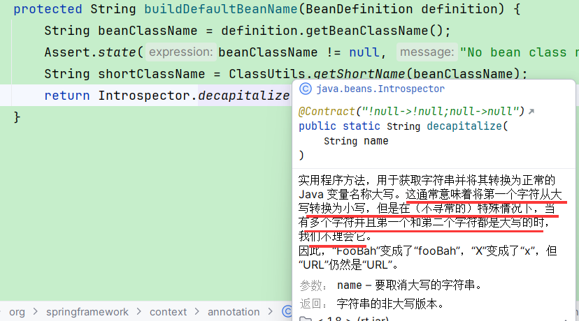
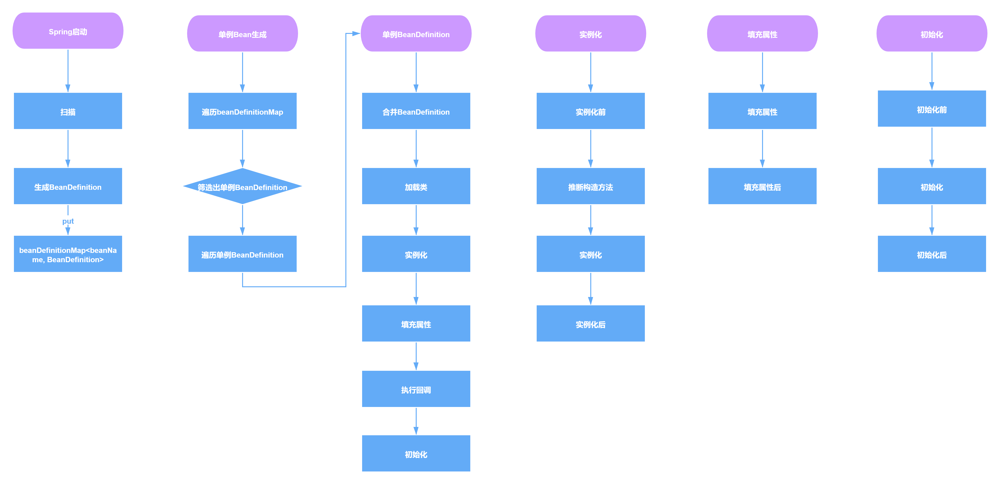
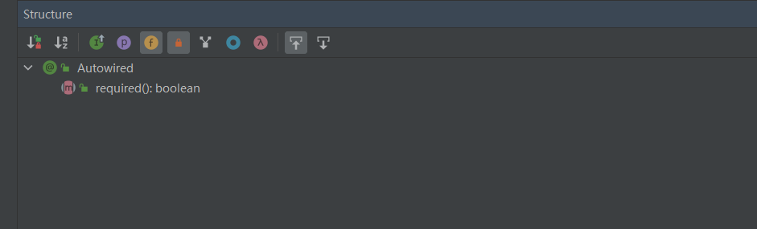
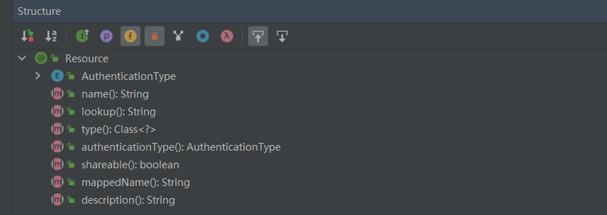
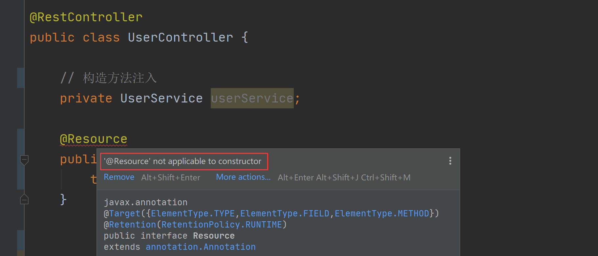
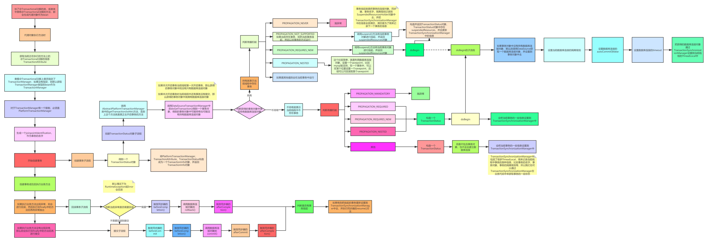
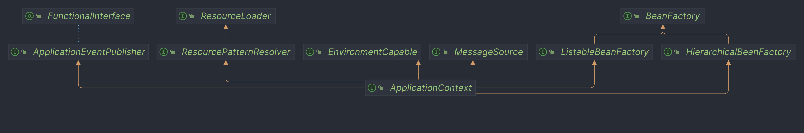
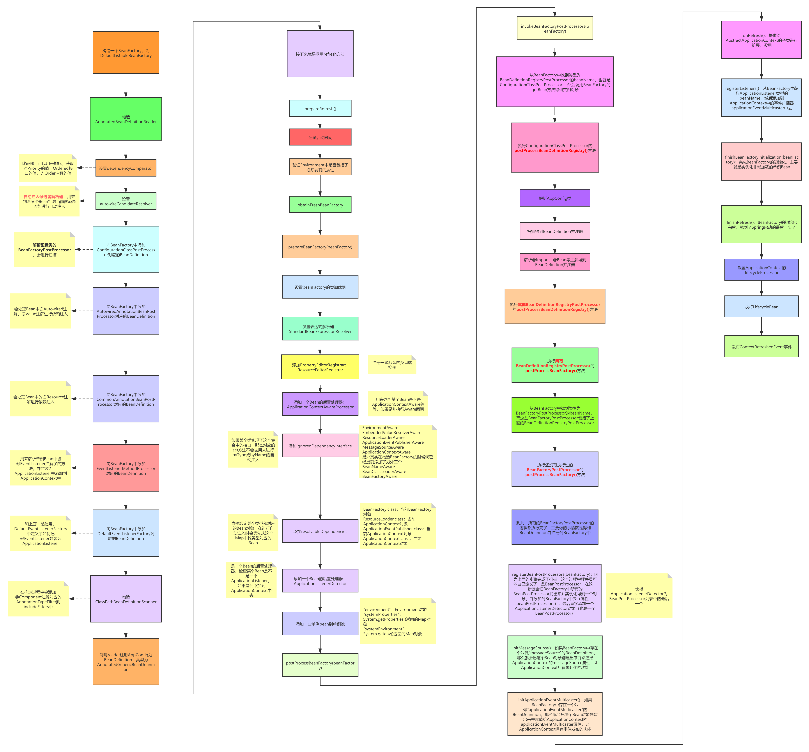
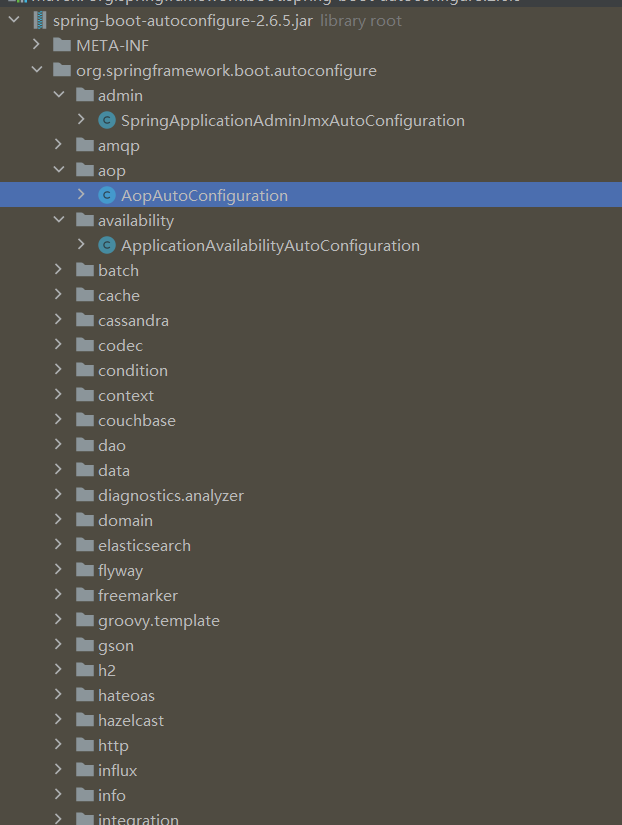

# Spring 知识汇总：IoC、AOP、事务与 Spring Boot

## 本文导读

本文按"容器与 Bean → 依赖注入 → AOP 与事务 → 容器实现 → Spring Boot → Spring MVC"的顺序梳理 Spring 的核心知识，面向具备 1 年左右 Java 经验、能写增删改查、但还没有系统了解容器内部机制的开发者。每个章节先回答"是什么"和"为什么需要"，再给出"怎么用"；源码级细节统一收进「进阶了解（可跳过）」小节。

- 第一章：IoC 与 Bean 基础（Bean 的名字、作用域、实例化与初始化、生命周期、线程安全）
- 第二章：依赖注入与自动装配（4 种装配方式、@Autowired 与 @Resource 的差异）
- 第三章：AOP 与事务（代理机制、事务实现原理、7 种传播行为、事务失效场景）
- 第四章：容器（ApplicationContext 与 BeanFactory、启动流程、元数据读取）
- 第五章：Spring Boot（复合注解、扩展文件、自动配置、启动流程、版本要求）
- 第六章：Spring MVC（请求处理流程、转发与重定向）

## 一、IoC 与 Bean 基础

本章建立两个最基础的模型：IoC 容器与 Bean。后面要讲的 AOP 与事务之所以"加个注解就生效"，前提正是容器接管了对象的创建、并在需要时返回代理对象，所以这一章是整篇的地基。

### 1.1 IoC、DI 与 Bean 是什么

Spring 最核心的能力是 **IoC**（Inversion of Control，控制反转）：对象的创建、依赖的装配不再由业务代码自己 `new`，而是交给一个统一管理者，也就是**容器**。容器把依赖"送"进对象的过程叫 **DI**（Dependency Injection，依赖注入），它是 IoC 的具体实现手段。被容器创建并管理的对象就叫 **Bean**。

一个生活化的比喻：没有 IoC 时，类要自己下厨做饭（`new` 依赖）；有了 IoC，类只负责"点单"（声明自己需要什么），外卖平台（容器）负责把做好的餐送上门，并且统一决定用哪家店、什么时候送到。

为什么需要它：

- **解耦**：`OrderService` 只依赖 `PayClient` 接口，具体用哪个实现由容器决定，换实现不用改业务代码。
- **便于测试**：单元测试里可以把真实依赖换成假的实现（mock）再注入进去。
- **统一管理**：生命周期、作用域、AOP、事务这些"横切"能力由容器统一施加，不必每个类各写一遍。

怎么用（构造器注入，也是最推荐的写法）：

```java
@Component
public class OrderService {

    private final PayClient payClient;

    // 只有一个构造方法时，@Autowired 可以省略（Spring 4.3+）
    public OrderService(PayClient payClient) {
        this.payClient = payClient;
    }

    public void pay(long orderId) {
        payClient.charge(orderId);
    }
}
```

`@Component` 告诉容器"扫描到这个类就创建它并管理起来"；容器发现构造方法需要一个 `PayClient`，会去容器里找对应的 Bean 注入进来。

### 1.2 @Component Bean 的 name 默认是什么

常见说法是"Bean 的名字就是类名首字母小写"，这个说法**大方向正确，但存在边界情况**。

扫描到 `@Component` 时，Spring 用 `AnnotationBeanNameGenerator` 生成 Bean 的名字，规则如下：

1. 注解里显式写了名字（如 `@Component("userServiceV2")`、`@Service("userService")`），就用这个名字；
2. 否则取**首字母小写的非限定类名**（官方文档的表述是 uncapitalized non-qualified class name），由 `buildDefaultBeanName` 处理类名首字母完成；
3. 边界情况：Spring Framework 6.0 起，这里的首字母处理采用 JavaBeans 的"属性名"规则（`StringUtils.uncapitalizeAsProperty`，语义等同于 `Introspector.decapitalize`）——首字符转小写，但**类名前两个字母都大写时保持原样**。所以 `UserService` → `userService`，`URLService` 仍然是 `URLService`；更早的版本只把首字符转小写，`URLService` 会得到 `uRLService`，从老版本升级且依赖按名字注入时需要留意这一差异。



```java
@Component
public class UserService { }        // bean name：userService

@Component("userServiceV2")
public class UserService { }        // bean name：userServiceV2
```

### 1.3 单例 Bean 与单例模式

**单例模式**（Singleton Pattern）：保证一个类在**一个 ClassLoader 范围内**只有一个实例。好处是避免重复创建带来的开销，也避免多个实例同时操作同一份资源互相干扰。典型场景是资源管理器，比如数据库连接、端口、配置文件的集中管理。

**单例 Bean**：在 Spring 中，指作用域为 `singleton` 的 Bean——一个 Bean 定义在**一个容器**里只会产生一个对象实例，用于共享和复用，减少创建开销。它的创建与销毁由容器负责。

为什么容易混淆：两者名字相同，但**范围不同**。Spring 官方文档的说法是，GoF 单例把范围硬编码在类上（每个 ClassLoader 一个实例），而 Spring 的单例是"每个容器、每个 Bean 定义一个实例"。

具体区别：

1. **运行环境**：Java 单例设计模式作用在 JVM 层面；单例 Bean 作用在容器层面。一个应用可以有多个 Spring 容器，同一个类在不同容器里可以各有一个实例，因此程序整体上未必只有一份。若把对象的生命周期完全交给 Spring 管理（不在别处 `new` 或反射创建），效果才与单例模式接近。
2. **范围**：单例模式通常是"一个 JVM 中一个类只能构造一个对象"；Spring 的单例范围更小，是 **beanName** 级别——一个 beanName 对应一个对象，同一个类可以注册出多个 beanName，对应多个不同对象。
3. **实现方式**：单例 Bean 由容器创建和管理；单例模式自己实现，常见写法有饿汉式（类加载时创建）、懒汉式（首次使用时创建）等。
4. **适用场景**：单例 Bean 适合需要共享复用的组件（如连接池、线程池）；单例模式适合要求全局唯一、避免资源浪费的场景（如配置信息管理、日志记录器）。

**小结**：单例 Bean 借用了单例设计模式的思想，但两者不能划等号——同一个 class 在容器里完全可以存在两个不同名字的实例，这不符合单例模式"一个类一个实例"的原则。

```java
@Component
public class DemoService {

}
```

上面定义了一个单例 Bean，beanName 为 `demoService`，类型为 `DemoService`。还可以用 `@Bean` 再定义两个同类实例：

```java
@ComponentScan("com.example")
public class AppConfig {

    @Bean
    public DemoService demoService1() {
        return new DemoService();
    }

    @Bean
    public DemoService demoService2() {
        return new DemoService();
    }
}
```

此时容器里会有 3 个 `DemoService` 类型的对象，它们的 beanName 各不相同（`demoService`、`demoService1`、`demoService2`）。

### 1.4 Bean 的作用域（Scope）

作用域回答两个问题：容器创建**几个**实例、实例**活多久**。默认是单例，这也是绝大多数业务 Bean 的用法；需要"每次取都新建"时才改成多例。

| 作用域 | 含义 | 说明 |
| --- | --- | --- |
| singleton | 每个容器、每个 Bean 定义一个实例 | 默认值，最常用 |
| prototype | 每次获取都创建新实例 | 容器不负责销毁回调，调用方自己管理 |
| request | 一次 HTTP 请求一个实例 | 仅 Web 容器可用 |
| session | 一个 HTTP Session 一个实例 | 仅 Web 容器可用 |
| application | 一个 ServletContext 一个实例 | 仅 Web 容器可用 |
| websocket | 一个 WebSocket 连接一个实例 | 仅 Web 容器可用 |

此外还有 `thread` 作用域，但默认不注册，需要自行注册；也可以自定义作用域。

```xml
<bean id="userService" class="com.example.UserService" scope="prototype"/>
```

```java
@Component
@Scope("prototype")
public class UserService { }
```

需要注意：单例 Bean 在 `ApplicationContext` 启动时就会预实例化（除非配置了懒加载），而多例 Bean 只在每次获取时创建。

### 1.5 实例化和初始化的区别

Spring 创建一个 Bean 时，会先通过反射执行类的构造方法得到一个 Java 对象，这一步叫 **Bean 的实例化**（instantiation）——此时对象已经存在，但属性还是空的。

随后容器做依赖注入（填充属性），再进入**初始化**（initialization）。初始化指的是调用对象中"约定好"的方法，容器只负责调用，不关心方法体做什么：

- 实现 `InitializingBean` 接口，则调用 `afterPropertiesSet()`；
- 或用 `init-method` / `@Bean(initMethod = ...)` 指定方法名；
- 或使用 JSR-250 的 `@PostConstruct`（Spring 6 起来自 `jakarta.annotation` 包）。

可以在初始化方法里校验配置、预热缓存或给属性兜底赋值：

```java
@Component
public class DemoService {

    public void init() {
        System.out.println("demo init");
    }
}
```

```java
@ComponentScan("com.example")
public class AppConfig {

    @Bean(initMethod = "init")
    public DemoService demoService1() {
        return new DemoService();
    }
}
```

当同一个 Bean 同时配置了多种初始化方式时，调用顺序是：`@PostConstruct` 标注的方法 → `afterPropertiesSet()` → 自定义 `init-method`；销毁顺序同理（`@PreDestroy` → `destroy()` → 自定义 `destroy-method`）。

### 1.6 Bean 创建的生命周期有哪些步骤

主线可以概括为 7 步，每一处扩展点都对应一类容器回调：

1. **推断构造方法**：有多个构造方法时，容器要决定用哪一个（加 `@Autowired`、或保留一个无参构造方法）。
2. **实例化**：反射调用构造方法得到对象。
3. **填充属性**：也就是依赖注入。
4. **处理 Aware 回调**：如 `BeanNameAware`、`BeanFactoryAware`，让 Bean 拿到容器相关对象。
5. **初始化前**：执行 `BeanPostProcessor#postProcessBeforeInitialization`，`@PostConstruct` 在这一步被调用。
6. **初始化**：执行 `afterPropertiesSet()` 与自定义 `init-method`。
7. **初始化后**：执行 `BeanPostProcessor#postProcessAfterInitialization`，AOP 代理通常在这一步生成。

之后再进入"使用中"阶段，容器关闭时执行销毁回调（`@PreDestroy`、`destroy()`、`destroy-method`）。

真实的调用链比上面更细，可参考下面的流程图：



### 1.7 进阶了解（可跳过）：循环依赖与三级缓存

本节涉及容器内部实现，初学可以略过，不影响日常使用。

**循环依赖**指 A 依赖 B、B 又依赖 A。官方文档给出的结论是：

- 如果两边都用**构造器注入**，容器在运行时会检测到循环引用并抛出 `BeanCurrentlyInCreationException`，这是无解的（对象还没造出来，就没法传给别人）。
- 如果改用 **Setter 注入**（或字段注入），循环依赖可以被解决，因为对象可以先创建、再补属性；不过官方文档也明确说这种做法**不推荐**，更好的办法是重构依赖关系。

为什么 Setter 注入能解决？容器在创建 A 的过程中，会先把"尚未填充属性的 A"提前暴露出去，让 B 能先引用到它。Spring 的 `DefaultSingletonBeanRegistry` 中可以看到三个用于此目的的 Map：

- `singletonObjects`：完全初始化好的单例（一级缓存）；
- `earlySingletonObjects`：提前暴露的早期引用（二级缓存）；
- `singletonFactories`：生成早期引用的工厂（三级缓存）。

Spring Boot 默认把 `spring.main.allow-circular-references` 设为 `false`，也就是**默认不允许**循环引用，需要时才会显式打开：

```yaml
spring:
  main:
    allow-circular-references: true   # 默认 false，不建议随意开启
```

### 1.8 Spring 中的 Bean 是线程安全的吗

Spring 本身不对 Bean 做线程安全处理，所以结论取决于 Bean 自身有没有状态：

1. **无状态 Bean**（只有方法、没有可变的成员变量）是线程安全的，这也是 Controller、Service 的常见写法。
2. **有状态 Bean**（成员变量会被请求修改）不是线程安全的，单例下多个线程会共享同一份数据。

另外，Bean 是否线程安全与作用域**没有必然关系**。作用域只决定实例的数量和存活范围；即使是 `prototype`，如果这个对象被多个线程共享，同样会有并发问题。要保证安全，应使用局部变量、`ThreadLocal`、不可变对象或加锁等手段。

## 二、依赖注入与自动装配

本章讲"依赖怎么进到对象里"。Spring 提供了 XML 时代的 4 种装配策略，以及注解时代的 `@Autowired`、`@Resource`；它们的差别集中在来源、查找顺序和支持的注入位置，面试与排错时经常被追问。

### 2.1 Spring 自动装配 Bean 有哪些方式

1. **按名称装配（byName）**：容器按 Bean 的名字匹配依赖。XML 中写 `autowire="byName"`。
2. **按类型装配（byType）**：容器按类型匹配依赖。XML 中写 `autowire="byType"`。
3. **按构造方法装配（constructor）**：容器按构造方法参数类型匹配依赖。XML 中写 `autowire="constructor"`。
4. **注解装配（@Autowired）**：在字段、构造方法或方法上标注，容器自动注入，这也是现在的主流方式。

```xml
<bean id="orderService" class="com.example.OrderService" autowire="byType"/>
```

```java
// 下面的示例把三种注入点写在同一个类里，只为对比写法；实际项目里选一种即可
@Component
public class OrderService {

    // 字段注入
    @Autowired
    private PayClient payClient;

    // 构造方法注入
    @Autowired
    public OrderService(PayClient payClient) {
        this.payClient = payClient;
    }

    // 方法（Setter）注入
    @Autowired
    public void setPayClient(PayClient payClient) {
        this.payClient = payClient;
    }
}
```

自动装配需要满足前提：依赖的 Bean 必须在容器中，而且**按类型匹配时只能有一个候选**。如果一个类型存在多个 Bean，可以用 `@Qualifier("beanName")` 指定名字，或用 `@Primary` 标记首选。

补充两点 `@Autowired` 的默认行为（官方文档口径）：

- 默认 `required = true`，即找不到依赖就启动失败；写成 `@Autowired(required = false)` 可让该注入点变为可选。
- 如果目标类**只有一个构造方法**，该构造方法上的 `@Autowired` 可以省略；有多个构造方法且没有无参构造方法时，必须至少给一个加 `@Autowired` 才能确定用哪个。

### 2.2 @Autowired 与 @Resource 的区别

两者都能完成自动注入，通常从四个维度对比：来源、查找顺序、支持的参数、支持的注入位置。

#### 2.2.1 来源不同

- `@Autowired` 是 Spring 自己定义的注解（Spring 2.5 引入）。
- `@Resource` 来自 JSR-250（Java 的规范提案），是 Java 标准注解。需要注意包名的版本差异：Spring 6 / Spring Boot 3 起使用 `jakarta.annotation.Resource`；更早的版本是 `javax.annotation.Resource`。

#### 2.2.2 查找顺序不同

注入过程都是"先在容器里找到对象，再赋给当前字段"，查找方式分为按名称（byName）和按类型（byType）。两者都用到了两种方式，但**顺序相反**。

`@Autowired`：**先按类型，再按名称**。

- 类型只有一个候选，直接注入：

```java
@Autowired
private UserService userService;
```

- 类型有多个候选时，会退化为按名称匹配：优先用 `@Qualifier` 指定的名字，没写则用字段名/参数名作为候选 Bean 的名字。

```java
@Autowired
@Qualifier("userService2")
private UserService userService;
```

`@Resource`：**先按名称，再按类型**。

- 指定了 `name`，就按这个名字找 Bean：

```java
@Resource(name = "myBean")
private MyBean myBean;
```

- 没指定 `name`，默认用字段名（或 Setter 对应的属性名）作为 Bean 名字；按该名字找不到时，会回退到按类型匹配（优先 `@Primary`）。

```java
@Resource
private MyBean myBean;   // 先找名为 myBean 的 Bean，找不到再按类型匹配
```

需要说明的是：JSR-250 的 `@Resource` 规范里确实定义了 `type` 属性，但 Spring 官方文档只描述了 `name` 的语义以及上面的按类型回退，**并未说明 Spring 会依据 `type` 属性进行查找**。因此不要把"指定 `type` 就一定按类型注入"当作确定行为，实践中建议只使用 `name`。

#### 2.2.3 支持的参数不同

`@Autowired` 只有一个 `required` 参数；`@Resource` 按规范有 7 个可选元素：`name`、`lookup`、`type`、`authenticationType`、`shareable`、`mappedName`、`description`（Spring 主要使用 `name`，`lookup` 与 JNDI 相关，其余多为 Java EE 容器场景保留）。





#### 2.2.4 支持的注入位置不同

常见注入方式有三种：属性注入、构造方法注入、Setter 注入。

- `@Autowired` 三种都支持（还能标注在任意普通方法上，用于多参数注入）。
- `@Resource` 按 Spring 文档只支持**字段**和 **Bean 属性的 Setter 方法**，不能标注在构造方法上。

```java
@RestController
public class UserController {

    // 属性注入
    @Autowired
    private UserService userService;

    @RequestMapping("/add")
    public UserInfo add(String username, String password) {
        return userService.add(username, password);
    }
}
```

```java
@RestController
public class UserController {

    // 构造方法注入
    private final UserService userService;

    @Autowired
    public UserController(UserService userService) {
        this.userService = userService;
    }

    @RequestMapping("/add")
    public UserInfo add(String username, String password) {
        return userService.add(username, password);
    }
}
```

```java
@RestController
public class UserController {

    // Setter 注入
    private UserService userService;

    @Autowired
    public void setUserService(UserService userService) {
        this.userService = userService;
    }

    @RequestMapping("/add")
    public UserInfo add(String username, String password) {
        return userService.add(username, password);
    }
}
```



#### 2.2.5 对比小结

| 维度 | @Autowired | @Resource |
| --- | --- | --- |
| 来源 | Spring 框架（2.5+） | JSR-250（Spring 6 起为 `jakarta.annotation`） |
| 查找顺序 | 先按类型，再按名称 | 先按名称，再按类型 |
| 参数 | 1 个（`required`） | 7 个可选元素（Spring 主要用 `name`） |
| 注入位置 | 构造方法、字段、Setter、普通方法 | 字段、Setter |
| 指定名字的方式 | `@Qualifier` | `name` 属性 |

实践建议：优先使用**构造方法注入**，它能让依赖不可变、避免空指针，也便于单元测试；`@Resource` 更适合需要按名字精确指定的场景。

## 三、AOP 与事务

本章讲 Spring 的第二项核心能力：在不改动业务代码的前提下，给方法统一加上日志、校验、事务等逻辑。理解代理机制之后，事务"为什么会失效"就变成一道推理题。

### 3.1 Spring AOP 是如何实现的？和 AspectJ 有什么区别

**AOP**（Aspect-Oriented Programming，面向切面编程）是一种思想：把散落在各处的通用逻辑（日志、权限、事务）抽成**切面**，再"织入"到目标方法前后。它不是某项具体技术，不同组织可以有不同的实现。

Spring AOP 用**动态代理**实现：

- 目标对象**实现了接口**时，默认用 JDK 动态代理，代理接口中的方法；
- 目标对象**没有实现接口**时，用 CGLIB 生成目标类的子类作为代理；
- 代理对象包住原始对象，方法调用先经过代理，代理在调用前后插入切面逻辑。

需要注意一个版本差异：**Spring Boot 的自动配置默认使用 CGLIB 代理**，需要 JDK 代理时要显式把 `spring.aop.proxy-target-class` 设为 `false`。因此"有接口就一定用 JDK 代理"只适用于原生 Spring 的默认配置。

代理方式的限制（官方文档列出）：

- `final` 类不能被代理，因为无法被继承；
- 使用 CGLIB 时 `final` 方法、`private` 方法不能被增强，因为无法被重写；非可见方法（如跨包的包级私有方法）同样不行。

```java
@Aspect
@Component
public class LogAspect {

    // 切点：com.example.service 包下所有方法
    @Around("execution(* com.example.service..*(..))")
    public Object log(ProceedingJoinPoint pjp) throws Throwable {
        long start = System.currentTimeMillis();
        try {
            return pjp.proceed();
        } finally {
            System.out.println(pjp.getSignature() + " cost=" + (System.currentTimeMillis() - start));
        }
    }
}
```

与 AspectJ 的区别：

- AspectJ 是 AOP 的一种**实现**，它在**编译期或类加载期**直接把增强逻辑织入字节码，因此需要 AspectJ 编译器（或加载期织入代理）。
- Spring AOP 是**运行期代理**实现，只能拦截通过代理进来的方法调用，同类内部的自调用拦截不到。
- 两者关系并不紧密：Spring 只是"借用"了 AspectJ 的 `@Aspect`、`@Before`、`@After`、`@Around` 等注解写法，底层仍是自己的代理机制。注解相同，实现完全不同。

### 3.2 Spring 中的事务是如何实现的

Spring 事务 = 数据库事务 + AOP 代理 + 事务管理器（`PlatformTransactionManager`）。执行流程可以拆成下面几步：

1. 对使用了 `@Transactional` 的 Bean，Spring 会在初始化后生成代理对象，调用方拿到的是代理。
2. 调用进入代理后，事务拦截器判断方法（或类）上是否有事务属性。
3. 有事务属性时，通过事务管理器获取一个数据库连接。
4. 把连接的 `autocommit` 改为 `false`，让提交/回滚由 Spring 控制——这是最关键的一步。
5. 执行方法体，方法内的 SQL 走这个连接。
6. 方法正常返回就提交事务。
7. 抛出异常时按回滚规则判断：命中规则则回滚，否则仍然提交。
8. 事务结束，释放连接。

几点补充：

- Spring 的隔离级别最终映射为数据库的隔离级别，`ISOLATION_DEFAULT` 表示沿用数据库默认值。
- 传播机制是 Spring 自己实现的，也是事务里最复杂的部分。
- 传播机制建立在**数据库连接**之上：一个连接对应一个事务；需要"新开事务"时，实际是新取一个连接并在其上执行 SQL。



`@Transactional` 的默认值（官方文档口径）可以直接背下来：

| 属性 | 默认值 |
| --- | --- |
| propagation | `PROPAGATION_REQUIRED` |
| isolation | `ISOLATION_DEFAULT` |
| 读写属性 | 读写事务（`readOnly = false`） |
| 超时 | 底层事务系统的默认值，不支持则为无 |
| 回滚规则 | `RuntimeException` 与 `Error` 回滚，受检异常不回滚 |

### 3.3 事务传播行为：语义与底层实现

一个线程可能连续调用多个方法：外层方法已经开了事务，内层方法到底是"加入同一个事务"还是"另开一个"？这就是**传播行为**（propagation）。可以把它想成开会：`REQUIRED` 是"有会议室就一起用"，`REQUIRES_NEW` 是"另开一间，互不干扰"。

| 传播行为 | 当前存在事务 | 当前没有事务 | 使用提示 |
| --- | --- | --- | --- |
| REQUIRED（默认） | 加入当前事务 | 新建一个事务 | 绝大多数业务方法 |
| SUPPORTS | 加入当前事务 | 以非事务方式执行 | 查询类方法 |
| MANDATORY | 加入当前事务 | 抛异常 | 必须在事务内被调用 |
| REQUIRES_NEW | 挂起当前事务，新建独立事务 | 新建事务 | 需要独立提交/回滚 |
| NOT_SUPPORTED | 挂起当前事务，非事务执行 | 非事务执行 | 不想被外层事务影响 |
| NEVER | 抛异常 | 以非事务方式执行 | 明确禁止事务 |
| NESTED | 在当前事务内建保存点，可回滚到保存点 | 新建一个事务 | 仅适用于支持保存点的 JDBC 资源事务 |

底层实现要点：

1. 一个 Spring 事务对应一个数据库连接。"新开事务"实际是新取一个连接，SQL 在新连接上执行。
2. `REQUIRES_NEW` 时，内层事务可以独立提交或回滚，外层事务不受内层回滚影响；但外层连接会被占住，内层又要新连接，**连接池没配够时可能耗尽甚至死锁**，官方文档建议连接数至少比并发线程数多 1。
3. `NESTED` 用的是同一个物理事务加**保存点**（savepoint），所以只能配合支持保存点的资源（如 JDBC 事务），回滚的是保存点之后的操作。
4. 内层（`REQUIRED`）把事务标记为 rollback-only 后，若外层仍尝试提交，会抛出 `UnexpectedRollbackException`——这是官方文档明确描述的行为，目的是不让调用方误以为提交成功。

### 3.4 哪些情况会导致 Spring 事务失效

按"代理是否生效"和"连接是否一致"两条线索排查即可：

1. **同类内部自调用**：事务逻辑在代理里，`this.xxx()` 绕过了代理，事务不生效。三种解决办法：
   - 把被调方法拆到另一个 Bean 中；
   - 自己注入自己（`@Lazy` 或注入代理对象）；
   - 用 `AopContext.currentProxy()` 调用，同时开启 `@EnableAspectJAutoProxy(exposeProxy = true)`。
2. **`private` 方法**：代理不会拦截 `private` 方法。需要注意版本差异——Spring 6.0 起，`protected` 和包级可见的方法在基于类的代理（CGLIB）下**可以**被事务增强；而基于接口的代理要求事务方法必须是 `public` 且在接口中声明。
3. **`final` 方法**：CGLIB 代理是子类，无法重写 `final` 方法，因此不生效；如果用的是 JDK 接口代理、且该方法来自接口，则不受此限制，所以"`final` 一定失效"并不严谨。
4. **在另一个线程中执行 SQL**：`JdbcTemplate`、MyBatis 通过 `ThreadLocal` 绑定当前线程的连接。跨线程后就取不到事务连接，框架会自己新开连接（`autocommit = true`），SQL 立即提交，之后外层抛异常也回滚不了。
5. **配置类漏了 `@Configuration`**：此时 `@Bean` 方法处于 "lite" 模式，直接调用 `@Bean` 方法不会走容器，而是像普通方法一样**每次 new 一个新对象**。如果代码里反复调用 `dataSource()`，事务管理器和 MyBatis 可能持有不同的 `DataSource` 实例，`ThreadLocal` 按 `DataSource` 作 key 就查不到同一个连接。Spring Boot 的自动配置类都带 `@Configuration`，所以基本不会踩到。
6. **异常被吞掉**：事务拦截器收不到异常就不会回滚（例如 `try/catch` 后没有重新抛出）。另外默认只对 `RuntimeException` 和 `Error` 回滚，受检异常默认**不回滚**，需要 `rollbackFor` 显式指定。
7. **类没有被 Spring 管理**：自己 `new` 出来的对象没有代理，注解只是装饰。
8. **存储层不支持事务**：例如 MySQL 的 MyISAM 引擎，或某些不支持事务的 NoSQL 存储。

另外两点容易忽略：在 `@PostConstruct` 等初始化回调里调用事务方法，代理可能尚未完全就绪；把传播行为配成 `NOT_SUPPORTED`、`NEVER` 时，本来就不会有事务。

### 3.5 @Transactional(readOnly = true) 能提升性能吗

先看 Spring 到底做了什么。事务管理器在开启事务后，会调用 `prepareTransactionalConnection`：如果开启了 `enforceReadOnly` 且事务定义是只读的，就向数据库发送 `SET TRANSACTION READ ONLY`。

```java
/**
 * Prepare the transactional {@code Connection} right after transaction begin.
 * The default implementation executes a "SET TRANSACTION READ ONLY" statement
 * if the {@link #setEnforceReadOnly "enforceReadOnly"} flag is set to {@code true}
 * and the transaction definition indicates a read-only transaction.
 */
protected void prepareTransactionalConnection(Connection con, TransactionDefinition definition)
        throws SQLException {

    if (isEnforceReadOnly() && definition.isReadOnly()) {
        try (Statement stmt = con.createStatement()) {
            stmt.executeUpdate("SET TRANSACTION READ ONLY");
        }
    }
}
```

也就是说，`readOnly = true` 的本质是**利用数据库的只读事务**，对数据库意味着：

1. 事务内禁止 `INSERT`、`UPDATE`、`DELETE`，只能读；
2. 依然要走事务与隔离级别（MVCC）的开销，并不是"零成本"。

那查询要不要开只读事务？

- 单纯不开事务的查询通常更轻量，因为没有事务管理和隔离级别的开销；
- 但如果查询需要和并发修改保持一致性（例如同一事务内多次读取要看到同一快照），就需要事务来提供隔离性；
- 因此结论取决于场景：需要一致性、隔离性就开；只追求单次查询的轻量就不开。

还有两个前提常被忽略：`readOnly` 只对 `REQUIRED`、`REQUIRES_NEW` 这类会真正开启事务的传播行为有意义；不同数据库/驱动对只读事务的优化程度不同，不能把它当成通用的"性能银弹"。

## 四、容器：ApplicationContext、启动流程与元数据

本章从"Bean 怎么用"转向"容器怎么工作"：两种容器接口的差异、容器启动时做了哪些事，以及 Spring 读取配置元数据的两个核心组件。这部分内容偏原理，但对排查"Bean 为什么没生效"很有帮助。

### 4.1 ApplicationContext 和 BeanFactory 有什么区别

**BeanFactory**：Spring 最基础的容器接口，提供最基本的容器能力——实例化对象、获取对象，可以理解为 IoC 容器的基础规范。

**ApplicationContext**（应用上下文）：继承 `BeanFactory`，在其之上增加企业级功能，是绝大多数应用的入口。

主要区别有两块。

**（1）装载 Bean 的时机**

- `BeanFactory`：默认延迟加载，第一次 `getBean()` 时才创建对应的 Bean，所以启动快。
- `ApplicationContext`：启动时预实例化所有单例 Bean（`lazy-init` 的除外）。好处是运行期不用等对象创建，而且配置问题能在启动阶段暴露。官方文档也把"尽早发现配置问题"作为默认预实例化的理由。

**（2）功能范围**



`ApplicationContext` 额外提供了这些能力：

- **国际化（MessageSource）**：

  ```java
  String message = context.getMessage("message.welcome", new Object[]{"user_a"}, Locale.US);
  ```

- **资源加载（ResourceLoader）**：统一读取类路径、文件系统等位置的资源。

  ```java
  Resource resource = context.getResource("classpath:config.xml");
  Resource fileResource = context.getResource("file:///path/to/file.txt");
  ```

- **事件机制（ApplicationEventPublisher）**：Bean 之间通过事件解耦。

  ```java
  // 自定义事件
  public class UserCreatedEvent extends ApplicationEvent {
      private final String username;

      public UserCreatedEvent(Object source, String username) {
          super(source);
          this.username = username;
      }

      public String getUsername() {
          return username;
      }
  }

  // 发布事件
  context.publishEvent(new UserCreatedEvent(this, "user_a"));

  // 监听事件
  @Component
  public class EmailNotifier implements ApplicationListener<UserCreatedEvent> {
      @Override
      public void onApplicationEvent(UserCreatedEvent event) {
          System.out.println("notify: " + event.getUsername());
      }
  }
  ```

- **标准容器事件**：`ContextRefreshedEvent`（刷新完成）、`ContextStartedEvent`（启动）、`ContextStoppedEvent`（停止）、`ContextClosedEvent`（关闭）。

- **拿到 Bean 工厂本身**：

  ```java
  ConfigurableListableBeanFactory factory =
          ((ConfigurableApplicationContext) context).getBeanFactory();
  ```

**（3）怎么选**

- 选 `BeanFactory`：资源极度受限、依赖关系简单、能接受首次请求变慢的场景，这类场景在实践中比较少见。
- 选 `ApplicationContext`（推荐）：企业应用、需要国际化/事件/AOP、Web 应用（用 `WebApplicationContext`）。

### 4.2 Spring 容器启动流程是怎样的

以注解配置的 `ApplicationContext` 为例，主线如下：

1. 创建容器，扫描得到所有 `BeanDefinition`（Bean 的"图纸"，记录类名、作用域、构造参数等信息），存放在一个 Map 中。
2. 筛选出**非懒加载的单例** `BeanDefinition` 依次创建 Bean；多例 Bean 不在启动时创建，而是每次获取时按 `BeanDefinition` 现造。
3. 创建单个 Bean 的过程就是 1.6 节的生命周期：合并 `BeanDefinition`、推断构造方法、实例化、属性填充、初始化前、初始化、初始化后（AOP 在此生成代理）。
4. 单例创建完成后，发布容器启动（刷新完成）事件。
5. 启动结束，容器进入可用状态。
6. 真实源码更复杂：会提供模板方法供子类扩展，并涉及 `BeanFactoryPostProcessor` 与 `BeanPostProcessor` 的注册——扫描依赖 `BeanFactoryPostProcessor`，依赖注入依赖 `BeanPostProcessor`。
7. 启动过程中还会处理 `@Import`、`@Conditional` 等注解（Spring Boot 的自动配置就建立在此之上）。



### 4.3 BeanDefinitionReader 与 MetadataReader 的区别

**BeanDefinitionReader**：负责从各种来源（XML、注解、Java 配置类）读取配置，把解析结果转成 `BeanDefinition` 并注册到 `BeanDefinitionRegistry`。常见实现：

- `XmlBeanDefinitionReader`：读 XML 配置；
- `AnnotatedBeanDefinitionReader`：读带注解的类（如 `AnnotationConfigApplicationContext` 内部使用）；
- `ClassPathBeanDefinitionScanner`：扫描指定包下的候选组件。

**MetadataReader**：读取类的**元数据**（类名、注解、方法、字段等），不局限于 Bean 定义。它通常与 ASM 配合，**不加载类**就能读到注解信息，这对扫描阶段的性能很重要（避免触发类初始化）。

四组区别：

1. **职责范围**：`BeanDefinitionReader` 专注解析 Bean 定义；`MetadataReader` 面向更广的类元数据。
2. **使用场景**：前者主要用于容器初始化阶段；后者用于注解扫描、条件化配置等需要读取元数据的地方。
3. **抽象层次**：前者直接面向 Spring 的 Bean 模型；后者更底层，只关心类结构信息。
4. **输出结果**：前者产出 `BeanDefinition`；后者产出 `ClassMetadata`、`AnnotationMetadata`。

两者是配合关系：扫描器用 `MetadataReader` 判断"这个类是不是候选组件、有哪些注解"，再交给 `BeanDefinitionReader` 相关的注册逻辑生成 `BeanDefinition`。

## 五、Spring Boot

本章讲 Spring Boot 如何在 Spring 之上做"约定优于配置"：一个复合注解完成扫描与自动配置，一个扩展文件让三方 jar 能参与启动过程，最后给出与 JDK、Jakarta 相关的版本要求。

### 5.1 @SpringBootApplication 注解有什么用

`@SpringBootApplication` 是一个**复合注解**，等价于同时声明三个注解（下面是简化示意，实际还带有 `excludeFilters` 等属性）：

```java
@SpringBootConfiguration
@EnableAutoConfiguration
@ComponentScan
public @interface SpringBootApplication {
}
```

三者各自的作用：

1. **`@ComponentScan`**：开启组件扫描，默认扫描**当前类所在包及其子包**。这也是启动类要放在根包下的原因。
2. **`@EnableAutoConfiguration`**：开启自动配置，把依赖 jar 中声明的自动配置类导入容器并解析。
3. **`@SpringBootConfiguration`**：本质是 `@Configuration`，声明当前类是配置类。

所以在 Spring Boot 项目里通常必须写它——扫描、自动配置、配置类声明三件事都由它一并打开。如果启动类不在根包，就需要通过 `scanBasePackages` 手动指定扫描范围。

### 5.2 spring.factories 文件有什么作用

`spring.factories` 是 Spring Boot 实现 **SPI**（Service Provider Interface，扩展机制）的核心文件：三方 jar 只要在自己的 `META-INF/spring.factories` 中列出实现类，Spring Boot 启动时就会把这些实现装配进来，不需要额外写代码。

典型用途包括注册 `ApplicationListener`、`ApplicationContextInitializer`、`EnvironmentPostProcessor` 等组件。

**版本变化（重要）**：自动配置类的注册方式已经改变。

- Spring Boot 2.7 引入了 `META-INF/spring/org.springframework.boot.autoconfigure.AutoConfiguration.imports` 文件来登记自动配置类，同时兼容旧的 `spring.factories` 写法；
- 从 Spring Boot 3.0 起，**用 `spring.factories` 中的 `EnableAutoConfiguration` 键注册自动配置的方式已被移除**，必须改用 `AutoConfiguration.imports`；
- `spring.factories` 中的**其他 key 不受影响**，仍然可以用于监听器、初始化器等扩展点。

因此"引一个带 spring.factories 的 jar 就能扩展 Spring Boot"这句话，在 Boot 3 以后只对非自动配置类的扩展点成立。

### 5.3 如何理解 Spring Boot 中的自动配置

在原生 Spring 里，用一个组件往往要先配一堆 Bean：

- 用 MyBatis，要配 `SqlSessionFactory`；
- 用 AOP，要加 `@EnableAspectJAutoProxy`；
- 用事务，要配 `DataSourceTransactionManager`；
- 用 RabbitMQ，要配 `RabbitTemplate`。

Spring Boot 把这些"样板配置"提前写成了**自动配置类**（如 `RabbitAutoConfiguration`、`AopAutoConfiguration`、`DataSourceTransactionManagerAutoConfiguration`），放在 `spring-boot-autoconfigure` 中。引入 `spring-boot-starter-web` 时会间接引入这个 jar：



自动配置类通常配合条件注解使用，做到"该生效时才生效"：

- `@ConditionalOnClass`：classpath 上存在某个类才生效（比如引入了 RabbitMQ 客户端）；
- `@ConditionalOnMissingBean`：容器里没有同类 Bean 才生效，因此自定义的 Bean 会覆盖默认配置。

这也解释了日常现象：引入 starter 后什么都不用配就能跑；一旦自己声明了同类型 Bean，自动配置就自动让位。

### 5.4 Spring Boot 启动过程中做了哪些事情

核心步骤：

1. 推断应用类型：是否为 Web 应用，是 Servlet 还是 Reactive，不同类型后续创建不同的容器。
2. 根据应用类型**创建 Spring 容器**。
3. 解析启动类，触发组件扫描、导入并解析自动配置类。
4. 启动内嵌的 Web 服务器（Tomcat、Jetty 或 Undertow）。
5. 调用 `ApplicationRunner` 与 `CommandLineRunner`。

完整过程还包括 `SpringApplicationRunListeners` 的回调、banner 打印、`ApplicationContextInitializer` 执行、环境准备等，具体可对照源码阅读。

### 5.5 版本与运行环境要求

版本差异是排查"依赖冲突""注解找不到"的第一现场，下面这些要求来自官方文档：

| 版本 | 运行要求 | 需要留意的变化 |
| --- | --- | --- |
| Spring Framework 6.x | Java 17+ | Java EE 的 API 迁移到 `jakarta.*` 命名空间（Jakarta EE 9 起） |
| Spring Framework 7.x | Java 17+ | 当前主线版本 |
| Spring Boot 3.5.x | Java 17+，Spring Framework 6.2+ | 内嵌容器为 Servlet 6.0（如 Tomcat 10.1+） |
| Spring Boot 4.1.x | Java 17+，Spring Framework 7.0+ | 内嵌容器为 Servlet 6.1（如 Tomcat 11+） |

由此带来的两个常见坑：

- 从 Spring 5 升级到 6、或从 Boot 2 升级到 3 时，`javax.annotation.Resource`、`javax.servlet.*` 等包名要改成 `jakarta.*`；
- Boot 3 以后用 `spring.factories` 注册自动配置不再生效，需要迁移到 `AutoConfiguration.imports`（见 5.2 节）。

另外，Spring AOP 的默认代理类型也随环境而变：原生 Spring 默认接口优先，**Spring Boot 自动配置默认使用 CGLIB 代理**（`spring.aop.proxy-target-class=false` 可改回 JDK 代理）。

## 六、Spring MVC

本章讲一个 HTTP 请求进入 Spring 应用后发生了什么，以及转发（forward）与重定向（redirect）在实现上的本质差别。

### 6.1 Spring MVC 处理请求的流程是什么

以传统 Servlet 部署为例：

1. 容器（如 Tomcat）启动时创建 `DispatcherServlet` 并执行它的初始化逻辑。
2. 初始化过程中，`DispatcherServlet` 会创建或获取自己的 `WebApplicationContext`（传统 `web.xml` 配置下由它按 `contextConfigLocation` 创建；Spring Boot 中容器先由 `ServletWebServerApplicationContext` 建好，`DispatcherServlet` 以 Bean 形式注册进来）。
3. 初始化时还会准备好 `HandlerMapping`、`HandlerAdapter`、`ViewResolver` 等组件。
4. `HandlerMapping` 有多个实现，注解开发常用的是 `RequestMappingHandlerMapping`。
5. 它负责找出容器中所有带 `@RequestMapping`（及其派生注解）的方法。
6. 解析注解上的路径信息，建立"请求路径 → 处理方法"的映射并缓存。
7. 请求到达 `DispatcherServlet` 后，由 `RequestMappingHandlerMapping` 依据请求路径找到对应的方法，封装成处理器执行链。
8. 执行前由 `HandlerAdapter` 解析方法参数：如 `@RequestParam` 从请求参数取值，`@PathVariable` 从路径取值，`@RequestBody` 交给消息转换器反序列化。
9. 参数准备完成后调用方法。
10. 方法返回后，`DispatcherServlet` 依据返回值类型决定后续处理。
11. 若方法（或类）标注了 `@ResponseBody`（`@RestController` 已包含），返回值由 `HttpMessageConverter` 直接写入响应体，通常是 JSON。
12. 否则把返回值当作视图名，交给 `ViewResolver` 找到视图并渲染（如 JSP、Thymeleaf），再把渲染结果写回响应。
13. 过程中抛出的异常交给 `HandlerExceptionResolver` 处理。

### 6.2 Spring MVC 中的重定向和转发分别是如何实现的

1. 返回值以 `forward:` 开头表示**转发**，如 `return "forward:/order/inner-detail";`。
2. 返回值以 `redirect:` 开头表示**重定向**，如 `return "redirect:/order/list";`。
3. 转发时，Spring MVC 通过 `RequestDispatcher` 把当前请求转到目标地址。整个过程是**同一个请求**，只是内部换了处理路径，浏览器无感知，地址栏不变，请求域中的数据也还在。
4. 重定向时，Spring MVC 向浏览器返回重定向状态码和 `Location` 地址，由浏览器**再发起一次新请求**。因此这是两个请求，地址栏会变，原请求的数据不会自动带过去（需要借助 flash 属性或查询参数）。
5. 关于状态码：`RedirectView` 默认发送 **302**；当关闭 HTTP 1.0 兼容模式（`http10Compatible = false`）时发送 **303**（See Other），后者在语义上更符合"用 GET 访问新地址"。

```java
@Controller
public class OrderController {

    // 转发：同一个请求，服务端内部跳转
    @GetMapping("/order/detail")
    public String detail() {
        return "forward:/order/inner-detail";
    }

    // 重定向：浏览器发起第二次请求
    @PostMapping("/order/save")
    public String save() {
        return "redirect:/order/list";
    }
}
```

## 参考资料

- Spring Framework Reference Documentation：Core Technologies（The IoC Container、AOP）、Data Access（Transaction Management）、Web on Servlet Stack（Spring Web MVC），7.0.x
- Spring Framework Javadoc：`RedirectView`、`DefaultSingletonBeanRegistry` 等类的说明
- Spring Boot Reference Documentation：System Requirements、AOP、Developing Auto-configuration
- Spring Boot 3.0 Migration Guide（Spring Boot 项目 Wiki）
- Java SE API 文档：`java.beans.Introspector#decapitalize`
- Jakarta EE 9 发布说明（jakarta.* 命名空间）
- JSR-250：`javax.annotation.Resource`（Java EE 7 API 文档）
