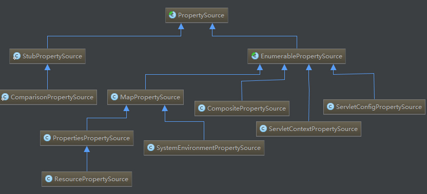
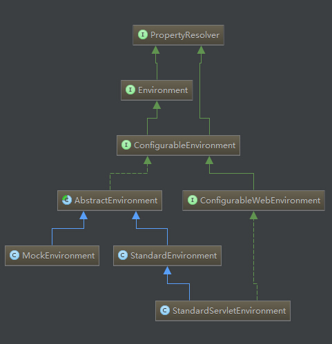
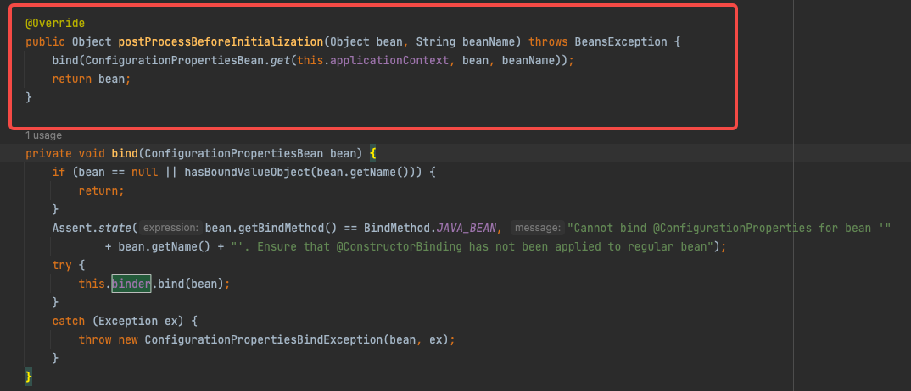
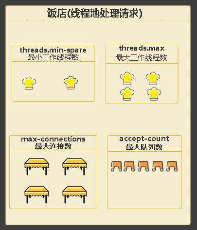
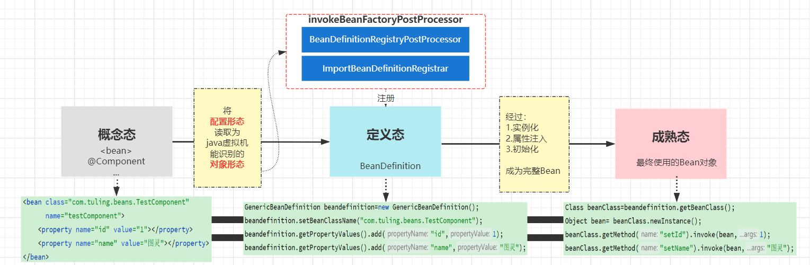
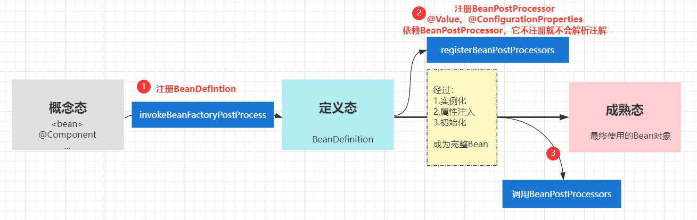
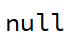
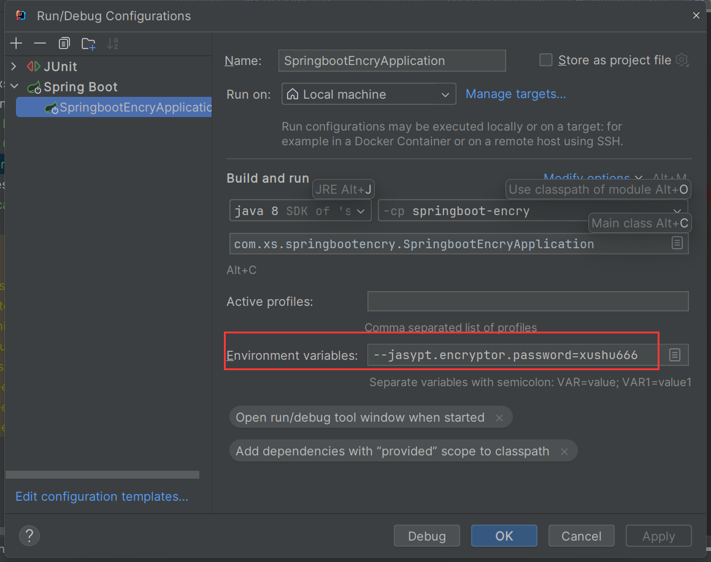

# Spring Boot 知识汇总（基于 Spring Boot 3.x）

> 适用版本：本文以 Spring Boot 3.x（3.5.x）为基准编写，涉及 2.x 的差异会在对应位置单独标注。文中配置项与默认值均以官方文档为准。

## 本文导读

全文按"概念 → 机制 → 配置 → 实战"的顺序组织，可按需跳读：

- [一、Spring Boot 概述](#一spring-boot-概述)：是什么、与 Spring 的关系、版本要求
- [二、@SpringBootApplication 与启动流程](#二springbootapplication-与启动流程)：一个注解做了什么、启动时发生了什么
- [三、自动配置机制](#三自动配置机制)：自动配置原理、条件注解、`spring.factories`、Starter
- [四、配置体系](#四配置体系)：属性源优先级与覆盖规则
- [五、读取配置的 6 种方式](#五读取配置的-6-种方式)：Environment、@Value、@ConfigurationProperties 等
- [六、参数校验](#六参数校验validation)：Validation 注解、自定义校验、统一异常处理
- [七、内嵌容器与可执行 JAR](#七内嵌容器与可执行-jar)：为什么 `java -jar` 就能跑
- [八、并发能力](#八并发能力spring-boot-能同时处理多少请求)：Tomcat 线程与连接参数
- [九、按配置动态创建 Bean](#九按配置动态创建-bean)：BeanDefinition 与注册器
- [十、安全加固](#十安全加固配置加密与防反编译)：配置加密、防反编译
- [十一、监控与运维](#十一监控与运维actuator)：Actuator 端点

## 一、Spring Boot 概述

本节先回答三个基础问题：Spring Boot 到底是什么、它和 Spring 是什么关系、新项目应该选哪个版本。把这三点弄清楚，后面读自动配置、Starter、启动流程时就不会迷路。

### 1.1 Spring Boot 是什么

Spring Boot 是构建在 Spring Framework 之上的**快速开发脚手架**。所谓"脚手架"，指它本身不替代 Spring，而是把 Spring 应用启动时那些重复、样板式的准备工作（引入依赖、装配组件、启动 Web 容器）预先做好，让开发者只写业务代码。

可以这样理解两者：Spring 像一套功能齐全的建材市场加毛坯房，材料什么都有，但水电、隔墙、装修都要自己设计施工；Spring Boot 则像精装交付的房子，水电煤已经接通，拎包入住，想改造也随时可以改。

Spring Boot 的核心特点可以归纳为六点：

1. **内置 Starter 与自动配置**：Starter 是预先打包好的依赖集合，自动配置会根据类路径上的依赖推断需要哪些组件，做到"引入依赖即可用"。
2. **零 XML 配置**：以 JavaConfig（用 Java 类加注解描述配置）为主，不再需要大量 XML 文件，配置更集中、更易读。
3. **内置 Web 容器**：自带 Tomcat、Jetty、Undertow 等 Servlet 容器，应用可打成可执行 JAR 直接运行，不必先安装外部 Web 服务器。
4. **微服务支持**：与 Spring Cloud 配合，可较方便地构建和部署微服务架构。
5. **依赖版本管理**：通过 `spring-boot-dependencies` 统一管理常用第三方库版本，减少版本冲突。
6. **监控与管理**：提供 Actuator 生产能力，可查看健康状态、内存与线程池指标、HTTP 请求统计，并支持优雅停机（`server.shutdown=graceful`）。

一句话总结：Spring Boot 的设计理念是"约定优于配置"（Convention over Configuration），即框架先按最常见的做法给出默认值，只有偏离默认时才需要显式配置。

### 1.2 Spring 和 Spring Boot 的关系与区别

初学者常把两者当成竞品，实际上它们是"地基"和"交付方案"的关系：Spring Boot 依赖 Spring，而不是取代 Spring。

**关系：**

1. **Spring 是框架，Spring Boot 是脚手架**：Spring 提供 IoC 容器、AOP、事务管理等完整能力，但需要开发者自行组装；Spring Boot 在 Spring 之上做自动化装配与约定，降低起步成本。
2. **Spring Boot 构建在 Spring 之上**：Spring Boot 使用 Spring 的核心功能（依赖注入、面向切面编程、事务管理等），因此 Spring 的用法在 Spring Boot 中同样适用，只是启动和配置更简单。

**区别：**

| 对比项 | Spring | Spring Boot |
| --- | --- | --- |
| 配置方式 | 常用大量 XML 或显式 Java 注解描述 Bean 与依赖关系 | 以默认值和自动配置为主，只在需要时覆盖 |
| 开发速度 | 需要手动集成各组件，样板工作多 | 引入 Starter 即可运行，起步快 |
| Web 容器 | 通常打成 WAR 部署到外部容器 | 内置 Tomcat/Jetty/Undertow，打成可执行 JAR 直接运行 |
| 依赖版本 | 由开发者自行选择并保证兼容 | 由 BOM 统一管理，减少冲突 |
| 监控能力 | 需自行集成 | 提供 Actuator 端点 |

结论：Spring 是全功能的应用框架，Spring Boot 是简化 Spring 应用开发与部署的工具，特别适合微服务和快速原型。

### 1.3 版本要求与 Jakarta 命名空间迁移

选版本时要先看运行环境。Spring Boot 3.x 把 JDK 17 定为最低要求，这是一次不向后兼容的升级，老项目升级前必须先确认 JDK 和依赖。

Spring Boot 3.5.x 的官方要求如下：

| 项目 | 要求 |
| --- | --- |
| JDK | 17 及以上（3.5.x 兼容到 JDK 25） |
| Spring Framework | 6.2.x 及以上 |
| 构建工具 | Maven 3.6.3+；Gradle 7.6.4+ 或 8.4+ |
| 内嵌 Tomcat | 10.1（Servlet 6.0） |
| 内嵌 Jetty / Undertow | Jetty 12.0 / Undertow 2.3 |
| GraalVM 原生镜像 | 22.3 及以上 |

除 JDK 之外，另一个必须注意的变化是**命名空间迁移**。Java EE 移交 Eclipse 基金会后更名为 Jakarta EE，包名从 `javax.*` 改为 `jakarta.*`。Spring Boot 3 全面使用 Jakarta 命名空间，因此：

- `javax.servlet.*` → `jakarta.servlet.*`
- `javax.validation.*` → `jakarta.validation.*`
- `javax.persistence.*` → `jakarta.persistence.*`

```java
// Spring Boot 3.x 的校验注解来自 jakarta 包
import jakarta.validation.constraints.NotBlank;
```

从 2.x 升级到 3.x 时，除了改包名，还要注意 JDK 17、Spring Security 6、以及部分第三方库尚无 Jakarta 版本的问题。Spring Boot 2.7 是 2.x 系列最后一个开源版本线，仍使用 `javax` 命名空间；新项目应直接选择 3.x。

### 1.4 为什么默认使用 CGLIB 动态代理

**动态代理**指程序运行期间生成一个"替身"对象，由它在调用真实对象前后插入额外逻辑（如事务、日志、权限）。Spring 的 AOP 和 `@Transactional` 都依赖它。

Java 自带两种实现：JDK 动态代理要求目标类**必须实现接口**；CGLIB 通过生成目标类的**子类**来实现代理，因此不要求接口。Spring Boot 默认把 `spring.aop.proxy-target-class` 设为 `true`，即优先使用 CGLIB，原因有四：

1. **无需接口**：业务类不必为了被代理而额外抽一层接口，适用范围更广，对遗留代码和第三方类更友好。
2. **无侵入**：类不需要实现特定接口或继承特定父类，源码无需改动。
3. **调用开销较小**：CGLIB 在启动时生成字节码，运行期方法调用不经过反射。早期版本中这被视为明显优势；在较新的 JDK 上两者差距已不明显，选择 CGLIB 的主要理由仍是"不需要接口"。
4. **集成方便**：CGLIB 已被重新打包进 `spring-core`（包名 `org.springframework.cglib`），无需额外引入依赖。

需要注意 CGLIB 的边界：`final` 类和 `final` 方法无法被代理（子类无法覆盖），`private` 方法也不会被拦截，构造器同样不在代理范围内。另外，`@Configuration` 类默认 `proxyBeanMethods = true`，Spring 会用 CGLIB 生成子类来保证 `@Bean` 方法返回单例；如果不需该方法间调用，可设为 `false` 以减少启动开销。

## 二、@SpringBootApplication 与启动流程

本节从一行 `SpringApplication.run(...)` 出发，说明一个注解为何能撑起整个应用，以及启动过程中 Spring Boot 依次做了哪些事。理解这条主线，排查"启动慢""Bean 找不到""配置没生效"这类问题时才有方向。

### 2.1 如何理解 @SpringBootApplication 注解

`@SpringBootApplication` 是 Spring Boot 应用的入口注解，标注在含 `main` 方法的主类上。它本身是一个**组合注解**，等价于同时写上以下三个注解：

- `@SpringBootConfiguration`：声明这是一个配置类，本质是 `@Configuration` 的特化版本，便于测试框架识别主配置类。
- `@EnableAutoConfiguration`：开启自动配置，让 Spring Boot 根据类路径依赖决定装配哪些组件。
- `@ComponentScan`：扫描当前类所在包及其子包，把 `@Component`、`@Service`、`@Controller`、`@Repository` 等标注的类注册为 Bean。

```java
import org.springframework.boot.SpringApplication;
import org.springframework.boot.autoconfigure.SpringBootApplication;

@SpringBootApplication
public class MySpringBootApplication {

    public static void main(String[] args) {
        SpringApplication.run(MySpringBootApplication.class, args);
    }
}
```

官方建议一个应用只加一个 `@SpringBootApplication`（或 `@EnableAutoConfiguration`），放在主配置类上。常用属性：

| 属性 | 作用 |
| --- | --- |
| `scanBasePackages` / `scanBasePackageClasses` | 修改组件扫描范围，适合主类不在根包下的场景 |
| `exclude` / `excludeName` | 排除指定的自动配置类（类不在类路径时用全限定名字符串） |
| `nameGenerator` | 指定 Bean 名称生成策略 |

需要提醒的是：`@ComponentScan` 默认只扫描主类所在包及子包，所以主类应放在项目根包下，否则会出现"Controller 写了但 404"的问题。

### 2.2 启动过程有哪些步骤

从外部观察，一次启动大致经过以下步骤：

1. **加载启动类**：JVM 执行 `main` 方法，创建 `SpringApplication` 实例，读取应用类型（Servlet、Reactive 或非 Web）等基础信息。
2. **构建应用上下文**：`SpringApplication.run()` 准备环境、创建 `ApplicationContext` 并启动。
3. **自动配置**：扫描类路径上的组件与配置类，按条件装配数据源、MVC、事务等基础设施。
4. **加载外部配置**：读取 `application.properties`、`application.yml`、环境变量、命令行参数等，形成统一的属性来源。
5. **创建 Bean 实例**：由 IoC 容器实例化、注入并初始化 Bean，期间执行各种 `BeanPostProcessor`。
6. **启动内嵌服务器**：Web 应用会在 `refresh` 的 `onRefresh` 阶段创建并启动内嵌容器（默认 Tomcat），开始监听端口。
7. **执行初始化回调**：调用 `ApplicationRunner`、`CommandLineRunner` 实现类，完成启动后的准备工作。
8. **应用就绪**：容器刷新完成、端口监听成功，应用开始接收请求。

### 2.3 启动原理：从 main 到 refresh

把上面的步骤展开到类与方法级别，可以看到这样一条链路：

1. **运行 main 方法**：创建 `SpringApplication` 实例。构造时会从 `META-INF/spring.factories` 读取 `ApplicationContextInitializer`、`ApplicationListener` 等扩展实现（Boot 3 仍然如此；自动配置类已改由 imports 文件加载，见 3.2）。
2. **调用 run 方法**：`run` 是启动总入口，内部依次完成启动计时、发布启动事件、准备环境、创建并刷新上下文。
3. **准备环境**：读取系统属性、环境变量、配置文件与命令行参数，得到 `ConfigurableEnvironment`（详见第五章）。
4. **创建 ApplicationContext**：根据应用类型选择上下文实现。Servlet Web 应用使用 `ServletWebServerApplicationContext`，Reactive 应用使用 `ReactiveWebServerApplicationContext`。
5. **预初始化上下文**：把启动类作为主配置类注册为 BeanDefinition，并执行 `ApplicationContextInitializer`。
6. **调用 refresh**：进入 Spring 的标准刷新流程，解析 `@Import`（含自动配置类）、注册 `BeanFactoryPostProcessor`、实例化 Bean。
7. **创建内嵌容器**：`onRefresh` 阶段由 `ServletWebServerFactory` 创建 Tomcat 等容器，并把 `DispatcherServlet` 注册进去。
8. **发布事件与回调**：刷新完成后发布 `ApplicationStartedEvent`，执行 Runner，再发布 `ApplicationReadyEvent`。

可见 Spring Boot 的启动并没有绕开 Spring，它只是把 Spring 原本需要手工完成的"建容器、读配置、装配、启动容器"串成了一条固定流水线。

### 2.4 启动事件与监听器

Spring Boot 在启动各阶段发布一系列事件（`SpringApplicationEvent`），开发者可借此在特定时机插入逻辑，例如启动完成后预热缓存、打印访问地址。

| 事件 | 发布时机 |
| --- | --- |
| `ApplicationStartingEvent` | 启动开始时，此时除监听器与初始化器注册外尚未做任何处理 |
| `ApplicationEnvironmentPreparedEvent` | 环境准备好，但上下文尚未创建 |
| `ApplicationContextInitializedEvent` | 上下文已创建、初始化器已执行，BeanDefinition 尚未加载 |
| `ApplicationPreparedEvent` | BeanDefinition 已加载，`refresh` 即将开始 |
| `ApplicationStartedEvent` | 上下文刷新完成，Runner 尚未执行 |
| `ApplicationReadyEvent` | Runner 执行完毕，应用可以对外提供服务 |
| `ApplicationFailedEvent` | 启动过程抛出异常 |

使用方式很直接：

```java
import org.springframework.boot.context.event.ApplicationReadyEvent;
import org.springframework.context.event.EventListener;
import org.springframework.stereotype.Component;

@Component
public class ReadyListener {

    @EventListener(ApplicationReadyEvent.class)
    public void onReady() {
        // 应用已就绪：可做缓存预热、打印启动地址等
    }
}
```

两个容易踩的坑：一是 `ApplicationStartingEvent`、`ApplicationEnvironmentPreparedEvent` 发布时容器还没创建，无法用 `@Bean` 注册监听器，只能通过 `SpringApplication.addListeners(...)` 或 `spring.factories` 中的 `org.springframework.context.ApplicationListener` 键注册；二是监听器默认与启动线程同步执行，耗时任务应交给 `ApplicationRunner`/`CommandLineRunner` 或线程池，避免拖慢启动。

## 三、自动配置机制

自动配置是 Spring Boot 最核心的能力，也是面试与排错的高频考点。本节按"是什么 → 为什么需要 → 怎么实现 → 怎么控制"的顺序展开，并纠正一个常见过时说法：Boot 3 起自动配置不再通过 `spring.factories` 注册。

### 3.1 如何理解 Spring Boot 的自动配置

自动配置指 Spring Boot 根据"类路径上有什么依赖、容器里已有哪些 Bean、配置了什么属性"，自动推断并注册所需的组件。例如类路径上有 HSQLDB 且用户没有自己定义数据源时，Spring Boot 会自动配置一个内存数据库。

可以从六个角度理解它：

1. **约定大于配置**：框架按最常见的使用方式预设默认值，只有偏离默认才需要显式配置。
2. **自动扫描类路径**：启动时检查依赖与组件，据此决定装配数据源、Web 容器、事务管理器等。
3. **条件化生效**：每个自动配置类都带条件注解，条件不满足就整体跳过，因此"引入依赖但没生效"通常是条件没满足。
4. **可覆盖**：用户自定义的 Bean 或配置属性优先于自动配置，自动配置会主动"退让"（`@ConditionalOnMissingBean`）。
5. **Starter 驱动**：Starter 负责引入依赖，自动配置负责装配组件，两者配合实现"加依赖即得功能"。
6. **自动配置类集中管理**：自动配置类位于 `spring-boot-autoconfigure` 模块，包名为 `org.springframework.boot.autoconfigure`，可用 `--debug` 启动参数查看当前生效的配置及原因。

### 3.2 自动配置原理

自动配置的完整链路可以拆成七步：

1. **引入 @EnableAutoConfiguration**：主类上的 `@SpringBootApplication` 已包含它，也可以单独标注。
2. **@EnableAutoConfiguration 内部使用 @Import**：它通过 `@Import(AutoConfigurationImportSelector.class)` 把选择器注册进容器。
3. **解析 @Import**：容器启动时处理 `@Import`，调用选择器的 `selectImports` 方法获取要导入的配置类名。
4. **DeferredImportSelector 延迟导入**：`AutoConfigurationImportSelector` 实现了 `DeferredImportSelector`，所有自动配置类会在用户自定义配置之后处理，从而保证用户配置优先、可覆盖自动配置。
5. **读取自动配置清单**：Boot 3 从每个 jar 的 `META-INF/spring/org.springframework.boot.autoconfigure.AutoConfiguration.imports` 文件读取候选类名，一行一个；Spring 内置的候选清单在 `spring-boot-autoconfigure` 的同一路径下。
6. **过滤候选类**：先按 `exclude`、`spring.autoconfigure.exclude` 排除，再交给条件注解评估（`@ConditionalOnClass`、`@ConditionalOnMissingBean` 等）。
7. **注册 BeanDefinition**：条件通过的配置类被当作普通 `@Configuration` 解析，其中的 `@Bean` 方法注册为 Bean 定义，随后由容器实例化。

```java
import org.springframework.boot.autoconfigure.SpringBootApplication;
import org.springframework.boot.autoconfigure.jdbc.DataSourceAutoConfiguration;

// 排除某个自动配置类：类不在类路径时改用 excludeName = "全限定名"
@SpringBootApplication(exclude = DataSourceAutoConfiguration.class)
public class MyApplication {
}
```

排查自动配置时有两个实用手段：

```yaml
# application.yml：启动时输出条件评估报告（等价于 --debug）
debug: true
```

- 启动日志中的 `CONDITIONS EVALUATION REPORT` 会列出"生效的自动配置"和"未生效的原因"。
- 引入 Actuator 后访问 `/actuator/conditions` 可在线查看同一份报告，`/actuator/beans` 可查看最终注册的 Bean。

### 3.3 条件注解

条件注解是自动配置的"开关"：它声明一组前提，只有前提成立时被标注的配置类或 `@Bean` 方法才会生效。

**生活化比喻**：条件注解像机场安检口的分流规则——只有"证件齐全 + 航班符合"的旅客才被放行，其余直接绕行，不会报错。

常见条件注解及其语义：

| 注解 | 生效条件 |
| --- | --- |
| `@ConditionalOnClass` | 类路径上存在指定类 |
| `@ConditionalOnMissingClass` | 类路径上不存在指定类 |
| `@ConditionalOnBean` | 容器中已存在指定 Bean |
| `@ConditionalOnMissingBean` | 容器中不存在指定 Bean（用于提供默认实现、避免重复定义） |
| `@ConditionalOnProperty` | 指定配置属性满足条件（如 `havingValue`、`matchIfMissing`） |
| `@ConditionalOnExpression` | SpEL 表达式结果为 `true` |
| `@ConditionalOnResource` | 指定资源文件存在 |
| `@ConditionalOnWebApplication` | 当前是 Web 应用（可限定 SERVLET/REACTIVE） |
| `@ConditionalOnSingleCandidate` | 指定类型的 Bean 只有一个，或虽多个但有一个 `@Primary` |

使用时有三点需要注意：

1. **条件判断有顺序**：`@ConditionalOnBean` 只能看到"当前已处理过的"Bean 定义，因此它依赖配置类的加载顺序，容易出现"看起来该生效却没生效"的情况。对顺序敏感的场景应配合 `@AutoConfigureAfter` 明确先后。
2. **`@ConditionalOnMissingBean` 是扩展点**：自定义 Starter 时用它给出默认实现，使用者只要声明同类型 Bean 就能覆盖。
3. **条件不满足是正常现象**：自动配置被跳过不算错误，排查时应看条件报告，而不是怀疑依赖没引入。

### 3.4 spring.factories 与 SPI

`spring.factories` 是 Spring 自定义的一种扩展点注册文件，位于 jar 的 `META-INF/` 目录下，由 `SpringFactoriesLoader` 读取。它的作用类似 Java 原生的 SPI（Service Provider Interface，服务提供者接口）：框架先定义接口，第三方实现只需在约定文件里登记，框架运行时自动发现并加载，从而实现"不改框架源码也能扩展"。

```properties
# META-INF/spring.factories 示例
org.springframework.context.ApplicationListener=com.example.MyListener
org.springframework.context.ApplicationContextInitializer=com.example.MyInitializer
```

上例声明了一个监听器与一个上下文初始化器，框架启动时会实例化并调用它们。文件格式为"接口全限定名 = 实现类全限定名"，多个实现用逗号分隔。

它的价值主要体现在四个方面：

1. **扩展点自动发现**：框架在类路径上搜索该文件，按接口分组加载实现，无需硬编码类名。
2. **解耦与可插拔**：第三方库把实现登记在文件里即可接入，不必修改 Spring 源码，像插件一样装卸。
3. **多模块各自注册**：多模块项目中，每个模块可以在自己的 jar 里放一份 `spring.factories`，各自声明扩展点。
4. **框架自身也在用**：Spring Boot 内部大量通过它注册监听器、初始化器、环境后置处理器等。

Spring Boot 中 `spring.factories` 的用途随版本发生过重要变化，这是很多旧资料容易出错的地方：

| 用途 | Spring Boot 2.6 及以前 | Spring Boot 2.7 | Spring Boot 3.x |
| --- | --- | --- | --- |
| 注册**自动配置类**（`EnableAutoConfiguration` 键） | 支持 | 引入 `AutoConfiguration.imports`，`spring.factories` 方式被标记为过时 | **不再支持**，只认 imports 文件 |
| 注册监听器、初始化器、`EnvironmentPostProcessor`、`FailureAnalyzer` 等扩展点 | 支持 | 支持 | 仍支持 |

因此，看到"自动配置通过 `spring.factories` 加载"的说法时要注意版本：这在 Boot 2.6 及以前成立，Boot 3 起自动配置只从 `META-INF/spring/org.springframework.boot.autoconfigure.AutoConfiguration.imports` 读取，写在 `spring.factories` 里的 `EnableAutoConfiguration` 键会被忽略。

`spring.factories` 相对 Java 原生 SPI 的差异：

| 对比项 | Java SPI（`ServiceLoader`） | Spring 的 `SpringFactoriesLoader` |
| --- | --- | --- |
| 配置文件 | `META-INF/services/接口全限定名` | `META-INF/spring.factories` |
| 文件内容 | 一行一个实现类名 | 键值对，一个接口可对应多个实现 |
| 是否能获取全部实现 | 需遍历迭代器 | 一次性读入并按接口分组缓存 |
| 典型用途 | JDBC 驱动、日志实现 | Spring Boot 扩展点、监听器注册 |

### 3.5 如何理解 Spring Boot 的 Starter 机制

Starter 是"一组预配置依赖 + 配套自动配置"的打包约定。引入 `spring-boot-starter-web` 就同时得到 Spring MVC、Jackson、内嵌 Tomcat 以及它们的兼容版本，无需逐个挑选依赖。

它的价值体现在五点：

1. **提供预配置的依赖**：`spring-boot-starter-web` 一次引入 Web 开发所需的全部依赖。
2. **简化依赖管理**：版本由 Spring Boot 的 BOM 统一决定，避免版本冲突。
3. **携带自动配置**：Starter 背后的自动配置类会按条件装配组件，做到"引入即生效"。
4. **遵循约定**：依赖组合方式固定，团队之间无需再讨论"该引哪些包"。
5. **可自定义扩展**：仍可通过自定义 Bean、配置属性覆盖默认行为。

常用 Starter 一览：

| Starter | 作用 |
| --- | --- |
| `spring-boot-starter-web` | Spring MVC + Jackson + 内嵌 Tomcat，构建 REST 服务 |
| `spring-boot-starter-webflux` | 响应式 Web 栈，默认使用 Reactor Netty |
| `spring-boot-starter-jdbc` | JDBC 与 `JdbcTemplate`、HikariCP 连接池 |
| `spring-boot-starter-data-jpa` | Spring Data JPA + Hibernate |
| `spring-boot-starter-data-redis` | Redis 客户端与 `RedisTemplate` |
| `spring-boot-starter-validation` | Bean Validation（默认实现为 Hibernate Validator） |
| `spring-boot-starter-security` | Spring Security 认证授权 |
| `spring-boot-starter-actuator` | 健康检查、指标、端点 |
| `spring-boot-starter-test` | JUnit、AssertJ、Mockito、Spring Test |

### 3.6 如何自定义 Starter

当团队内部有多个项目要复用同一套能力（如统一日志、统一鉴权、公司内部 SDK）时，把它封装成 Starter 最省事。步骤如下，其中第 4 步在 Boot 3 中必须使用 imports 文件：

1. **创建项目结构**：标准 Maven/Gradle 工程，`src/main/java` 放代码，`src/main/resources` 放资源。
2. **编写自动配置类**：用 `@AutoConfiguration`（或 `@Configuration`）标注，配合 `@ConditionalOnClass`、`@ConditionalOnProperty`、`@ConditionalOnMissingBean` 控制生效条件。
3. **提供属性配置**：用 `@ConfigurationProperties` 承接配置，并在自动配置类上通过 `@EnableConfigurationProperties` 启用；需要 IDE 提示时引入 `spring-boot-configuration-processor`。
4. **注册自动配置类**：在 `src/main/resources/META-INF/spring/org.springframework.boot.autoconfigure.AutoConfiguration.imports` 中写入自动配置类的全限定名，一行一个。Boot 3 不再读取 `spring.factories` 中的自动配置声明。
5. **定义 Starter 依赖**：在 `pom.xml` 中声明 Spring Boot 基础依赖与所需第三方库。
6. **测试与文档**：编写单元测试与集成测试，说明配置项与使用方式。
7. **发布到仓库**：发布到私服或中央仓库供其他项目引用。

```java
import org.springframework.boot.autoconfigure.AutoConfiguration;
import org.springframework.boot.autoconfigure.condition.ConditionalOnClass;
import org.springframework.boot.autoconfigure.condition.ConditionalOnMissingBean;
import org.springframework.boot.context.properties.EnableConfigurationProperties;
import org.springframework.context.annotation.Bean;

@AutoConfiguration
@ConditionalOnClass(MyService.class)
@EnableConfigurationProperties(MyProperties.class)
public class MyAutoConfiguration {

    @Bean
    @ConditionalOnMissingBean
    public MyService myService(MyProperties properties) {
        return new MyService(properties.getEndpoint());
    }
}
```

```properties
# META-INF/spring/org.springframework.boot.autoconfigure.AutoConfiguration.imports
com.example.mystarter.MyAutoConfiguration
```

命名上有个约定：Spring 官方 Starter 命名为 `spring-boot-starter-xxx`，第三方 Starter 建议命名为 `xxx-spring-boot-starter`，以免与官方包名混淆。

## 四、配置体系

Spring Boot 的配置能力围绕一个目标：同一份代码，在不同环境下用不同的参数运行，且不需要改代码。本节先讲清"多个配置源谁覆盖谁"；具体怎么读配置，见下一章。

### 4.1 配置优先级

**为什么需要优先级**：数据库地址在开发环境是 `localhost`，在生产环境是集群地址；端口在本地是 8080，在容器里可能由环境变量注入。这些差异必须能在启动时覆盖，而且覆盖规则要可预测。

**生活化比喻**：把各个配置源想象成一摞透明胶片，每张胶片上写着若干键值对。查找某个键时从上往下翻，第一张写有该键的胶片就决定结果——越靠上的胶片优先级越高。

Spring Boot 3.x 中，属性源的优先级从低到高如下（后列出的覆盖先列出的）：

| 优先级 | 属性源 | 典型形式 |
| --- | --- | --- |
| 1（最低） | 默认属性 | `SpringApplication.setDefaultProperties(...)` |
| 2 | `@PropertySource` | 类上标注，加载自定义 `.properties` 文件 |
| 3 | 配置文件（Config Data） | `application.properties` / `application.yml` 及其 profile 变体 |
| 4 | 随机值 | `random.*` |
| 5 | 操作系统环境变量 | `SPRING_DATASOURCE_URL` |
| 6 | Java 系统属性 | `-Dserver.port=9000` |
| 7 | JNDI 属性 | `java:comp/env` |
| 8 | `ServletContext` 初始化参数 | 传统 WAR 部署时使用 |
| 9 | `ServletConfig` 初始化参数 | 传统 WAR 部署时使用 |
| 10 | `SPRING_APPLICATION_JSON` | 内联 JSON 配置 |
| 11 | 命令行参数 | `--server.port=9000` |
| 12 | 测试专用源 | `@SpringBootTest(properties=...)`、`@DynamicPropertySource`、`@TestPropertySource` |
| 13（最高） | Devtools 全局配置 | `$HOME/.config/spring-boot` 下的 devtools 配置 |

配置文件内部也有先后顺序（后者覆盖前者）：

1. jar 包内的 `application.properties` / `application.yml`
2. jar 包内的 `application-{profile}.properties` / `.yml`
3. jar 包外的 `application.properties` / `application.yml`（如运行目录、`config/` 子目录）
4. jar 包外的 `application-{profile}.properties` / `.yml`

同一目录下同时存在 `.properties` 与 `.yml` 时，`.properties` 优先；官方建议一个项目只用一种格式。

几个实用结论：

- 命令行参数**总是**覆盖配置文件，适合临时改端口、改日志级别：`java -jar app.jar --server.port=9000`。
- 环境变量名需要大写并用下划线代替点号，如 `spring.datasource.url` 对应 `SPRING_DATASOURCE_URL`。
- 需要区分环境时用 profile：`application-dev.yml`、`application-prod.yml`，通过 `spring.profiles.active=prod` 激活。

> 版本与纠错说明：一些旧资料把"外部属性文件"排在命令行参数之上，又把环境变量与命令行参数并列为最高，这与官方 Externalized Configuration 的顺序不符。以 Boot 3.x 官方文档为准：命令行参数高于环境变量，环境变量高于配置文件；配置文件的 jar 外优先于 jar 内。

配置为什么没生效时，最快的办法是引入 Actuator，访问 `/actuator/env` 查看该属性的所有来源与最终取值，`/actuator/configprops` 查看绑定到 `@ConfigurationProperties` 的结果。

## 五、读取配置的 6 种方式

同一份配置可以有多种读法，差别在于"取一个值"还是"绑定一组值"、是否类型安全、是否依赖容器。选择哪种方式，取决于配置的数量、结构以及是否需要运行时动态获取。下面按从底层到上层的顺序介绍。

### 方式一：Environment

`Environment` 是 Spring 对环境配置的抽象接口，可以按 key 直接读取属性，来源包括系统属性、环境变量、命令行参数和配置文件。它继承自 `PropertyResolver`（属性解析器），后者提供 `getProperty(key)` 等核心方法。

```java
import jakarta.annotation.Resource;
import lombok.extern.slf4j.Slf4j;
import org.springframework.boot.test.context.SpringBootTest;
import org.springframework.core.env.Environment;
import org.junit.jupiter.api.Test;

@Slf4j
@SpringBootTest
public class EnvironmentTest {

    @Resource
    private Environment env;

    @Test
    public void var1Test() {
        String var1 = env.getProperty("env101.var1");
        log.info("Environment 配置获取 {}", var1);
    }
}
```

#### 配置初始化

`Environment` 里的配置不是凭空出现的，它由 `SpringApplication.run` 中的 `prepareEnvironment()` 方法准备：

```java
private ConfigurableEnvironment prepareEnvironment(SpringApplicationRunListeners listeners,
        DefaultBootstrapContext bootstrapContext, ApplicationArguments applicationArguments) {
    // 1、创建 ConfigurableEnvironment 对象用于存储环境参数
    ConfigurableEnvironment environment = getOrCreateEnvironment();
    // 2、解析并加载用户指定的配置文件，封装为 PropertySource 添加到环境对象中
    configureEnvironment(environment, applicationArguments.getSourceArgs());
    // 3、加载所有的系统属性，并将它们添加到 ConfigurableEnvironment 对象中
    ConfigurationPropertySources.attach(environment);
    // 4、通知监听器环境参数已经准备就绪
    listeners.environmentPrepared(bootstrapContext, environment);
    // 5、将默认属性源中的所有属性值移到环境对象的队列末尾，避免用户无意中覆盖 Spring Boot 默认属性
    DefaultPropertiesPropertySource.moveToEnd(environment);
    Assert.state(!environment.containsProperty("spring.main.environment-prefix"),
            "Environment prefix cannot be set via properties.");
    // 6、将 Spring Boot 应用程序的属性绑定到环境对象上
    bindToSpringApplication(environment);
    // 7、如果没有自定义的环境类型，则转换为标准的环境类型
    if (!this.isCustomEnvironment) {
        EnvironmentConverter environmentConverter = new EnvironmentConverter(getClassLoader());
        environment = environmentConverter.convertEnvironmentIfNecessary(environment, deduceEnvironmentClass());
    }
    // 8、再次加载系统配置，以防止被其他配置覆盖
    ConfigurationPropertySources.attach(environment);
    return environment;
}
```

对应到流程上：

- 创建 `ConfigurableEnvironment` 存放环境参数；
- `configureEnvironment` 加载默认的 `application.properties` / `application.yml` 及用户指定的配置文件，封装为 `PropertySource` 加入环境；
- `attach()` 加载系统属性；
- `listeners.environmentPrepared()` 通知监听器环境已就绪；
- `moveToEnd()` 把"默认属性"移到队列末尾，保证自定义值能覆盖默认值；
- `bindToSpringApplication` 把配置绑定到 `SpringApplication` 自身；
- 再次 `attach()`，防止系统配置被覆盖。

每个配置源都会被封装成 `PropertySource`（属性源），它是一组 key-value 的抽象：

```java
public abstract class PropertySource<T> {
    protected final String name;   // 属性源名称
    protected final T source;      // 属性源值（如 Map、Properties）

    public String getName();                        // 获取属性源名称
    public T getSource();                           // 获取属性源值
    public boolean containsProperty(String name);   // 是否包含某个属性
    public abstract Object getProperty(String name); // 获取属性对应的值
}
```

常见实现类如下：



- **MapPropertySource**：把 Map 适配为属性源；
- **PropertiesPropertySource**：把 `Properties` 对象转为属性源；
- **ResourcePropertySource**：从文件系统或 classpath 资源加载属性；
- **ServletConfigPropertySource**：从 ServletConfig 读取；
- **ServletContextPropertySource**：从 ServletContext 读取；
- **StubPropertySource**：空实现，作为 `CompositePropertySource` 的默认父级以避免空指针；
- **CompositePropertySource**：组合模式，内部维护一组属性源，可整体参与查找；
- **SystemEnvironmentPropertySource**：从操作系统环境变量读取。

这些 `PropertySource` 会被放进一个有序集合，优先级就体现在集合顺序上：

```java
List<PropertySource<?>> sources = new ArrayList<>();
```

环境准备完成后，应用上下文会接管这个环境对象，运行时即可随时读取配置：

```java
private void prepareContext(DefaultBootstrapContext bootstrapContext, ConfigurableApplicationContext context,
        ConfigurableEnvironment environment, SpringApplicationRunListeners listeners,
        ApplicationArguments applicationArguments, Banner printedBanner) {
    // 应用上下文加载环境对象
    context.setEnvironment(environment);
    postProcessApplicationContext(context);
    // ...
}
```

#### 读取配置

读取配置的本质是遍历属性源队列，按名称匹配并返回第一个命中的值。`PropertyResolver` 是完成这件事的关键类，`Environment` 是它的子接口。



因此直接注入 `PropertyResolver` 也能读配置：

```java
@Slf4j
@SpringBootTest
public class PropertyResolverTest {

    @Resource
    private PropertyResolver env;

    @Test
    public void var1Test() {
        String var1 = env.getProperty("env101.var1");
        log.info("PropertyResolver 配置获取 {}", var1);
    }
}
```

### 方式二：@Value 注解

`@Value` 用于把单个配置值注入字段、方法参数或构造器参数，是最常用的方式，适合零散的一两个配置。

其原理是：容器实例化 Bean 后，由后置处理器解析 `@Value` 中的占位符（`${...}`），再通过反射写入目标字段。占位符的解析工作由 `PropertySourcesPlaceholderConfigurer` 提供的解析器完成；如果属性未被加载到环境中，注入会失败。

```yaml
env101:
  var1: var1-from-config-file
```

```java
@Slf4j
@SpringBootTest
public class EnvVariablesTest {

    @Value("${env101.var1}")
    private String var1;

    @Test
    public void var1Test() {
        log.info("配置文件属性: {}", var1);
    }
}
```

#### 缺失配置时给默认值

若代码引用了配置文件中不存在的键，启动会因占位符无法解析而报错。可用 `:` 提供默认值：

```java
@Value("${env101.var1:default-value}")
private String var1;
```

#### 静态变量（static）无法注入

`@Value` 加在静态变量上拿不到值。原因有两点：静态变量属于类而不属于对象，而 Spring 的依赖注入面向对象实例；类加载时静态变量已经初始化，此时 Bean 还未被创建。

```java
@Slf4j
@SpringBootTest
public class StaticValueTest {

    @Value("${env101.var1}")
    private static String var1;   // 注入不生效，值为 null

    @Test
    public void var1Test() {
        log.info("静态变量: {}", var1);
    }
}
```

变通做法是先注入实例，再赋给静态变量，例如通过 setter 注入或构造器注入：

```java
@Slf4j
@SpringBootTest
public class StaticValueFixTest {

    private static String var3;

    private static String var4;

    @Value("${env101.var3}")
    public void setVar3(String var3) {
        StaticValueFixTest.var3 = var3;
    }

    StaticValueFixTest(@Value("${env101.var4}") String var4) {
        StaticValueFixTest.var4 = var4;
    }

    public static String getVar3() {
        return var3;
    }

    public static String getVar4() {
        return var4;
    }
}
```

#### 常量（final）无法直接注入

`@Value` 加在 `final` 字段上同样无效。`final` 字段必须在构造方法中完成赋值，而 `@Value` 的字段注入发生在对象构造之后。可行方案是构造器注入：

```java
@Slf4j
@SpringBootTest
public class FinalValueTest {

    private final String var6;

    @Autowired
    FinalValueTest(@Value("${env101.var6}") String var6) {
        this.var6 = var6;
    }

    @Test
    public void var1Test() {
        log.info("final 注入: {}", var6);
    }
}
```

#### 非容器管理的类中不生效

只有被 Spring 管理的 Bean（标注 `@Component`、`@Service`、`@Controller`、`@Repository`、`@Configuration` 等）才会执行依赖注入，普通 POJO 上的 `@Value` 不会生效。

```java
@Data
@Slf4j
@Component
public class TestService {

    @Value("${env101.var7}")
    private String var7;

    public String getVar7() {
        return this.var7;
    }
}
```

#### 用 new 创建对象同样不生效

即使类上标了 `@Component`，用 `new` 手动创建的对象也不经过容器，依赖注入不会发生：

```java
@Test
public void var7_1Test() {
    TestService testService = new TestService();   // 绕过容器，var7 为 null
    log.info("引用方式不对 注入: {}", testService.getVar7());
}
```

小结：**`@Value` 只在 Bean 的生命周期内生效**，即对象必须由容器创建。

### 方式三：@ConfigurationProperties 注解

当配置项成组出现（如数据源、第三方 SDK 参数）时，逐个写 `@Value` 既啰嗦又容易拼错。`@ConfigurationProperties` 可以把指定前缀下的一组属性按名称自动绑定到 Bean 的字段上，并完成类型转换。

它相对 `@Value` 的优势是：批量绑定、支持嵌套对象/List/Map、支持松散绑定（`max-threads`、`maxThreads`、`MAX_THREADS` 都能匹配）、可结合校验注解、可生成配置元数据供 IDE 提示。

#### 加载原理

在 `prepareEnvironment()` 中有一个步骤 `bindToSpringApplication(environment)`，它负责把配置绑定到 `SpringApplication` 自身；此时业务 Bean 还没创建，因此真正的属性注入要等到 Bean 初始化阶段。

真正完成绑定的是 `ConfigurationPropertiesBindingPostProcessor`（一个 Bean 后置处理器）：它扫描容器中所有被 `@ConfigurationProperties` 标注的 Bean，在 Bean 初始化前后调用 Binder 组件，把外部属性按前缀绑定到对象字段上。



- `bindToSpringApplication`：把属性绑定到 `SpringApplication` 相关对象；
- `ConfigurationPropertiesBindingPostProcessor`：在容器启动过程中处理业务 Bean 的绑定与注入。

#### 如何使用

```yaml
env101:
  var1: var1-from-config-file
  var2: var2-from-config-file
```

```java
@Data
@Component
@ConfigurationProperties(prefix = "env101")
public class MyConf {

    private String var1;

    private String var2;
}
```

```java
@Slf4j
@SpringBootTest
public class ConfTest {

    @Resource
    private MyConf myConf;

    @Test
    public void myConfTest() {
        log.info("@ConfigurationProperties 配置获取 {}", myConf);
    }
}
```

如果不想在类上加 `@Component`，可以在配置类上使用 `@EnableConfigurationProperties(MyConf.class)` 显式启用，或用 `@ConfigurationPropertiesScan` 批量扫描。自定义 Starter 中推荐后者，避免组件扫描污染。

### 方式四：@PropertySources 注解

除了默认的 `application.yml` / `application.properties`，项目有时需要独立的配置文件（如第三方对接参数）。这类文件不会被自动加载，需要手动指定。

`@PropertySources` 的原理是：容器启动时扫描标注该注解的类，读取其中指定的资源路径，把文件内容加载为 `PropertySource` 加入 `Environment`，之后就能用 `@Value` 或 `Environment` 读取。

```properties
# src/main/resources/custom.properties
env101.var9=var9-from-custom-file
env101.var10=var10-from-custom-file
```

```java
@Data
@Configuration
@PropertySources({
        @PropertySource(value = "classpath:custom.properties", encoding = "utf-8"),
        @PropertySource(value = "classpath:custom.properties", encoding = "utf-8")
})
public class PropertySourcesConf {

    @Value("${env101.var9}")
    private String var9;

    @Value("${env101.var10}")
    private String var10;
}
```

需要注意，`@PropertySource` 默认只支持 `.properties` 文件。要加载 YAML，需自行实现 `PropertySourceFactory`：

```java
import org.springframework.beans.factory.config.YamlPropertiesFactoryBean;
import org.springframework.core.env.PropertiesPropertySource;
import org.springframework.core.env.PropertySource;
import org.springframework.core.io.support.EncodedResource;
import org.springframework.core.io.support.PropertySourceFactory;
import java.io.IOException;
import java.util.Properties;

public class YamlPropertySourceFactory implements PropertySourceFactory {

    @Override
    public PropertySource<?> createPropertySource(String name, EncodedResource encodedResource) throws IOException {
        YamlPropertiesFactoryBean factory = new YamlPropertiesFactoryBean();
        factory.setResources(encodedResource.getResource());

        Properties properties = factory.getObject();

        return new PropertiesPropertySource(encodedResource.getResource().getFilename(), properties);
    }
}
```

使用时通过 `factory` 属性指定该工厂即可：

```java
@Data
@Configuration
@PropertySources({
        @PropertySource(value = "classpath:custom.yaml", encoding = "utf-8",
                factory = YamlPropertySourceFactory.class)
})
public class PropertySourcesConf2 {

    @Value("${env101.var10}")
    private String var10;

    @Value("${env101.var9}")
    private String var9;
}
```

另外，`@PropertySource` 加载的配置在上下文刷新阶段才加入环境，因此不能用于配置 `logging.*`、`spring.main.*` 这类"刷新前就要读取"的属性。

### 方式五：YamlPropertiesFactoryBean 加载 YAML 文件

`YamlPropertiesFactoryBean` 是 Spring 提供的 YAML 解析工具，可把 YAML 文件解析为 `Properties`，再交给占位符解析器使用。适合在代码中显式加载额外 YAML 的场景。

```java
import org.springframework.beans.factory.config.PropertySourcesPlaceholderConfigurer;
import org.springframework.beans.factory.config.YamlPropertiesFactoryBean;
import org.springframework.context.annotation.Bean;
import org.springframework.context.annotation.Configuration;
import org.springframework.core.io.ClassPathResource;
import java.util.Objects;

@Configuration
public class MyYamlConfig {

    @Bean
    public static PropertySourcesPlaceholderConfigurer yamlConfigurer() {
        PropertySourcesPlaceholderConfigurer configurer = new PropertySourcesPlaceholderConfigurer();
        YamlPropertiesFactoryBean yaml = new YamlPropertiesFactoryBean();
        yaml.setResources(new ClassPathResource("custom.yml"));
        configurer.setProperties(Objects.requireNonNull(yaml.getObject()));
        return configurer;
    }
}
```

加载后同样可用 `@Value` 或 `Environment` 读取：

```java
@Slf4j
@SpringBootTest
public class YamlTest {

    @Value("${env101.var11}")
    private String var11;

    @Test
    public void myYamlTest() {
        log.info("Yaml 配置获取 {}", var11);
    }
}
```

### 方式六：Java 原生读取

不依赖 Spring，直接用 `Properties` 从 classpath 读取配置文件，适合工具类或与 Spring 解耦的模块：

```java
@Slf4j
@SpringBootTest
public class CustomTest {

    @Test
    public void customTest() {
        Properties props = new Properties();
        try {
            InputStreamReader reader = new InputStreamReader(
                    this.getClass().getClassLoader().getResourceAsStream("extra.properties"),
                    StandardCharsets.UTF_8);
            props.load(reader);
        } catch (IOException e1) {
            log.error("读取配置文件失败", e1);
        }
        log.info("Properties Name：{}", props.getProperty("user.name"));
    }
}
```

这种方式拿不到 Spring 的多环境、占位符、类型转换等能力，只建议在边缘场景使用。

### 六种方式对比

| 方式 | 适用场景 | 优点 | 局限 |
| --- | --- | --- | --- |
| `Environment` | 运行时动态取单个值 | 灵活、可判断是否存在 | 需自行做类型转换，字符串 key 易写错 |
| `@Value` | 注入少量单值 | 写法简单直观 | 不支持批量绑定，静态/final 字段受限 |
| `@ConfigurationProperties` | 一组结构化配置 | 批量、类型安全、可校验、有 IDE 提示 | 需要额外的类，改动配置后需重启（除非配合刷新） |
| `@PropertySource` | 加载额外的 properties 文件 | 显式、可控 | 默认不支持 YAML；加载时机较晚 |
| `YamlPropertiesFactoryBean` | 代码中加载 YAML | 复用 Spring 的 YAML 解析 | 需手写配置类，属性源顺序需注意 |
| Java 原生 `Properties` | 与 Spring 解耦的工具 | 无框架依赖 | 无占位符、无多环境、无类型转换 |

选型建议：单个值用 `@Value`；成组配置一律用 `@ConfigurationProperties`；需要在运行时按 key 动态取值用 `Environment`；自定义文件用 `@PropertySource`。

## 六、参数校验（Validation）

后端不能相信前端传入的参数：前端校验只是体验优化，绕过前端直接调接口的情况始终存在。Bean Validation 提供了一套声明式校验注解，配合 Spring MVC 可以在进入业务代码前就拦下非法参数。本节按"引依赖 → 用注解 → 自定义 → 统一处理异常"的顺序展开。

### 6.1 引入依赖

```xml
<dependency>
    <groupId>org.springframework.boot</groupId>
    <artifactId>spring-boot-starter-validation</artifactId>
</dependency>
```

`spring-boot-starter-validation` 只提供规范与集成，真正的校验实现是 Hibernate Validator。

> 版本说明：Spring Boot 2.x 的校验注解在 `javax.validation.constraints` 包下；Spring Boot 3.x 起迁移到 `jakarta.validation.constraints`。升级时需同步替换 import，并确认自定义校验器也改用 `jakarta.validation`。

### 6.2 Validation 基本校验注解

| **注解** | **描述** |
| --- | --- |
| **@Null** | 验证对象是否为 null |
| **@NotNull** | 验证对象是否不为 null，无法检查长度为 0 的字符串 |
| **@NotBlank** | 检查字符串是否不为 null 且 Trim 后长度大于 0，只适用于字符串 |
| **@NotEmpty** | 检查集合、数组、Map 或字符串是否不为 null 且不为空 |
| **@AssertTrue** | 验证 Boolean 对象是否为 true |
| **@AssertFalse** | 验证 Boolean 对象是否为 false |
| **@Size(min=, max=)** | 验证对象（Array、Collection、Map、String）长度是否在给定范围内 |
| **@Length(min=, max=)** | 验证字符串长度是否在 min 与 max 之间（Hibernate Validator 扩展） |
| **@Past** | 验证 Date、Calendar、LocalDate 等是否在当前时间之前 |
| **@Future** | 验证 Date、Calendar、LocalDate 等是否在当前时间之后 |
| **@Pattern** | 验证 String 是否符合正则表达式 |
| **@Min** | 验证 Number 或 String 表示的数是否大于等于指定值 |
| **@Max** | 验证 Number 或 String 表示的数是否小于等于指定值 |
| **@DecimalMax** | 被标注的值必须不大于指定的最大值，参数为 BigDecimal 最大值的字符串表示，支持小数精度 |
| **@DecimalMin** | 被标注的值必须不小于指定的最小值，参数为 BigDecimal 最小值的字符串表示，支持小数精度 |
| **@Digits** | 验证 Number 或 String 的整数位与小数位是否合法 |
| **@Digits(integer=, fraction=)** | 验证数字格式，**integer** 指定整数精度，**fraction** 指定小数精度 |
| **@Range(min=, max=)** | 验证元素值是否在最小值和最大值之间（Hibernate Validator 扩展） |
| **@Range(min=10000, max=50000, message="range.bean.wage")** | 验证元素值在 10000 与 50000 之间，自定义提示信息为 `range.bean.wage` |
| **@Valid** | 标注在方法参数或字段上，递归校验该对象；集合/数组校验元素，Map 校验值部分 |
| **@CreditCardNumber** | 信用卡号校验（Hibernate Validator 扩展） |
| **@Email** | 校验邮箱格式；值为 null 时视为通过 |
| **@ScriptAssert(lang=, script=, alias=)** | 用脚本表达式做自定义校验 |
| **@URL(protocol=, host=, port=, regexp=, flags=)** | 校验 URL 格式，可限定协议与主机（Hibernate Validator 扩展） |

### 6.3 添加参数校验

#### 在 DTO 属性上添加校验

```java
import com.fasterxml.jackson.annotation.JsonIgnore;
import jakarta.validation.constraints.Email;
import jakarta.validation.constraints.Max;
import jakarta.validation.constraints.Min;
import jakarta.validation.constraints.NotBlank;
import lombok.AllArgsConstructor;
import lombok.Data;
import lombok.NoArgsConstructor;
import org.hibernate.validator.constraints.Length;

import java.util.UUID;

@Data
@AllArgsConstructor
@NoArgsConstructor
public class RegistryUserDto {

    @NotBlank(message = "用户名不能为空")
    private String username;

    @NotBlank(message = "密码不能为空")
    @Length(min = 6, max = 20, message = "密码长度在6-20之间")
    private String password;

    @Min(value = 0, message = "年龄最小为0")
    @Max(value = 200, message = "年龄最大为200")
    private Integer age;

    @NotBlank(message = "邮箱不能为空")
    @Email(message = "邮箱格式不正确")
    private String email;

    @JsonIgnore
    private String salt = UUID.randomUUID().toString().replaceAll("-", "");

    private Boolean admin;
}
```

#### 在 Controller 的 DTO 参数上添加 @Valid 或 @Validated

```java
@PostMapping("/registry")
public ResponseResult registryUser(@RequestBody @Valid RegistryUserDto registryUserDto) {
    return ResponseResult.okResult(registryUserDto);
}
```

校验不通过时，Spring MVC 会抛出异常并返回 400（若项目里配置了统一异常处理，则可以返回自定义结构）。`@Valid` 来自 Bean Validation 规范，`@Validated` 是 Spring 的变体，额外支持分组校验，两者在"校验 DTO 属性"这一场景下效果相同。

#### 复杂字符串校验可用正则

```java
@Pattern(regexp = "^1(3|4|5|7|8)\\d{9}$", message = "手机号码格式错误")
@NotBlank(message = "手机号码不能为空")
private String phone;
```

对于未封装成 DTO 的单个参数，需要先在 Controller 类上加 `@Validated`，再在参数前加校验注解：

```java
@RestController
@RequestMapping("/user")
@Validated
public class UserController {

    @PostMapping("/registry")
    public ResponseResult registryUser(@NotBlank(message = "name不能为空") String name) {
        return ResponseResult.okResult(name);
    }
}
```

### 6.4 自定义校验注解

内置注解覆盖不了业务规则（如"状态只能是 1 或 2"）时，可以自定义注解与校验器，分三步完成。

#### 新建自定义注解

```java
import com.example.validator.StatusValidator;
import jakarta.validation.Constraint;
import jakarta.validation.Payload;

import java.lang.annotation.Documented;
import java.lang.annotation.ElementType;
import java.lang.annotation.Retention;
import java.lang.annotation.RetentionPolicy;
import java.lang.annotation.Target;

@Target({ElementType.FIELD, ElementType.PARAMETER})
@Retention(RetentionPolicy.RUNTIME)
@Documented
@Constraint(validatedBy = {StatusValidator.class})
public @interface Status {

    String[] statusType() default {};

    String message() default "状态传递有误";

    Class<?>[] groups() default {};

    Class<? extends Payload>[] payload() default {};
}
```

其中 `message`、`groups`、`payload` 是 Bean Validation 规范要求的三要素，`statusType` 是本例自定义的属性。

#### 实现相应的校验逻辑

```java
import com.example.annotation.Status;
import jakarta.validation.ConstraintValidator;
import jakarta.validation.ConstraintValidatorContext;

import java.util.Arrays;
import java.util.List;

public class StatusValidator implements ConstraintValidator<Status, Integer> {

    private List<String> typeStatus;

    @Override
    public void initialize(Status constraintAnnotation) {
        typeStatus = Arrays.asList(constraintAnnotation.statusType());
        ConstraintValidator.super.initialize(constraintAnnotation);
    }

    @Override
    public boolean isValid(Integer value, ConstraintValidatorContext context) {
        if (value != null) {
            return typeStatus.contains(String.valueOf(value));
        }
        return true;
    }
}
```

`isValid` 返回 `false` 即表示校验失败；`null` 通常交给 `@NotNull` 处理，这里直接放行，避免重复报错。

#### 自定义注解的使用

```java
@Status(statusType = {"1", "2"})
private Integer status;
```

### 6.5 校验失败统一异常处理

默认的校验失败信息对前端不友好，通常会在全局异常处理器中捕获并转成统一响应结构。下面示例假定项目已有 `ResponseResult`、`AppHttpCodeEnum`、`SystemException` 等基础类。

```java
import com.example.domain.vo.ResponseResult;
import com.example.enums.AppHttpCodeEnum;
import com.example.exception.SystemException;
import lombok.extern.slf4j.Slf4j;
import org.springframework.validation.BindException;
import org.springframework.web.bind.annotation.ExceptionHandler;
import org.springframework.web.bind.annotation.RestControllerAdvice;

@RestControllerAdvice
@Slf4j
public class GlobalExceptionHandler {

    @ExceptionHandler(SystemException.class)
    public ResponseResult systemExceptionHandler(SystemException e) {
        log.error("出现了异常! {}", e.getMessage());
        return ResponseResult.errorResult(e.getCode(), e.getMsg());
    }

    @ExceptionHandler(Exception.class)
    public ResponseResult exceptionHandler(Exception e) {
        log.error("出现了异常! {}", e.getMessage());
        return ResponseResult.errorResult(AppHttpCodeEnum.SYSTEM_ERROR.getCode(), e.getMessage());
    }

    /* 添加校验参数异常处理 */
    @ExceptionHandler(BindException.class)
    public ResponseResult bindExceptionHandler(BindException e) {
        log.error("出现了异常! {}", e.getMessage());
        return ResponseResult.errorResult(AppHttpCodeEnum.SYSTEM_ERROR,
                e.getBindingResult().getAllErrors().get(0).getDefaultMessage());
    }
}
```

补充两点：对 `@RequestBody` 的 DTO 校验失败，Spring 6 抛出的是 `MethodArgumentNotValidException`，它是 `BindException` 的子类，因此上面的处理器可以一并覆盖；而对方法参数（`@Validated` + 参数注解）的校验失败抛出的是 `ConstraintViolationException`，需要单独加一个处理方法。

## 七、内嵌容器与可执行 JAR

Spring Boot 应用打成 JAR 后可以直接 `java -jar` 启动，不需要预先安装 Tomcat。本节解释这件事为什么成立，以及内嵌容器的默认值和替换方式。

### 7.1 jar 为什么可以直接运行

原因可以归为六点：

1. **内嵌 Web 服务器**：Tomcat、Jetty、Undertow 作为普通依赖打进包里，应用自己启动容器，而不是把应用交给外部容器。
2. **可执行 JAR**：包内有 `main` 方法作为入口，可以像运行普通 Java 程序一样运行。
3. **类路径管理**：通过自定义类加载器从包内的嵌套 JAR 中加载类和资源，不依赖外部 `CLASSPATH`。
4. **自动配置与依赖管理**：所需组件按依赖自动装配，配置随包一起分发，避免"换台机器就跑不起来"。
5. **Maven/Gradle 插件**：`spring-boot-maven-plugin` 负责重打包，生成符合可执行格式的产物。
6. **运行时自包含**：容器、Spring 框架、第三方库都在包内，形成自包含的运行单元。

### 7.2 Fat JAR 的结构与启动过程

`spring-boot-maven-plugin` 生成的包通常称为 Fat JAR（胖包）或 Uber JAR，结构如下：

```text
app.jar
├── META-INF/
│   └── MANIFEST.MF
├── org/springframework/boot/loader/   # Spring Boot 的启动器类
└── BOOT-INF/
    ├── classes/                       # 应用自身的 class 与 resources
    └── lib/                           # 所有依赖 jar
```

启动过程分为五步：

1. `MANIFEST.MF` 中的 `Main-Class` 指向 `org.springframework.boot.loader.launch.JarLauncher`，`Start-Class` 指向应用真正的启动类。
2. JVM 先执行 `JarLauncher`，由它创建一个自定义类加载器 `LaunchedURLClassLoader`。
3. 该加载器能识别 `BOOT-INF/lib` 下的嵌套 JAR，把它们加入可加载的类路径。
4. 随后以新线程调用 `Start-Class` 的 `main` 方法。
5. `main` 中执行 `SpringApplication.run`，创建容器并启动内嵌 Tomcat，进程进入监听状态。

> 版本说明：Spring Boot 3.2 起启动器类位于 `org.springframework.boot.loader.launch` 包；更早版本为 `org.springframework.boot.loader.JarLauncher`。`BOOT-INF/lib` 是标准布局，旧资料中出现的 `boot-lib` 并非官方目录名。

### 7.3 内嵌容器：默认值与替换

`spring-boot-starter-web` 默认使用 Tomcat，这是"引入 web starter 就得到 Tomcat"的原因。可选容器如下：

| 容器 | Starter | 说明 |
| --- | --- | --- |
| Tomcat | `spring-boot-starter-tomcat` | 默认，Servlet 6.0（Tomcat 10.1，Boot 3.5） |
| Jetty | `spring-boot-starter-jetty` | 轻量，适合长连接场景 |
| Undertow | `spring-boot-starter-undertow` | 基于 NIO，内存占用较低 |
| Reactor Netty | `spring-boot-starter-webflux` 默认 | 响应式栈，非 Servlet 容器 |

替换容器时先排除默认依赖，再引入目标 Starter：

```xml
<dependency>
    <groupId>org.springframework.boot</groupId>
    <artifactId>spring-boot-starter-web</artifactId>
    <exclusions>
        <exclusion>
            <groupId>org.springframework.boot</groupId>
            <artifactId>spring-boot-starter-tomcat</artifactId>
        </exclusion>
    </exclusions>
</dependency>
<dependency>
    <groupId>org.springframework.boot</groupId>
    <artifactId>spring-boot-starter-jetty</artifactId>
</dependency>
```

常用容器配置：

```yaml
server:
  port: 8080
  shutdown: graceful          # 优雅停机，等待处理中的请求结束
spring:
  lifecycle:
    timeout-per-shutdown-phase: 20s
```

### 7.4 进阶了解（可跳过）

可执行 JAR 中的依赖是"嵌套 JAR"，标准 `URLClassLoader` 无法直接加载其中的类，因此 Spring Boot 自定义了 `LaunchedURLClassLoader` 与 `jar:file:...!/BOOT-INF/lib/xxx.jar!/` 形式的 URL 协议处理器。这也解释了两个常见现象：一是不能随意用 `java -cp app.jar` 运行（会找不到依赖）；二是某些依赖在扫描 classpath 资源时行为与普通工程不同，需要改用 `PathMatchingResourcePatternResolver` 等支持嵌套包的 API。

## 八、并发能力：Spring Boot 能同时处理多少请求

"Spring Boot 能处理多少请求"实际上问的是内嵌容器能同时处理多少请求。默认容器是 Tomcat，因此答案取决于 Tomcat 的线程池与连接参数。本节先给默认值，再解释每个参数的含义，最后给出配置建议。

### 8.1 四个关键参数

这些参数的默认值定义在 `ServerProperties`（包 `org.springframework.boot.autoconfigure.web`）中，也可以在 `spring-configuration-metadata.json` 里查到：

```json
[
  {
    "name": "server.tomcat.threads.min-spare",
    "type": "java.lang.Integer",
    "description": "Minimum amount of worker threads.",
    "defaultValue": 10
  },
  {
    "name": "server.tomcat.threads.max",
    "type": "java.lang.Integer",
    "description": "Maximum amount of worker threads.",
    "defaultValue": 200
  },
  {
    "name": "server.tomcat.max-connections",
    "type": "java.lang.Integer",
    "description": "Maximum number of connections that the server accepts and processes at any given time.",
    "defaultValue": 8192
  },
  {
    "name": "server.tomcat.accept-count",
    "type": "java.lang.Integer",
    "description": "Maximum queue length for incoming connection requests when all possible request processing threads are in use.",
    "defaultValue": 100
  }
]
```

| 参数 | 含义 | Boot 3.5 默认值 |
| --- | --- | --- |
| `server.tomcat.threads.min-spare` | 核心工作线程数（最小空闲线程） | 10 |
| `server.tomcat.threads.max` | 最大工作线程数 | 200 |
| `server.tomcat.max-connections` | 同一时刻允许接受并处理的最大连接数 | 8192 |
| `server.tomcat.accept-count` | 线程耗尽时等待队列的最大长度 | 100 |

### 8.2 参数详解

**`server.tomcat.threads.min-spare`（最少工作线程数，默认 10）**

- 对绝大多数场景，把它设置成与最大线程数相等即可，让线程池一开始就准备好所需线程，避免流量突增时的"热身"开销。
- 之所以默认留出差距，是为了节省资源：每个线程都要占用线程栈等内存。对服务器程序而言，预热带来的收益通常大于这点资源节省。
- 若并发峰值很高但平均值很低（例如峰值 2000、平时 20），则应把最小线程数设小，否则大量空闲线程会长期占用资源，使用了 `ThreadLocal` 时尤其明显。

**`server.tomcat.threads.max`（最多工作线程数，默认 200）**

每个请求由一个工作线程处理，因此该值直接决定同时能处理多少请求。调大有用，但不是越大越好：线程切换、内存占用都会上升。JVM 默认给每个线程分配约 1 MB 栈空间，线程越多内存压力越大。

社区常见的经验配置是"1 核 2G 内存配 200 个线程、4 核 8G 配 800 个线程"，这只是经验值而非官方标准，实际应结合压测结果与业务是 CPU 密集型还是 IO 密集型来定。

**`server.tomcat.max-connections`（最大连接数，默认 8192）**

指同一时刻 Tomcat 能接受并处理的最大连接数。Tomcat 官方文档的说明是：

> 对 Java 阻塞式 BIO，默认值等于 maxThreads；若在 BIO 模式使用自定义 Executor，则等于该执行器的 maxThreads。对 NIO 模式，Tomcat 自身的默认值是 10000。
> 在 Windows 上使用 APR/native IO 时，默认值为 8192，这是出于性能考虑；如果配置的值不是 1024 的倍数，实际值会向下取整到 1024 的倍数（例如设为 5000，运行时按 4096 生效）。
> 设为 -1 表示禁用该限制，即不限制连接数。
> 连接数达到 maxConnections 后，操作系统仍可继续接收连接，但新连接只能排队，排队上限由 acceptCount 决定。

需要区分两个"默认值"：Tomcat 自身的 NIO 默认是 10000，而 Spring Boot 在 `ServerProperties` 中固定为 8192，因此使用 Spring Boot 时看到的是 8192。

**`server.tomcat.accept-count`（等待队列长度，默认 100）**

当所有工作线程都在忙时，新连接进入等待队列；队列满后，新连接会被拒绝（客户端看到 connection refused）。

### 8.3 图解三者关系



用火锅店打比方：

- **accept-count**：门口排号处能容纳的号码数量，排满了店里就会说"已经客满"。
- **max-connections**：大堂里的餐桌数，桌子坐满后不能再进人。
- **threads.max**：厨师人数，一位厨师同一时刻只能给一桌炒菜。

#### 完整就餐流程

1. **取号**：还有空桌（连接数未达 max-connections）时直接入座；桌子满了但排号未满 accept-count 时取号成功；排号也满了则取号失败，对应 Tomcat 返回 connection refused。
2. **上桌**：有桌子空出来（连接释放），排队的人依次入座。
3. **就餐**：厨师（线程）数量少于餐桌数，一位厨师要轮着给多桌炒菜；忙不过来时可以加厨师，加到 threads.max 为止；仍不够就只能拖慢每桌的上菜速度，表现为响应时间变长。

### 8.4 代码示例

为便于观察，把参数调小：

```yaml
server:
  tomcat:
    threads:
      # 最少线程数
      min-spare: 10
      # 最多线程数
      max: 30
    # 最大连接数
    max-connections: 30
    # 最大等待数
    accept-count: 10
```

```java
@GetMapping("/test")
public String test(HttpServletRequest request) throws Exception {
    log.info("线程:{}", Thread.currentThread().getName());
    Thread.sleep(2000);
    return "success";
}
```

用压测工具并发请求该接口时，可以观察到线程名在 10~30 之间变化；并发数超过 40（30 个连接 + 10 个排队）后，多余请求被拒绝。

### 8.5 怎么配置才能让服务效率更高

首先取决于 Tomcat 使用的 IO 模型。Tomcat 8.5 之后默认使用 NIO，一个连接在等待数据时不独占线程，因此"连接数"可以远大于"线程数"；而在阻塞式 BIO 下，一个连接基本对应一个线程，连接数受线程数限制。

实践建议：

1. 先压测再调参，观察 CPU、内存、GC 与 P99 响应时间，而不是照搬数字。
2. IO 密集型接口可适当提高 `threads.max`，CPU 密集型则不宜过高，否则线程切换会吃掉收益。
3. `max-connections` 应大于 `threads.max`，让等待中的连接排队而不是被立即拒绝；队列长度结合可接受的最大延迟设置。
4. Spring Boot 3.2+ 可开启虚拟线程，让阻塞式代码获得更高的并发能力：

```yaml
spring:
  threads:
    virtual:
      enabled: true
```

开启后 Tomcat 使用虚拟线程处理请求，`server.tomcat.threads.max` 等参数不再起决定作用（官方文档明确说明此时这两个参数不生效），但仍需关注下游连接池、数据库连接数等真正的瓶颈。

## 九、按配置动态创建 Bean

有些需求无法靠固定注解满足：某个组件是否装配由配置开关决定，甚至要创建的类名也来自配置。本节把需求拆成"读配置"和"动态注册 Bean"两半，分别给出实现方式，并说明为什么某些组合行不通。

### 9.1 需求与配置

目标：由配置项 `enabled` 控制 `bean-class` 指定的类是否被注册为 Bean，同时把 `properties` 中的键值注入该 Bean。

```yaml
com:
  example:
    bean:
      enabled: true          # 业务需求：根据 enabled 控制下面 bean-class 是否创建
      bean-class: com.example.beans.TestComponent
      properties:
        id: 1
        name: user_a
```

拆解后有两个子问题：如何读到这组配置、如何在运行时注册 Bean。前者有现成 API，后者的关键是理解 BeanDefinition。

### 9.2 获取配置信息的几种方式

#### @Value

`@Value` 只能一个键一个键地取，配置项一多就很啰嗦：

```java
@Value("${com.example.bean.bean-class}")
private Class<?> beanClass;

// 还需要逐个声明 id、name 等字段，维护成本高
```

#### @ConfigurationProperties

用前缀一次性绑定整组配置，且支持 `Map`、嵌套对象与类型转换：

```java
@ConfigurationProperties("com.example.bean")
@Component   // 若在自动配置类中使用，应改用 @EnableConfigurationProperties 启用
@Data
public class BeanProperties {
    private Boolean enabled;
    private Class<?> beanClass;
    private Map<String, Object> properties;
}
```

#### EnvironmentAware

Spring 提供了一系列 `XXXAware` 接口，用于把容器内部对象回调给 Bean。实现 `EnvironmentAware` 即可拿到 `Environment`，在 Bean 初始化阶段读取配置。

第一步，实现接口：

```java
import org.springframework.context.EnvironmentAware;
import org.springframework.core.env.Environment;
import org.springframework.stereotype.Component;

@Component
public class TestEnvironmentAware implements EnvironmentAware {

    @Override
    public void setEnvironment(Environment environment) {
        // 在此读取或绑定配置
    }
}
```

第二步，读取配置，有两种写法。

方式一，逐个取值：

```java
@Override
public void setEnvironment(Environment environment) {
    String beanClass = environment.getProperty("com.example.bean.bean-class");
    // 其余配置项同样逐个获取
}
```

方式二，用 Binder 一次性绑定：

```java
@Override
public void setEnvironment(Environment environment) {
    BindResult<BeanProperties> bindResult = Binder.get(environment)
            .bind("com.example.bean", BeanProperties.class);
    BeanProperties beanProperties = bindResult.get();
}
```

`Binder` 是 Spring Boot 提供的类型安全绑定器，`@ConfigurationProperties` 的底层也是它。

### 9.3 动态创建 Bean 的几种方式

这里的"动态"指在运行期由代码逻辑决定是否注册、注册哪个类，而不是靠 `@Component` 这类编译期就固定的方式。

要理解动态注册，先理解 Bean 的创建过程：Spring 先解析配置得到 **BeanDefinition**（Bean 的定义，描述类名、作用域、属性值、构造参数等元信息），再由容器根据定义实例化 Bean。

**生活化比喻**：BeanDefinition 是建筑图纸，Bean 是按图纸盖出来的房子。想临时多盖一栋房，正确做法是先补一张图纸（注册 BeanDefinition），而不是直接搬砖（手动 new）。



#### ImportBeanDefinitionRegistrar

**第一步**：实现 `ImportBeanDefinitionRegistrar`，在回调中注册 BeanDefinition：

```java
import org.springframework.beans.factory.support.BeanNameGenerator;
import org.springframework.beans.factory.support.GenericBeanDefinition;
import org.springframework.context.annotation.ImportBeanDefinitionRegistrar;
import org.springframework.core.type.AnnotationMetadata;
import org.springframework.beans.factory.support.BeanDefinitionRegistry;

public class MyImportBeanDefinitionRegistrar implements ImportBeanDefinitionRegistrar {

    @Override
    public void registerBeanDefinitions(AnnotationMetadata importingClassMetadata,
            BeanDefinitionRegistry registry, BeanNameGenerator importBeanNameGenerator) {
        GenericBeanDefinition beanDefinition = new GenericBeanDefinition();
        beanDefinition.setBeanClassName("com.example.beans.TestComponent");
        beanDefinition.getPropertyValues().add("id", 1);
        beanDefinition.getPropertyValues().add("name", "user_a");

        registry.registerBeanDefinition("testComponent", beanDefinition);
    }
}
```

**第二步**：用 `@Import` 让它生效：

```java
@Import(MyImportBeanDefinitionRegistrar.class)
```

#### BeanDefinitionRegistryPostProcessor

`BeanDefinitionRegistryPostProcessor` 是容器级扩展点，在所有 BeanDefinition 加载完成后、Bean 实例化之前执行，适合批量注册：

```java
import org.springframework.beans.BeansException;
import org.springframework.beans.factory.config.ConfigurableListableBeanFactory;
import org.springframework.beans.factory.support.BeanDefinitionRegistry;
import org.springframework.beans.factory.support.BeanDefinitionRegistryPostProcessor;
import org.springframework.beans.factory.support.GenericBeanDefinition;

public class MyBeanDefinitionRegistryPostProcessor implements BeanDefinitionRegistryPostProcessor {

    @Override
    public void postProcessBeanDefinitionRegistry(BeanDefinitionRegistry registry) throws BeansException {
        GenericBeanDefinition beanDefinition = new GenericBeanDefinition();
        beanDefinition.setBeanClassName("com.example.beans.TestComponent");
        beanDefinition.getPropertyValues().add("id", 1);
        beanDefinition.getPropertyValues().add("name", "user_a");

        registry.registerBeanDefinition("testComponent", beanDefinition);
    }

    @Override
    public void postProcessBeanFactory(ConfigurableListableBeanFactory beanFactory) throws BeansException {
        // 此处可对已注册的 BeanDefinition 做二次修改
    }
}
```

#### 通过 BeanFactoryPostProcessor

`BeanFactoryPostProcessor` 也能拿到 `BeanFactory` 并注册 Bean，但它职责更宽泛，不像 `BeanDefinitionRegistryPostProcessor` 那样专用于注册，语义不如前者清晰，一般优先选前者。

### 9.4 组合实现与顺序问题

把"读配置"和"注册 Bean"组合起来，有两种可行搭配：

1. `EnvironmentAware`（读配置）+ `ImportBeanDefinitionRegistrar`（注册 Bean）
2. `EnvironmentAware`（读配置）+ `BeanDefinitionRegistryPostProcessor`（注册 Bean）

为什么不能用 `@Value` 或 `@ConfigurationProperties` 读配置后再注册？因为顺序不允许：这两个注解依赖 **BeanPostProcessor** 完成注入，而 BeanPostProcessor 本身要在 BeanDefinition 全部注册之后才创建。也就是说，等到能读注解绑定的配置时，注册 BeanDefinition 的时机已经过去了。



#### 实现

下面用 `EnvironmentAware` + `BeanDefinitionRegistryPostProcessor` 完成完整逻辑：

```java
import org.springframework.beans.BeansException;
import org.springframework.beans.factory.config.ConfigurableListableBeanFactory;
import org.springframework.beans.factory.support.BeanDefinitionRegistry;
import org.springframework.beans.factory.support.BeanDefinitionRegistryPostProcessor;
import org.springframework.beans.factory.support.GenericBeanDefinition;
import org.springframework.boot.context.properties.bind.BindResult;
import org.springframework.boot.context.properties.bind.Binder;
import org.springframework.context.EnvironmentAware;
import org.springframework.core.env.Environment;
import org.springframework.stereotype.Component;

import java.util.Map;

@Component
public class DynamicBeanRegistrar implements BeanDefinitionRegistryPostProcessor, EnvironmentAware {

    private BeanProperties beanProperties;

    // 根据配置信息做逻辑控制，动态注册 BeanDefinition 从而创建 Bean
    @Override
    public void postProcessBeanDefinitionRegistry(BeanDefinitionRegistry registry) throws BeansException {
        if (beanProperties == null || !Boolean.TRUE.equals(beanProperties.getEnabled())) {
            return;   // 开关关闭时不注册
        }
        GenericBeanDefinition beanDefinition = new GenericBeanDefinition();
        beanDefinition.setBeanClass(beanProperties.getBeanClass());
        Map<String, Object> properties = beanProperties.getProperties();
        for (String propertyName : properties.keySet()) {
            beanDefinition.getPropertyValues().add(propertyName, properties.get(propertyName));
        }
        registry.registerBeanDefinition(beanDefinition.getBeanClass().getName(), beanDefinition);
    }

    // 绑定配置信息
    @Override
    public void setEnvironment(Environment environment) {
        BindResult<BeanProperties> bindResult = Binder.get(environment)
                .bind("com.example.bean", BeanProperties.class);
        beanProperties = bindResult.get();
    }

    @Override
    public void postProcessBeanFactory(ConfigurableListableBeanFactory beanFactory) throws BeansException {
        // 无需额外处理
    }
}
```

### 9.5 测试与效果

用 `CommandLineRunner` 在启动后打印结果，配合 `@Autowired(required = false)` 判断 Bean 是否存在：

```java
@Bean
public CommandLineRunner runner(@Autowired(required = false) TestComponent testComponent) {
    return args -> System.out.println(testComponent);
}
```

当 `com.example.bean.enabled` 为 `true` 时，容器中存在该 Bean，输出对象信息：


当 `enabled` 为 `false` 时，Bean 未注册，输出 `null`：



这种"配置驱动装配"的方式在实际项目中很常见：按开关启用某个业务实现、按环境注册不同的客户端、按租户动态生成多个 Bean 等。使用时要注意两点：动态注册的 Bean 不参与组件扫描，`@Transactional` 等基于代理的注解仍可生效，但依赖注入需保证其依赖已就绪；另外，注册逻辑应保持幂等，避免重复注册同名 BeanDefinition。

## 十、安全加固：配置加密与防反编译

交付给客户或部署到第三方环境时，两类信息最容易泄露：配置文件里的数据库口令，以及 JAR 包中的字节码。本节分别给出加密与防反编译的做法。

### 10.1 配置文件加密

配置文件里常见明文口令：

```yaml
# 数据源
spring:
  datasource:
    username: root
    password: 123456
    url: jdbc:mysql://localhost:3306/springboot_mybatis?characterEncoding=utf8&useSSL=false&serverTimezone=UTC
    driver-class-name: com.mysql.cj.jdbc.Driver
```

常规做法是使用 jasypt（Java Simplified Encryption）加密敏感项，运行时再解密。它通过 `ENC(...)` 占位符识别密文，对代码零侵入。

#### 依赖引入

```xml
<dependency>
    <groupId>com.github.ulisesbocchio</groupId>
    <artifactId>jasypt-spring-boot-starter</artifactId>
    <version>3.0.3</version>
</dependency>
<dependency>
    <groupId>com.github.ulisesbocchio</groupId>
    <artifactId>jasypt-maven-plugin</artifactId>
    <version>3.0.5</version>
</dependency>
```

> 版本说明：jasypt-spring-boot 3.x 面向 Spring Boot 2.x/3.x，具体兼容性以项目实测为准；不同小版本对 Jakarta 与配置加载机制的支持存在差异。

#### 通过命令生成密文

```bash
mvn jasypt:encrypt-value -Djasypt.encryptor.password="changeit" -Djasypt.plugin.value="123456"
```

依次为用户名、密码、URL 生成密文后替换原值：

```yaml
# 数据源
spring:
  datasource:
    username: ENC(yLMoH1EzdXgPCO42AbAeeatL2YNcfRpJ57GrWnT2CxJ/RnsyxmBK9TLOsOL/HceC)
    password: ENC(a2LlxUkUa0pFS59UqMrzlL/Yq+guIZw5hhL+bwtNplyGf5yIKuwz118Q+gK04dQU)
    url: ENC(vdlMzpRnsFrJH9le+nhJGMMz0VSaDJpRbEMPecqIGZFtYBaSYhudIEDWOooBhbvIeMshRXsXFQDgpF6B5wgGXTCWVxIGuhKD75g6VcS+S0FrciNQaKMQp9nk0yvQRV9ZwTZNrD9txsV/QvyjpPLk4k3e6wP/m2VztteJgUfMzVaIri75BQQLQOZFdEg+tKUr)
    driver-class-name: com.mysql.cj.jdbc.Driver
```

#### 运行程序解密

启动时把密钥传给应用，jasypt 会在属性解析阶段自动解密：



#### 部署 jar 包解密

```powershell
java -jar springboot-encry-xs-1.0.0.jar --jasypt.encryptor.password=changeit
```

更安全的做法是通过环境变量传入，避免密钥出现在命令历史与进程列表中：

```bash
export JASYPT_ENCRYPTOR_PASSWORD=changeit
java -jar app.jar
```

需要清醒认识：jasypt 的作用是"防止配置被随手看到"，密钥一旦泄露，密文同样可解。生产环境应配合密钥管理服务、最小权限账号、数据库访问白名单一起使用，不要把密钥写进代码仓库或配置文件。

### 10.2 防止 Spring Boot 的 jar 被反编译

#### 场景

项目部署到客户服务器，又不希望源码被反编译工具还原，需要对正式包做保护。

#### 方案

**第一种方案：代码混淆**

使用 `proguard-maven-plugin`。单模块项目尚可，多模块项目依赖复杂，混淆规则难写，模块间调用容易出错，维护成本较高。

**第二种方案：代码加密**

使用 `classfinal-maven-plugin`。配置一个插件即可完成，可加密 class、`application.yml`/`application.properties` 等配置文件，以及 `lib` 目录下的依赖 JAR，还支持绑定机器，使加密后的包只能在指定机器运行。ClassFinal 是一个开源的 Java 加密工具，项目托管在 Gitee（此处不再列出网址）。

#### 项目操作

在启动模块的 `pom.xml` 中加入插件，注意要放在 `spring-boot-maven-plugin` 之后，否则不生效：

```xml
<plugin>
    <groupId>net.roseboy</groupId>
    <artifactId>classfinal-maven-plugin</artifactId>
    <version>1.2.1</version>
    <configuration>
        <!-- 加密密码，启动时需要提供 -->
        <password>xxxx</password>
        <!-- 需要加密的包名（不含配置文件） -->
        <packages>com.example</packages>
        <!-- 需要加密的配置文件 -->
        <cfgfiles>application.yml,application-dev.yml</cfgfiles>
        <!-- 需要加密的依赖 jar 包 -->
        <libjars>hutool-all.jar</libjars>
        <excludes>${groupId}</excludes>
    </configuration>
    <executions>
        <execution>
            <phase>package</phase>
            <goals>
                <goal>classFinal</goal>
            </goals>
        </execution>
    </executions>
</plugin>
```

#### 启动方式

无密码启动：

```powershell
java -javaagent:xxx-encrypted.jar -jar xxx-encrypted.jar
```

有密码启动：

```powershell
java -javaagent:xxx-encrypted.jar='-pwd=密码' -jar xxx-encrypted.jar
```


加密只能提高破解成本，无法做到绝对安全；对安全要求高的场景，还应结合代码托管权限、接口鉴权与服务端部署等方式。

## 十一、监控与运维：Actuator

应用上线后，开发关心的"有没有报错"会变成运维关心的"服务是否健康、慢在哪里"。Actuator 提供了一组开箱即用的端点（endpoint），把应用内部状态以 HTTP 或 JMX 形式暴露出来。

### 11.1 是什么、怎么启用

Actuator 是 Spring Boot 的"生产就绪特性"（Production-ready Features）模块，通过端点暴露健康检查、指标、配置、线程栈等信息。引入依赖即可启用：

```xml
<dependency>
    <groupId>org.springframework.boot</groupId>
    <artifactId>spring-boot-starter-actuator</artifactId>
</dependency>
```

启用后，HTTP 端点的默认基础路径是 `/actuator`，例如健康检查为 `/actuator/health`。

### 11.2 常用端点

| 端点 | 作用 |
| --- | --- |
| `health` | 应用健康状态，可聚合数据库、Redis 等组件的检查结果 |
| `info` | 应用自定义信息（版本、构建时间等） |
| `metrics` | 指标，如 JVM 内存、GC、HTTP 请求耗时 |
| `env` | 所有属性源与属性值，排查"配置为什么不生效" |
| `configprops` | `@ConfigurationProperties` 的绑定结果 |
| `beans` | 容器中所有 Bean 及其依赖关系 |
| `conditions` | 自动配置条件评估报告 |
| `mappings` | 所有 `@RequestMapping` 映射 |
| `loggers` | 查看与动态修改日志级别 |
| `threaddump` | 线程栈，排查卡顿与死锁 |
| `heapdump` | 堆转储文件（HPROF） |
| `scheduledtasks` | 定时任务列表 |
| `shutdown` | 优雅关闭应用（默认不开放） |

### 11.3 暴露与保护

出于安全考虑，Actuator **默认只通过 HTTP 暴露 `health` 端点**，其余端点需要显式开启；`health` 默认只返回 `UP`/`DOWN`，不展示细节。

```yaml
management:
  endpoints:
    web:
      exposure:
        include: health,info,metrics,loggers
  endpoint:
    health:
      show-details: when_authorized   # 细节仅对有权限的访问者展示
```

几条实践原则：

1. **按需暴露**：只 include 运维真正需要的端点，`env`、`heapdump`、`shutdown` 等敏感端点不要在生产环境随意开放。
2. **加访问控制**：Actuator 与业务接口通常共用端口，应通过 Spring Security 限制访问，或使用 `management.server.port` 暴露到独立端口并限制来源 IP。
3. **不要公网可达**：端点信息足以勾勒出系统内部结构，属于攻击面。
4. **接入监控体系**：引入 `micrometer-registry-prometheus` 后可通过 `/actuator/prometheus` 暴露指标，供 Prometheus 抓取、Grafana 展示。

## 参考资料

- Spring Boot Reference Documentation 3.5.x：System Requirements、Auto-configuration、Creating Your Own Auto-configuration、Externalized Configuration、SpringApplication、Actuator Endpoints 等章节
- Spring Boot Reference Documentation 2.7.x：配置数据加载与 `spring.factories` 兼容性对照
- Apache Tomcat 10.1 Documentation：HTTP Connector 配置（maxConnections、acceptCount、maxThreads）
- Hibernate Validator Documentation：内置约束注解与自定义约束
- Jasypt Spring Boot 项目文档：属性加密与 `ENC()` 占位符
- Spring Framework Reference Documentation：Environment 抽象、Bean 生命周期与 BeanPostProcessor
