# Spring Cloud 微服务知识手册

本文面向有一年左右 Java 开发经验、正在接触微服务或准备技术面试的读者，把 Spring Cloud 生态里最常被问到的概念、组件和工作原理串成一条主线：先讲清"微服务到底解决了什么问题、代价是什么"，再按注册中心、配置中心、远程调用、服务容灾、API 网关、链路追踪、分布式事务、安全授权的顺序展开。每个主题尽量按"是什么 → 为什么需要 → 怎么用"来写，术语第一次出现时给出一句话解释，抽象机制配一个生活化的比喻。

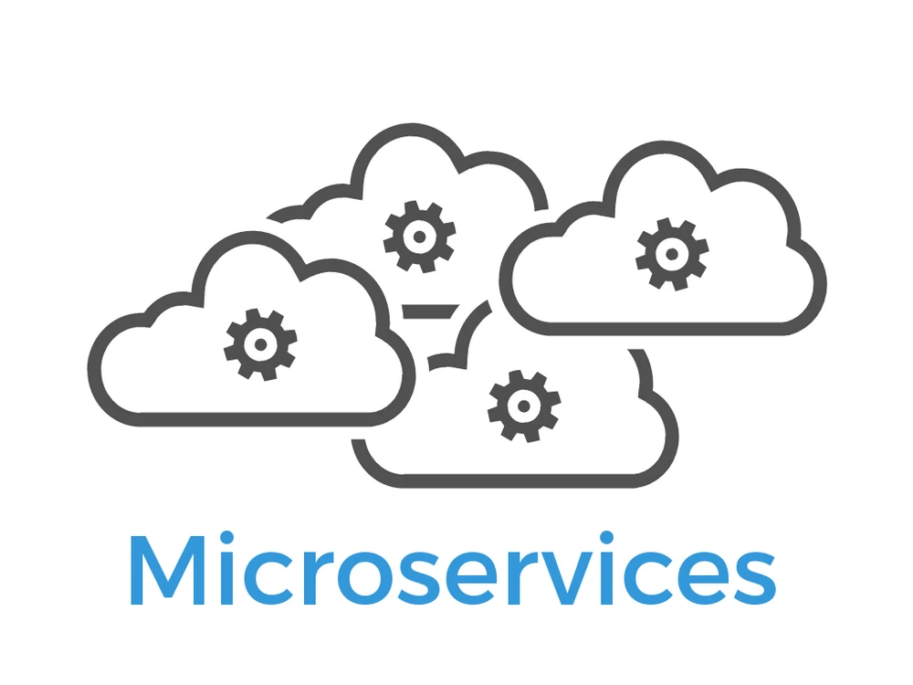

> 阅读建议：只想快速复习，可以只看每节加粗的结论和小结；从零开始则建议按章节顺序阅读。第 2 章（版本与组件维护状态）值得先看，它能解释为什么很多旧教程里的组件今天已经不该再用了。

## 本文导读

全文按主题分为 11 章，可按需跳读；括号内是该章要解决的核心问题。

- 第 1 章 微服务基础：微服务的好处与代价、主流方案对比、需要哪些组件、单体/SOA/微服务的区别、如何理解微服务、9 种常见设计模式。
- 第 2 章 版本与维护状态：Spring Cloud 与 Spring Boot 的版本矩阵，Hystrix、Ribbon、Zuul、Sleuth 的现状与替代品。
- 第 3 章 注册中心：注册中心的作用、Eureka 原理与高可用、Eureka 与 ZooKeeper/Nacos 的区别、Nacos 的服务注册表结构与 Namespace 用法。
- 第 4 章 配置中心：为什么需要、Nacos 配置中心原理、配置动态刷新的长轮询与服务端推送、Spring Cloud Config 的刷新方式。
- 第 5 章 远程调用与负载均衡：HTTP 与 RPC 的区别、Feign 与 Dubbo 的区别、Feign 的用法与坑、负载均衡算法。
- 第 6 章 服务容灾：服务雪崩、熔断与降级、Hystrix 六大机制、Sentinel 的限流实现、Sentinel 与 Hystrix 的差异、限流算法。
- 第 7 章 API 网关：网关的职责、Spring Cloud Gateway 的核心概念与过滤器链、网关的代价与选型。
- 第 8 章 链路追踪与可观测性：为什么需要链路追踪、常见方案、SkyWalking 的定位与用法、监控告警与日志收集。
- 第 9 章 分布式事务：什么场景需要、Seata 的四种模式、TC/TM/RM 与两阶段提交、AT 模式的实现细节与取舍。
- 第 10 章 领域驱动设计（DDD）：战略设计与战术设计、贫血与充血模型、值对象、聚合边界与落地难点。
- 第 11 章 OAuth2 与接口安全：OAuth 2.0 的角色与四种授权模式、敏感信息的存储与传输、刷新令牌、Token 与密码的区别。

## 关于本文

微服务组件的"最佳实践"变化很快，同一个问题在 2018 年和 2026 年的正确答案并不一样（典型例子是 Hystrix、Ribbon、Zuul）。因此本文的默认语境是 **Spring Cloud 2020.0（代号 Ilford）及之后的版本**，涉及旧版本差异时会显式标注"Hoxton 及更早版本"之类的限定，避免把过时结论当成通用结论。

文中涉及的可验证事实，已按官方文档核对，主要依据：

- Spring 官方文档：Spring Cloud 版本支持说明（Release Train 与 Spring Boot 对应关系）、Spring Cloud Netflix 参考文档、Spring Cloud Commons 的 LoadBalancer 章节、Spring Cloud Gateway 的 How It Works 章节。
- Netflix Hystrix 项目 README 中的维护状态说明。
- Sentinel 官方文档的流量控制章节（`controlBehavior` 的取值与语义）。
- Nacos 官方文档（数据模型、配置发布与监听、版本升级与客户端兼容性）。
- Spring Cloud Alibaba 官方版本说明（与 Spring Cloud、Spring Boot 及 Nacos/Sentinel/Seata 的版本对应）。

## 一、微服务基础

这一章回答"为什么会有微服务"这个前置问题。只有先理解单体架构的痛点和微服务引入的代价，后面学注册中心、网关、熔断这些组件时，才知道它们各自在补哪个洞。

### 1.1 微服务解决了什么问题：与单体架构对比

**是什么**：微服务（Microservices）是一种把单个应用拆成一组小型、独立部署的服务的架构风格，每个服务只负责一块业务能力，服务之间通过网络调用协作。讨论它的好处，通常要拿它和单体（Monolithic）项目比较。

可以用一个比喻理解：单体应用像一家"什么都卖"的杂货铺，进货、收银、理货全在同一个门面里，想多摆一排货架就得整店停业改造；微服务像一条商业街，每家店只做一件事，哪家店要扩店就单独装修，但整条街需要物业（注册中心、网关、监控）来协调。

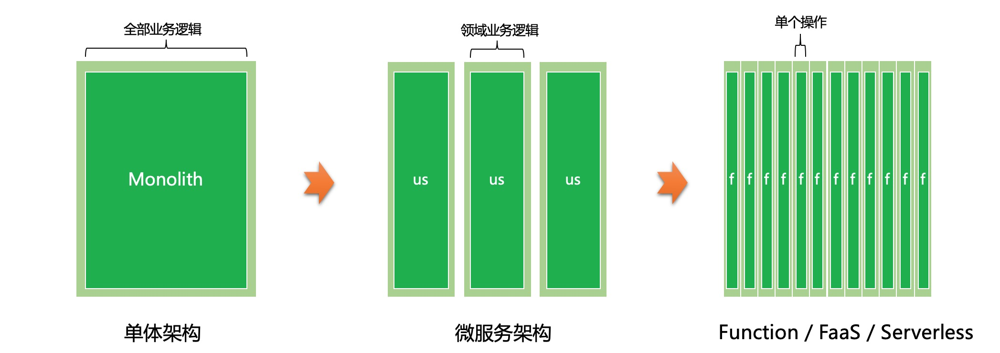

**单体的缺点：**

1. 可扩展性受限：整体一起扩展，即使只有一个组件需要更多资源，也得全量扩容，浪费资源。
2. 难维护更新：系统日益庞大复杂，每次修改都可能引发意外影响。
3. 高风险：一处小错误或故障就可能拖垮整个应用。
4. 技术栈受限：所有组件只能用同一套技术栈。
5. 协作复杂：所有组件共用一个代码库，团队之间冲突多。

**微服务的优点：**

1. 可扩展性：可以按需独立扩展单个服务。
2. 灵活、开发快：各团队独立设计、开发、部署，更快交付新功能。
3. 故障隔离、容错：单个服务故障通常不影响其他服务，故障更易定位处理。
4. 技术多样：每个服务可以选最合适的技术栈。
5. 独立部署维护：降低风险，修复更新更快。
6. 团队协作：不同团队负责不同服务，自治性更强、冲突更少。

微服务以更高的可扩展性、灵活性和容错性，以及更易管理的部署维护，弥补了单体架构的诸多限制；但它同时引入了更多管理与监控的复杂度。是否采用取决于项目实际需求，而不是"新技术一定要用"。

### 1.2 微服务带来了哪些挑战

拆得越细，需要自己解决的问题越多。下面五点是落地时最常踩的坑：

1. **成本**：基础设施（服务器、容器、负载均衡）投入增加；多服务的开发、测试、部署、维护需要更多人力。
2. **复杂性**：分布式系统涉及网络通信、故障处理、事务管理；服务发现、注册、版本控制、路由需要服务网格或 API 网关来支撑。
3. **部署**：需要自动化部署流程；多版本管理与回滚变得复杂。
4. **一致性**：数据分散在各服务，需要分布式事务或事件驱动来保证一致；跨服务事务的一致性与隔离性实现困难。
5. **监控与排障**：问题可能横跨多个服务，需要强大的监控和诊断工具才能快速定位并恢复。

微服务不是万金油，而是应对海量用户、业务复杂、需求频繁变更场景的一种架构风格。常听到的说法是"好的架构是演化出来的，而不是设计出来的"——引入任何架构都有利弊两面，关键在于平衡。

### 1.3 主流方案：Dubbo、Spring Cloud Netflix、Spring Cloud Alibaba

主流的开源微服务方案有三种，它们的定位并不完全相同。

1. **Dubbo**：高性能、轻量级 Java 微服务框架，阿里 2011 年开源，提供注册发现、负载均衡、容错、分布式调用等能力；中间曾一度停更，后恢复迭代并推出 Dubbo 3。它基于 RPC 通信模型，支持多种传输协议（TCP、HTTP、Redis）与序列化方式（JSON、Hessian、Protobuf）。它更偏向高性能 RPC 框架，部分服务治理能力依赖 ZooKeeper、Apollo 等第三方组件。

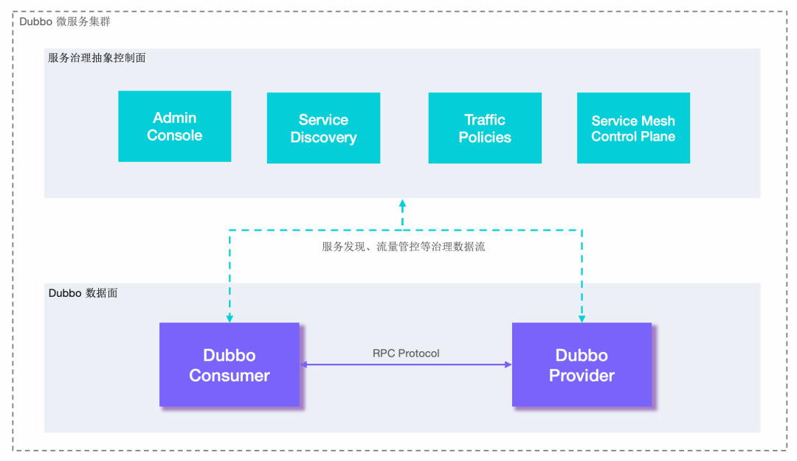

Dubbo 工作原理图（来源：Dubbo 官方文档）

2. **Spring Cloud Netflix**：Spring Cloud 的子项目，用于整合 Netflix 开源组件。Netflix 自 2018 年起陆续停止维护 Eureka 2.0、Hystrix 等 OSS 项目，该项目也随之进入维护模式；从 Spring Cloud 2020.0 起，Ribbon、Hystrix、Zuul 等模块已被移出，只保留 Eureka 的注册发现能力（Eureka 本身仍在维护，详见 2.2 节）。
3. **Spring Cloud Alibaba**：Spring Cloud 的子项目，提供与阿里生态集成的整套方案，包含 Nacos（注册发现、配置管理）、Sentinel（流控、熔断降级）、RocketMQ（消息队列）等，并可对接阿里云产品，为基于 Spring Cloud 的微服务提供更丰富的选项。

**三种方案的区别：**

| 特点 | Dubbo | Spring Cloud Netflix | Spring Cloud Alibaba |
| --- | --- | --- | --- |
| 开发语言 | Java | Java | Java |
| 服务治理 | 完整 | 部分（2020.0 后仅剩 Eureka 等少量能力） | 完整 |
| 服务注册与发现 | ZooKeeper/Nacos | Eureka/Consul | Nacos |
| 负载均衡 | 自带策略 | Ribbon（旧版）→ Spring Cloud LoadBalancer | Spring Cloud LoadBalancer / Dubbo 策略 |
| 服务调用 | RPC | RestTemplate/OpenFeign | OpenFeign/RestTemplate/Dubbo |
| 熔断器 | Sentinel | Hystrix（旧版）→ Resilience4j | Sentinel / Resilience4j |
| 配置中心 | Apollo | Spring Cloud Config | Nacos Config |
| API 网关 | Higress/APISIX | Zuul（旧版）/Gateway | Spring Cloud Gateway |
| 分布式事务 | Seata | 不内置 | Seata |
| 限流和降级 | Sentinel | Hystrix（旧版） | Sentinel |
| 分布式追踪与监控 | SkyWalking | Sleuth + Zipkin（旧版） | SkyWalking / Sentinel Dashboard |
| 服务网格 | Dubbo Mesh | 不支持 | Service Mesh（Nacos + Dubbo Mesh） |
| 社区活跃度 | 较高 | 较低（维护模式） | 较高 |
| 孵化和成熟度 | 早、成熟度高 | 成熟度高 | 较新但发展快 |

面试中微服务话题主要围绕 Spring Cloud Netflix 与 Spring Cloud Alibaba 展开，Dubbo 更多是作为 RPC 框架被问到。

### 1.4 微服务需要哪些组件

微服务带来了服务调用复杂、分布式事务、服务动态管理等问题，各类治理组件应运而生。

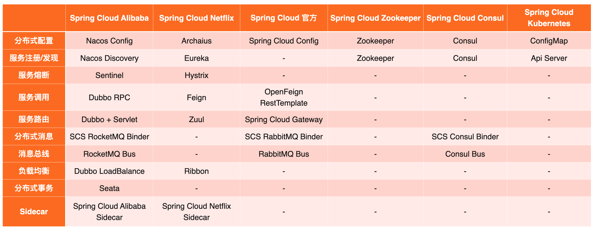

微服务组件示意图

1. **注册中心**：负责服务的注册与发现，管理服务地址。Netflix 系：Eureka、Consul；Alibaba 系：Nacos。
2. **配置中心**：集中管理配置，支持动态修改而无需重启。Netflix 系：Spring Cloud Config；Alibaba 系：Nacos Config。
3. **远程调用**：服务间通信。RESTful（RestTemplate、OpenFeign）、RPC（Dubbo、gRPC）。
4. **API 网关**：架构入口，统一暴露服务，提供路由、负载均衡、安全认证等。Netflix 系：Zuul（旧版）、Gateway；Alibaba 系：Gateway、APISIX 等。
5. **分布式事务**：保证跨服务的一致性与原子性。Alibaba 系：Seata。
6. **熔断器**：防止故障扩散，提高容错。Netflix 系：Hystrix（旧版）；Alibaba 系：Sentinel、Resilience4j。
7. **限流和降级**：防止过载，限制并降级请求。Netflix 系：Hystrix（旧版）；Alibaba 系：Sentinel。
8. **分布式追踪与监控**：跟踪请求流程与性能指标。Netflix 系：Sleuth + Zipkin（旧版）；Alibaba 系：SkyWalking、Sentinel Dashboard。

### 1.5 单体、SOA 与微服务的区别

- **单体应用**：所有功能打包在一个应用里，像一个整体。容易部署和测试，但随着规模扩大，灵活性和可维护性降低。
- **SOA**（Service-Oriented Architecture，面向服务的架构）：把系统划分为多个独立服务，通过网络调用，可跨平台、跨语言交互。优点是提供跨系统的服务复用和松散耦合；缺点是实现需要大量工作（服务定义、接口选择、协议制定等），常见的 ESB（企业服务总线）还会成为新的单点。
- **微服务**：在 SOA 的基础上进一步把系统拆成多个小型、独立的服务，每个都是单独应用，可独立部署、运行和扩展。灵活性和可维护性更高，适用于复杂的大型系统，强调服务自治；但同样需要大量投入（服务定义、通信机制选择、服务管理等）。

一句话概括：SOA 重在"系统之间复用服务"，微服务重在"单个服务自治并可独立演进"。

### 1.6 怎么理解微服务：四个维度

多数人回答"把单体拆成多个独立小服务，各自部署，通过 RPC 或 RESTful 调用"，这只说出了微服务的**"形"**（怎么做），没有说清**"神"**（为什么做、代价是什么）。可以从四个维度展开。

**第一，算得清性能账。** 单体里的方法调用是**本地调用**（纳秒级）；拆成微服务后变成**网络 RPC**（毫秒级）。若把一个紧密耦合的流程强行拆成 A→B→C→D 四个服务，网络开销会成倍放大。拆分必须有边界，不能为拆而拆，否则吞吐量直线下降。

**第二，搞得定数据一致性。** 单体时代靠数据库 ACID（原子性、一致性、隔离性、持久性），一个 `@Transactional` 就能保证全成功或全回滚。微服务下数据分散，服务 A 扣款成功、B 发货失败、C 积分未加，就失去了 ACID，迎来"分布式事务"噩梦。初级理解是上 Seata 用 AT 模式强保一致；更成熟的理解是**尽量避免分布式事务**——强一致（CP）往往以牺牲可用性和吞吐为代价，能异步的就用 **MQ 做最终一致性**（对应 BASE 理论：基本可用、软状态、最终一致），只有极少数核心链路（如支付转账）才考虑强一致。

**第三，扛得住运维复杂度。** 单体出问题 `grep` 日志即可；几百个服务实例在容器平台里频繁漂移，就不能只靠 `grep`。没有完善的可观测性（Observability）基建，微服务很难运维，通常要提"三驾马车"：

1. **Logging（日志）**：ELK/EFK 做日志聚合。
2. **Tracing（链路追踪）**：SkyWalking/Zipkin 串联 Trace ID，定位请求卡在哪一环。
3. **Metrics（监控指标）**：Prometheus + Grafana 监控系统水位。

**第四，看得见组织架构（康威定律）。** 康威定律（Conway's Law）指出：系统的架构设计最终会反映出组织的沟通结构。微服务不只是技术架构，也是**组织架构**。若团队人少、流程还是瀑布式，没有 DevOps 文化、自动化 CI/CD 流水线和容器底座，硬上微服务往往得不偿失——基础设施决定上层建筑。

### 1.7 一段可复用的回答

把上面四个维度压缩成三句话，就是一段结构完整的回答：

> 我认为微服务本质上是一种**架构层面的权衡（Trade-off）**。
>
> **第一，微服务是有代价的。** 它用运维复杂度（几百个服务的治理）和数据一致性（牺牲 ACID），换取业务敏捷性和团队独立性。业务规模不到那个程度，强行拆分只会带来 RPC 性能损耗和分布式事务的噩梦。
>
> **第二，微服务极其依赖治理能力。** 拆分谁都会，治理才是关键：为解决雪崩，需要熔断、降级、限流（如 Sentinel）；为解决数据一致性，更稳妥的做法是用 MQ 实现最终一致性，而不是盲目引入强一致框架拖慢性能；为解决排查难，必须建立完整的可观测性体系（ELK + SkyWalking + Prometheus）。
>
> **第三，微服务需要组织架构的匹配。** 基于康威定律，它要求具备 DevOps 文化和自动化运维基建（CI/CD、容器平台），否则只会沦为"分布式单体"。
>
> 所以我的理解是：它不是银弹，而是解决特定规模下复杂问题的一种手段。

补充一个更教科书式的定义，方便收尾：微服务是一种架构思想，把应用拆分为一系列小型、独立的服务，每个服务负责一项特定业务功能，特点是服务之间松散耦合、可独立部署和运行；服务间通过轻量级通信机制（如 RPC、HTTP）通信，可独立部署、扩展和升级，从而提高可靠性和可用性。

### 1.8 微服务的 9 种常见设计模式

微软的架构团队曾总结过一组在微服务架构中反复出现的模式，下图是它们的关系示意：

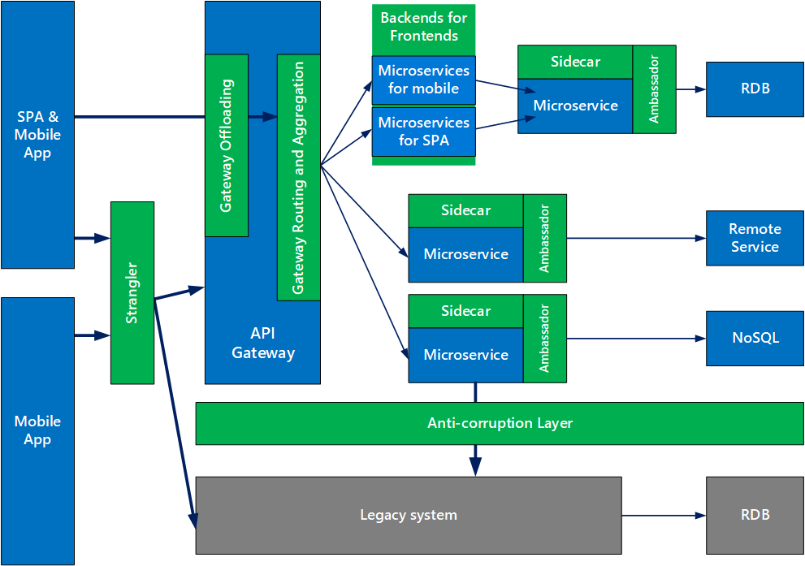

9 个模式分别是：外交官（Ambassador）、防腐层（Anti-corruption layer）、后端服务前端（Backends for Frontends，简称 BFF）、舱壁（Bulkhead）、网关聚合（Gateway Aggregation）、网关卸载（Gateway Offloading）、网关路由（Gateway Routing）、挎斗（Sidecar）、绞杀者（Strangler）。它们大多也是业界常用模式，其中几个尤其常见：

- **外交官模式**：以与语言无关的方式处理常见的客户端连接任务，如监视、日志、路由和安全（如 TLS）。
- **防腐层**：介于新应用与遗留应用之间，确保新应用的设计不受遗留应用限制。
- **后端服务前端（BFF）**：为不同类型客户端（如桌面和移动）创建单独的后端服务，使单个后端服务无需同时满足各类客户端的冲突需求，通过分离客户端特定关注点保持微服务的简单性。
- **舱壁模式**：隔离每个工作负载或服务的关键资源（连接池、内存、CPU），避免单个工作负载耗尽所有资源而拖垮其他服务，主要通过防止级联故障来增强系统弹性。
- **网关聚合**：把对多个微服务的请求聚合成单个请求，减少消费者与服务之间过多的往返。
- **挎斗模式**：把应用的辅助组件（如日志采集、代理）部署为单独的容器或进程，以提供隔离和封装。

设计模式是针对某一问题域的解决方案，其出现也代表了工程化的可能。随着微服务实践普及，这一领域会逐步走向成熟稳定。

## 二、版本与组件维护状态

Spring Cloud 的组件生态在 2018—2020 年间发生过一次大换血，很多流传较广的资料仍停留在换血之前。这一章把"哪个版本配哪个 Boot""哪些组件已经不该再用"讲清楚，后面所有章节的结论都以本章为准。

### 2.1 Spring Cloud 与 Spring Boot 的版本对应关系

Spring Cloud 从 2020.0 起改用日历版本号（CALVER，形如 `YYYY.MINOR.MICRO`），代号继续沿用伦敦地铁站名。**Release Train 的版本必须与 Spring Boot 的版本匹配**，否则会出现启动失败或自动配置不生效。

| Spring Cloud 版本（代号） | 对应 Spring Boot | 当前状态（2026 年核查） |
| --- | --- | --- |
| 2025.1（Oakwood） | 4.0.x | 开发中 |
| 2025.0（Northfields） | 3.5.x | 受支持 |
| 2024.0（Moorgate） | 3.4.x | OSS 支持已结束 |
| 2023.0（Leyton） | 3.3.x / 3.2.x | OSS 支持已结束 |
| 2022.0（Kilburn） | 3.1.x / 3.0.x | 已结束 |
| 2021.0（Jubilee） | 2.6.x / 2.7.x | 已结束 |
| 2020.0（Ilford） | 2.4.x / 2.5.x | 已结束 |

国内项目常用的 Spring Cloud Alibaba 也有自己的对应关系。以官方版本说明中的 2023.x 分支为例：

| Spring Cloud Alibaba | Spring Cloud | Spring Boot | Sentinel | Nacos | Seata |
| --- | --- | --- | --- | --- | --- |
| 2023.0.1.0 | 2023.0.1 | 3.2.4 | 1.8.6 | 2.3.2 | 2.0.0 |

实际选型时建议"三件套一起对齐"：Spring Boot 版本 → Spring Cloud Release Train → Spring Cloud Alibaba（若使用），再确认 Nacos、Sentinel 服务端的版本。

### 2.2 已停止维护的组件与替代方案

这是本文最重要的一张表。很多"经典"组件已经进入维护模式甚至被移出 Spring Cloud，新项目不应再选。

| 组件 | 现状 | 替代方案 |
| --- | --- | --- |
| Hystrix | Netflix 已于 2018 年宣布停止开发，进入维护模式，最终版本 1.5.18，官方明确建议新项目改用 Resilience4j | Spring Cloud CircuitBreaker + Resilience4j |
| Ribbon | 进入维护模式；Spring Cloud 2020.0 起不再包含 | Spring Cloud LoadBalancer（默认轮询，另有随机等实现） |
| Zuul 1 | 进入维护模式；Spring Cloud 2020.0 起不再提供 Zuul 模块 | Spring Cloud Gateway |
| Spring Cloud Sleuth | 停止演进（最后随 Spring Cloud 2021.0 发布）；Spring Boot 3.x 世代由 Micrometer 体系承担 | Micrometer Tracing（可对接 Zipkin、OpenTelemetry 等） |
| Eureka | **仍在维护**，Spring Cloud Netflix 5.0.x 仍提供 Eureka 的服务端与客户端 | 可用 Nacos、Consul 等替代，但 Eureka 并未废弃 |
| Nacos / Sentinel / Seata | 活跃维护 | — |

需要特别更正一个流传很广的说法：**"Eureka 已闭源"并不准确**。准确的事实是 Netflix 在 2018 年宣布停止 Eureka 2.0 的开发，而 Eureka 1.x 一直是开源的，并由 Spring Cloud Netflix 持续集成和维护（当前 5.0.x 文档中 Eureka 客户端与服务端仍是其主要功能）。

**为什么这套替代关系是合理的？** 可以把它们看成三次"同类替换"：

1. **负载均衡**：Ribbon 是"客户端自己挑实例"的库，功能全但维护停滞；Spring Cloud LoadBalancer 用同一思路重写，默认轮询，并提供缓存、权重、同区域优先、健康检查等 `ServiceInstanceListSupplier` 组合能力。
2. **熔断限流**：Hystrix 以线程池隔离著称，但线程开销大、配置复杂；Resilience4j 用装饰器 + 轻量实现替代，Sentinel 则以流量为切入点，把限流、熔断、系统自适应保护做在一起。
3. **网关**：Zuul 1 基于阻塞式 Servlet，难以支撑高并发长连接；Spring Cloud Gateway 基于 WebFlux（响应式、非阻塞），是官方指定的替代品。

### 2.3 版本决定了你能用哪个组件

同一条需求，版本不同写法完全不同，这是初学者最容易困惑的地方：

- **Hoxton（Spring Boot 2.2/2.3）及更早**：Feign 依赖 Ribbon 做负载均衡，熔断用 Hystrix，网关常见 Zuul。这时候 `ribbon.*`、`hystrix.*` 配置项是有效的。
- **2020.0（Ilford）及以后**：Ribbon、Hystrix、Zuul 的 starter 不再提供；Feign 默认配合 Spring Cloud LoadBalancer，熔断走 Spring Cloud CircuitBreaker（常用 Resilience4j 实现），网关用 Spring Cloud Gateway。此时 `ribbon.*` 配置不再生效，对应的是 `spring.cloud.loadbalancer.*`。

所以看到一篇教程时，第一件事是确认它的 Spring Boot 版本；配置项对不上，多半是版本错了，而不是写法"错了"。

## 三、注册中心

注册中心解决的是"服务地址会变，调用方怎么找到它"这个问题。它是微服务的第一步：没有它，服务实例一扩缩容，调用方的配置就得跟着改。

### 3.1 注册中心是用来干什么的

注册中心（Registry / Service Discovery）用于管理和维护分布式系统中各服务的地址与元数据，主要实现服务注册和服务发现。

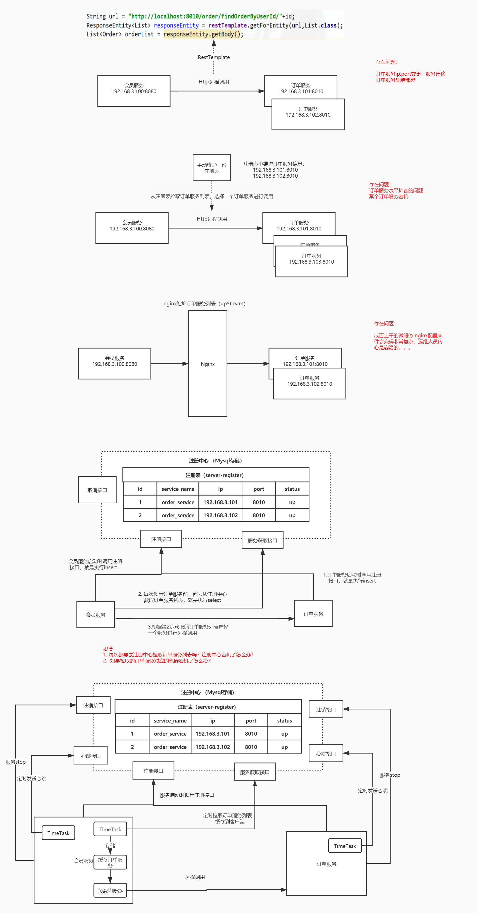

注册中心示意图

1. **服务注册**：服务启动时向注册中心注册自己的网络地址、实例信息和元数据，供其他服务查询。
2. **服务发现**：客户端查询服务信息，获得可用实例列表，按需选择调用，实现服务间解耦。
3. **负载均衡**：对同一服务的多个实例做负载均衡，提升整体性能与可用性。
4. **故障恢复**：监测服务状态，实例故障或下线时及时更新注册信息。
5. **服务治理**：支持配置管理、动态扩缩容、服务路由、灰度发布等。

一个生活化的比喻：注册中心像医院的"分诊台"，各科室（服务实例）上班时先在分诊台登记"我在几楼几诊室"，病人（调用方）不用记住每个诊室的位置，问分诊台即可；医生下班（实例下线）也要报备，否则病人会被指到空诊室。

### 3.2 Spring Cloud 可以选哪些注册中心

1. **Eureka**：Netflix 开源的服务发现框架，高可用、有弹性、可扩展，与 Spring Cloud 集成良好，属于 AP 型（优先保证可用性）。注意：Eureka 2.0 已停止开发，1.x 仍开源并由 Spring Cloud Netflix 维护。
2. **Consul**：HashiCorp 的分布式服务发现与配置管理系统，提供服务注册、发现、健康检查、KV 存储，支持多数据中心，可配置为 CP 或 AP 取向。
3. **ZooKeeper**：Apache 开源的分布式协调服务，可作注册中心，高可用、一致、可靠，属于 CP 型（优先保证一致性）。
4. **Nacos**：阿里开源的动态服务发现、配置和服务管理平台，支持服务注册发现、配置管理、动态 DNS；临时实例走 AP（Distro 协议），持久实例可走 CP（Raft 协议）。
5. **etcd**：CoreOS 开源的分布式键值存储，可作注册中心，高可用、强一致、分布式复制，属于 CP 型。

### 3.3 Eureka、ZooKeeper、Nacos 的区别

| 特性 | Eureka | ZooKeeper | Nacos |
| --- | --- | --- | --- |
| 开发公司 | Netflix | Apache 基金会 | 阿里巴巴 |
| CAP | AP | CP | 既支持 AP，也支持 CP |
| 功能 | 服务注册与发现 | 分布式协调、配置管理、分布式锁 | 服务注册与发现、配置管理、服务管理 |
| 定位 | 基于 HTTP 的微服务架构 | 通用分布式协调服务框架 | 微服务和云原生应用 |
| 访问协议 | HTTP | TCP | HTTP/DNS/gRPC |
| 自我保护 | 支持 | - | 支持 |
| 数据存储 | 内嵌数据库、多实例集群 | 基于 ZAB 协议的一致性存储 | 内嵌 Derby（单机）或外置 MySQL 等 |
| 健康检查 | Client Beat（客户端心跳） | Keep Alive（会话保活） | TCP/HTTP/MySQL/Client Beat |
| 特点 | 简单易用、自我保护 | 高性能、强一致 | 动态配置、流量管理、灰度发布等 |

最大区别在于 CAP 取舍：Eureka 支持 AP，ZooKeeper 支持 CP，Nacos 两者皆支持（按实例类型选择）。

### 3.4 Eureka 的实现原理

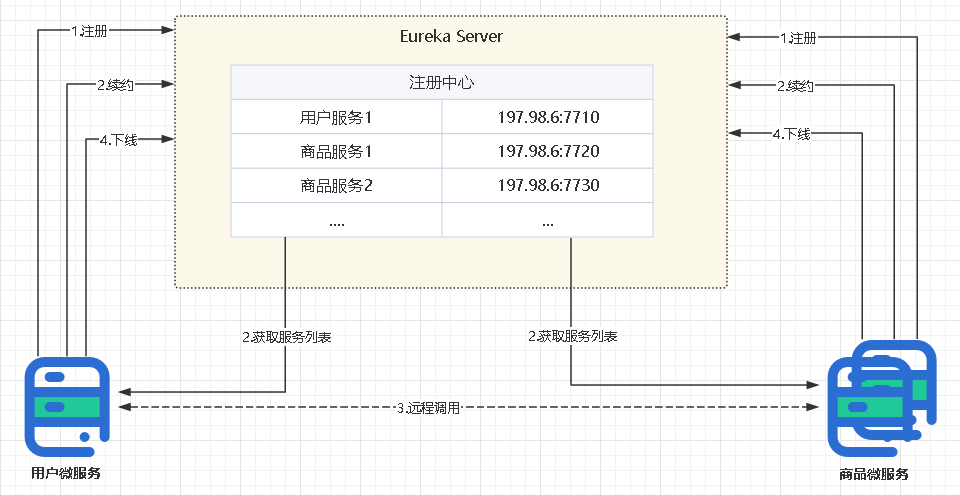

Eureka 原理示意图

1. **服务注册与发现**：实例启动时向 Eureka Server 发送注册请求，Server 把信息保存在内存中并提供 REST 接口。消费者查询实例列表，获得可用的服务提供者。
2. **服务健康检查**：通过心跳（续约）检测实例健康状态。一定时间内未收到心跳，则标记为不可用并从服务列表移除。
3. **服务负载均衡**：客户端调用其他服务时先从本地缓存获取注册信息，缓存未命中再向 Server 查询，Server 返回可用实例列表，客户端用负载均衡算法选一个调用。

其他注册中心（Nacos、Consul 等）在"注册 + 心跳 + 拉取列表"这条主线上原理大同小异，差异主要在一致性协议、推送方式和健康检查手段。

### 3.5 Eureka Server 怎么保证高可用

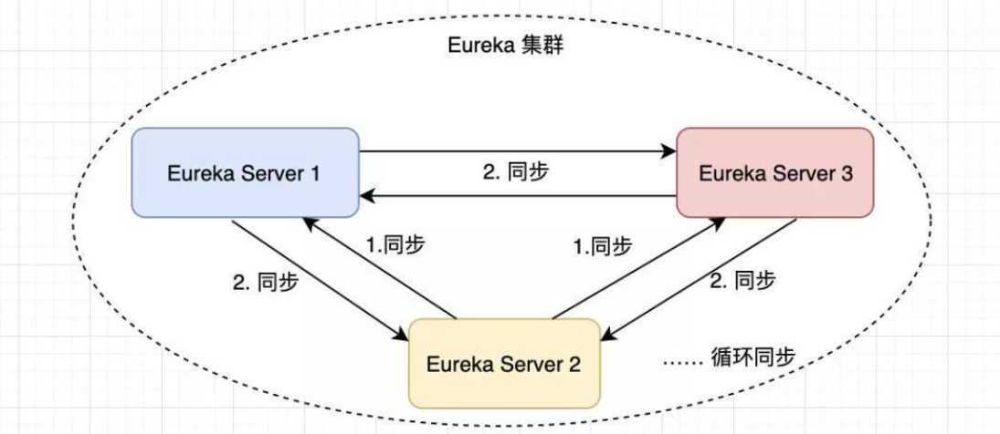

1. **多实例部署**：多个实例部署在不同节点，某实例故障时其余实例仍可提供服务并保持一致。
2. **注册信息复制**：实例注册时各 Server 互相复制注册信息以保持一致，某实例故障时其余实例可接管其工作（即 peer 之间的 replication）。
3. **自我保护机制**：一定时间内未收到心跳时进入自我保护模式，不再剔除注册表中的实例，防止网络抖动导致误剔除，进一步提高稳定性。

### 3.6 Nacos 的服务注册表结构

Nacos 采用分级存储模型：最外层是 Namespace（隔离环境），然后是 Group（服务分组），接下来是服务（Service）——一个服务包含多个可能处于不同机房的实例，因此 Service 下有多个集群（Cluster），Cluster 下是不同的实例（Instance）。

对应到 Java 代码中，Nacos 用一个多层 Map 表示，结构形如 `Map<String, Map<String, Service>>`：最外层 Map 的 key 是 namespaceId，值是一个 Map；内层 Map 的 key 是 group 拼接 serviceName，值是 Service 对象。Service 内部又是一个 Map，key 是集群名称、值是 Cluster 对象，Cluster 内部则维护了 Instance 的集合。

### 3.7 Nacos 中的 Namespace 是什么、怎么用

Namespace（命名空间）是 Nacos 中最粗粒度的资源隔离维度。数据模型层级为：**Namespace > Group > Service/DataId**。

1. **核心定义**：Namespace 主要用于实现**环境隔离**。默认有一个保留的 Namespace 叫 `public`，但生产上不建议把所有配置和服务都堆在 `public` 里。
2. **使用场景**：通常用 Namespace 区分**开发（Dev）、测试（Test）、生产（Prod）**环境：Dev 的微服务只读 Dev Namespace 下的配置，Prod 只读 Prod 的配置，从逻辑和权限上保证配置安全，避免"测试环境改配置把生产搞挂"这类事故。

**配置怎么写：**

- 错误示范：什么都不配，默认使用 `public`，好比把卧室、厨房、储藏室的东西全堆在客厅，找起来全靠运气。
- 正确示范：在 `bootstrap.yml`（Spring Cloud 2020.0 之后多数场景改用 `application.yml`）中显式指定 Namespace 的 **ID**（注意填 ID，不是名称）。

```yaml
# application.yml
spring:
  application:
    name: order-service
  cloud:
    nacos:
      config:
        server-addr: 127.0.0.1:8848
        file-extension: yaml
        # 指定 Namespace ID（控制台里显示的通常是一串 UUID）
        namespace: 53268903-8205-4c07-b649-1456728080a1
        # Group 默认 DEFAULT_GROUP，可按需修改
        group: ORDER_GROUP
```

**控制台的视觉隔离**：打开 Nacos 控制台应看到干净的"Dev""Test""Prod"标签页；不切换 Namespace 时甚至搜不到别的环境的配置，这就是隔离带来的安全感。

**Namespace 和 Group 的分工：**

- **Namespace**：**纵向**切分，代表"不同的世界"，如北京机房 vs 上海机房、租户 A vs 租户 B、Dev vs Prod，彼此之间默认互不可见。
- **Group**：**横向**切分，代表"同一个世界里的不同模块"，如 Prod 环境下的"大促版"（Group=DOUBLE_11）与"日常版"（Group=DAILY），或把订单中心放 ORDER_GROUP、用户中心放 USER_GROUP。

**推荐实践：**

1. **Namespace = 环境**：不要混用，建议为 `dev`、`test`、`uat`、`prod` 分别建 Namespace。理由：ID 填错时服务会启动报错、拉不到配置，这其实是 **Fail-Fast（快速失败）**，能防止配置串味。
2. **Group = 业务域/项目**：默认用 `DEFAULT_GROUP` 也可以；微服务特别多时建议按业务线分组，如 `TRADE_GROUP`（交易线）、`LOGISTICS_GROUP`（物流线）。
3. **DataId = 服务名 + Profile**：常见格式 `{service-name}-{profile}.{file-extension}`，如 `order-service-prod.yaml`。

小结：Namespace 定环境，Group 分业务，DataId 锁定具体配置。搞懂这个三元组，Nacos 的配置管理才算入门。

### 3.8 Nacos、Eureka、ZooKeeper 的速答版差异

- **Nacos**：除注册中心外还提供配置管理、服务发现、事件通知等。默认采用 AP 架构保证可用性，持久实例可用 CP（底层 Raft）保证一致性。适合同时作为微服务的注册中心与配置中心。
- **Eureka**：只提供注册中心功能，设计理念是 AP，保证可用性、不追求强一致。各节点相互注册，只要还有一台 Eureka 节点存活，微服务之间就仍可通信。
- **ZooKeeper**：除注册中心外还提供分布式协调服务（通知、配置管理等）。采用 CP 设计，保证数据一致性但牺牲部分可用性，适用于需要分布式协调的场景（配置管理、命名服务等）。

## 四、配置中心

配置中心解决的是"几十上百个实例的配置怎么统一改、改完怎么生效"这个问题。它和注册中心常常由同一个中间件承担（例如 Nacos），但两者解决的问题完全不同。

### 4.1 为什么微服务需要配置中心

每个服务通常都需要数据库地址、端口、日志级别等配置，这些配置可能因环境、实例或运行时而调整。微服务实例数量庞大，逐个维护成本极高，因此需要集中化的配置中心统一管理。

配置中心的核心价值有三点：集中（一处修改）、动态（不重启生效）、可追溯（有版本与历史，可回滚）。

### 4.2 Spring Cloud 可以选哪些配置中心

1. **Spring Cloud Config**：Spring 官方方案，支持将配置存于 Git、SVN 等版本控制系统，并提供 RESTful API 访问管理。
2. **ZooKeeper**：开源分布式协调服务，可作配置中心，高可用、一致、有通知机制。
3. **Consul**：开源分布式服务发现与配置管理工具，可作配置中心，支持多种格式，提供健康检查、故障转移、动态变更。
4. **etcd**：分布式键值存储，基于 Raft 保证一致性。
5. **Apollo**：携程开源，支持多语言框架，提供细粒度权限管理、变更通知、灰度发布及可视化界面。
6. **Nacos**：阿里开源的服务发现、配置管理与服务管理平台，支持注册发现、动态配置、健康监测、动态 DNS。

### 4.3 Nacos 配置中心的实现原理

配置中心本质就是配置信息的增删改查（CRUD）加上变更通知。

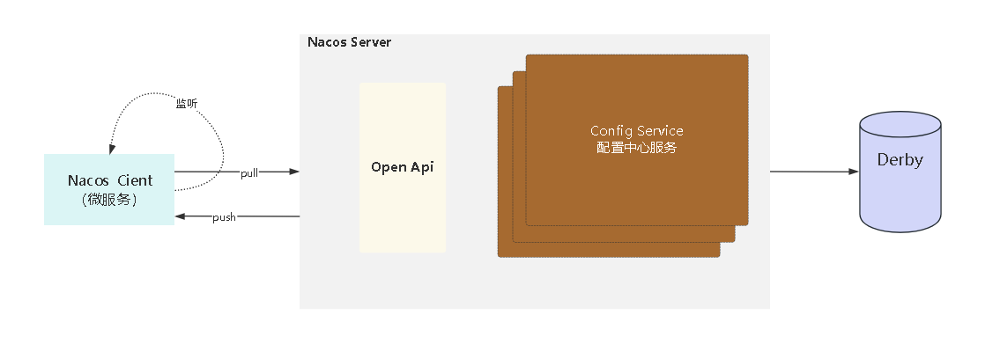

配置中心示意

1. **配置信息存储**：单机模式默认用内嵌 Derby，集群模式建议换成 MySQL 等外置关系型数据库（官方文档明确单机 Derby 不适合承载高可用生产流量）。
2. **注册配置信息**：服务启动时，Nacos Client 向 Server 注册配置，即写入存储并生成版本号。
3. **获取配置信息**：运行时 Client 通过 API 从 Server 拉取配置，Server 按 `namespace + group + dataId` 查找并返回。
4. **监听配置变化**：Client 注册监听器，配置变化时 Server 通知监听器并触发回调，回调里拿到的已经是配置正文。

### 4.4 配置动态刷新：长轮询与服务端推送

客户端与服务端的交互分推（Push）和拉（Pull）两种；Nacos 在 Pull 基础上用长轮询（long polling）实现配置的动态刷新——客户端发起请求检查配置是否变更，无变更时服务端先"hold"住请求（暂不返回），直到配置变化或超时。

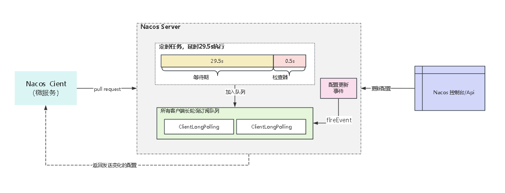

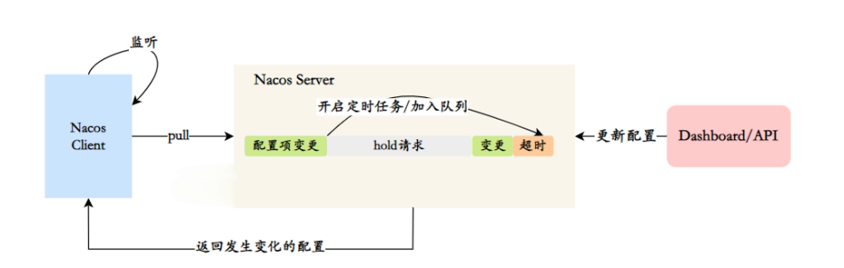

以 Nacos 1.x 的 HTTP 客户端为例，一次长轮询的流程是：

- 客户端发起 **Pull** 请求，服务端先检查配置是否变更：
  - **有变更**：立即返回变更后的配置；
  - **无变更**：设置定时任务延期约 29.5 秒执行，把当前长轮询连接加入 allSubs 队列；
- 这段等待时间内的配置变化：
  - **无变化**：等待到期后触发自动检查，返回配置（客户端随即发起下一轮）；
  - **有变化**：配置变化会触发事件，监听任务遍历 allSubs 队列，找到对应的 ClientLongPolling 任务，通过其连接返回变更数据，相当于完成一次 **PUSH**；
- 长轮询因此结合了 **Pull** 与 **Push** 的优点。

这种设计让客户端能较快感知配置变化并及时获取最新配置，同时降低服务端压力，避免大量长连接长期占用内存。

**适用版本（重要）**：上面的 29.5 秒挂起细节属于 **Nacos 1.x 的 HTTP 客户端实现**。Nacos 2.x 起客户端与服务端之间改为长连接（gRPC）通信，配置变更由服务端主动推送；Nacos 3.x 官方文档也明确 HTTP Client OpenAPI 不再提供配置长轮询监听，需要监听时应使用官方 SDK 的长连接能力。面试时先说清是哪一代实现，比背具体秒数更有价值。

### 4.5 Spring Cloud Config 怎么刷新配置

Spring Cloud Config 把配置放在 Git 等仓库里，客户端启动时拉取。它的"动态刷新"不是一个自动推送机制，而是两个动作的组合：

1. **暴露刷新端点**：引入 `spring-boot-starter-actuator` 后，调用 `POST /actuator/refresh` 让客户端重新拉取配置。
2. **刷新作用域**：被 `@RefreshScope` 标注的 Bean 会在刷新时销毁重建，从而读到新值；没有标注的 Bean（例如在启动时就读进构造函数的字段）不会自动更新。

```java
@RefreshScope
@RestController
public class ConfigDemoController {

    @Value("${demo.timeout:3000}")
    private long timeout;

    @GetMapping("/timeout")
    public long timeout() {
        return timeout;
    }
}
```

单个实例逐个调用刷新端点很麻烦，实践中通常配合 **Spring Cloud Bus**（基于消息中间件）把一次刷新事件广播给所有实例，或直接用 Nacos 这类自带推送能力的配置中心。

## 五、远程调用与负载均衡

一个服务调用另一个服务，绕不开两个问题：用什么协议通信（HTTP 还是 RPC），以及同一个服务的多个实例该选哪一个（负载均衡）。这一章同时回答"Feign 和 Dubbo 有什么区别""Feign 为什么第一次调用慢"这类高频问题。

### 5.1 HTTP 与 RPC 的区别

严格来讲二者不在同一层面：

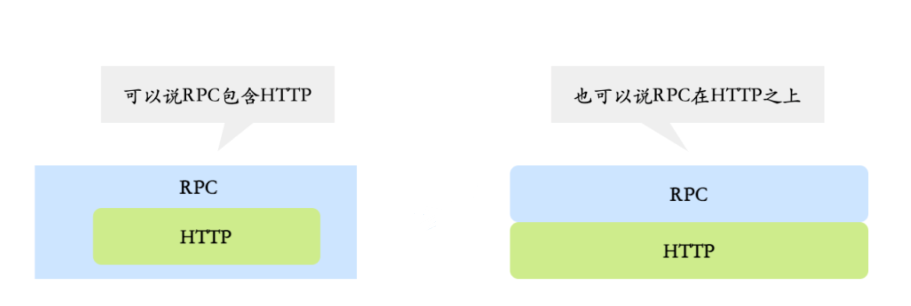

HTTP 和 RPC 示意

- HTTP（Hypertext Transfer Protocol，超文本传输协议）是应用层协议，强调网络通信；
- RPC（Remote Procedure Call，远程过程调用）是一种调用范式，强调"像调用本地方法一样调用远程服务"，具体可以跑在各种传输协议之上。

一些 RPC 框架底层也用 HTTP/2，例如 gRPC 以 HTTP/2 作为传输层，Dubbo 3 也兼容 gRPC。硬要比较的话：

| HTTP | RPC |
| --- | --- |
| 用于传输超文本的协议 | 用于分布式系统节点间通信的协议族 |
| 基于请求-响应模型，客户端发请求、服务器返回响应 | 基于方法调用模型，客户端调用远程方法并等待结果 |
| 通常基于 TCP，可用 TLS/SSL 加密 | 可用 TCP、UDP 等多种传输协议 |
| 报文多为文本，常用 JSON、XML | 可用二进制、JSON、Protobuf 等 |
| 用 RESTful 风格接口定义（GET/POST/PUT/DELETE 等） | 用 IDL（接口描述语言）定义接口，如 Protobuf、Thrift |
| 支持跨语言 | 支持跨语言（由 IDL 生成各语言代码） |
| 更灵活，适用于 Web 开发、开放 API | 更高效，适用于高性能、低延迟的内部调用 |

微服务体系中，基于 HTTP 的远程调用通常用 OpenFeign（Spring Cloud 对 Feign 的集成），基于 RPC 的通常用 Dubbo。

### 5.2 Feign 与 Dubbo 的区别

这两个才适合拿来比较：

| 对比项 | Feign（OpenFeign） | Dubbo |
| --- | --- | --- |
| 定义 | 声明式 Web 服务客户端，简化 HTTP API 调用 | 分布式服务框架，构建面向服务的微服务架构 |
| 通信方式 | 基于 HTTP，使用 RESTful 风格接口 | 基于 RPC，支持 Dubbo、gRPC、Hessian 等多种协议与序列化 |
| 服务发现 | 结合注册中心（Nacos、Eureka、Consul 等） | 通过 ZooKeeper、Nacos 等注册发现并提供负载均衡 |
| 服务治理 | 不直接提供，需结合其他组件 | 内置注册发现、负载均衡、容错、降级等 |
| 跨语言性 | 好，任何能发 HTTP 请求的语言都能调 | 好，通过 IDL 生成各语言代码 |
| 生态系统 | 与 Spring Boot/Spring Cloud 无缝集成 | 完整生态，含注册、配置、监控中心等 |
| 适用场景 | RESTful 风格的微服务调用、对外 API 集成 | 内部高频调用、对性能与治理要求高的场景 |

二者并不互斥：Dubbo 可以暴露 HTTP 接口，Feign 也能调用任何 HTTP 端点。选型取决于业务需求和技术栈，而不是"哪个更先进"。

### 5.3 服务端负载均衡与客户端负载均衡

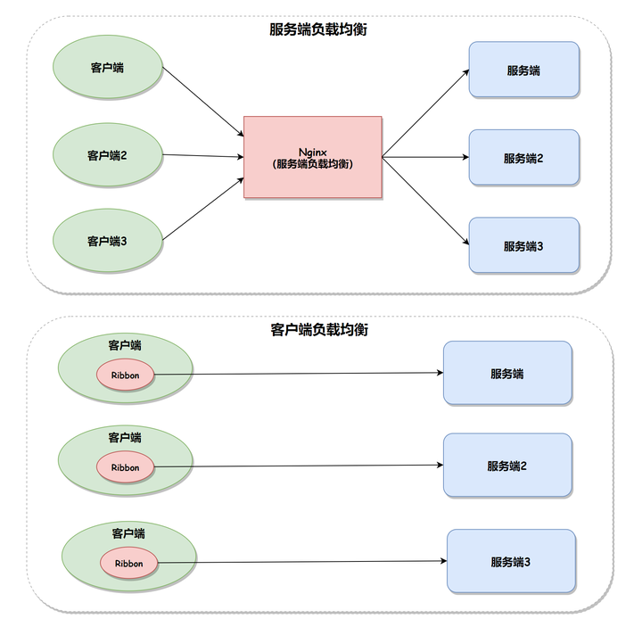

- **服务端负载均衡**：请求先到达一个独立的负载均衡设备或软件（如 Nginx、F5），由它转发给后端实例，调用方并不知道后端有多少台机器。
- **客户端负载均衡**：调用方自己从注册中心拉取实例列表并缓存在本地，由客户端内的负载均衡器按策略选出一个 IP 与端口，再直接发起 HTTP 请求。

一个比喻：服务端负载均衡像写字楼一楼的"前台代收"，快递员只认识前台；客户端负载均衡像每位员工手里都有一份内部通讯录，自己按规则挑人联系。

以客户端负载均衡为例，完整链路是：客户端负载均衡器通过注册中心（如 Nacos）将可用服务列表拉取到本地，再按策略选出某个服务器的 IP 与端口，然后通过 HTTP 框架请求服务并得到结果。这样做少了一次转发，但每个调用方都要自己维护实例列表。

### 5.4 Feign 是什么

Feign 是一个声明式的 Web 服务客户端：只写接口和注解、不写实现，运行时由框架生成代理去发起 HTTP 请求，把"拼 URL、填参数、发请求、解析响应"这套模板代码隐藏起来。

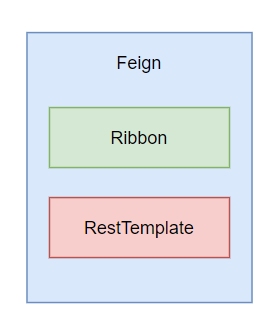

Feign 封装示意

```java
@FeignClient(name = "example")
public interface ExampleService {
    @GetMapping("/endpoint")
    String getEndpointData();
}
```

这里的 `name` 是服务名，具体请求哪台机器由负载均衡组件决定；如果在注解里改用 `url` 属性直接写死地址，就变成直连固定地址，注册中心与负载均衡都不再参与，一般只用于联调。

它的三个特点：

1. **声明式 API**：用注解定义对远程服务的访问，指定路径、HTTP 方法、请求参数、请求头等，直观易懂。
2. **集成负载均衡**：根据服务名与可用实例列表动态路由、分发请求。Hoxton 及更早由 Ribbon 提供，Spring Cloud 2020.0 之后由 Spring Cloud LoadBalancer 提供。
3. **容错机制**：可集成 Spring Cloud CircuitBreaker（常用 Resilience4j 实现）或 Sentinel，在远程服务不可用或响应过慢时快速失败并返回兜底结果，避免级联故障。

需要更正一个流传较广的说法：**Feign 并不是"在 RestTemplate 之上再包一层"**。Feign 有自己的请求构建与编解码流程，底层通过 `feign.Client` 发起请求（默认实现基于 HttpURLConnection，也可替换为 OkHttp 或 Apache HttpClient），与 RestTemplate 无关；RestTemplate 是另一种命令式调用方式，两者是并列的可选项。

### 5.5 为什么 Feign 第一次调用耗时很长

主要原因有两个：

1. **负载均衡上下文的懒加载**：Spring Cloud LoadBalancer 会为每个服务名创建一个子容器，默认在第一次请求该服务时才初始化，其中包括从注册中心获取实例列表、初始化缓存等。
2. **连接建立的固定成本**：第一次请求要建立 TCP 连接（HTTPS 还要 TLS 握手），比复用连接池中的连接慢得多。

Hoxton 及更早版本用的是 Ribbon，也有同样的懒加载行为，可以在启动时预热：

```yaml
# 仅 Hoxton 及更早版本（基于 Ribbon）有效
ribbon:
  eager-load:
    enabled: true
    clients: service-1
```

Spring Cloud 2020.0 及以后（基于 Spring Cloud LoadBalancer）的对应写法是：

```yaml
spring:
  cloud:
    loadbalancer:
      eager-load:
        clients: service-1
```

另一种通用做法是在应用启动后主动触发一次"预热调用"，相当于提前完成第一次真实请求；代价是要处理启动期依赖不可用的情况。

### 5.6 Feign 怎么实现认证传递

常见做法是用拦截器传递认证信息：实现 `RequestInterceptor` 接口定义拦截器，把认证信息加入请求头，并注册到 Feign 配置中。

```java
@Configuration
public class FeignClientConfig {

    @Bean
    public RequestInterceptor requestInterceptor() {
        return template -> template.header("Authorization", "Bearer " + currentToken());
    }

    private String currentToken() {
        // 实际项目中通常从 SecurityContext、ThreadLocal 或上游请求头中获取
        return "your_token";
    }
}
```

两个注意点：一是拦截器默认对所有 Feign 客户端生效，若只想对某个客户端生效，应放在 `@FeignClient(configuration = ...)` 指定的配置类中，并避免该类被组件扫描到；二是要确认上游是否已经把令牌放进了上下文，否则下游拿到的是空值。

### 5.7 Feign 的负载均衡是怎么做的

Feign 只负责"发请求"，"选哪个实例"由负载均衡组件完成。以 Ribbon 为例（Hoxton 及更早版本）：

Ribbon 在发起请求前从"服务中心"获取服务列表，再按一定策略发起请求。它自身维护"服务提供者"清单的有效性，发现提供者不可用时重新从服务中心获取有效清单及时更新。

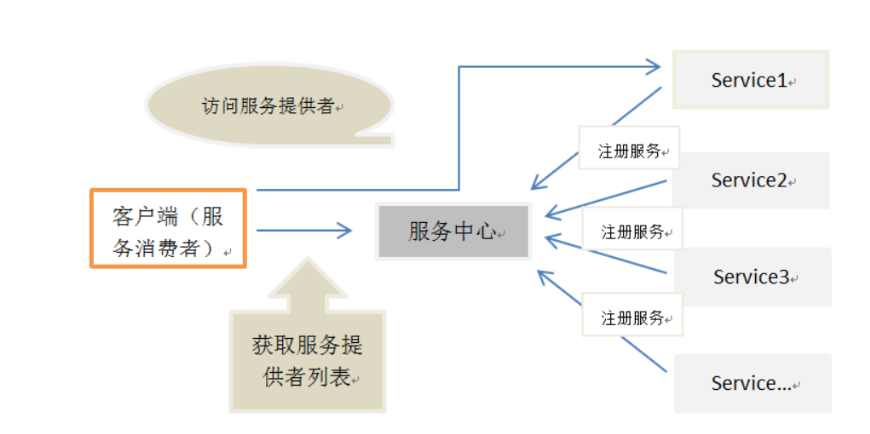

客户端负载均衡示意

Spring Cloud 2020.0 之后由 Spring Cloud LoadBalancer 承担同样的角色：`ReactiveLoadBalancer` 默认实现是 `RoundRobinLoadBalancer`（轮询），可切换为 `RandomLoadBalancer`（随机），还能叠加缓存、权重、同区域优先、健康检查等能力。

### 5.8 有哪些负载均衡算法

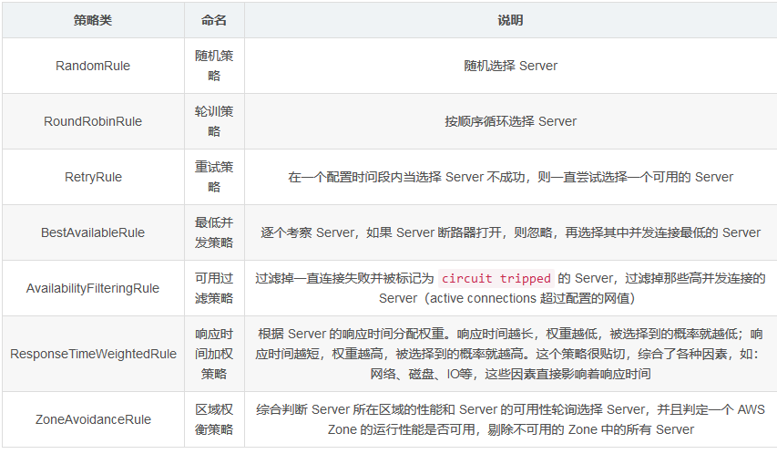

常见负载均衡算法示意

1. **轮询**：按顺序依次分配给每个后端服务器，循环往复。适用于处理能力和性能相同的服务器。
2. **加权轮询**：在轮询基础上引入权重，权重越高被选中概率越大，可按处理能力调整分配比例。
3. **随机**：将请求随机分配给后端服务器，各服务器被选中概率相等。简单快速，适用于性能相近的场景。
4. **加权随机**：在随机基础上引入权重，权重越高被选中概率越大。
5. **最少连接**：选择当前连接数最少的服务器，适用于处理能力或请求处理时间不同的场景。
6. **哈希**：按请求的某个属性（如客户端 IP、URL、用户 ID）计算哈希值选择服务器，同一属性总是落到同一实例，可用于会话保持。

常见的负载均衡器（Spring Cloud LoadBalancer、Gateway、Nginx 等）基本都支持其中的若干种。

### 5.9 Ribbon 和 Feign 的区别（速答）

两者都曾是 Netflix 开源的 Java 库，但职责不同：

- **Ribbon 是客户端负载均衡器**：在多个微服务实例间分发请求，提升可用性和性能，可与 RestTemplate 等 HTTP 客户端配合使用来发送请求并做负载均衡。
- **Feign 是声明式 HTTP 客户端**：通过编写接口和注解定义对远程微服务的调用，运行时生成实现类执行实际的 HTTP 请求。

区别在用途、编程模型和集成方式：Ribbon 更注重"选实例"，需配合 HTTP 客户端发送请求，并提供自定义负载均衡策略的能力；Feign 采用声明式编程模型，通常与负载均衡组件一起使用。需要更多控制时关注负载均衡组件，喜欢简洁声明式写法时选 Feign。

版本提醒：Ribbon 已进入维护模式并在 Spring Cloud 2020.0 之后被移除，新项目应使用 Spring Cloud LoadBalancer；Feign 由 Spring Cloud OpenFeign 继续维护。

## 六、服务容灾：熔断、降级与限流

微服务之间的依赖像一串串联的灯泡，坏一个就可能全灭。这一章讲三件保命的事：熔断（不再调用坏掉的服务）、降级（返回兜底结果）、限流（少放一些请求进来）。

### 6.1 什么是服务雪崩

微服务中，若一个或多个服务出现故障，而依赖方仍不断发起请求或重试，压力会不断在下游堆积，导致下游负载急剧增加，可能进一步加剧故障、引发级联失败甚至整个系统崩溃，这就是服务雪崩（Cascading Failure）。

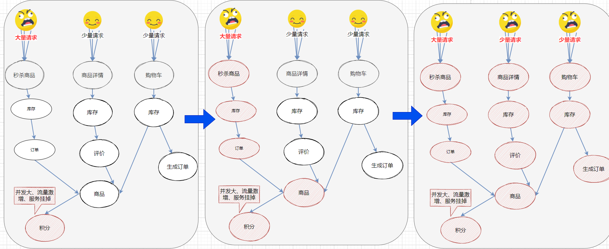

服务雪崩示意

一个比喻：高速上一辆车急刹，后车连环追尾。每一辆车本身都没坏，但请求在瓶颈处堆积，最终整条路瘫痪。

防止服务雪崩的常见措施：

1. **服务高可用部署**：冗余部署、故障转移，减少单点故障的影响。
2. **限流和熔断**：对服务间请求限流和熔断，防止过多请求涌入导致后端不可用。
3. **缓存和降级**：合理使用缓存减轻后端压力，必要时服务降级，保证核心功能可用。

### 6.2 什么是服务熔断，什么是服务降级

**服务熔断**是一种容错机制，用于保护系统免受服务故障或异常的影响：监控调用情况，当错误率或响应时间超过阈值时触发熔断，后续请求直接返回默认值或错误信息，避免资源浪费和系统崩溃。熔断通常支持自动恢复——经过一段"半开"试探期后，若调用恢复正常则关闭熔断器。

**服务降级**也是一种容错机制，用于在资源紧张或服务故障时保证核心功能可用：主动屏蔽非核心或可选功能，只提供最基本的能力，通过减少资源依赖保证可用性和性能。降级策略可以按业务制定，如替换耗时操作、返回默认响应、返回静态错误页等。

区别一句话：**熔断是"不再调用"，降级是"调用失败后给个兜底"**，两者经常配合使用，但触发条件和目的不同。

**常见的熔断降级方案：**

| 框架 | 实现方案 | 特点 |
| --- | --- | --- |
| Spring Cloud | Netflix Hystrix | 提供线程隔离、服务降级、请求缓存、请求合并等；与 Spring Cloud 集成良好；已停止开发（最终版 1.5.18），官方推荐用 Resilience4j 替代 |
| Spring Cloud | Resilience4j | 轻量级熔断库；功能与 Hystrix 类似；基于装饰器模型，API 更简洁，不强制线程池隔离；通过 Spring Cloud CircuitBreaker 与 Spring Cloud 集成 |
| Spring Cloud Alibaba | Sentinel | 阿里开源的流控与熔断降级组件；提供实时监控、流量控制、熔断降级、系统自适应保护等；与 Alibaba 生态紧密集成 |
| Dubbo | 自带熔断降级 | 框架自带，配置即可实现，与 RPC 框架紧密集成 |

### 6.3 Hystrix 怎么实现服务容错

Hystrix 虽已停更，但它仍是理解熔断机制的经典样本，提供六大机制：

1. **服务熔断**：监控错误率或响应时间，超过阈值则打开熔断器，后续请求不再发往实际服务，而返回预设值或错误信息，快速隔离故障、防止扩散。
2. **服务降级**：熔断打开时提供备用降级方法或默认值，如返回缓存数据、执行简化逻辑或调用其他可靠服务，保证有限但可用的功能。
3. **请求缓存**：缓存对同一请求的响应，下次请求相同数据时直接取缓存，避免重复网络请求。
4. **请求合并**：将多个并发请求合并为一个批量请求，减少网络开销和资源占用。
5. **实时监控和度量**：提供错误率、响应时间、并发量等指标的实时统计，便于及时发现故障（配套能力是 Hystrix Dashboard 与 Turbine）。
6. **线程池隔离**：每个依赖服务的请求都在独立线程池中执行，避免单个服务故障耗尽整个系统的线程资源。

下面的写法仅用于理解机制，新项目应改用 Resilience4j 或 Sentinel：

```java
import com.netflix.hystrix.contrib.javanica.annotation.HystrixCommand;

@Service
public class MyService {

    @HystrixCommand(fallbackMethod = "fallbackMethod")
    public String myServiceMethod() {
        // 实际的服务调用逻辑
        return remoteCall();
    }

    public String fallbackMethod() {
        // 服务调用失败、超时或被熔断时执行，返回默认值或备用逻辑
        return "default";
    }
}
```

### 6.4 Sentinel 是什么，它是如何工作的

Sentinel 是阿里开源的轻量级流量控制组件，以流量为切入点，从流量控制、熔断降级、系统负载保护等维度保护服务稳定性。

三个基本概念：

- **资源（Resource）**：Sentinel 的关键概念，可以是 Java 应用中的任何东西——应用提供的服务、调用的其他服务，甚至一段代码。
- **规则（Rule）**：围绕资源的实时状态设定，包括流量控制、熔断降级、系统保护规则，均可动态实时调整。
- **处理器/插槽链（Slot Chain）**：请求进入后依次经过统计、限流、熔断等处理环节，最终决定放行还是拒绝。

主要功能：

1. **流量控制**：控制每个服务或接口的并发请求数量或 QPS，避免并发过多导致崩溃。
2. **熔断降级**：某服务或接口不稳定时自动触发熔断，避免单点故障拖垮整个系统。
3. **系统负载保护**：从系统整体维度（如 CPU、负载、入口 QPS）控制流量，避免过载。

工作原理分三步：

1. **数据采集**：在调用链路上采集流量数据（通过统计插槽实时记录 QPS、线程数、响应时间、异常数等）。
2. **策略计算**：根据预设规则和算法，判断是否需要限流、熔断降级或系统保护。
3. **结果执行**：根据计算结果放行、抛出 `BlockException` 或执行降级逻辑。

### 6.5 Sentinel 的限流实现与超限处理

**底层限流机制：**

- **核心思想**：主要采用**滑动时间窗口结合计数器**统计流量并判断限流，部分策略融合了令牌桶、漏桶思想，目标是单位时间内只放行限定请求数。
- **时间窗口划分**：把统计时间（如 1 秒）切成多个格子（如每格 100 毫秒），每格记录该格子的请求数。
- **窗口滑动**：请求进来时按时间戳判断属于哪个格子并刷新计数，多个格子累加得出单位时间的总请求数。
- **核心数据结构**：底层用 `LeapArray`（循环数组）管理时间窗口，保证高并发下的效率与准确度。
- **阈值判断**：新请求进来时计算当前窗口的累计请求数，超过阈值则进入限流逻辑。

需要说明的是，Sentinel 的线程数限流并不创建线程池，它只是统计当前请求上下文的并发线程数，超过阈值就拒绝新请求——这与 Hystrix 的线程池隔离是两套思路。

**超过限流数的请求怎么处理？** 由流控规则 `FlowRule` 的 `controlBehavior` 字段决定。Sentinel 官方文档给出了明确取值：

| controlBehavior | 常量 | 处理方式 |
| --- | --- | --- |
| 0（默认） | `CONTROL_BEHAVIOR_DEFAULT` | 直接拒绝：超过阈值的请求立即被拒绝，抛出 `FlowException`（`BlockException` 的子类） |
| 1 | `CONTROL_BEHAVIOR_WARM_UP` | 冷启动/预热：流量缓慢上升，逐渐逼近阈值，给冷系统预热时间 |
| 2 | `CONTROL_BEHAVIOR_RATE_LIMITER` | 匀速排队：让请求以均匀间隔通过（漏桶思路），超时未处理的请求被丢弃 |
| 3（1.8 起） | `CONTROL_BEHAVIOR_WARM_UP_RATE_LIMITER` | 预热 + 匀速排队的组合 |

早期资料里常把 1 和 2 写反，实际应以官方文档为准。

**配置示例：**

```java
private static void initFlowQpsRule() {
    List<FlowRule> rules = new ArrayList<>();
    FlowRule rule = new FlowRule();
    rule.setResource("getUserById");                  // 资源名称
    rule.setCount(20);                                // 最大 QPS 为 20
    rule.setGrade(RuleConstant.FLOW_GRADE_QPS);       // 限流维度：0 = 并发线程数，1 = QPS
    rule.setLimitApp("default");                      // 限制的调用方，default 表示不区分
    rule.setControlBehavior(RuleConstant.CONTROL_BEHAVIOR_DEFAULT); // 直接拒绝
    rules.add(rule);
    FlowRuleManager.loadRules(rules);                 // 使规则生效
}
```

**监控流量：**

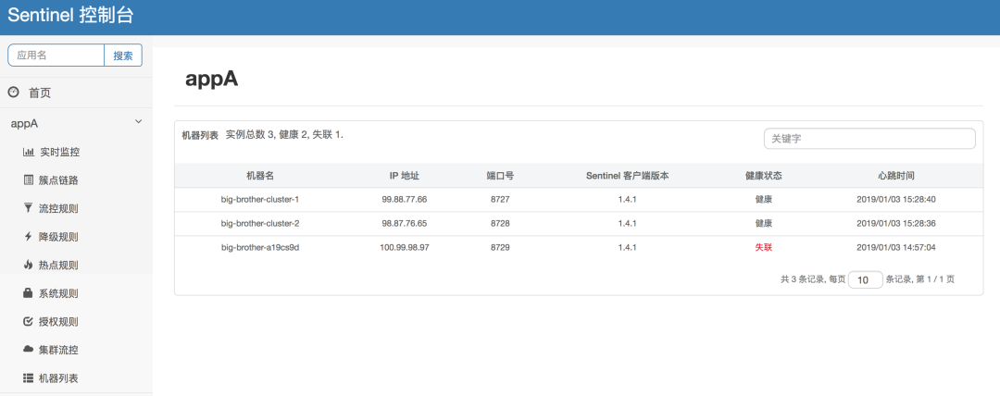

Sentinel 控制台

请求到达时按规则判断是否需要限流，超过阈值则限制、拒绝或做降级处理；控制台可实时查看每个资源的 QPS、线程数、响应时间与被拒绝数。

**集群限流：**

单机限流只能保证"每台机器不超过阈值"，总量会随实例数放大。Sentinel 的集群限流利用 Token Server 与 Token Client 机制：开启集群限流后，Client 向 Token Server 申请令牌，Token Server 按全局规则决定是否放行。

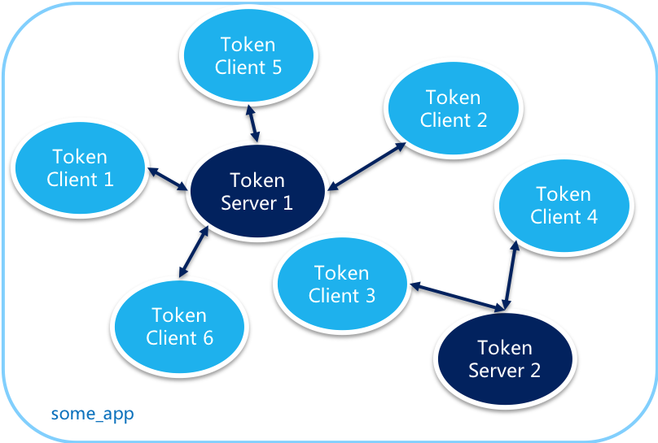

Token Server 和 Client

### 6.6 Sentinel 与 Hystrix 的区别

Hystrix 是微服务熔断领域的先行者，但已停止开发；Sentinel 是阿里系的主力组件。差异可以归纳为四点：

1. **核心差异在隔离策略**：
   - **Hystrix**：强依赖**线程池隔离**，为每个依赖服务建独立线程池。优点是隔离彻底、天然支持异步与超时中断；缺点是线程上下文切换开销大，线程数一多反而拖累吞吐。
   - **Sentinel**：默认不另起线程池，直接在调用线程内统计与判断（并发线程数限流只是计数），因此开销小；代价是不能像线程池那样强行中断阻塞中的调用，异步场景需要额外适配。
2. **流量整形的丰富度**：Hystrix 的流控能力较弱，主要基于阈值；Sentinel 支持 QPS、并发线程数、冷启动预热、匀速排队，甚至**热点参数限流**（例如只对某个商品 ID 的请求限流）。
3. **熔断降级的灵活度**：Hystrix 主要看异常比率与响应时间；Sentinel 还支持慢调用比例、异常数等维度，恢复策略更细。
4. **系统自适应保护**：Sentinel 提供 System Adaptive Protection，可根据系统负载、CPU 使用率、入口 QPS 等指标整体限流，Hystrix 不具备这类能力。

用一个场景说明隔离的差别：Hystrix 像去银行办业务要先取号、再去固定柜台办理，柜台满了只能等，柜员换班（线程切换）本身也要花时间；Sentinel 更像门口保安手拿计数器，人满就拦住，没满就放行，全程只有一次原子加一减一。

```java
// 并发数控制的示意（非 Sentinel 源码）
if (count.incrementAndGet() > limit) {
    throw new FlowException();   // 超过阈值，直接拒绝
}
try {
    doBusiness();                // 在当前线程执行，没有线程切换
} finally {
    count.decrementAndGet();
}
```

**选型结论**：新项目优先 Sentinel（尤其已用 Spring Cloud Alibaba/Nacos 时，规则可动态下发、无需重启）或 Resilience4j（纯 Spring Cloud 体系、希望轻量嵌入时）。Hystrix 适合读懂原理和维护老系统，不适合新起项目。

**热点参数限流的价值**：Hystrix 无法区分参数。例如"秒杀商品 A"和"冷门商品 B"共用接口 `/buy/{id}`，Hystrix 一旦整体 QPS 超标会把 A、B 一起熔断，导致 B 也无辜受影响；Sentinel 可配置热点参数规则，只对 `id=A` 的请求限流，`id=B` 依然畅通。

### 6.7 Sentinel 的异常处理规则不满足需求怎么办

可以自定义异常处理：实现 Spring MVC 场景下的 `BlockExceptionHandler` 接口（不同版本/适配模块中类名略有差异，以所用版本为准），把自定义处理器交给 Spring 容器管理，即可接管被限流、被熔断时的响应。

```java
@Component
public class CustomBlockExceptionHandler implements BlockExceptionHandler {

    @Override
    public void handle(HttpServletRequest request, HttpServletResponse response,
                       BlockException ex) throws Exception {
        // 统一返回 JSON，而不是默认的纯文本提示
        response.setStatus(429);
        response.setContentType("application/json;charset=UTF-8");
        response.getWriter().write("{\"code\":429,\"msg\":\"请求过于频繁，请稍后重试\"}");
    }
}
```

可在此基础上按业务定制：全局兜底、日志打印、空指针检查，或对异常分类统计与上报，从而扩展 Sentinel 的异常处理能力。

### 6.8 常见限流算法与网关限流

限流算法用于限制单位时间内服务的请求数量，防止服务被过高的请求压力击垮。常见算法有四种：

| 算法 | 思路 | 特点 |
| --- | --- | --- |
| 计数器 | 固定时间窗口内计数，超过阈值拒绝 | 实现最简单；窗口边界可能出现"双倍流量" |
| 滑动窗口 | 把窗口切成多个小格，滚动累加 | 比固定窗口平滑，Sentinel 采用此思路 |
| 漏桶 | 请求先入桶，以固定速率流出 | 输出绝对平滑，适合保护下游；突发流量会被排队或丢弃 |
| 令牌桶 | 按固定速率往桶里放令牌，请求取到令牌才放行 | 允许一定突发，最常用 |

网关实现限流的方式通常有三种：

1. **使用网关自带的限流过滤器/插件**：例如 Spring Cloud Gateway 的 `RequestRateLimiter` 过滤器，配合 Redis 做分布式令牌桶；Nginx/Kong/APISIX 也有各自的限流插件，配置桶容量与速率即可。
2. **自定义限流逻辑**：以编程方式在网关层实现（如自定义 `GlobalFilter`），或引入限流 SDK（如 Sentinel 的网关适配）。
3. **使用云平台提供的限流能力**：如 AWS CloudWatch、Azure Application Insights，或各云厂商 API 网关自带的限流功能。

## 七、API 网关

网关是微服务对外的唯一入口，几乎所有横切关注点（鉴权、限流、日志、协议转换）都可以在这里集中处理。这一章讲它到底承担什么职责、Spring Cloud Gateway 的内部结构，以及"网关和 Nginx 怎么选"。

### 7.1 什么是 API 网关

API 网关是介于客户端与后端服务之间的中间层服务器，用于集中管理、保护和路由对后端服务的访问，提供统一接口来管理和控制 API 访问。

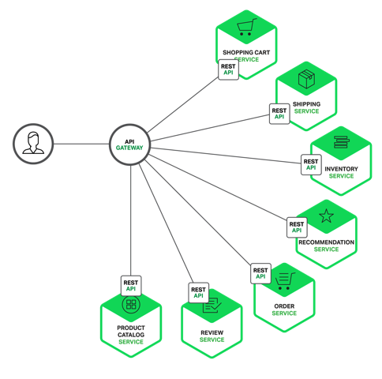

网关示意图

主要功能：

1. **路由转发**：按 URL 路径或其他标识将请求路由到相应的后端服务。
2. **负载均衡**：在后端服务实例间分发请求，提高吞吐量和可扩展性。
3. **安全认证与授权**：集中处理身份验证和授权，可与 OAuth 2.0、OpenID Connect 等集成。
4. **缓存**：缓存后端响应，减少请求次数。
5. **监控与日志**：收集请求指标和日志，提供实时监控分析，便于排障和优化。
6. **数据与协议转换**：在客户端与后端之间转换数据格式和协议（如 HTTP 转 WebSocket、REST 转 gRPC）。
7. **API 版本管理**：管理多个 API 版本并按路由规则转发到对应版本。

网关简化了前后端交互，提供统一接口和安全保障，也便于服务治理与监控。

### 7.2 Spring Cloud 可以选哪些 API 网关

1. **Netflix Zuul 1（已进入维护模式）**：早期默认网关，基于 Servlet 技术栈（阻塞式 IO），支持路由、过滤、负载均衡。Spring Cloud 2020.0 起不再提供 Zuul 模块。
2. **Spring Cloud Gateway**：官方推荐，取代 Zuul。基于非阻塞的 WebFlux/Reactor，提供路由、过滤、断路器、限流等特性，并可与服务发现、负载均衡等组件集成。
3. **Kong**：独立的云原生 API 网关与服务管理平台，基于 Nginx/OpenResty，提供路由、认证、授权、监控和插件扩展能力。
4. **APISIX**：基于 Nginx 和 Lua 的云原生网关，具备路由、流量控制、插件扩展等能力，支持动态路由、负载均衡和限流。

### 7.3 Spring Cloud Gateway 的核心概念与过滤器链

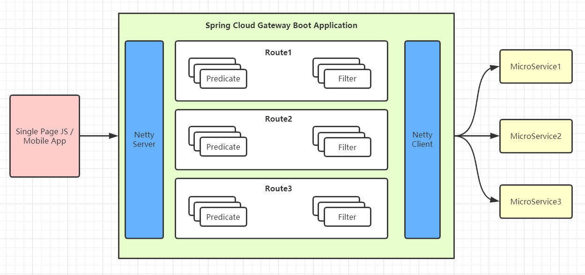

Gateway 原理示意

三个关键组件：

- **Route（路由）**：基本构建块，定义请求的匹配规则和转发目标，可按路径、方法、请求头等匹配并指定目标 URI。
- **Predicate（断言）**：用于匹配请求条件，满足则应用所配置的过滤器。内置 Path、Method、Header 等，也支持自定义。
- **Filter（过滤器）**：对请求进行处理和转换，可修改请求、响应或执行自定义逻辑。内置请求头改写、重试、限流、熔断等，也支持自定义。

```yaml
spring:
  cloud:
    gateway:
      routes:
        - id: order-service
          uri: lb://order-service        # lb:// 表示走注册中心 + 负载均衡
          predicates:
            - Path=/order/**
          filters:
            - StripPrefix=1
            - AddRequestHeader=X-Gateway, scg
```

另有两个重要概念：

- **Gateway Handler（网关处理器）**：核心组件，根据路由配置和断言条件进行路由匹配，选出合适的路由转发，并依次应用过滤器链。
- **Gateway Filter Chain（网关过滤器链）**：一系列过滤器按配置顺序依次执行，可在请求前、请求后或出错时处理。

官方文档对执行顺序的描述是：请求先到 Gateway Handler Mapping，命中路由后交给 Gateway Web Handler；Handler 让请求经过一条"该请求专属"的过滤器链。过滤器被分成虚线两侧——**所有 pre 逻辑先执行，然后发起代理请求，代理请求返回后再执行 post 逻辑**。这也是为什么同一个过滤器既能改请求、又能改响应。

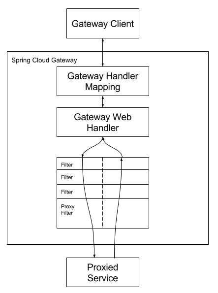

Spring Cloud Gateway 工作流程（来源：Spring Cloud Gateway 官方文档）

### 7.4 网关在微服务中的四个职责

网关的本质是微服务架构中的**统一门面（Facade Pattern）**，可以概括为"一个入口，四个核心职责"：

1. **一个入口（Unified Entry）**：是所有客户端（App、Web、小程序）与后端微服务之间的唯一入口。客户端无需知道后端几十上百个服务的 IP 和端口，只需访问网关，实现客户端与服务端的解耦。
2. **四个核心职责**：
   - **统一鉴权**："保安"角色。鉴权逻辑上移到网关，校验通过后把用户信息（如 User ID）写入 Header 传给下游，避免在每个微服务里重复校验。
   - **动态路由**："调度员"角色。按请求路径（`/order/**`、`/user/**`）转发给 Nacos/Eureka 中注册的对应实例。
   - **限流熔断**："大坝"角色。流量洪峰时用 Sentinel 或 Redis 令牌桶在入口拦住多余请求，保护后端不被压垮。
   - **协议转换**："翻译官"角色。对外暴露 RESTful（HTTP/JSON），对内可能是性能更好的 RPC（Dubbo/gRPC），由网关完成转换。

**统一鉴权的演进**：

- 没有网关时：每个 Service 都校验 Token，一旦鉴权逻辑变化（如 JWT 换成 OAuth 2.0），要改几十个服务的代码。
- 有网关时：`Client -> Gateway（校验 Token、解析 UserId、写入 X-User-Id Header）-> Service A`。Service A 不需要理解 JWT，只需从 Header 取 `X-User-Id`，这就是关注点分离。

**BFF 模式（Backend for Frontend）**：

手机屏幕小，只需要 3 个字段；PC 页面大，需要 10 个字段。共用一个接口时，手机端会浪费流量（Over-fetching）。可以针对不同客户端建立不同的网关或路由聚合逻辑，把多个服务的数据**聚合**后裁剪成手机端需要的格式返回，这就是"为前端服务的后端"。


BFF 与网关聚合、网关卸载、网关路由同属常见的微服务设计模式。

### 7.5 网关的代价与选型

**架构上的权衡**，网关并非只有好处：

- **性能瓶颈风险**：所有流量都走网关，它就是全链路的**咽喉**，网关挂则全站不可用（SPOF，单点故障）。解决办法是**高可用部署**，常见形态是 `VIP(Keepalived) -> Nginx 集群(L4/L7) -> Gateway 集群(业务网关)`。
- **网络延迟**：多了一次网络跳转（Hop），内网环境下通常是毫秒级，一般可以接受。

**Nginx 与 Spring Cloud Gateway 怎么选：**

- **Nginx/OpenResty（Kong、APISIX）**：C/Lua 实现，基于 epoll 的事件驱动模型，擅长做**流量网关**（最外层，只做转发、TLS 终止和简单鉴权），单机吞吐量高。
- **Spring Cloud Gateway**：Java 实现，基于 Netty + WebFlux（Reactor），优势在生态——与 Spring Cloud、Sentinel、Nacos 无缝集成，适合做**业务网关**（复杂鉴权、聚合、灰度），易于二次开发。
- **Zuul 1.x**：基于阻塞 IO（Servlet），已被 Gateway 取代，新项目不建议再选。

一句话总结：**对外抗流量用 Nginx/Kong，对内做业务用 Spring Cloud Gateway**，两者分工而非互相替代。

## 八、链路追踪与可观测性

一个请求穿过十几个服务，出问题时靠翻日志很难定位。这一章讲三件配套能力：链路追踪（请求走到哪、慢在哪）、指标监控（系统水位如何）、日志聚合（现场证据在哪）。

### 8.1 为什么要用微服务链路追踪

微服务中一个业务请求的上下游可能有十几个服务，某一环出问题，排查非常困难，因此需要链路追踪（Distributed Tracing）来还原调用路径。

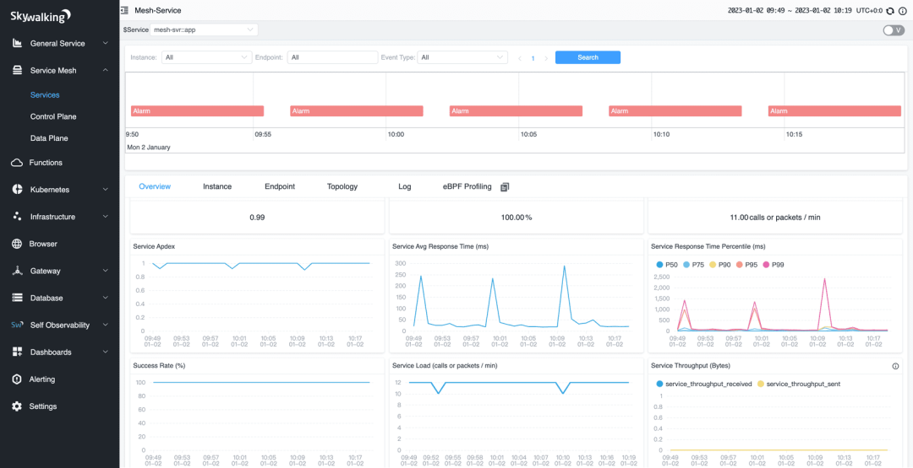

SkyWalking 界面

先解释两个术语：

- **Trace（链路）**：一次完整请求的调用树，用一个全局唯一的 Trace ID 串起来。
- **Span（跨度）**：链路中的一次调用（一次 RPC、一次数据库查询都算一个 Span），记录起止时间、耗时、状态。

一个比喻：Trace 像快递单号，Span 像这张单子上的每一个中转站记录——哪个站停留时间长，一眼就能看出来。

链路追踪除了排查问题，还能帮助优化性能、可视化服务依赖关系、做服务监控和告警。

### 8.2 Spring Cloud 可以选哪些链路追踪方案

1. **Zipkin**：Twitter 开源的分布式实时追踪系统，可接收各服务上报的 Span 并通过 UI 可视化查询。

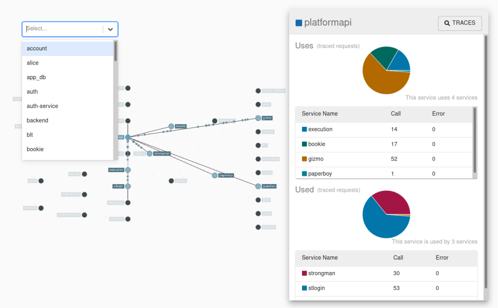

Zipkin 界面

2. **Jaeger**：Uber 开源的分布式追踪系统，已纳入 CNCF，可通过 OpenTelemetry 等客户端上报数据并可视化查询。
3. **SkyWalking**：Apache 开源的应用性能监控与分析系统，支持 Java、.NET、Node.js 等，通过 Agent 采集数据并在 UI 中分析。

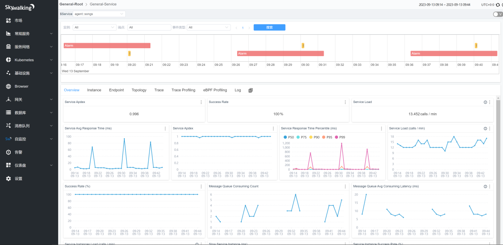

SkyWalking 示例界面

4. **Pinpoint**：Naver 开源的分布式应用性能监控系统，支持 Java 和 .NET，通过 Agent 采集数据并在服务端分析展示。

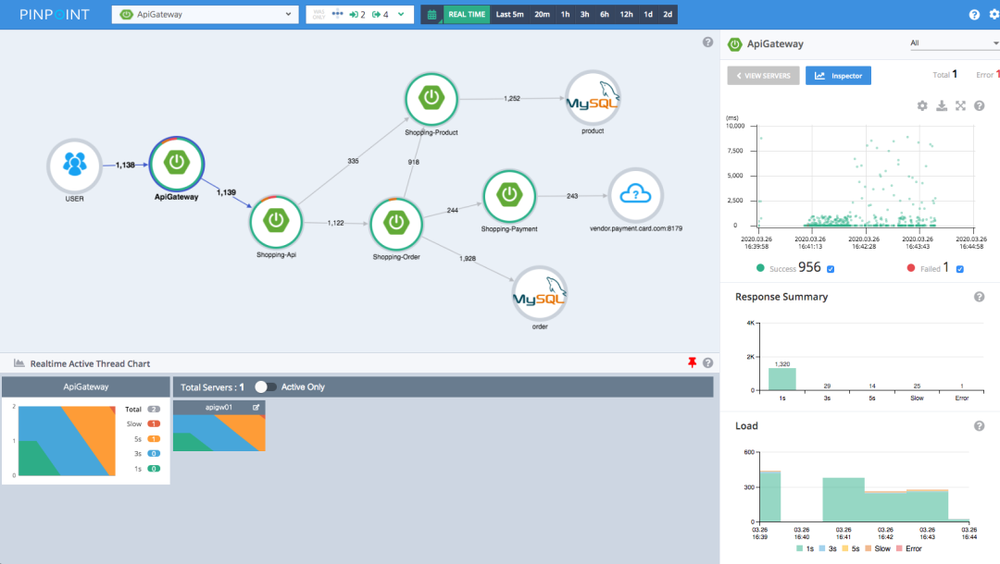

Pinpoint 示意图

**关于 Spring Cloud Sleuth 的版本说明**：过去这些方案常通过 Spring Cloud Sleuth 生成追踪信息。Sleuth 已停止演进（最后随 Spring Cloud 2021.0 发布），Spring Boot 3.x 世代应使用 **Micrometer Tracing**（可对接 Zipkin、OpenTelemetry 等后端），或直接使用 SkyWalking、Pinpoint 这类基于 Agent 的方案（无需改代码，通过 `-javaagent` 挂载）。

### 8.3 SkyWalking 是什么，数据是怎么收集和传输的

SkyWalking 是面向分布式系统的应用性能监控（APM）与可观测性分析平台，可收集、分析、聚合和可视化分布式系统数据，包括服务拓扑、性能指标、Trace 和日志，甚至能观测横跨不同云环境的系统。

它的数据流转分三段：

1. **数据采集**：探针（Agent，通常以 `-javaagent` 方式挂载）与应用程序集成，获取请求响应时间、调用链路、系统资源使用情况等运行时数据，发送到后端收集器（OAP/backend）。
2. **数据传输与处理**：收集器接收后做必要处理（清洗、过滤、聚合等），并把结果写入存储组件（配置文件中通常称为 database，可选 Elasticsearch、H2、BanyanDB 等）。
3. **数据消费**：存储的数据既可以本地保留，也可以提供给其他系统消费，例如发给 UI 做可视化，或触发告警规则通知相关人员。

传输过程通常使用 gRPC 等高效协议（Agent 与 OAP 之间），具体采集项、采样率、存储选型都可在配置中调整。

### 8.4 用 SkyWalking 定位性能瓶颈

在微服务架构中，只靠"翻日志"或"盯 CPU 监控"很难定位问题。可以按"宏观 → 微观 → 代码"三步走，SkyWalking 对应提供三个维度：

1. **宏观维度——拓扑图（Topology）**：解决"谁调谁慢"。自动发现服务间依赖关系，节点或连线变红（响应时间过长）的地方往往就是瓶颈源头；除了服务，还能看到 Database、Redis、MQ 等中间件的耗时。
2. **微观维度——链路追踪（Tracing）**：解决"慢在哪里"。通过 Trace ID 串联全链路，用甘特图找出耗时最长的 Span，并区分是**网络传输耗时**还是**自身代码逻辑耗时**（Self Duration）。
3. **代码维度——性能剖析（Profiling）**：解决"哪行代码慢"。当 Trace 只能定位到某个 API 慢、却不知道慢在 SQL 还是计算时，Profile 通过线程采样生成火焰图，可精确到方法甚至代码行，且无需改代码或重启服务。

**实战一：拓扑图定位**

用户反馈"下单慢"时，先看拓扑图而不是翻代码：

- 现象：拓扑图中"订单服务"指向"库存服务"的连线变红，平均耗时 3000 毫秒。
- 结论：瓶颈不在订单服务本身，而在库存服务或两者之间的网络。
- 细节：SkyWalking 还能识别虚拟节点（如外部第三方支付接口），若该节点变红，说明是第三方拖累。

**实战二：Trace 甘特图找"长条"**

确定嫌疑服务后点进 Trace 列表：

- 操作：按 Duration 倒序，找最慢的那条。
- 分析：若一个 Span 特别长且类型是数据库操作，多半是慢 SQL；若一个 Span 很长却没有子 Span，说明耗时消耗在当前服务的业务逻辑里（如复杂循环、序列化）。

**进阶：Profile 火焰图**

如果某方法耗时 2 秒，既没查库也没调 RPC，纯粹是代码逻辑，怎么知道卡在哪一行？这需要 Profile，其原理是**基于线程快照采样**：

1. 动态下发任务：在控制台对该端点下发 Profile 任务，例如采样 10 分钟。
2. 低开销采样：Agent 定期（如每 10 毫秒）dump 一次目标线程的堆栈。
3. 生成火焰图：采样结束后聚合堆栈生成火焰图，最宽的平顶代表占用 CPU 时间最多的调用路径，可以直接看出是哪个方法占了大部分时间。

过去定位这类问题要去服务器上反复 `jstack`，现在可以在控制台上按需触发、事后分析。

### 8.5 服务监控与告警：Prometheus + Grafana

链路追踪看单次请求，指标监控看整体水位，两者互补。常见组合是 Prometheus + Grafana：

1. **Prometheus**：开源的监控与告警系统，数据模型灵活、查询语言强大（PromQL），能收集和存储时间序列数据，通过 HTTP 主动拉取（scrape）各服务暴露的指标端点。
2. **Grafana**：开源的可视化仪表板工具，与 Prometheus 结合可创建实时和历史数据看板，提供丰富图表，便于分析微服务性能与状态。

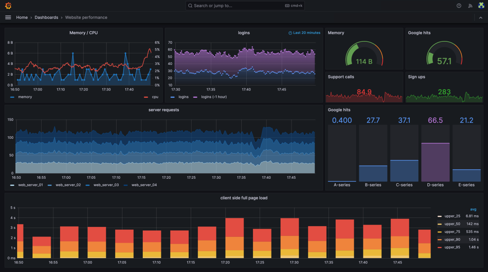

Dashboard 示例

在 Spring Boot 项目中，通常引入 Actuator 与 Micrometer，暴露 `/actuator/prometheus` 端点，再由 Prometheus 拉取、Grafana 展示，并基于指标配置告警规则。

### 8.6 日志收集：ELK

日志是排障的"现场证据"。常见方案是 ELK：

- **Elasticsearch**：分布式搜索与分析引擎，负责存储和索引日志数据，提供快速搜索和聚合能力。
- **Logstash**：负责收集、过滤和转发日志数据，支持多种来源，处理后发送到 Elasticsearch。
- **Kibana**：日志可视化分析工具，提供图表、仪表盘和搜索功能，用于实时监控与分析。

简言之：Elasticsearch 负责存储和检索，Logstash 负责把日志收进来，Kibana 负责可视化分析。典型流程是：

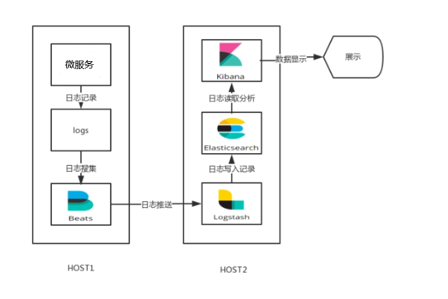

ELK 流程

1. 在每个微服务中把日志输出到标准输出或日志文件。
2. 用采集器（Logstash 或更轻量的 Filebeat）监听日志输出并做过滤处理。
3. 通过输出插件将处理后的日志发送到 Elasticsearch 存储和索引。
4. 用 Kibana 连接 Elasticsearch，创建仪表盘、图表和查询，实时监控分析。

除 ELK 外，还有 Fluentd、Graylog、Loki、Filebeat 等开源选择，以及阿里云 SLS 等云厂商的日志服务。

## 九、分布式事务

数据被拆到多个服务/多个库之后，"要么都成功、要么都回滚"就变成了一个需要专门解决的问题。这一章先讲什么时候真的需要分布式事务，再讲 Seata 的四种模式与 AT 模式的实现细节。

### 9.1 什么情况下需要用到分布式事务

分布式事务用于在多个网络节点或服务之间保证数据一致性。常见场景：

1. **微服务之间通过远程调用完成事务操作**：如电商的订单服务和库存服务需通过远程调用保证库存与订单同步更新，避免超卖或缺货。
2. **单体系统访问多个数据库实例**：如用户信息和订单信息分别存在两个数据库实例，需要分布式事务保证一致性。
3. **多服务访问同一个数据库实例**：如订单和库存微服务访问同一个数据库，跨 JVM 进程的多个服务同时持有不同连接操作数据，也可能出现不一致。

常用方案包括 2PC（两阶段提交）、3PC、TCC、Saga、本地消息表等。其中 2PC、3PC 基于资源锁，TCC、Saga、本地消息表基于业务补偿；选择取决于业务需求、系统复杂性和性能要求。

### 9.2 Seata 是什么，支持哪些模式

Seata 是阿里开源的高性能分布式事务解决方案，目标是在微服务架构下提供简单易用的事务服务，提供 **AT、TCC、Saga、XA** 四种模式，其中 AT 模式最常用。

1. **AT 模式（Automatic Transaction）**：默认支持、最常用的模式。通过在业务代码中嵌入事务上下文实现分布式事务管理，代理数据源拦截并解析 SQL，自动生成回滚日志，业务代码几乎零侵入。


AT 模式示意图

2. **TCC 模式（Try-Confirm-Cancel）**：基于补偿机制。业务逻辑需实现 Try（预留资源）、Confirm（确认）、Cancel（取消）三个阶段，Seata 通过调用这三个方法并记录事务日志实现一致性。

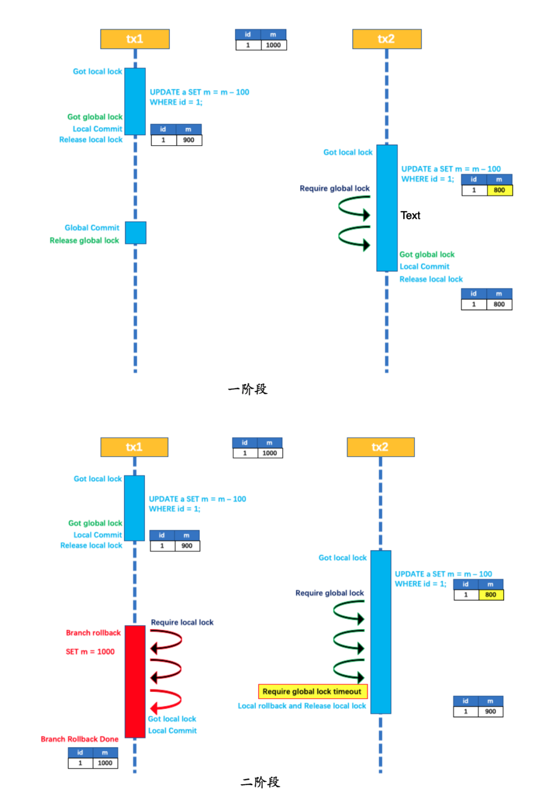

Seata TCC 模式

3. **SAGA 模式**：基于事件驱动与状态机。每个参与者提供正向操作与补偿操作，由状态机引擎按顺序驱动，失败时反向执行已完成的补偿。

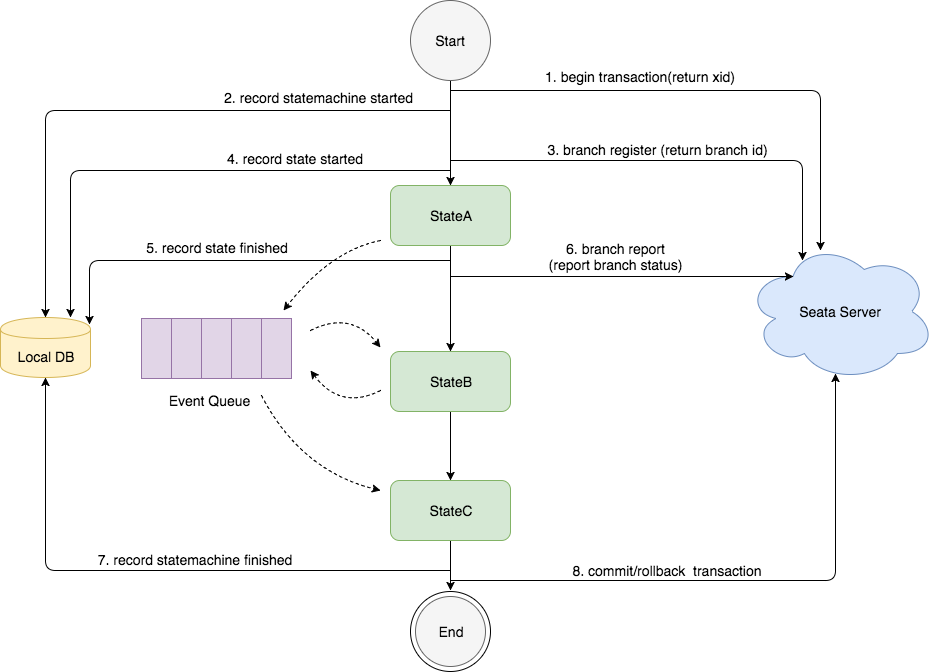

SAGA 模式状态机引擎

4. **XA 模式**：基于数据库的 XA 协议（两阶段提交）。需要数据库支持 XA 事务，并在应用中配置 XA 数据源，隔离性强但资源锁定时间长、性能开销大。

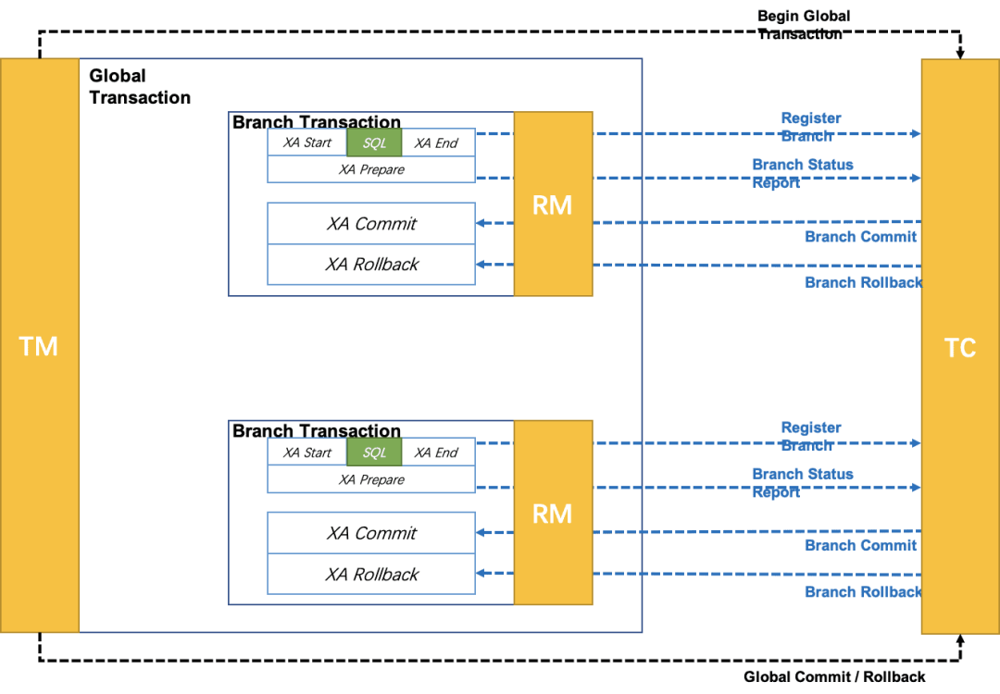

XA 模式示意图

### 9.3 核心组件与两阶段提交

Seata 的实现依赖三个核心组件（官方术语是 TC、TM、RM，早期资料里的 GTM/BTM 说法并不规范，建议统一用 TC/TM/RM）：

- **事务协调器（TC，Transaction Coordinator）**：独立部署的 Seata Server，维护全局事务与分支事务的状态，驱动全局提交或回滚，并管理全局锁。
- **事务管理器（TM，Transaction Manager）**：定义全局事务的边界（`@GlobalTransactional` 标注的方法），负责发起全局事务的开始、提交或回滚。
- **资源管理器（RM，Resource Manager）**：管理分支事务的资源（如数据库连接），负责执行本地事务、注册分支事务、上报状态、生成与使用回滚日志。

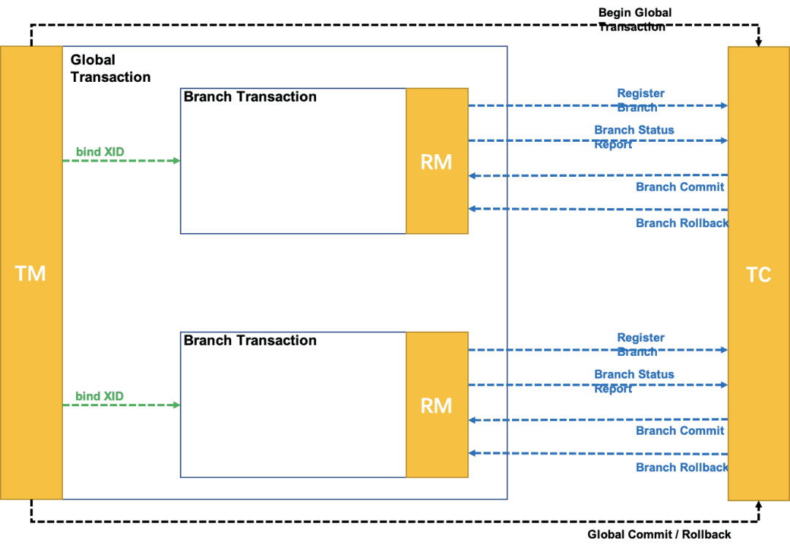

Seata 领域模型

其原理基于**两阶段提交协议**的改良：

1. **一阶段（预提交）**：TM 向 TC 申请开启全局事务并拿到 XID；各 RM 执行本地事务，同时把业务数据与回滚日志放在同一个本地事务中提交，随后释放本地锁与连接资源——这是 AT 模式相对 XA 的关键优化。
2. **二阶段**：
   - **提交**：TC 收到所有分支成功的结果后，异步通知各 RM 删除回滚日志（很快）。
   - **回滚**：若有分支失败，TC 通知各 RM 依据一阶段记录的回滚日志做反向补偿，把数据还原。

### 9.4 Seata 的完整执行流程

以 AT 模式为例，一次全局事务的流程是：

1. 事务发起方（TM）发起全局事务，向 TC 发送开始请求，TC 生成全局事务 ID（XID）。
2. TC 创建全局事务记录，并为每个分支生成分支事务 ID。
3. 发起方把 XID 随调用链传给各参与者，参与者向 TC 注册分支事务，并反馈执行结果。
4. 各参与者在事务上下文中执行各自的本地事务（业务 SQL + 回滚日志同事务提交）。
5. 发起方（TM）向 TC 发起全局提交或回滚决议。
6. TC 根据各分支的反馈判断：全部成功则通知各 RM 异步提交（删除回滚日志）；任一失败则通知各 RM 回滚。
7. TC 更新全局事务状态，并通知发起方最终结果。

回滚能够成立，靠的是回滚日志：每个参与者执行本地事务时记录数据修改前后的镜像，需要回滚时依据日志把数据恢复到事务开始前的状态。

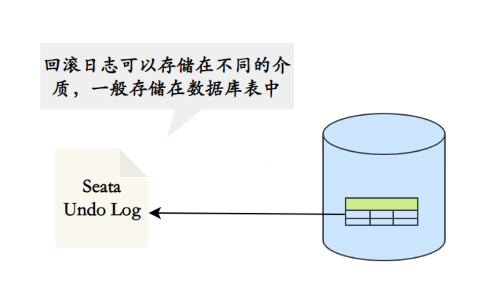

事务日志记录

### 9.5 AT 模式：一个优化、两个阶段、两处隔离

理解 AT 模式可以抓三个关键词：

1. **一个优化（核心竞争力）**：相比传统 XA（2PC），AT 模式最大的改进是**一阶段直接提交本地事务**，不长时间占用数据库连接与行锁，从而提升高并发下的性能。
2. **两个阶段（工作机制）**：
   - 一阶段：执行业务 SQL，同时记录 **Undo Log（回滚日志）**（含前镜像和后镜像），然后提交本地事务。
   - 二阶段：顺利提交则异步删除 Undo Log（效率高）；需要回滚则根据 Undo Log 的"前镜像"生成反向 SQL 还原数据。
3. **两处隔离（最大的坑）**：一阶段释放了本地锁，会带来**脏写（Dirty Write）**问题，Seata 因此引入 **TC 侧的全局锁（Global Lock）** 保证隔离性：
   - **写隔离**：提交本地事务前必须先拿到全局锁，拿不到就重试或失败。
   - **读隔离**：默认是读未提交（可能脏读）；若需要读已提交，需在查询时通过 `@GlobalLock` 或 `SELECT ... FOR UPDATE` 触发全局锁检查。

**Undo Log 是怎么生成的？** 以 `update account set money = money - 10 where id = 1`（原 money = 100）为例，Seata 代理数据源的处理流程是：

1. 解析 SQL：识别为 Update 操作，解析出表名、主键与更新列。
2. 查询前镜像：`select * from account where id = 1`，记录 money = 100。
3. 执行业务 SQL：money 变为 90。
4. 查询后镜像：再查一次，记录 money = 90。
5. 构建 Undo Log：把前后镜像等信息封装成 JSON 写入 `undo_log` 表。

```json
{
  "beforeImage": { "id": 1, "money": 100 },
  "afterImage": { "id": 1, "money": 90 }
}
```

6. 提交：业务数据与 Undo Log 在同一个本地事务中提交。

**脏写是怎么发生的？** 假设没有全局锁：

- 事务 T1 把 money 从 100 改成 90，并**已本地提交**。
- 事务 T2 紧接着把 money 从 90 改成 80，也**已本地提交**。
- 此时 T1 因故回滚，拿着前镜像（100）还原，直接把 money 改回 100——**T2 的更新（80）被覆盖丢失**，这就是脏写。

Seata 的解法是在本地提交前先申请全局锁：

```java
// 示意逻辑：Seata 代理数据源在本地提交前会做全局锁校验
while (true) {
    boolean locked = tc.acquireGlobalLock(xid, "account", 1L); // 申请 id=1 这一行的全局锁
    if (locked) {
        doLocalCommit();        // 拿到锁才提交本地事务
        break;
    }
    throw new LockConflictException(); // 拿不到锁则回滚或按策略重试
}
```

**一个容易忽略的生产隐患**：AT 模式强依赖全局锁。如果某个定时任务或老接口没有走 Seata 的代理数据源（AT 模式下的 `DataSourceProxy`）、也没有加 `@GlobalTransactional`，它更新数据时**完全不会检查全局锁**。一旦有正经的 Seata 事务需要回滚，Seata 会校验当前值与后镜像是否一致，发现不一致就说明已被脏写，只能抛异常并人工修数据。规避办法是：涉及全局事务的表禁止"裸写"，或给这类写操作加 `@GlobalLock` 强制检查。

### 9.6 全局事务 ID 怎么传递、回滚怎么实现

- **XID 的传递**：通过事务上下文传递，常见方式包括方法参数传递、线程上下文（ThreadLocal，配合 RPC 框架的隐式传参）、消息中间件传递（把 XID 放进消息头），按业务场景与技术选型选择。
- **回滚的实现**：依靠回滚日志。每个参与者执行本地事务时记录数据修改，需要回滚时 TC 通知参与者依据日志撤销操作，把数据恢复到事务开始前的状态。回滚日志的存储介质可配置，通过持久化与恢复机制保证事务的可恢复性。

### 9.7 AT 与 TCC 怎么选

没有最好的模式，只有最适合的场景：

- **AT 模式**：开发友好，代码几乎零侵入，像写本地事务一样写分布式事务。适合业务逻辑不复杂、并发不极端的链路。代价是需要全局锁，高并发下可能成为瓶颈。
- **TCC 模式**：性能优先，不依赖数据库行锁，把资源预留（Try）、确认（Confirm）、取消（Cancel）都在业务层实现。适合核心支付交易链路或并发量极高的场景，但要处理空回滚、悬挂、幂等等问题，开发与测试成本明显更高。
- **Saga 模式**：适合长流程、跨系统、能接受最终一致的业务（如订单履约）。
- **XA 模式**：适合对一致性要求极高、并发不高且数据库原生支持 XA 的场景。

## 十、领域驱动设计（DDD）

微服务最难的一步不是写代码，而是"服务怎么拆"。领域驱动设计（Domain-Driven Design，简称 DDD）提供了一套拆分的思路和建模方法。这一章讲清它的战略设计、战术设计、贫血与充血模型的差别，以及落地时最容易踩的坑。

### 10.1 DDD 是什么：战略设计与战术设计

DDD 不是一套框架，而是一种**处理高度复杂业务的思维方式**，可以分为"战略设计"和"战术设计"两个层面。

1. **战略设计（架构层）**：核心是**划定边界**。通过**通用语言（Ubiquitous Language）**与业务专家对齐认知，识别**核心域、支撑域、通用域**；最重要的是划分**限界上下文（Bounded Context）**——在微服务架构中，一个限界上下文通常对应一个（或一组）微服务，这也回答了"微服务该怎么拆"这个难题。
2. **战术设计（编码层）**：核心是**保证业务逻辑高内聚**。定义**聚合（Aggregate）**和**聚合根（Aggregate Root）**作为一致性边界，区分**实体（Entity）**和**值对象（Value Object）**；最关键的是摒弃**贫血模型**，转向**充血模型**，把业务逻辑封装在领域对象内部，而不是散落在 Service 层。

一个比喻：限界上下文像公司的部门边界——"财务部"和"人事部"各自有一套术语和流程，跨部门协作要走明确的接口（对外 API），而部门内部怎么分工是部门自己的事。强行把两个部门合并成一个"什么都管"的大部门，沟通成本反而更高。

一句话总结：DDD 的本质是**让软件架构与业务领域保持高度一致**，从而控制业务复杂度。

### 10.2 贫血模型与充血模型

- **贫血模型（传统 Spring 开发模式）**：User 对象只有 `@Data`（Getter/Setter），业务逻辑全在 `UserService` 里。这是"披着对象外衣的面向过程"，Service 越来越臃肿，Entity 退化成数据载体。
- **充血模型（DDD 模式）**：User 对象拥有业务行为，状态与行为放在一起。

```java
// 贫血模型写法（反例）
userService.changePassword(userId, oldPwd, newPwd);
// 逻辑全在 Service 里，User 只是个数据包

// DDD 充血模型写法（正例）
public class User {
    private Long id;
    private String password;

    // 状态和行为放在一起
    public void changePassword(String oldPwd, String newPwd) {
        if (!this.password.equals(encrypt(oldPwd))) {
            throw new BizException("旧密码错误");
        }
        this.password = encrypt(newPwd);
        addDomainEvent(new PasswordChangedEvent(this.id)); // 发布领域事件
    }
}

// 应用服务层因此变得很薄
public void changePasswordAppService(String userId, String oldPwd, String newPwd) {
    User user = userRepository.find(userId);
    user.changePassword(oldPwd, newPwd); // 调用领域对象的行为
    userRepository.save(user);
}
```

判断标准很简单：如果一个对象的业务规则离开 Service 就无法表达，说明它还是贫血模型。

### 10.3 值对象：用不可变对象表达概念

以地址（Address）为例：它没有 ID，只有属性（省、市、区），两个属性完全一样的地址就应当被视为相等。这类对象叫**值对象**，特点是不可变、按值比较。

在 DDD 中，修改地址**不是**逐个 setter 改字段（`user.setProvince("xx")`），而是直接**整体替换**：`user.changeAddress(new Address("北京", "海淀"))`。好处是任何一次修改都是一个完整、合法的状态，不会出现"省改了、市还没改"的中间态。

### 10.4 落地难点与聚合设计的铁律

**难点一：认知成本，而不是技术。** DDD 的最大阻力是团队能力和协作方式。DDD 要求开发理解业务，但很多开发只关心"表怎么建"；若团队仍是"数据库驱动开发"（先建表再写代码），推行 DDD 会很别扭。DDD 是**领域优先**，最后才考虑数据怎么存（Repository 只是接口，实现可以随时替换）。

**难点二：聚合边界划错。** 聚合设计的核心不是"大"，而是**一致性边界**——一个事务中只应修改一个聚合。把"订单"和"用户"塞进同一个聚合、想在一个事务里既改订单状态又扣余额，是错误的；订单、用户各自成聚合，通过**领域事件**做最终一致性解耦，这才是分布式系统下的做法。

**什么时候不该用 DDD？** 如果系统只是简单 CRUD（如后台管理），不建议引入 DDD，那是过度设计。判断标准是业务规则的复杂度，而不是团队想不想学。知道什么时候该用 DDD、什么时候老老实实写 CRUD，本身就是架构能力的一部分。

## 十一、OAuth2 与接口安全

微服务对外开放接口后，"谁能访问、能访问到什么程度、凭证泄露了怎么办"必须回答清楚。这一章讲 OAuth 2.0 的授权模式、敏感信息的处理方式，以及 Token 与密码的本质区别。

### 11.1 为什么需要 OAuth 2.0

传统的客户端-服务器身份验证模型中，客户端用资源所有者的凭据向服务器认证，以请求受保护资源。为了让第三方应用能访问受限资源，资源所有者需与第三方共享凭据，这会带来一系列问题：

- 第三方通常需**明文存储**资源所有者的凭据（通常是密码）。
- 服务器需支持密码认证，而密码认证本身存在**安全弱点**。
- 第三方可能获得过宽的**访问权限**，资源所有者无法限制访问时长或资源子集。
- 资源所有者无法单独撤销对某个第三方的访问，只能靠改密码，而改密码会影响所有第三方。
- 任一第三方被攻破，都会导致用户密码及其保护的所有数据**泄露**。

一个比喻：把密码交给第三方，就像把家里钥匙复制给保洁、维修、快递各一把，谁都能随时进门，而你换锁（改密码）时所有人都受影响。OAuth 2.0 相当于给每个人发一张"限时、限区域的门禁卡"。

### 11.2 OAuth 2.0 是什么，四个角色

OAuth 2.0 是用于授权的开放标准，允许用户让第三方应用访问其在某网站存储的私有资源，而无需把用户名和密码交给第三方。它明确了"授权"与"认证"的边界：OAuth 2.0 本身解决的是**授权**（能做什么），身份认证通常由 OpenID Connect 在其之上补充。

其中的主要角色：

1. **资源所有者（Resource Owner）**：即用户，拥有受保护资源，授权第三方应用访问其资源。
2. **客户端（Client）**：即第三方应用，需要访问资源所有者的受保护资源。
3. **授权服务器（Authorization Server）**：验证资源所有者身份并颁发访问令牌，可与资源服务器是同一服务，也可分开部署。
4. **资源服务器（Resource Server）**：存储受保护资源，校验访问令牌后提供资源。

OAuth 2.0 定义了多种授权方式（授权码、隐式、密码、客户端凭证等），客户端与授权服务器交互获取访问令牌，再用令牌访问受保护资源。

### 11.3 四种授权模式

#### 授权码模式

授权码模式（Authorization Code）适用于客户端需要访问用户资源、但不能直接接触用户凭证的场景，也是当前最推荐的模式。

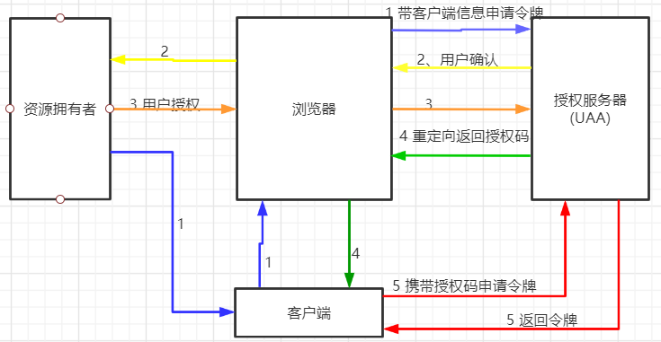

1. **客户端请求授权**：把用户导向授权服务器，参数包括 `response_type=code`、`client_id`、`redirect_uri`、`scope`。
2. **用户同意授权**：用户在授权服务器登录并同意授权请求。
3. **授权服务器发放授权码**：验证身份与授权请求后，向客户端发放授权码（code）。
4. **客户端获取访问令牌**：客户端后端把授权码和客户端凭证发送到授权服务器，参数包括 `grant_type=authorization_code`、`code`、`redirect_uri`（须与第 1 步一致）、`client_id`、`client_secret`。
5. **授权服务器发放访问令牌**：验证授权码和客户端凭证，有效则发放令牌（通常还返回刷新令牌）。
6. **客户端使用访问令牌**：用令牌访问用户的受保护资源。

授权码模式更安全的原因有两点：客户端不直接接触用户凭证；授权码通过后端通道交换令牌，令牌不会出现在浏览器地址栏里。

#### 隐式授权模式（简化模式）

隐式模式（Implicit）曾用于纯前端应用或移动应用，因为它不需要客户端后端参与。

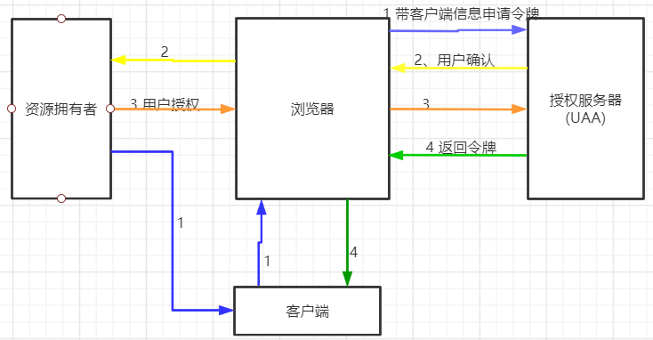

1. **发起认证请求**：客户端（浏览器或移动应用）向授权服务器发送请求，`response_type` 设为 `token`，并带上 `client_id`、`redirect_uri`。
2. **用户身份验证和授权**：用户在授权服务器验证身份并同意授权，服务器生成访问令牌。
3. **生成令牌**：令牌直接包含在重定向 URI 中，作为 URI 片段（fragment）的一部分。
4. **重定向到客户端**：授权服务器把含令牌的重定向 URI 返回，令牌可被前端 JavaScript 读取。
5. **客户端使用令牌**：从 URI 中提取令牌，访问资源服务器上的受保护资源。

隐式模式不涉及客户端后端，直接在浏览器中处理，但令牌会暴露在浏览器历史与日志中，安全性较差。

#### 密码模式

密码模式（Resource Owner Password Credentials，简称 ROPC）允许客户端用用户的用户名和密码直接向授权服务器请求访问令牌，通常只用于高度受信任的客户端（如自家官方 App）。

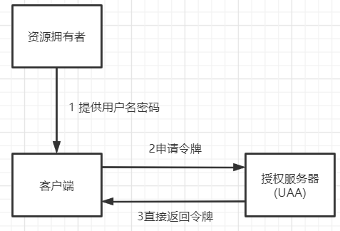

1. **客户端向授权服务器发送请求**：参数包括 `grant_type=password`、`client_id`、`client_secret`（如有）、`username`、`password`、`scope`（可选）。
2. **授权服务器验证用户身份**：验证客户端与用户身份，成功则生成访问令牌，通常还有刷新令牌。
3. **授权服务器响应**：以 JSON 格式返回访问令牌和刷新令牌。

该模式要求客户端直接接触用户密码，因此只适用于受信任的客户端，且必须通过 HTTPS 传输。

#### 客户端凭证模式

客户端凭证模式（Client Credentials）适用于无需用户参与、客户端访问自身拥有权限的资源的情况。

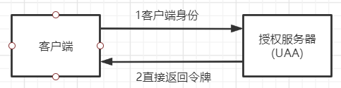

1. **客户端向授权服务器发送请求**：参数包括 `grant_type=client_credentials`、`client_id`、`client_secret`。
2. **授权服务器验证客户端身份**：确认客户端合法且有权限使用此模式。
3. **授权服务器响应**：以 JSON 格式返回访问令牌及有效期等信息。

该模式适用于不涉及用户的服务间调用（如后台任务调用内部 API），同样需要保障传输安全并限制凭证的使用范围。

### 11.4 四种模式速查与选择

| 模式 | 适用场景 | 是否接触用户密码 | 现状建议 |
| --- | --- | --- | --- |
| 授权码模式 | 有后端的 Web 应用、移动 App | 否 | 首选，配合 PKCE 使用 |
| 隐式模式 | 无后端的纯前端应用 | 否 | 不推荐，已被授权码 + PKCE 取代 |
| 密码模式（ROPC） | 高度受信任的自有客户端 | 是 | 不推荐，OAuth 2.1 草案已移除 |
| 客户端凭证模式 | 服务间调用、后台任务 | 否 | 推荐用于机器对机器场景 |

具体选择哪种模式需根据应用场景和安全需求决定。一个常见的判断顺序是：**有用户参与就选授权码（+PKCE），没有用户参与就选客户端凭证**。


服务间调用通常用客户端凭证模式获取令牌，再由调用方在请求头中携带。

### 11.5 敏感信息（用户名、密码、Token）怎么存、怎么传

OAuth 2.0 的核心设计理念是**让客户端永远不要接触用户的密码**。可以从三个层面回答：

1. **传输层面**：
   - **HTTPS 是底线**：所有交互（重定向、Token 交换、API 调用）都应全链路启用 HTTPS（TLS 1.2 及以上），否则任何应用层加密在中间人攻击面前都形同虚设。
   - **不用密码模式**：废弃 ROPC，避免客户端接触用户密码。
   - **推荐流程**：授权码模式配合 **PKCE**（Proof Key for Code Exchange，为公共客户端设计的授权码增强机制），输入密码的动作始终发生在授权服务器页面上。
2. **存储层面**：
   - **密码不存明文**：授权服务器端密码绝不能明文或可逆加密存储，必须使用**加盐哈希**（如 BCrypt、Argon2）。
   - **Token 不放敏感信息**：JWT 默认只是 Base64 编码（JWS），任何人都能解开查看，不要放手机号、身份证号等；确需放入敏感数据必须使用 **JWE** 加密。
3. **客户端防护**：
   - 浏览器端（SPA/H5）尽量不要把 Access Token 存进 LocalStorage，容易被 XSS 窃取。
   - **推荐做法**：采用 **BFF（Backend for Frontend）** 架构，Token 保存在后端会话中，前端只持有一个 `HttpOnly` Cookie。

**反例：用密码模式传密码**


```http
POST /oauth/token HTTP/1.1
Host: auth-server.com
Content-Type: application/x-www-form-urlencoded

grant_type=password&username=user_a&password=123456&client_id=app
```

客户端直接持有了密码。若 Client 是第三方 App，等于把密码交了出去，一旦泄露影响不可控。

**正例：密码只存哈希**

```java
// Spring Security 示例
public class PasswordStorageDemo {
    public static void main(String[] args) {
        // 1. 强哈希算法（自带随机 Salt，cost 参数控制计算强度）
        PasswordEncoder encoder = new BCryptPasswordEncoder(10);

        String rawPassword = "my_secret_password";

        // 2. 入库的是这个哈希值，形如 $2a$10$dXJ3SW6G7P50lGmMkkmwe...
        String encodedPassword = encoder.encode(rawPassword);

        // 3. 校验时只能比对，无法还原明文
        boolean matched = encoder.matches("my_secret_password", encodedPassword);
    }
}
```

### 11.6 授权码模式 + PKCE：推荐的落地方式

对单页应用和移动 App 这类无法安全保存 `client_secret` 的"公共客户端"，标准做法是授权码模式 + PKCE：


1. 客户端生成一个随机串 `code_verifier`，对它做 SHA-256 后 Base64URL 编码得到 `code_challenge`。
2. 发起授权请求时带上 `code_challenge` 与 `code_challenge_method=S256`。
3. 用授权码换令牌时，再带上原始 `code_verifier`。
4. 授权服务器校验两者是否匹配，防止授权码被中途截获后由他人兑换。

这样即使授权码被截获，攻击者没有 `code_verifier` 也无法换取令牌，等于给授权码加了一次性"取件密码"。

### 11.7 刷新令牌怎么处理

访问令牌过期后，客户端可以用刷新令牌（Refresh Token）从授权服务器换取新的访问令牌，而不必让用户重新登录。刷新令牌是特殊令牌，应在安全环境中存储，不应暴露给未授权的用户或应用。实践要点：

1. **存储**：存在安全环境，如客户端应用的服务器端或受信任的安全存储；不要长期存在客户端应用本身，以免被反编译或窃取。
2. **生命周期**：应有明确的有效期并定期轮换，减少未授权访问的风险。
3. **保密性**：应严格保密，一旦泄露，攻击者可能借此长期获取访问权限。
4. **安全传输**：传输时使用 HTTPS 等安全协议，防止被拦截或篡改。
5. **撤销**：泄露或不再需要时，应能立即撤销，并让相关会话失效。

### 11.8 隐式模式为什么不再推荐

隐式模式的设计初衷是让没有后端的应用也能拿到令牌，但令牌通过 URL 片段返回，存在几个难以规避的问题：


- 令牌会出现在浏览器历史、Referer 头、代理日志里；
- 无法使用刷新令牌，用户需要频繁重新授权；
- 令牌直接暴露在前端 JavaScript 环境，XSS 一旦得手即可窃取。

因此现在的建议是：所有客户端（包括 SPA 和移动 App）都走**授权码 + PKCE**；浏览器端再叠加 BFF 架构，把令牌留在后端。

### 11.9 OAuth 2.0 的优点和缺点

**优点：**

1. **安全性**：客户端不接触用户密码，认证与授权信息集中在授权服务器，更易集中保护。
2. **广泛使用**：作为广泛应用的授权标准，被众多公司组织采用，便于与其他系统集成。
3. **令牌短寿命与可封装**：使用短寿命访问令牌，减少泄露和攻击风险，并提供灵活的令牌封装机制。
4. **资源服务器与授权服务器解耦**：两者分离，结构清晰，便于系统间集成。
5. **集中式授权**：由专门服务处理授权，客户端只需与授权服务器交互。

**缺点：**

1. **对接流程较长**：需要理解并实现多个概念，接入相对复杂耗时。
2. **使用不当可能造成安全漏洞**：协议本身安全，但令牌管理不善、授权范围过大或回调地址校验不严都会引入漏洞。
3. **兼容性问题**：不同厂商按协议实现的认证系统可能存在差异，导致系统间兼容性问题。

### 11.10 Token 与密码的区别：为什么 Token 泄露没那么可怕

有人会问：Access Token 被截获，岂不是和密码泄露一样？两者有本质区别，这正是 OAuth 2.0 的价值所在：

1. **时效性**：密码长期有效（除非改密）；Access Token 是短寿命的（通常几十分钟），攻击窗口很短。
2. **权限范围（Scope）**：密码代表"全部权限"；Token 是受限的，只开通 `read:profile` 就只能读资料，不能转账。
3. **撤销机制**：密码泄露需要用户改密，体验很差；Token 泄露可以在后台吊销该 Token 或让对应 Refresh Token 失效，攻击立即停止。
4. **令牌轮转（Token Rotation）**：用 Refresh Token 换新 Access Token 时强制更换 Refresh Token。若攻击者偷了 Refresh Token 抢先使用，合法用户再来刷新时服务器会发现旧 Token 已被使用过，判定为盗用并强制该用户重新登录，从而具备侦测盗用的能力。

小结：密码是"家门钥匙"，必须锁死在授权服务器的数据库里；Token 是"临时通行证"，靠 HTTPS、BFF 和轮换机制把风险控制在可接受范围内。

## 参考来源

本文档中可验证的技术事实，主要依据以下来源核对（按要求只写文字，不附链接）：

- Spring 官方文档. Spring Cloud 版本支持说明（Release Train 与 Spring Boot 对应关系）. 2026 年查阅.
- Spring 官方文档. Spring Cloud Netflix 参考文档（Eureka 客户端与服务端、当前功能范围）. 5.0.x.
- Spring 官方文档. Spring Cloud Commons 参考文档：Spring Cloud LoadBalancer. 2026 年查阅.
- Spring 官方文档. Spring Cloud Gateway 参考文档：How It Works（过滤器链与 pre/post 执行顺序）. 4.3.x.
- Netflix. Hystrix 项目 README：Hystrix Status（停止开发、维护模式、最终版本 1.5.18、推荐 resilience4j）. 2018.
- Alibaba. Sentinel 官方文档：流量控制（FlowRule 的 grade 与 controlBehavior 语义、线程数限流）. 1.8.x.
- Alibaba. Nacos 官方文档：概览与数据模型、发布查询与监听、升级手册（客户端兼容性）. 3.x.
- Alibaba. Spring Cloud Alibaba 官方文档：版本发布说明（与 Spring Cloud、Spring Boot 及 Nacos/Sentinel/Seata 的版本对应）. 2023.x.
- Microsoft. 微服务设计模式与 Azure 架构中心（微服务模式全景）. 文字参考，未附链接.
