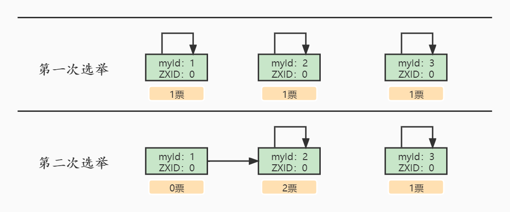
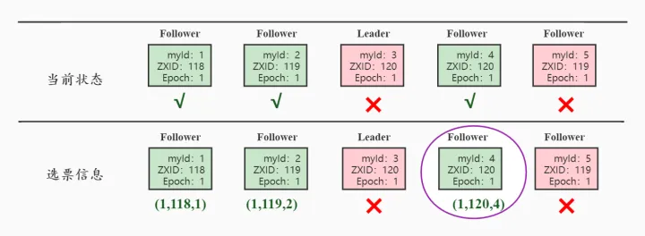

# ZooKeeper 知识汇总

ZooKeeper 是分布式系统里最常用的协调服务之一，Java 开发者常用它做注册中心、分布式锁、配置中心。本文把 ZooKeeper 的选举、协议、通信、持久化、watch、脑裂等核心知识点串成一条线，每个概念都从"是什么 → 为什么需要 → 怎么用"讲起，适合有一年左右 Java 经验、还没有接触过分布式协调组件的读者。

## 本文导读

全文按"基础概念 → 集群机制 → 使用方式"的顺序组织，可以按下面的清单挑着读。

- [先认识几个基础概念](#先认识几个基础概念)：Znode、集群角色、会话
- [ZooKeeper 集群中是怎样选举 Leader 的](#zookeeper-集群中是怎样选举-leader-的)
- [ZAB 协议是什么](#zab-协议是什么)
- [ZAB 与 Paxos 的联系与区别](#zab-与-paxos-的联系与区别)
- [集群中服务器之间是怎样通信的](#集群中服务器之间是怎样通信的)
- [Watch 监听通知是永久的吗](#watch-监听通知是永久的吗)
- [ZooKeeper 的持久化机制](#zookeeper-的持久化机制)
- [CAP 问题上做了怎样的取舍](#cap-问题上做了怎样的取舍)
- [如何解决脑裂问题](#如何解决脑裂问题)
- [脑裂是什么原因导致的](#脑裂是什么原因导致的)
- [集群数据是如何同步的](#集群数据是如何同步的)
- [分布式锁如何实现](#分布式锁如何实现)
- [如何保证事务的顺序一致性](#如何保证事务的顺序一致性)
- [为什么集群节点数一般为奇数个](#为什么集群节点数一般为奇数个)
- [典型应用场景](#典型应用场景)
- [通知机制是什么](#通知机制是什么)
- [节点宕机如何处理](#节点宕机如何处理)

## 先认识几个基础概念

在读选举和协议之前，先要把三个名词弄清楚：数据存在哪（Znode）、机器分工是什么（Leader / Follower / Observer）、客户端和集群之间靠什么维持关系（会话）。后面的所有机制都建立在这三个概念之上。

### 数据模型：Znode

ZooKeeper 内部是一棵类似文件系统的树，每个节点叫 **Znode**（ZooKeeper node）。和文件系统不同的是，Znode 既可以是"目录"（有子节点），也可以同时存一小段数据。

- 数据量级是 KB 级：服务端默认单个 Znode 数据上限约 1 MB（`jute.maxbuffer` 默认 0xfffff 字节），官方也建议远小于这个值，大对象应该把地址存进来而不是把内容存进来。
- 每个 Znode 带版本号：`version`（数据变更次数）、`cversion`（子节点变更次数）、`aversion`（ACL 变更次数），可以配合"带版本号写入"做乐观锁。
- 节点类型：
  - **持久节点（PERSISTENT）**：会话结束也不删除。
  - **临时节点（EPHEMERAL）**：会话结束自动删除，因此不能有子节点，常用来表示"某台机器还活着"。
  - **顺序节点（SEQUENTIAL）**：创建时由父节点追加 10 位、补零的递增序号（形如 `lock-0000000001`），父节点维护的计数器溢出后会变成负数，属于极端场景。
  - **容器节点 / TTL 节点**：ZooKeeper 3.5.3 起提供，用于自动清理的空容器和有存活期的节点，TTL 需要显式开启系统属性。

### 集群角色：Leader、Follower、Observer

一个 ZooKeeper 集群（ensemble）通常由多台服务器组成，角色分三种：

| 角色 | 是否参与投票 | 主要职责 |
| --- | --- | --- |
| Leader | 是 | 为写请求分配全局递增的事务编号，广播提案，决定提交 |
| Follower | 是 | 接收提案、持久化、回 ACK；可以处理读请求 |
| Observer | 否 | 同步数据、分担读请求，只扩大读能力，不改变投票结果 |

### 会话（Session）

客户端连上集群后会得到一个 64 位的会话 ID。会话靠心跳维持，超时由集群判定：当前实现允许的会话超时最小是 `2 × tickTime`，最大是 `20 × tickTime`。会话过期时，该会话创建的临时节点会被删除，并触发相关 watch。

## ZooKeeper 集群中是怎样选举 Leader 的

选举（Leader Election）要解决的是"写请求由谁定顺序"的问题：只有唯一一个 Leader 负责给写请求编号，集群才不会出现两套互相冲突的数据。可以把它想成班级选班长——每人先投自己，再互相比较"谁掌握的信息最新、学号最大"，票数过半才算当选。

### 集群中服务器的四种状态

| 状态 | 含义 | 对应角色 |
| --- | --- | --- |
| LOOKING | 认为集群中没有 Leader，正在寻找 / 参与选举 | 参与投票的服务器 |
| FOLLOWING | 已跟随某个 Leader | Follower |
| LEADING | 正在作为 Leader 领导集群 | Leader |
| OBSERVING | 只同步数据、不参与投票 | Observer |

### Leader 选举的触发时机

- 集群刚启动，还没有 Leader。
- Leader 宕机，或者 Leader 长时间连不上过半服务器（例如网络分区、长时间 Full GC 造成的"假死"），被迫退出 LEADING 状态。

### 第一次启动时的 Leader 选举

假设现有三台机器搭建集群：



1. **每个 Server 发出一个投票投给自己。** Server1 启动时为 LOOKING 状态，myid 记为 1、ZXID 为 0，先投自己一票，投票为 (1, 0)，然后把选票发给集群中的其他机器。
2. Server2 此时也启动，同样为 LOOKING 状态，先投自己一票 (2, 0)，再发给集群中的其他机器。
3. **接收来自各个服务器的投票。** 集群的每个服务器收到投票后，首先判断该投票是否有效，如检查是否属于本轮投票、是否来自 LOOKING 状态的服务器。
4. **处理投票。** 针对每一个投票，服务器都需要将别人的投票和自己的投票进行 PK，PK 规则如下：
   - **优先检查 ZXID。** ZXID 较大的服务器优先作为 Leader。
   - **如果 ZXID 相同，则比较 myid。** myid 较大的服务器作为 Leader。

   对于 Server1 而言，它的投票是 (1, 0)，收到 Server2 的投票 (2, 0)：两者 ZXID 均为 0，再比较 myid，Server2 的 myid 更大，**于是 Server1 更新自己的投票为 (2, 0) 并重新投票；Server2 则无须更新，只需再次向集群中所有机器发出上一次的投票信息即可。**
5. **统计投票。** 每次投票后，服务器都会统计投票信息，判断是否已有过半机器接收到相同的投票信息。对 Server1、Server2 而言，都统计出集群中已有两台机器接受了 (2, 0) 的投票信息，此时便认为已经选出了 Leader。
6. **改变服务器状态。** 一旦确定 Leader，每个服务器都会更新状态：Follower 变更为 FOLLOWING，Leader 变更为 LEADING。
7. Server3 此时启动，发现集群中已有 Leader，便建立连接并把状态置为 FOLLOWING。

### 非第一次启动时的 Leader 选举



在 ZooKeeper 运行期间，即便有新服务器加入，也不会影响 Leader——**新加入的服务器会将原有的 Leader 视为 Leader 并同步数据。但一旦 Leader 宕机，整个集群将暂停对外服务，进行新一轮 Leader 选举**，其过程与启动时期基本一致。假设集群有 Server1~Server5 五台服务器，原本的 Leader 是 Server3，某一时刻 Server3 和 Server5 都宕机，选举过程如下：

1. **变更状态。** Leader 宕机后，余下的非 Observer 服务器都会将状态变更为 LOOKING，然后开始 Leader 选举流程。
2. **每个 Server 会发出一个投票。** 需要生成投票信息 (EPOCH, ZXID, myid)，对应的 Server1、Server2、Server4 选票信息如上图。Leader 选举规则是：
   - EPOCH 大的直接胜出；
   - EPOCH 相同，ZXID 大的胜出；
   - ZXID 相同，服务器 ID（myid）大的胜出。
3. 之后各个 LOOKING 状态的服务器会交换信息，最终多数选举 Server4，即更改为 (1, 120, 4) 的选票信息。
4. **接收来自各个服务器的投票。** 与启动时过程相同。
5. **处理投票。**
6. **统计投票。**
7. **改变服务器状态。** 此时 Server4 成为新的 Leader。

### 进阶了解（可跳过）

初学可以略过这一小节，它解释"选票为什么长这样"。

- **zxid** 是 64 位整数，高 32 位是 **epoch（届数）**，低 32 位是自增计数器。Leader 换届时 epoch 加一，因此"epoch 更大"就意味着"这份数据来自更晚的任期"，必须优先。
- 投票比较顺序为：`peerEpoch` → `zxid` → `myid`，三者都相同则说明是同一台机器。集群刚启动时 epoch 都是 0，所以看起来只比较了 zxid 和 myid。
- 当前版本默认的选举实现是 `FastLeaderElection`，投票通过独立的选举端口交换（配置项 `server.x=host:2888:3888` 中后一个端口，惯例是 3888），数据同步和提案使用前一个端口（惯例是 2888）。

## ZAB 协议是什么

ZAB（ZooKeeper Atomic Broadcast，ZooKeeper 原子广播协议）是 ZooKeeper 保证数据一致性的核心协议。一句话概括：**它让集群里所有服务器按照完全相同的顺序看到同一串写操作**。可以把它理解成群聊里的"接龙通知"——主持人（Leader）按固定顺序发通知，半数以上成员回复"收到"，这条通知才算正式生效。

### 它解决什么问题

1. **支持崩溃恢复：** 当 Leader 节点崩溃或因其他原因导致 Leader 缺失时，ZAB 能自动进入崩溃恢复模式，重新选举一个新的 Leader，并确保所有 Follower 节点的状态与新 Leader 保持一致，之后继续消息广播。
2. **原子性保证：** 确保每个事务请求的原子性，即每个事务要么被所有节点成功执行，要么在所有节点上失败，不会出现部分成功。这是通过"提案—确认—提交"的两阶段过程实现的。
3. **一致性保证：** 通过多副本同步和消息广播机制，保证所有副本按相同的顺序应用同一串事务；已提交的事务不会因为 Leader 故障而丢失。即使发生 Leader 崩溃或网络分区，也能通过崩溃恢复机制重新达成一致。

### 正常运行时：提案 → 确认 → 提交

1. **提案（Propose）：** Leader 为一次写操作分配唯一的事务 ID（zxid），把提案广播给所有 Follower。
2. **确认（Ack）：** Follower 收到提案后先写入本地事务日志（落盘），再回复一个 ACK 给 Leader。注意这里的"确认"表示"我已经持久化、随时可以应用"，并不表示提案已经提交。
3. **提交（Commit）：** Leader 收到过半 Follower 的 ACK 后，向所有 Follower 广播提交消息（COMMIT），各节点才把变更真正应用到内存数据树中，客户端这时才能读到新值。

> 说明：不少资料把这段写成"准备 / 提议 / 提交"三个并列阶段。按 Apache ZooKeeper 官方《ZooKeeper Internals》的描述，广播过程只有"提案 + 提交"两个阶段（形似两阶段提交，但没有中止分支），另有一个独立的"Leader 激活 / 崩溃恢复"阶段。本文按官方的两阶段划分叙述，含义与原描述一致。

### Leader 故障时：崩溃恢复

如果在提案/确认阶段，Follower 久久收不到 Leader 的任何消息（包括提案和可能的超时通知），且无法与 Leader 建立通信，那么这些 Follower 会认为 Leader 已失效，触发新一轮选举。

不过，崩溃恢复通常不是由单个 Follower 单独决定的。实际上，ZooKeeper 集群中的节点会通过"选举算法"共同决定何时进入崩溃恢复模式，并选举出新的 Leader；新 Leader 会先与过半 Follower 完成状态同步（补发缺失的提案，落后太多则发送全量快照），提交一条 `NEW_LEADER` 提案后才开始对外服务。

## ZAB 与 Paxos 的联系与区别

两者都是分布式一致性算法，经常被放在一起比较。理解它们的异同，有助于判断"ZooKeeper 能不能当作通用的共识组件来用"。

### 联系

- 都采用类似的领导者协调机制，并通过**多数派投票**（quorum）保证系统稳定：在 ZAB 中是 Leader 协调多个 Follower；在 Paxos 中，一个提案需要被大多数参与者接受才能被确定。
- 都要求"任意两个多数派集合至少有一台机器重叠"，这样新一轮决策一定能看到上一轮已确定的值。

### 区别

| 维度 | ZAB | Paxos |
| --- | --- | --- |
| 目标场景 | 构建高可用的分布式数据主备系统（如 ZooKeeper） | 一类通用共识算法，Multi-Paxos 可用于复制状态机，也可用于选主、配置管理等 |
| 领导者 | 必须有唯一 Leader，并用 epoch 区分届次 | Basic Paxos 不要求固定 Leader；Multi-Paxos 才引入稳定的 Leader |
| 顺序性 | 强调消息广播的全局全序（zxid）与严格 FIFO | 逐个提案达成一致，跨提案的全序需要额外机制保证 |
| 故障恢复 | 内建专门的恢复阶段（选主 + 同步 + NEW_LEADER） | 靠提案编号与多数派保证安全，恢复流程需使用方自行设计 |
| 实现复杂度 | 相对聚焦，协议面窄 | 更通用，但要处理 Leader 故障、消息丢失等多种情况，实现复杂 |

综上，ZAB 与 Paxos 的联系在于都采用领导者协调和多数派投票原则；区别在于 ZAB 专为"主备复制 + 全序广播"设计，而 Paxos 更通用、覆盖面更广。

## 集群中服务器之间是怎样通信的

ZooKeeper 集群内部靠 TCP 长连接通信，分成两条通道：一条用于选举，一条用于数据同步与提案广播。理解这两条通道，就能解释"为什么 Leader 挂了集群会短暂不可用""为什么 Follower 也能读"。

### 通信的整体结构

1. **Leader 和 Follower：** 集群中有一个服务器被选为领导者（Leader），其余成为跟随者（Follower）；Observer 也属于跟随者一类，但不投票。
2. **通信机制：** 服务器之间建立 TCP 连接。选举阶段通过选举端口互发投票；选举完成后，各 Follower / Observer 主动连接 Leader，Leader 侧为每个学习者（learner）启动一个 **LearnerHandler** 线程，负责向它发送快照和提案，并接收它返回的 ACK。
3. **客户端请求：** 客户端通过 ZooKeeper 客户端库连接集群中的任一服务器（`clientPort` 惯例是 2181），写请求会被转发给 Leader，读请求由当前连接的服务器直接返回。
4. **数据同步：** Leader 把写操作以提案形式广播给所有 Follower，Follower 持久化并应用，从而保持一致。
5. **故障处理：** 如果 Leader 发生故障，ZooKeeper 通过选举机制选出新的 Leader；在选举和同步完成前，集群对外表现为短暂不可用。

### 进阶了解（可跳过）

`LearnerHandler` 位于 **Leader 一侧**（源码中它持有 `LearnerMaster` 引用），职责是"把数据推给学习者并等待确认"，而不是"接收别人的更新再传给应用"。学习者一侧对应的类是 `Learner`。这一点在阅读源码或排查同步问题时容易混淆：看到 `LearnerHandler` 线程数等于学习者数量，说明 Leader 正在为每个 Follower / Observer 单独服务。

## Watch 监听通知是永久的吗

不是。默认的 watch 是**一次性**的：注册、触发一次、然后被删除。这是 ZooKeeper 使用中最容易踩坑的语义，需要重点掌握。

### 一次性监听（默认行为）

当客户端注册一个监视事件（如监视节点的数据变化或子节点变化）后，如果相应的节点状态发生变化，ZooKeeper 会通知客户端并触发监视事件。一旦监视事件被触发，它会从客户端的监视列表中删除，客户端需要再次显式设置监视，才能继续监视节点状态变化。

这种一次性机制有助于避免客户端在不再需要监视时浪费资源；服务端也只需保存很小的状态。代价是：**若需持续监视，客户端必须在每次触发监视后重新设置**。

可以把它想成门铃：按一次响一次，想再听就得再按。

### 永久监听（ZooKeeper 3.6.0 起）

从 **ZooKeeper 3.6.0** 开始引入了永久监听（persistent watch）：监听事件触发后不会自动移除，除非客户端显式取消，ZooKeeper 会持续发送通知。它通过 `addWatch()` 注册，支持普通（PERSISTENT）和递归（PERSISTENT_RECURSIVE）两种模式；触发的事件类型是 `NodeCreated`、`NodeDeleted`、`NodeDataChanged`，递归模式不再触发 `NodeChildrenChanged`（因为它是冗余信息）。移除时使用 `removeWatches()` 并指定 `WatcherType.Any`。

注意：这个能力是 3.6.0 才有的，3.5.x 及更早版本只有一次性 watch。如果项目依赖旧版本，只能沿用"触发后重新注册"的写法。

### 用 Java 写一段 Watch 示例

```java
import org.apache.zookeeper.*;
import org.apache.zookeeper.data.Stat;

public class WatchDemo {
    public static void main(String[] args) throws Exception {
        // 第三个参数是默认 watcher，负责连接、会话过期等全局事件
        ZooKeeper zk = new ZooKeeper("127.0.0.1:2181", 30_000, event ->
                System.out.println("连接/会话事件：" + event.getType()));

        String path = "/config/app"; // 演示前提：该节点已经存在

        // 一次性 watch：触发一次即失效，所以要在回调里重新注册
        Watcher oneShot = new Watcher() {
            @Override
            public void process(WatchedEvent event) {
                System.out.println("监听到：" + event.getType() + " " + event.getPath());
                try {
                    zk.getData(path, this, new Stat()); // 重新注册
                } catch (Exception e) {
                    e.printStackTrace();
                }
            }
        };
        zk.getData(path, oneShot, new Stat());

        // 3.6.0+ 永久监听：无需反复注册
        zk.addWatch(path, event -> System.out.println("永久监听：" + event.getType()),
                AddWatchMode.PERSISTENT);

        Thread.sleep(Long.MAX_VALUE);
    }
}
```

## ZooKeeper 的持久化机制

ZooKeeper 的数据同时存在于内存和磁盘，两者不是"二选一"的两种模式，而是分工配合：内存负责快，磁盘负责不丢。

### 内存：服务读写的数据树

ZooKeeper 把整棵 Znode 树放在内存里，读请求直接从内存返回，所以读性能很好。也正因为数据主要在内存中，ZooKeeper 只适合存放 KB 级的协调数据，不适合当数据库用。需要说明的是，磁盘持久化无法关闭——事务日志是"已提交数据不丢"的基础，只能调整刷盘策略。

### 磁盘：事务日志 + 快照

- **事务日志（transaction log，相当于预写日志 WAL）：** 记录每一次写操作。写请求在返回成功之前，必须先把事务写入日志并刷盘，因此"进程崩溃会丢数据"的情况不会发生。
- **快照（snapshot）：** 数据树的定期全量拷贝。默认每 `snapCount` 条事务（默认 100000）触发一次，实际会在 `[snapCount/2+1, snapCount]` 区间内取随机值，避免所有机器同时打快照。
- **恢复流程：** 启动时先加载最近的快照，再重放快照之后的事务日志，把内存数据树还原到最新状态。

> 需要更正的一种常见说法：ZooKeeper 并不是"先写内存、再异步刷盘"。写请求必须在事务日志落盘之后才会被提交；只有把 `forceSync` 显式设为 `no` 时，才会放弃"每次刷盘"的保证来换取吞吐，此时掉电可能丢最近的写操作。

### 怎么配

```properties
tickTime=2000
dataDir=/data/zookeeper/data
dataLogDir=/data/zookeeper/log
clientPort=2181
initLimit=10
syncLimit=5
server.1=zk1:2888:3888
server.2=zk2:2888:3888
server.3=zk3:2888:3888
```

实践建议：

- `dataLogDir` 单独挂一块盘，避免快照写入和日志刷盘互相抢 IO。
- `dataDir` 下还要放一个 `myid` 文件，内容为本机编号（与 `server.x` 对应），否则集群起不来。
- 快照和日志不会自动无限保留，生产环境需要配置自动清理策略并监控磁盘。

## CAP 问题上做了怎样的取舍

CAP 指一致性（Consistency）、可用性（Availability）、分区容错性（Partition tolerance）三者不可同时满足。ZooKeeper 的定位是**偏 CP**：发生网络分区时，少数派分区宁可拒绝服务，也不返回可能错误的数据。可以把它想成银行柜台——宁可暂停办理，也不给错账。

### 具体表现

- **写操作是线性一致的：** 每个写请求看起来都在"发出请求"和"收到响应"之间的某个瞬间原子生效，所有客户端的写可以排出全序。
- **读操作不保证线性一致：** 读不是多数派操作，由当前连接的服务器直接返回，可能读到稍旧的数据（顺序一致）。官方文档明确指出 ZooKeeper 的一致性介于顺序一致与线性一致之间。
- **分区时少数派不可用：** 凑不够过半节点就无法选出 Leader、也无法提交写操作，这部分节点只能等待恢复。

### 提高可用性的做法

- 客户端配置多个服务器地址，连接断开时自动切换重连。
- 增加 Observer 分担读流量，它不参与投票，不会降低写性能。
- 对"必须读到最新值"的场景，在读之前调用 `sync()`，可以显著降低读到旧数据的概率；但官方也说明 `sync()` 不是多数派操作，不能提供严格保证。

## 如何解决脑裂问题

**脑裂**（split brain）指集群里同时出现两个自认为"主"的节点，各自接受写入，最终数据不一致。ZooKeeper 用**过半机制**（quorum，多数派）来避免这种情况。

### 过半机制怎么起作用

- 一个 Server 必须获得**严格超过半数**的选票才能成为 Leader。例如 5 台服务器，过半是 2.5，至少要有 3 台投票给同一台，才会选出 Leader。
- 过半要求票数**严格大于**集群总数的一半（">"，而非 "≥"）。数学上任意两个分区不可能同时满足：`2 × (n/2 + 1) > n`，所以同一时刻最多只有一个 Leader。
- 提交写操作同样需要过半 ACK，因此旧 Leader 即使"自认为还是 Leader"，也凑不够多数派来提交新数据。

### 容错能力对照

| 集群规模 | 过半所需票数 | 最多容忍宕机 |
| --- | --- | --- |
| 1 | 1 | 0 |
| 2 | 2 | 0 |
| 3 | 2 | 1 |
| 4 | 3 | 1 |
| 5 | 3 | 2 |

## 脑裂是什么原因导致的

ZooKeeper 语境下的"脑裂"通常指一个集群里出现了两个 Leader，导致数据不一致。这种情况一般发生在网络故障导致部分节点与 Leader 失联时：这些节点认为 Leader 已失效，从而选举新的 Leader；如果旧 Leader 随后又"回来了"，就可能短暂出现两个 Leader。

### 主要原因

1. **网络不稳定 / 网络分区：** 部分节点连不上 Leader，误判其死亡。
2. **假死现象：** 机器负载过高、长时间 Full GC，导致心跳和响应超时，被其他节点判定为失效。

### 应对办法

1. 提升网络稳定性，避免链路抖动造成的误判。
2. 合理调整选举与超时参数（`tickTime`、`initLimit`、`syncLimit`），使其匹配实际网络与集群规模。
3. 做好监控告警，及时发现并处理异常节点，避免数据不一致扩散。

补充一点：ZooKeeper 本身没有"多 Master 并存"的内建状态，过半机制保证同一时刻只有一个 Leader 能提交写操作。官方文档也提示过一个理论边界：若 TCP 超时小于 `syncLimit × tickTime`，旧 Leader 可能短暂自认为仍是 Leader，此时它返回的读数据可能更旧——实践中很少发生，但排查"读到旧值"问题时值得知道。

## 集群数据是如何同步的

数据同步分两个阶段：**启动/恢复时的追赶**（Leader 把历史数据补给落后的节点）和**运行时的广播**（每个写请求都按提案流程同步）。

### 启动与恢复阶段

1. 集群启动时，先进行领导者选举，确定哪个节点是 Leader，哪些节点是 Follower 和 Observer。
2. Leader 会和其他节点进行数据同步，采用发送快照和发送 Diff 日志的方式：落后不多就补发缺失的事务，落后太多就整份快照发过去。
3. 同步完成后，Leader 提交 `NEW_LEADER` 提案，集群才开始对外提供服务。

### 运行时的写流程

1. 集群在工作过程中，所有写请求都交给 Leader 处理（客户端连的是 Follower 时，Follower 会把写请求转发给 Leader）；读请求可以由任意节点直接处理。
2. Leader 收到写请求时，会通过两阶段提交机制来处理。
3. Leader 将该写请求对应的日志发送给其他 Follower 节点，并等待 Follower 持久化日志成功。
4. Follower 收到日志后持久化，持久化成功则发送一个 Ack 给 Leader。
5. Leader 收到半数以上的 Ack 后开始提交，先更新 Leader 本地的内存数据。
6. 然后发送 commit 命令给 Follower 节点，Follower 收到后也更新本地内存中的数据。

这样，一次写操作就在整个集群中同步完成了。

## 分布式锁如何实现

ZooKeeper 实现分布式锁的主要思路，是利用**临时顺序节点**的唯一性和顺序性。可以把它想成银行排队取号：每人取一个号，号码最小的先办业务，后面的人只盯着自己前一位。

### 实现步骤

1. 创建一个 ZooKeeper 节点作为锁的根节点，例如 `/locks`。
2. 当某个线程需要获取锁时，在锁的根节点下创建一个**临时顺序节点**，例如 `/locks/lock-0000000001`。
3. 线程获取锁的过程是：检查自己创建的节点是否是锁节点下最小的节点，如果是，则表示该线程获得了锁；否则监听自己创建节点的**前一个节点**，等待前一个节点释放。
4. 当线程释放锁时，删除自己创建的节点（或会话结束时由服务端自动删除）。

### Java 示例（原生 API）

```java
import org.apache.zookeeper.*;
import java.util.List;
import java.util.concurrent.CountDownLatch;

public class ZkLock {
    private final ZooKeeper zk;
    private final String lockRoot = "/locks";
    private String myNode; // 本线程持有的临时顺序节点

    public ZkLock(ZooKeeper zk) throws Exception {
        this.zk = zk;
        if (zk.exists(lockRoot, false) == null) {
            try {
                zk.create(lockRoot, new byte[0], ZooDefs.Ids.OPEN_ACL_UNSAFE,
                        CreateMode.PERSISTENT);
            } catch (KeeperException.NodeExistsException ignored) {
                // 其他线程已经创建，忽略
            }
        }
    }

    public void lock() throws Exception {
        // 1. 创建临时顺序节点
        myNode = zk.create(lockRoot + "/lock-", new byte[0],
                ZooDefs.Ids.OPEN_ACL_UNSAFE, CreateMode.EPHEMERAL_SEQUENTIAL);

        while (true) {
            // 2. 取出所有子节点并排序，看自己是不是最小的
            List<String> children = zk.getChildren(lockRoot, false);
            children.sort(String::compareTo);
            String smallest = lockRoot + "/" + children.get(0);
            if (smallest.equals(myNode)) {
                return; // 拿到锁
            }

            // 3. 只监听自己前一个节点，避免惊群
            String prev = null;
            for (String child : children) {
                if ((lockRoot + "/" + child).equals(myNode)) {
                    break;
                }
                prev = lockRoot + "/" + child;
            }
            CountDownLatch latch = new CountDownLatch(1);
            if (zk.exists(prev, event -> latch.countDown()) == null) {
                continue; // 前一个节点已释放，重新判断
            }
            latch.await();
        }
    }

    public void unlock() throws Exception {
        zk.delete(myNode, -1); // -1 表示不校验版本
    }
}
```

### 使用注意

- **必须用临时节点：** 客户端崩溃后会话过期，节点会被自动删除，避免死锁；用持久节点则一旦客户端掉线锁就永远不释放。
- **只监听前一个节点：** 若监听父节点，所有等待者会在同一时刻被唤醒，形成"惊群"。
- **处理连接中断与会话过期：** 会话过期后临时节点已消失，程序要重新创建节点并重新排队；生产中通常使用封装好的客户端（如 Apache Curator 的 `InterProcessMutex`），它处理了重连、可重入、超时等细节。
- **锁的粒度与超时：** 需要业务侧配合超时与幂等，避免持锁线程卡死导致整体阻塞。

## 如何保证事务的顺序一致性

ZooKeeper 保证的是**顺序一致性**：同一个客户端的更新按发送顺序生效，所有客户端看到的更新顺序一致。它依靠的不是"加锁"，而是"单一 Leader + 全局递增编号 + FIFO 通道"。

### 具体机制

1. **唯一 Leader 分配全局编号（zxid）：** 所有写请求都由 Leader 处理，Leader 为每个提案分配严格递增的 zxid。zxid 的大小关系就是事务的先后关系，这一点官方文档有明确说明：zxid 较小的事务一定先发生。
2. **严格串行化提交：** 提案必须获得过半 ACK 才会提交；在提交之前，任何客户端都读不到该事务的结果。由于编号唯一且单调递增，事务实际上是串行生效的。
3. **FIFO 通道保证按序到达：** 服务器之间用 TCP 通信，Leader 按收到请求的顺序发送提案，Follower 按顺序处理并回 ACK，因此提交顺序与提案顺序一致。
4. **后续请求可见性：** 一个事务提交后，后续读请求才能看到它的结果；客户端不会看到"部分生效"的中间状态。

> 需要更正的一种常见说法：ZooKeeper 服务端并没有内建的"共享锁 / 排他锁"两种锁类型。官方文档明确说，锁、屏障、队列这类结构都是在**客户端**用 Znode 组合出来的"配方（recipe）"，不需要改动服务端。因此"锁定机制"不是 ZooKeeper 保证顺序一致性的手段，真正起作用的是 zxid 全序与过半提交。

## 为什么集群节点数一般为奇数个

ZooKeeper 集群节点数通常取奇数，原因有两个：容错能力相同但成本更低，以及更容易形成明确多数。

### 原因一：性价比更高

容错能力（最多容忍几台宕机）只取决于"过半"，因此 3 台和 4 台的容错能力相同，都是 1 台；5 台和 6 台都只能容忍 2 台。既然多一台不能提高容错，就没必要多花机器。

### 原因二：避免平票僵局

若节点数为偶数，脑裂时可能均分成两个对等子集群（如 4 台分成 2 + 2），谁都无法获得超过半数的票，整个集群瘫痪；而奇数个节点在分区时必然有一个子集群占多数，仍可正常工作，选举也更容易得出明确结果。

### 小结

| 节点数 | 过半所需 | 容忍宕机 | 是否推荐 |
| --- | --- | --- | --- |
| 3 | 2 | 1 | 推荐（最小生产规模） |
| 4 | 3 | 1 | 不推荐（多一台无收益） |
| 5 | 3 | 2 | 推荐 |
| 6 | 4 | 2 | 不推荐 |

因此，为确保 ZooKeeper 集群的稳定性和可用性，通常采用奇数个节点（3、5、7）。若读流量大，可以额外增加 Observer，它不参与投票，不影响写性能和选举结果。

## 典型应用场景

ZooKeeper 提供的是"协调"能力，而不是存储能力，因此它的典型场景都围绕"小数据 + 强一致 + 事件通知"展开。

1. **数据发布与订阅（配置中心）：** 发布者把配置写到 Znode 上，订阅者注册 watch 动态获取变更，实现配置的集中管理与热更新。
2. **分布式锁：** 利用临时顺序节点的唯一性和顺序性，保证多个进程按顺序获取锁。
3. **集群管理（注册中心）：** 通过临时节点感知成员上下线，实现节点监控、异常处理与状态同步。
4. **分布式协调：** 为分布式系统中的各个参与者提供协调能力，例如任务分配、屏障（barrier）、等待与通知。
5. **命名服务：** 作为分布式命名服务，为网络中的对象提供唯一名称（类似电话簿）。

## 通知机制是什么

ZooKeeper 的通知机制（watch）让客户端可以"订阅"某个 Znode 的变化，而不必反复轮询。它是**异步**的：事件发生时由服务端主动推送通知，客户端不需要阻塞等待。

### 工作方式

1. 客户端向服务端的某个 Znode 注册一个 **Watcher**（回调对象）。
2. 当该 Znode 的指定事件发生时（如节点创建、数据改变、节点删除、子节点列表变化），服务端向该观察所属的客户端发送一个通知包，告知发生了什么事件。
3. 通知包里**只有事件类型和路径，没有具体数据**，所以客户端收到通知后通常要再调用一次 `getData()` 或 `getChildren()` 把最新数据拉回来。

### 关键特性

- **一次性（默认）：** 触发后即失效，需要重新注册；3.6.0+ 可用 `addWatch()` 注册永久监听。
- **有序：** 同一个客户端的通知按顺序到达，且客户端会先看到 watch 事件、再看到对应的新数据。
- **可能丢失：** 客户端断连期间发生的变化不会补发通知，重连后应主动全量拉取一次数据对齐状态。
- **轻量：** 服务端只在内存中维护"路径 + 会话"的映射，因此 watch 数量很大时也更适合用 3.6.0+ 的永久监听减少反复注册。

正是这种 Watcher 机制，让 ZooKeeper 能够实现分布式锁、发布订阅、集群上下线感知等功能。

## 节点宕机如何处理

ZooKeeper 必须集群部署，官方建议至少 3 个节点，且自身要保证当一台机器宕机时其他节点能继续提供服务。核心判断标准只有一条：**存活节点是否还能凑出过半**。

1. **Follower 宕机：** 3 节点集群还剩 2 台，仍满足过半（2 > 1.5），集群继续提供服务；因为数据有多个副本，不会丢失。
2. **Leader 宕机：** 剩余节点会重新选举出新的 Leader，选举和同步期间对外短暂不可用，恢复后继续服务。
3. **多数节点宕机：** 只剩一半或不到一半能工作时，无法形成多数派，集群拒绝服务——这是设计上的取舍，用短暂不可用来换取数据不出现分歧。

因此，ZooKeeper 可以容忍一部分节点宕机，但前提是**超过一半的节点正常工作**。这也解释了为什么 2 节点集群的容错能力是 0：它需要 2 票才能过半，任何一台宕机都直接失去服务能力。

## 参考资料

本文涉及的行为、默认值与版本差异，均以 Apache ZooKeeper 官方文档和公开论文为依据，出处如下（仅列文字出处）：

- Apache ZooKeeper 官方文档：Programmer's Guide、Administrator's Guide、ZooKeeper Internals、Release Notes 3.6.0（3.9 版本文档）
- Flavio Junqueira, Benjamin Reed. ZooKeeper: Distributed Process Coordination. O'Reilly, 2013
- Flavio Junqueira, Benjamin Reed, Marco Serafini. Zab: High-performance broadcast for primary-backup systems. DSN, 2011
