# 三高架构知识汇总

"三高"指高性能、高并发、高可用，是后端系统设计中最常被讨论的一组目标。本文按数据库、负载均衡、高可用、性能优化、一致性五个主题拆解常见做法，每个主题都尽量按"是什么 → 为什么需要 → 怎么用"的顺序展开。

文中出现的数字分两类：一类来自官方文档或协议规范，会注明出处与版本；另一类是行业经验值，会明确标为"经验值"，不作为承诺指标。

## 本文导读

下面是全文的章节地图，可按需跳读或顺序阅读。

- 一、高并发下的数据库性能瓶颈：读写分离、分库分表、雪花算法
- 二、常用负载均衡算法：轮询、加权、源地址哈希、一致性哈希、虚拟节点
- 三、系统高可用：冗余、VIP 漂移、哨兵、限流、熔断、异地多活
- 四、系统性能优化：执行计划、缓存一致性、异步解耦、JVM 与线程池
- 五、高性能系统设计：CDN、并行化、多级缓存、零拷贝、无锁化
- 六、数据一致性与可靠性：Cache Aside、Binlog + MQ、RocketMQ 事务消息
- 七、三高架构的定义与取舍

## 一、高并发下的数据库性能瓶颈

高并发场景下，数据库最常见的表现是 CPU 打满、磁盘 I/O 排队、慢查询堆积。本节先说明为什么"加索引、换硬盘"通常解决不了根本问题，再分别针对读压力和写压力介绍读写分离与分库分表，最后说明缓存与消息队列这两道前置防线的位置。

### 1.1 先诊断：到底是读慢还是写慢

遇到数据库变慢，"加索引""SQL 调优""换 SSD"是最直接的三板斧。它们本身没有错，但只在数据量不大、并发不高时有效；在真正的流量面前，单点调优的收益很快会被耗尽。

- **加索引并非越多越好**：索引能加速查询，但每次写入都要同步维护索引对应的 B+ 树（一种多路平衡查找树，InnoDB 用它组织数据和索引），涉及页分裂、页合并等操作。索引越多，写放大越明显，写入反而更慢。
- **升级硬件有天花板**：堆机器、换 SSD 能抬高单机上限，但成本随配置线性甚至指数上升，而且总有物理极限。架构上的常规做法是先减少打到数据库的请求量，再考虑换硬件。

所以第一步不是动手优化，而是判断瓶颈类型：**是读慢了，还是写慢了？** 这两类问题的解法完全不同。

### 1.2 读多写少：读写分离

**是什么：** 一台主库（Master）专门处理写请求（增删改），若干台从库（Replica/Slave）专门处理读请求，主库把数据变更通过二进制日志（binlog）复制给从库。

**为什么需要：** 大多数互联网业务是"读多写少"，例如商品详情页、新闻浏览、列表查询。读请求往往是写请求的数倍到数十倍，把读压力分摊出去，主库才有余力处理写入。

**怎么用：** 应用层按 SQL 类型路由（写走主库、读走从库），或者接入数据库中间件统一路由。落地时通常配合连接池分别配置主从数据源。

打个比方：一个门店里，收银台只负责收款记账（写），旁边开几个查询窗口专门查账（读），顾客排队就不会全堵在收银台。

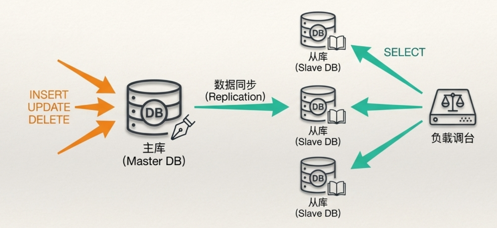

#### 主从同步延迟

主从复制默认是**异步**的：主库写完就返回，从库稍后才追上。于是出现一个经典问题——刚写入主库的数据，用户立刻去查却查不到。

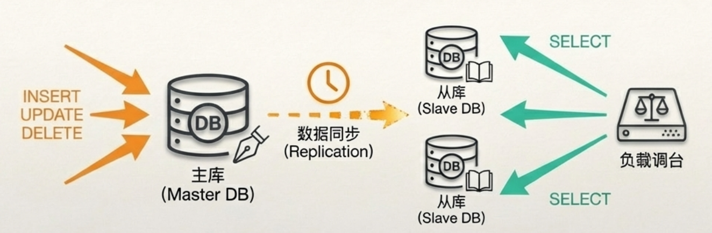

常见处理方式：

1. **非核心业务**（点赞数、评论数、浏览记录）：允许短暂延迟，前端做兜底展示即可。
2. **核心业务**（支付成功后立即查订单）：写后立即读的请求**强制读主库**，保证读到刚提交的数据。
3. **折中方案**：把"刚写入的关键标识"放进缓存，读请求先看缓存标记再决定走主还是走从。

需要注意，异步复制意味着主库宕机时，尚未同步的少量数据可能丢失；对数据安全性要求高的场景，可评估半同步复制等增强方案。

### 1.3 写请求打满：分库分表

当主库的写入也到瓶颈，或者单表数据量已经大到索引也难以支撑时，就需要拆分数据。拆分有两个方向：

1. **垂直分库**：按业务拆分。用户表、订单表、商品表分到不同的数据库实例上，专库专用，互相不抢资源。

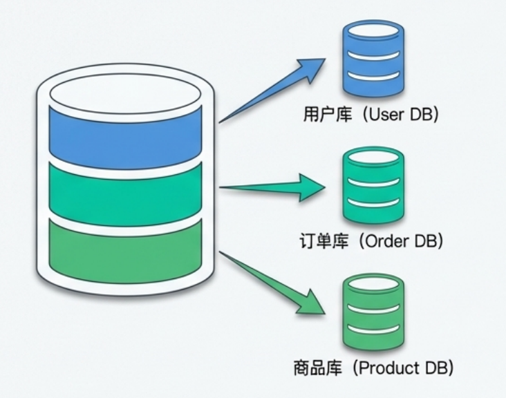

2. **水平分表**：按规则拆分。例如一张 2 亿条记录的表，按用户 ID 取模拆成 100 张表，每张约 200 万条。

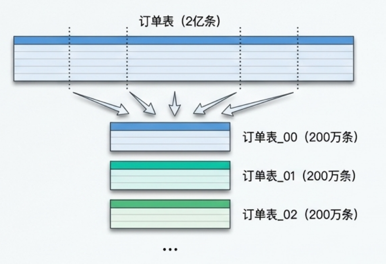

这里要澄清一个常见误解：水平分表**降低的是单表数据量和单次索引查找的成本，不等于性能自动提升 100 倍**。实际收益取决于查询是否能命中分片键、是否需要跨分片聚合，以及应用层的改造成本。

**分库分表带来的复杂性：** 跨库 Join 变难、分布式事务变复杂、全局排序与分页需要额外处理、扩容时要考虑数据迁移。因此它通常是最后手段，而不是第一手段。

#### 分表之后的主键怎么办

单表自增主键在分表后会冲突（每张表都从 1 开始），因此不能再简单依赖单表自增。常见方案有三类：

- **步长方案**：不同表设置不同的自增起始值与步长。
- **号段模式**：由中心服务批量分配一段 ID，应用本地消费，例如 Leaf 等实现。
- **雪花算法（Snowflake）**：本地生成 64 位长整型 ID，不依赖数据库，趋势递增。

雪花算法的位划分（**这是一种常见划分，各实现可自行调整位数**）：

| 部分 | 位数 | 作用 |
| --- | --- | --- |
| 符号位 | 1 位 | 固定为 0，保证 ID 为正数 |
| 时间戳 | 41 位 | 毫秒级时间戳，可用约 69 年 |
| 机器 ID | 10 位 | 标识节点，最多 1024 个（常再拆成 5 位机房 + 5 位机器） |
| 序列号 | 12 位 | 同一毫秒内的自增序号，每毫秒每节点最多 4096 个 |

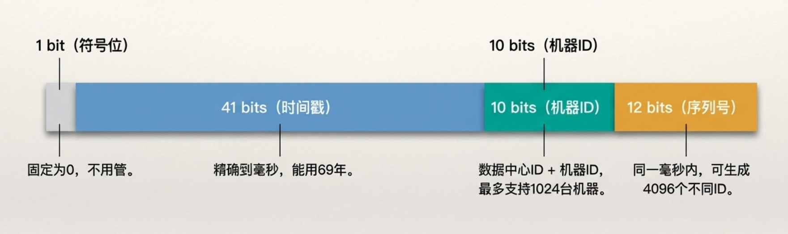

例如百度 UidGenerator 就改成了 1 位符号 + 28 位秒级时间 + 22 位机器 ID + 13 位序列号的默认划分，说明位数是按业务寿命、节点规模、并发量三者权衡出来的，并非固定公式。

使用雪花算法有两点要提前设计：

- **依赖机器时钟**：时钟回拨（如 NTP 校时）可能导致重复 ID，需要在实现中检测并等待或报错。
- **趋势递增不等于严格递增**：它只保证整体随时间增长，不能当作严格有序的序列使用。

### 1.4 分库分表之前的两道防线

在动数据库结构之前，先想办法让请求根本不到数据库：

1. **第一道防线：缓存优先。** 用 Redis 等内存缓存挡住读流量，让大部分查询（经验上常见 80%~90%）在缓存层就返回。
2. **第二道防线：异步削峰。** 用消息队列（MQ，Message Queue）挡住写流量，把瞬时爆发的写请求先落进 Kafka、RocketMQ，后端按自己的处理能力匀速消费。

缓存和 MQ 都可能引入数据延迟与一致性问题，这部分在第六节展开。

### 1.5 小结：架构演进的正确路径

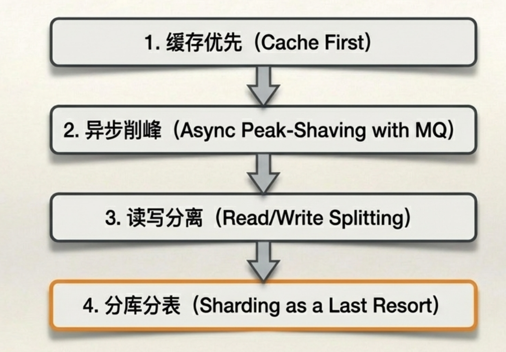

| 阶段 | 手段 | 主要解决 | 代价 |
| --- | --- | --- | --- |
| 1 | 缓存（Redis） | 读流量 | 一致性、缓存故障 |
| 2 | 消息队列（MQ） | 写峰值 | 最终一致、重复消费 |
| 3 | 读写分离 | 单机读上限 | 主从延迟 |
| 4 | 分库分表 | 单表/单库容量与写入上限 | 跨库查询、分布式事务、运维成本 |

顺序背后的思路是**层层设防**：能靠缓存和队列解决的，就不要动数据库结构；必须拆分时，也先做读写分离，再做分库分表。

## 二、常用负载均衡算法

负载均衡（Load Balancing）是把请求分摊到多台服务器上的技术，它决定了"每个请求该交给谁"。算法选得对，集群才不会出现"一台忙死、一台闲着"；选得不对，再多的机器也挡不住局部过载。

### 2.1 轮询与随机

最理想的前提是：所有服务器配置完全相同、每个请求的耗时也差不多。此时有两种最简单的策略：

- **轮询（Round Robin）**：按顺序依次分发，A → B → C → A，公平且无需额外配置。
- **随机（Random）**：随机挑一台，实现简单，请求量足够大时分布也接近均匀。

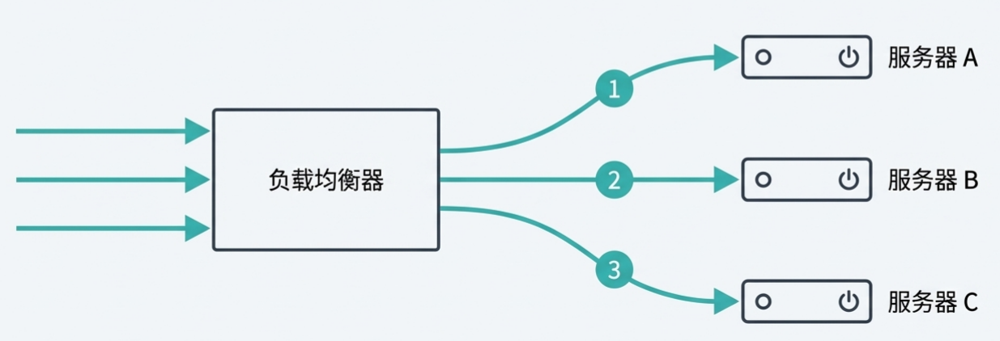

这两种算法都假设"每台机器能力相同"。一旦机器配置有差异，问题就出现了。

### 2.2 加权轮询

现实中的集群往往是混搭的：可能有 8 核 16G 的新机器，也有 2 核 4G 的老机器。如果仍按轮询均分，高性能机器在"摸鱼"，低性能机器则会被压到 CPU 100%。

解决办法是引入**权重（Weight）**——能力强的机器分到更多请求。Nginx 的 `weight` 参数就是为此设计的，默认值为 1，且 Nginx 默认的负载均衡方式本身就是加权轮询。

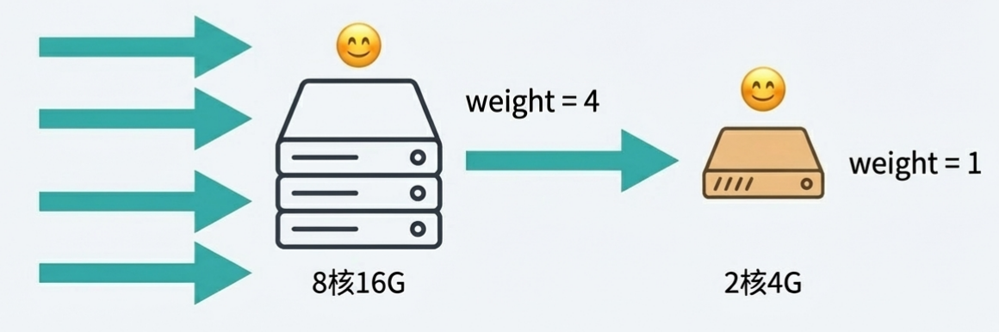

例如给 8 核机器设 `weight=4`、2 核机器设 `weight=1`，则每 5 个请求中高性能机器处理 4 个、老机器处理 1 个。

```nginx
upstream backend {
    # 默认即为加权轮询，weight 默认值 1
    server 192.168.1.11:8080 weight=4;
    server 192.168.1.12:8080 weight=1;
}
```

| 算法 | 适用前提 | 主要问题 |
| --- | --- | --- |
| 轮询 | 机器同构、请求耗时相近 | 机器异构时分配不均 |
| 随机 | 同上，且请求量足够大 | 短时间可能不均衡 |
| 加权轮询 | 机器异构，能估算处理能力 | 权重靠人工估算，流量变化后需调整 |

### 2.3 源地址哈希（会话保持）

如果应用把用户会话（Session，服务端保存的登录状态）存在单机内存里，用户第一次请求落到服务器 A 并登录，下一次请求被分到服务器 B，B 上没有这份会话，用户就会被要求重新登录。

**源地址哈希**的思路是：让同一个客户端的请求始终落到同一台服务器。

朴素公式是 `index = hash(client_ip) % N`（N 为服务器数量）。

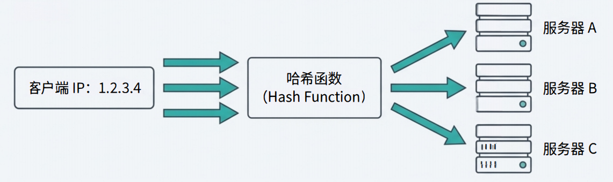

只要客户端 IP 不变，哈希值就不变，取模结果也不变，请求就会"绑定"在某台机器上。

实际实现会有些差异，以 Nginx 的 `ip_hash` 为例：它取客户端 IPv4 地址的**前三段**（即 /24 网段）或完整 IPv6 地址作为哈希键，因此同一出口网段的客户端会落到同一台服务器；只有该服务器不可用时才会转到其他服务器。

这个方案有两个已知短板：

- **NAT 与运营商出口**：大量用户共享同一个出口 IP，会导致流量倾斜。
- **节点增减**：N 一变，几乎所有映射都会重排，这正是下一节要解决的问题。

### 2.4 一致性哈希

假设原有 3 台服务器，现在扩容到 4 台。公式里的 N 从 3 变成 4，绝大多数 IP 的取模结果都会改变：原本落在 A 的请求去了 B，原本在 B 的去了 C。

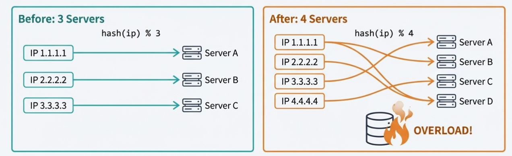

如果被重映射的是缓存数据，就意味着大量缓存同时失效，请求全部穿透到数据库，形成"扩容即雪崩"。

**一致性哈希**把取模对象从"服务器数量"换成固定的哈希空间：

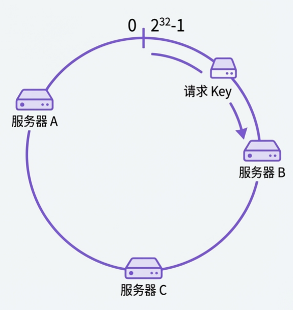

1. **哈希环**：不再对 N 取模，而是把哈希值映射到一个首尾相接的环上。常见实现（如 Ketama）使用 32 位哈希空间，即 0 到 2³²−1。
2. **节点映射**：把每台服务器的标识（IP 或"IP:端口"）哈希后放到环上。
3. **请求寻址**：把请求的键（如客户端 IP、缓存 key）哈希到环上，然后**顺时针**找到第一个服务器节点。

**优势：** 增加或移除一个节点时，只有环上相邻的那一小段区间需要重新映射，其余键的归属保持不变，缓存命中率不会整体崩塌。

### 2.5 解决数据倾斜：虚拟节点

节点很少时，它们在环上的位置可能很集中。例如只有 A、B 两台机器，恰好 90% 的环区间顺时针都指向 A，只有 10% 指向 B，这就是**数据倾斜**。

**解决办法是引入虚拟节点**：不只把物理机 A 放到环上，还为它生成许多"分身"（A1、A2……A100），这些虚拟节点散布在环上，实际请求落到哪个分身，就交给对应的物理机。

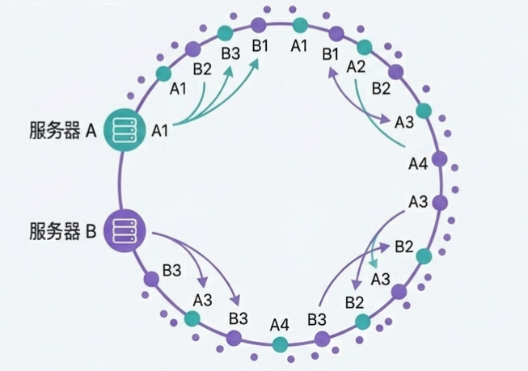

虚拟节点数量越多，分布越均匀。Ketama 的经典做法是每台服务器映射 100~200 个点，前文提到的"100 个分身"属于同一量级的经验取值。

### 2.6 更智能的策略：最小连接数与最快响应

前几种算法都只看"请求数量"，不看"服务器当前忙不忙"。在长连接或请求耗时差异很大的场景下，还有两种动态策略：

1. **最小连接数（least_conn）**：把新请求交给当前活跃连接数最少的服务器，同时考虑权重。Nginx 的 `least_conn` 指令即为此实现；若有多台并列最少，则在这些服务器之间按加权轮询选择。

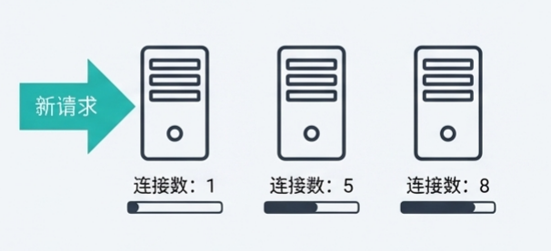

2. **最快响应（least_time）**：根据响应头时间或完整响应时间挑选平均响应最快、连接数最少的服务器。Nginx 的 `least_time` 指令在较早版本中属于商业订阅功能，较新版本已并入开源版。

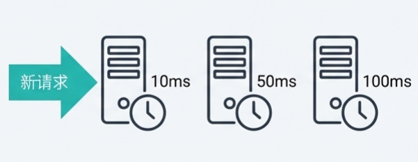

```nginx
upstream backend {
    least_conn;                       # 最小连接数
    server 192.168.1.11:8080 weight=4;
    server 192.168.1.12:8080 weight=1;

    # 或者：按请求 URI 做一致性哈希（Ketama）
    # hash $request_uri consistent;
}
```

### 2.7 如何选型

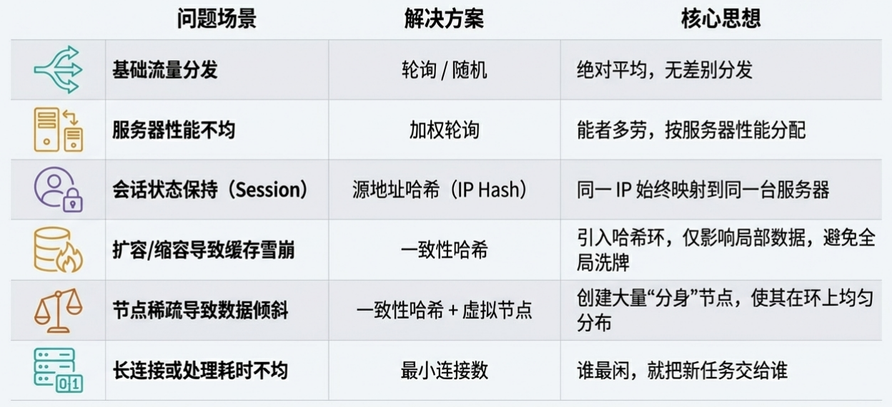

| 场景 | 推荐算法 | 原因 |
| --- | --- | --- |
| 机器同构、请求短平快 | 轮询 / 随机 | 简单，开销小 |
| 机器异构 | 加权轮询 | 按能力分配 |
| 需要会话保持 | 源地址哈希 / Cookie 会话保持 | 同一用户固定落点 |
| 缓存节点、需要扩容平滑 | 一致性哈希 + 虚拟节点 | 重映射范围小 |
| 长连接、请求耗时差异大 | 最小连接数 / 最快响应 | 按实时负载分配 |

没有"最好"的算法，只有与业务特征匹配的算法。选型时先明确三点：机器是否同构、是否要求会话保持、扩容时能否接受缓存失效。

## 三、如何实现系统的高可用性

高可用（High Availability，HA）讨论的是"系统在部分组件故障时，还能不能对外提供服务"。本节从单点故障出发，依次介绍入口层、数据层、流量层、依赖层和机房层的五道防线。

### 3.1 高可用的本质是冗余

高可用的核心是**冗余（Redundancy）**：不追求服务器永不宕机，而是当某台机器挂掉时，有备份能立刻顶上，让用户几乎感知不到。

一个常用的比喻是"鸡蛋不要放在一个篮子里"：篮子是单点，多准备几个篮子，摔一个还有别的。

**单点故障（SPOF，Single Point of Failure）**指系统中一旦失效就会导致整体不可用的组件。做高可用的第一步，就是把 SPOF 一个个找出来。

举个例子：部署两台 Tomcat 做集群，看起来已经冗余了，但用户请求总得有个入口——通常是 Nginx。

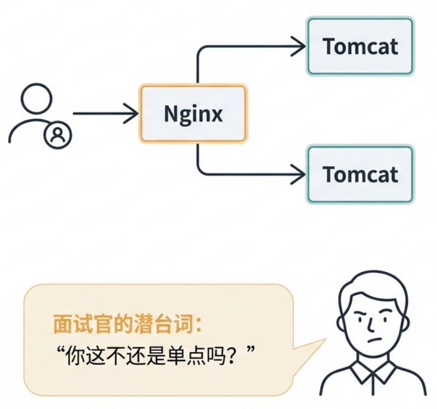

于是 Nginx 成了新的单点，这就是第一关要解决的问题。

### 3.2 第 1 关：入口层的单点

两台 Tomcat 前面挡着一台 Nginx，Tomcat 是冗余了，但 Nginx 一旦宕机，后端再多健康节点也没用——整个系统对外表现为全瘫。

**解决方案：Keepalived + VIP（虚拟 IP）。** 部署两台 Nginx，一台主（Master）、一台备（Backup），两者共享一个对外提供服务的虚拟 IP。Keepalived 通过 VRRP（虚拟路由冗余协议）在主备之间持续发送通告报文；主节点失联后，备节点接管 VIP，流量自动切换。

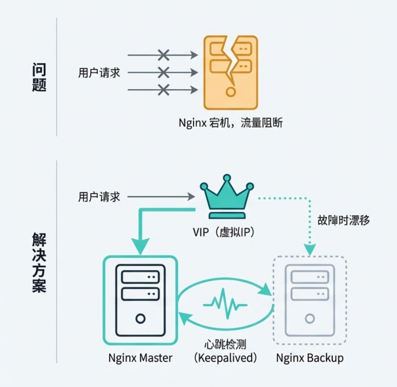

- **架构设计**：两台 Nginx 组成主备，VIP 平时绑定在 Master 上。
- **核心机制**：心跳检测（Keepalived 定期发送 VRRP 通告）→ 故障判定 → VIP 漂移（备节点接管地址）→ 流量自动切换。
- **关键概念**：**故障转移（Failover）**，即不仅要有备份，还要能自动接管。

关于切换速度，常被说成"毫秒级"，这并不准确：VRRPv3 在默认参数下，备节点接管通常需要**秒级**时间。RFC 5798 给出的参考值是"约 3 秒"（备份节点的 Master_Down_Interval 由通告间隔推算而来）。想更快，可以调小通告间隔并配合健康检查脚本，但要注意误判风险。

另外要防**脑裂**：主备之间网络中断时，两边都可能认为自己是主，出现双主。常用办法是加上对端检测、仲裁节点或带外管理网络。

### 3.3 第 2 关：数据层的单点

数据库通常是系统中最脆弱的一环。单机数据库宕机，读写全停。常规做法是"一主多从"，既做读写分离也做备份，但新的问题来了：**主库在凌晨故障，谁来把从库提升为主库？**

人工介入意味着几分钟甚至几十分钟的停机。因此需要自动化的故障转移：

- **MySQL 侧**：常见方案有 MHA（Master High Availability）、MGR（MySQL Group Replication）、Orchestrator 等，负责监控主库、选举新主、切换拓扑。
- **Redis 侧**：使用**哨兵（Sentinel）**。哨兵是独立进程，负责监控、通知、自动故障转移，并充当客户端的配置来源。

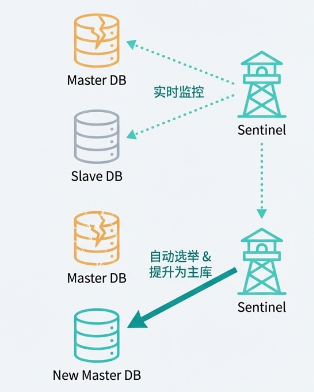

哨兵的关键机制（以 Redis 官方文档为准）：

1. **监控**：持续检查主库与从库是否正常。
2. **主观下线与客观下线**：单个哨兵判定不可达只是"主观下线"，需要达到 `quorum` 数量的哨兵一致同意，才判定"客观下线"。
3. **选举与切换**：真正执行故障转移需要**多数派哨兵授权**选出领导者，再由领导者提升某个从库为主库，并通知客户端新地址。
4. **部署要求**：官方建议至少 3 个哨兵实例，且分布在故障相互独立的机器上；只有 2 个哨兵的部署是不可靠的。

需要明确一个前提：Redis 复制是**异步**的，故障切换时尚未同步到从库的写入可能丢失。官方文档对此有明确说明，业务上要么接受这个窗口，要么通过 `min-replicas-to-write` 等配置限制风险。

### 3.4 第 3 关：流量洪峰与限流

前两关解决"自身生病"，这一关解决"外界压力"。秒杀、突发推送会让流量在几秒内涨到平时的数倍，CPU 打满后所有请求超时，最终整条链路一起崩，这就是**服务雪崩**。

限流的核心思想是"扛不住就别硬扛"：主动拒绝一部分请求，保住系统整体存活。

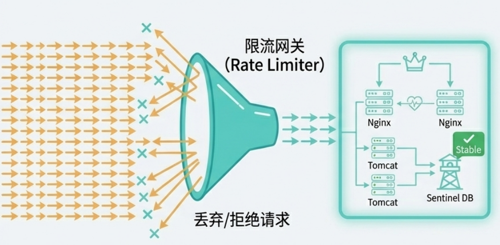

两种经典算法：

- **令牌桶（Token Bucket）**：系统以固定速率往桶里放令牌，桶有容量上限；请求需要取到令牌才能通过。桶里平时会积攒一些令牌，所以**允许一定程度的突发**，突发上限就是桶容量。RFC 2697 中对令牌桶的计量模型有明确定义（令牌按速率补充、桶容量封顶）。
- **漏桶（Leaky Bucket）**：请求先进入桶中，再以固定速率流出，**把流量强制抹平**，几乎不允许突发。

| 维度 | 令牌桶 | 漏桶 |
| --- | --- | --- |
| 输出速率 | 平均速率受限，允许突发 | 恒定速率，完全平滑 |
| 突发流量 | 桶内令牌可吸收 | 超出部分排队或丢弃 |
| 典型用途 | 对外 API 限流、允许短时脉冲 | 保护下游脆弱系统、流量整形 |

配置限流通常要定三个参数：**限流阈值**（每秒允许多少请求）、**桶容量/突发额度**、**超限后的动作**（快速失败、排队等待或降级返回兜底数据）。

### 3.5 第 4 关：级联故障与熔断

微服务中服务 A 调用服务 B。如果 B 响应极慢或挂住，A 的线程会一直等待，线程池被占满，A 也无法处理其他正常请求，故障顺着调用链向上蔓延，这就是**级联故障**。

**熔断（Circuit Breaker）**的思路类似电路里的保险丝：电流异常时主动断开，保护整个电路。

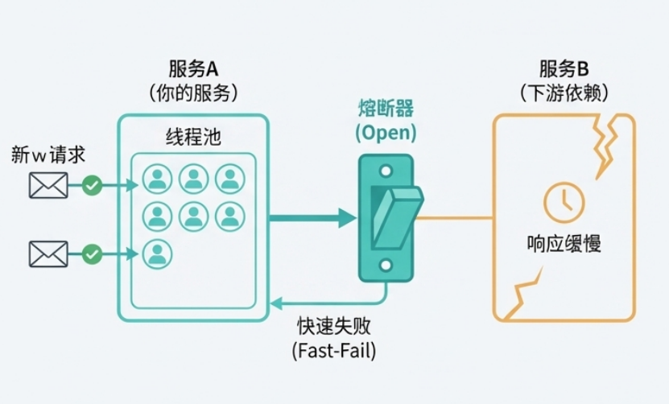

熔断器有三种状态：

1. **关闭（Closed）**：正常放行请求，同时统计错误率与超时率。
2. **打开（Open）**：错误率或超时率达到阈值后断开，后续请求**快速失败（Fast-Fail）**，不再真正调用下游，从而释放线程资源。
3. **半开（Half-Open）**：等待一段时间后放行少量探测请求，成功则恢复为关闭，失败则继续保持打开。

| 对比项 | 限流 | 熔断 |
| --- | --- | --- |
| 保护对象 | 自己不被流量打垮 | 自己不被下游拖垮 |
| 触发条件 | 请求量超过阈值 | 下游错误率/超时率超阈值 |
| 典型动作 | 拒绝多余请求 | 直接快速失败，过段时间探测恢复 |

熔断之后往往还要配合**降级**：返回缓存数据、默认值或友好提示，保证核心流程可用。

### 3.6 第 5 关：机房级灾难

如果光纤被挖断、机房起火，同机房内的所有服务器和备份会一起失效，软件层面的冗余全部归零。这时只能靠跨机房部署：

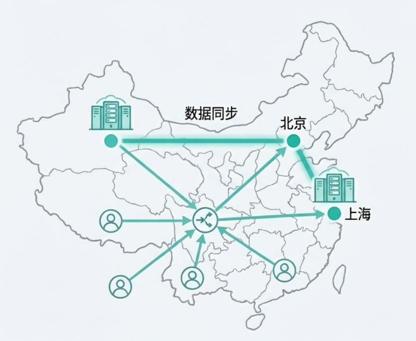

- **同城双活**：同城两个机房同时对外服务，专线互联，延迟通常在毫秒级。
- **异地多活**：跨城市部署（如北京 + 上海），能抵御城市级灾难，但跨地域的数据同步与一致性保障是真正的难点。
- **关键指标**：**RTO**（恢复时间目标，多久能恢复）与 **RPO**（恢复点目标，最多丢多少数据）。

### 3.7 小结：高可用设计的层次

高可用不是"多部署几台机器"，而是对故障的敬畏，通常按四层来构建：

1. **架构冗余**：用 Keepalived + VIP 解决入口单点，用哨兵、MHA 等解决数据单点。
2. **流量治理**：用限流抵御洪峰，避免被瞬间流量打挂。
3. **依赖治理**：用熔断、降级隔离下游不稳定服务。
4. **物理容灾**：资源允许时做同城双活甚至异地多活，抵御机房级灾难。

目标不是设计一个"永不宕机"的系统，而是设计一个**能快速从故障中恢复**的系统。

## 四、如何进行系统性能优化

性能问题往往表现为"接口偶尔很慢""高峰期卡顿"，原因可能分布在数据库、缓存、调用链路、JVM 各个层面。本节按从外到内的顺序，梳理四个最常见的优化切入点。

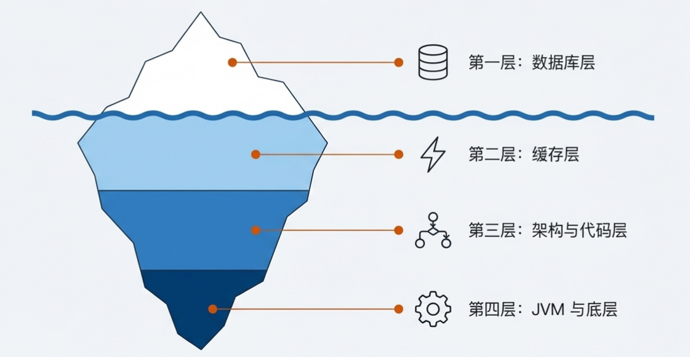

### 4.1 数据库：别只盯着索引

接口变慢时，数据库常常是主要原因（这属于经验判断，具体要结合监控定位）。但优化数据库远不止 `CREATE INDEX`。

**1. 索引到底有没有生效？**

SQL 写得不当、字段区分度太低、对索引列做函数运算，都可能让索引失效。判断依据不是"我加了哪个字段的索引"，而是**执行计划（EXPLAIN）**：

```sql
EXPLAIN SELECT id, amount, status FROM t_order WHERE user_id = 1001;
```

重点看这几列：

| 列 | 关注点 |
| --- | --- |
| `type` | `ALL` 表示全表扫描；`ref`、`range`、`eq_ref` 等表示走了索引 |
| `key` | 实际使用的索引名，为 `NULL` 说明没用到索引 |
| `rows` | 预估扫描行数，越大越要警惕 |
| `Extra` | 出现 `Using filesort`、`Using temporary` 通常意味着额外排序或临时表开销 |

**2. 单表数据量变大之后**

数据量增长会让 B+ 树层级变深、缓存命中率下降，磁盘 I/O 重新成为瓶颈。**"千万级"只是常见的经验分界，不是硬性阈值**——真正的拐点取决于行宽、索引数量、缓冲池大小和查询模式。

此时可以考虑：

- **水平拆分**：按用户 ID 取模，把数据分散到不同的库表，降低单表数据量。
- **冷热分离**：把近 3 个月的订单（热数据）与历史订单（冷数据）物理隔离，让绝大多数查询只访问较小的热库。

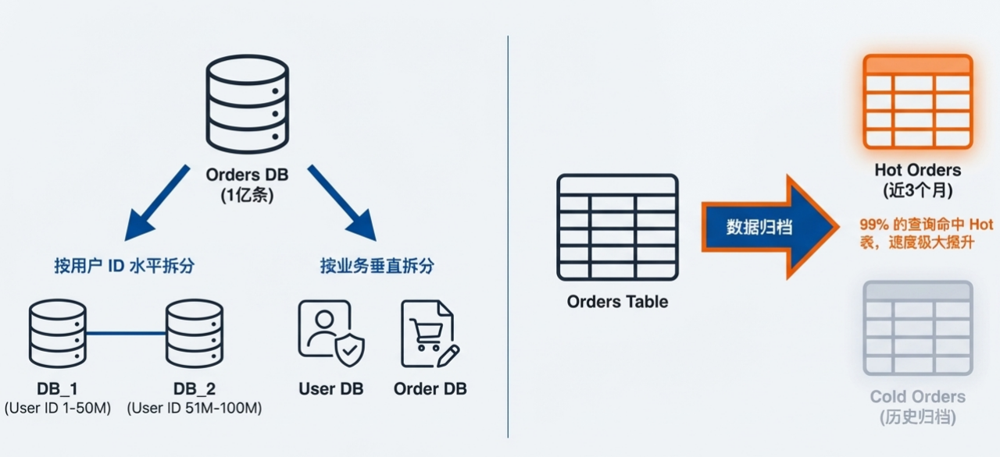

### 4.2 缓存：并发利器与它的三个陷阱

用内存换磁盘时间（空间换时间）是性能优化最有效的手段之一。引入 Redis 后吞吐会明显提升，但同时带来两个必须回答的问题。

**1. 数据一致性怎么保证？**

改了数据库，缓存里还是旧值，用户看到的就是"老黄历"。常见方案有先更新库再删缓存、延时双删、以及用 Canal 监听 Binlog 异步刷新缓存。这几种方案的对比在第六节详细展开。

**2. 缓存三灾：雪崩、穿透、击穿**

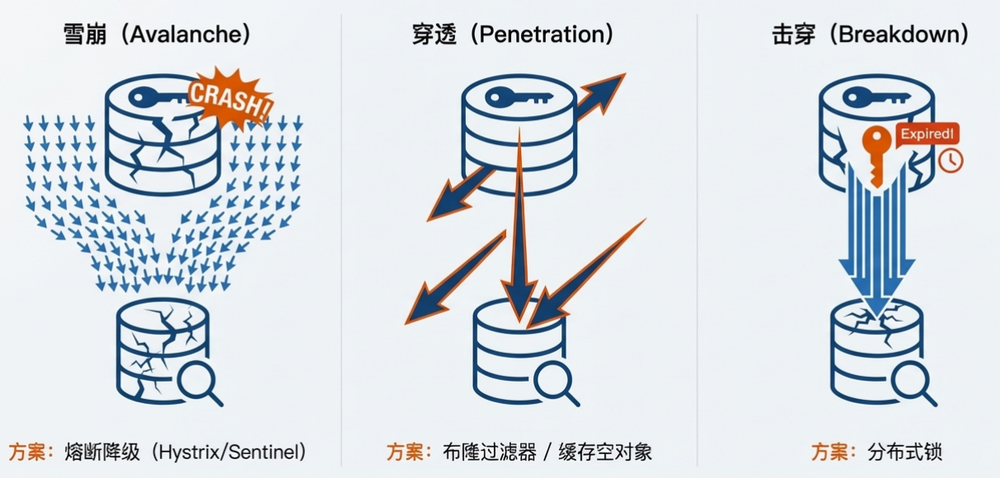

- **缓存雪崩**：大量 key 在同一时刻过期，或 Redis 整体不可用，请求瞬间全部压到数据库。**对策**：给过期时间加随机抖动、做缓存高可用，并用 Hystrix、Sentinel 等组件做熔断降级。
- **缓存穿透**：请求查询根本不存在的数据，缓存不命中，每次都打到数据库；恶意构造不存在的 ID 时会形成攻击。**对策**：布隆过滤器（一种用位数组判断"元素一定不存在/可能存在"的概率型结构）提前拦截，或把空结果也缓存一小段时间。
- **缓存击穿**：某个热点 key 过期的一瞬间，大量并发请求同时回源查库。**对策**：加互斥锁只让一个线程回源，或用逻辑过期 + 异步刷新。

### 4.3 架构：解耦与异步

如果数据库和缓存都优化过了，CPU 仍然偏高、吞吐上不去，就要看主流程里是不是有"慢动作"：同步调用第三方短信接口、同步生成复杂报表、同步发送邮件等。

网络 I/O 的耗时远高于内存计算，同步调用会让线程长时间处于阻塞（Blocked）状态，线程池很快被占满，新请求进不来。

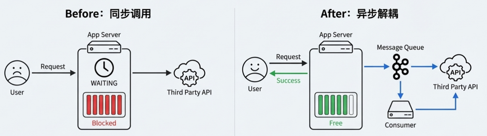

这时引入**消息队列（MQ）**，例如 RocketMQ、Kafka：

- **异步解耦**：用户下单后，先把消息投递到 MQ 并立即返回"下单成功"，扣库存、加积分、发短信交给消费者慢慢处理。
- **削峰填谷**：流量洪峰时 MQ 暂存请求，后端按自身处理能力平滑消费，避免被打崩。

代价是链路变长、需要处理消息重复与丢失，业务上要接受"最终一致"。

### 4.4 JVM 与线程池：最后的阵地

如果系统仍偶发"幽灵卡顿"、耗时忽高忽低，就该看 GC 日志了。

**1. 频繁 Full GC 的影响**

新生代（Young 区）设置过小，对象会过早晋升到老年代（Old 区）；超大对象也可能直接进入老年代。老年代满了会触发 Full GC，而 Full GC 通常伴随 **STW（Stop The World，暂停所有应用线程）**，此时再快的业务代码也得停下。

优化方向：

- 合理设置堆大小，`-Xms` 与 `-Xmx` 设为相同值，减少堆动态伸缩带来的抖动。
- 选择合适的垃圾收集器：JDK 9 起 G1 成为默认收集器；ZGC 自 JDK 15 起转为正式特性，目标是把停顿控制在很低的量级。
- 结合 GC 日志与堆转储定位大对象来源，而不是盲目调参数。

**2. 线程池的陷阱**

`Executors.newCachedThreadPool()` 看起来方便，但它会按需创建线程、没有线程数上限，任务突增时可能创建大量线程，引发频繁上下文切换，甚至耗尽内存。类似的，`newFixedThreadPool` 使用无界队列，任务堆积同样可能导致 OOM。

更稳妥的做法是直接用 `ThreadPoolExecutor` 显式指定每个参数：

```java
int cpu = Runtime.getRuntime().availableProcessors();

// CPU 密集型：线程数≈核数，通常再加 1 用于填补偶发停顿
ThreadPoolExecutor cpuPool = new ThreadPoolExecutor(
        cpu + 1, cpu + 1,
        0L, TimeUnit.MILLISECONDS,
        new ArrayBlockingQueue<>(1024),            // 有界队列，避免任务无限堆积
        new ThreadPoolExecutor.CallerRunsPolicy()   // 队列满时由调用线程执行，形成背压
);

// IO 密集型：线程数 ≈ 核数 × (1 + 平均等待时间 / 平均计算时间)，属经验公式
```

关键参数：核心线程数、最大线程数、空闲存活时间、任务队列、拒绝策略。队列必须是有界的，拒绝策略要与业务约定好（拒绝、丢最旧、调用方执行）。

### 4.5 小结

性能优化是一套组合动作，而不是单点修补：

- **数据库**：从执行计划到分库分表、冷热分离。
- **缓存**：用内存换时间，同时防住雪崩、穿透、击穿。
- **架构**：用 MQ 做异步解耦与削峰填谷。
- **JVM**：通过 GC 调优与线程池治理，压榨最后一点硬件性能。

## 五、如何设计高性能系统

"高性能"不是某个组件的属性，而是整条链路的结果。本节按请求经过的顺序，从边缘网络、代码并发、多级缓存、异步架构一直到操作系统内核，逐层说明可以优化的地方。

### 5.1 性能的本质：RT 与 QPS

衡量性能的两个核心指标：

- **响应时间（RT，Response Time）**：一次请求从发出到收到结果花了多久。
- **吞吐量（QPS/TPS）**：系统每秒能处理多少请求/事务。

两者相互制约：并发数不变时，RT 越低，QPS 越高；一旦系统接近饱和，RT 会急剧上升，QPS 反而下降。

优化的核心心法可以概括为两点：**读写分离**（让读和写各走各的路）与**分治**（把大问题拆成能并行的小问题）。

### 5.2 第一层：边缘网络与网关

请求还没进到 Java 服务，优化就已经开始了。

- **CDN（内容分发网络）**：图片、CSS、JS 等静态资源缓存在离用户最近的边缘节点，不占后端带宽。
- **网关（如 Nginx）**：作为流量入口做负载均衡与静态资源服务，把请求均匀分发到应用集群，避免单点过热。

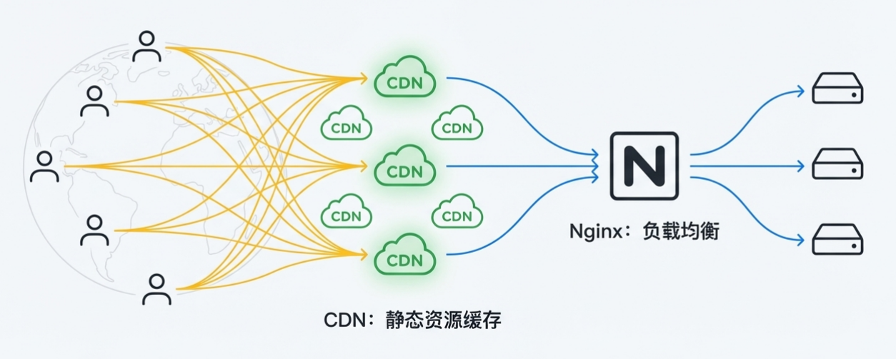

一句话概括这一层的目标：能不进后端的请求，就绝不进后端。

### 5.3 第二层：代码与并发

很多代码是串行的：查 A 库 → 查 B 库 → 调 C 接口，总耗时是三者之和。在多核 CPU 上，这是对资源的浪费——如果三个任务互不依赖，就完全可以并行。

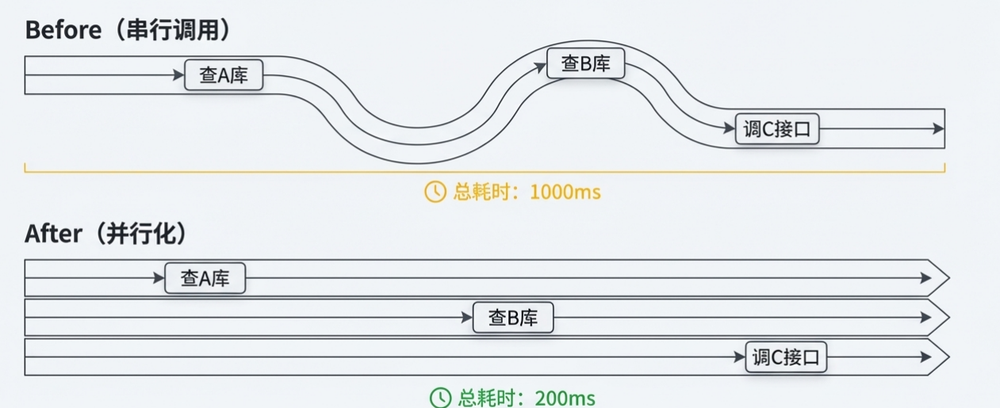

```java
// 三个互不依赖的远程调用并行执行，总耗时取决于最慢的那个
CompletableFuture<User> userFuture =
        CompletableFuture.supplyAsync(() -> userService.get(uid), pool);
CompletableFuture<List<Order>> orderFuture =
        CompletableFuture.supplyAsync(() -> orderService.list(uid), pool);
CompletableFuture<List<Coupon>> couponFuture =
        CompletableFuture.supplyAsync(() -> couponService.list(uid), pool);

CompletableFuture.allOf(userFuture, orderFuture, couponFuture).join();
```

并行化要注意三点：

- 必须使用**独立的业务线程池**，不要占用公共的 ForkJoinPool，避免相互影响。
- 每个任务都要有**超时控制**，否则最慢的那个会拖住整体。
- 并行度不是越高越好，线程切换与下游容量都是上限。

### 5.4 第三层：多级缓存

"加 Redis"只是其中一级。更完整的做法是把缓存分成多层，越靠近 CPU 的层越快、容量越小：

- **第一级：本地缓存（进程内）**：Caffeine、Guava Cache 等，访问只需纳秒到微秒级，容量受堆内存限制。
- **第二级：远程缓存（Redis 等）**：集中式缓存，容量大、可共享，访问需要一次网络往返。
- **兜底：数据库**：只让少量请求真正落到磁盘。

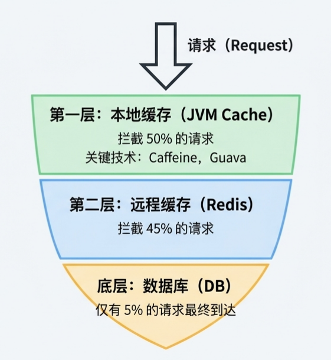

常见资料里"本地缓存拦截 50%、Redis 拦截 45%、数据库只承接 5%"这类比例属于**经验值**，实际比例取决于数据热点程度、缓存容量与过期策略，不要当成固定指标。

多级缓存的代价是**本地缓存的一致性**：多实例部署时，一个实例更新了数据，其他实例的本地缓存仍是旧值。常见解法是通过 MQ 广播失效消息，或设置较短的本地过期时间。

### 5.5 第四层：架构与异步

同步写数据库会让瞬时压力全部落到数据库上，写洪峰时甚至直接压垮它。

- **异步削峰**：请求先写入 MQ 并立即返回，后端消费者以平滑速率落库。这就是"削峰填谷"，本质是**用异步换同步**。

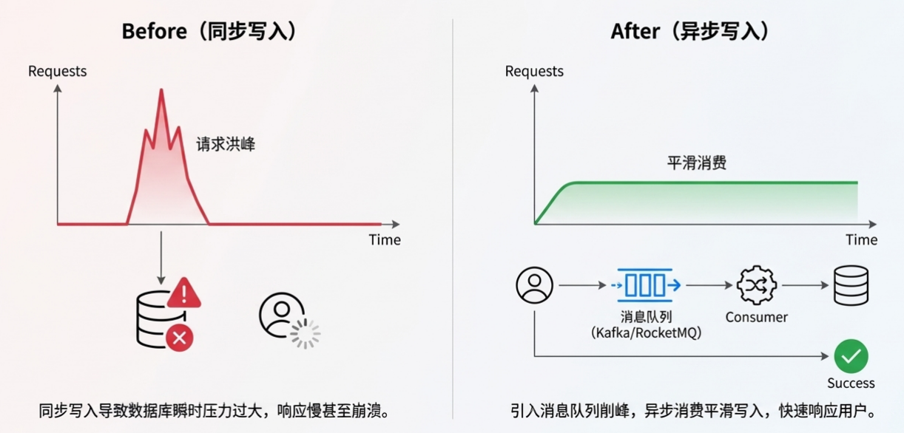

### 5.6 第五层：内核与无锁化（进阶了解，初学可略过）

这一层涉及操作系统与 CPU 指令，初学可以先了解结论，需要时再深入。

**1. 零拷贝（Zero-Copy）**

- **痛点**：传统 I/O 中，数据要在磁盘、内核缓冲区、用户缓冲区之间来回拷贝，还要伴随多次用户态/内核态切换，CPU 大量时间花在搬运数据上。
- **解法**：`mmap` 把内核缓冲区映射到用户空间，减少一次拷贝；`sendfile` 让数据在内核态直接从文件描述符送到 socket，省去用户态中转。
- **案例**：Kafka 大量使用 `sendfile` 提升日志传输效率。Netty 所说的"零拷贝"更多指应用层的 `ByteBuf` 复合缓冲区、切片等避免内存复制的机制，文件传输场景则通过 `FileRegion` 使用 `sendfile`。

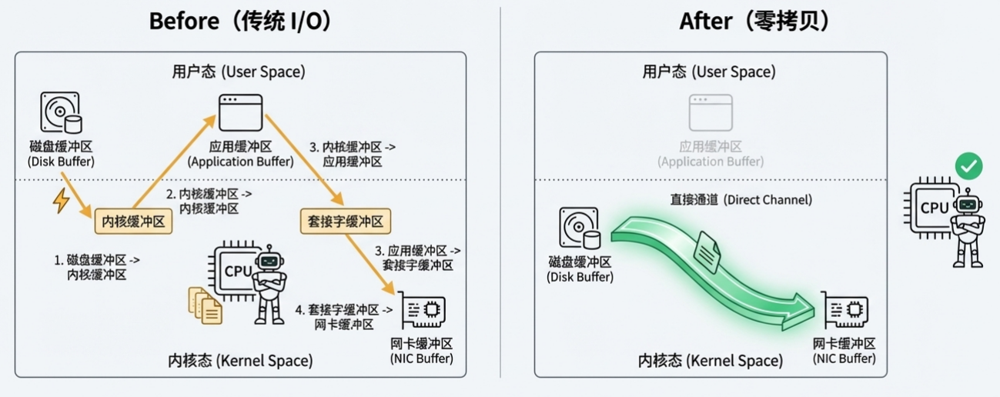

**2. 无锁化编程**

- **痛点**：高并发下线程争抢锁会引起阻塞与上下文切换，开销很大。
- **解法**：使用 **CAS（Compare-And-Swap，比较并交换）** 这类 CPU 原子指令，配合 `AtomicInteger`、`LongAdder` 等工具类；更高性能的队列可用 Disruptor 的环形数组结构，通过序号与内存屏障替代锁。

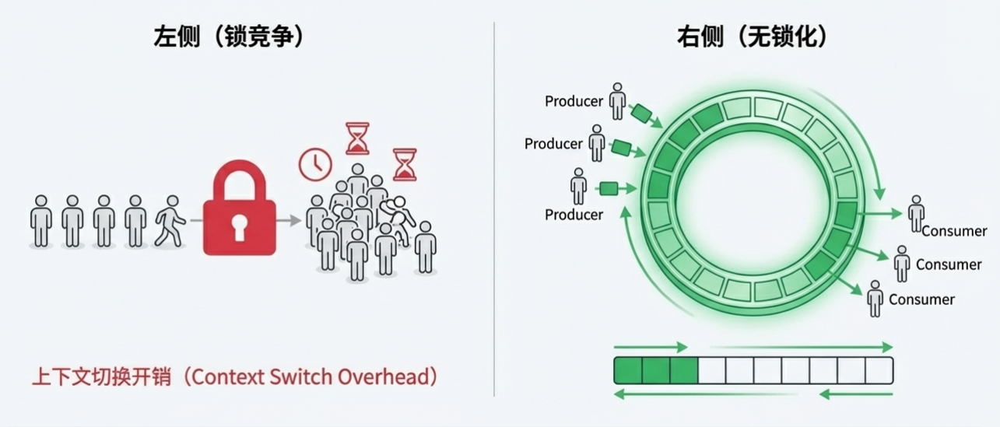

### 5.7 小结

高性能设计是一条从**网络 I/O**（零拷贝）、**多线程**（并行化）、到**架构**（多级缓存、异步 MQ）的完整链路。任何单点优化都会遇到天花板，真正的收益来自各层的配合。

## 六、高并发下如何保证数据的一致性和可靠性

一致性问题讨论的不是教科书定义，而是**性能**与**一致性**之间的权衡。本节先说明为什么高并发场景普遍选择最终一致性，再分别处理"数据库与缓存"和"服务与服务"两类不一致。

### 6.1 先明确目标：最终一致性

**强一致性**要求任何时刻读到的都是最新写入的值；**最终一致性**允许中间存在短暂的不一致窗口，但保证在没有新写入的情况下，数据最终会收敛到一致状态。

在绝大多数高并发业务中，追求全局强一致性的代价（锁、同步等待、可用性下降）过高，因此工程上通常选择**高可用前提下的最终一致性**，并接受一段"软状态"：数据在同步过程中允许处于中间状态。

### 6.2 数据库与缓存的一致性

业界把"读时先查缓存、未命中再查库并回填，写时先写库再让缓存失效"这套做法称为 **Cache Aside Pattern（旁路缓存）**。下面几个小节分别讨论其中的关键决策点。

#### 6.2.1 更新缓存还是删除缓存

一种常见但错误的做法是"更新数据库时顺便更新缓存"。问题在于并发写：

线程 A 与线程 B 同时写同一条数据：A 先写库、B 后写库；但 B 可能先更新缓存、A 后更新缓存。最终数据库是 B 的新值，缓存却是 A 的旧值，出现**脏数据**。

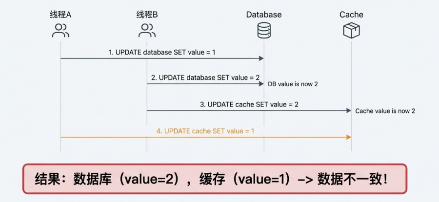

正确做法是**删除缓存**，让下一次读请求回源并把最新值回填。删除是一个"幂等的失效动作"，天然比写入更安全。

#### 6.2.2 先删缓存还是先写数据库

如果选择"先删缓存，再写数据库"，会出现另一种问题：

线程 A 删了缓存还没写库；线程 B 来读，缓存未命中，去数据库读到**旧值**并回填缓存；随后 A 才把新值写入数据库。结果缓存里长期保留旧数据，这就是**持久性脏数据**。

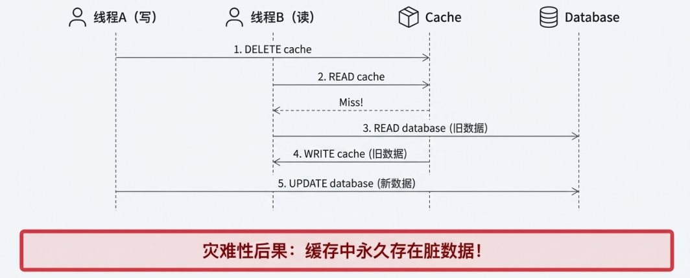

正确顺序是**先写数据库，再删缓存**。即使删除动作失败，也可以靠重试或过期时间兜底。

#### 6.2.3 为什么"延时双删"不可靠

"延时双删"指：删缓存 → 写库 → sleep 一段时间 → 再删一次缓存。

它的问题在于那个 `sleep` 只能靠猜：睡短了覆盖不了主从同步延迟，睡长了直接拖垮接口吞吐。而且它依赖单机调度，在集群环境下无法精确控制。因此它更适合作为过渡方案，而不是长期方案。

#### 6.2.4 更稳妥的做法：Binlog + MQ

把"删缓存"从业务代码里剥离出来，改由数据变更事件驱动：

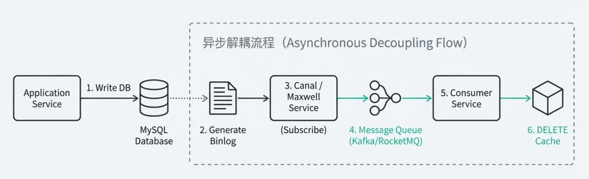

1. **解耦**：业务代码只负责写 MySQL，不再关心缓存。
2. **监听**：用 Canal、Maxwell 等工具**模拟 MySQL 从库**，向主库发送 dump 请求，解析 binlog 变更。
3. **投递**：把变更事件发送到 MQ（Kafka、RocketMQ 等）。
4. **消费**：消费者收到消息后删除对应缓存 key。
5. **保障**：借助 MQ 的重试机制保证最终删除成功，多次失败则告警转人工处理。

这套方案的好处是业务无侵入、可重放、可观测；代价是链路更长，需要接受秒级的同步延迟。

### 6.3 微服务间的分布式事务

#### 6.3.1 为什么 2PC 不适合高并发

**2PC（两阶段提交）**分准备（Prepare）与提交（Commit）两个阶段：协调者先让所有参与者准备，全部就绪后再统一提交。

它在高并发系统中的问题是：**同步阻塞**——参与者在准备阶段就要锁定资源并等待协调者指令，锁持有时间长、吞吐低；同时协调者本身是单点，一旦挂掉，参与者可能长时间处于不确定状态。

#### 6.3.2 RocketMQ 事务消息与回查

柔性事务的思路是：不锁资源，用"可补偿 + 可回查"保证最终一致。RocketMQ 的事务消息就是典型实现：

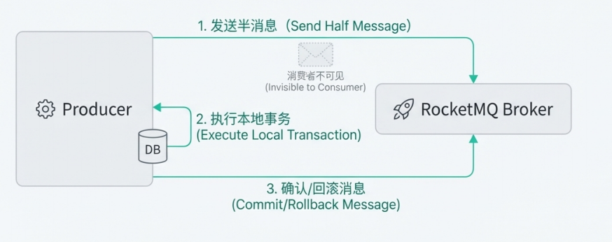

1. **发送半消息（Half Message）**：生产者先把消息发给 Broker，Broker 存储后标记为"暂不投递"，此时对消费者**不可见**。
2. **执行本地事务**：生产者执行本地数据库操作（例如创建订单）。
3. **提交或回滚**：本地事务成功则发送 Commit，Broker 把消息标记为可投递；失败则发送 Rollback，消息被丢弃。
4. **事务回查**：如果 Broker 长时间没收到二次确认（网络中断、生产者重启等），会主动回调生产者的检查接口；生产者查询本地数据库后补发 Commit 或 Rollback。

据 Apache RocketMQ 官方文档，Broker 等待一段时间后仍未确定状态时也会触发回查；若超过规定时间仍无法确认，**默认回滚**该消息。

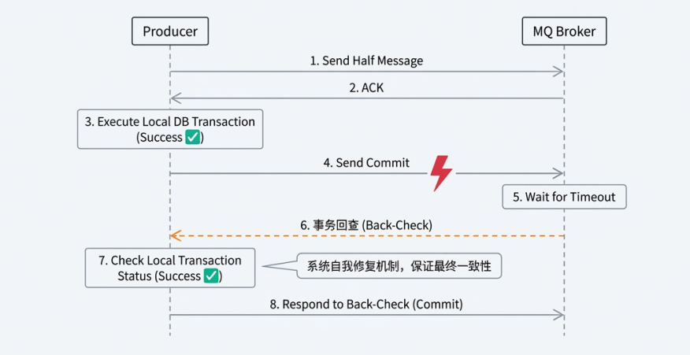

### 6.4 小结

回答"高并发下如何保证一致性"，逻辑闭环是三步：

1. 放弃全局强一致性，选择**最终一致性**。
2. 用 **Binlog + MQ 异步解耦** 解决数据库与缓存的同步问题。
3. 用 **RocketMQ 事务消息 + 回查** 解决跨服务的数据一致性问题。

核心思维是：**可用性优先，接受软状态，用最终一致性兜底**。

## 七、什么是三高架构

"三高"经常被拆成三个孤立的概念去背，但它们其实是同一套系统里相互牵制的三个目标。本节先给出三者的定义与主要手段，再说明它们之间的冲突与取舍。

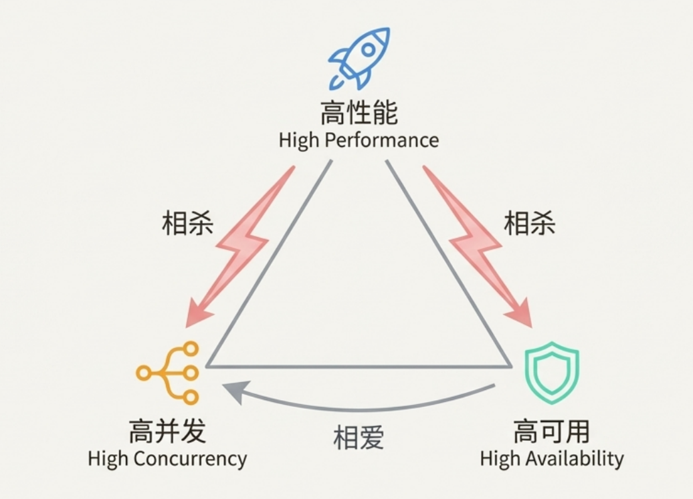

### 7.1 三高的定义与手段

#### 高性能：唯快不破

- **定义**：响应时间（RT）短、吞吐量（TPS/QPS）高。
- **痛点**：传统架构慢在磁盘 I/O、慢在数据库查询。
- **核心武器**：**缓存（Cache）**。
- **落地思路**：把 Redis 放在数据库前面，让热点数据留在内存里。内存访问在百纳秒量级，SSD 随机读在百微秒量级，机械磁盘寻道在毫秒量级（见文末参考资料中的延迟数据），差距是数量级的——这正是缓存有效的根本原因。

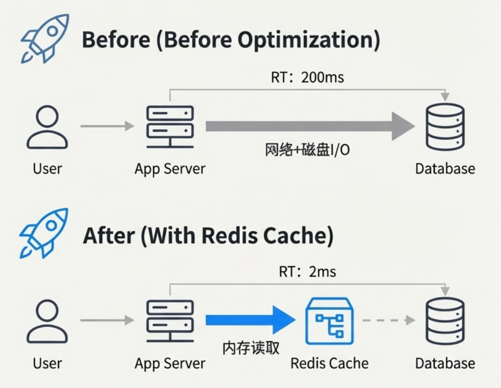

#### 高并发：扛住洪峰

- **定义**：系统在同一时间能承载的请求数量。
- **痛点**：单机性能再强，CPU、网卡、连接数都有上限，流量洪峰下必然顶不住。
- **核心武器**：**分流（水平扩展）** 与 **削峰（异步）**。
- **落地思路**：
    1. **水平扩展**：用 Nginx 做负载均衡，后端 Tomcat 集群扩容，靠多台机器分摊流量。
    2. **异步队列**：引入 MQ 建"水库"，洪峰来时先蓄水，再匀速放水，保护后端。

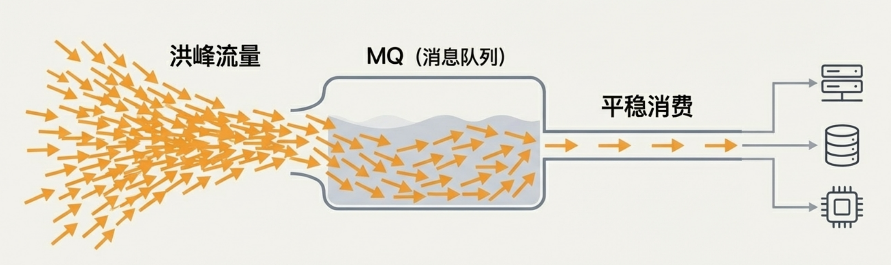

#### 高可用：持续可用

- **定义**：系统在部分组件故障时仍能提供服务。常用 **SLA（服务等级协议）** 衡量，例如"4 个 9"即 99.99%，折算下来全年不可用时间约 52.6 分钟。
- **核心武器**：**冗余（Redundancy）**。
- **落地思路**：数据库主从复制、服务多实例、异地多活，本质都是"不要只有一套"。主节点挂了，从节点顶上。

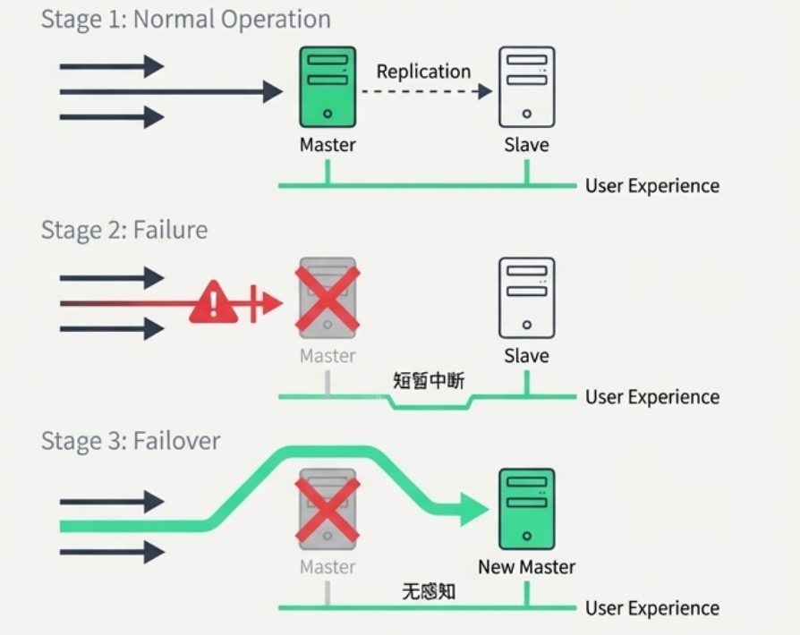

### 7.2 三者之间的取舍

三者无法同时做到最优，必须根据业务做取舍。

#### 冲突一：高可用 vs 高性能

为了保证高可用，数据要冗余，就要做主从同步。同步复制需要等待从库确认，主库的写响应时间随之变长——**想要更强的一致性保障，往往要牺牲一部分写性能**。

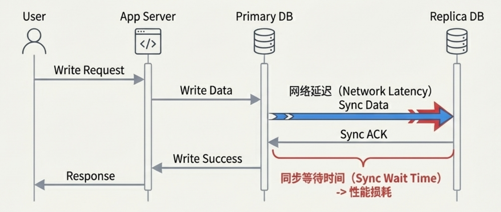

#### 冲突二：高并发 vs 数据一致性

为了抗住高并发，我们用 MQ 做异步处理。请求还在队列里排队时，数据库尚未更新，用户可能读到旧数据，形成**数据不一致窗口**。我们获得的是最终一致性，代价是放弃了强一致性。

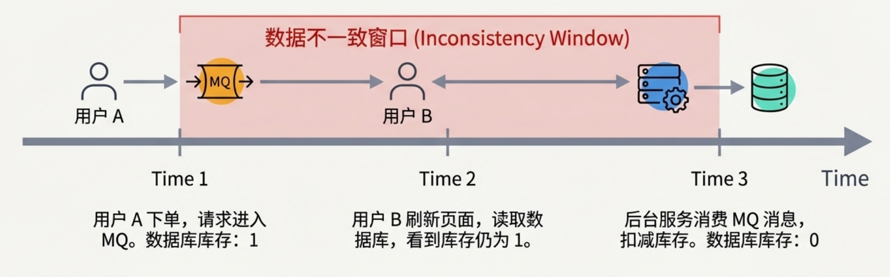

### 7.3 按业务场景做平衡

- **金融核心系统**：优先强一致与正确性，可以接受较低的并发和稍高的延迟。
- **电商秒杀系统**：优先高并发与高可用，允许库存扣减等环节存在短暂延迟，用异步与补偿保证最终正确。

判断依据是"错了会怎样"：账务错误不可接受，而"点赞数晚几秒更新"完全可以接受。

### 7.4 小结

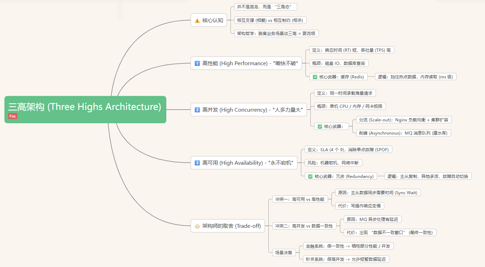

三高架构不是技术名词的堆砌，而是**基于业务场景的平衡**：先明确业务能容忍什么、不能容忍什么，再决定在哪一层加缓存、在哪一层做冗余、在哪一处放弃强一致。

## 参考资料

以下是本文核对事实时参考的主要来源。

- Nginx 官方文档. Module ngx_http_upstream_module（weight、ip_hash、least_conn、hash consistent）. 2025
- IETF. RFC 5798: Virtual Router Redundancy Protocol (VRRP) Version 3 for IPv4 and IPv6. 2010
- IETF. RFC 2697: A Single Rate Three Color Marker（令牌桶计量模型）. 1999
- Redis 官方文档. High availability with Redis Sentinel. 2025
- Apache RocketMQ 官方文档. Transaction Message. 2025
- Alibaba Canal 项目说明（模拟 MySQL 从库、解析 binlog）. 2024
- 百度 UidGenerator 项目说明（雪花算法位划分可配置）. 2017
- Jeff Dean 等. Latency Numbers Every Programmer Should Know. 2012
