# 分布式知识汇总

分布式系统是把一个系统拆成多台服务器上的多个组件、让它们通过网络通信与协调来共同完成工作的系统。它解决了单机扛不住流量、一台机器挂掉就整体不可用的问题，同时也带来了一批新难题：一次操作跨了多个服务，事务怎么保证？多个节点同时改一份数据，锁怎么互斥？网络断开时，一致性和可用性该牺牲哪一个？

本文按"是什么 → 为什么需要 → 怎么用"的顺序梳理这些基础话题：先给出分布式系统与分布式事务的定义，再逐个讲清两阶段提交（2PC）、三阶段提交（3PC）、TCC、Saga、本地消息表、MQ 事务消息、最大努力通知等事务方案，然后讨论 CAP 定理与 BASE 理论、Seata 框架、幂等性、分布式锁和限流算法。读者只需会写 Java 的增删改查，不要求读过框架源码；术语第一次出现时会先给一句话解释，抽象机制尽量配一个生活化的比喻。

## 本文导读

- [1. 什么是分布式系统](#1-什么是分布式系统)：定义、两种常见形态、它最初要解决的问题与代价
- [2. 什么是分布式事务](#2-什么是分布式事务)：从本地事务的 ACID 到跨库事务
- [3. 分布式事务的常见实现方案](#3-分布式事务的常见实现方案)：2PC、3PC、TCC、Saga、本地消息表、MQ 事务消息、最大努力通知与选型
- [4. CAP 定理](#4-cap-定理)：为什么三者不能同时满足，CA、CP、AP 怎么选，BASE 与最终一致性
- [5. Seata 分布式事务框架](#5-seata-分布式事务框架)：TC、TM、RM 三个角色，XA 模式与 AT 模式
- [6. 幂等性](#6-幂等性)：重复请求从哪来、八种常见方案与取舍
- [7. 分布式锁](#7-分布式锁)：数据库、Redis、ZooKeeper 三种实现的差异
- [8. 限流算法](#8-限流算法)：计数器、漏桶、令牌桶
- [9. 总结与参考资料](#9-总结与参考资料)

## 1. 什么是分布式系统

这一节先把"分布式系统"这个词说清楚：它长什么样、为什么会出现、又付出了什么代价。后面的事务、锁、CAP，都是这些代价的具体表现。

### 1.1 定义

一个系统的**各组件**分别部署在不同服务器上，**彼此通过网络通信和协调**，这样的系统就是分布式系统（Distributed System）。

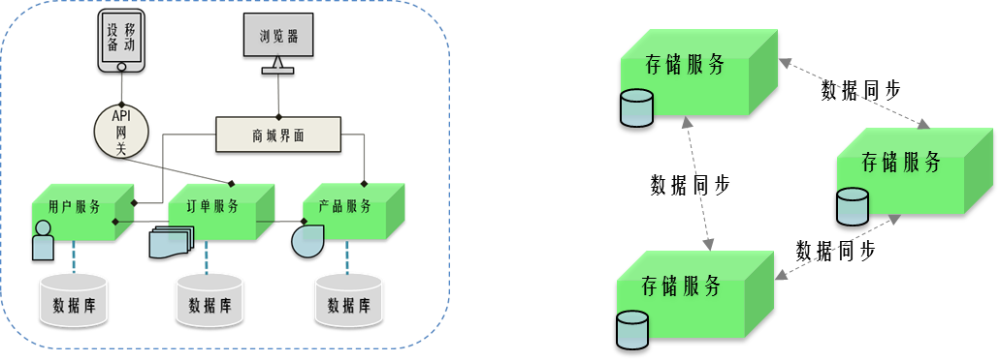

### 1.2 两种常见形态

同样是"分布"，落地时有两种完全不同的样子：

- **多个不同组件分布在网络上互相协作**：例如电商网站由用户服务、商品服务、订单服务、支付服务组成，各自是一个独立进程，靠接口调用串起一次下单。
- **同一个组件的多个副本组成集群，对外像一个组件**：例如数据存储服务为了不丢数据而做多副本冗余，数据被修改时，副本之间也要通过通信来复制数据。

区别在于：前者是"分工"，拆的是业务；后者是"备份"，拆的是同一份职责。实际系统往往两者兼有。

### 1.3 为什么需要分布式

**分布式最早出现的目的，首先是解决单点问题、避免单点故障，然后才是解决性能问题。**

- **避免单点故障（Single Point of Failure）**：单机部署时，这台机器一停，整个服务就停。改成多台机器后，一台坏了还有别的机器顶上。
- **提升性能与容量**：单机的 CPU、内存、磁盘、连接数都有上限。把请求分散到多台机器，整体吞吐就上去了。

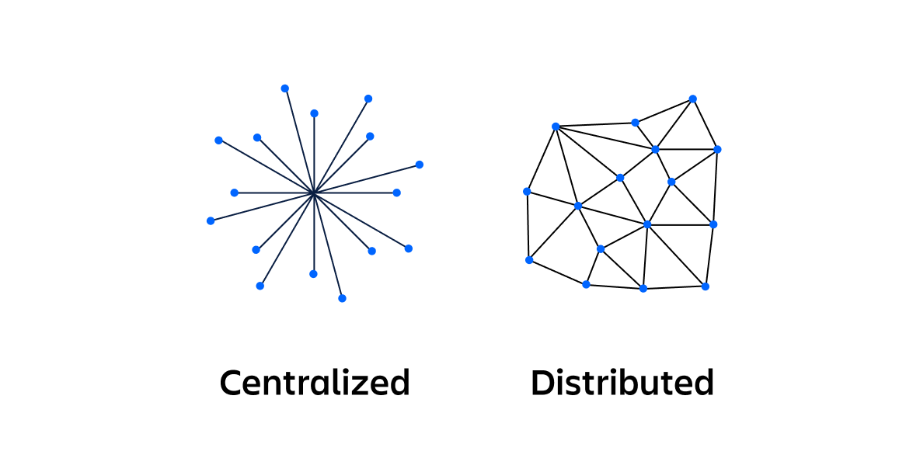

### 1.4 代价：三个绕不开的现实

分布式不是免费的，它把"一台机器内部的事"变成了"网络上的事"，于是出现三类新问题，这也是后文所有方案的出发点：

1. **网络不可靠**：调用可能超时、丢包、乱序。超时尤其麻烦——你不知道对方是没收到，还是收到了但回复丢了。
2. **部分失败**：单机程序要么全活要么全死；分布式系统里经常是"一部分节点活着、一部分节点挂了"，业务处于中间状态。
3. **没有全局时钟**：每台机器的本地时间都可能不准，靠时间戳判断"谁先谁后"并不可靠。

## 2. 什么是分布式事务

理解了分布式系统的代价，就能理解为什么"一次操作跨多个库"会变成难题。这一节从最熟悉的本地事务讲起，再把它扩展到多个数据库。

### 2.1 本地事务与 ACID

本地事务指只涉及一个数据库连接、一个数据库的事务，直接交给数据库自身的事务机制处理。它要满足 ACID 四个特性：

- **A（Atomicity，原子性）**：事务里的操作要么全做，要么全不做。
- **C（Consistency，一致性）**：事务前后数据都满足业务约束，例如转账前后两个账户总额不变。
- **I（Isolation，隔离性）**：并发执行的事务互不干扰，靠隔离级别（读未提交、读已提交、可重复读、串行化）来约束。
- **D（Durability，持久性）**：事务提交后结果不会因为宕机而丢失。

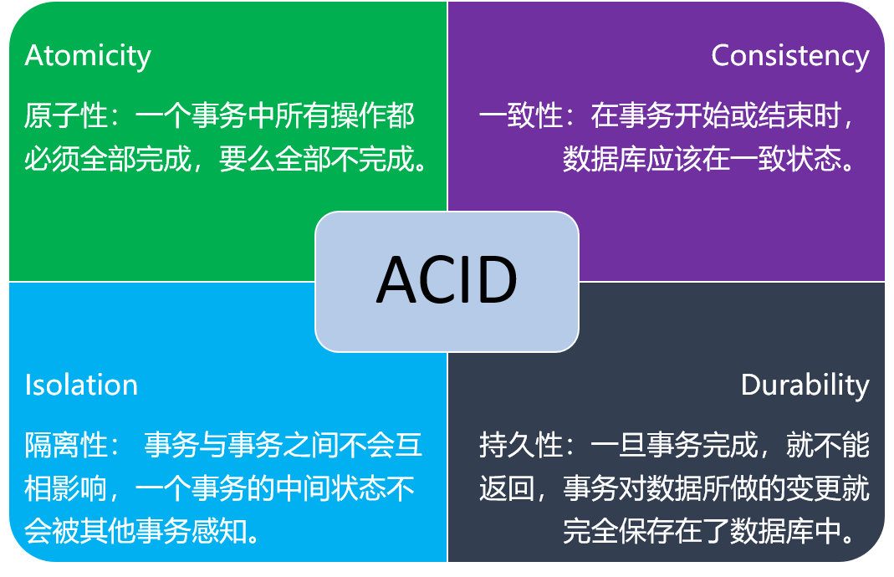

### 2.2 跨库场景

而在分布式环境下，一次业务操作往往会涉及多个数据库：下单要扣库存库、写订单库、扣账户库，它们可能在不同的实例、不同的机器，甚至不同的机房。

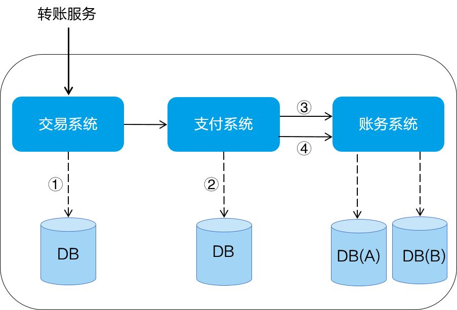

每个库自己的本地事务只能管好自己那一份，没有办法把三个库的提交"捆"在一起。如果库存扣了、订单写了，账户扣款却失败，数据就不一致了。

### 2.3 定义与两个关键要求

**分布式事务**就是把"对同一个库的事务"这个概念，扩大到"对多个库（多个服务）的事务"，目的是保证分布式系统中的数据一致性。

换句话说：一次操作需要由多个服务协同完成，这种由不同服务之间通过网络协同完成的事务，称为分布式事务。

要把它做对，有两个关键点：

1. **需要记录事务在任何节点所做的所有动作**：只有记下来，出错时才知道该撤销什么、恢复到哪一步。
2. **事务进行的所有操作要么全部提交，要么全部回滚**：这是原子性在分布式场景下的延伸。

### 2.4 难点在哪里

本地事务靠数据库的日志和锁就能做到 ACID；分布式事务没有这样一个"管住所有库"的角色，只能靠应用层协议去协调，于是要面对：

- 参与者可能提交成功、也可能失败，还可能"卡住不响应"；
- 协调者自己也可能宕机；
- 网络超时让"成功/失败"变得不确定，只能靠重试、回查、对账来收敛。

后面的 2PC、TCC、Saga、消息表等方案，本质上都是在回答同一个问题：**当参与者可能失败、消息可能丢失时，怎样让所有分支最终要么都成功、要么都撤销。**

## 3. 分布式事务的常见实现方案

这一节按"强一致 → 最终一致"的顺序介绍七种方案。读的时候不必死记流程，抓住三件事即可：谁是协调者、失败时靠什么回滚、一致性是强一致还是最终一致。

### 3.1 2PC（两阶段提交）

2PC（Two-Phase Commit，两阶段提交）把一次事务的提交拆成"资源准备"和"资源提交"两个阶段，由事务协调者（Coordinator）统一指挥所有事务参与者（Participant）：如果准备阶段所有参与者都预留资源成功，就进入第二阶段的资源提交，否则协调者通知大家回滚。

一个生活化的比喻：像旅行团发车前，导游先挨个问"都上车了吗、都准备好了吗"，全员确认后才发车；只要有一个人没准备好，行程就取消。

#### 3.1.1 第一阶段：准备阶段

由事务协调者询问、通知各个事务参与者是否准备好执行事务，流程如下：

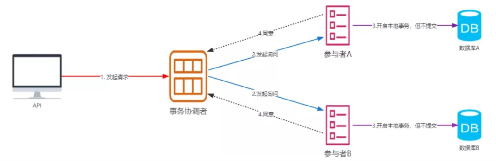

- ① 协调者向所有参与者发送事务内容，询问是否可以提交事务，并等待答复。
- ② 各参与者执行本地事务操作，将 undo 和 redo 信息记入事务日志中，但**不提交事务**（undo 记录"怎么撤销"，redo 记录"怎么重做"，是数据库实现回滚与恢复的基础）。
- ③ 参与者执行成功则反馈"同意"，否则反馈"中止"，表示事务不可以执行。

#### 3.1.2 第二阶段：提交阶段

协调者收到各个参与者的准备结果后，根据反馈情况通知大家 commit 提交或 rollback 回滚。

**（1）事务提交**

当第一阶段所有参与者都反馈同意时，协调者发起正式提交请求，所有参与者都回复 ACK 后事务完成：

- ① 协调者向所有参与者发出正式提交的 commit 请求。
- ② 收到 commit 请求后，参与者正式执行事务提交，并释放在整个事务期间占用的资源。
- ③ 参与者完成提交后，向协调者发送 ACK 消息。
- ④ 协调者收到所有参与者的 ACK 后，完成事务。

正常提交时，完整流程如下：

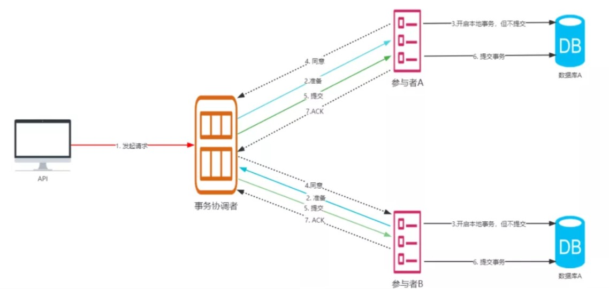

**（2）事务回滚**

如果任意一个参与者在第一阶段返回"中止"，或者协调者在询问超时前无法拿到所有参与者的响应，这个事务就会被回滚：

- ① 协调者向所有参与者发出 rollback 请求。
- ② 参与者利用阶段一写入的 undo 信息执行回滚，并释放事务期间占用的资源。
- ③ 参与者在完成回滚后，向协调者发送回滚完成的 ACK。
- ④ 协调者收到所有参与者的 ACK 后，取消事务。

回滚时的完整流程如下：

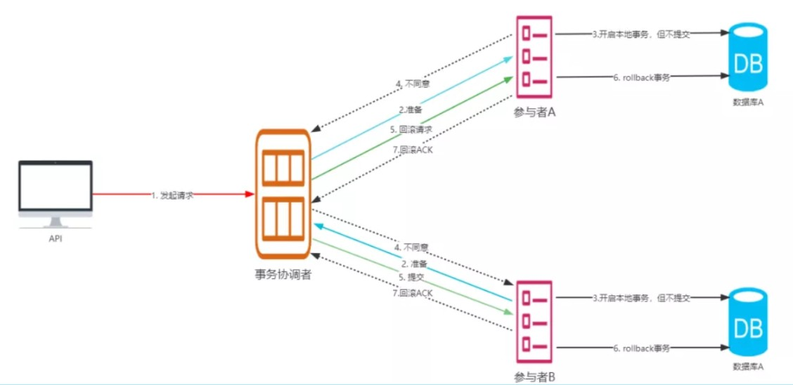

#### 3.1.3 2PC 的缺点

2PC 能提供原子性，但有几个明显短板：

1. **性能问题**：执行过程中所有参与节点都是事务阻塞性的，参与者占用公共资源期间，第三方节点访问这些资源只能阻塞等待。为了数据一致性牺牲了可用性，不适合高并发、高性能场景。
2. **可靠性问题**：2PC 非常依赖协调者。协调者故障时（尤其是第二阶段），所有参与者都会处于"锁着资源、等指令"的状态。即便重新选举出一个协调者，也解决不了参与者被阻塞的问题。
3. **数据一致性问题**：第二阶段中，协调者发出 commit 请求后若发生局部网络异常，或协调者自身故障，可能只有一部分参与者收到 commit 并提交，另一部分没收到、无法提交，系统就出现了数据不一致。
4. **二阶段无法解决的问题**：协调者在发出 commit 消息后宕机，而唯一收到这条消息的参与者也宕机。此时即使选出新协调者，这条事务的状态也是不确定的——没人知道它究竟提交了没有。

### 3.2 3PC（三阶段提交）

3PC（Three-Phase Commit，三阶段提交）是 2PC 的改进版，改动点有两个：

- 在协调者和参与者**双方**都引入超时机制；
- 把 2PC 的准备阶段**拆成两个阶段**（CanCommit 询问、PreCommit 预提交），使进入最后提交阶段之前，各参与节点的状态是一致的。

因此 3PC 分为三个阶段：CanCommit、PreCommit、doCommit。

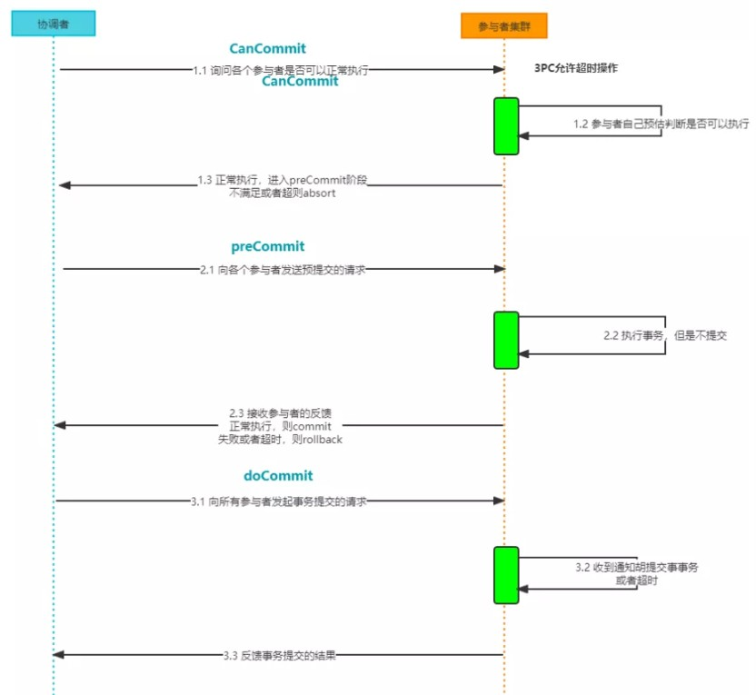

#### 3.2.1 阶段一：CanCommit（询问阶段）

协调者向参与者发送 canCommit 请求，参与者如果能提交就返回 Yes，否则返回 No：

- **事务询问**：协调者向所有参与者发出包含事务内容的 canCommit 请求，询问是否可以提交事务，并等待所有参与者答复。
- **响应反馈**：参与者收到请求后，如果认为可以执行事务，就反馈 yes 并进入预备状态，否则反馈 no。

注意这一阶段只做"表态"，并不执行本地事务、也不占用资源。

#### 3.2.2 阶段二：PreCommit（预提交阶段）

协调者根据参与者的反馈决定是否进入 PreCommit，有两种可能。

**（1）执行事务**：所有参与者都反馈 yes 时，协调者预执行事务：

- ① 发送预提交请求：协调者向参与者发送 PreCommit 请求，并进入准备阶段。
- ② 事务预提交：参与者收到 PreCommit 请求后执行本地事务操作，并把 undo、redo 信息记入事务日志（但不提交事务）。
- ③ 响应反馈：执行成功则返回 ACK，同时开始等待最终指令。

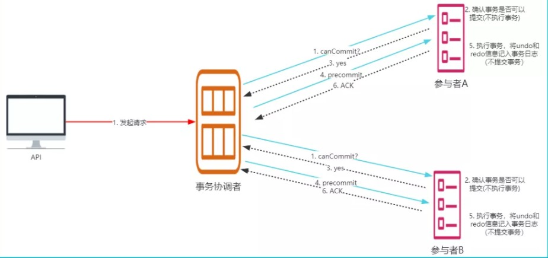

**（2）中断事务**：任何一个参与者返回 No，或协调者等待超时都没能收到全部响应时，执行中断：

- ① 发送中断请求：协调者向所有参与者发送 abort 请求。
- ② 中断事务：参与者收到 abort 请求后（或超时后仍未收到请求）执行事务中断。

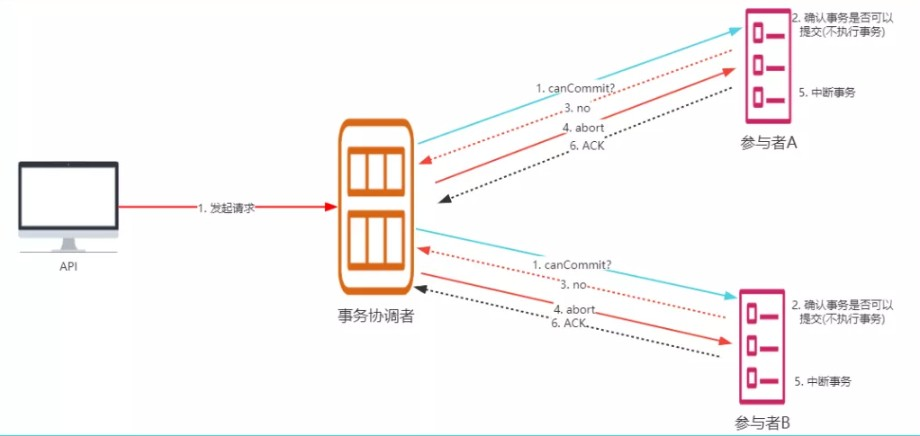

#### 3.2.3 阶段三：doCommit（提交阶段）

这一阶段才是真正的事务提交，同样分两种情况。

**（1）提交事务**：

- ① 发送提交请求：协调者收到所有参与者的 ACK 后，从预提交状态进入提交状态，向所有参与者发送 doCommit 请求。
- ② 本地事务提交：参与者收到 doCommit 后执行正式提交，并在完成后释放所有事务资源。
- ③ 响应反馈：提交完成后向协调者发送 ack。
- ④ 完成事务：协调者收到所有 ack 后完成事务。

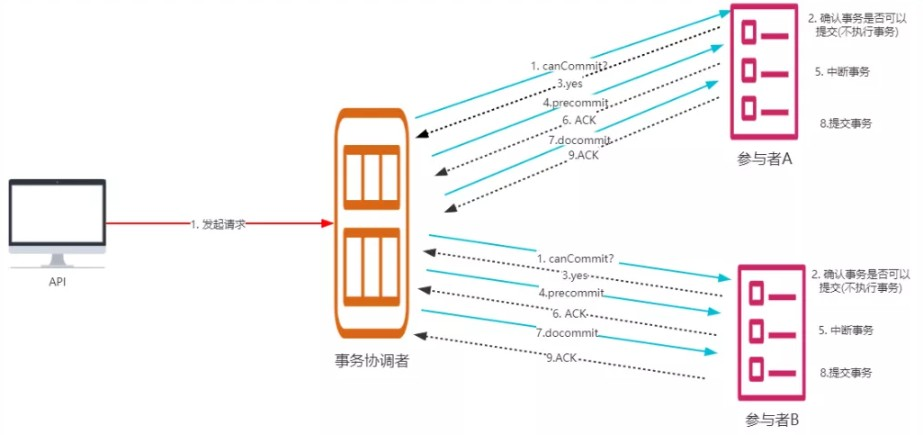

**（2）中断事务**：任何一个参与者反馈 no，或协调者等待超时仍收不到全部反馈时中断事务：

- ① 发送中断请求：协调者若仍正常工作，向所有参与者发出 abort 请求。
- ② 事务回滚：参与者收到 abort 后，利用阶段二记录的 undo 信息回滚，并释放所有事务资源。
- ③ 反馈结果：回滚完成后向协调者反馈 ACK。
- ④ 中断事务：协调者收到 ACK 后执行事务中断。

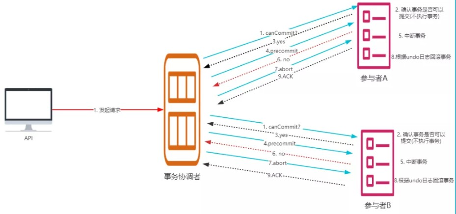

进入 doCommit 阶段后，无论协调者出问题，还是协调者与参与者之间的网络出问题，参与者都可能收不到 doCommit 或 abort。此时参与者会在等待超时后**继续执行事务提交**。这样做的理由是概率判断：能进入第三阶段，说明第一阶段的 CanCommit 全员回答 yes、第二阶段全员同意 PreCommit，那么"提交成功"的可能性远大于"应当回滚"。这就是 3PC 用超时换取"少阻塞"的代价——用可能性代替确定性。

#### 3.2.4 3PC 的优缺点

与 2PC 相比：

- **降低了阻塞范围**：参与者在等待超时后可以自行中断或提交，不必无限期锁着资源等协调者。
- **缓解了协调者单点问题**：等待超时后协调者或参与者都会推进事务，阶段三中协调者失联时参与者会继续提交。

**但数据不一致问题依然存在**：参与者在收到 preCommit 后等待 doCommit 时，如果协调者决定中断事务、却又因为网络问题无法把 abort 送到参与者，参与者会按超时逻辑继续提交，结果就与协调者的意图相反。

所以 2PC 和 3PC 都无法保证数据绝对一致。实践中通常补充**监控告警 + 自动补偿**：监控到事务长时间处于中间状态时报警，再用脚本核对差异、补偿数据。

> 说明：3PC 的"超时即提交"依赖网络延迟大体有界的假设，且通常只讨论单点故障的情形；一旦发生真正的网络分区（两侧互相收不到消息），仍可能出现上述不一致。这也是多数互联网系统宁可选最终一致方案（TCC、Saga、消息表）的原因。

### 3.3 TCC（Try-Confirm-Cancel）

#### 3.3.1 是什么

TCC（Try-Confirm-Cancel）是**应用层的两阶段提交**：把"提交"这件事从数据库层搬到业务代码层，因此对代码侵入性强。

它的核心思想是：每个操作都要实现对应的确认和补偿动作，也就是业务逻辑的每个分支都要提供 try、confirm、cancel 三个方法。

- 第一阶段由业务代码编排，调用各参与者的 Try 接口做**资源预留**；
- 所有参与者的 Try 都成功后，事务协调者提交事务，调用各参与者的 Confirm 接口真正提交业务操作；
- 任一 Try 失败，则调用所有参与者的 Cancel 接口回滚事务。

由于 Confirm 或 Cancel 可能被重试，这两部分都必须支持幂等（同一个请求执行多次，结果与执行一次相同）。

#### 3.3.2 执行流程

（1）第一阶段 **Try**：业务系统做检测并预留资源（相当于先加锁、锁住资源）。比如下单场景，Try 阶段并不是真正扣减库存，而是把要用的库存"锁定"起来，别人不能卖。

（2）第二阶段根据第一阶段的结果决定走 Confirm 还是 Cancel：

- **Confirm**：执行真正的业务（扣减锁定的库存），并释放锁；
- **Cancel**：释放 Try 阶段预留的资源（出问题时把锁定解开）。

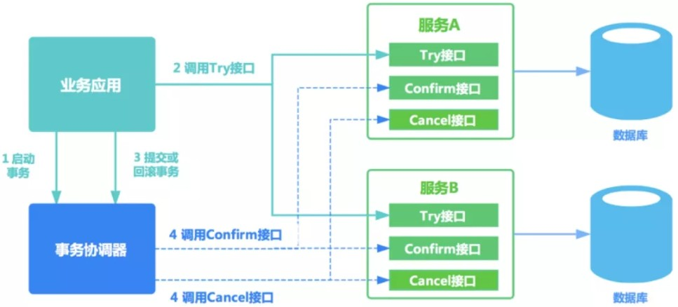

#### 3.3.3 如何保证最终一致性

- TCC 以 Try 为中心，Confirm 和 Cancel 都围绕 Try 展开。因此 Try 阶段的保障性最好：即使后续失败，仍有 Cancel 可以撤销它的执行结果。
- TCC 的设计假设是"Try 成功则 Confirm 基本不会失败"——Confirm 只是把 Try 已锁定的资源落定，通常不会因业务规则失败。注意这只是**设计假设**，不是定律：Confirm 仍可能因数据库故障、超时等原因失败，所以框架层面必须重试。
- Confirm 与 Cancel 失败时，由 TCC 框架进行重试补偿。
- 仍存在极低概率在 Confirm/Cancel 环节彻底失败（例如重试次数耗尽、资源永久不可用），此时需要定时任务扫描悬挂事务或人工介入。

#### 3.3.4 三个必须处理的问题

**（1）允许空回滚**

空回滚产生的原因是：Try 请求超时或丢包，事务管理器判定失败并触发二阶段的 Cancel；此时参与者根本没收到 Try，却先收到了 Cancel。

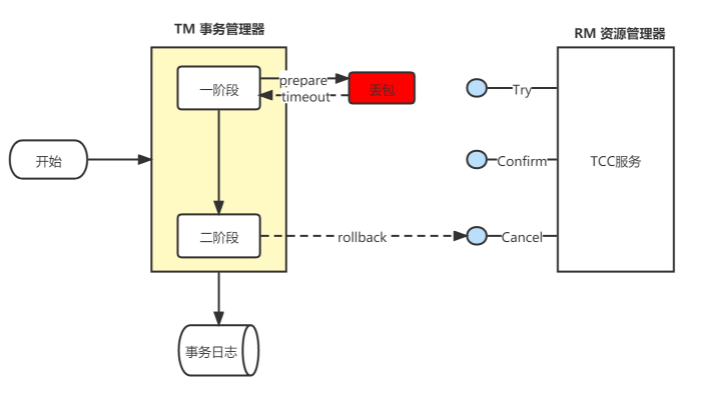

所以 Cancel 接口必须允许空回滚：执行 Cancel 时如果发现没有对应的事务 xid 或业务主键，也要返回"回滚成功"，让事务管理器认为已经回滚，否则事务会一直卡在重试里。

**（2）防悬挂控制**

悬挂指二阶段的 Cancel 比一阶段的 Try 先执行。原因是：Try 因网络拥堵而超时，事务管理器生成回滚并触发 Cancel；之后堵在网络里的 Try 才到达参与者，于是 Cancel 先到、Try 后到。

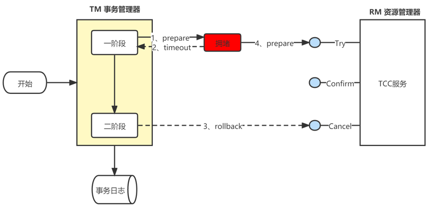

按上面"允许空回滚"的逻辑，这次 Cancel 会返回成功，事务管理器认为事务已回滚；如果随后到达的 Try 还照常执行业务，就会产生"事务已结束却又有资源被预留"的不一致。因此必须拒绝这种迟到 Try：在 Cancel 空回滚返回成功之前，先记录该事务 xid 或业务主键，标记"已回滚"；Try 执行前先检查该标识，若已标记为回滚成功，则不再执行 Try 的业务操作。

**（3）幂等控制**

网络重试都可能导致 Try、Confirm、Cancel 三个操作被重复执行，因此三者都要做幂等控制，通常用事务 xid 或业务主键判重。

#### 3.3.5 TCC 的优缺点

（1）相比 XA 事务机制，TCC 的优点：

- **性能提升**：由具体业务实现资源控制，锁的粒度变小，不会锁住整个资源。
- **数据最终一致**：基于 Confirm、Cancel 的幂等性，保证事务最终完成确认或取消。
- **可靠性更好**：不再依赖数据库层面的 XA 协议协调者，由主业务方发起并控制整个业务活动，业务活动管理器可以做成多点集群。

（2）缺点：Try、Confirm、Cancel 三个操作都要按具体业务实现，业务耦合度高，开发成本明显高于 AT、XA 这类"框架自动完成"的模式。

### 3.4 Saga 事务

#### 3.4.1 是什么

Saga 的核心思想是：把长事务拆成多个本地短事务并依次提交。全部成功则分布式事务成功；某个参与者失败，则由 Saga 协调器按**相反顺序**调用补偿操作，撤销已提交的参与者，把整个流程退回初始状态。

Saga 的基本协议有两条：

- 每个 Saga 事务由一系列**有序、幂等**的子事务 Ti 组成；
- 每个 Ti 都有一个对应的**幂等补偿动作** Ci，用于撤销 Ti 造成的结果。

与 TCC 相比：TCC 有一个预留动作（Try），相当于先存草稿再提交；Saga 没有预留动作，**直接提交**，只能靠补偿把已生效的结果撤回来。所以 Saga 的补偿动作必须由业务仔细设计——例如已经发出的短信，补偿只能再发一条"撤销通知"，体验较差。

#### 3.4.2 两种恢复策略

**（1）向后恢复（backward recovery）**

执行失败时，补偿所有已完成的子事务，是"一退到底"的方式：撤销之前所有成功的子事务，使整个 Saga 的执行效果被抵消。

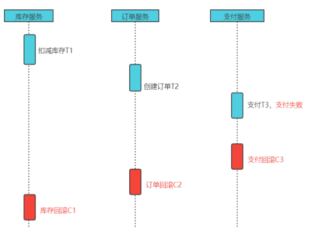

上图里事务执行到支付 T3 时失败，回滚需要从 C3、C2、C1 依次补偿，执行顺序为：T1、T2、T3、C3、C2、C1。

**（2）向前恢复（forward recovery）**

对执行不通过的事务尝试重试。它假设每个子事务最终都能成功，适用于"必须成功"的场景：失败就重试，不做补偿。

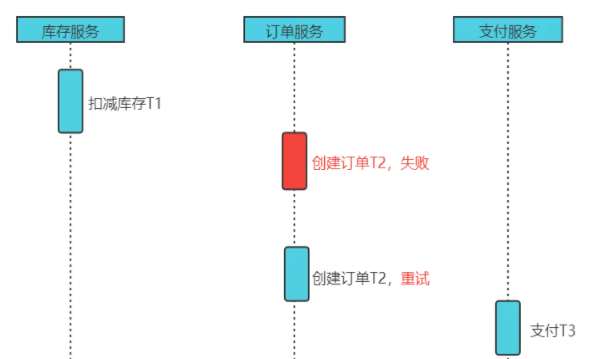

#### 3.4.3 两种实现方式

Saga 有两种协调方式：

- **命令协调（Orchestration，编排式）**
- **事件编排（Choreography，协同式）**

**（1）命令协调**

中央协调器（Orchestrator，可简称 OSO）以"命令/回复"的方式与每个服务通信，全权负责告诉参与者该做什么、什么时候做。

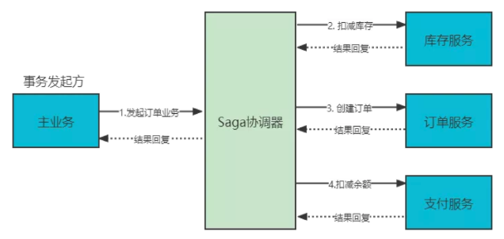

流程：

- ① 事务发起方的主业务逻辑请求 OSO 服务开启订单事务；
- ② OSO 向库存服务请求扣减库存，库存服务回复处理结果；
- ③ OSO 向订单服务请求创建订单，订单服务回复创建结果；
- ④ OSO 向支付服务请求支付，支付服务回复处理结果；
- ⑤ 主业务逻辑接收并处理 OSO 的最终结果。

中央协调器必须事先知道整个事务的流程；一旦某步失败，它还负责向每个参与者发送命令，反向撤销之前的操作。正因为"一切由协调器指挥"，回滚反而容易：正向流程反过来走一遍即可。

**（2）事件编排**

命令协调依赖中央协调器，因此有单点风险；事件编排没有中央协调器，每个服务产生自己的事件、并监听其他服务的事件来决定是否行动。

在事件编排中，第一个服务执行本地事务后发布一个事件，事件被一个或多个服务监听，这些服务再执行本地事务并发布（或不发布）新事件。当最后一个服务执行完本地事务且不再发布事件时，意味着分布式事务结束；或者它发布的事件没有任何 Saga 参与者监听，也意味着事务结束。

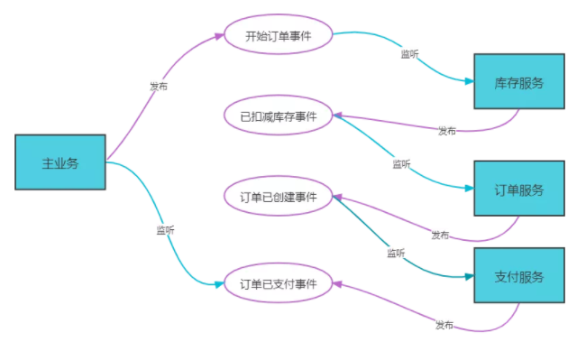

流程：

- ① 事务发起方的主业务逻辑发布"开始订单"事件；
- ② 库存服务监听"开始订单"事件，扣减库存，发布"库存已扣减"事件；
- ③ 订单服务监听"库存已扣减"事件，创建订单，发布"订单已创建"事件；
- ④ 支付服务监听"订单已创建"事件，完成支付，发布"订单已支付"事件；
- ⑤ 主业务逻辑监听"订单已支付"事件并处理。

如果事务只涉及 2 至 4 个步骤，事件编排非常合适：它是实现 Saga 最自然的方式，简单、易理解，不需要太多代码。

#### 3.4.4 优缺点

**（1）命令协调的优缺点**

优点：

- 服务之间关系简单，避免服务间循环依赖：协调器调用参与者，参与者不会反过来调用协调器；
- 程序开发简单，参与者只需执行"命令/回复"（回复消息本身也是一种事件），复杂度被收敛到协调器一侧；
- 易维护扩展：新增步骤时复杂度线性增长，回滚更容易管理，也更容易实施和测试。

缺点：

- 中央协调器的处理逻辑容易变得庞大复杂，难以维护；
- 存在协调器单点故障风险。

**（2）事件编排的优缺点**

优点：

- 没有中央协调器，天然避免单点故障；
- 步骤较少时开发简单、容易实现。

缺点：

- 服务之间可能存在循环依赖的风险；
- 步骤较多时服务间关系混乱，难以追踪和调试。

#### 3.4.5 隔离性怎么办

Saga 模型没有 Prepare 阶段，各子事务提交即生效，因此**事务之间不能保证隔离性**。当多个 Saga 事务操作同一份资源时，会出现更新丢失、脏数据读取等问题。这时需要在业务层控制并发，例如在应用层加锁，或者预先冻结资源（把要用的额度先扣到"冻结"账户里，补偿时再退回）。

### 3.5 本地消息表

#### 3.5.1 是什么

本地消息表的核心思路是把分布式事务拆成本地事务来处理。方案里有两个角色：

- **事务主动方**：业务发起方，额外建一张事务消息表，在**同一个本地事务**里完成业务处理和写消息记录，再由后台任务轮询消息表把消息发出去；
- **事务被动方**：基于消息中间件消费这些事务消息，执行自己的本地业务。

这样就能规避两种情况导致的数据不一致：

- 业务处理成功、事务消息发送失败；
- 业务处理失败、事务消息发送成功。

#### 3.5.2 执行流程

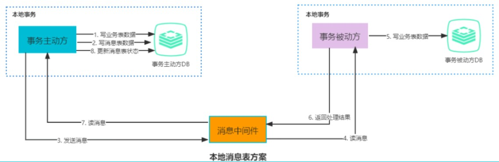

- ① 事务主动方在同一个本地事务中处理业务并写消息表；
- ② 事务主动方通过消息中间件通知事务被动方处理事务消息（中间件可以是 Kafka、RocketMQ 等）；
- ③ 事务被动方处理完后，通过消息中间件通知事务主动方"已处理"；
- ④ 事务主动方收到回执，更新消息表状态为已处理。

一些必要的容错处理：

- ① 出错：还在主动方的本地事务内，直接回滚即可；
- ②、③ 出错：主动方本地已保存消息，只需轮询消息表重新投递，通知被动方重新读取处理；
- 业务上处理失败：被动方可以发消息给主动方，请求回滚；
- 被动方已消费但主动方需要回滚：主动方要发消息通知被动方执行反向操作。

#### 3.5.3 优缺点

优点：

- 从应用设计开发的角度实现了消息数据的可靠性，可靠性不依赖消息中间件本身，弱化了对 MQ 特性的依赖；
- 方案轻量，容易实现。

缺点：

- 与具体业务场景绑定，耦合性强，不易复用；
- 消息数据与业务数据同库，占用业务系统资源；
- 业务系统使用关系型数据库时，消息服务性能会受数据库并发性能的局限。

### 3.6 MQ 事务消息

#### 3.6.1 和本地消息表的关系

基于 MQ 的分布式事务方案本质上是对本地消息表的封装：整体流程一致，唯一不同是把"本地消息表"放进了 MQ 内部，而不是业务数据库里。

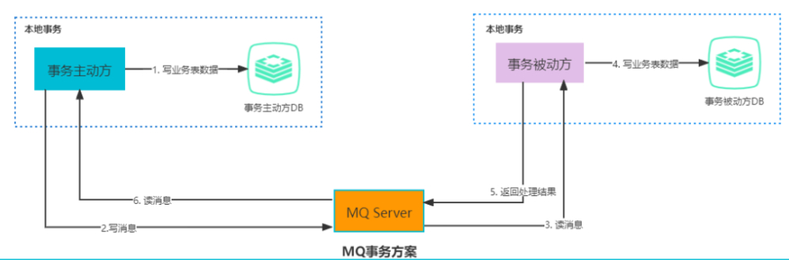

由于消息表搬到了 MQ 内部，MQ 自身的处理逻辑就成了关键。下面以 RocketMQ 官方文档描述的事务消息流程为例（4.x 与 5.x 的流程一致，回查间隔、最大回查次数等参数以所用版本文档为准）。

#### 3.6.2 RocketMQ 事务消息

本地消息表方案靠"数据库事务"保证"写业务表"和"写消息表"的一致性；RocketMQ 的事务消息则对普通消息额外提供了类似 2PC 的提交接口。

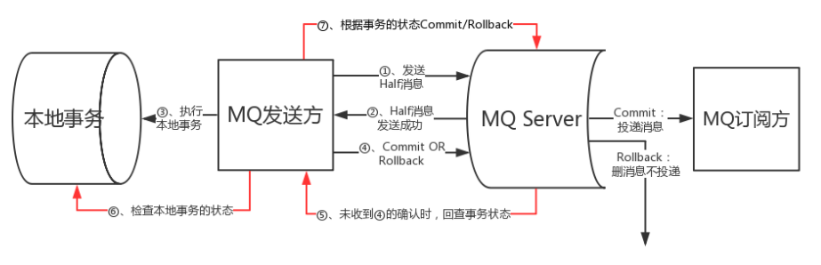

**（1）正常情况**

事务主动方服务正常、没有发生故障时，发消息流程如下：

- 步骤①：发送方向 MQ Server 发送 half 消息（半消息，暂存在 MQ 中、对消费者不可见的消息）；
- 步骤②：MQ Server 持久化成功后，向发送方 ack，确认消息已收到；
- 步骤③：发送方开始执行本地事务逻辑；
- 步骤④：发送方根据本地事务执行结果，向 MQ Server 提交二次确认（commit 或 rollback）；
- 最终步骤：MQ Server 收到 commit 就把半消息标记为可投递，订阅方最终会收到；收到 rollback 则删除半消息，订阅方不会收到。

**（2）异常情况**

断网、应用重启等异常情况下，步骤④的二次确认可能超时没到 MQ Server，处理逻辑如下：

- 步骤⑤：MQ Server 对该消息发起消息回查（check back）；
- 步骤⑥：发送方收到回查后，检查对应本地事务的最终执行结果；
- 步骤⑦：发送方根据检查到的最终状态，再次提交二次确认；
- 最终步骤：MQ Server 依据 commit/rollback 投递或删除消息。

需要注意一点：若在约定时间内 MQ 仍无法确定该事务的状态，RocketMQ 会**默认回滚**这条半消息。这意味着消息有极小概率"本地事务其实成功了、消息却被丢弃"，因此消费侧仍需幂等，关键业务最好再配对账兜底。

#### 3.6.3 优缺点

优点（相比本地消息表）：

- 消息数据独立存储，降低业务系统与消息系统之间的耦合；
- 吞吐量通常高于本地消息表方案（少了业务库写消息表的开销）。

缺点：

- 一次消息发送需要两次网络请求（half 消息 + commit/rollback 消息）；
- 业务处理服务需要实现消息状态回查接口。

### 3.7 最大努力通知

最大努力通知（Best Effort Notification）的思路是：事务主动方尽最大努力（重试、轮询……）把结果通知给被动方，但不保证一定送达；被动方如果没收到，需要主动调用主动方提供的**消息校对（查询）接口**来补拿数据。

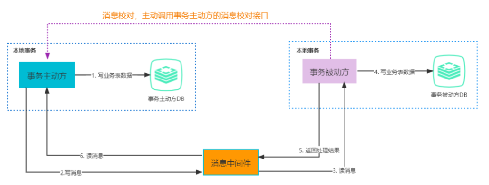

和可靠消息方案的差别在于"谁保证可靠性"：

- 在可靠消息事务中，事务主动方有责任把消息发出去并让接收方成功接收，可靠性由**主动方**保证；
- 在最大努力通知中，主动方只承诺"尽力"，因此存在被动方收不到消息的可能，必须由被动方主动查询来兜底，可靠性由**被动方**保证。

> 一个常见误解：最大努力通知不等于"定期校对"。两者常被放在同一类场景里讨论，但分工不同——通知负责"尽快告知"，校对（对账）负责"事后补齐"，实践中通常两者配合使用。

所以最大努力通知适用于**业务通知类**场景。例如微信支付把交易结果通知给商户：既有回调通知，也提供交易查询接口供商户主动查询。

### 3.8 方案对比与选型

| 方案 | 一致性 | 隔离性 | 对业务代码的侵入 | 典型性能 | 常见场景 |
| --- | --- | --- | --- | --- | --- |
| 2PC / XA | 强一致 | 有（资源锁到二阶段） | 无 | 低 | 单体应用内的跨库操作、传统金融系统 |
| 3PC | 较强，极端分区下仍可能不一致 | 有 | 无 | 略好于 2PC | 教学与协议研究，工程落地较少 |
| TCC | 最终一致 | 靠资源预留实现 | 高（三个接口） | 高 | 核心交易、对性能和一致性都要求高 |
| Saga | 最终一致 | 无（需业务补偿） | 中高（补偿逻辑） | 高 | 长流程、跨公司/遗留系统、补偿易实现 |
| 本地消息表 | 最终一致 | 无 | 中 | 受数据库并发限制 | 参与方少、可接受人工对账兜底 |
| MQ 事务消息 | 最终一致 | 无 | 中（需回查接口） | 较高 | 已有 MQ 基础设施、异步解耦场景 |
| 最大努力通知 | 最终一致（靠查询兜底） | 无 | 低 | 高 | 支付结果、状态变更等通知类业务 |

结合业务场景的选型经验：

- **2PC/3PC**：依赖数据库，能提供强一致性和强事务性，但延迟较高。适合传统单体应用在同一方法中跨库操作的场景，不适合高并发、高性能要求。
- **TCC**：准备阶段业务多、锁粒度小、性能要求高的场景。只要把 try、confirm、cancel 三段逻辑捋清楚就可以用，代价是业务耦合。
- **本地消息表 / MQ 事务消息**：适合参与方支持幂等、对一致性要求不高、业务上能容忍"一个巡检周期内的不一致"、参与方与环节较少、且有对账/校验系统兜底的场景。
- **Saga**：因为不能保证隔离性，需要在业务层控制并发，适合事务并发操作同一资源较少的场景；又因为缺少预提交动作，补偿实现较麻烦（例如发短信的补偿只能再发一条撤销短信），所以适合补偿动作容易处理的场景。

## 4. CAP 定理

前面反复提到"为了可用性牺牲一致性"，这个取舍的理论依据就是 CAP 定理。这一节先用一个两节点的小场景把它证明一遍，再讨论现实系统怎么选，最后补上 AP 方向常用的 BASE 理论。

**CAP 定理（CAP Theorem）**：一个分布式数据系统无法同时满足一致性（Consistency）、可用性（Availability）、分区容错性（Partition tolerance）这三项，最多只能同时满足其中两项。它由 Eric Brewer 在 2000 年的 PODC 主题演讲中提出，2002 年由 Gilbert 与 Lynch 给出形式化证明。

### 4.1 证明 CAP 的基本场景

如下图，这是证明 CAP 的基本场景：分布式网络中有两个节点 Host1 和 Host2，两者之间网络可连通；Host1 上运行 Process1 程序和对应的数据库 Data，Host2 上运行 Process2 程序和对应的数据库 Data。

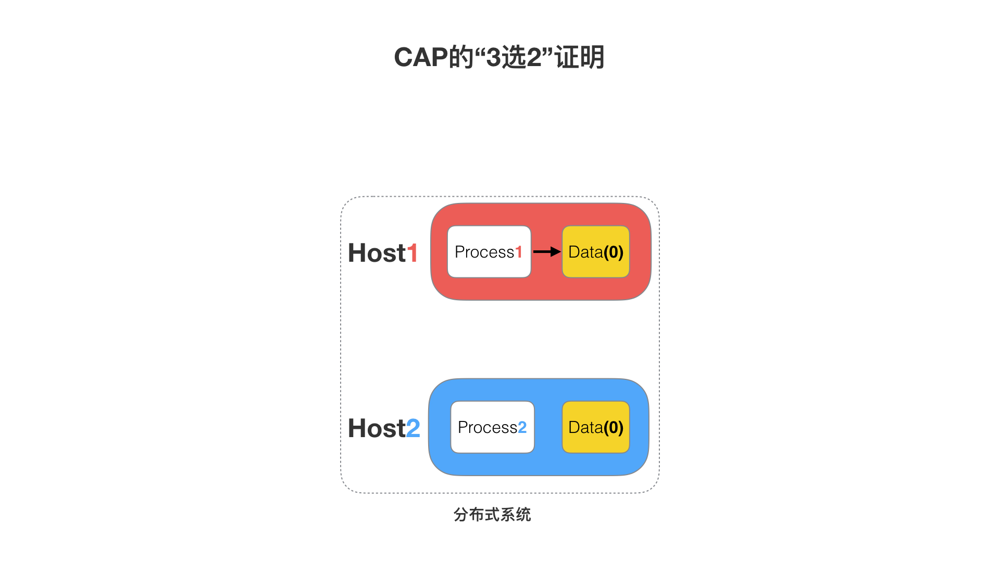

### 4.2 三个特性分别指什么

- **一致性（C）**：任何时刻，两个节点读到的同一份数据应当相同，即 Data(0) = Data(0)。
- **可用性（A）**：用户不管请求 Host1 还是 Host2，都能立刻得到响应结果（不报错、不无限等待）。
- **分区容错性（P）**：节点之间的网络出现分区（消息丢失、延迟、断开）时，系统仍能继续运行，不会因为某一方联系不上就整体停摆。

### 4.3 分布式系统正常运行流程

如下图，是分布式系统正常运转的流程。

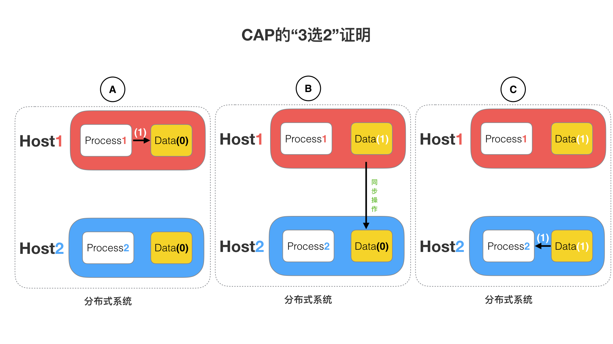

- A、用户向 Host1 请求数据更新，Process1 把数据库里的 Data(0) 更新为 Data(1)；
- B、分布式系统做数据同步，把 Host1 的 Data(1) 同步到 Host2，Host2 中的数据也变成 Data(1)；
- C、用户请求 Host2 时，Process2 能返回最新的 Data(1)。

对应到 CAP 的三个特性：

1. Host1 与 Host2 的数据库数据是否一样 —— 一致性（C）；
2. 用户对 Host1、Host2 的请求能否得到响应 —— 可用性（A）；
3. Host1 与 Host2 之间的网络环境是否可靠 —— 分区容错性（P）。

正常运转时三个特性可以同时满足，这是理想状态。但实际场景中故障在所难免，一旦网络断开，还能三个都要吗？

### 4.4 网络断开时的两难

假设 Host1 和 Host2 之间的网络断开了。要支持这种网络异常，就等于要求满足分区容错性（P）。此时还能同时满足一致性（C）和可用性（A）吗？

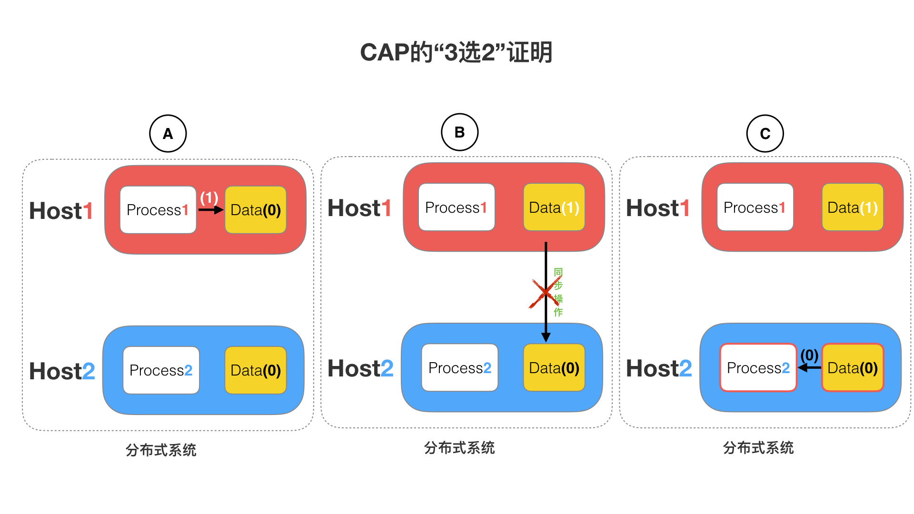

- A、用户向 Host1 发送更新请求，Host1 中的数据 Data(0) 被更新为 Data(1)；
- B、此时 Host1 与 Host2 网络断开，同步操作失败，Host2 中仍是 Data(0)；
- C、有用户向 Host2 读数据。由于数据没同步过来，Process2 无法返回最新值，只能二选一：
  - 第一，**牺牲一致性（C）**：把旧数据 Data(0) 返回给用户；
  - 第二，**牺牲可用性（A）**：阻塞等待，直到网络恢复、数据同步完成，再返回 Data(1)。

这个过程说明：一个分布式系统一旦要满足分区容错性（P），就只能在一致性（C）和可用性（A）之间选一个。

### 4.5 为什么只能"三选二"

既然无法三者兼得，那该舍弃哪个？下面分别看三种组合。

#### 4.5.1 CA：放弃 P

放弃分区容错性（P），即不考虑网络不通、节点挂掉的问题，就可以同时获得一致性和可用性。但此时系统已经不算一个标准的分布式系统。

最常用的关系型数据库在**单机部署**下就满足 CA：

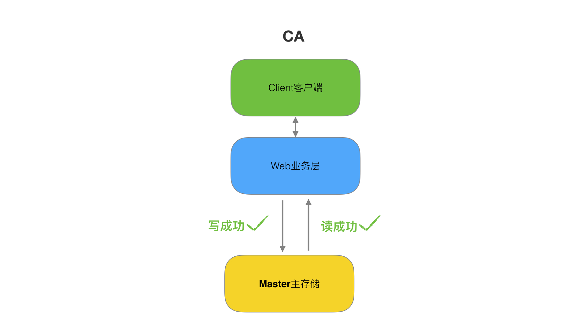

主库与从库之间不再做异步数据同步，数据库可以响应每次查询请求，用事务（原子性）和隔离级别保证每个查询都能读到最新数据。

> 需要补充一个边界：一旦数据库做成了**异步复制的主从架构**，主库故障切换时从库可能还没收到最新写入，此时读从库就会读到旧值——它已经落到"牺牲 C、保证 A"的 AP 一侧了。所以"关系型数据库满足 CA"，准确说是**单机、或同机房同步复制**的前提下成立。
>
> 另外要注意：**对一个分布式系统来说，P 是基本要求**——网络分区是客观存在、无法通过软件消除的，因此工程上真正要做的是"接受 P，然后在 C 和 A 之间权衡"，并想尽办法提升系统对分区的容忍能力。

#### 4.5.2 CP：放弃 A

如果一个分布式系统不要求强可用性（允许短时间停机、或请求长时间无响应），就可以保障 CP 而舍弃 A。

典型例子是 ZooKeeper、HBase 这类系统：分区发生时，少数派一侧的节点会拒绝服务，以保证任何一次读到的都是达成多数派共识的数据。

> 关于 Redis 需要更正一个常见说法：Redis 在**主从异步复制**部署下，主节点故障切换时可能丢失已确认的写入，因此严格意义上不满足 CP；只有在单机或同步落盘等特定配置下才接近强一致。把 Redis 一概归为 CP 属于简化说法，实际要先看部署模式。

场景：跨行转账，一次转账请求要等双方银行系统都完成整个事务才算完成——宁可暂时不可用，也不能让账目对不上。

#### 4.5.3 AP：放弃 C

放弃一致性，追求分区容忍性和可用性，这是很多互联网分布式系统的选择。实现 AP 的前提是：用户可以接受"查到的数据在一定时间内不是最新的"。

通常实现 AP 都会保证**最终一致性**（不保证随时一致，但保证在没有新写入的前提下，经过一段时间后所有副本都会一致），BASE 理论就是对 AP 的进一步展开。

场景 1：电商订单退款。今日退款成功、明日账户到账，只要用户能接受"一定时间内到账"即可。

场景 2：12306 买票。查询余票时显示有票（实际可能已被抢完），用户正常输入验证码、下单，过了一会儿系统才提示"下单失败，余票不足"。这就是优先保证系统能正常服务，在数据一致性上做了让步：它牺牲的只是**强一致性**，最终仍会通过下单校验保证**最终一致性**。

### 4.6 三种取舍的总结

- **CA 放弃 P**：如果不要求 P（不允许分区），C 和 A 是可以保证的。这类系统更多是指"允许分区后各子系统内部仍保持 CA"，而不是整体上真的没有分区。
- **CP 放弃 A**：如果不要求 A，相当于每个请求都要在节点间强一致；P 会导致同步过程可能被无限期拉长，于是系统选择"宁可不响应，也不给不一致的结果"。很多传统数据库的分布式事务属于这一类。
- **AP 放弃 C**：要高可用并允许分区，就必须放弃强一致性。分区一旦发生，节点之间可能失去联系；为了继续服务，每个节点只能用本地数据应答，于是全局数据会短暂不一致。大量 NoSQL 系统属于此类。

### 4.7 延伸：BASE 与最终一致性

BASE 是 AP 方向的工程化方法论，由 Basically Available（基本可用）、Soft state（软状态）、Eventually consistent（最终一致）三个词的首字母组成：

- **基本可用（Basically Available）**：允许损失部分可用性，例如响应时间变长、非核心功能降级，但核心流程要能走通。
- **软状态（Soft state）**：允许系统中存在中间状态（例如"支付中""库存锁定中"），且不要求中间状态对所有人立即可见。
- **最终一致（Eventually consistent）**：在没有新的写入的前提下，经过一段数据同步时间后，所有副本最终会达到一致。

理解"最终一致"要抓住"不一致窗口"：从写入完成到所有副本都更新之间的这段时间，读请求可能读到旧值。工程上要做的，是把不一致窗口控制到业务可接受的范围（例如秒级），并对读到的旧数据做兜底提示。

一句话对照：**ACID 追求"随时都对"，BASE 追求"最终会对"。**

### 4.8 思考：按 CAP 取舍设计一个电商系统

电商网站的核心模块有用户、订单、商品、支付、促销管理等，它们对 CAP 的要求并不相同：

1. **用户模块**（登录、个人设置、个人订单、购物车、收藏夹）：保证 AP，数据短时间不一致不影响使用。
2. **订单模块**：下单、付款、扣减库存是整个系统的核心，C 和 A 都要保证；极端情况下牺牲 A 保证 C（宁可下单失败，也不能超卖）。
3. **商品模块**：商品上下架和库存管理保证 CP。
4. **搜索功能**：本身实时性要求不高，保证 AP 即可。
5. **促销模块**：短时间不一致的后果只是"优惠信息暂时看不到"，但已有的优惠必须可用；而且优惠可以提前预计算，因此可以保证 AP。
6. **支付模块**：通常是独立系统或第三方支付，CAP 由第三方保证。支付系统对 CAP 要求极高，C 必须保证；在 A 与 P 之间，A 相对更重要——不能因为一次分区就让所有人都无法支付。

## 5. Seata 分布式事务框架

前面讲的方案各有代价：2PC/XA 性能差，TCC 侵入性强。Seata 的价值在于把多种模式统一到一个框架里，让业务按场景挑选。这一节介绍它的角色划分与两种最常用的模式（XA、AT）。

### 5.1 Seata 是什么

Seata 是一款开源的分布式事务解决方案，目标是提供高性能、简单易用的分布式事务服务。它为使用者提供 AT、TCC、SAGA、XA 四种事务模式，构成一站式方案。

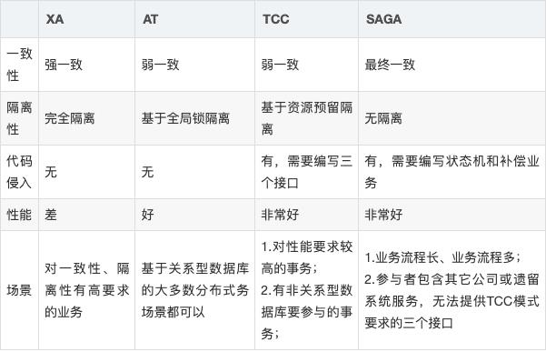

### 5.2 三个核心角色

在 Seata 的架构中一共有三个角色：

- **TC（Transaction Coordinator，事务协调者）**：维护全局事务和分支事务的状态，驱动全局事务提交或回滚。
- **TM（Transaction Manager，事务管理器）**：定义全局事务的范围——开始一个全局事务、提交或回滚全局事务。
- **RM（Resource Manager，资源管理器）**：管理分支事务处理的资源，与 TC 通信以注册分支事务、报告分支事务状态，并驱动分支事务提交或回滚。

部署形态上，TC 是单独部署的 Server 端服务，TM 和 RM 则是嵌入到业务应用中的 Client 端组件。

用一个比喻理解三者分工：TM 是"发起人"，负责说"这笔事要办"；RM 是"各办事窗口"，负责具体执行并汇报进度；TC 是"总调度台"，记录每一笔事办到哪一步，并下达最终"确认"或"撤销"的指令。

### 5.3 XA 模式

Seata 对原始的 XA 模式做了简单封装和改造，以适应自己的事务模型。

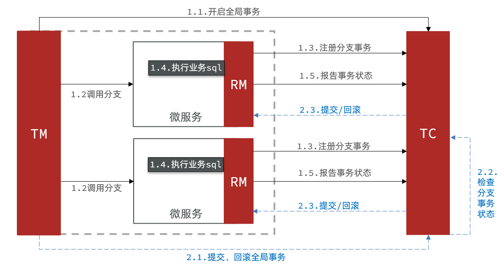

**RM 一阶段的工作：**

- ① 注册分支事务到 TC；
- ② 执行分支业务 SQL，但**不提交**；
- ③ 把执行状态报告给 TC。

**TC 二阶段的工作：**

- 检测各分支事务的执行状态：a. 全部成功，通知所有 RM 提交事务；b. 有失败，通知所有 RM 回滚事务。

**RM 二阶段的工作：**

- 接收 TC 指令，提交或回滚事务。

**优点：**

- 强一致性，满足 ACID 原则；
- 常用数据库都支持 XA，实现简单，且没有代码侵入。

**缺点：**

- 一阶段就要锁定数据库资源，直到二阶段结束才释放，性能较差；
- 依赖关系型数据库实现事务（非关系型资源无法参与）。

### 5.4 AT 模式

AT 模式同样是分阶段提交的模型，但弥补了 XA"资源锁定周期过长"的缺陷。它的关键设计是：一阶段就把业务 SQL 提交掉，同时把"改前的数据快照"记进 undo log，需要回滚时再拿快照反向恢复。

#### 5.4.1 一阶段与二阶段做了什么

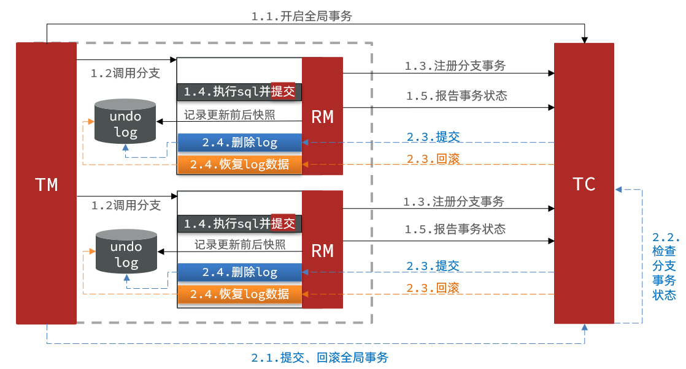

阶段一 RM 的工作：

- 注册分支事务；
- 记录 undo-log（数据快照）；
- 执行业务 SQL 并提交（在提交本地事务前，必须先拿到全局锁）；
- 报告事务状态。

阶段二提交时 RM 的工作：

- 删除 undo-log 即可（这一步可以异步完成）。

阶段二回滚时 RM 的工作：

- 根据 undo-log 把数据恢复到更新前。

#### 5.4.2 用一个例子走一遍

假设有一张记录用户余额的表：

| **id** | **money** |
| --- | --- |
| 1 | 100 |

某个分支业务要执行的 SQL 为：

```sql
update tb_account set money = money - 10 where id = 1
```

AT 模式下，这个分支事务的执行流程如下。

**一阶段：**

1. TM 发起并注册全局事务到 TC；
2. TM 调用分支事务；
3. 分支事务准备执行业务 SQL；
4. RM 拦截业务 SQL，根据 where 条件查询原始数据，形成快照（before image）：

```json
{
  "id": 1,
  "money": 100
}
```

5. RM 执行业务 SQL，提交本地事务，释放数据库锁，此时 money = 90；
6. RM 把本地事务状态报告给 TC。

**二阶段：**

1. TM 通知 TC 事务结束；
2. TC 检查分支事务状态：
   - a）全部成功：立即删除快照；
   - b）有分支事务失败：读取快照（`{"id": 1, "money": 100}`）恢复到数据库，money 回到 100。

真实实现里 undo-log 还会同时记录 after image（改后镜像），回滚前先比对当前数据是否仍等于 after image，用来发现"数据已被别人改过"的情况。

#### 5.4.3 脏写问题与全局锁

多线程并发访问 AT 模式的分布式事务时，可能出现脏写问题：

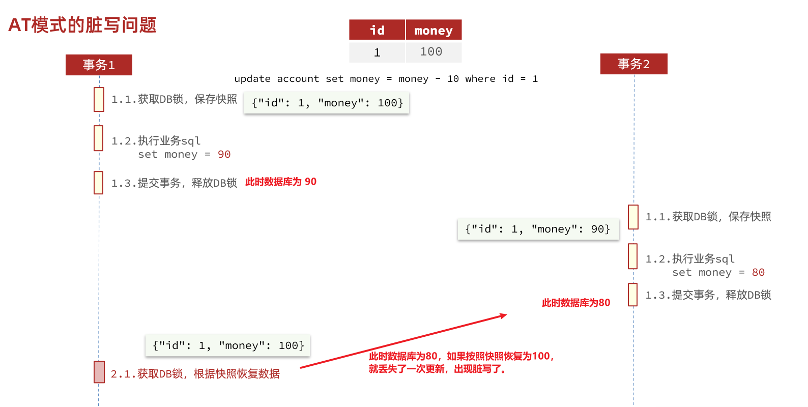

解决思路是引入**全局锁**：在释放数据库本地锁之前，先拿到全局锁，避免同一时刻有另一个全局事务操作同一行数据。

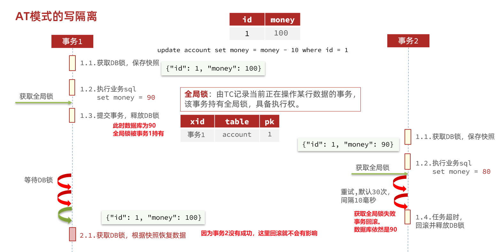

具体规则是：提交本地事务前必须先获取全局锁；拿不到就重试，重试超时则回滚本地事务、释放本地锁。

> 但在一种极端情况下仍可能造成脏读：一个**不受 Seata 管理**的事务，在事务 1 提交并释放数据库锁之后拿到了本地锁，从而造成脏写。此时事务 1 在回滚前比对快照会发现问题，于是记录告警并转人工处理。

#### 5.4.4 优缺点

优点：

- 一阶段完成即提交事务、释放数据库资源，性能较好；
- 利用全局锁实现写隔离（读隔离默认相当于读未提交，需要读已提交时可对查询加 `for update`）；
- 没有代码侵入，回滚和提交由框架自动完成。

缺点：

- 两阶段之间属于软状态，整体是最终一致，不是强一致；
- 快照功能会带来额外开销（比 XA 好很多，但并非免费）。

### 5.5 AT 与 XA 的区别

| 对比项 | XA 模式 | AT 模式 |
| --- | --- | --- |
| 一阶段是否提交 | 不提交，锁定资源 | 直接提交，不锁定数据库资源 |
| 回滚依据 | 数据库自身的 XA 机制 | 数据快照（undo-log）反向恢复 |
| 隔离与并发 | 强隔离，锁到二阶段结束 | 靠全局锁做写隔离，默认读未提交 |
| 一致性强度 | 强一致 | 最终一致 |
| 性能 | 较差 | 较好 |

## 6. 幂等性

分布式系统里"重试"是常态：超时了要重试、MQ 投递失败要重投、用户手快点两下也是重发。这一节讲清幂等性是什么、为什么分布式场景特别需要它，以及八种常见做法。

### 6.1 什么是幂等性

幂等性原本是数学概念：某个操作执行一次和执行多次，结果相同。用在接口上可以理解为：**同一个接口，多次发出同一个请求，最终结果是一致的。**

简单说，就是"多次调用如一次"。

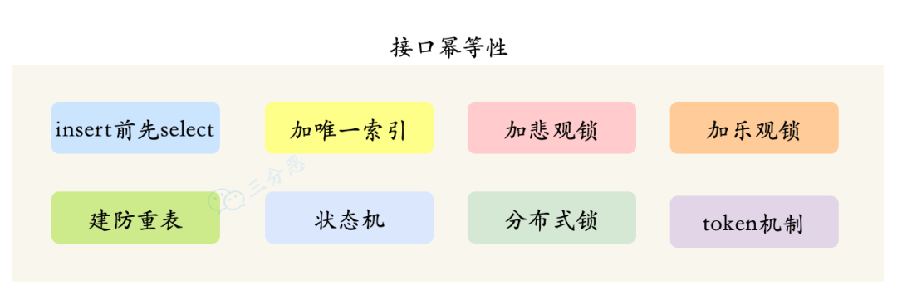

需要区分两个相近的词：

- **防重**：强调防止同一条数据被重复处理；
- **幂等**：强调多次调用结果一致。

防重包含幂等，幂等的范围更大——拦截重复请求是防重，而"重复执行也不出错、返回一样的结果"才是幂等。

### 6.2 为什么需要幂等

系统运行中经常出现这样的问题：

1. 用户填写表单时，保存按钮被快速点了两次，表里出现两条重复数据，只是 id 不同；
2. 开发人员为解决接口超时引入了重试机制：第一次请求超时了（其实可能已经成功），请求方拿不到结果就再试几次，于是产生重复数据；
3. MQ 消费者读取消息时可能收到重复消息，同样产生重复数据。

结论：**在分布式系统里，只要下游服务有写（保存、更新）操作，就有可能产生幂等性问题**。因为"请求是否成功"这个信息在网络上可能丢失，发送方只能重试，而接收方无法区分"第一次"和"第二次"。

### 6.3 保证接口幂等的八种方案

#### 6.3.1 insert 前先 select

在保存数据的接口里，insert 之前先按 requestId、业务单号等字段 select 一次。已存在就直接返回，不存在才执行 insert。

优点是简单直观；缺点是"查"和"插"之间仍有并发窗口（两个请求同时查不到、同时插入），所以通常要和唯一索引配合使用。

#### 6.3.2 加唯一索引

这是最简单也最有效的兜底手段：给业务唯一键（订单号、请求号）加唯一索引，重复插入时数据库直接抛异常，捕获异常后按"已处理"返回即可。

在 Java 里通常捕获两类异常：

- Spring 的 `org.springframework.dao.DuplicateKeyException`；
- JDBC 标准的 `java.sql.SQLIntegrityConstraintViolationException`（自 Java 1.6 起提供）。

> 版本提示：老版本 MySQL 驱动（Connector/J 5.x）抛出的类名是 `com.mysql.jdbc.exceptions.jdbc4.MySQLIntegrityConstraintViolationException`，8.x 起改为标准的 `java.sql.SQLIntegrityConstraintViolationException`。按项目实际驱动版本捕获，或直接捕获 Spring 转换后的 `DuplicateKeyException` 更省事。

```java
// 依靠唯一索引兜底：重复插入会抛异常，捕获后按"已处理"返回
try {
    orderMapper.insert(order);      // order_no 上建有唯一索引
} catch (DuplicateKeyException e) {
    log.info("重复请求，返回已有结果, orderNo={}", order.getOrderNo());
    return orderMapper.selectByOrderNo(order.getOrderNo());
}
```

#### 6.3.3 加悲观锁

对更新类逻辑（例如扣减账户余额），可以加悲观锁，把对应的那一行数据锁住，同一时刻只允许一个请求获得锁，其他请求排队等待。

```sql
select * from `user` where id = 123 for update;
```

这种方式有一个缺点：拿不到锁的请求一般只能报失败，较难保证"多次请求返回相同的结果"，因此严格来说它是"防并发"，不完全是"幂等"。

#### 6.3.4 加乐观锁

更新逻辑也可以用乐观锁，性能更好。做法是在表里增加 version（或 timestamp）字段：更新前先查一次数据，把 version 作为更新条件，同时把 version 加一。

```sql
update `user` set amount = amount + 100, version = version + 1
where id = 123 and version = 1;
```

更新成功后 version 变了，重复的更新请求再来就匹配不上条件，自然无法重复执行。

#### 6.3.5 建防重表

有些场景并非"所有重复都不允许"，只是"特定条件下不允许"。这时可以单独建一张防重表：例如消息消费场景，把消息唯一 ID 存进防重表，消费前先查是否已消费，已消费就直接返回成功。

好处是不改动业务表结构，坏处是多一次写入和一次查询，且防重表本身要清理。

#### 6.3.6 状态机

有些业务表本身是有状态的，例如订单有 1-下单、2-已支付、3-完成、4-撤销等状态。可以通过限制状态流转来实现幂等：只允许"下单 → 已支付"，重复的"支付成功"回调因为状态已经推进过，会被直接忽略。

#### 6.3.7 分布式锁

直接在数据库上加锁性能不友好，可以改用分布式锁。目前最常用的是基于 Redis 的实现，Java 侧一般用 Redisson（详见第 7 章）。

做法是：以业务唯一键为锁的 key，处理前先抢锁，抢到才执行业务，执行完释放。

#### 6.3.8 token 机制

请求接口之前先获取一个唯一 token（由服务端生成并缓存），再带着 token 去执行业务；服务端判断该 token 是否存在，存在则消费掉并继续，不存在则说明是重复请求，直接拒绝。

这种方案适合"页面表单提交"这类能明确区分"一次操作"的场景。

### 6.4 方案对比

| 方案 | 依赖 | 适合场景 | 主要代价 |
| --- | --- | --- | --- |
| insert 前 select | 应用代码 | 低频写入、非严格并发 | 存在并发窗口 |
| 唯一索引 | 数据库约束 | 有天然业务唯一键 | 需处理异常、键设计要合理 |
| 悲观锁 | 数据库行锁 | 强并发写同一行 | 阻塞、吞吐下降 |
| 乐观锁 | version 字段 | 更新类操作 | 冲突时需重试 |
| 防重表 | 额外一张表 | 消息消费、第三方回调 | 多一次读写、需清理 |
| 状态机 | 业务状态字段 | 有明确状态流转 | 只适用状态型业务 |
| 分布式锁 | Redis 等 | 跨节点互斥 | 引入外部依赖 |
| token | 缓存 + 前端配合 | 表单重复提交 | 需前后端约定 |

实践中往往**组合使用**：前端按钮防抖 + 唯一索引兜底 + 关键接口分布式锁，是最常见的三层防护。

## 7. 分布式锁

多个节点同时改同一份数据时，"互斥"这件事没法再用 JVM 里的 `synchronized`、`ReentrantLock` 解决——它们只在单个进程内有效。分布式锁就是跨进程、跨机器的锁。这一节先讲需求与标准，再对比数据库、Redis、ZooKeeper 三种实现。

### 7.1 什么场景需要分布式锁

一般需要使用分布式锁的场景有两类：

- **效率**：避免不同节点重复做同一件事，比如定时任务在多个实例上被重复执行；
- **正确性**：避免两个节点同时操作同一条数据导致并发问题（例如重复扣库存）。

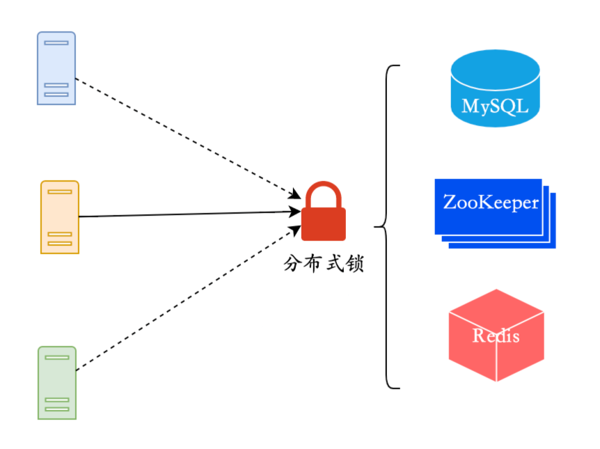

### 7.2 一把合格的分布式锁应具备的特点

- **互斥性**：锁的基本特性，需要按需求保证线程级或节点级的互斥；
- **可重入性**：同一个节点或线程已持有锁时，可以再次获取该锁；
- **锁超时**：支持超时自动释放，防止某个节点宕机后锁永远不释放；
- **高效性**：加锁、解锁效率高，能支撑高并发；
- **高可用**：锁服务本身要有高可用机制，例如降级方案；
- **阻塞性**：同时支持阻塞获取与非阻塞获取两种方式；
- **公平性**：支持公平锁与非公平锁，公平锁保证按请求顺序获得锁。

现实中很难全部满足，选择实现方式时，其实是在挑"哪几条必须满足、哪几条可以放弃"。三种实现的差别主要就在这里。

### 7.3 三种常见实现

- 基于数据库的分布式锁；
- 基于 Redis 的分布式锁；
- 基于 ZooKeeper 的分布式锁。

### 7.4 基于数据库的分布式锁

用数据库实现分布式锁最简单：建一张锁表，对字段做唯一性约束。加锁时在锁表里插入一条记录，释放锁时删除记录。并发请求同时提交到数据库时，数据库会保证只有一个请求能成功插入。

这属于数据库 IO 操作，效率不高，频繁操作还会增大数据库开销，因此在高并发、高性能场景中用得不多。

#### 7.4.1 方案概览

- **互斥性**：靠数据库 update/insert 的原子性，保证两次获取锁之间互斥；
- **可重入性**：在表里保留一个字段存储当前锁的持有者；
- **锁超时**：在表里存储获取锁的时间点和超时时长；
- **高效性**：数据库本身可以支撑比较高的并发（但不如缓存）；
- **高可用**：可以增加主从数据库，提升可用性；
- **阻塞性**：可以通过"看门狗"轮询的方式实现阻塞等待；
- **公平性**：可以加锁队列，但实现复杂，不建议。

#### 7.4.2 表结构设计

假设锁表名为 `lock`，各字段定义如下：

| **字段名称** | **字段类型** | **说明** |
| --- | --- | --- |
| lock_key | varchar | 锁的唯一标识 |
| lock_time | timestamp | 加锁的时间 |
| lock_duration | integer | 锁的超时时长，单位可由业务自定义，通常为秒 |
| lock_owner | varchar | 锁的持有者，可以是节点或线程的唯一标识；不同可重入粒度的锁含义不同 |
| locked | boolean | 当前锁是否被占有 |

> 小提示：`lock` 在 MySQL 中是保留字，建表和写 SQL 时要用反引号包起来，或者干脆把表名改成 `t_lock` 之类。

#### 7.4.3 获取锁的 SQL

如果锁不存在，先创建锁，创建锁的线程即获得锁：

```sql
-- 表名加反引号，避免与 MySQL 保留字冲突
insert into `lock` (lock_key, lock_time, lock_duration, lock_owner, locked)
values ('xxx', now(), 1000, 'ownerxxxx', true);
```

如果锁已存在，就尝试更新锁的信息：更新成功表示获取锁成功，更新失败表示获取锁失败（影响行数为 0）。

```sql
update `lock` set
    locked = true,
    lock_owner = 'ownerxxxx',
    lock_time = now(),
    lock_duration = 1000
where
    lock_key = 'xxx' and (
      lock_owner = 'ownerxxxx'        -- 自己已持有，可重入
      or locked = false               -- 没人持有
      or date_add(lock_time, interval lock_duration second) > now()  -- 已超时，可抢占
    )
```

#### 7.4.4 释放锁的 SQL

使用完锁需要释放时，把 locked 置为 false 即可：

```sql
update `lock` set
    locked = false
where
    lock_key = 'xxx' and
    lock_owner = 'ownerxxxx' and
    locked = true
```

#### 7.4.5 看门狗

有了上面的两步，似乎已经能加锁、解锁了，那看门狗做什么？

如果"获取锁到释放锁"的耗时大于锁的超时时长，就可能出现多个节点同时认为自己持有锁的情况。看门狗（watchdog）就是用一个定时任务不断刷新锁的获取时间（或续期），从而在业务执行期间让锁一直有效。

### 7.5 基于 Redis 的分布式锁（Redisson）

Redis 的 Java 客户端 Redisson 实现了分布式锁，用法上与 `ReentrantLock` 很像：加锁、执行、finally 里解锁。

#### 7.5.1 最简用法

```java
RLock disLock = redissonClient.getLock("DISLOCK");
disLock.lock();
try {
    // 业务逻辑
} finally {
    // 无论如何，最后都要解锁
    disLock.unlock();
}
```

#### 7.5.2 加锁机制

Redisson 客户端加锁、释放锁的整体逻辑如下图：

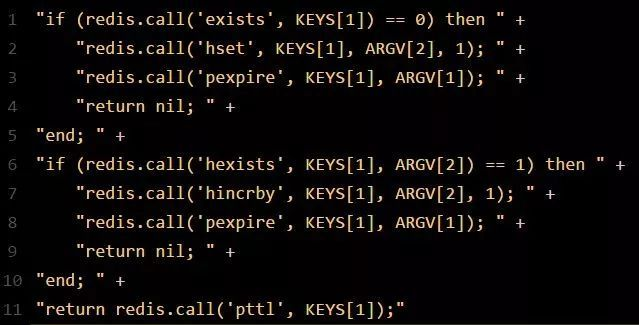

获取锁时，客户端会发送一段 Lua 脚本到 Redis 执行。为什么要用 Lua？因为一段复杂逻辑封装在脚本里由 Redis 单线程一次执行完，可以保证这段逻辑的原子性（不会被别的命令插进来）。

Lua 脚本有三个输入参数：

- `KEYS[1]`：加锁的 key，例如 `redisson.getLock("myLock")` 里的 `"myLock"`；
- `ARGV[1]`：锁 key 的默认生存时间，Redisson 默认为 30000 毫秒（30 秒）；
- `ARGV[2]`：加锁客户端的唯一 ID，形如 `8743c9c0-0795-4907-87fd-6c719a6b4586:1`（UUID + 线程 ID）。

加锁脚本的大致原理是：

- 锁不存在时，创建锁（用 hash 结构记录"客户端 ID → 重入次数"）并设置过期时间；
- 锁存在且持有者是自己时，重入次数加一，并刷新过期时间；
- 否则返回锁的剩余过期时间，表示加锁失败。

```lua
-- 判断锁是否存在
if (redis.call('exists', KEYS[1]) == 0) then
    -- 创建锁，并记录客户端与初始重入次数
    redis.call('hincrby', KEYS[1], ARGV[2], 1);
    -- 设置锁的过期时间
    redis.call('pexpire', KEYS[1], ARGV[1]);
    -- 返回加锁成功
    return nil;
end;
-- 判断当前锁的持有者是否是请求者
if (redis.call('hexists', KEYS[1], ARGV[2]) == 1) then
    -- 是持有者，重入次数加一
    redis.call('hincrby', KEYS[1], ARGV[2], 1);
    -- 刷新过期时间
    redis.call('pexpire', KEYS[1], ARGV[1]);
    -- 返回加锁成功
    return nil;
end;
-- 加锁失败，返回当前锁的剩余存活时间
return redis.call('pttl', KEYS[1]);
```

#### 7.5.3 看门狗

客户端 1 加锁后，锁 key 默认只活 30 秒。如果业务要跑更久，怎么保证锁不被别人抢走？

答案还是看门狗：加锁成功后启动一个后台线程（watchdog），它每隔一段时间（默认约为锁超时时间的 1/3，即 10 秒）检查一次，如果客户端 1 仍持有锁，就把锁的过期时间续上。这样只要进程还活着，锁就一直有效；进程挂掉后不再续期，锁到期自动释放。

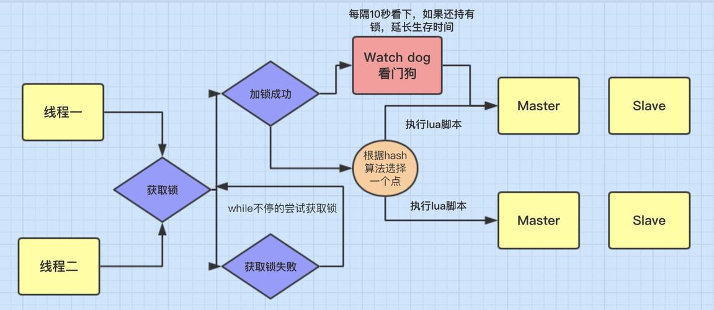

#### 7.5.4 释放锁

执行 `lock.unlock()` 时，逻辑很简单：把锁 hash 里该客户端的重入次数减一；减到 0 说明这个客户端不再持有锁，此时用 `del` 命令删掉这个 key，其他客户端就可以加锁了。

生产环境中一般直接使用 Redisson 提供的 `RLock` 完成加锁与释放，不建议手写 Lua 脚本。

#### 7.5.5 Redisson 锁的缺陷：主从切换

Redis 分布式锁有一个经典缺陷，出现在哨兵（Sentinel）或主从模式下：

1. 客户端 1 向某个 master 节点写入了锁，Redis 会**异步**把这次写入复制给 slave；复制完成前 master 宕机，发生主备切换，slave 被提升为 master；
2. 客户端 2 到新的 master 上加同一把锁，此时也能加锁成功；
3. 于是两个客户端同时认为自己持有同一把锁，业务语义上必然出问题，产生脏数据。

Redis 官方文档也明确指出了这一点：由于复制是异步的，基于主从切换的锁实现无法严格保证互斥性（safety）。若要缓解，可以：

- 使用 Redlock 算法（向多个独立 Redis 实例加锁，多数成功才算成功），但它在故障切换、时钟漂移等场景下仍有争议；
- 为关键业务引入**fencing token（栅栏令牌）**：每次加锁返回一个单调递增的序号，写数据时带上序号，存储侧拒绝比已见序号更小的写入——这样即使出现两把锁，旧持有者的写入也会被拒绝。

### 7.6 基于 ZooKeeper 的分布式锁

ZooKeeper 实现的分布式锁适用于已经引入 ZooKeeper 的系统。假设有两个服务注册到 ZooKeeper，并且都需要获取同一把分布式锁，流程如下。

#### 7.6.1 加锁流程

首先在 ZooKeeper 中创建一个持久节点 ParentLock。第一个客户端想获得锁时，在 ParentLock 下创建一个**临时顺序节点** Lock1（临时节点：会话断开即自动删除；顺序节点：由 ZK 自动在名字后追加单调递增序号）。

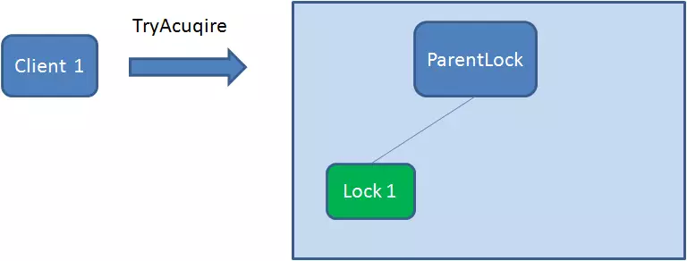

之后 Client1 查找 ParentLock 下所有临时顺序节点并排序，判断自己创建的 Lock1 是否排在第一个。如果是第一个，则成功获得锁。

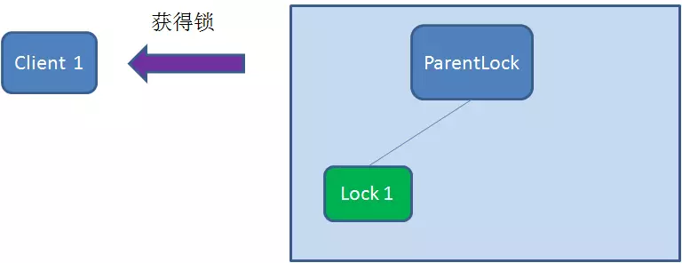

这时如果 Client2 也来获取锁，会在 ParentLock 下创建临时顺序节点 Lock2。

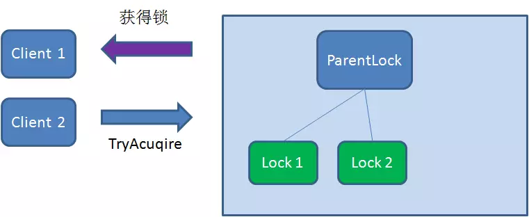

Client2 查出所有子节点并排序，发现 Lock2 不是最小的。

于是 Client2 向**排序仅比它靠前**的节点 Lock1 注册 Watcher（监听器），用于监听 Lock1 是否存在。这表示 Client2 抢锁失败，进入等待状态。

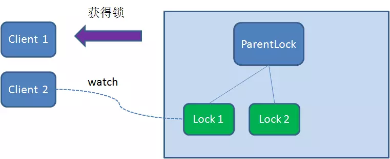

如果这时又来了 Client3，它在 ParentLock 下创建临时顺序节点 Lock3。

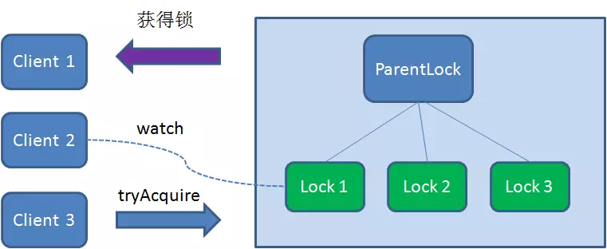

Client3 排序后发现 Lock3 也不是最小的，于是向比它靠前的 Lock2 注册 Watcher，同样进入等待状态。

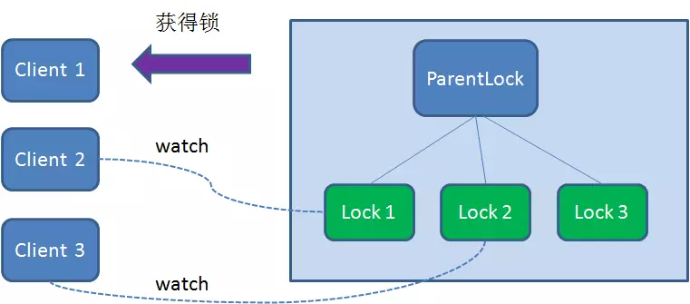

这样 Client1 持锁、Client2 监听 Lock1、Client3 监听 Lock2，恰好形成一个等待队列——很像 Java 中 `ReentrantLock` 依赖的 AQS（AbstractQueuedSynchronizer，抽象队列同步器）的排队机制。

关键点在于"只监听前一个节点"：如果所有等待者都监听 ParentLock，那么任何一次释放都会唤醒全部客户端，形成"惊群效应"；只监听前一个，则每次只唤醒一个。

#### 7.6.2 释放锁

释放锁分两种情况。

**（1）任务完成，客户端显式释放**

Client1 任务完成后，显式调用删除节点 Lock1 的指令。

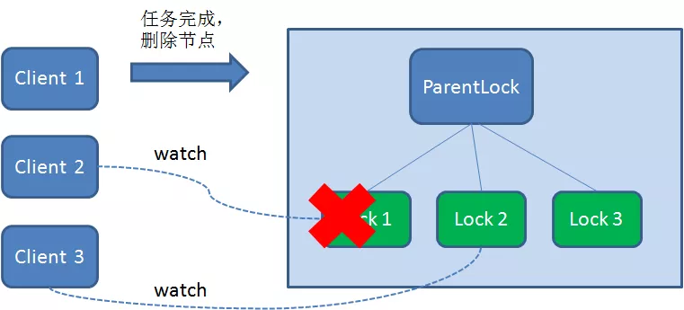

**（2）任务执行中，客户端崩溃**

Client1 在任务执行过程中崩溃，会断开与 ZooKeeper 服务端的连接。根据临时节点的特性，Lock1 会随之自动删除。

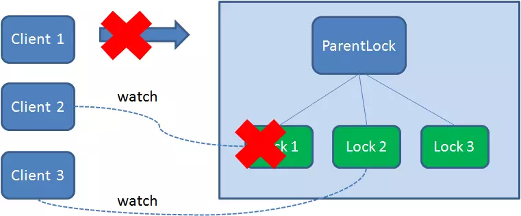

由于 Client2 一直监听 Lock1 的存在状态，Lock1 被删除后 Client2 会立刻收到通知，然后重新查询 ParentLock 下所有节点，确认自己创建的 Lock2 是否变成最小节点。如果是最小，Client2 就获得了锁。

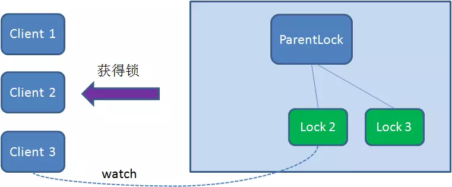

同理，Client2 完成任务或崩溃导致 Lock2 被删除后，Client3 会收到通知。

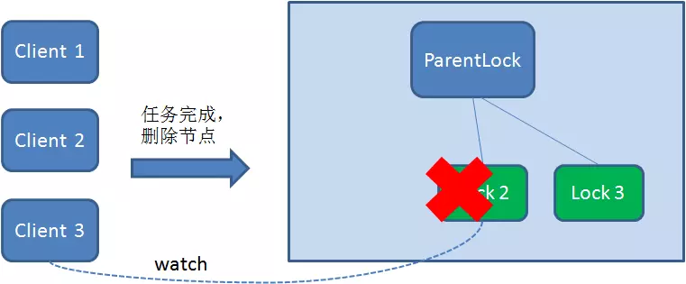

最终 Client3 成功获得锁。

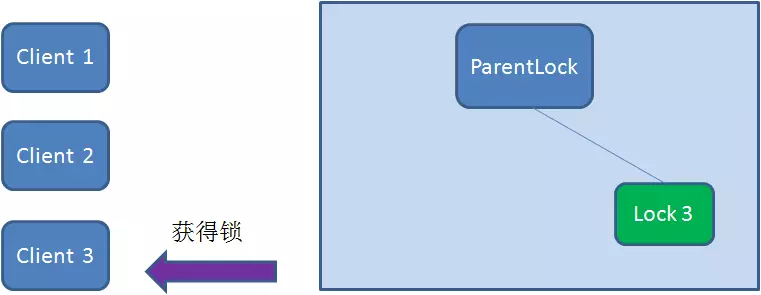

### 7.7 三种实现的对比

| 维度 | 数据库 | Redis（Redisson） | ZooKeeper |
| --- | --- | --- | --- |
| 互斥保证 | 靠唯一约束 / update 原子性 | 靠 SETNX + Lua 原子执行 | 靠节点唯一性与顺序 |
| 性能 | 较差（磁盘 IO） | 最好（内存） | 中等（需写多数派） |
| 锁超时与续期 | 需自行实现看门狗 | 内置看门狗自动续期 | 临时节点随会话自动删除 |
| 阻塞与排队 | 需轮询 | 支持等待与重试 | 天然形成等待队列，只唤醒下一个 |
| 公平性 | 难实现 | 有公平锁实现（FairLock） | 天然公平（按序号） |
| 主从/分区风险 | 依赖数据库高可用 | 异步复制下切换可能双持锁 | 依赖 ZK 集群过半可用 |
| 额外成本 | 无新组件 | 需部署/运维 Redis | 需部署/运维 ZooKeeper，较重 |

各实现的固有缺点汇总：

- **数据库锁**：并发性能较差；阻塞式锁实现较复杂；公平锁实现较复杂。
- **Redis 锁**：主从切换时可能出现多个客户端同时持锁；Lua 脚本在单机上具有原子性，主从同步过程中不具备原子性。
- **ZooKeeper 锁**：需要引入 ZooKeeper 集群，比较重；可重入粒度通常只能是节点级（同一节点的不同线程无法区分）。

## 8. 限流算法

限流是保护系统的第一道闸门：当流量超过系统处理能力时，主动丢弃或排队一部分请求，避免整体被压垮。这一节讲三种最常用的算法及其差异。

### 8.1 计数器（固定窗口）

计数器比较直接：要限制"每秒 N 个请求"，就从第一个请求进来开始计时，接下来 1 秒内每来一个请求计数加一，超过上限的请求被拒绝；1 秒结束后计数清零，重新开始。

这种方式有个明显弊端：如果前 10 毫秒就把额度用完了，后面 990 毫秒的请求只能全部拒绝，这种现象称为"突刺现象"。反过来，在窗口边界两侧各打满一次额度，也会在极短时间内放过接近两倍的请求。

改进办法是**滑动窗口**：把 1 秒切成若干小格（例如 10 个 100 毫秒的格子），按"最近 1 秒内的所有格子之和"判断是否超限，流量曲线会平滑很多。

### 8.2 漏桶算法

漏桶的思路是：桶底漏水的速度恒定，进水的速度可能快慢不一。进水量大于出水量时，水先存在桶里而不是直接丢弃；但桶有容量上限，装满后溢出的部分仍然会被丢弃。

也就是说，漏桶**强行把请求速率整形成恒定速率**，起到"削峰填谷"的作用。

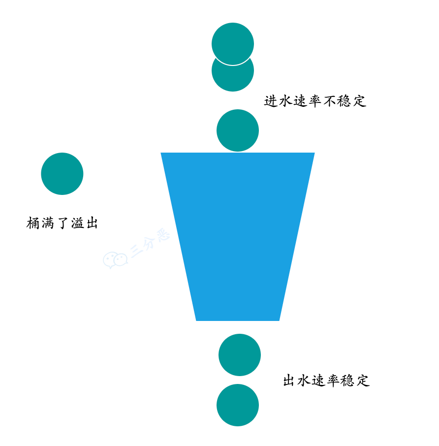

**一种实现思路**：准备一个队列保存暂时处理不了的请求，再由线程池按固定速率从队列中取请求执行。队列长度即"桶的容量"，队列满了就拒绝新请求。

### 8.3 令牌桶算法

令牌桶是"发令牌"的地方：以恒定速率往桶里放令牌，桶有容量上限，满了就丢弃多余令牌。请求进来时，能从桶里拿到令牌就可以通行，拿不到就触发限流。

与漏桶的区别在于：漏桶限制的是**流出速率**（严格恒定），令牌桶允许在桶里攒下令牌，因此**允许一定程度的突发流量**——只要桶里还有令牌，突发请求可以立刻通过。

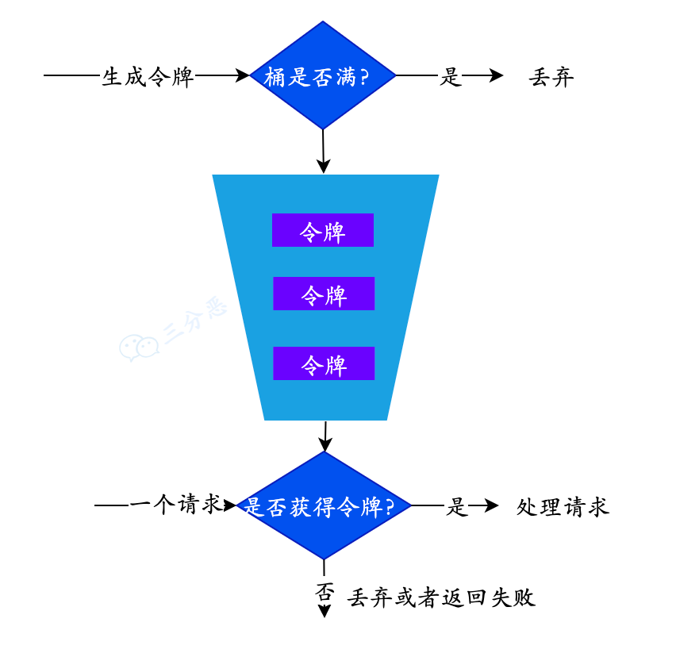

**实现方案**：Guava 的 `RateLimiter` 是一个常用的限流工具，基于令牌桶思想实现（默认 `SmoothBursty` 支持突发，另有 `SmoothWarmingUp` 支持预热），比较适用于单实例系统；多实例部署时需要网关或集中式限流（如基于 Redis 的计数）来统一额度。

### 8.4 三种算法对比

| 算法 | 是否允许突发 | 输出速率 | 实现复杂度 | 典型用途 |
| --- | --- | --- | --- | --- |
| 固定窗口计数器 | 允许（窗口边界更明显） | 不平滑 | 低 | 简单接口限流、防刷 |
| 滑动窗口计数器 | 少量允许 | 较平滑 | 中 | 需要更精确的 QPS 控制 |
| 漏桶 | 不允许 | 恒定 | 中（需队列） | 保护下游、流量整形 |
| 令牌桶 | 允许（受桶容量限制） | 平均恒定、可突发 | 中 | 对外 API 限流、突发流量场景 |

## 9. 总结与参考资料

### 9.1 一页速查

- **分布式系统**用网络换来了扩展性与容错，也带来了网络不可靠、部分失败、无全局时钟三个现实约束。
- **分布式事务**的方案可以按一致性强度排序：2PC/3PC（强一致、阻塞）→ TCC（预留资源、性能好但侵入强）→ Saga（直接提交、靠补偿）→ 本地消息表/MQ 事务消息/最大努力通知（最终一致、工程上最常用）。
- **CAP** 说明 P 是必须接受的前提，真正要选的是"分区时保 C 还是保 A"；**BASE** 是选 A 之后的工程方法论：基本可用、软状态、最终一致。
- **Seata** 把 XA、AT、TCC、Saga 统一到一个框架：AT 用 undo-log + 全局锁实现"一阶段提交、二阶段补偿"，性能优于 XA 但只是最终一致。
- **幂等**是分布式写操作的必修课，常用组合是"唯一索引兜底 + 状态机/防重表 + 分布式锁"。
- **分布式锁**三种实现各有取舍：数据库简单但慢，Redis 快但主从切换有风险，ZooKeeper 公平可靠但重。
- **限流**三种算法：计数器最简单但会突刺，漏桶整形最严格，令牌桶最常用且允许突发。

### 9.2 参考资料

- Eric Brewer. PODC 主题演讲：Towards Robust Distributed Systems. 2000.
- Seth Gilbert, Nancy Lynch. Brewer's Conjecture and the Feasibility of Consistent, Available, Partition-Tolerant Web Services. ACM SIGACT News. 2002.
- Werner Vogels. Eventually Consistent. ACM Queue. 2008.
- Dan Pritchett. BASE: An Acid Alternative. ACM Queue. 2008.
- Chris Richardson. Pattern: Saga. microservices.io. 2018.
- Apache Seata 官方文档：What Is Seata、Seata TCC 模式. 2023.
- Apache RocketMQ 官方文档：Transaction Message. 2022.
- Redis 官方文档：Distributed Locks with Redis. 2024.
- Redisson 官方文档：分布式锁与看门狗机制. 2024.
- Martin Kleppmann. How to do distributed locking. 2016.
- Oracle. Java SE API 文档：java.sql.SQLIntegrityConstraintViolationException. 2021.
