# 分库分表：拆分策略、常见问题与 ShardingSphere 实践

单表数据从几百万涨到几亿时，查询变慢、磁盘吃紧、主从也顶不住，这时通常就要考虑把数据拆开存。本文按"为什么拆 → 怎么拆 → 拆完有哪些坑 → 中间件怎么用"的顺序讲清分库分表，面向有 1 年左右 Java 经验、能独立写 CRUD 的开发者。

> 说明：文中出现的并发量、容量、比例等数字均为经验估算，只用于说明量级关系，不代表任何具体环境的实测结果。

## 本文导读

- 一、认识分库分表：拆什么、为什么拆、代价是什么
- 二、先定位瓶颈：常见优化手段与 IO / CPU 瓶颈
- 三、四种拆分方式：水平分库、水平分表、垂直分库、垂直分表
- 四、核心概念：数据分片、数据节点、逻辑表、真实表、广播表、单表、分片键、分片策略、分片算法、绑定表
- 五、一条 SQL 的旅程：解析、优化、路由、改写、执行、归并
- 六、全局唯一 ID：UUID、雪花算法、号段模式
- 七、容量规划：分多少个库、多少张表
- 八、扩容与数据迁移
- 九、分页查询
- 十、跨库 JOIN
- 十一、非分片键查询：索引表、缓存映射、基因法、冗余
- 十二、中间件：ShardingSphere 的能力与边界
- 十三、总结

## 一、认识分库分表

分库分表是把一份数据按规则拆到多个库、多张表里，让每个库表的数据量和访问量都回到可控范围。它不是某个可以随手打开的优化开关，而是一次架构级改造，会同时引入事务、主键、跨库查询等一连串新问题。所以先要弄清它到底解决什么、又带来什么。

### 1.1 什么是分库分表

分库分表拆开来看是两个手段：

- **分表**：把一张表的数据按某种规则拆到多张结构相同的表里，降低单表索引树的高度和锁粒度，提升查询效率。

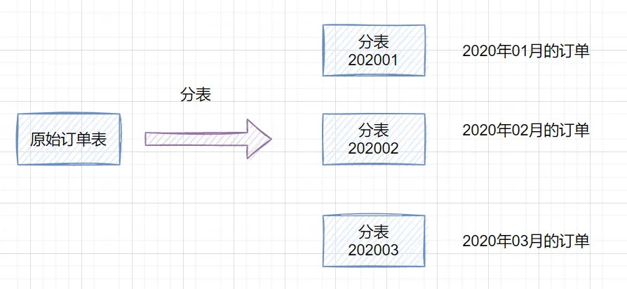

- **分库**：把一个数据库中的数据按某种规则拆到多个数据库中，缓解单台服务器的压力（CPU、内存、磁盘、IO）。

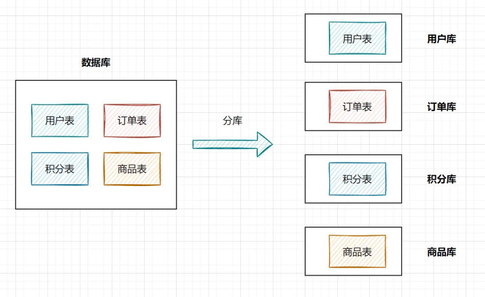

> 生活化比喻：原来只有一个窗口排队，分库相当于多开几个窗口（多台服务器分担流量），分表相当于把一个大抽屉隔成几个小抽屉（同一个窗口里找东西更快）。

分库分表在解决 IO 瓶颈、读写性能、物理存储瓶颈、内存瓶颈、单机故障影响面等问题的同时，也带来事务性、主键冲突、跨库 join、跨库聚合查询等问题。综合业务场景考虑，正如缓存的使用一样，应本着**非必须勿使用**的原则。如果数据库确实成为性能瓶颈，设计时也要充分考虑扩展性，或者考虑采用成熟的分布式数据库解决方案（如 TiDB）。

### 1.2 为什么需要分库分表

业务量剧增后数据库可能出现性能瓶颈，从下面几个角度看，拆分就有了必要：

- **磁盘存储**：业务量剧增时，MySQL 单机磁盘容量会被撑爆；拆成多个数据库后，单机磁盘使用率大幅降低。
- **并发连接支撑**：数据库连接数是有限的，高并发下大量请求访问数据库，单机扛不住。当前流行的**微服务架构**正是为应对高并发而生：它把**订单、用户、商品**等不同模块拆成多个应用，也把单个数据库拆成**订单库、用户库、商品库**等多个功能模块的数据库，以分担读写压力。
- **性能角度（CPU、内存、磁盘、IO 瓶颈）**：
  - 数据规模扩大后，单表行数达到百万甚至上亿级，B+ 树索引变深，磁盘随机 IO 次数增加，查询性能出现瓶颈。
  - 并发流量规模扩大，单库（单服务器）的物理性能上限无法承载大流量。
- **可用性角度（单机故障影响面）**：
  - 单库时数据库宕机将导致 100% 服务不可用；拆成 N 个库后，单库故障的影响面理论上可降到 1/N。

### 1.3 分库分表带来的问题

- **事务性问题**：分库**可能**导致一次事务所需的数据分布在不同服务器上，数据库层面无法实现事务性操作，需要更上层业务引入分布式事务，难免给业务带来复杂性。一般有两种手段：
  - 方案一：设计时从业务角度出发，尽可能保证一个事务所操作的表分布在一个库中，从而在数据库层面保证事务。
  - 方案二：方案一无法实现时，业务层引入分布式事务组件（如事务性消息、TCC、Seata 等）实现数据最终一致性。
- **主键（自增 ID）唯一性问题**：表设计时常使用自增 ID 作为主键，后续迁库迁表或分库分表时会因主键变化或不唯一产生冲突，常见解法有：
  - 方案一：自增 ID 做主键时设置自增步长，采用等差数列递增，避免各库表的主键冲突。但该方案仍无法解决迁库迁表以及扩容导致主键 ID 变化的问题。
  - 方案二：主键采用全局统一 ID 生成机制，如 UUID、雪花算法、数据库号段等（详见第六章）。
- **跨库多表 join 问题**：实践中 DBA 的普遍建议是线上服务尽可能不要有表的 join 操作，join 往往会给后续分库分表带来各种问题，甚至可能导致死锁。可以采用多次查询、在业务层进行数据组装（需要考虑业务上多次查询的事务性容忍度）。
- **跨库聚合查询问题**：分库分表会让常规聚合查询（如 group by、order by 等）变得异常复杂，需要更多业务代码来实现，常见的操作方式有：

方案一：赛道赛马机制，每次从 N 个库表中查询出 TOP N 数据，然后在业务层代码中聚合合并。

```sql
-- 假设：以 2 库 1 表为例，每次分页查询 N 条数据。

-- 第一次查询：
-- ① 每个表中分别查询出 N 条数据：
SELECT * FROM db1_table1 where $col > 0 order by $col LIMIT 0,N
SELECT * FROM db2_table1 where $col > 0 order by $col LIMIT 0,N
-- ② 业务层对上述结果做归并排序，假设最终取 db1 数据 K1 条、db2 数据 K2 条，则 K1+K2 = N
-- 此时 DB1 可计算出 Offset 为 K1，DB2 计算出 Offset 为 K2
-- 将获取的 N 条数据以及相应的 Offset K1/K2 返回给端上。

-- 第二次查询：
-- ① 端上将上一次查询对应的数据库 Offset K1/K2 传到后端
-- ② 后端根据 Offset 构造查询语句，分别查询出 N 条：
SELECT * FROM db1_table1 where $col > 0 order by $col LIMIT $K1,N
SELECT * FROM db2_table1 where $col > 0 order by $col LIMIT $K2,N
-- ③ 再次归并排序，获取 TOP N 数据，将 N 条数据以及相应的 Offset K1/K2 返回给端上。

-- 第三次查询：依次类推……
```

方案二：将经常使用的 group by、order by 字段存储到一个单一库表（可以是 Redis、ES、MySQL）中，业务代码先到单一表按查询条件查出相应数据，再根据主键 ID 到分库分表中查询详情返回。两次查询会带来接口耗时增加，以及极端情况下的数据不一致问题。

### 1.4 什么样的方案算好方案

- **满足业务场景需要**：根据业务场景选择不同方案，如按时间划分、按用户 ID 划分、按业务能力划分等。
- **方案可持续性**：业务数据量和流量未来达到新量级时，分库分表方案可以持续灵活扩容。
- **最小化数据迁移**：扩容一般涉及历史数据迁移，扩容后需要迁移的数据量越小，可持续性越强。理想程度从好到差依次是：同库同表 > 同表不同库 > 同库不同表 > 不同库不同表。
- **数据偏斜**：数据在库表中分配的均衡性，尽可能保证各库表流量等量分配，避免热点数据压垮单个库。
  - 最大数据偏斜率 =（数据量最大样本 - 数据量最小样本）/ 数据量最小样本。经验上，最大数据偏斜率控制在 5% 以内比较理想，具体阈值应结合业务评估。

## 二、先定位瓶颈

分库分表只是众多优化手段中的一种，用错地方只会增加复杂度。这一章先把"数据库为什么会慢"讲清楚，再说明每种优化手段各自解决哪一类问题，避免一上来就拆库拆表。

### 2.1 数据库常见优化手段

随着业务规模逐渐扩大，存储的使用也需要随之升级和优化。规模扩大后，数据库通常面临如下问题：

- 读压力：并发 QPS 高、索引不合理、SQL 语句写得不合理、锁粒度过大。
- 写压力：并发写入高、事务过大、锁粒度过大。
- 物理性能：磁盘瓶颈、CPU 瓶颈、内存瓶颈、IO 瓶颈。
- 其他：宕机、网络异常。

面对上述问题，常见的优化手段有：

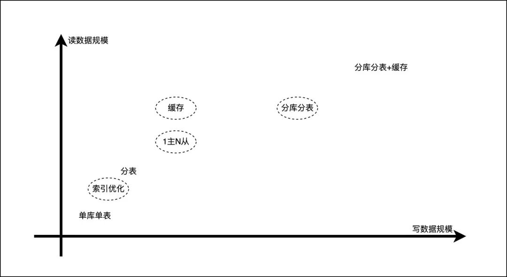

索引优化、主从同步、缓存、分库分表，每一个手段都可以单独作为一个专题，本文主要介绍分库分表的实现方案。

### 2.2 两类典型瓶颈

不管是 IO 瓶颈还是 CPU 瓶颈，最终都会导致数据库的活跃连接数增加，进而逼近甚至达到可承载连接数的阈值。在业务 Service 看来就是可用数据库连接变少甚至无连接可用，接下来并发量、吞吐量上升直至崩溃。

#### 2.2.1 IO 瓶颈

- 第一种：磁盘读 IO 瓶颈。热点数据太多，数据库缓存放不下，每次查询产生大量 IO，降低查询速度，对应的手段是分库和垂直分表。
- 第二种：网络 IO 瓶颈。单次请求的数据太多，网络带宽不够，对应的手段是分库。

#### 2.2.2 CPU 瓶颈

- 第一种：SQL 问题。如 SQL 中包含 join、group by、order by、非索引字段条件查询等，增加 CPU 运算，对应的手段是 SQL 优化、建立合适的索引、在业务 Service 层做业务计算。
- 第二种：单表数据量太大。查询时扫描的行太多，SQL 效率低，增加 CPU 运算，对应的手段是水平分表。

## 三、四种拆分方式

按"数据怎么切"和"切完放在哪"，分库分表有四种基本形态：水平分库、水平分表、垂直分库、垂直分表。理解它们的差别，才能在面对具体瓶颈时选对工具。

### 3.1 水平分库

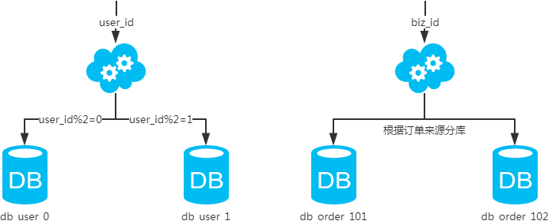

#### 概念

以字段为依据，按照一定策略（hash、range 等），将一个库中的数据拆分到多个库中。

#### 结果

- 每个库的结构都一样；
- 每个库的数据都不一样，没有交集；
- 所有库的并集是全量数据。

#### 场景

系统绝对并发量上来了，分表难以从根本上解决问题，并且还没有明显的业务归属可以垂直分库。

#### 分析

库多了，IO 和 CPU 的压力自然可以成倍缓解。

### 3.2 水平分表

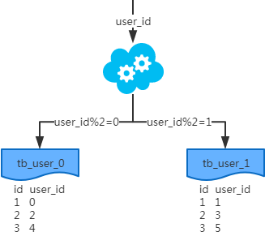

#### 概念

以字段为依据，按照一定策略（hash、range 等），将一个表中的数据拆分到多个表中。

#### 结果

- 每个表的结构都一样；
- 每个表的数据都不一样，没有交集；
- 所有表的并集是全量数据。

#### 场景

系统绝对并发量并没有上来，只是单表的数据量太多，影响了 SQL 效率，加重了 CPU 负担，以至于成为瓶颈。

#### 分析

表的数据量少了，单次 SQL 执行效率高，自然减轻了 CPU 的负担。

### 3.3 垂直分库

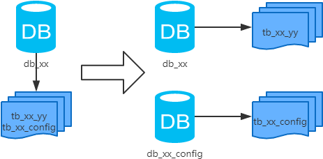

#### 概念

以表为依据，按照业务归属不同，将不同的表拆分到不同的库中。

#### 结果

- 每个库的结构都不一样；
- 每个库的数据也不一样，没有交集；
- 所有库的并集是全量数据。

#### 场景

系统绝对并发量上来了，并且可以抽象出单独的业务模块。

#### 分析

到这一步基本上就可以服务化了。例如，随着业务发展，公用的配置表、字典表等越来越多，可以将这些表拆到单独的库中，甚至可以服务化；又如业务孵化出了一套新的业务模式，也可以将相关的表拆到单独的库中。

### 3.4 垂直分表

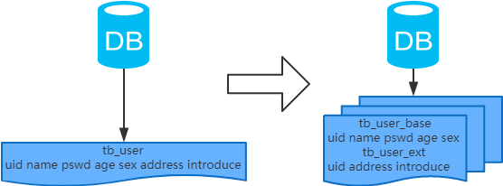

#### 概念

以字段为依据，按照字段的活跃性，将表中字段拆到不同的表（主表和扩展表）中。

#### 结果

- 每个表的结构都不一样；
- 每个表的数据也不一样，一般来说每个表的字段至少有一列交集（一般是主键），用于关联数据；
- 所有表的并集是全量数据。

#### 场景

系统绝对并发量并没有上来，表的记录并不多，但是字段多，并且热点数据和非热点数据混在一起，单行数据所需的存储空间较大，以至于数据库缓存能放下的数据行减少，查询时会去磁盘读数据产生大量随机读 IO，形成 IO 瓶颈。

#### 分析

可以用列表页和详情页来帮助理解：列表页只需要几个热点字段，详情页才需要全部字段。垂直分表的拆分原则是把热点数据（可冗余经常一起查询的数据）放在一起作为主表，非热点数据放在一起作为扩展表，这样更多热点数据能被缓存下来，减少随机读 IO。拆分后要获得全部数据就需要关联两张表来取。

但要注意，**线上查询通常不建议使用 join**，因为 join 不仅会增加 CPU 负担，还会把两张表耦合在一起（必须位于同一个数据库实例上）。关联数据应该在业务 Service 层处理：分别获取主表和扩展表数据，再用关联字段拼成完整对象。

### 3.5 四种方式怎么选

| 方式 | 拆分依据 | 主要解决的问题 | 典型触发场景 |
| --- | --- | --- | --- |
| 水平分库 | 字段 + 分片策略 | 单库连接数、CPU、IO 达到物理上限 | 并发很高，单库扩容已到顶 |
| 水平分表 | 字段 + 分片策略 | 单表数据量过大导致查询变慢 | 单表行数过亿，SQL 扫描行数多 |
| 垂直分库 | 业务归属 | 业务耦合、单库资源被多业务争抢 | 可抽象出独立业务模块，准备服务化 |
| 垂直分表 | 字段活跃度 | 单行过大、缓存命中率低、随机读多 | 大字段（如长文本、JSON）与热点字段混存 |

实际项目中这四种方式经常组合使用：先垂直分库把业务拆开，再对数据量最大的表做水平分库分表。

## 四、核心概念

分库分表的方案设计、配置、排错都建立在一组固定术语之上。这一章把这些术语逐个解释清楚，后面讲 SQL 路由和中间件配置时就不会卡在名词上。

### 4.1 数据分片

提到分库分表时，大多以水平切分模式（水平分库、水平分表）为基础。数据分片将原本一张数据量较大的表 t_order 拆分生成数个**表结构完全一致**的小数据量表（拆分表）t_order_0、t_order_1、……、t_order_n，每张表只存储原大表中的一部分数据。

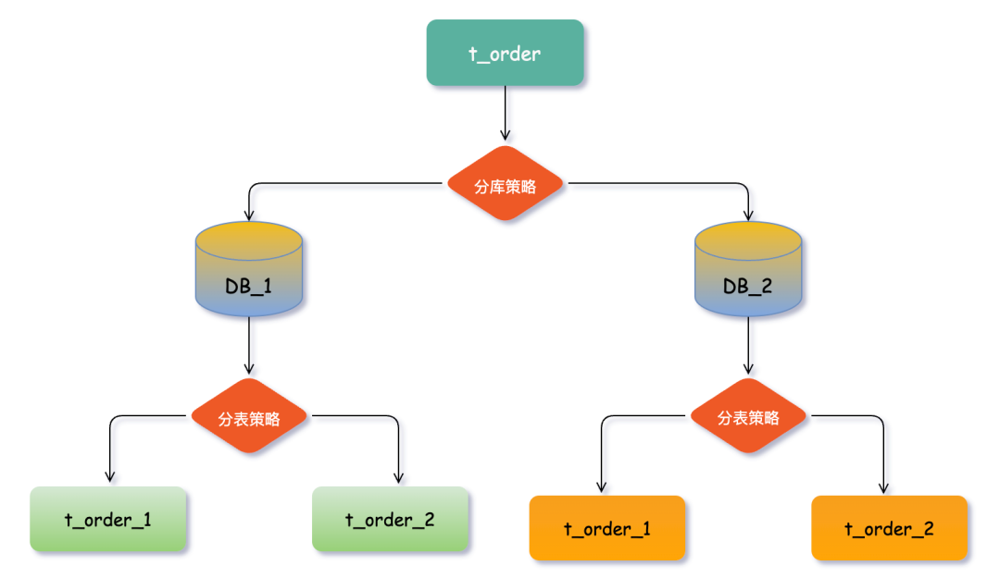

### 4.2 数据节点

数据节点是数据分片中一个不可再分的最小单元（表），由数据源名称和数据表组成。例如下图中 DB_1.t_order_1、DB_2.t_order_2 就表示一个数据节点。


### 4.3 逻辑表

逻辑表是指具有相同结构的水平拆分表的逻辑名称。

比如将订单表 t_order 拆分成 t_order_0 …… t_order_9 等 10 张表，此时数据库中已不存在 t_order 表，取而代之的是若干 t_order_n 表。

分库分表通常对业务代码无侵入，开发者只专注业务逻辑 SQL 编码，代码中的 SQL 依然按 t_order 来写，执行前再将其解析成对应的数据库真实执行的 SQL。此时 t_order 就是这些拆分表的逻辑表。

> 生活化比喻：逻辑表像公司的"客服总机"，真实表像各个分机号。对外只需要知道总机号码，具体接到哪个分机由交换机（中间件）决定。

业务逻辑 SQL：

```sql
select * from t_order where order_id = 'A11111'
```

真实执行 SQL：

```sql
select * from DB_1.t_order_n where order_id = 'A11111'
```

### 4.4 真实表

真实表就是在数据库中真实存在的物理表，如 DB_1.t_order_n。


### 4.5 广播表

广播表是一类特殊的表，其表结构和数据在所有分片数据源中均完全一致。与拆分表相比，广播表数据量较小、更新频率较低，通常用于字典表或配置表等场景。由于它在所有节点上都有副本，可以大大降低 JOIN 关联查询的网络开销，提高查询效率。

需要注意的是，对广播表的修改操作需要保证同步性，以确保所有节点上的数据保持一致。

**广播表的特点**：

- 在所有分片数据源中数据完全一致。对广播表的操作（插入、更新和删除）会实时在每个分片数据源中执行一遍，以保证一致性。
- 查询操作仅需在任意一个分片数据源中执行一次即可。
- 与任何其他表进行 JOIN 操作都是可行的，因为广播表数据在所有节点上一致，可以访问到任何一个节点上的相同数据。

什么样的表可以作为广播表？

订单管理系统中往往需要按城市地区统计订单数据，会涉及省份地区表 t_city 与订单流水表 DB_n.t_order_n 进行 JOIN 查询，因此可以考虑将省份地区表设计为广播表，核心理念就是**避免跨库 JOIN 操作**。

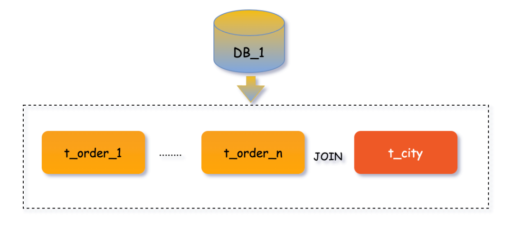

> 生活化比喻：广播表像连锁店门口统一张贴的价目表，每家店都贴一份，顾客在哪家店看到的都一样；但每次调价都要把所有门店的价目表重贴一遍。

**注意**：广播表在插入、更新与删除时会实时在每个分片数据源执行，也就是说如果有 1000 个分片数据源，修改一次广播表就要执行 1000 次 SQL。所以尽量不在并发环境下和业务高峰时修改广播表，以免影响系统性能。

### 4.6 单表

单表指所有分片数据源中唯一存在的表（没有分片的表），适用于数据量不大且无需分片的表。

如果一张表的数据量预估在千万级别，且没有与其他拆分表进行关联查询的需求，建议将其设置为单表类型，存储在默认分片数据源中。

### 4.7 分片键

分片键决定了数据落地的位置，也就是数据将被分配到哪个数据节点上存储，因此分片键的选择非常重要。

比如将 t_order 表分片后，插入一条订单数据执行 SQL 时，需要通过解析 SQL 语句中指定的分片键来计算数据应该落在哪个分片中。以表中 order_id 字段为例，可以通过取模运算（比如 order_id % 2）得到分片编号，再根据分片编号把数据分配到对应的数据库实例（比如 DB_1 和 DB_2）。拆分表也是同理计算。

在这个过程中，order_id 就是 t_order 表的分片键。也就是说，每一条订单数据的 order_id 值决定了它应该存放的数据库实例和表。选择一个适合作为分片键的字段，可以更好地利用水平分片带来的性能提升。

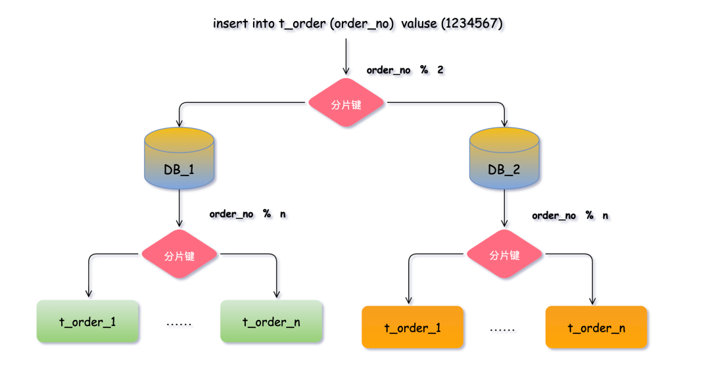

这样同一个订单的相关数据就会落在同一个数据库、同一张表中，查询订单时同理计算即可直接定位数据位置，大幅提升检索性能，避免全库表扫描。

> 生活化比喻：分片键就像快递单上的邮编，分拣员只看邮编就知道包裹该发往哪个城市的中转站。

不仅如此，ShardingSphere 还支持根据多个字段作为分片键进行分片，后续章节会详细讲。

### 4.8 分片策略

分片策略用于指定使用哪种分片算法、选择哪个字段作为分片键，以及如何将数据分配到不同的节点上。

分片策略由分片算法和分片键组合而成，其中可以使用多种分片算法并对多个分片键进行运算。

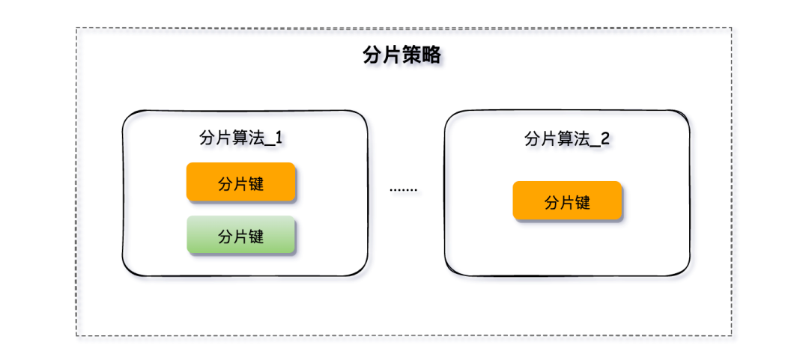

分库、分表的分片策略配置相对独立，可以各自使用不同的策略与算法。每种策略中可以是多个分片算法的组合，每个分片算法可以对多个分片键做逻辑判断。

### 4.9 分片算法

分片算法用于对分片键进行运算，将数据划分到具体的数据节点中。

常用的分片算法有以下几类：

| 算法 | 怎么分 | 优点 | 需要注意 |
| --- | --- | --- | --- |
| 范围分片（range） | 分片键值按区间分配到不同节点，如按订单创建时间、地理区域 | 便于按时间归档和删除历史数据，范围查询友好 | 新数据集中落在最后一个分片，容易产生写热点 |
| 取模分片（mod） | 分片键值对分片数取模，结果作为节点编号，如 order_id % 2 | 分布均匀、路由计算简单 | 扩容时节点数变化会导致大量数据重新分布 |
| 哈希分片（hash） | 对分片键先做哈希再取模 | 字符串等非数字键也能均匀分布 | 结果不可预期，范围查询基本退化为全路由 |
| 一致性哈希（consistent hashing） | 把节点和数据映射到同一个哈希环上，按顺时针就近归位 | 节点增减时只影响相邻区间的一部分数据，重分布范围小 | 节点少时容易负载不均，通常要配合虚拟节点 |

实际业务中的分片逻辑要比上面复杂得多，不同算法适用于不同场景和需求，需要根据实际情况选择和调整。

### 4.10 绑定表

绑定表是那些具有相同分片规则的一组分片表，由于分片规则一致、数据落地位置相同，在 JOIN 联合查询时能有效**避免跨库**操作。

比如 t_order 订单表和 t_order_item 订单明细表，都以 order_id 作为分片键，并且使用 order_id 进行关联，因此两张表互为绑定表关系。

使用绑定表进行多表关联查询时，必须使用分片键进行关联，否则会出现笛卡尔积关联或跨库关联，影响查询效率。

当使用 t_order 和 t_order_item 表进行多表联合查询时，执行如下逻辑 SQL：

```sql
SELECT * FROM t_order o JOIN t_order_item i ON o.order_id = i.order_id WHERE o.order_id IN (1, 2)
```

如果不配置绑定表关系，两个表的数据位置不确定，就会全库表查询，出现笛卡尔积关联查询，产生如下四条 SQL：

```sql
SELECT * FROM t_order_0 o JOIN t_order_item_0 i ON o.order_id = i.order_id
SELECT * FROM t_order_0 o JOIN t_order_item_1 i ON o.order_id = i.order_id
SELECT * FROM t_order_1 o JOIN t_order_item_0 i ON o.order_id = i.order_id
SELECT * FROM t_order_1 o JOIN t_order_item_1 i ON o.order_id = i.order_id
```

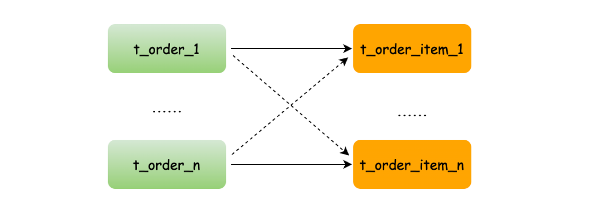

而配置绑定表关系后再进行关联查询时，分片规则一致产生的数据会落到同一个库表中，只需在当前库中做 t_order_n 和 t_order_item_n 表关联即可：

```sql
SELECT * FROM t_order_0 o JOIN t_order_item_0 i ON o.order_id = i.order_id
SELECT * FROM t_order_1 o JOIN t_order_item_1 i ON o.order_id = i.order_id
```

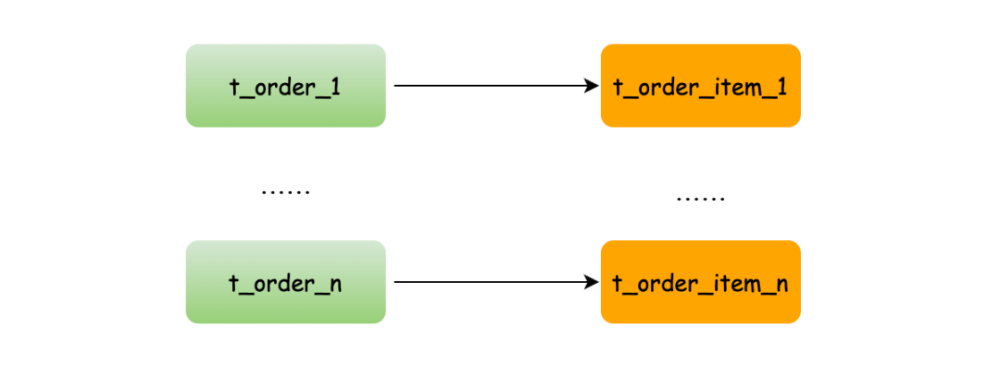

**注意**：关联查询时 t_order 作为整个联合查询的主表，所有相关的路由计算都只使用主表的策略，t_order_item 表的分片相关计算也会使用 t_order 的条件，所以要保证绑定表之间的分片键完全相同。

## 五、一条 SQL 的旅程

写业务代码时，开发者面对的仍然是一个库、一张逻辑表；真正把 SQL 拆开发往多个数据节点的是中间件。这一章按执行顺序拆解中间件内部做了什么，理解它，就能判断一条 SQL 会不会变慢、会不会打爆所有分片。

### 5.1 五个阶段总览

分库分表后在应用层面执行一条 SQL 语句，通常需要经过五个阶段：SQL 解析 → SQL 路由 → SQL 改写 → SQL 执行 → 结果归并。早期资料里还会把"执行器优化"单列出来，形成六步流程；在 ShardingSphere 5.x 的官方开发者指南中，优化能力主要并入改写与执行环节。

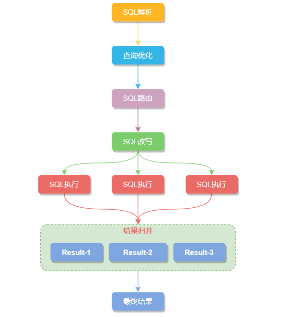

### 5.2 SQL 解析

SQL 解析过程分为词法解析和语法解析两步。比如下面这条查询用户订单的 SQL，先用词法解析将其拆解成不可再分的原子单元，再根据不同数据库方言提供的字典，将这些单元归类为关键字、表达式、变量或操作符等类型。

```sql
SELECT order_id FROM t_order where order_status > 0 and user_id = 10086
```

接着语法解析会把拆解后的 SQL 关键字转换为抽象语法树（AST，Abstract Syntax Tree，可以理解为用树形结构表示 SQL 的语法组成）。通过遍历抽象语法树提炼出分片所需的上下文，包含查询字段（Field）、表信息（Table）、查询条件（Condition）、排序（Order By）、分组（Group By）以及分页（Limit）等，并标记出 SQL 中有可能需要改写的位置。

### 5.3 执行器优化

执行器优化会根据 SQL 查询特点和执行统计信息，选择更优的查询计划。比如 user_id 字段有索引，那么可以调整查询条件的书写顺序，以提高 SQL 的执行效率：

```sql
SELECT order_id FROM t_order where user_id = 10086 and order_status > 0
```

需要说明的是，SQL 中条件的先后顺序是否真的影响执行计划，取决于数据库优化器本身；这里调整顺序的作用是让可用的索引条件更早被识别，实际效果应以 `EXPLAIN` 的结果为准。

### 5.4 SQL 路由总览

通过 SQL 解析得到分片上下文数据，再匹配配置的分片策略和算法，就可以运算生成路由路径，将 SQL 语句路由到相应的数据节点上。

简单理解就是：拿到分片策略中配置的分片键等信息，再从 SQL 解析结果中找到对应分片键字段的值，计算出 SQL 该在哪个库的哪张表中执行。SQL 路由根据有无分片键分为**分片路由**和**广播路由**。

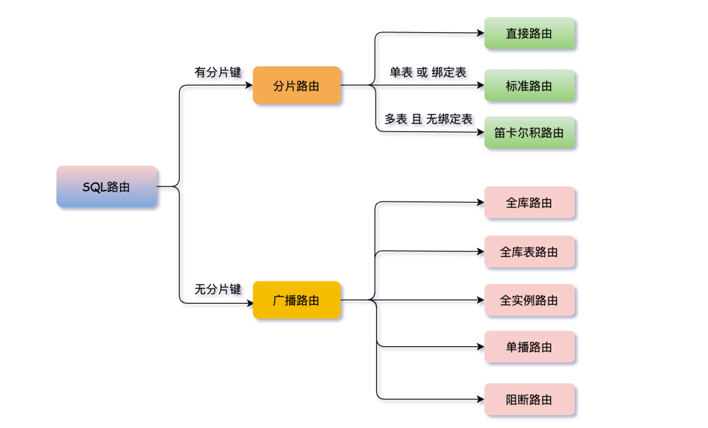

有分片键的路由叫分片路由，细分为直接路由、标准路由和笛卡尔积路由 3 种类型。无分片键的路由叫广播路由，可划分为全库表路由、全库路由、全实例路由、单播路由和阻断路由 5 种类型。

另外要注意：如果分片键出现在表达式或函数中（例如 `to_date(create_time, ...)`），中间件无法从 SQL 字面量中提取分片值，就会退化为全路由，性能会明显下降。

### 5.5 标准路由

标准路由是最推荐也最常用的分片方式，适用范围是不包含关联查询、或仅包含绑定表之间关联查询的 SQL。

当 SQL 分片键的运算符为 `=` 时，路由结果将落入单库（单表）；当分片运算符是 BETWEEN 或 IN 等范围时，路由结果则不一定落入唯一的库（表），因此一条逻辑 SQL 最终可能被拆分为多条真实 SQL。

```sql
SELECT * FROM t_order where order_id in (1,2)
```

SQL 路由处理后：

```sql
SELECT * FROM t_order_0 where order_id in (1,2)
SELECT * FROM t_order_1 where order_id in (1,2)
```

### 5.6 直接路由

直接路由是直接将 SQL 路由到指定库、表的一种分片方式，可以用于分片键不在 SQL 中的场景，还可以执行包括子查询、自定义函数等复杂情况的任意 SQL。

它通常配合 Hint（一种由代码显式指定路由值的机制）使用，例如把数据库分片值直接设为 3：

```java
try (HintManager hintManager = HintManager.getInstance();
     Connection conn = dataSource.getConnection();
     PreparedStatement pstmt = conn.prepareStatement("SELECT * FROM t_order")) {
    hintManager.setDatabaseShardingValue(3);
    try (ResultSet rs = pstmt.executeQuery()) {
        // 处理结果集
    }
}
```

### 5.7 笛卡尔积路由

笛卡尔积路由由非绑定表之间的关联查询产生。比如订单表 t_order 的分片键是 order_id、用户表 t_user 的分片键是 user_id，两个表的分片键不同，要做联表查询就会执行笛卡尔积路由，查询性能较低，应尽量避免走此路由模式。

```sql
SELECT * FROM t_order_0 t LEFT JOIN t_user_0 u ON u.user_id = t.user_id WHERE t.user_id = 1
SELECT * FROM t_order_0 t LEFT JOIN t_user_1 u ON u.user_id = t.user_id WHERE t.user_id = 1
SELECT * FROM t_order_1 t LEFT JOIN t_user_0 u ON u.user_id = t.user_id WHERE t.user_id = 1
SELECT * FROM t_order_1 t LEFT JOIN t_user_1 u ON u.user_id = t.user_id WHERE t.user_id = 1
```

### 5.8 广播路由

广播路由用于没有分片键的 SQL，按 SQL 类型又分为 5 种。

#### 5.8.1 全库表路由

全库表路由针对数据库的 DQL 和 DML，以及 DDL 等操作。执行一条逻辑表 t_order 的 SQL 时，会在所有分片库中对应的真实表 t_order_0 …… t_order_n 内逐一执行。

#### 5.8.2 全库路由

全库路由主要针对数据库层面的操作，比如 SET 类型的数据库管理命令，以及 TCL 这类事务控制语句。对逻辑库设置 autocommit 属性后，所有对应的真实库中都会执行该命令：

```sql
SET autocommit=0;
```

#### 5.8.3 全实例路由

全实例路由针对数据库实例的 DCL 操作（设置或更改数据库用户或角色权限）。比如创建一个用户 order，该命令会在所有真实库实例中执行，以此确保 order 用户可以正常访问每一个数据库实例：

```sql
CREATE USER order@127.0.0.1 identified BY 'Fcant';
```

#### 5.8.4 单播路由

单播路由用来获取某一真实表的信息，比如获得表的描述信息：

```sql
DESCRIBE t_order;
```

t_order 的真实表是 t_order_0 …… t_order_n，它们的描述结构完全相同，只需在任意一张真实表上执行一次即可。

#### 5.8.5 阻断路由

阻断路由用来屏蔽 SQL 对数据库的操作，例如：

```sql
USE order_db;
```

该命令不会在真实数据库中执行，因为 ShardingSphere 采用的是逻辑 Schema（数据库的组织和结构）方式，无需将切换数据库的命令发送至真实数据库。

### 5.9 改写、执行与结果归并

- **SQL 改写**：把面向逻辑表的 SQL 改写成能在真实库表执行的语句，包括表名替换、分页补全、聚合补全等。改写分为正确性改写和优化改写两类。
- **SQL 执行**：执行引擎把改写后的真实 SQL 安全、高效地发送到底层数据源执行，并控制连接与并发度。
- **结果归并**：把多个数据节点返回的结果集合并成一个结果集再返回给客户端，常见方式有流式归并（边读边合并，内存占用小）和内存归并（全部读入内存再排序）。

## 六、全局唯一 ID

分库分表后，各库表的自增 ID 互相看不见，同一个逻辑表里很容易出现重复主键。这一章讲清楚冲突从哪来、常见方案怎么选，以及雪花算法和号段模式各自的关键参数。

### 6.1 为什么自增 ID 会冲突

单库时自增主键由数据库统一发放，天然唯一；拆成多个库表后，每张表各自从 1 开始递增，重复就不可避免。

除了冲突，还有两个隐性成本：一是迁库迁表、扩容重分布时主键可能变化，业务代码里一旦依赖了具体 ID 值就会出问题；二是自增 ID 会暴露数据规模（看一眼 ID 就能大致推算出日增量）。因此分片场景下通常改用全局 ID 生成方案。

### 6.2 常见方案对比

| 方案 | 生成方式 | 优点 | 局限 |
| --- | --- | --- | --- |
| UUID | 本地按规则生成 128 位标识串 | 无需中心服务，本地生成无网络开销 | 无序、字符串较长，作为 InnoDB 主键会导致页分裂和索引膨胀 |
| 雪花算法（Snowflake） | 时间戳 + 机器号 + 序列号拼成一个 64 位整数 | 趋势递增、本地生成、性能高 | 依赖机器时钟，需处理时钟回拨和机器号分配 |
| 号段模式 | 应用一次向数据库申请一段 ID，在内存中发放 | 数据库压力小、ID 趋势递增 | 需要额外一张号段表，服务重启会浪费一段 ID |
| Redis INCR | 用 Redis 的自增命令发号 | 简单、性能好 | 强依赖 Redis 可用性，需考虑持久化与容量 |

### 6.3 雪花算法的位分配

雪花算法把 64 位长整型切成几段，每段放不同的信息，拼起来就得到一个全局唯一且趋势递增的 ID。它由 Twitter 在 2010 年公布，原始实现的位分配如下：

| 位段 | 位数 | 作用 |
| --- | --- | --- |
| 符号位 | 1 | 固定为 0，保证生成的是正数 |
| 时间戳 | 41 | 当前时间与起始纪元的毫秒差，约可用 69 年 |
| 数据中心 ID | 5 | 机房（数据中心）编号，最多 32 个 |
| 机器 ID | 5 | 同机房内的机器编号，最多 32 台 |
| 序列号 | 12 | 同一毫秒内的自增序号，单机每毫秒最多 4096 个 |

由此可以推算容量：单台机器每毫秒 4096 个、每秒约 409 万个；一个数据中心最多 32 台机器。实际使用时通常会把 10 位机器位整体当作 workerId 分配。

> 生活化比喻：雪花 ID 像一张"时间 + 柜台号 + 排队号"的小票，只要时间不同或柜台不同，小票编号就不会重复。

使用时有两个坑：

- **时钟回拨**：机器时间往后退会导致可能生成重复 ID，原始实现的做法是直接抛异常等待时钟追上。ShardingSphere 的雪花实现提供了 `max-tolerate-time-difference-milliseconds` 参数（默认 10 毫秒）来容忍小幅回拨，超过容忍值仍会报错。
- **分片值取模问题**：用雪花 ID 当分片键时，低位的序列号会让 `ID % 2^n` 的结果集中在少数几个值上，导致数据倾斜。ShardingSphere 为此提供了 `max-vibration-offset` 参数（取值 [0, 4096)），配置成 `2^n - 1` 可以让低位带随机抖动。

### 6.4 号段模式

号段模式（segment）的思路是"批发代替零售"：应用不再每次向数据库要一个 ID，而是一次要一段（比如 1000 个），在内存里发放，用完再申请下一段。这样数据库的写压力被摊薄到千分之一。

号段表可以设计成一行一个业务：

```sql
CREATE TABLE id_segment (
  biz      VARCHAR(64) PRIMARY KEY COMMENT '业务标识，如 order',
  max_id   BIGINT NOT NULL COMMENT '当前已分配到的最大 ID',
  step     INT NOT NULL DEFAULT 1000 COMMENT '每次申请的号段长度',
  version  INT NOT NULL DEFAULT 0 COMMENT '乐观锁版本号'
);
```

取号时用一条 UPDATE 原子地把上界推高，再读回新上界：

```sql
UPDATE id_segment SET max_id = max_id + step, version = version + 1
WHERE biz = 'order' AND version = ?;

SELECT max_id FROM id_segment WHERE biz = 'order';
```

内存中的发号逻辑大致如下：

```java
public class SegmentIdGenerator {
    private long cursor;          // 当前已发放到的位置
    private long max;             // 当前号段的上界
    private final long step = 1000;

    public synchronized long nextId() {
        if (cursor >= max) {
            // 向数据库申请新号段，返回新的上界
            long newMax = fetchAndIncrement(step);
            max = newMax;
            cursor = newMax - step;
        }
        return ++cursor;
    }
}
```

号段模式的代价是：服务重启时未用完的号段会被丢弃，ID 会出现"空洞"；另外数据库短暂不可用时，只要本地还有余量就仍能发号，余量耗尽则会失败，所以通常会把 step 设得比峰值消耗更大一些。

### 6.5 在 ShardingSphere 中配置主键生成

ShardingSphere 内置了 `UUID` 和 `SNOWFLAKE` 两种主键生成器，也可以实现 SPI 接口自定义。为逻辑表指定生成策略的配置如下：

```yaml
rules:
- !SHARDING
  keyGenerateStrategies:
    t_order_order_id:
      keyGenerateType: column
      keyGeneratorName: snowflake
      logicTable: t_order
      keyGenerateColumn: order_id
  keyGenerators:
    snowflake:
      type: SNOWFLAKE
```

`worker-id` 在单机模式下可手工指定（默认 0），集群模式下由框架自动分配，同一命名空间内不会重复。

## 七、容量规划

拆多少库、多少表，是设计阶段最容易拍脑袋的一步。这一章用一个订单系统的例子，把"按数据量估算 → 向上取整 → 留余量"的算法走一遍，给出可以直接套用的计算过程。

### 7.1 示例：订单系统

假设有一个电子商务平台，主要处理订单信息，以订单表为例进行分析。

#### 7.1.1 数据量分析

- 当前订单数：1 亿
- 每日新增订单：100 万
- 预计 5 年后的订单总量：1 亿 + 100 万 × 365 × 5 ≈ 19.25 亿

#### 7.1.2 性能考量

- 假设单个 MySQL 实例能高效承载的数据量上限是 500GB（经验假设，需按实际硬件压测校准）。
- 每条订单记录大小约为 1KB。

#### 7.1.3 业务需求

- 需要支持按用户 ID 和订单时间查询。
- 需要保证单个用户的订单落在同一个分片，便于事务处理和查询。

#### 7.1.4 分库分表策略

考虑到上述因素，可以采用双层分片策略：先分库，再分表。

- 分库策略：使用用户 ID 作为分库键，确保同一用户的订单在同一个库中。
- 分表策略：在每个库内，按照订单创建时间范围分表。

#### 7.1.5 具体计算

1. **预估总数据量**：19.25 亿 × 1KB ≈ 1.925TB。
2. **预估需要的库数量**：1.925TB / 500GB ≈ 3.85，即至少需要 4 个库；考虑后续按 2 的幂扩容，并且预留增长余量，取 **8 个库**。
3. **每个库的表数量**：19.25 亿 / 8 ≈ 2.4 亿条/库；若希望单表控制在 5000 万条以内，则 2.4 亿 / 5000 万 ≈ 4.8，向上取整并取 2 的幂，得到 **8 张表**。

#### 7.1.6 最终方案

- 分 8 个库
- 每个库 8 张表
- 总共 64 个分片（8 × 8）

### 7.2 用 Java 写一个路由工具类

不引入中间件时，路由可以由业务代码自己算。下面这个工具类演示了"用用户 ID 定库、用订单时间定表"的写法：

```java
public class OrderShardingStrategy {
    private static final int DB_COUNT = 8;
    private static final int TABLE_COUNT_PER_DB = 8;

    public static int getDbIndex(long userId) {
        return (int) (userId % DB_COUNT);
    }

    public static int getTableIndex(Date orderTime) {
        // 假设按季度分表
        Calendar cal = Calendar.getInstance();
        cal.setTime(orderTime);
        int quarter = cal.get(Calendar.MONTH) / 3;
        int year = cal.get(Calendar.YEAR) - 2023; // 假设从 2023 年开始
        return (year * 4 + quarter) % TABLE_COUNT_PER_DB;
    }

    public static String getTableName(long userId, Date orderTime) {
        int dbIndex = getDbIndex(userId);
        int tableIndex = getTableIndex(orderTime);
        return String.format("db_%d.order_%d", dbIndex, tableIndex);
    }
}
```

在这个示例中：

- `getDbIndex` 根据用户 ID 确定数据库索引。
- `getTableIndex` 根据订单时间确定表索引，这里假设按季度分表。
- `getTableName` 结合两者，返回完整的表名。

### 7.3 注意事项

1. 这只是初始设计，需要根据实际运行情况调整。
2. 考虑使用分库分表中间件（如 ShardingSphere）来简化实现。
3. 预留足够的扩展空间，比如这里用了 8 个库而不是 6 个。
4. 定期监控数据增长情况，及时调整分片策略。

这个例子展示了如何基于具体的业务需求和数据特征来设计分库分表方案。实际应用中还需要考虑更多因素，如查询模式、数据分布的均匀性等，并通过压力测试验证方案的可行性。

### 7.4 如果日均新增 500 万单

如果日均订单约有 500 万增量，思路是：一年约 18 亿，至少保留 2~3 年热数据就是 40~50 亿，算上空间预留可以按 50 亿准备。按 32 个库、每个库 32 张表规划，一共 1024 张表，每张表预计存放 500 万，即可满足 50 亿数据的容量规划。

## 八、扩容与数据迁移

分库分表不是一次性的动作，数据会持续增长，两三年后往往要再扩一次。这一章讲拆分的一般步骤、怎样让扩容不动路由规则，以及历史数据怎么搬才不影响线上。

### 8.1 分库分表的一般步骤

根据容量（当前容量和增长量）评估分库或分表个数 → 选分片键（尽量均匀）→ 定分表规则（hash 或 range 等）→ 实施（一般用双写过渡）→ 规划扩容（尽量减少数据移动）。

假设系统目前有 1 亿用户，场景为 10 万写并发、100 万读并发、60 亿数据量，设计时考虑极限情况，可按 32 库 × 32~64 表、总共约 1000~2000 张表规划：

- 单库可支撑约 3 万写并发，配合 MQ 削峰可把峰值写入进一步抬升（经验值）。
- 读写分离可承接约 6 万读并发，热点读再由分布式缓存挡住（经验值）。
- 2000 张表、每张 300 万条，理论上可容纳约 60 亿条数据。
- 32 张用户表即可支撑亿级用户，后续最多再扩容一次。

### 8.2 倍数扩容：让路由规则不变

1. 推荐 32 库 × 32 表，对上述量级的公司来说，可能几年都够用。
2. 配置路由规则：`uid % 32 = 库`，`uid / 32 % 32 = 表`。
3. 扩容时申请增加更多的数据库服务器，按倍数扩容。
4. 由 DBA 负责把原先数据库服务器上的库迁移到新的数据库服务器上。
5. 修改配置、重新发布上线，原先的路由规则不用变。
6. 直接基于 n 倍的数据库服务器资源继续为线上系统提供服务。

这里的关键是"按倍数扩容"：分片数从 32 变 64 时，`uid % 32` 变成 `uid % 64`，只会有约一半的数据需要移动，而不是全量重分布；如果分片数取非 2 的幂（如 30 变 40），几乎所有数据都要重新落位。

### 8.3 数据迁移怎么做

扩容真正难的不是改配置，而是把历史数据搬过去且不丢不重。常见做法有三种：

| 做法 | 做法要点 | 适用场景 |
| --- | --- | --- |
| 停机迁移 | 停写 → 全量导出导入 → 校验 → 切流量 | 数据量小、允许停服维护窗口 |
| 双写 + 校验 | 新老库同时写，用迁移工具回补历史数据，比对一致后切读、再停旧写入 | 绝大多数在线业务 |
| 中间件迁移工具 | 用中间件自带迁移能力做全量 + 增量同步，支持重分片 | 已使用 ShardingSphere 等中间件 |

双写迁移的典型步骤是：先改造代码对新老两套库双写，再跑全量迁移补齐历史数据，然后用增量同步追平差异，接着做数据校验（行数、金额合计、抽样明细），确认无误后灰度切读，最后下线旧库和双写逻辑。整个过程要保证每一步都可回滚。

### 8.4 ShardingSphere 提供的数据迁移能力

ShardingSphere 官方提供了数据迁移功能，定位是帮助传统单体数据库平滑迁移到分片架构，支持跨数据源迁移，并可支持重分片（resharding）扩展。它的设计目标是最小化迁移期间的业务不可用时间，并保证迁移前后数据的正确性。

需要注意能力边界：迁移解决的是"数据搬得过去、搬得正确"，业务侧仍需保证迁移期间的新写入不丢（例如停写窗口、双写或增量同步），并且迁移完成后要核对索引、约束、自增起始值等细节。

## 九、分页查询

分页在单表里只是一个 LIMIT，在分片环境里却要跨多个节点汇总排序。这一章给出四种常见解法，并说明各自适合的场景。

### 9.1 为什么变难

分库分表后数据进行分页查询是一项复杂的任务，因为数据分布在多个表或数据库中，不像单个表那样可以直接利用数据库提供的分页功能（如 LIMIT 和 OFFSET）。这时需要在应用层面做一些策略上的调整。

假设要取第 100 页的 20 条数据，中间件必须知道每个分片里排在前面的数据分别有多少条，才能确定从哪个位置截取，这就是额外的排序与网络开销。

### 9.2 方法一：应用层合并

1. **每个分表查询**：分别在每个子表或数据库上执行相同的分页查询，但不使用 LIMIT 和 OFFSET，这意味着每个分表都可能要查出比单表环境更多的数据。
2. **合并结果**：将来自所有分表的结果合并在一起。
3. **排序和截取**：在应用层对合并后的数据排序，然后根据全局分页参数（如 page 和 pageSize）计算出实际需要返回的记录范围，并从中截取需要的数据。

### 9.3 方法二：主键或逻辑分页

1. **确定分页字段**：分库分表设计时，确保有一个能够全局排序的字段，如时间戳、主键（如果是全局唯一）或其他可用于排序的字段。
2. **分表分页查询**：利用确定的分页字段，对每个子表执行带范围条件的子查询，比如选取某个范围的字段值。
3. **循环迭代**：使用一个外层循环依次查询每个子表中的下一页数据，根据分页字段逐步推进，直到得到足够多的记录来展示所需页。
4. **合并结果**：合并每次查询得到的结果，按全局排序字段排序，并截取所需的记录段。

这种方式类似"游标翻页"，避免了深翻页时 OFFSET 越来越大导致的扫描浪费，但要求排序字段稳定且唯一。

### 9.4 方法三：中间件支持

1. **使用中间件**：用数据访问中间件承接分库分表对应用开发过程的复杂性，这些中间件通常内置了分页处理、查询合并等能力。
2. **工具辅助**：一些分库分表解决方案提供了分页功能，例如 Mycat、ShardingSphere，通常可以通过配置执行跨分片的分页查询。

需要提醒的是，中间件的跨分片分页本质上仍是"各分片取 N 条 + 内存归并"，深翻页时内存和网络开销会明显放大，无法通过配置消除。

### 9.5 方法四：异步批查询

1. **分步执行**：通过异步请求并行获取每个子表的分页数据。
2. **缓存全量索引**：依据全局排序字段定期缓存数据的索引或结果，以降低实时查询的开销。
3. **动态刷新**：针对高实时性要求，通过定时更新和必要时即时刷新来保证数据的时效性。

### 9.6 开发建议

- **选择合适的分库分表策略**：在分片策略设计之初，就要重点考虑如何高效进行全局分页查询。
- **平衡延迟和查询成本**：通过增加一些计算或存储（如缓存）来降低查询复杂度。
- **性能监测**：调整时使用性能监测工具持续关注数据库和应用程序开销的变化。

通过以上策略，结合实际的应用需求，可以有效应对分库分表后分页查询过程中的挑战。

## 十、跨库 JOIN

JOIN 是分片架构里最先"失效"的 SQL 能力：数据不在同一个库，数据库优化器无能为力。这一章给出五种替代思路，并说明各自的一致性代价。

### 10.1 应用层 Join

应用层 Join 是最直接的方法，通过在应用程序中编写逻辑来处理多个数据库的查询结果并进行合并。

```java
public List<ResultType> performJoin() {
    List<EntityA> listA = repositoryA.findEntitiesBySomeCriteria();
    List<EntityB> listB = repositoryB.findEntitiesByOtherCriteria();

    // 在应用层做关联
    List<ResultType> result = new ArrayList<>();
    for (EntityA a : listA) {
        for (EntityB b : listB) {
            if (a.getJoinKey().equals(b.getJoinKey())) {
                result.add(new ResultType(a, b));
            }
        }
    }
    return result;
}
```

上面的双重循环适合小数据量；数据量大时应先用 join key 集合做一次批量查询（`IN` 查询），再用 Map 匹配，避免 O(n×m) 的嵌套遍历。

### 10.2 数据冗余

在某些情况下，可以通过冗余存储部分必要的数据来避免跨库 Join。例如将信息复制到一个中心库，或让每个分片包含必要的冗余字段。

示例：订单（Order）和用户（User）数据分库后，可以在 Order 表中冗余存储 User 的部分信息（如 username），以减少跨库查询。代价是用户信息变更时要同步更新冗余字段。

### 10.3 使用中间件

利用分布式数据库中间件，例如 Mycat、ShardingSphere，这些工具通常能处理分库分表情况下的部分复杂查询。

ShardingSphere 的配置示例：

```yaml
# ShardingSphere configuration example
tables:
  t_order:
    actualDataNodes: ds_${0..1}.t_order_${0..1}
    # ... other configurations
```

### 10.4 数据仓库

将数据归集到数据仓库（如 Hadoop、Apache Drill），并在那里执行复杂的跨库 JOIN 查询。数据仓库通常更擅长处理大规模数据的 JOIN 操作，代价是数据通常有延迟，不适合实时业务查询。

### 10.5 缓存和异步处理

利用 Redis 或其他缓存系统缓存部分跨库 JOIN 结果，减少实时计算负荷；或者异步地进行定时数据处理，预先准备合并后的结果。

### 10.6 风险与最佳实践

风险和注意事项：

1. **性能问题**：应用层 Join 可能导致性能问题，尤其是在数据量很大时。
2. **一致性**：如果使用数据冗余或中间件，需要小心维护数据一致性。
3. **复杂性**：采用复杂的中间件或数据仓库可能引入额外的系统复杂性和运维负担。

最佳实践：

- **减少跨库操作**：在系统设计时，尽量减少需要跨库的场景。
- **数据设计**：在数据设计阶段考虑拆分策略，最大化本地数据访问。
- **持续监控**：监控性能和负载，必要时优化查询策略。

跨库 JOIN 是一个系统复杂性较高的问题，应根据具体场景做出合理选择和优化设计。大多数情况下，通过良好的数据设计和应用级优化，可以有效缓解跨库数据访问带来的复杂性和性能挑战。

## 十一、非分片键查询

业务不会只用分片键查数据：订单按 order_id 分片，运营却要按用户名查。这一章整理"用非分片键查询"的常见套路。

### 11.1 问题从哪来

以常用的 hash 法水平分库分表为例，如果按 user_id 分片，那么"按 order_id 查订单"就成了问题：order_id 里没有 user_id 的信息，中间件只能全路由。

解决思路只有两条：要么让查询条件能推算出分片位置（基因法），要么额外维护一份"键 → 分片"的映射（索引表、缓存映射、冗余）。

### 11.2 单 key：索引表法与缓存映射法

单 key 是指查询条件只涉及一个非分片键字段（例如只要按 user_name 查用户）。

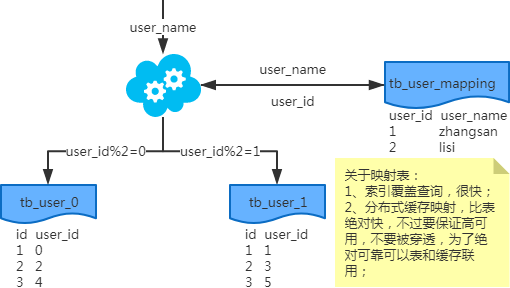

索引表法的做法是单独维护一张映射表，存 `查询字段 → 主键/分片`，先查映射表拿到分片位置，再带主键去目标分片取详情。缓存映射法把这份映射放进 Redis 等缓存，进一步减少一次数据库访问，代价是要处理缓存与主库的一致性。

### 11.3 单 key：基因法

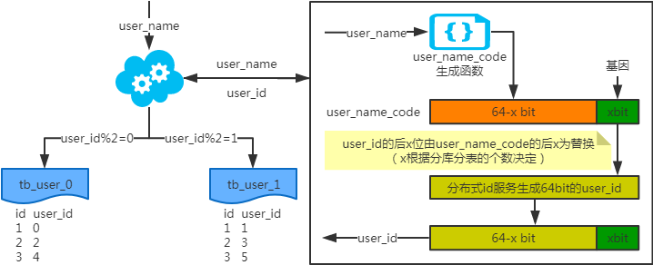

基因法的思路是把分片信息"写进" ID 本身，让 ID 自己带上分片位置。

具体做法：先对 user_name 做一次哈希（例如 MD5、SHA-1 之类的摘要算法，得到固定位数的编码），取其中最后 x 个 bit 作为"基因"。x 由分片数决定：要分 16 张表，因为 2 的 4 次方等于 16，所以 x 取 4，即 4 bit 基因，取值范围是 0~15。

写入时，用基因法生成 user_id：先生成一个普通的雪花 ID，再把它的低 4 位替换成基因。例如取到的基因是二进制的 1010（十进制 10），那么生成的 user_id 低 4 位就是 1010，之后 `user_id % 16` 必然落在表 10 上。

查询时：

- 按 user_id 查询，直接取模路由到对应的分库或分表。
- 按 user_name 查询，先用同样的哈希函数算出 user_name_code，再取最后 4 位作为基因，同样能定位到表 10。

注意两个前提：一是哈希函数必须稳定（同一输入永远得到同一输出），且写入和查询两侧使用完全相同的算法；二是基因占用的位数会挤掉 ID 自身的位宽，所以在位宽有限时要评估 ID 容量是否够用。

### 11.4 多 key：索引表法与缓存映射法

多 key 是指业务需要按多个非分片键字段查询（例如订单既要能按 order_id 查，也要能按 buyer_id、seller_id 查）。

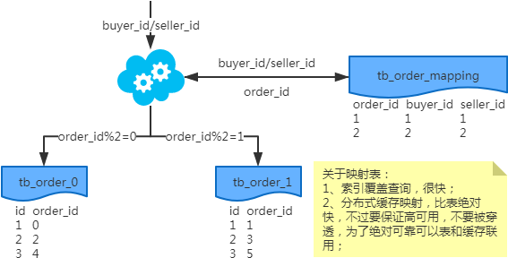

做法与单 key 类似，只是需要为每个查询维度各维护一份映射（或一张包含多个索引列的表），分别指向数据所在的分片。

### 11.5 多 key：冗余法

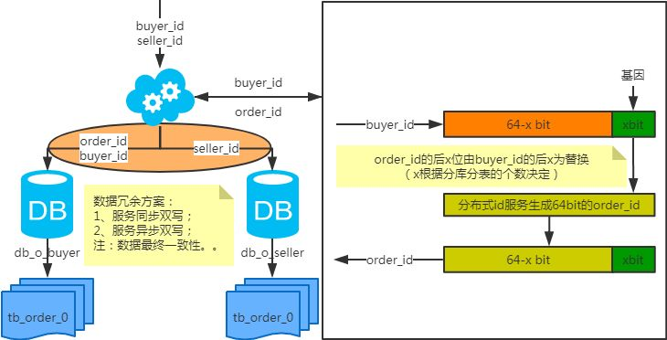

冗余法的做法是按不同查询维度各存一份数据：

- 异步双写：包含线上异步（通过 ESB 之类的消息通道）和线下异步（通过日志回放）。
- 按照 order_id 或 buyer_id 查询时路由到 db_o_buyer 库中，按照 seller_id 查询时路由到 db_o_seller 库中。

代价是存储翻倍、双写要保证最终一致，通常通过消息队列 + 幂等消费来兜底。

## 十二、中间件：ShardingSphere 的能力与边界

理解概念之后，落地时通常不会手写路由，而是引入中间件。这一章介绍 ShardingSphere 的形态、模块、执行流程与各项能力边界，帮助判断"哪些事它能做、哪些事仍要业务自己做"。

### 12.1 两种接入形态：client 与 proxy

| 形态 | 代表产品 | 优点 | 代价 |
| --- | --- | --- | --- |
| client（客户端增强） | ShardingSphere-JDBC | 不用额外部署，运维成本低，没有代理层的二次转发，性能损耗小 | 各系统都要耦合中间件的依赖，升级需要逐个应用改 |
| proxy（数据库代理） | ShardingSphere-Proxy、Mycat | 对应用透明，异构语言也能用，升级在中间件侧完成 | 需要独立部署和运维一套中间件，多一次网络转发 |

这两种形态可以混合部署：Java 应用直连 JDBC 版追求性能，其他语言或运维查询走 Proxy 版。

### 12.2 ShardingSphere 是什么

Apache ShardingSphere 是一套开源的分布式数据库中间件生态，定位是把任意数据库"增强"为分布式数据库，而不是重新实现一个数据库。它由 ShardingSphere-JDBC 和 ShardingSphere-Proxy 两款可独立部署、也可混合部署的产品组成，两者都提供标准化的数据分片、分布式事务和数据库治理能力，适用于 Java 同构、异构语言、云原生等不同场景。

它的主要功能包括：数据分片、读写分离、分布式事务、数据迁移、联邦查询、数据加密、影子库（全链路压测时隔离测试流量，避免污染生产数据）。项目于 2020 年 4 月成为 Apache 软件基金会顶级项目。

ShardingSphere 5.x 起采用可插拔架构，功能组件可以按需装配，方便做定制化扩展。

### 12.3 核心模块

ShardingSphere 的核心模块可以从部署形态和架构分层两个角度看。

从部署形态看，当前官方文档中列出的是两款产品：

- **ShardingSphere-JDBC**：轻量级 Java 框架，在 JDBC 层提供额外服务。它使用客户端直连数据库，以 jar 包形式提供服务，无需额外部署，可理解为增强版的 JDBC 驱动，完全兼容 JDBC 和各种 ORM 框架（MyBatis、JPA 等），也支持 HikariCP 等连接池。
- **ShardingSphere-Proxy**：以代理形式部署在应用与数据库之间，通过实现 MySQL / PostgreSQL 二进制协议对异构语言提供支持。应用无需改代码，只通过配置或 API 设置分片规则即可，也便于集中做监控和审计。

> 版本提示：早期资料里还会提到第三个模块 ShardingSphere-Sidecar（规划中的云原生 Sidecar 形态）。它长期处于规划状态，当前官方文档的部署形态只保留 JDBC 与 Proxy 两款产品，阅读旧资料时请注意区分。

从架构分层看，5.x 的可插拔架构分为三层：L1 内核层（查询优化器、分布式事务引擎、分布式执行引擎、权限引擎、调度引擎等必需组件）、L2 功能层（数据分片、读写分离、数据加密、影子库等可选能力）、L3 生态层（数据库协议、SQL 解析器、存储适配器）。

### 12.4 水平分片与垂直分片

ShardingSphere 同时支持水平分片和垂直分片，区别在于：

| 维度 | 垂直分片 | 水平分片 |
| --- | --- | --- |
| 拆分依据 | 业务逻辑分类（专库专用） | 某个字段或某几个字段的规则 |
| 每个分片的内容 | 不同的表，结构通常不同 | 同一张表的一部分数据，结构相同 |
| 解决的问题 | 单库负载压力、业务耦合 | 单库数据量过大、并发过高 |
| 局限 | 无法根治单库数据量过大的问题，可能引入跨服务事务一致性 | 需要处理跨分片查询、分布式事务 |
| 定位 | 架构层面的拆分手段 | 数据分片的标准解决方案 |

垂直分片在应用层面完成，能减轻单库负载、方便维护，但没有从根本上解决单库数据量大、并发高的瓶颈；水平分片在数据库层面完成，理论上突破了单机数据量处理的瓶颈，扩展相对自由。实际项目可以两者同时使用。

### 12.5 分库分表功能的执行流程

ShardingSphere 的分库分表功能主要通过如下几个步骤完成：

1. **配置管控**：解析复杂的配置信息，并支持将配置信息上传到第三方注册中心。
2. **SQL 解析**：将要执行的 SQL 语句解析成抽象语法树。
3. **SQL 路由**：根据解析上下文匹配数据库和表的分片策略，生成 SQL 的路由路径。
4. **SQL 改写**：用户只需要面向逻辑库和逻辑表写 SQL，由改写引擎将 SQL 改写为在真实数据库中可以正确执行的语句，分为正确性改写和优化改写。
5. **SQL 执行**：执行引擎负责将路由和改写完成之后的真实 SQL 安全且高效地发送到底层数据源执行。
6. **结果归并**：将从各个数据节点获取的多结果集组合成一个结果集返回客户端，内部实现了流式归并和内存归并两种方案。

这使得应用程序能够透明地访问分布式数据库，无需关心具体的分片细节。

### 12.6 读写分离

读写分离是 ShardingSphere 的重要功能，负责把 SQL 按语义路由到不同的数据库执行。需要先明确它的边界：**读写分离只负责 SQL 路由与读库负载均衡，不负责主从之间的数据同步**，MySQL 的数据同步通常由主从复制机制完成。

主要步骤：

1. **数据源配置**：配置多个数据源，包括主库（用于写操作）和多个从库（用于读操作），每个数据源都有唯一名称和连接信息。
2. **SQL 解析**：应用发送 SQL 请求时，执行引擎会拦截并解析 SQL 语句。
3. **读写分离规则**：通过规则确定查询应该发往主库还是从库，规则通常基于 SQL 类型（SELECT、INSERT、UPDATE、DELETE）判断。
4. **路由查询**：SELECT 路由到从库，INSERT、UPDATE、DELETE 路由到主库，确保写操作总是发往主库，读操作分散到从库。
5. **执行查询**：确定目标数据源后，将请求转发到相应的数据库。
6. **返回结果**：数据库执行后把结果返回给中间件，再由中间件返回给应用。

由此也带来一个必须面对的问题：主从复制存在延迟，刚写入的数据可能读不到。常见对策是"写后读走主库"（同一事务或短时间内的读强制路由主库），或对一致性要求高的查询直接指定主库。

### 12.7 分布式事务

ShardingSphere 对外提供 begin/commit/rollback 传统事务接口，通过 LOCAL、XA、BASE 三种模式提供分布式事务能力。

- **LOCAL 事务**：基于被代理数据库的本地事务实现。对一条逻辑 SQL，中间件在每个被代理的数据库上分别开启、提交或回滚事务。各数据节点之间没有协调与通信，性能无损耗，但不保证跨库的强一致性和最终一致性，需要业务自行处理不一致。
- **XA 事务**：基于 X/Open 组织定义的 DTP 模型（AP 应用、TM 事务管理器、RM 资源管理器），TM 与 RM 之间通过 XA 协议两阶段提交：准备阶段各数据库完成资源锁定并反馈是否可以提交，提交阶段由 TM 统一发起提交或回滚，从而保证强一致性。因为全程持有资源锁，XA 更适合执行时间确定的短事务，长事务下并发性能会明显下降。
- **BASE 事务（柔性事务）**：BASE 是基本可用（Basically Available）、柔性状态（Soft State）、最终一致性（Eventually Consistent）的缩写。它把互斥锁从资源层上移到业务层，用放宽强一致性来换取吞吐量。ShardingSphere 集成了 Seata 作为柔性事务方案，接入时需要额外部署 Seata Server。

三种模式的对比：

| 维度 | LOCAL | XA | BASE |
| --- | --- | --- | --- |
| 业务改造 | 无 | 无 | 需要 Seata Server |
| 一致性 | 不保证 | 强一致 | 最终一致 |
| 隔离性 | 不保证 | 支持 | 由业务方保证 |
| 并发性能 | 无影响 | 明显下降 | 略有下降 |
| 适用场景 | 业务自行处理不一致 | 短事务、低并发 | 长事务、高并发 |

此外，ShardingSphere 还提供了接入分布式事务的 SPI，方便对接其他事务方案；在整合 Seata AT 模式时，会把全局事务上下文传递到分片执行引擎中，从而参与全局事务。

### 12.8 数据加密

ShardingSphere 的数据加密是对业务透明的：应用照常写明文、按明文查询，中间件负责加解密和密文存储。配置主要分为三步：

1. **数据源配置**：配置数据源信息，包括数据源名称、连接池等。
2. **加密算法配置**：选择内置算法或实现 SPI 接口自定义算法。当前版本文档中内置的是标准加密算法 AES 与辅助查询加密算法 MD5；旧资料里提到的 RC4、SM3、SM4 在当前版本文档中未再列出，使用前请以所用版本文档为准，需要时也可以通过 SPI 自行实现。
3. **加密表配置**：配置哪一列是密文列（cipher）、用什么算法加解密（encryptorName）、哪一列是辅助查询列（assistedQuery）、哪一列用于模糊查询（likeQuery）。旧资料中的明文列（plainColumn）、逻辑列（logicColumn）配置项在当前版本文档中已不再出现。

需要清楚它的能力边界：加密列无法支持不区分大小写查询、大小比较（`>`、`<`、`ORDER BY`、`BETWEEN`）、计算（`AVG`、`SUM`）等操作，也不支持包含加密列的子查询、`WITH`、`INSERT SELECT` 和集合运算。确实需要范围查询时，通常要把该列放进辅助查询列并接受等值查询的限制，或者改用其他方案。

### 12.9 广播表

从 ShardingSphere 的角度看，广播表是指存在于每个分片数据源中的表，其结构和数据在每个数据库中都完全一致。这种表适用于数据量不大、又需要与海量数据的表做关联查询的场景，例如字典表、省份信息等。

对于广播表，ShardingSphere 不会对数据进行分片，所有节点的数据完全一致。当有新的插入、更新操作时，会实时在所有节点上执行，以保证各分片的数据一致性；查询操作只需要从一个节点获取，而不是从多个节点汇总。同时，广播表可以与任何一张表做 JOIN。在 ShardingSphere 中，通过创建广播表规则即可实现该功能。

配置广播表后它会在分片集群中自动生效，从而简化分布式系统中的数据管理，确保全局数据一致，同时降低查询广播表的复杂度。

### 12.10 分片算法清单

ShardingSphere 内置的分片算法按类型分为自动分片算法、标准分片算法、复合分片算法和 Hint 分片算法，也可以通过实现 SPI 提供自定义算法。

| 配置标识 | 类型 | 说明 |
| --- | --- | --- |
| MOD | 自动分片算法 | 取模分片，按分片数量取模 |
| HASH_MOD | 自动分片算法 | 哈希后取模，适合字符串分片键 |
| VOLUME_RANGE | 自动分片算法 | 按每片容量切分范围 |
| BOUNDARY_RANGE | 自动分片算法 | 按自定义边界切分范围 |
| AUTO_INTERVAL | 自动分片算法 | 按时间范围自动分片（时间范围可变） |
| INTERVAL | 标准分片算法 | 按固定时间范围分片 |
| INLINE | 标准分片算法 | 行表达式，支持 `=` 与 `IN`，只支持单分片键 |
| COMPLEX_INLINE | 复合分片算法 | 多分片键的行表达式 |
| HINT_INLINE | Hint 分片算法 | 由外部 Hint 注入分片值 |
| CLASS_BASED | 自定义类算法 | 指定算法类全限定名，实现 SPI 接口 |

补充说明：

- 自动分片算法的分片逻辑由框架托管，需要通过 `autoTables` 规则使用，使用者无需关心真实表的物理分布。
- 早期资料中常见的 `PreciseShardingAlgorithm`（精确分片）与 `RangeShardingAlgorithm`（范围分片）是 4.x 时代的接口划分；在 5.x 中已合并为标准分片算法（`StandardShardingAlgorithm`），同一个算法同时处理 `=`、`IN` 与 `BETWEEN`、`>`、`<` 等范围条件。
- 标准分片算法用于单一分片键；复合分片算法用于多分片键，复杂度由开发者自行处理；Hint 分片算法用于分片字段不由 SQL 决定、而由外部条件决定的场景。
- `INLINE` 默认不允许范围查询（`allow-range-query-with-inline-sharding` 默认为 false），开启后范围查询会无视分片策略走全路由。

### 12.11 配置数据分片策略的步骤

在 ShardingSphere 中配置数据分片策略，通常按以下步骤进行：

1. **配置数据源**：配置多个数据源，每个数据源对应一个数据库实例。
2. **配置逻辑表**：为每个逻辑表配置它对应的真实数据节点。
3. **配置逻辑表的主键生成策略**：分库分表场景下主键不能由数据库本地生成，所以要配置主键生成策略，为每条记录生成唯一主键。
4. **配置分库策略和分表策略**：先配置分片键（按哪个字段分片），再配置对应的分片算法（按什么规则分片）。常用算法有取模、哈希等，也可以自定义复杂算法。
5. **补充其他规则**：按业务需要配置广播表、绑定表、数据加密、影子库等。

一个可运行的 YAML 配置示例：

```yaml
dataSources:
  ds_0:
    dataSourceClassName: com.zaxxer.hikari.HikariDataSource
    driverClassName: com.mysql.cj.jdbc.Driver
    jdbcUrl: jdbc:mysql://localhost:3306/demo_ds_0?serverTimezone=UTC&useSSL=false
    username: root
    password:
  ds_1:
    dataSourceClassName: com.zaxxer.hikari.HikariDataSource
    driverClassName: com.mysql.cj.jdbc.Driver
    jdbcUrl: jdbc:mysql://localhost:3306/demo_ds_1?serverTimezone=UTC&useSSL=false
    username: root
    password:

rules:
- !SHARDING
  tables:
    t_order:
      actualDataNodes: ds_${0..1}.t_order_${0..1}
      tableStrategy:
        standard:
          shardingColumn: order_id
          shardingAlgorithmName: t_order_inline
    t_order_item:
      actualDataNodes: ds_${0..1}.t_order_item_${0..1}
      tableStrategy:
        standard:
          shardingColumn: order_id
          shardingAlgorithmName: t_order_item_inline
  bindingTables:
    - t_order,t_order_item
  defaultDatabaseStrategy:
    standard:
      shardingColumn: user_id
      shardingAlgorithmName: database_inline
  defaultTableStrategy:
    none:
  keyGenerateStrategies:
    t_order_order_id:
      keyGenerateType: column
      keyGeneratorName: snowflake
      logicTable: t_order
      keyGenerateColumn: order_id
  shardingAlgorithms:
    database_inline:
      type: INLINE
      props:
        algorithm-expression: ds_${user_id % 2}
    t_order_inline:
      type: INLINE
      props:
        algorithm-expression: t_order_${order_id % 2}
    t_order_item_inline:
      type: INLINE
      props:
        algorithm-expression: t_order_item_${order_id % 2}
  keyGenerators:
    snowflake:
      type: SNOWFLAKE

- !BROADCAST
  tables:
    - t_address
```

这段配置表达的意思是：`ds_0`、`ds_1` 两个库各放 `t_order_0`、`t_order_1` 两张表；按 `user_id` 分库、按 `order_id` 分表；主键用雪花算法生成；`t_order` 与 `t_order_item` 互为绑定表；`t_address` 作为广播表在所有库中存在。

## 十三、总结

- 分库分表首先要明确瓶颈在哪里，然后才能合理拆分（分库还是分表？水平还是垂直？分几个？），不可为了分库分表而拆分。
- 选分片键很重要，既要考虑拆分均匀，也要考虑非分片键的查询。
- 只要能满足需求，拆分规则越简单越好；扩容方案应按倍数规划，尽量让路由规则不变、数据迁移量最小。

## 参考与出处

- Apache ShardingSphere 官方文档（当前版本 5.5.x）：概览、数据分片、核心概念、分片算法、分布式事务、读写分离、数据加密、数据迁移、路由引擎、使用限制。
- Twitter. Announcing Snowflake. 2010（原始 IdWorker 实现：41 位时间戳 + 5 位数据中心 + 5 位机器 + 12 位序列，起始纪元 1288834974657 毫秒）。
- 关系型数据库 B+ 树索引与分片阈值等经验性结论，参考 ShardingSphere 官方文档中"单一数据库实例数据阈值在 1TB 之内比较合理"的说明，具体数值以实际压测为准。
