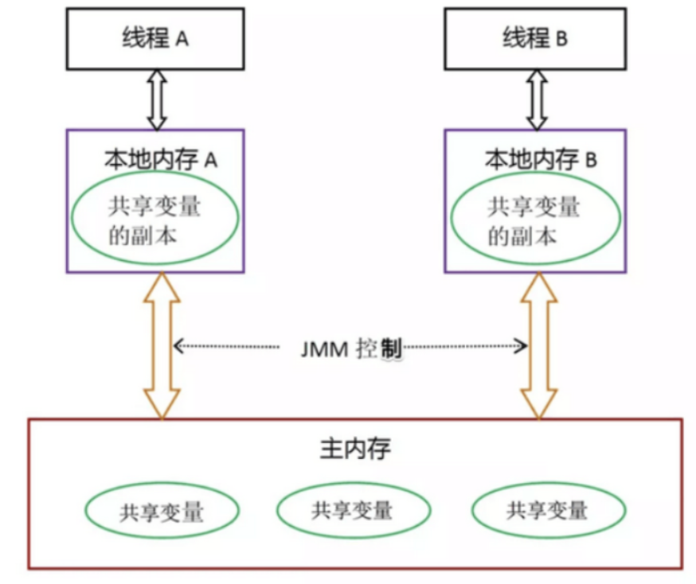
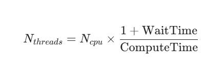
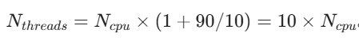

# 并发编程知识汇总

本文整理 Java 并发编程的核心知识：从线程基础、Java 内存模型（JMM）、锁与同步，到原子类、AQS、并发容器、线程池、工具类与虚拟线程。内容面向有一年左右 Java 经验、会写 CRUD 但没系统学过并发的读者，每个概念尽量按「是什么 → 为什么需要 → 怎么用」的顺序展开，源码级细节收进「进阶了解（可跳过）」小节。

> 版本说明：正文以 JDK 8 ~ JDK 21 的公开行为为准，凡涉及版本差异处单独标注；未标注的内容在 JDK 8 及以上均成立。示例代码默认使用 JDK 8 可用的 API，用到 JDK 21 特性时会写明。

## 本文导读

- 一、线程基础：进程与线程、并发与并行、创建方式、生命周期、调度、守护线程
- 二、线程安全与 Java 内存模型：三大特性、happens-before、volatile、final、不可变对象
- 三、锁与同步：synchronized、锁升级、ReentrantLock、Condition、读写锁、锁优化
- 四、CAS 与原子类
- 五、AQS 与并发工具类
- 六、并发容器
- 七、线程池
- 八、阻塞队列
- 九、ThreadLocal
- 十、CompletableFuture 与任务编排
- 十一、Fork/Join 框架
- 十二、死锁、活锁与饥饿
- 十三、伪共享
- 十四、虚拟线程（JDK 21+）
- 十五、常见追问速查
- 参考资料

## 一、线程基础

本章先把「进程、线程、并发、并行」这些最基础的概念说清楚，再讲线程怎么创建、有哪些状态、由谁调度。这些概念是所有并发问题的共同背景，后面讲锁、线程池时都会反复用到。

### 1.1 进程与线程

- **进程**（process）：程序运行时被分配独立内存空间的实例，是操作系统**资源分配**的最小单位。
- **线程**（thread）：进程内部的执行单元，是 CPU **调度**的最小单位。一个进程可包含多个线程，它们共享进程的内存空间。

| 特性 | 进程 | 线程 |
| --- | --- | --- |
| 定义 | 资源分配的最小单位 | CPU 调度的最小单位 |
| 内存 | 独立地址空间，互不可见 | 共享进程的堆和方法区 |
| 通信 | 管道、消息队列、共享内存等 | 直接读写共享变量（因此需要同步） |
| 开销 | 创建、切换开销大 | 创建、切换开销小 |
| 安全性 | 一个进程崩溃通常不影响其他进程 | 一个线程崩溃可能拖垮整个进程 |

**一句话记法**：进程是「一栋楼」，线程是「楼里的住户」——住户共用水电（堆内存），所以彼此会互相影响。

### 1.2 并发与并行

- **并发**（concurrency）：多个任务在**同一时间段**内交替推进，宏观上像同时进行，微观上可能是串行的。单核 CPU 靠时间片轮转就能实现并发。
- **并行**（parallelism）：多个任务在**同一时刻**真正同时执行，需要多核 CPU 支持。

两者的关系：并行是并发的特例。单核只能并发、不能并行；多核既可以并发也可以并行。日常说的「高并发」强调的是**同时处理大量请求的能力**，并不要求每个请求都在独立 CPU 核上跑。

### 1.3 线程的创建方式

Java 里创建线程有四种常见方式，前三种是「怎么定义任务」，第四种是「怎么管理线程」。

```java
// 方式1：继承 Thread，重写 run()
class MyThread extends Thread {
    @Override
    public void run() {
        System.out.println("继承 Thread");
    }
}

// 方式2：实现 Runnable，避免单继承限制，任务与线程解耦
class MyRunnable implements Runnable {
    @Override
    public void run() {
        System.out.println("实现 Runnable");
    }
}

// 方式3：实现 Callable，可以有返回值、可以抛受检异常，配合 FutureTask 使用
class MyCallable implements Callable<Integer> {
    @Override
    public Integer call() {
        return 42;
    }
}

// 方式4：交给线程池执行，复用线程，避免频繁创建销毁
ExecutorService pool = Executors.newFixedThreadPool(10);
pool.submit(() -> System.out.println("线程池执行"));
```

**必须注意的两点**：

1. `start()` 才会真正创建新线程并由 JVM 调用 `run()`；直接调用 `run()` 只是普通方法调用，仍在当前线程里执行。
2. 一个线程对象只能 `start()` 一次，第二次会抛 `IllegalThreadStateException`。原因是 `start()` 内部会检查线程状态，只有 `NEW` 状态才允许启动，而线程结束后状态是 `TERMINATED`，不会回到 `NEW`。确实需要重复执行，就新建 `Thread` 对象，或改用线程池 `submit()`。

### 1.4 线程的生命周期

`Thread.State` 枚举定义了 6 种状态（Java SE 5 起），任何时刻一个线程只处于其中一种：

| 状态 | 说明 | 典型进入方式 |
| --- | --- | --- |
| `NEW` | 已创建但还没启动 | `new Thread(...)` 之后 |
| `RUNNABLE` | 正在 JVM 中执行，或在等操作系统分配 CPU | 调用 `start()` 之后 |
| `BLOCKED` | 等待获取监视器锁（monitor lock） | 抢 `synchronized` 锁失败 |
| `WAITING` | 无限期等待别的线程做某个动作 | `Object.wait()`、`Thread.join()`、`LockSupport.park()` |
| `TIMED_WAITING` | 限时等待 | `Thread.sleep(n)`、`wait(n)`、`join(n)`、`parkNanos()` |
| `TERMINATED` | 已执行结束 | `run()` 正常返回或抛异常退出 |

官方文档特别提示：这些是 **JVM 层面的状态**，并不等于操作系统的线程状态。

**最容易混淆的几组对比**：

- 抢 `synchronized` 锁失败 → `BLOCKED`；抢 `ReentrantLock` 失败 → `WAITING`（内部用 `LockSupport.park()`，不产生 BLOCKED）。
- `sleep(n)` → `TIMED_WAITING`，且**不释放**已持有的锁；`wait()` → `WAITING`，且**会释放**持有的监视器锁。
- `Condition.await()` 底层同样基于 `LockSupport.park()`，因此观察到的状态也是 `WAITING`；带超时的 `await(time, unit)` 是 `TIMED_WAITING`。

```java
// 观察 WAITING 状态
Thread t = new Thread(() -> LockSupport.park(), "park-thread");
t.start();
Thread.sleep(100);
System.out.println(t.getState()); // WAITING
LockSupport.unpark(t);
```

### 1.5 线程调度与时间片

Java 的**平台线程**（platform thread）是操作系统线程的薄封装，属于 1:1 映射：一个 Java 线程对应一个 OS 线程，因此调度由操作系统负责，采用**抢占式**策略——时间片用完就强制切换，不需要线程主动让出。

- **时间片**：每次分给线程的 CPU 时间，具体长度由操作系统决定，不同平台差异很大，不要依赖具体数值。
- **上下文切换**（context switch）：保存当前线程的寄存器、程序计数器、栈指针等状态，再加载下一个线程的状态。切换本身不干活，所以线程数不是越多越好。
- `Thread.setPriority(1~10)` 只是给操作系统的**建议**，不保证生效。
- `Thread.yield()` 只是暗示「可以让出 CPU」，同样不强制。
- JDK 21 起的**虚拟线程**（virtual thread）由 JVM 自己的调度器负责，是 M:N 调度，在遇到阻塞操作时会主动让出底层线程，属于协作式让出（详见第十四章）。

**为什么不用纯协作式调度**：如果某个线程一直不主动让出 CPU，整个系统就会卡死。抢占式由操作系统统一控制，用时间片轮转保证基本公平。

### 1.6 守护线程

- **用户线程**：执行业务逻辑。JVM 会等**所有**用户线程结束后才退出。
- **守护线程**（daemon thread）：后台辅助线程。当所有用户线程结束时，JVM 直接退出，不会等待守护线程。JVM 内部用于垃圾回收、JIT 编译的线程属于 VM 内部线程（严格说不是普通的 Java 守护线程），行为上同样是「不阻止 JVM 退出」。

```java
Thread daemon = new Thread(() -> {
    while (true) {
        // 后台任务
    }
});
daemon.setDaemon(true); // 必须在 start() 之前设置，否则抛 IllegalThreadStateException
daemon.start();
```

**注意**：JVM 退出时守护线程会被直接终止，它的 `finally` 块**可能不会执行**，所以守护线程不能用于写文件、提交事务、释放关键资源这类必须完成的操作。

补充一个 JDK 21 的差异：虚拟线程**永远是守护线程**，`setDaemon(false)` 对它无效；虚拟线程的优先级固定为 `NORM_PRIORITY`，`setPriority()` 也不起作用。

## 二、线程安全与 Java 内存模型

本章回答两个问题：什么样的代码算「线程安全」，以及为什么多线程下会看到「莫名其妙」的结果。答案都指向 Java 内存模型（JMM，Java Memory Model）——它规定了多线程读写共享变量时，哪些结果是被允许的。

### 2.1 线程安全的四种解法

| 方案 | 常用手段 | 说明 |
| --- | --- | --- |
| 互斥同步（悲观锁） | `synchronized`、`ReentrantLock` | 同一时刻只让一个线程进入临界区，同时保证原子性与可见性 |
| 非阻塞同步（CAS） | `AtomicInteger` 等原子类 | 不加锁，靠 CAS 重试，适合竞争不激烈的场景 |
| 线程隔离 | 局部变量（栈封闭）、`ThreadLocal` | 数据不共享，自然没有竞争 |
| 不可变对象 | `final` 字段、`String`、`Integer`、`LocalDate` | 状态不可改，天然线程安全 |

**一个高频误区**：用了线程安全的集合，不等于整段代码线程安全。

```java
// 复合操作（check-then-act）依然不安全：两个线程可能同时判断为「不存在」
if (!map.containsKey(key)) {
    map.put(key, value);
}

// 应改用集合提供的原子方法
map.putIfAbsent(key, value);
```

### 2.2 JMM：主内存与工作内存

JMM 定义了一套**抽象**的读写规则（注意：这是规范层面的抽象模型，不是真实的硬件结构）：

- 所有共享变量都存在**主内存**（main memory，可理解为堆）。
- 每个线程有自己的**工作内存**（working memory，可理解为 CPU 缓存和寄存器的抽象），保存它用到的共享变量的副本。
- 线程对变量的读写都在工作内存里进行，不能直接操作主内存；线程之间要传递变量值，必须经过主内存。



很多教材用下面这组「原子操作」来讲主内存与工作内存的交互。它便于理解，但**不是 JLS 第 17 章的正式定义**——正式的可见性规则用 happens-before 描述（见 2.4）。

| 操作 | 作用范围 | 含义 |
| --- | --- | --- |
| `read` | 主内存 → 工作内存 | 把变量的值从主内存读出 |
| `load` | 工作内存 | 把读到的值放进工作内存的变量副本 |
| `use` | 工作内存 | 把变量值传给执行引擎使用 |
| `assign` | 工作内存 | 把执行引擎算出的值赋给变量副本 |
| `store` | 工作内存 → 主内存 | 把变量副本的值传到主内存 |
| `write` | 主内存 | 把传过来的值写入主内存变量 |

**一个生活化比喻**：主内存像公司的公共白板，工作内存像每个人手里的便签。你在便签上改了数字，别人看不到，除非你把便签内容抄回白板（写回）；别人改了白板，你手里的旧便签也不会自动更新（需要重新抄写）。`volatile` 的作用就是强制「改完立刻抄回白板、读之前必须重新抄写」。

### 2.3 三大特性：可见性、原子性、有序性

| 特性 | 含义 | 谁能保证 |
| --- | --- | --- |
| 可见性（visibility） | 一个线程改了共享变量，其他线程能及时看到 | `volatile`、`synchronized`、`Lock`、`final`（针对构造完成的字段） |
| 原子性（atomicity） | 操作不可分割，不会执行到一半被打断 | `synchronized`、`Lock`、`Atomic*` 类；`volatile` **不保证** |
| 有序性（ordering） | 指令按代码预期顺序生效，不被随意重排 | `volatile`（通过内存屏障禁止特定重排）、`synchronized` |

为什么会出现「有序性」问题：编译器和 CPU 为了性能会做**指令重排序**（reordering），前提是不改变单线程的执行结果。但多线程下，重排序可能让另一个线程看到「半成品」状态，经典例子就是 DCL 单例（见 2.5）。

### 2.4 happens-before 规则

happens-before 是 JMM 用来描述「哪些操作的结果对哪些操作可见」的偏序关系。如果 A happens-before B（记作 hb(A, B)），那么 A 的结果对 B 可见，且 A 在 B 之前生效。它像快递的**签收单**：只要签收单上有先后顺序，就说明前一件确实送到了，后面的人才能依据它继续操作。

JLS 第 17.4.5 节给出的规则是：

1. **程序顺序规则**：同一个线程内，按代码顺序，前面的操作 hb 后面的操作。
2. **监视器锁规则**：对同一个锁的 `unlock` hb 后续的 `lock`。
3. **volatile 规则**：对同一个 volatile 变量的写 hb 后续的读。
4. **线程启动规则**：`Thread.start()` hb 被启动线程中的任何操作。
5. **线程终止规则**：线程中的所有操作 hb 其他线程从该线程 `join()` 成功返回。
6. **中断规则**：线程 A 对线程 B 的 `interrupt()` hb 其他线程（包括 B 自己）检测到 B 被中断（抛 `InterruptedException`，或调用 `isInterrupted()` / `interrupted()`）。
7. **对象终结规则**：一个对象的构造函数结束 hb 该对象 finalizer 的开始。
8. **传递性**：hb(A, B) 且 hb(B, C)，则 hb(A, C)。

由此还能推出：默认值写入（0、false、null）hb 每个线程的第一个操作。

**两个重要结论**：

- 如果两个冲突的访问（至少一个写）之间**没有** happens-before 关系，就叫**数据竞争**（data race）。正确同步的程序不会出现数据竞争，其执行结果表现为顺序一致。
- `Thread.sleep()` 和 `Thread.yield()` **没有任何同步语义**（JLS 17.3）：编译器完全可以把循环里的非 volatile 变量读一次缓存起来一直用。所以「用 sleep 等一下」不能代替同步。

```java
// 错误写法：done 不是 volatile，JIT 可能只读一次，循环永不退出
while (!this.done) {
    Thread.sleep(1000);
}
```

### 2.5 volatile 关键字

`volatile` 保证**可见性**和**有序性**，但**不保证原子性**。

- **可见性**：对 volatile 变量的写 happens-before 后续对该变量的读，读线程一定能看到之前那次写的结果（JLS 17.4.4 / 17.4.5）。
- **有序性**：实现上通过**内存屏障**（memory barrier）禁止 volatile 读写与周围指令的特定重排序。

**适用场景**：

1. 状态标志位（一个线程写、多个线程读）。
2. DCL 单例（防止「先发布引用、后初始化对象」的重排序）。
3. 双重检查的延迟初始化。

```java
// 状态标志位
public class Worker implements Runnable {
    private volatile boolean running = true;

    public void stop() {
        running = false;
    }

    @Override
    public void run() {
        while (running) {
            // 处理任务
        }
    }
}
```

```java
// DCL 单例：volatile 不可省，否则可能拿到「构造未完成」的对象
public class Singleton {
    private static volatile Singleton instance;

    public static Singleton getInstance() {
        if (instance == null) {              // 第一次检查，避免每次都加锁
            synchronized (Singleton.class) {
                if (instance == null) {      // 第二次检查，防止重复创建
                    instance = new Singleton();
                }
            }
        }
        return instance;
    }
}
```

**不适用场景**：`i++`、`count = count + 1` 这类「读-改-写」复合操作，`volatile` 只能保证读到最新值，不能保证两步之间不被打断，需要 `synchronized` 或 `AtomicInteger`。

### 2.6 final 与初始化安全性

JLS 第 17.5 节规定：**构造完成后，final 字段对其他线程一定可见，且看到的是构造完成后的值**，不需要额外同步——这叫「初始化安全性」（initialization safety）。

- `final` 字段：构造完成后安全发布。
- `final` 引用：引用本身不可变，但引用对象内部状态可变，仍需同步才能并发修改。

```java
public class SafePublication {
    private final int x;
    private final List<String> list;

    public SafePublication() {
        this.x = 42;
        this.list = new ArrayList<>(Arrays.asList("a", "b"));
        // 构造结束后，其他线程看到 x 一定是 42，看到 list 一定是初始化好的列表
    }
}
```

反过来说，**非 final 字段在构造期间可能被重排序**，别的线程可能看到字段还是默认值——这正是 DCL 单例必须给 `instance` 加 `volatile` 的原因。

### 2.7 不可变对象

不可变对象（immutable object）状态永不改变，因此天生线程安全，无需任何同步。创建原则：

1. 所有字段 `final`。
2. 不提供 setter 方法。
3. 类声明为 `final`（或构造器私有 + 工厂方法），防止子类破坏不可变性。
4. 若持有可变对象引用，不要对外暴露（需要时返回防御性拷贝）。

```java
public final class ImmutablePoint {
    private final int x;
    private final int y;

    public ImmutablePoint(int x, int y) {
        this.x = x;
        this.y = y;
    }

    public int getX() { return x; }

    public int getY() { return y; }
    // 没有 setter
}
```

常见例子：`String`、`Integer`、`LocalDate`、`BigDecimal`。

## 三、锁与同步

本章讲 Java 最核心的两种锁：JVM 内置的 `synchronized` 和 JUC（java.util.concurrent）提供的 `ReentrantLock`，以及围绕它们衍生出的条件变量、读写锁和优化手段。锁解决的是「互斥」问题——同一段代码或同一份数据，一次只让一个线程进入。

### 3.1 synchronized 是什么、怎么用

`synchronized` 是 JVM 层面的内置锁，靠对象头里的**监视器**（monitor）实现。修饰方法或代码块都可以：

| 写法 | 锁住的对象 |
| --- | --- |
| `synchronized` 修饰实例方法 | 当前实例 `this` |
| `synchronized` 修饰静态方法 | 当前类的 `Class` 对象 |
| `synchronized (obj) { ... }` | 括号里指定的对象 |

特点：

- **可重入**：同一线程可以重复获取同一把锁，靠监视器里的计数器累加实现，退出时递减，减到 0 才真正释放。
- **不可中断**：等锁的线程不能被 `interrupt()` 打断。
- **非公平**：不保证先到先得，允许「插队」（barging）。

### 3.2 锁升级与对象头

JDK 6 起 HotSpot 对 `synchronized` 做了大量优化，锁会根据竞争情况**升级**（实现上只能升级、不能降级）：

| 锁状态 | 适用情况 | 大致做法 |
| --- | --- | --- |
| 无锁 | 对象刚创建，还没有线程加锁 | 对象头 Mark Word 记录哈希等信息 |
| 偏向锁 | 始终由同一个线程反复获取 | 把线程 ID 记进 Mark Word，以后同线程进入无需 CAS |
| 轻量级锁 | 多个线程交替获取，几乎没有真正竞争 | 在栈上建锁记录，用 CAS 把 Mark Word 指向它，失败则自旋 |
| 重量级锁 | 竞争激烈，自旋也拿不到 | 膨胀为操作系统互斥量，线程阻塞/唤醒，涉及用户态与内核态切换 |

**版本更正**：原文写「JDK 15 开始偏向锁被废弃（`-XX:-UseBiasedLocking`）」，表述有误。按 JEP 374，**JDK 15 起偏向锁默认关闭，相关参数被标记为弃用**；如果需要重新启用，要用 `-XX:+UseBiasedLocking`（不是 `-`）。因此在 JDK 15 及以后讨论锁升级，实际观察到的主要是「轻量级锁 → 重量级锁」。在 JDK 8 上偏向锁默认开启。

### 3.3 ReentrantLock

`ReentrantLock` 是 JUC 提供的显式锁，基于 AQS 实现（见第五章）。它的能力是 `synchronized` 的超集，代价是必须手动释放。

```java
Lock lock = new ReentrantLock(); // 默认非公平
lock.lock();
try {
    // 临界区
} finally {
    lock.unlock(); // 必须放在 finally，否则异常会导致锁永远不释放
}
```

**与 synchronized 对比**：

| 特性 | synchronized | ReentrantLock |
| --- | --- | --- |
| 实现层面 | JVM 内置（字节码 `monitorenter` / `monitorexit`） | Java API 层（基于 AQS） |
| 可重入 | 是 | 是 |
| 公平性 | 只有非公平 | 可选公平 / 非公平 |
| 可中断 | 不支持 | 支持 `lockInterruptibly()` |
| 超时获取 | 不支持 | 支持 `tryLock(timeout, unit)` |
| 条件变量 | 只有一个 `wait` / `notify` 等待集 | 可创建多个 `Condition` |
| 锁释放 | 自动（退出代码块即释放） | 手动 `unlock()` |
| 性能 | JDK 6 优化后已很接近 | 竞争激烈、功能复杂的场景更灵活 |

**选择建议**：

- 用 `synchronized`：逻辑简单、不需要公平锁/超时/中断/多条件，且希望「不会忘记释放锁」。
- 用 `ReentrantLock`：需要公平锁、可中断等待、超时获取、多个条件变量，或需要非阻塞的 `tryLock()`。

### 3.4 公平锁与非公平锁

- **公平锁**：严格按 FIFO 顺序获取锁，新来的线程先看队列里有没有等待者，有就排队。不会饥饿，但吞吐量低（频繁的线程唤醒有开销）。
- **非公平锁（默认）**：新线程先直接尝试 CAS 抢锁，抢不到再入队。吞吐量高，但理论上可能饥饿。

```java
ReentrantLock fairLock = new ReentrantLock(true);    // 公平
ReentrantLock unfairLock = new ReentrantLock(false); // 非公平（默认）
```

**非公平锁为什么更快**：刚释放锁的线程往往还在 CPU 上运行，它可能立刻又抢到锁，省掉一次上下文切换。AQS 文档把这种策略称为 barging，并说明它的吞吐和扩展性通常最好，但不保证公平、也不保证无饥饿。

### 3.5 tryLock() 与 lock() 的区别

- `lock()`：阻塞等待，拿不到锁就一直等（不可中断，除非用 `lockInterruptibly()`）。
- `tryLock()`：立即返回，拿到返回 `true`，拿不到返回 `false`，不阻塞。
- `tryLock(timeout, unit)`：最多等指定时间，超时返回 `false`。

```java
if (lock.tryLock(3, TimeUnit.SECONDS)) {
    try {
        // 拿到锁，执行临界区
    } finally {
        lock.unlock();
    }
} else {
    // 没拿到锁：记录日志、降级处理或稍后重试
}
```

**典型用法**：用 `tryLock(timeout)` 规避死锁——拿不到第二把锁就释放已经持有的锁再重试。

### 3.6 Condition

`Condition` 是 `Lock` 提供的条件变量，用来替代 `Object.wait()` / `notify()`。最大优势是**一把锁可以挂多个等待队列**，从而做到「精确唤醒」。

```java
Lock lock = new ReentrantLock();
Condition notEmpty = lock.newCondition(); // 等待「队列非空」
Condition notFull = lock.newCondition();  // 等待「队列未满」

// 消费者等待
lock.lock();
try {
    while (队列为空) {
        notEmpty.await(); // 释放锁并进入 notEmpty 的等待队列
    }
    // 取元素
} finally {
    lock.unlock();
}

// 生产者唤醒
lock.lock();
try {
    // 放元素
    notEmpty.signal(); // 唤醒 notEmpty 队列中的一个线程
} finally {
    lock.unlock();
}
```

**与 wait/notify 对比**：

- `Condition` 可以有多个等待队列；`wait/notify` 只有一个对象等待集（wait set）。
- `Condition` 必须配合 `Lock` 使用；`wait/notify` 必须配合 `synchronized` 使用。
- `Condition` 支持超时等待（`await(time, unit)`）和不可中断等待（`awaitUninterruptibly()`）。

**进阶了解（可跳过）**：每个 `Condition` 内部维护一条独立的等待队列。`await()` 会把当前节点从 AQS 的同步队列移到该 Condition 的等待队列并释放锁；`signal()` 把节点移回同步队列，等线程重新抢到锁后从 `await()` 返回。因此「唤醒」不等于「立刻继续执行」。

### 3.7 读写锁与 StampedLock

读多写少的场景里，读读之间并不冲突，用互斥锁会把并发度白白浪费掉。`ReadWriteLock` 把读锁和写锁分开：

```java
ReadWriteLock rwLock = new ReentrantReadWriteLock();
Lock readLock = rwLock.readLock();   // 多线程可同时持有
Lock writeLock = rwLock.writeLock(); // 独占：写写互斥、读写互斥

readLock.lock();
try {
    // 读
} finally {
    readLock.unlock();
}

writeLock.lock();
try {
    // 写
} finally {
    writeLock.unlock();
}
```

**StampedLock**（JDK 8+）提供三种模式：写锁、悲观读锁、**乐观读**。乐观读不加锁，只在读完后校验版本号是否变化，适合读远多于写、且读操作很短的场景。注意它**不支持重入**，也不能像 `ReentrantLock` 那样直接配合 `Condition`。

```java
StampedLock sl = new StampedLock();
long stamp = sl.tryOptimisticRead(); // 乐观读，不阻塞写线程
// ... 读取数据到局部变量 ...
if (!sl.validate(stamp)) {           // 期间有写入，乐观读失效
    stamp = sl.readLock();           // 退化为悲观读，重新读一次
    try {
        // ... 重新读取 ...
    } finally {
        sl.unlockRead(stamp);
    }
}
```

### 3.8 锁优化

**JVM 层面的优化**：

- **锁消除**（lock elision）：JIT 通过逃逸分析发现某个锁对象不可能被其他线程访问，直接把加锁指令删掉（典型例子：方法内部新建的 `StringBuffer`）。
- **锁粗化**（lock coarsening）：对同一对象的连续加锁解锁，JIT 合并成一次，减少开销。
- **自旋与自适应自旋**：竞争不激烈时先自旋等一会儿，避免直接进入内核态阻塞。

**应用层面的优化**：

- **减小锁粒度**：只锁必要的数据。`ConcurrentHashMap` 从 JDK 7 的分段锁演进到 JDK 8 的「CAS + 锁单个桶」就是这个思路。
- **减小锁范围**：只把真正需要互斥的语句放进同步块，不要在锁里做 I/O、远程调用。
- **读写分离**：`ReadWriteLock`、`StampedLock`。
- **无锁设计**：CAS、`ThreadLocal`、不可变对象。

### 3.9 不要用 String 或包装类型做锁对象

`synchronized ("lock")` 是危险写法：

- 字符串字面量存放在**字符串常量池**，相同内容的字面量往往是同一个对象。不同模块、不同类里都写 `synchronized ("lock")`，就会意外地互相阻塞，甚至造成死锁。
- `Integer.valueOf()` 对 **-128 ~ 127** 的值有缓存（Java SE API 文档明确写了这一点），小整数装箱后是同一个对象，做锁同样会「撞车」。此外 `Integer` 是 value-based 类，官方文档明确建议不要用它的实例做同步。

```java
// 危险：可能锁到常量池里的同一个对象
synchronized ("lock") { /* ... */ }

// 安全：使用专用的、私有的锁对象
private final Object lock = new Object();
synchronized (lock) { /* ... */ }
```

### 3.10 wait/notify 为什么必须放在 synchronized 里

`wait()` / `notify()` 必须在持有该对象监视器锁时调用，否则抛 `IllegalMonitorStateException`。

原因在于语义：`wait()` 的本质是「**释放锁并等待**」，`notify()` 的本质是「**唤醒等待者、让它有机会重新拿锁**」。没有锁，就谈不上「释放」和「交出」。

具体过程：`wait()` 先检查当前线程是否持有监视器（JLS 17.2.1：持有计数为 0 就抛异常），然后把自己加入该对象的等待集（wait set），并释放已持有的锁；被 `notify()` / `notifyAll()` 唤醒后，还要重新竞争锁才能从 `wait()` 返回。正因为「唤醒后可能被别人抢先」，官方要求 `wait()` 必须写在循环里：

```java
synchronized (lock) {
    while (!condition) {   // 用 while 而不是 if，防止虚假唤醒和条件被抢先改变
        lock.wait();
    }
    // 条件满足，继续执行
}
```

## 四、CAS 与原子类

本章讲「不加锁也能保证原子性」的思路。它的核心是一条 CPU 指令，而不是 Java 语法糖，理解它有助于看懂原子类、AQS、并发容器的实现。

### 4.1 CAS 是什么

**CAS**（Compare-And-Swap，比较并交换）是一条原子指令的语义：比较内存中当前值与期望值，相同就更新为新值并返回成功，不同就什么都不做并返回失败。底层由 CPU 的 `cmpxchg` 一类指令保证原子性。

```java
AtomicInteger ai = new AtomicInteger(0);

boolean ok = ai.compareAndSet(0, 1); // 当前是 0 才改成 1，返回 true
int next = ai.getAndIncrement();     // 原子自增，等价于「读-改-写」的原子版本
```

`AtomicInteger` 的 `compareAndSet` 最终调用的是底层（`VarHandle` / `Unsafe`）的比较交换方法，JDK 8 的实现大致如下：

```java
// JDK 8 中 AtomicInteger 的写法（JDK 9+ 改为通过 VarHandle 实现，语义不变）
public final boolean compareAndSet(int expect, int update) {
    return unsafe.compareAndSwapInt(this, valueOffset, expect, update);
}
```

**优点**：无锁、无阻塞、没有线程上下文切换，竞争不激烈时性能很好。

### 4.2 CAS 的三个缺点

1. **ABA 问题**：值从 A 变成 B 又变回 A，CAS 检查「当前值 == 期望值」会通过，但实际上中间已经变过。解决办法是加版本号，用 `AtomicStampedReference`（或 `AtomicMarkableReference`）把「值 + 版本」一起比较。

```java
AtomicStampedReference<String> ref = new AtomicStampedReference<>("A", 0);
int stamp = ref.getStamp();
ref.compareAndSet("A", "B", stamp, stamp + 1); // 值和版本都匹配才更新
```

2. **自旋开销**：CAS 失败通常要重试（自旋），竞争激烈时大量重试会空耗 CPU，所以 CAS 适合低竞争场景。
3. **只能保证单个变量原子**：多个变量需要一起原子更新时，用 `AtomicReference` 把它们封装成一个对象。

## 五、AQS 与并发工具类

AQS（AbstractQueuedSynchronizer）是 JUC 里锁和同步器的**公共底座**，`ReentrantLock`、`Semaphore`、`CountDownLatch`、`ReentrantReadWriteLock` 都建立在它之上。理解它能一次性看懂一批工具类的行为。

### 5.1 AQS 的基本原理

按 Java SE API 文档的描述，AQS 是一个「基于 FIFO 等待队列、用一个原子 `int` 表示同步状态」的框架：

- **同步状态**：一个 `int` 类型的 `state`，用 `getState()` / `setState()` / `compareAndSetState()` 读写。这三个方法分别具有 volatile 读、volatile 写、volatile 读写的内存语义。具体含义由子类定义，例如 `ReentrantLock` 用它表示重入次数，`Semaphore` 用它表示剩余许可数。
- **等待队列**：抢不到资源的线程被包装成节点，挂到一条 FIFO 的等待队列上（AQS 源码注释里称它为 CLH 锁队列的变体；对外文档只描述为 FIFO wait queue，具体链表结构属于实现细节）。
- **两种模式**：**独占模式**（exclusive，同一时刻只允许一个线程持有，如 `ReentrantLock`）和**共享模式**（shared，允许多个线程同时持有，如 `Semaphore`、`CountDownLatch`）。
- **模板方法模式**：AQS 负责排队、阻塞、唤醒这些「脏活」，子类只需要重写 `tryAcquire` / `tryRelease` / `tryAcquireShared` / `tryReleaseShared` / `isHeldExclusively` 来判断「当前状态能不能获取/释放」。

**重要提醒**：AQS 内部有 FIFO 队列，但**默认不保证公平**。新来的线程在入队前会先尝试抢一次（barging），这正是非公平锁吞吐更高的原因；需要公平时，子类的 `tryAcquire` 里先判断 `hasQueuedPredecessors()`。

### 5.2 CountDownLatch、CyclicBarrier、Semaphore

| 特性 | `CountDownLatch` | `CyclicBarrier` | `Semaphore` |
| --- | --- | --- | --- |
| 作用 | 等待 N 个事件完成 | N 个线程互相等待，全部到齐再一起走 | 控制同时访问的线程数（限流） |
| 计数方向 | 递减到 0 | 递增到 N（到齐后重置） | 获取/释放许可 |
| 能否重置 | 不能 | 能（`reset()`，会自动「打破」当前等待） | 无此概念 |
| 放行条件 | 计数归零 | 所有线程到达屏障点 | 有可用许可 |
| 典型场景 | 主线程等所有初始化完成 | 多阶段并行计算，每阶段对齐 | 连接池、接口限流 |

```java
// CountDownLatch：等 3 个初始化任务全部完成
CountDownLatch latch = new CountDownLatch(3);
for (int i = 0; i < 3; i++) {
    new Thread(() -> {
        try {
            // 初始化
        } finally {
            latch.countDown(); // 放在 finally，避免异常导致永远等不到 0
        }
    }).start();
}
latch.await(); // 阻塞直到计数为 0
```

```java
// Semaphore：最多 5 个线程同时访问
Semaphore sem = new Semaphore(5);
sem.acquire();          // 获取许可，没有则阻塞
try {
    // 访问受限资源
} finally {
    sem.release();      // 一定归还
}
```

### 5.3 阻塞之后怎么唤醒

| 阻塞方式 | 唤醒方式 |
| --- | --- |
| `sleep(n)` | 超时自动返回，或被 `interrupt()` 打断（抛 `InterruptedException`） |
| `wait()` | `notify()` / `notifyAll()`，或被 `interrupt()` 打断 |
| `join()` | 目标线程结束，或被 `interrupt()` 打断 |
| `LockSupport.park()` | `LockSupport.unpark(thread)` |
| `ReentrantLock.lock()` | 其他线程 `unlock()`，或 `lockInterruptibly()` 时被中断 |
| 阻塞式 I/O | 部分实现支持 `interrupt()`（会关闭通道），或直接关闭流/连接 |

**注意**：`interrupt()` 不是「强制停止」，它只是把中断标志置为 `true`。是否响应、怎么响应，由被中断的线程自己决定。

### 5.4 进阶了解：AQS 的一个获取流程（可跳过）

以独占模式为例，`acquire(1)` 的骨架是：

```java
// 伪代码，取自 AQS 文档描述的模型
while (!tryAcquire(arg)) {
    // 入队（如果还没入队）
    // 可能阻塞当前线程（LockSupport.park）
}
// 成功后出队
```

释放时若 `tryRelease(arg)` 返回 `true`，就唤醒队列里的第一个等待者。共享模式类似，但可能引发连锁唤醒。由于入队前的快速尝试，队列并非严格 FIFO，这也是「AQS 有队列但不保证公平」的由来。

## 六、并发容器

本章讲「已经帮你处理好并发」的集合类。选型时先判断读写比例和是否需要排序，再挑具体实现，比自己去 `synchronized` 包一层更安全也更快。

### 6.1 常见并发容器对比

| 容器 | 特点 | 适用场景 |
| --- | --- | --- |
| `ConcurrentHashMap` | JDK 7 分段锁；JDK 8 起 CAS + 锁单个桶（实现细节） | 高并发 key-value 读写 |
| `CopyOnWriteArrayList` | 写时复制：写操作复制整个数组，读操作完全无锁 | 读多写极少（如监听器列表） |
| `CopyOnWriteArraySet` | 基于 `CopyOnWriteArrayList` 的去重集合 | 同上 |
| `ConcurrentSkipListMap` | 跳表实现的有序 Map，无锁读、CAS 写 | 需要排序的并发 Map |
| `ConcurrentSkipListSet` | 基于 `ConcurrentSkipListMap` 的有序 Set | 需要排序的并发 Set |
| `ConcurrentLinkedQueue` | 基于 CAS 的无锁并发队列 | 高并发、无界、不需要阻塞 |
| `BlockingQueue` 系列 | 支持阻塞的队列，生产者-消费者标配 | 线程池任务队列、解耦缓冲 |

**`CopyOnWriteArrayList` 的代价**：每次写都要复制整个数组，写多时开销和内存占用都很高，而且读线程看到的是「旧快照」，不保证实时一致。只在「读远多于写、且能接受短暂不一致」时使用。

### 6.2 ConcurrentHashMap 的演进

- **JDK 7**：分段锁（Segment），默认 16 段，每段一把 `ReentrantLock`，不同段可以并发写。
- **JDK 8 及以后**：放弃分段锁，改为「数组 + 链表 + 红黑树」，写入时对单个桶的头节点用 CAS 或 `synchronized` 加锁，锁粒度更细，空桶写入几乎无锁。

**使用要点**：`ConcurrentHashMap` 不允许 `null` 键和 `null` 值（`HashMap` 允许），这样 `get()` 返回 `null` 就只有「不存在」一种含义。复合操作要用它提供的原子方法：`putIfAbsent`、`computeIfAbsent`、`merge`、`replace`。

### 6.3 ConcurrentSkipListMap 与跳表

`ConcurrentSkipListMap` 是并发安全的有序 Map，底层是**跳表**（skip list）：在有序链表上叠加多级索引，查找时从最高层开始逐层缩小范围，平均时间复杂度 O(log N)。

**与 TreeMap 对比**：

| 特性 | `TreeMap` | `ConcurrentSkipListMap` |
| --- | --- | --- |
| 底层结构 | 红黑树 | 跳表 + CAS |
| 线程安全 | 否 | 是 |
| 并发性能 | 需外部加锁 | 读几乎无锁，写锁局部 |
| 范围查询 | 支持 | 支持，且并发友好 |

**跳表的优势**：实现比红黑树简单（不需要复杂的旋转）、天然适合无锁并发（改指针即可）、范围查询高效。

### 6.4 HashMap 的 JDK 7 与 JDK 8 差异

| 特性 | JDK 7 | JDK 8 |
| --- | --- | --- |
| 结构 | 数组 + 链表 | 数组 + 链表 + 红黑树 |
| 链表插入 | 头插法 | 尾插法 |
| 并发问题 | 扩容时头插法可能形成环，CPU 飙到 100% | 不会成环，但仍可能丢数据 |
| 链表 → 树 | 无 | 链表长度 ≥ 8 且数组长度 ≥ 64 |
| 树 → 链表 | 无 | 树节点数 ≤ 6 时退化 |
| 扩容后位置 | 重新计算 hash 下标 | 只需判断高位：原位置或「原位置 + oldCap」 |

**结论**：`HashMap` 从来都不是线程安全的，JDK 8 只是把「成环」这个最严重的后果修掉了，并发写依然会丢数据。多线程场景请用 `ConcurrentHashMap`。

## 七、线程池

线程池是工程里最常用的并发工具。本章讲清七个参数、任务怎么被接收、满了怎么办、线程怎么复用、池子怎么关，以及线上最容易踩的几个坑。

**为什么需要线程池**：线程的创建和销毁都要和操作系统打交道，成本不低；请求量大时「来一个建一个」会把资源耗尽。线程池通过复用线程、限制并发数、缓冲任务，同时解决了性能和资源控制两个问题。

### 7.1 七个核心参数

```java
ThreadPoolExecutor pool = new ThreadPoolExecutor(
    2,                              // corePoolSize：核心线程数
    4,                              // maximumPoolSize：最大线程数
    60L, TimeUnit.SECONDS,          // keepAliveTime：非核心线程空闲存活时间
    new LinkedBlockingQueue<>(10),  // workQueue：任务队列
    Executors.defaultThreadFactory(),             // threadFactory：线程工厂
    new ThreadPoolExecutor.AbortPolicy()          // handler：拒绝策略
);
```

| 参数 | 含义 | 常见设置 |
| --- | --- | --- |
| `corePoolSize` | 常驻线程数，默认即使空闲也不回收（除非 `allowCoreThreadTimeOut(true)`） | 按任务类型估算，见 7.6 |
| `maximumPoolSize` | 线程数上限 | 有界队列时才有意义 |
| `keepAliveTime` + `unit` | 超出核心数的线程空闲多久被回收 | 通常 30~60 秒 |
| `workQueue` | 存放待执行任务的阻塞队列 | 建议有界队列，防 OOM |
| `threadFactory` | 创建线程的工厂 | 自定义线程名，便于排查问题 |
| `handler` | 队列满且线程达上限时的拒绝策略 | 按「能否丢任务」选择 |

**默认行为补充**：核心线程默认是「有任务才创建」，不是构造池子就创建；想预热可以调用 `prestartCoreThread()` / `prestartAllCoreThreads()`。

### 7.2 任务提交流程

```text
提交任务
  ├─ 当前线程数 < corePoolSize        → 新建核心线程执行
  ├─ 否则尝试放入 workQueue           → 入队成功则等待空闲线程取走
  ├─ 入队失败（队列满）且线程数 < maximumPoolSize → 新建非核心线程执行
  └─ 否则                             → 执行拒绝策略
```

这与很多人的直觉相反：**线程池是「先排队，排不下才扩容」**，而不是「先扩容到最大再排队」。

**一个高频坑**：如果用的是无界队列（例如 `new LinkedBlockingQueue<>()` 不传容量，默认容量是 `Integer.MAX_VALUE`），队列永远不会满，`maximumPoolSize` 就永远用不上，线程数最多只会到 `corePoolSize`，任务会一直堆积直到 OOM。官方文档对此有明确说明。

### 7.3 拒绝策略

| 策略 | 行为 | 适用场景 |
| --- | --- | --- |
| `AbortPolicy`（默认） | 抛 `RejectedExecutionException` | 不允许丢任务，让调用方感知 |
| `CallerRunsPolicy` | 由提交任务的线程自己执行（若池已 `shutdown`，则丢弃该任务） | 不想丢任务，同时用「占用调用方」形成反压 |
| `DiscardPolicy` | 静默丢弃新任务 | 允许丢、且丢任务无影响 |
| `DiscardOldestPolicy` | 丢掉队列里最老的任务再重试提交（若池已 `shutdown`，则丢弃该任务） | 只关心最新数据 |

自定义策略只需实现 `RejectedExecutionHandler` 接口，在 `rejectedExecution(Runnable, ThreadPoolExecutor)` 里写自己的降级逻辑（落库、限流、发告警等）。

### 7.4 线程池状态

| 状态 | 说明 |
| --- | --- |
| `RUNNING` | 接收新任务，也处理队列中的任务 |
| `SHUTDOWN` | 不接收新任务，但会把队列中的任务执行完（`shutdown()`） |
| `STOP` | 不接收新任务，不处理队列任务，并中断正在执行的任务（`shutdownNow()`） |
| `TIDYING` | 所有任务已终止、工作线程数为 0，即将执行 `terminated()` |
| `TERMINATED` | `terminated()` 执行完毕，池彻底结束 |

状态转换只有两条路径：

```text
RUNNING --shutdown()--> SHUTDOWN --(队列空且线程为0)--> TIDYING --> TERMINATED
RUNNING --shutdownNow()--> STOP --(线程为0)--> TIDYING --> TERMINATED
```

### 7.5 线程复用的原理

线程池里的线程执行完一个任务不会被销毁，而是循环去队列取下一个任务：

```java
// Worker.run() 的简化逻辑
public void run() {
    while (task != null || (task = getTask()) != null) {
        task.run();              // 执行任务
        task = null;
    }
    // getTask() 返回 null 时退出，线程结束
}
```

`getTask()` 决定线程是「继续等」还是「退出」：

- 核心线程：一般用 `take()` 无限等待（除非开启了 `allowCoreThreadTimeOut`）。
- 非核心线程：用 `poll(keepAliveTime)` 限时等待，超时返回 `null`，线程退出。
- 线程池处于 `STOP` 及以上状态、或 `SHUTDOWN` 且队列为空时，`getTask()` 返回 `null`，线程退出。

### 7.6 线程数怎么定



- **CPU 密集型**：`N + 1`（N = CPU 核心数）。多一个线程是为了在偶尔发生页缺失等短暂停顿时仍能顶住。
- **IO 密集型**：`2N`，或更精细的 `N × (1 + 等待时间 / 计算时间)`。



```java
int cpuCores = Runtime.getRuntime().availableProcessors();
int cpuPoolSize = cpuCores + 1;  // CPU 密集型
int ioPoolSize = cpuCores * 2;   // IO 密集型的粗略估算
```

**线程过多/过少的问题**：

- 过多：上下文切换开销上升、每个线程都要占栈内存（平台线程默认栈通常在 MB 量级，具体取决于平台和 `-Xss`）、GC 压力变大。
- 过少：CPU 利用率不足，任务排队，响应时间变长。

**实践建议**：公式只是起点，一定要用压测校准，并持续观察 CPU 使用率、队列长度、任务等待时间、拒绝次数等指标。

### 7.7 任务异常：execute 与 submit 的差别

| 提交方式 | 异常表现 | 线程是否被替换 |
| --- | --- | --- |
| `execute(Runnable)` | 异常直接抛到线程的 `UncaughtExceptionHandler`，工作线程随即终止 | 会，线程池随后新建线程补位 |
| `submit(...)` | 异常被封装进返回的 `Future`，调用 `get()` 时以 `ExecutionException` 抛出 | 不会，因为异常没有逃出任务，`FutureTask` 自己捕获了 |

两种方式都不会影响池中其他线程。需要注意的是：**用 `submit()` 却从不调用 `get()`，异常就会彻底消失**，日志里什么都看不到，这是排查「任务莫名不生效」时的常见原因。

```java
// 给 execute 提交的任务设置统一的异常处理器
pool.setUncaughtExceptionHandler((t, e) ->
        System.out.println(t.getName() + " 抛出异常: " + e.getMessage()));
```

### 7.8 如何优雅关闭线程池

1. `shutdown()`：不再接收新任务，已提交（含队列中）的任务继续执行完。
2. `shutdownNow()`：不再接收、不再处理队列任务，尝试中断正在执行的任务，并**返回还没开始执行的任务列表**。
3. `awaitTermination(timeout, unit)`：等待池真正终止，配合超时使用。

```java
pool.shutdown(); // 先温和关闭
if (!pool.awaitTermination(60, TimeUnit.SECONDS)) {
    pool.shutdownNow(); // 超时再强制关闭
}
```

**注意**：`shutdownNow()` 只是「尽力」中断（底层是 `Thread.interrupt()`），不响应中断的任务可能永远不结束，此时 `awaitTermination` 会一直返回 `false`。

### 7.9 如何检测「任务全部完成」

| 方式 | 说明 |
| --- | --- |
| `Future.get()` | 阻塞等待单个任务完成，最简单 |
| `CompletableFuture.allOf(...).join()` | 等一批任务全部完成 |
| `CountDownLatch` | 手动计数，灵活但要自己保证 `countDown()` 一定执行 |
| `getCompletedTaskCount()` | 只能拿到「已完成任务数的近似值」，不能精确判断本批任务是否结束 |
| 重写 `afterExecute(Runnable, Throwable)` | 在 `ThreadPoolExecutor` 子类里对每个任务的完成做钩子 |

```java
// 用 CompletableFuture 等一批任务
List<CompletableFuture<Void>> futures = tasks.stream()
        .map(task -> CompletableFuture.runAsync(task, pool))
        .collect(Collectors.toList());
CompletableFuture.allOf(futures.toArray(new CompletableFuture[0])).join();

// 用 afterExecute 感知每个任务结束（可在子类里做统计）
class MyPool extends ThreadPoolExecutor {
    MyPool(int core, int max, long keepAlive, TimeUnit unit, BlockingQueue<Runnable> queue) {
        super(core, max, keepAlive, unit, queue);
    }

    @Override
    protected void afterExecute(Runnable r, Throwable t) {
        super.afterExecute(r, t);
        if (t != null) {
            // 这里能拿到 execute 提交任务的异常；submit 提交的任务异常在 Future 里
        }
    }
}
```

### 7.10 Tomcat 线程池与 JUC 线程池的差异

Tomcat 重写了任务提交流程：**先尝试扩容到 `maxThreads`，扩不上去才入队列**，与 JUC「先入队、队列满才扩容」正好相反，更适合突发流量。

```java
// Spring Boot 中调整 Tomcat 线程池参数（Tomcat 9 / Spring Boot 2.x 风格）
@Configuration
public class TomcatConfig {
    @Bean
    public WebServerFactoryCustomizer<TomcatServletWebServerFactory> customizer() {
        return factory -> factory.addConnectorCustomizers(connector -> {
            ProtocolHandler handler = connector.getProtocolHandler();
            if (handler instanceof AbstractProtocol) {
                AbstractProtocol<?> p = (AbstractProtocol<?>) handler;
                p.setMaxThreads(500);   // 最大工作线程数
                p.setMinSpareThreads(200); // 最小空闲线程数
                p.setAcceptCount(100);  // 全连接队列长度
            }
        });
    }
}
```

### 7.11 进阶了解：ctl 与 Worker（可跳过）

`ThreadPoolExecutor` 用一个 `AtomicInteger` 类型的 `ctl` 同时保存两样东西：

- **高 3 位**：线程池状态（`RUNNING` 为 -1，即全 1；`SHUTDOWN` 为 0；`STOP` 为 1；`TIDYING` 为 2；`TERMINATED` 为 3）。
- **低 29 位**：当前工作线程数，因此理论上最多约 5 亿（实际受内存和系统限制）。

其余组成部分：

- `workers`：`HashSet<Worker>`，持有所有工作线程，访问时加锁。
- `workQueue`：阻塞队列，存放待执行任务。
- `Worker`：内部类，继承 AQS 并实现 `Runnable`，持有一个线程和首个任务 `firstTask`；它本身是一把「不可重入的独占锁」，用来标记线程是否正在执行任务（`shutdown` 时据此判断要不要中断）。

`execute()` 的核心分支与本篇 7.2 的流程一一对应：线程数不足就 `addWorker`，否则 `workQueue.offer`，入队失败再 `addWorker`，最后才 `reject`。

## 八、阻塞队列

阻塞队列（BlockingQueue）在队列为空时阻塞取元素、在队列满时阻塞放元素，是生产者-消费者模式的标准实现，也是线程池的任务容器。

| 队列 | 是否有界 | 实现特点 | 适用场景 |
| --- | --- | --- | --- |
| `ArrayBlockingQueue` | 有界 | 数组实现，一把锁 + 两个条件变量 | 有界缓冲，内存可控 |
| `LinkedBlockingQueue` | 可选（默认近似无界） | 链表实现，`put` / `take` 两把锁分离 | 线程池默认选择；无界时注意 OOM |
| `SynchronousQueue` | 容量 0 | 不存储元素，直接把手交给等待的消费者 | 高吞吐直接交接（`newCachedThreadPool` 用它） |
| `PriorityBlockingQueue` | 无界 | 二叉堆排序，元素需可比较 | 按优先级处理任务 |
| `DelayQueue` | 无界 | 元素到期才能被取出 | 定时任务、缓存过期 |
| `LinkedTransferQueue` | 无界 | 融合了直接交接与队列 | 高并发传递场景 |

**四组核心方法**（同一语义，失败时的行为不同）：

| 行为 | 抛异常 | 返回特殊值 | 阻塞 | 超时 |
| --- | --- | --- | --- | --- |
| 插入 | `add(e)` | `offer(e)` | `put(e)` | `offer(e, time, unit)` |
| 取出 | `remove()` | `poll()` | `take()` | `poll(time, unit)` |
| 查看队首 | `element()` | `peek()` | — | — |

## 九、ThreadLocal

`ThreadLocal` 用来给每个线程准备一份**独立的变量副本**，用「空间换时间」的方式避免共享与加锁。典型用途是存放请求上下文（用户 ID、traceId）、数据库连接、`SimpleDateFormat` 等「每个线程各用一份」的对象。

打个比方：`ThreadLocal` 像健身房的一排储物柜，每个线程拿到自己的柜子，存取互不干扰，也就不需要抢锁。

### 9.1 基本用法

```java
ThreadLocal<String> tl = new ThreadLocal<>();
tl.set("thread-specific-value");   // 只对当前线程可见
String val = tl.get();             // 取当前线程自己的副本，其他线程取到的是 null
tl.remove();                       // 用完清理，避免内存泄漏
```

### 9.2 底层原理

每个 `Thread` 对象内部都持有一个 `ThreadLocalMap`，它以 `ThreadLocal` 对象为 key、业务值为 value：

```java
// Thread 类中的字段（简化）
ThreadLocal.ThreadLocalMap threadLocals = null;

// ThreadLocalMap 的 Entry（简化）
static class Entry extends WeakReference<ThreadLocal<?>> {
    Object value;
    Entry(ThreadLocal<?> k, Object v) {
        super(k);   // key 是弱引用
        value = v;  // value 是强引用
    }
}
```

- `set(v)`：拿到当前线程的 `ThreadLocalMap`，以 `this`（当前 `ThreadLocal` 对象）为 key 存入 `v`。
- `get()`：从当前线程的 `ThreadLocalMap` 里取 key 为 `this` 的值，取不到则执行 `initialValue()`。
- `remove()`：删除对应 Entry。

**细节**：`ThreadLocalMap` 用**开放定址法**（线性探测）解决哈希冲突，而不是 `HashMap` 的链表法——出现冲突就往后找下一个空槽。所以它的删除操作会做「探测式清理」，顺手把遇到的脏 Entry 清掉。

### 9.3 内存泄漏

**原因**：key 是弱引用，value 是强引用。当外部的 `ThreadLocal` 对象不再被引用而被 GC 回收后，Entry 的 key 变成 `null`，但 value 仍被 Entry（进而被 Thread → ThreadLocalMap）强引用着，无法回收。

**发生条件**（三者同时满足）：

1. `ThreadLocal` 对象被回收（key 变 null）；
2. 线程长期存活（线程池里的线程几乎永生）；
3. 没有调用 `remove()`。

**解决方案**：用完在 `finally` 里 `remove()`。

```java
ThreadLocal<String> tl = new ThreadLocal<>();
try {
    tl.set("value");
    // 使用 tl
} finally {
    tl.remove(); // 必须清理
}
```

补充：`ThreadLocalMap` 在 `get` / `set` / `remove` 时会顺带清理 key 为 null 的 Entry，但这属于「碰运气」的被动清理，不能代替显式 `remove()`。

### 9.4 父子线程之间传值

| 方式 | 行为 |
| --- | --- |
| `ThreadLocal` | 不继承，父子线程各看各的 |
| `InheritableThreadLocal` | 子线程**创建时**拷贝父线程的值；之后父线程再改，子线程看不到 |
| 显式传参 | 最可靠，没有隐式副作用 |

```java
InheritableThreadLocal<String> itl = new InheritableThreadLocal<>();
itl.set("parent-value");
new Thread(() -> System.out.println(itl.get())).start(); // parent-value
```

**坑**：线程池里的线程是复用的，只在**第一次创建**时继承，之后复用的线程不会更新该值。需要在线程池场景传递上下文时，可以用阿里开源的 `TransmittableThreadLocal`（TTL），或者干脆显式传参。

## 十、CompletableFuture 与任务编排

`CompletableFuture`（JDK 8 引入）把「异步任务」变成了可组合的对象：可以链式转换结果、合并多个任务、统一处理异常。它是把回调式异步代码写得像同步代码的主要工具。

### 10.1 Future 的局限与 CompletableFuture 的改进

| 特性 | `Future` | `CompletableFuture` |
| --- | --- | --- |
| 获取结果 | `get()` 阻塞，或 `isDone()` 轮询 | `join()` / `get()`，也支持回调式 `thenApply` 等 |
| 链式处理 | 不支持 | 支持 `thenApply` / `thenCompose` 等 |
| 组合多个任务 | 不支持 | 支持 `thenCombine` / `allOf` / `anyOf` |
| 异常处理 | `get()` 抛 `ExecutionException` | `exceptionally` / `handle` / `whenComplete` |
| 手动完成 | 不支持 | 支持 `complete()` / `completeExceptionally()` |
| 取消 | `cancel()` | 也支持 `cancel()`：等价于以 `CancellationException` 异常完成，但**不会中断**底层正在跑的计算 |

> 更正：原表格写「CompletableFuture 不支持取消」是不准确的。`CompletableFuture` 实现了 `Future` 接口，有 `cancel(boolean)`；只是它无法直接控制引发计算的任务，所以取消仅表现为「把结果标记为异常完成」，不会去停掉线程。

### 10.2 基本用法

```java
CompletableFuture<String> cf = CompletableFuture
        .supplyAsync(() -> "hello")                                  // 异步执行，有返回值
        .thenApply(s -> s + " world")                                // 同步转换结果
        .thenCompose(s -> CompletableFuture.supplyAsync(() -> s + "!")) // 组合另一个异步任务（扁平化）
        .exceptionally(e -> "fallback");                             // 异常兜底

String result = cf.join(); // hello world!
```

### 10.3 常用方法

| 方法 | 作用 |
| --- | --- |
| `thenApply` / `thenApplyAsync` | 转换结果（`Function`） |
| `thenAccept` / `thenAcceptAsync` | 消费结果，无返回值（`Consumer`） |
| `thenRun` / `thenRunAsync` | 不关心结果，只在前一步完成后执行动作 |
| `thenCompose` | 串联另一个返回 `CompletableFuture` 的任务（避免嵌套） |
| `thenCombine` | 合并两个独立任务的结果 |
| `allOf` / `anyOf` | 等全部完成 / 等任一完成 |
| `exceptionally` | 只处理异常，返回兜底值 |
| `handle` / `whenComplete` | 正常、异常都会执行 |
| `orTimeout` / `completeOnTimeout`（JDK 9+） | 超时控制 |

### 10.4 四个常见坑

1. **默认线程池**：不带 `Executor` 参数的 `*Async` 方法使用 `ForkJoinPool.commonPool()`。该池的并行度与可用处理器数量相关（可用 `ForkJoinPool.getCommonPoolParallelism()` 查看，也可用系统属性 `java.util.concurrent.ForkJoinPool.common.parallelism` 调整）；若并行度小于 2，则会为每个任务新建一个线程。IO 密集任务会把它占满，进而影响其他使用者。**做法**：传入自定义线程池。

```java
// 不推荐：占用公共池
CompletableFuture.supplyAsync(() -> callRemote());

// 推荐：传入业务线程池
CompletableFuture.supplyAsync(() -> callRemote(), customPool);
```

2. **异常被静默吞掉**：异常本身会沿链传播，最终由 `join()` 以 `CompletionException` 抛出（`get()` 抛 `ExecutionException`），所以「抛不到 `join()`」的说法不准确。真正的坑是：**如果既不调用 `join()`/`get()`，也没写 `exceptionally`/`handle`，异常就没有任何出口**，日志里看不到，任务像没执行一样。**做法**：链尾一定有终结操作或异常处理。

3. **`thenApply` 与 `thenApplyAsync` 的线程不同**：非 async 方法可能由「完成上一步的那个线程」执行，也可能由调用完成方法的线程执行；`*Async` 才会把任务提交到线程池。两者语义相同，但线程切换的开销和上下文（如 `ThreadLocal`）不同。

4. **`allOf` 不返回结果**：`allOf` 的返回类型是 `CompletableFuture<Void>`，需要自己再对每个 future 调 `join()` 取结果。

```java
CompletableFuture<Void> all = CompletableFuture.allOf(f1, f2, f3);
all.join();
String r1 = f1.join(); // 逐个取结果
```

### 10.5 让 T1、T2、T3 顺序执行

```java
// 方式1：join() 串起来
t1.start(); t1.join();
t2.start(); t2.join();
t3.start(); t3.join();

// 方式2：CompletableFuture 串联
CompletableFuture.runAsync(t1)
        .thenRunAsync(t2)
        .thenRunAsync(t3)
        .join();

// 方式3：单线程线程池（天然串行）
ExecutorService single = Executors.newSingleThreadExecutor();
single.submit(t1);
single.submit(t2);
single.submit(t3);
single.shutdown();

// 方式4：CountDownLatch 链式等待——T1 结束 countDown，T2 先 await 再执行，依此类推
```

### 10.6 阻塞/非阻塞 与 同步/异步

这是两组容易混淆的概念，按「调用方是否等待」和「结果怎么拿」两个维度区分：

- **阻塞**：调用后线程挂起，期间什么都不能做。
- **非阻塞**：调用立即返回，结果稍后通过轮询或回调获取。
- **同步**：调用方主动等待结果（阻塞等或轮询）。
- **异步**：调用方不等待，结果通过回调/通知送达。

| | 同步 | 异步 |
| --- | --- | --- |
| 阻塞 | 同步阻塞（`Future.get()`） | 实践中很少这样组合 |
| 非阻塞 | 同步非阻塞（轮询 `Future.isDone()`） | 异步非阻塞（`CompletableFuture.thenApply()`） |

## 十一、Fork/Join 框架

Fork/Join 是「分而治之」的并行计算框架：把大任务拆成小任务并行算，再把结果合并。它适合可以递归拆分、且子任务之间互不依赖的计算型任务。

```java
class SumTask extends RecursiveTask<Long> {
    private static final int THRESHOLD = 10_000;
    private final long[] array;
    private final int start, end;

    SumTask(long[] array, int start, int end) {
        this.array = array;
        this.start = start;
        this.end = end;
    }

    @Override
    protected Long compute() {
        if (end - start <= THRESHOLD) {   // 足够小就直接算
            long sum = 0;
            for (int i = start; i < end; i++) {
                sum += array[i];
            }
            return sum;
        }
        int mid = (start + end) / 2;
        SumTask left = new SumTask(array, start, mid);
        SumTask right = new SumTask(array, mid, end);
        left.fork();                       // 左半异步执行
        long rightResult = right.compute(); // 右半当前线程直接算
        return rightResult + left.join();   // 等左半结果再合并
    }
}

ForkJoinPool pool = new ForkJoinPool();
long result = pool.invoke(new SumTask(array, 0, array.length));
```

**工作窃取（work stealing）**：每个工作线程有自己的双端队列，自己产生的任务从**队头**取（LIFO，缓存友好）；空闲时从其他线程的**队尾**窃取任务（FIFO），从而自动做负载均衡。

**关于公共池**：`new ForkJoinPool()` 的并行度默认等于可用处理器数；`ForkJoinPool.commonPool()` 是所有未指定池的 ForkJoinTask 的默认去处，其并行度与处理器数量相关但不是固定公式，需要时用 `ForkJoinPool.getCommonPoolParallelism()` 查询，并注意不要让阻塞型任务占满它。

## 十二、死锁、活锁与饥饿

三个概念说的都是「线程无法推进」，但成因不同。生产中遇到接口卡死、线程数飙升，先分清是哪种，再决定怎么处理。

### 12.1 死锁的四个必要条件

死锁（deadlock）指多个线程互相持有对方需要的锁，并且都不释放，形成循环等待。四个条件必须**同时**满足：

1. **互斥**：资源一次只能被一个线程占用。
2. **持有并等待**：持有资源的同时还在等别的资源。
3. **不可剥夺**：已获得的资源不能被强行抢走。
4. **循环等待**：存在一个线程等待环路。

### 12.2 如何避免与解决

只要破坏其中任意一个条件即可：

1. **固定加锁顺序**（破坏循环等待，最常用）：

```java
public void transfer(Account from, Account to, int amount) {
    Account first = from.getId() < to.getId() ? from : to;
    Account second = from.getId() < to.getId() ? to : from;
    synchronized (first) {
        synchronized (second) {
            // 转账
        }
    }
}
```

2. **用 `tryLock(timeout)` 替代 `lock()`**（破坏不可剥夺）：拿不到第二把锁就释放已持有的锁，稍后重试。
3. **一次性申请全部资源**（破坏持有并等待）。
4. **减小锁粒度、缩短持锁时间**，避免在锁内做 I/O 或调用外部服务。

### 12.3 如何检测

1. `jstack <pid>`：查找输出里的 `Found one Java-level deadlock` 段落，会列出互相等待的线程和锁。
2. 编程检测：`ThreadMXBean.findDeadlockedThreads()`。

```java
ThreadMXBean bean = ManagementFactory.getThreadMXBean();
long[] ids = bean.findDeadlockedThreads();
if (ids != null) {
    // 存在死锁：记录日志、发告警、导出线程栈
}
```

3. Arthas 的 `thread -b` 命令，可以直接找出阻塞其他线程的那个线程。

**处理顺序**：先止血（重启、降级），再定位根因（看线程栈里的锁持有关系），最后改代码（固定顺序、超时、缩范围）。

### 12.4 死锁、活锁与饥饿的区别

| 现象 | 表现 | 解决思路 |
| --- | --- | --- |
| 死锁 | 线程互相等待，全部静止不动 | 破坏四个必要条件之一 |
| 活锁 | 线程都在运行（比如互相谦让、反复重试），但状态无法推进 | 引入随机退避、打破对称性 |
| 饥饿 | 某个线程长期拿不到资源（如非公平锁下的低优先级线程） | 使用公平锁、限制高优先级任务比例 |

## 十三、伪共享

**伪共享**（false sharing）是硬件层面的性能陷阱：CPU 缓存以**缓存行**（cache line，常见为 64 字节）为单位加载数据。如果两个线程分别修改同一缓存行里的**不同变量**，缓存一致性协议（如 MESI）会让这一行在核心之间反复失效，导致性能大幅下降——看上去没有共享变量，实际却在「共享缓存行」。

**解决办法**：

1. `@Contended` 注解（JDK 8+ 内部 API，位于 `sun.misc`，JDK 9+ 在 `jdk.internal.vm.annotation`）：由 JVM 自动填充，默认只对 JDK 内部类生效，用户类需要加 `-XX:-RestrictContended` 才生效。
2. 手动填充（padding）：在目标字段前后插入无用字段，把目标字段「撑」到独占一个缓存行。

```java
// 手动填充：让 value 独占缓存行
class PaddedLong {
    volatile long p1, p2, p3, p4, p5, p6; // 前置填充
    volatile long value;                  // 真正要竞争的字段
    volatile long q1, q2, q3, q4, q5, q6; // 后置填充
}
```

**应用**：`LongAdder`（JDK 8+，高并发计数比 `AtomicLong` 更快）、Disruptor 的 `RingBuffer` 等高性能组件都用了缓存行填充或类似的隔离手段。

## 十四、虚拟线程（JDK 21+）

虚拟线程是 JDK 21 正式发布的轻量级线程（JEP 444）。它让「一个请求一个线程」这种最简单的写法也能支撑极高并发，从而不必为了性能去写复杂的异步回调代码。

### 14.1 是什么

- **平台线程**：`java.lang.Thread` 的传统实现，1:1 绑定一个操作系统线程，创建成本高，数量受 OS 限制。
- **虚拟线程**：同样是 `java.lang.Thread` 的实例，但不绑定固定的 OS 线程。大量虚拟线程被 JVM 调度器映射到少量平台线程（称为**载体线程**，carrier thread）上运行，属于 M:N 调度。

**比喻**：平台线程像「固定工位的员工」，一个人占一个工位；虚拟线程像「共享工位的轮班员工」，谁在干活谁上工位，一旦去等快递（阻塞 I/O）就先把工位让出来。

### 14.2 与平台线程的对比

| 特性 | 平台线程 | 虚拟线程 |
| --- | --- | --- |
| 实现 | 1:1 映射 OS 线程 | JVM 调度，多个虚拟线程复用一个载体线程 |
| 创建开销 | 较大（默认栈通常在 MB 量级） | 很小，栈在堆上按需增长 |
| 数量上限 | 通常千级 | 可达百万级（JEP 444 的示例即百万任务） |
| 阻塞行为 | 一直占用 OS 线程 | 阻塞时自动卸载（unmount），释放载体线程 |
| 适用场景 | CPU 密集型 | IO 密集型、高并发请求 |
| 默认属性 | 可设为守护线程，可设优先级 | 永远是守护线程，优先级固定为 `NORM_PRIORITY` |

### 14.3 怎么用

```java
// 方式1：直接创建并启动
Thread vt = Thread.startVirtualThread(() -> {
    // 业务逻辑
});

// 方式2：用 Thread.Builder（JDK 21）
Thread vt2 = Thread.ofVirtual().name("vt-1").start(() -> {
    // 业务逻辑
});

// 方式3：每个任务一个虚拟线程的执行器（推荐）
try (var executor = Executors.newVirtualThreadPerTaskExecutor()) {
    IntStream.range(0, 10_000).forEach(i ->
            executor.submit(() -> handleRequest(i)));
} // try-with-resources 结束时自动 close()，并等待所有任务完成
```

Spring Boot 3.2+ 可以把 Tomcat 的请求处理切换到虚拟线程：

```java
@Bean
public TomcatProtocolHandlerCustomizer<?> virtualThreadExecutorCustomizer() {
    return protocolHandler ->
            protocolHandler.setExecutor(Executors.newVirtualThreadPerTaskExecutor());
}
```

### 14.4 四个注意事项

1. **不要池化虚拟线程**。池化是为了复用昂贵资源，而虚拟线程很便宜，用完即弃。需要限制并发数请用 `Semaphore`，不要用线程池大小来限流。
2. **JDK 21 上，在 `synchronized` 块内阻塞会「钉住」（pin）载体线程**，导致载体线程无法被复用。JEP 491 在 **JDK 24** 修复了这个问题，`synchronized` 不再导致 pinning；在 JDK 21 ~ 23 上，长期阻塞的临界区建议改用 `ReentrantLock`。排查 pinning 可以观察 JFR 的 `jdk.VirtualThreadPinned` 事件。
3. **不适合 CPU 密集型任务**。虚拟线程不会让代码跑得更快，它解决的是「等 I/O 时别占着线程」的吞吐问题；计算型任务超过核数并不会更快。
4. **慎用 `ThreadLocal`**。虚拟线程数量巨大，每个线程一份 `ThreadLocal` 会放大内存占用；从线程池迁移过来时，也不要把「昂贵资源缓存在 `ThreadLocal` 里」的老习惯带过来。

补充：JDK 21 的 JVM 调度器是一个独立的、FIFO 模式的工作窃取 `ForkJoinPool`（不是 `commonPool`），默认并行度等于可用处理器数，可用系统属性 `jdk.virtualThreadScheduler.parallelism` 调整。

## 十五、常见追问速查

最后一章把前文最容易混淆、也最常被追问的点集中成一张表。它不引入新知识，适合复习和自查；每一条的细节都在对应章节里。

| 问题 | 要点 |
| --- | --- |
| 一个线程能 `start()` 两次吗 | 不能，第二次抛 `IllegalThreadStateException`；要重复执行请新建线程或用线程池 |
| `sleep()` 会释放锁吗 | 不会（JLS 17.3 明确线程不丢失监视器所有权）；`wait()` 会释放 |
| `volatile` 能保证 `i++` 安全吗 | 不能，`i++` 是读-改-写三步，需 `synchronized` 或 `AtomicInteger` |
| 为什么用 `synchronized` 抢锁是 BLOCKED，`ReentrantLock` 却是 WAITING | 前者等监视器（JVM 定义为 BLOCKED），后者底层是 `LockSupport.park()`（定义为 WAITING） |
| 无界队列的线程池有什么问题 | `maximumPoolSize` 失效，任务无限堆积直到 OOM |
| `submit()` 的任务抛异常会怎样 | 异常被封装进 `Future`，线程不终止；不调用 `get()` 就看不到异常 |
| 守护线程能用来写文件吗 | 不能，JVM 退出时它可能被直接终止，`finally` 不一定执行 |
| `interrupt()` 是强制停止线程吗 | 不是，只设置中断标志；阻塞方法会因此抛 `InterruptedException` 并清除标志 |
| 为什么不能锁 `String` 常量 | 常量池会复用同一对象，可能与其他代码意外互斥；`Integer` 的 -128~127 缓存同理 |
| `ConcurrentHashMap` 能存 null 吗 | 不能，键和值都不允许 null |
| `HashMap` 在 JDK 8 还会成环吗 | 不会（改为尾插法），但并发写仍会丢数据 |
| `CompletableFuture` 能取消吗 | 能 `cancel()`，但只是标记异常完成，不会中断底层任务 |

## 参考资料

- Oracle. Java Platform, Standard Edition 21 API 规范：`java.lang.Thread`、`Thread.State`、`java.util.concurrent.ThreadPoolExecutor`、`CompletableFuture`、`ForkJoinPool`、`Integer`、`AbstractQueuedSynchronizer`。2023
- Oracle. The Java Language Specification, Java SE 21 Edition，第 17 章 Threads and Locks（17.2 Wait Sets and Notification、17.3 Sleep and Yield、17.4 Memory Model、17.5 final Field Semantics）。2023
- OpenJDK. JEP 444: Virtual Threads。2023
- OpenJDK. JEP 491: Synchronize Virtual Threads without Pinning。2024
- OpenJDK. JEP 374: Deprecate and Disable Biased Locking。2020
- Brian Goetz 等. Java Concurrency in Practice（中译《Java 并发编程实战》）。2006
