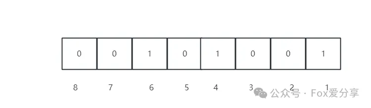
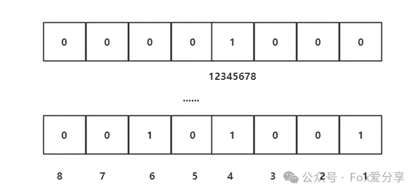

# 数据结构与算法：原理、复杂度与 Java 实现

数据结构解决"数据怎么放"，算法解决"数据怎么算"。同样一批数据，放法不同、算法不同，程序的速度可能相差成千上万倍。本文把常用的线性结构、哈希、树、堆、图、排序、查找和经典算法思想串成一条线，每个知识点都给出可运行的 Java 示例，并标清时间与空间复杂度。

阅读时不必按顺序背结论，重点是三件事：这个结构为什么被发明出来、它的操作代价是多少、在什么场景下应该选它。

## 本文导读

全文共十二章，可按兴趣跳读：

- 一、先看全景：数据结构与算法的关系
- 二、复杂度：衡量快慢与内存的统一语言
- 三、线性结构：数组、链表、栈、队列
- 四、哈希：用算地址换时间，以及 BitMap
- 五、树与堆：从二叉树到红黑树、前缀树、哈夫曼树
- 六、图：表示、遍历、拓扑排序、最小生成树
- 七、排序：冒泡、插入、快速、归并及对比表
- 八、查找：二分查找与字符串匹配
- 九、算法思想：分治、贪心、回溯、动态规划、二分
- 十、工程实践：手写一个 LRU 缓存
- 十一、分布式与安全算法速览：ZAB、Paxos、Raft、雪花、摘要与加密
- 十二、学习路径与面试常见问法

## 一、先看全景：数据结构与算法是什么关系

数据结构（Data Structure）是数据在内存中的组织方式，比如排成一排的数组、用指针串起来的链表、分叉的树。算法（Algorithm）是在这种组织方式上完成操作的具体步骤，比如查找、排序、去重。

打个比方：数据结构像厨房的收纳方式——抽屉、挂架、保鲜盒各有各的用处；算法像菜谱里的操作步骤。收纳方式决定了拿取的速度，步骤决定了做菜的快慢，两者配合才有好结果。

选择结构时通常看三个维度：

- **访问方式**：按下标随机访问，还是只能从头逐个走。
- **操作频率**：查得多、插得多，还是删得多。
- **数据规模**：几百条和上亿条，最优选择往往不同。

## 二、复杂度：衡量"快慢"和"费不费内存"的统一语言

同一段代码在不同机器上跑出来的秒数没有可比性，所以计算机科学用"随着数据量增长，操作次数怎么涨"来描述代价，这就是复杂度。看懂复杂度，才能在写代码之前判断方案会不会在数据量上来后崩掉。

### 2.1 大 O 记号怎么读

大 O 记号（Big-O Notation）描述的是**增长趋势**，忽略常数和低阶项。比如某段代码执行 `3n + 5` 次，记作 O(n)；执行 `n²/2 + n` 次，记作 O(n²)。

常见的几个量级：

- **O(1)**：常数时间，和数据量无关。例如数组按下标取值。
- **O(log n)**：对数时间，数据量翻倍只多一步。例如二分查找。
- **O(n)**：线性时间，数据量翻倍耗时翻倍。例如遍历一遍数组。
- **O(n log n)**：线性对数时间，常见于高效排序。
- **O(n²)**：平方时间，双层循环的典型代价。
- **O(2ⁿ)、O(n!)**：指数与阶乘，规模稍大就无法接受，常见于暴力枚举和未剪枝的回溯。

### 2.2 常见复杂度对比表

| 复杂度 | 名称 | n = 10 时的量级 | n = 1000 时的量级 | 典型例子 |
| --- | --- | --- | --- | --- |
| O(1) | 常数 | 1 | 1 | 数组下标访问、哈希表查找（平均） |
| O(log n) | 对数 | 约 4 | 约 10 | 二分查找、平衡树查找 |
| O(n) | 线性 | 10 | 1000 | 遍历数组、链表查找 |
| O(n log n) | 线性对数 | 约 33 | 约 10000 | 归并排序、快速排序（平均） |
| O(n²) | 平方 | 100 | 1000000 | 冒泡排序、插入排序、快速排序（最坏） |
| O(2ⁿ) | 指数 | 1024 | 天文数字 | 子集枚举、未剪枝回溯 |

表中数字是数量级估计，用于感受差距，不代表实际耗时。

### 2.3 空间复杂度与"原地"的含义

空间复杂度衡量算法额外占用的内存，同样用大 O 表示。只用了几个临时变量的算法，额外空间是 O(1)，称为**原地**（in-place）算法。

需要注意，"原地"不等于"零内存"：快速排序是原地排序，但递归调用本身会占用 O(log n) 的栈空间；归并排序需要一个和原数组等长的临时数组，额外空间是 O(n)。日常讨论中说的"快排省内存"，指的是它不需要按数据规模申请额外数组。

### 2.4 递归与迭代是等价的

递归（Recursion）是函数调用自身，迭代（Iteration）是用循环重复执行。理论上两者可以互相改写：递归用的是 JVM 的调用栈，迭代用的是自己维护的栈或循环变量，两者表达的计算过程相同。

实践中的差别在代价上：

- 递归代码短、贴近数学定义，但每次调用都有压栈开销；递归太深会抛 `StackOverflowError`。
- 迭代代码稍长，但没有栈溢出风险，常数更小。

所以树的前序、中序、后序遍历既可以用递归写，也可以用显式栈写，结果完全一致，只是空间位置不同。下面的代码会同时给出两种写法。

## 三、线性结构：数组、链表、栈、队列

线性结构是最基础的一类结构：元素排成一条线，除了首尾，每个元素最多有一个前驱和一个后继。Java 里的数组、`ArrayList`、`LinkedList`、`ArrayDeque` 都属于这一族。

### 3.1 数组与矩阵

**数组（Array）** 是有序元素的集合，通过下标访问，是最基础的数据结构。三个特点：

- **连续存储**：元素在内存中连续存放，可以用"起始地址 + 下标 × 元素大小"直接算出位置。
- **元素类型相同**：所有元素必须是同一数据类型，因此每个元素占用的字节数一致。
- **长度固定**：创建时就要指定大小，不能原地扩容；`ArrayList` 的"自动扩容"其实是新建更大的数组再拷贝。

数组下标从 0 开始。按下标访问的时间复杂度是 O(1)；但在中间插入或删除元素，需要移动后面的元素以保持连续，时间复杂度是 O(n)。

**矩阵（Matrix）** 是二维线性表，由行和列组成，每个元素由行号、列号唯一确定：

- **二维结构**：适合表示图像像素、棋盘、邻接矩阵等二维数据。
- **索引定位**：和数组一样可以按下标读写，访问单个元素是 O(1)。
- **运算代价**：矩阵相加是 O(m × n)；标准矩阵乘法是 O(m × n × p)（m×n 的矩阵乘 n×p 的矩阵）。具体实现还有更快的算法，复杂度取决于所用算法。

矩阵广泛用于图像处理、机器学习和科学计算。

### 3.2 链表

链表（Linked List）由节点（Node）组成，每个节点存一个数据元素和一个指向下一个节点的指针。节点在内存中**不要求连续**，靠指针串起来。

这种结构带来两个直接后果：插入和删除只需要改指针，不用移动其他元素；但想访问第 k 个元素，只能从头一个个走，访问是 O(n)。

常见类型：

- **单向链表**：每个节点只有一个 `next` 指针，只能向前。
- **双向链表**：每个节点有 `prev` 和 `next`，可以双向走，代价是每个节点多一个指针。
- **循环链表**：尾节点的 `next` 指回头节点，适合环形调度场景。

数组和链表的对比：

| 维度 | 数组 | 链表 |
| --- | --- | --- |
| 内存布局 | 连续 | 分散，靠指针连接 |
| 按下标访问 | O(1) | O(n) |
| 已知位置插入/删除 | O(n)（要搬元素） | O(1)（只改指针） |
| 容量 | 固定，扩容要拷贝 | 动态增减 |
| 额外开销 | 无 | 每个节点存指针 |

### 3.3 栈与队列

**栈（Stack）** 遵循后进先出（LIFO，Last In First Out）：最后放进去的元素最先被取出。核心操作是入栈 `push`（压到栈顶）和出栈 `pop`（从栈顶弹出）。

栈的典型应用：

- **函数调用与递归**：每次方法调用都会在虚拟机栈里压入一个栈帧，保存参数、局部变量和返回地址，方法返回时弹出，所以函数能正确回到调用点。
- **括号匹配**：遇到左括号入栈，遇到右括号检查栈顶是否配对。
- **浏览器前进后退、编辑器的撤销**。

**队列（Queue）** 遵循先进先出（FIFO，First In First Out）：最先放进去的元素最先被取出。核心操作是入队 `offer`（加到队尾）和出队 `poll`（从队头取出）。

队列的典型应用：

- **广度优先搜索**：按层扩展，天然适合找无权图的最短路径。
- **缓冲区与任务调度**：线程池的任务队列、消息队列。
- **打印队列、请求排队**。

### 3.4 代码：用数组实现一个栈

用数组加一个 `top` 指针即可。`top` 指向栈顶元素，空栈时为 -1。这种实现简单高效，但容量固定；需要动态扩容时可以用 `ArrayList` 或链表。

```java
public class ArrayStack {
    private final int[] stack;
    private final int capacity;
    private int top;

    public ArrayStack(int capacity) {
        this.capacity = capacity;
        this.stack = new int[capacity];
        this.top = -1; // 栈为空时 top 为 -1
    }

    // 入栈
    public void push(int value) {
        if (isFull()) {
            throw new IllegalStateException("Stack is full");
        }
        stack[++top] = value;
    }

    // 出栈
    public int pop() {
        if (isEmpty()) {
            throw new IllegalStateException("Stack is empty");
        }
        return stack[top--];
    }

    // 查看栈顶元素，不弹出
    public int peek() {
        if (isEmpty()) {
            throw new IllegalStateException("Stack is empty");
        }
        return stack[top];
    }

    public boolean isEmpty() {
        return top == -1;
    }

    public boolean isFull() {
        return top == capacity - 1;
    }

    public int size() {
        return top + 1;
    }

    public static void main(String[] args) {
        ArrayStack stack = new ArrayStack(5);
        stack.push(10);
        stack.push(20);
        stack.push(30);

        System.out.println("栈顶元素：" + stack.peek());   // 30
        System.out.println("栈大小：" + stack.size());     // 3
        System.out.println("弹出：" + stack.pop());        // 30
        System.out.println("弹出后大小：" + stack.size()); // 2
    }
}
```

`push`、`pop`、`peek` 都是 O(1)，额外空间 O(1)（数组本身占 O(capacity)）。

### 3.5 代码：用两个队列实现一个栈

思路是：入栈时把元素放进当前非空的那个队列；出栈时把该队列里除最后一个元素之外的元素全部搬到另一个队列，剩下的那个就是栈顶。

```java
import java.util.LinkedList;
import java.util.Queue;

public class StackUsingQueues {
    private final Queue<Integer> queue1 = new LinkedList<>();
    private final Queue<Integer> queue2 = new LinkedList<>();

    // 入栈：始终追加到非空队列的尾部
    public void push(int value) {
        if (!queue1.isEmpty()) {
            queue1.offer(value);
        } else {
            queue2.offer(value);
        }
    }

    // 出栈：把前 n-1 个元素搬到另一个队列，剩下的就是栈顶
    public int pop() {
        if (isEmpty()) {
            throw new IllegalStateException("Stack is empty");
        }
        if (!queue1.isEmpty()) {
            while (queue1.size() > 1) {
                queue2.offer(queue1.poll());
            }
            return queue1.poll();
        } else {
            while (queue2.size() > 1) {
                queue1.offer(queue2.poll());
            }
            return queue2.poll();
        }
    }

    // 查看栈顶：和 pop 类似，但最后一个元素也转移过去，只是返回而不丢弃
    public int peek() {
        if (isEmpty()) {
            throw new IllegalStateException("Stack is empty");
        }
        int topElement = 0;
        if (!queue1.isEmpty()) {
            while (!queue1.isEmpty()) {
                topElement = queue1.poll();
                queue2.offer(topElement);
            }
        } else {
            while (!queue2.isEmpty()) {
                topElement = queue2.poll();
                queue1.offer(topElement);
            }
        }
        return topElement;
    }

    public boolean isEmpty() {
        return queue1.isEmpty() && queue2.isEmpty();
    }

    public static void main(String[] args) {
        StackUsingQueues stack = new StackUsingQueues();
        stack.push(10);
        stack.push(20);
        stack.push(30);

        System.out.println("栈顶元素：" + stack.peek());        // 30
        System.out.println("弹出：" + stack.pop());            // 30
        System.out.println("弹出后的栈顶：" + stack.peek());   // 20
    }
}
```

复杂度：`push` 是 O(1)；`pop` 和 `peek` 需要搬运元素，是 O(n)。这种实现主要用来练习"用 A 结构模拟 B 结构"的思路，工程中直接用 `ArrayDeque` 当栈更划算。

### 3.6 代码：反转一个单链表

用三个指针 `prev`、`current`、`next` 顺着链表走，边走边把 `current.next` 指向 `prev`。走完后 `prev` 就是新的头节点。

```java
class ListNode {
    int val;
    ListNode next;

    ListNode(int val) {
        this.val = val;
    }
}

public class LinkedListReversal {
    public static ListNode reverseList(ListNode head) {
        ListNode prev = null;
        ListNode current = head;
        while (current != null) {
            ListNode next = current.next; // 先保存下一个节点，否则改完指针就找不到了
            current.next = prev;          // 反转当前节点的指针
            prev = current;               // prev 前移
            current = next;               // current 前移
        }
        return prev; // prev 指向原链表的尾节点，即新头节点
    }

    public static void printList(ListNode head) {
        for (ListNode cur = head; cur != null; cur = cur.next) {
            System.out.print(cur.val + " ");
        }
        System.out.println();
    }

    public static void main(String[] args) {
        // 链表：1 -> 2 -> 3 -> 4 -> 5
        ListNode head = new ListNode(1);
        head.next = new ListNode(2);
        head.next.next = new ListNode(3);
        head.next.next.next = new ListNode(4);
        head.next.next.next.next = new ListNode(5);

        System.out.println("原链表：");
        printList(head);

        ListNode reversed = reverseList(head);
        System.out.println("反转后：");
        printList(reversed); // 5 4 3 2 1
    }
}
```

时间复杂度 O(n)，空间复杂度 O(1)。注意空链表和单节点链表都能正确处理，因为循环条件只看 `current != null`。

### 3.7 代码：找出两个单链表的交点

两个链表如果相交，从交点开始到末尾是同一段。用双指针：`pA` 走完 A 后转到 B 的头，`pB` 走完 B 后转到 A 的头。这样两个指针走过的总长度都是 `len(A) + len(B)`，如果相交就一定在交点相遇；如果不相交，两者会同时走到 `null`。

```java
class ListNode {
    int val;
    ListNode next;

    ListNode(int val) {
        this.val = val;
    }
}

public class LinkedListIntersection {
    public static ListNode getIntersectionNode(ListNode headA, ListNode headB) {
        if (headA == null || headB == null) {
            return null; // 任一链表为空，不可能相交
        }
        ListNode pA = headA;
        ListNode pB = headB;
        while (pA != pB) {
            pA = (pA == null) ? headB : pA.next;
            pB = (pB == null) ? headA : pB.next;
        }
        return pA; // 交点，或 null 表示不相交
    }

    public static void main(String[] args) {
        // 链表 A：1 -> 2 -> 3 -> 8 -> 9
        ListNode headA = new ListNode(1);
        headA.next = new ListNode(2);
        headA.next.next = new ListNode(3);

        // 链表 B：6 -> 7 -> 8 -> 9
        ListNode headB = new ListNode(6);
        headB.next = new ListNode(7);

        ListNode intersection = new ListNode(8);
        intersection.next = new ListNode(9);

        headA.next.next.next = intersection;
        headB.next.next = intersection;

        ListNode node = getIntersectionNode(headA, headB);
        System.out.println(node == null ? "不相交" : "交点值：" + node.val); // 8
    }
}
```

时间复杂度 O(n + m)，空间复杂度 O(1)。这里比较的是节点引用而不是值，所以值相同的不同节点不会被误判为交点。

### 3.8 代码：检测单链表中是否有环

用快慢指针（也叫龟兔赛跑算法）：`slow` 每次走一步，`fast` 每次走两步。如果有环，快指针一定会在环内追上慢指针；如果没有环，快指针会先走到末尾。

```java
class ListNode {
    int val;
    ListNode next;

    ListNode(int val) {
        this.val = val;
    }
}

public class LinkedListCycleDetection {
    public static boolean hasCycle(ListNode head) {
        if (head == null || head.next == null) {
            return false;
        }
        ListNode slow = head;
        ListNode fast = head;
        while (fast != null && fast.next != null) {
            slow = slow.next;
            fast = fast.next.next;
            if (slow == fast) {
                return true; // 相遇说明有环
            }
        }
        return false; // 快指针走到末尾说明无环
    }

    public static void main(String[] args) {
        // 1 -> 2 -> 3 -> 4 -> 5，再让 5 指回 3
        ListNode head = new ListNode(1);
        head.next = new ListNode(2);
        head.next.next = new ListNode(3);
        head.next.next.next = new ListNode(4);
        head.next.next.next.next = new ListNode(5);
        head.next.next.next.next.next = head.next.next;

        System.out.println("是否有环：" + hasCycle(head)); // true
    }
}
```

时间复杂度 O(n)，空间复杂度 O(1)。判断条件必须是 `fast != null && fast.next != null`，否则 `fast.next.next` 会抛空指针异常。

## 四、哈希：用"算地址"换时间

哈希表（Hash Table）是工程里用得最多的结构之一：`HashMap`、Redis 的字典、数据库索引的哈希分区都基于它。它把"查找"从逐个比较变成一次地址计算，用一点空间和冲突处理换来平均 O(1) 的操作。

### 4.1 哈希表是什么

哈希表的思路是：用一个**哈希函数**（Hash Function）把关键字映射成数组下标，直接去那个位置读写。

打个比方：图书馆不按书名排列，而是按书名算出一个编号，直接把书放进对应编号的格子。找书时算一遍编号就能直达，不用一排排找。

三个组成部分：

1. **哈希函数**：把关键字映射为哈希值，再对数组长度取模得到下标。好的哈希函数分布均匀，能减少冲突。
2. **数组存储**：底层是一个数组，每个位置称为一个**桶**（Bucket），可以存一个或多个元素。
3. **冲突处理**：不同的关键字可能算出同一个下标，这叫哈希冲突（Collision），必须有机制处理。

理想情况下插入、删除、查找都是 O(1)；如果所有键都冲突到同一个桶，就退化成链表，最坏是 O(n)。所以"平均 O(1)、最坏 O(n)"是更准确的表述。

### 4.2 冲突怎么处理

| 方法 | 做法 | 优点 | 缺点 |
| --- | --- | --- | --- |
| 链地址法 | 每个桶挂一个链表（或红黑树），冲突元素串在桶后面 | 实现简单，删除方便，装载因子可以大于 1 | 有指针开销，链表过长时退化 |
| 开放地址法 | 冲突时按规则探测下一个空桶（线性探测、二次探测、再哈希） | 不用额外指针，缓存友好 | 删除要用标记，容易聚集，装满了就插不进 |

JDK 的 `HashMap` 用链地址法：默认初始容量 16、装载因子 0.75，当某个桶的链表过长（且容量足够）时会转成红黑树，把最坏查找从 O(n) 降到 O(log n)。这是实现层面的优化，面试时能说出来会加分。

### 4.3 代码：链地址法实现一个简单哈希表

下面这个实现用数组 + `LinkedList` 存冲突元素，支持 `put`、`get`、`remove`。

```java
import java.util.Iterator;
import java.util.LinkedList;

public class SimpleHashTable<K, V> {
    private static class HashNode<K, V> {
        final K key;
        V value;

        HashNode(K key, V value) {
            this.key = key;
            this.value = value;
        }
    }

    private final LinkedList<HashNode<K, V>>[] table;
    private final int capacity;
    private int size;

    @SuppressWarnings("unchecked")
    public SimpleHashTable(int capacity) {
        this.capacity = capacity;
        this.table = new LinkedList[capacity];
        this.size = 0;
    }

    // 计算下标：先去掉符号位，避免 hashCode 为负数（含 Integer.MIN_VALUE）时下标为负
    private int hash(K key) {
        return (key.hashCode() & 0x7fffffff) % capacity;
    }

    public void put(K key, V value) {
        int index = hash(key);
        if (table[index] == null) {
            table[index] = new LinkedList<>();
        }
        for (HashNode<K, V> node : table[index]) {
            if (node.key.equals(key)) {
                node.value = value; // 键已存在，更新值
                return;
            }
        }
        table[index].add(new HashNode<>(key, value));
        size++;
    }

    public V get(K key) {
        LinkedList<HashNode<K, V>> chain = table[hash(key)];
        if (chain != null) {
            for (HashNode<K, V> node : chain) {
                if (node.key.equals(key)) {
                    return node.value;
                }
            }
        }
        return null; // 键不存在
    }

    public V remove(K key) {
        LinkedList<HashNode<K, V>> chain = table[hash(key)];
        if (chain != null) {
            Iterator<HashNode<K, V>> it = chain.iterator();
            while (it.hasNext()) {
                HashNode<K, V> node = it.next();
                if (node.key.equals(key)) {
                    it.remove(); // 用迭代器删除，避免并发修改异常
                    size--;
                    return node.value;
                }
            }
        }
        return null; // 键不存在
    }

    public int size() {
        return size;
    }

    public static void main(String[] args) {
        SimpleHashTable<String, Integer> table = new SimpleHashTable<>(10);
        table.put("apple", 1);
        table.put("banana", 2);
        table.put("orange", 3);

        System.out.println("apple = " + table.get("apple"));      // 1
        System.out.println("banana = " + table.get("banana"));    // 2
        System.out.println("删除 banana = " + table.remove("banana")); // 2
        System.out.println("删除后再查 = " + table.get("banana")); // null
        System.out.println("当前元素数 = " + table.size());        // 2
    }
}
```

几个容易踩的边界：

- `hashCode()` 可能返回负数，`Integer.MIN_VALUE` 取绝对值后仍是负数，直接用 `Math.abs(...) % n` 会得到负下标并抛数组越界。用 `& 0x7fffffff` 更稳。
- 这个简化版不会自动扩容，元素一多每个桶的链表就变长，性能随之下降；`HashMap` 用装载因子触发扩容来解决。
- 键不能为 `null`，否则 `key.hashCode()` 会抛空指针。

### 4.4 BitMap：把"有没有"压缩成 1 个 bit

BitMap（位图）是哈希思想的一个极端用法：不存键本身，只用一位表示某个数"出现过没有"。它在海量数据去重、排序、集合运算里非常常见。

#### 4.4.1 什么是 BitMap

位图就是一个 bit 数组，每个位置取值 0 或 1，像一本超级节省空间的"登记簿"：某个数存在就把对应格子标记为 1，不存在就是 0。

例如要记录 1、4、6 这三个数：传统做法用 3 个 `int`，共 12 字节；BitMap 只需要 1 个字节（8 位），把第 1、4、6 位置为 1 即可，节省约 12 倍空间。



BitMap 最大的优势是用**极小的存储空间**表示**巨大的数值范围**，查询和去重都是 O(1)，特别适合"有或没有"这类二值问题。

#### 4.4.2 用 BitMap 给 40 亿个号码去重

**题目**：40 亿个 QQ 号，相同号码只保留一个，内存限制 1GB，怎么实现？

先算一下存原始数据的代价。QQ 号可以看作 4 字节的无符号整数：

```plain
4000000000 * 4 字节 / 1024 / 1024 / 1024 ≈ 14.9 GiB
```

接近 15GB，远超 1GB 的限制，必须换思路。改用 BitMap：

```plain
4000000000 bit / 8 / 1024 / 1024 ≈ 477 MiB
```

不到 500MB，1GB 内存放得下。步骤是：

1. 申请一个 40 亿位的 BitMap（约 477MiB）。
2. 遍历 40 亿个号码，把每个号码映射到对应下标并置 1。比如号码 `12345678` 就把第 `12345678` 位置 1。
3. 遍历 BitMap，所有为 1 的下标就是去重后的号码集合。



三种方案的空间对比（按 40 亿条、4 字节整数估算）：

| 方案 | 大致空间 | 能否还原原始数据 | 说明 |
| --- | --- | --- | --- |
| 直接存 `int` 数组 | 约 15GB | 能 | 超内存，不可行 |
| BitMap | 约 477MiB | 能（下标即值） | 要求值域有限且已知 |
| 布隆过滤器 | 取决于误判率 | 不能 | 有误判，只能判断"可能存在" |

Java 里可以用 `long[]` 手动实现位图，`long` 的每一位对应一个数：

```java
public class BitMap {
    private final long[] bits;

    // maxValue：支持的最大数值（含）
    public BitMap(int maxValue) {
        this.bits = new long[(maxValue >> 6) + 1]; // 每个 long 存 64 位
    }

    public void set(int value) {
        bits[value >> 6] |= 1L << (value & 63);
    }

    public boolean get(int value) {
        return (bits[value >> 6] & (1L << (value & 63))) != 0;
    }

    public static void main(String[] args) {
        BitMap bitMap = new BitMap(40);
        bitMap.set(1);
        bitMap.set(4);
        bitMap.set(6);
        System.out.println(bitMap.get(4));  // true
        System.out.println(bitMap.get(5));  // false
    }
}
```

#### 4.4.3 BitMap 的优缺点

**优点**

- **超级省内存**：相比按字节或按整型存储，空间可降到约 1/8 甚至更低。
- **操作快**：置位、查询、去重都是 O(1)。
- **实现简单**：只依赖一个整型数组，没有指针和对象开销。

**缺点**

- **只能表示"有或没有"**：存不了具体值，也存不了出现次数（要计数得用多个位或换成计数数组）。
- **必须能确定值域**：值域多大就要开多大的位图，稀疏数据会浪费空间；超出范围无法标记。
- **不适合大范围稀疏数据**：比如只存 1000 个随机 64 位数，位图反而更费内存。

这类思路被广泛用于大规模去重、数据排序、集合的交并差运算，以及布隆过滤器的底层实现。

### 4.5 一致性哈希

一致性哈希（Consistent Hashing）解决的是**分布式缓存和分片**里的数据分布问题：当节点数量变化时，尽量少搬数据。

普通取模分片的做法是 `hash(key) % 节点数`。一旦节点数从 3 变成 4，几乎所有 key 的归属都会变，缓存集体失效。

一致性哈希把哈希值空间想象成一个首尾相接的环（0 到 2³²−1），节点和数据都映射到环上：

- 每个节点按哈希值落在环上某个位置。
- 存数据时，先算出数据在环上的位置，然后**顺时针**找到第一个节点，就存到那里。

这样一来，增加或删除一个节点，只影响环上相邻的那一段数据，其他数据的归属不变。

**优点**：节点增删时数据迁移量小；数据分布相对均匀；节点数变化只需重新映射一部分 key。

**缺点**：节点较少时，环上的位置可能不均匀，导致负载倾斜；热点数据仍可能集中在少数节点。

工程上的解决办法是引入**虚拟节点**：给每个物理节点在环上分配几十到几百个虚拟位置，节点越多分布越均匀。这也是主流客户端分片方案的常见做法。

### 4.6 布隆过滤器：BitMap 的概率版

布隆过滤器（Bloom Filter）用一个位数组加多个哈希函数来判断"某个元素可能存在或一定不存在"。它允许少量误判（把不存在的判成存在），但绝不漏判，而且不支持删除元素。适合缓存穿透防护、爬虫 URL 去重这类"宁可多查一次，不能漏"的场景。

## 五、树与堆：从二叉树到红黑树、前缀树、哈夫曼树

树用来表达层次和分支关系：文件目录、组织架构、语法树、索引结构都是树。相比线性结构，树能把查找从 O(n) 降到 O(log n)，代价是结构维护更复杂。

### 5.1 二叉树与三种遍历

二叉树（Binary Tree）的每个节点最多有两个子节点：左子节点和右子节点。遍历就是按某种顺序访问所有节点一次，三种深度优先顺序的区别只在"访问根节点"放在哪一步：

- **前序**（根 → 左 → 右）：适合复制一棵树、输出目录结构。
- **中序**（左 → 根 → 右）：对二叉搜索树来说，中序输出就是升序序列。
- **后序**（左 → 右 → 根）：适合释放节点、计算子树聚合值。

递归写法直接对应定义；非递归写法用显式栈模拟调用栈。下面把两种写法放在同一个类里，方便对照运行。

```java
import java.util.ArrayDeque;
import java.util.Deque;

class TreeNode {
    int val;
    TreeNode left;
    TreeNode right;

    TreeNode(int val) {
        this.val = val;
    }
}

public class TreeTraversalDemo {

    // ---------- 递归写法 ----------
    static void preorderRec(TreeNode node) {
        if (node == null) {
            return;
        }
        System.out.print(node.val + " ");
        preorderRec(node.left);
        preorderRec(node.right);
    }

    static void inorderRec(TreeNode node) {
        if (node == null) {
            return;
        }
        inorderRec(node.left);
        System.out.print(node.val + " ");
        inorderRec(node.right);
    }

    static void postorderRec(TreeNode node) {
        if (node == null) {
            return;
        }
        postorderRec(node.left);
        postorderRec(node.right);
        System.out.print(node.val + " ");
    }

    // ---------- 非递归写法 ----------
    // 前序：先压右再压左，弹出顺序就是根、左、右
    static void preorderIter(TreeNode root) {
        if (root == null) {
            return;
        }
        Deque<TreeNode> stack = new ArrayDeque<>();
        stack.push(root);
        while (!stack.isEmpty()) {
            TreeNode node = stack.pop();
            System.out.print(node.val + " ");
            if (node.right != null) {
                stack.push(node.right);
            }
            if (node.left != null) {
                stack.push(node.left);
            }
        }
    }

    // 中序：一路向左压栈，弹出后访问，再转向右子树
    static void inorderIter(TreeNode root) {
        Deque<TreeNode> stack = new ArrayDeque<>();
        TreeNode current = root;
        while (current != null || !stack.isEmpty()) {
            while (current != null) {
                stack.push(current);
                current = current.left;
            }
            current = stack.pop();
            System.out.print(current.val + " ");
            current = current.right;
        }
    }

    // 后序：用两个栈，第一个栈按"根、右、左"顺序压，第二个栈逆序输出
    static void postorderIter(TreeNode root) {
        if (root == null) {
            return;
        }
        Deque<TreeNode> stack = new ArrayDeque<>();
        Deque<TreeNode> output = new ArrayDeque<>();
        stack.push(root);
        while (!stack.isEmpty()) {
            TreeNode node = stack.pop();
            output.push(node);
            if (node.left != null) {
                stack.push(node.left);
            }
            if (node.right != null) {
                stack.push(node.right);
            }
        }
        while (!output.isEmpty()) {
            System.out.print(output.pop().val + " ");
        }
    }

    public static void main(String[] args) {
        //        1
        //       / \
        //      2   3
        //     / \ / \
        //    4  5 6  7
        TreeNode root = new TreeNode(1);
        root.left = new TreeNode(2);
        root.right = new TreeNode(3);
        root.left.left = new TreeNode(4);
        root.left.right = new TreeNode(5);
        root.right.left = new TreeNode(6);
        root.right.right = new TreeNode(7);

        System.out.print("前序-递归：");
        preorderRec(root);
        System.out.print("\n前序-非递归：");
        preorderIter(root);
        System.out.print("\n中序-递归：");
        inorderRec(root);
        System.out.print("\n中序-非递归：");
        inorderIter(root);
        System.out.print("\n后序-递归：");
        postorderRec(root);
        System.out.print("\n后序-非递归：");
        postorderIter(root);
        System.out.println();
    }
}
```

两种写法的时间复杂度都是 O(n)，每个节点访问一次。空间上递归用调用栈，非递归用显式栈，最坏都是 O(h)，h 为树高。这里用 `ArrayDeque` 而不是 `Stack`，因为 `Stack` 是早期同步类，单线程下 `ArrayDeque` 更快。

### 5.2 层序遍历

层序遍历（也叫广度优先遍历）按从上到下、从左到右的顺序访问每一层，用队列实现：根节点入队，然后反复"出队一个、把它的左右子节点入队"。

```java
import java.util.LinkedList;
import java.util.Queue;

class TreeNode {
    int val;
    TreeNode left;
    TreeNode right;

    TreeNode(int val) {
        this.val = val;
    }
}

public class BinaryTreeLevelOrder {
    public static void levelOrder(TreeNode root) {
        if (root == null) {
            return;
        }
        Queue<TreeNode> queue = new LinkedList<>();
        queue.offer(root);

        while (!queue.isEmpty()) {
            int levelSize = queue.size(); // 当前层的节点数，用它来分层
            for (int i = 0; i < levelSize; i++) {
                TreeNode node = queue.poll();
                System.out.print(node.val + " ");
                if (node.left != null) {
                    queue.offer(node.left);
                }
                if (node.right != null) {
                    queue.offer(node.right);
                }
            }
            System.out.println(); // 换行，输出一层
        }
    }

    public static void main(String[] args) {
        TreeNode root = new TreeNode(1);
        root.left = new TreeNode(2);
        root.right = new TreeNode(3);
        root.left.left = new TreeNode(4);
        root.left.right = new TreeNode(5);
        root.right.left = new TreeNode(6);
        root.right.right = new TreeNode(7);

        levelOrder(root);
        // 1
        // 2 3
        // 4 5 6 7
    }
}
```

时间复杂度 O(n)，队列最多存一层节点，空间 O(n)（最宽层）。

### 5.3 二叉搜索树

二叉搜索树（BST，Binary Search Tree）在二叉树基础上加了顺序约束：

1. 每个节点最多有两个子节点。
2. 对任意节点，左子树所有节点的值都小于它，右子树所有节点的值都大于它。
3. 左右子树本身也都是二叉搜索树。

这种顺序让查找可以"每比较一次砍掉一半"：比当前节点小就往左走，大就往右走。

- **查找**：平均 O(log n)，最坏 O(n)。
- **插入**：先查找位置再挂上，平均 O(log n)，最坏 O(n)。
- **删除**：找到节点后分三种情况处理（无子节点、一个子节点、两个子节点），平均 O(log n)，最坏 O(n)。

最坏情况出现在树退化成链表时：如果按 1、2、3、4、5 的顺序插入，每个节点都只有右子节点，树高变成 n，查找退化为 O(n)。这正是需要"平衡"的原因，也是 AVL 树和红黑树存在的意义。

### 5.4 平衡二叉树：AVL 与红黑树

平衡二叉树（Balanced Binary Tree）是加了平衡约束的二叉搜索树：任意节点的左右子树高度差不超过 1（这是 AVL 树的严格定义；红黑树用的是另一套等价约束）。约束的作用是保证树高维持在 O(log n)，从而让查找、插入、删除的最坏情况也是 O(log n)，而不是退化成 O(n)。

两种常见实现：

- **AVL 树**：每个节点维护平衡因子（左子树高度减右子树高度），一旦绝对值超过 1 就通过左旋、右旋调整。它的平衡更严格，查找快，但插入删除时旋转次数可能较多。
- **红黑树**：每个节点增加颜色属性（红或黑），通过变色和旋转维持五条性质（见下），平衡没有 AVL 那么严格，但插入删除的调整次数更少。Java 的 `TreeMap`、`HashMap` 的树化桶都用红黑树。

红黑树的五条性质：

1. 每个节点是红色或黑色。
2. 根节点是黑色。
3. 叶子节点（指 NIL 空节点）是黑色。
4. 红色节点的两个子节点必须是黑色，也就是不能有两个相邻的红节点。
5. 从任意节点到其每个叶子节点的简单路径上，黑色节点数量相同（称为黑高相同）。

这五条性质保证最长路径不超过最短路径的两倍，因此树高是 O(log n)。需要说明的是，"最坏 O(log n)"这个结论对 AVL 和红黑树成立，对普通二叉搜索树不成立。

### 5.5 代码：判断一棵二叉树是否平衡

思路是自底向上递归计算高度，一旦发现某个节点左右子树高度差超过 1，就返回 -1 表示"已不平衡"，后续不再计算。

```java
class TreeNode {
    int val;
    TreeNode left;
    TreeNode right;

    TreeNode(int val) {
        this.val = val;
    }
}

public class BalancedBinaryTree {
    public static boolean isBalanced(TreeNode root) {
        return checkHeight(root) != -1;
    }

    // 返回节点高度；返回 -1 表示该子树不平衡
    private static int checkHeight(TreeNode node) {
        if (node == null) {
            return 0;
        }
        int leftHeight = checkHeight(node.left);
        if (leftHeight == -1) {
            return -1;
        }
        int rightHeight = checkHeight(node.right);
        if (rightHeight == -1) {
            return -1;
        }
        if (Math.abs(leftHeight - rightHeight) > 1) {
            return -1;
        }
        return Math.max(leftHeight, rightHeight) + 1;
    }

    public static void main(String[] args) {
        // 平衡树：1 的左右子树高度都是 2
        TreeNode balanced = new TreeNode(1);
        balanced.left = new TreeNode(2);
        balanced.right = new TreeNode(3);
        balanced.left.left = new TreeNode(4);
        balanced.left.right = new TreeNode(5);
        balanced.right.left = new TreeNode(6);
        balanced.right.right = new TreeNode(7);
        System.out.println("是否平衡：" + isBalanced(balanced)); // true

        // 不平衡：只有左子树的左子树，高度差为 2
        TreeNode unbalanced = new TreeNode(1);
        unbalanced.left = new TreeNode(2);
        unbalanced.left.left = new TreeNode(3);
        System.out.println("是否平衡：" + isBalanced(unbalanced)); // false
    }
}
```

时间复杂度 O(n)，每个节点只算一次高度；如果写成"每个节点都重新求一次高度"，复杂度会退化成 O(n²)。空间是递归栈 O(h)。

### 5.6 堆与优先队列

堆（Heap）是一棵完全二叉树，并且满足"父节点总是不大于（或不小于）子节点"。父节点最小叫**最小堆**，父节点最大叫**最大堆**。堆通常用数组存储，下标 i 的左右子节点分别是 `2i+1` 和 `2i+2`。

堆的用途是快速拿到当前的最值：插入和删除堆顶都是 O(log n)，查看堆顶是 O(1)。优先队列（Priority Queue）、Top-K 问题、任务调度、Dijkstra 算法都依赖堆。

Java 的 `PriorityQueue` 默认就是最小堆，也可以用 `Comparator` 定制顺序：

```java
import java.util.Comparator;
import java.util.PriorityQueue;

public class MinHeapDemo {
    public static void main(String[] args) {
        PriorityQueue<Integer> minHeap = new PriorityQueue<>();
        minHeap.add(10);
        minHeap.add(5);
        minHeap.add(20);
        minHeap.add(3);

        // 注意：直接遍历拿到的是堆内部数组的顺序，不保证有序
        System.out.println("内部顺序（无序）：" + minHeap);

        System.out.println("堆顶：" + minHeap.peek());     // 3
        System.out.println("弹出：" + minHeap.poll());    // 3
        System.out.println("弹出后堆顶：" + minHeap.peek()); // 5

        // 想要有序输出，应该反复 poll
        System.out.print("依次弹出：");
        while (!minHeap.isEmpty()) {
            System.out.print(minHeap.poll() + " "); // 5 10 20
        }
        System.out.println();

        // 最大堆：传入反向比较器
        PriorityQueue<Integer> maxHeap = new PriorityQueue<>(Comparator.reverseOrder());
        maxHeap.add(10);
        maxHeap.add(5);
        maxHeap.add(20);
        System.out.println("最大堆堆顶：" + maxHeap.peek()); // 20
    }
}
```

几个关键点：

- `add`/`offer` 和 `poll` 是 O(log n)，`peek` 和 `size` 是 O(1)。
- `iterator()` 不保证任何顺序，所以用 for-each 打印出来的不是排序结果；要按序取元素只能反复 `poll`。
- `PriorityQueue` 不是线程安全的，多线程场景用 `PriorityBlockingQueue`。

### 5.7 前缀树（Trie）

前缀树（也叫字典树）专门用来存字符串集合，核心优势是"按前缀查找"。

结构上：根节点为空，每个节点代表一个字符，从根到某个节点的路径拼起来就是该节点对应的前缀；从根到叶子的路径表示一个完整字符串。每个节点通常带一个 `isEnd` 标记，表示这里是否是一个完整单词的结尾。

插入时逐字符往下走，字符对应的子节点不存在就新建。查找前缀时从根开始按字符走，走完前缀就说明存在以它为前缀的字符串。

复杂度只和字符串长度 L 有关：插入和查询都是 O(L)，与集合里有多少个字符串无关。

典型应用：搜索框自动补全、搜索引擎关键词索引、IP 路由表、拼写检查。

```java
public class Trie {
    private static class Node {
        Node[] children = new Node[26]; // 只考虑小写字母
        boolean isEnd;
    }

    private final Node root = new Node();

    public void insert(String word) {
        Node cur = root;
        for (char c : word.toCharArray()) {
            int idx = c - 'a';
            if (cur.children[idx] == null) {
                cur.children[idx] = new Node();
            }
            cur = cur.children[idx];
        }
        cur.isEnd = true;
    }

    // 是否包含完整单词
    public boolean search(String word) {
        Node node = find(word);
        return node != null && node.isEnd;
    }

    // 是否存在以 prefix 开头的单词
    public boolean startsWith(String prefix) {
        return find(prefix) != null;
    }

    private Node find(String s) {
        Node cur = root;
        for (char c : s.toCharArray()) {
            int idx = c - 'a';
            if (cur.children[idx] == null) {
                return null;
            }
            cur = cur.children[idx];
        }
        return cur;
    }

    public static void main(String[] args) {
        Trie trie = new Trie();
        trie.insert("cat");
        trie.insert("car");
        trie.insert("card");

        System.out.println(trie.search("car"));      // true
        System.out.println(trie.search("ca"));       // false（只是前缀，不是单词）
        System.out.println(trie.startsWith("ca"));   // true
        System.out.println(trie.startsWith("dog"));  // false
    }
}
```

### 5.8 哈夫曼树与哈夫曼编码

哈夫曼树（Huffman Tree）用于无损数据压缩，目标是用尽量少的比特表示出现频率高的字符。

构建过程：

1. 统计待编码数据中每个字符的出现频率。
2. 每个字符建一个叶子节点，权重就是频率，放进一个按权重排序的集合（通常用最小堆）。
3. 反复取出权重最小的两个节点，作为左右子节点合成一个新父节点，父节点权重为两者之和，再放回集合。
4. 重复直到只剩一个节点，它就是根。

编码规则：从根出发，向左走记 0，向右走记 1，到达叶子时路径上的 0/1 串就是该字符的编码。频率高的字符离根近，编码短；频率低的字符离根远，编码长。

哈夫曼编码是**前缀编码**：任何一个字符的编码都不是另一个字符编码的前缀，所以解码时不需要分隔符，从左往右逐位匹配就能唯一还原。

```java
import java.util.HashMap;
import java.util.Map;
import java.util.PriorityQueue;

public class HuffmanDemo {
    static class Node implements Comparable<Node> {
        char ch;
        int freq;
        Node left, right;

        Node(char ch, int freq, Node left, Node right) {
            this.ch = ch;
            this.freq = freq;
            this.left = left;
            this.right = right;
        }

        boolean isLeaf() {
            return left == null && right == null;
        }

        @Override
        public int compareTo(Node other) {
            return Integer.compare(this.freq, other.freq);
        }
    }

    static void buildCodes(Node node, String code, Map<Character, String> codes) {
        if (node == null) {
            return;
        }
        if (node.isLeaf()) {
            codes.put(node.ch, code.isEmpty() ? "0" : code); // 只有一个字符时给个默认编码
            return;
        }
        buildCodes(node.left, code + "0", codes);
        buildCodes(node.right, code + "1", codes);
    }

    public static void main(String[] args) {
        String text = "abracadabra";
        Map<Character, Integer> freq = new HashMap<>();
        for (char c : text.toCharArray()) {
            freq.merge(c, 1, Integer::sum);
        }

        PriorityQueue<Node> pq = new PriorityQueue<>();
        for (Map.Entry<Character, Integer> e : freq.entrySet()) {
            pq.add(new Node(e.getKey(), e.getValue(), null, null));
        }
        while (pq.size() > 1) {
            Node a = pq.poll();
            Node b = pq.poll();
            pq.add(new Node('\0', a.freq + b.freq, a, b));
        }

        Map<Character, String> codes = new HashMap<>();
        buildCodes(pq.poll(), "", codes);
        System.out.println(codes); // 频率高的字符编码更短
    }
}
```

## 六、图

图（Graph）由顶点（Vertex）和边（Edge）组成，用来表达"多对多"的关系：社交网络、地图路径、任务依赖、网络拓扑都是图。图算法几乎都建立在两种遍历之上。

### 6.1 图怎么表示

两种常见表示：

| 表示 | 结构 | 空间 | 适合 |
| --- | --- | --- | --- |
| 邻接矩阵 | 二维数组 `matrix[i][j]` 表示 i 到 j 是否有边 | O(V²) | 稠密图、需要快速判断两点是否相邻 |
| 邻接表 | 每个顶点挂一个相邻顶点列表 | O(V + E) | 稀疏图，绝大多数实际场景 |

V 是顶点数，E 是边数。下面的代码用邻接表：`Map<Integer, List<Integer>>`，键是顶点，值是与它相邻的顶点列表。

### 6.2 代码：邻接表 + DFS / BFS

```java
import java.util.ArrayDeque;
import java.util.ArrayList;
import java.util.Deque;
import java.util.HashMap;
import java.util.HashSet;
import java.util.List;
import java.util.Map;
import java.util.Queue;
import java.util.Set;

public class Graph {
    private final Map<Integer, List<Integer>> adjList = new HashMap<>();

    // 添加无向边：两个方向都要加
    public void addEdge(int source, int destination) {
        adjList.computeIfAbsent(source, k -> new ArrayList<>()).add(destination);
        adjList.computeIfAbsent(destination, k -> new ArrayList<>()).add(source);
    }

    // 深度优先搜索（递归）
    public void dfs(int start) {
        Set<Integer> visited = new HashSet<>();
        dfsUtil(start, visited);
        System.out.println();
    }

    private void dfsUtil(int node, Set<Integer> visited) {
        visited.add(node);
        System.out.print(node + " ");
        for (int neighbor : adjList.getOrDefault(node, List.of())) {
            if (!visited.contains(neighbor)) {
                dfsUtil(neighbor, visited);
            }
        }
    }

    // 深度优先搜索（显式栈，避免深图递归溢出）
    public void dfsIterative(int start) {
        Set<Integer> visited = new HashSet<>();
        Deque<Integer> stack = new ArrayDeque<>();
        stack.push(start);

        while (!stack.isEmpty()) {
            int node = stack.pop();
            if (!visited.add(node)) {
                continue;
            }
            System.out.print(node + " ");
            List<Integer> neighbors = adjList.getOrDefault(node, List.of());
            for (int i = neighbors.size() - 1; i >= 0; i--) {
                if (!visited.contains(neighbors.get(i))) {
                    stack.push(neighbors.get(i));
                }
            }
        }
        System.out.println();
    }

    // 广度优先搜索
    public void bfs(int start) {
        Set<Integer> visited = new HashSet<>();
        Queue<Integer> queue = new ArrayDeque<>();
        visited.add(start);
        queue.offer(start);

        while (!queue.isEmpty()) {
            int node = queue.poll();
            System.out.print(node + " ");
            for (int neighbor : adjList.getOrDefault(node, List.of())) {
                if (visited.add(neighbor)) {
                    queue.offer(neighbor);
                }
            }
        }
        System.out.println();
    }

    public static void main(String[] args) {
        Graph graph = new Graph();
        graph.addEdge(0, 1);
        graph.addEdge(0, 2);
        graph.addEdge(1, 2);
        graph.addEdge(2, 3);
        graph.addEdge(3, 4);

        System.out.print("DFS 递归：");
        graph.dfs(0);
        System.out.print("DFS 迭代：");
        graph.dfsIterative(0);
        System.out.print("BFS：");
        graph.bfs(0);
    }
}
```

两者的复杂度都是 O(V + E)：每个顶点进出一次，每条边检查两次。区别在于：

- **DFS** 用栈（递归或显式栈），一条路走到黑再回退，适合找所有路径、判断连通性、检测环、求连通分量。
- **BFS** 用队列，按距离一圈圈扩展，在无权图上第一次到达某点就是最短路径，适合求最短步数、迷宫问题。

DFS 递归版在超深图上可能栈溢出，工程里可以把递归换成显式栈，如上面的 `dfsIterative`。

### 6.3 拓扑排序

拓扑排序（Topological Sort）解决的是"有依赖关系的任务按什么顺序执行"的问题：把有向无环图（DAG，Directed Acyclic Graph）的顶点排成一个序列，使每条边都从序列前面指向后面。

生活化理解：穿衣服要先穿袜子再穿鞋，先穿内衣再穿外套；拓扑排序给出一个不违反所有"先穿 A 才能穿 B"约束的顺序。

Kahn 算法（BFS 版）最直观：

1. 统计每个顶点的入度（有多少条边指向它）。
2. 把所有入度为 0 的顶点入队。
3. 反复出队一个顶点加入结果，并把它的所有后继入度减 1；减到 0 的后继入队。
4. 如果结果序列的长度小于顶点总数，说明图中有环，无法拓扑排序。

复杂度 O(V + E)。应用场景：编译器的模块依赖排序、Maven/Gradle 的构建顺序、任务调度、课程安排。注意它**只适用于有向无环图**，有环就没有合法顺序。

### 6.4 最小生成树

最小生成树（MST，Minimum Spanning Tree）针对**连通无向带权图**：找出一棵包含所有顶点、边权之和最小的树。它解决的是"用最低成本把所有点连起来"的问题，比如铺光纤、架电网、修路。

两种经典算法：

| 算法 | 思路 | 复杂度（常见实现） |
| --- | --- | --- |
| Prim（普里姆） | 从一个顶点开始，每次挑一条连接"已在树中"和"不在树中"的权值最小的边，扩展生成树 | O(E log V)（配合优先队列） |
| Kruskal（克鲁斯卡尔） | 把所有边按权值从小到大排序，依次尝试加入，用并查集判断是否成环，成环就跳过 | O(E log E)（主要花在排序） |

- **Prim** 更像"滚雪球"，适合稠密图。
- **Kruskal** 更像"挑便宜边"，适合稀疏图，实现上依赖并查集（Union-Find）判断两个顶点是否已连通。

应用：网络设计中选择成本最低的通信链路、电力网络中规划输电线路、聚类分析中的单链接层次聚类。

## 七、排序

排序是把一组数据按关键字重新排列。它既是高频面试题，也是理解算法思想（分治、原地、稳定性）的最好入口。选排序算法时看三件事：数据规模、是否要求稳定、内存是否紧张。

### 7.1 冒泡排序

冒泡排序反复遍历数组，每次比较相邻两个元素，前者大于后者就交换。每趟走完，未排序部分的最大值会被"冒"到末尾，重复 n-1 趟就整体有序。

```java
import java.util.Arrays;

public class BubbleSortDemo {
    public static void bubbleSort(int[] arr) {
        for (int i = 0; i < arr.length - 1; i++) {
            boolean swapped = false;
            for (int j = 0; j < arr.length - 1 - i; j++) {
                if (arr[j] > arr[j + 1]) {
                    int tmp = arr[j];
                    arr[j] = arr[j + 1];
                    arr[j + 1] = tmp;
                    swapped = true;
                }
            }
            if (!swapped) {
                break; // 一趟没有交换，说明已经有序，提前结束
            }
        }
    }

    public static void main(String[] args) {
        int[] arr = {5, 3, 8, 4, 2};
        bubbleSort(arr);
        System.out.println(Arrays.toString(arr)); // [2, 3, 4, 5, 8]
    }
}
```

时间复杂度：最坏和平均都是 O(n²)，加了 `swapped` 标记后，已有序时最好为 O(n)。空间 O(1)，且是**稳定**排序（相等元素不会交换位置）。实现简单、易于调试，但大规模数据下远不如快速排序和归并排序，实际多用于教学或极小规模数据。

### 7.2 插入排序

插入排序把数组分成"已排序"和"未排序"两部分，初始已排序部分只有第一个元素；每次取未排序部分的第一个元素，插入到已排序部分的正确位置。

步骤：

1. 从第二个元素开始，把它作为待插入元素暂存。
2. 从后往前与已排序部分比较，比它大的元素依次后移一位。
3. 找到位置后插入该元素。
4. 重复直到所有元素都处理完。

```java
import java.util.Arrays;

public class InsertionSortDemo {
    public static void insertionSort(int[] arr) {
        for (int i = 1; i < arr.length; i++) {
            int current = arr[i];
            int j = i - 1;
            while (j >= 0 && arr[j] > current) {
                arr[j + 1] = arr[j]; // 大的元素后移，腾出位置
                j--;
            }
            arr[j + 1] = current;
        }
    }

    public static void main(String[] args) {
        int[] arr = {9, 5, 1, 4, 3};
        insertionSort(arr);
        System.out.println(Arrays.toString(arr)); // [1, 3, 4, 5, 9]
    }
}
```

时间复杂度：最坏和平均 O(n²)，数组接近有序时最好为 O(n)（内层循环几乎不执行），这是它比冒泡、选择更实用的原因之一。空间 O(1)，是**稳定**排序。小规模或部分有序的数据上，插入排序往往比快速排序更快，所以很多库在子数组足够小时会切换成插入排序。

### 7.3 快速排序

快速排序采用分治策略：选一个基准元素（pivot），一趟分区把序列分成"都小于基准"和"都大于基准"两部分，再递归排序两部分。

```java
import java.util.Arrays;
import java.util.concurrent.ThreadLocalRandom;

public class QuickSortDemo {
    public static void quickSort(int[] arr, int low, int high) {
        if (low < high) {
            int pi = partition(arr, low, high); // 分区，返回基准的最终位置
            quickSort(arr, low, pi - 1);
            quickSort(arr, pi + 1, high);
        }
    }

    private static int partition(int[] arr, int low, int high) {
        // 随机选基准并换到末尾，避免有序数组导致最坏情况
        int randomIndex = ThreadLocalRandom.current().nextInt(low, high + 1);
        swap(arr, randomIndex, high);

        int pivot = arr[high];
        int i = low - 1; // i 指向"小于等于基准"区域的最后一个位置

        for (int j = low; j < high; j++) {
            if (arr[j] <= pivot) {
                i++;
                swap(arr, i, j);
            }
        }
        swap(arr, i + 1, high); // 基准放到正确位置
        return i + 1;
    }

    private static void swap(int[] arr, int i, int j) {
        int tmp = arr[i];
        arr[i] = arr[j];
        arr[j] = tmp;
    }

    public static void main(String[] args) {
        int[] arr = {10, 7, 8, 9, 1, 5};
        quickSort(arr, 0, arr.length - 1);
        System.out.println(Arrays.toString(arr)); // [1, 5, 7, 8, 9, 10]
    }
}
```

需要准确记住三点：

- **平均 O(n log n)，最坏 O(n²)**。最坏出现在每次分区都极不均衡时（例如固定取末尾元素作基准、而数组已经有序），随机化基准或三数取中可以大幅降低概率。
- **原地排序**，不需要额外数组，但递归调用栈需要 O(log n) 空间（最坏 O(n)）。
- **不稳定**。分区过程中的交换会打乱相等元素的相对顺序。

快速排序平均性能好、常数小、缓存友好，是很多语言内置排序的基础。Java 的 `Arrays.sort(int[])` 等基本类型排序用的就是双轴快速排序，而 `Arrays.sort(Object[])` 因为要求稳定，用的是归并类的算法（TimSort）。

### 7.4 归并排序

归并排序同样基于分治：把数组分成两半，分别排序，再把两个有序子数组合并成一个有序数组。

```java
import java.util.Arrays;

public class MergeSortDemo {
    public static void mergeSort(int[] arr, int left, int right) {
        if (left < right) {
            int mid = left + (right - left) / 2; // 防止相加溢出
            mergeSort(arr, left, mid);
            mergeSort(arr, mid + 1, right);
            merge(arr, left, mid, right);
        }
    }

    private static void merge(int[] arr, int left, int mid, int right) {
        int n1 = mid - left + 1;
        int n2 = right - mid;
        int[] L = new int[n1];
        int[] R = new int[n2];

        for (int i = 0; i < n1; i++) {
            L[i] = arr[left + i];
        }
        for (int j = 0; j < n2; j++) {
            R[j] = arr[mid + 1 + j];
        }

        int i = 0, j = 0, k = left;
        while (i < n1 && j < n2) {
            // 用 <= 保证稳定性：相等时先取左边的元素
            if (L[i] <= R[j]) {
                arr[k++] = L[i++];
            } else {
                arr[k++] = R[j++];
            }
        }
        while (i < n1) {
            arr[k++] = L[i++];
        }
        while (j < n2) {
            arr[k++] = R[j++];
        }
    }

    public static void main(String[] args) {
        int[] arr = {38, 27, 43, 3, 9, 82, 10};
        mergeSort(arr, 0, arr.length - 1);
        System.out.println(Arrays.toString(arr)); // [3, 9, 10, 27, 38, 43, 82]
    }
}
```

归并排序的时间复杂度在最好、平均、最坏情况下都是 O(n log n)，是**稳定**排序；代价是需要 O(n) 的额外空间（临时数组）。它特别适合链表排序和外部排序（数据大到内存放不下，需要分段排序再归并）。

### 7.5 排序算法对比表

| 算法 | 最好 | 平均 | 最坏 | 额外空间 | 稳定性 | 适用场景 |
| --- | --- | --- | --- | --- | --- | --- |
| 冒泡排序 | O(n)（带提前退出） | O(n²) | O(n²) | O(1) | 稳定 | 教学、极小规模 |
| 插入排序 | O(n) | O(n²) | O(n²) | O(1) | 稳定 | 小规模、近乎有序 |
| 快速排序 | O(n log n) | O(n log n) | O(n²) | O(log n) 递归栈 | 不稳定 | 通用内存排序 |
| 归并排序 | O(n log n) | O(n log n) | O(n log n) | O(n) | 稳定 | 要求稳定、链表、外部排序 |

选择建议：数据量小或基本有序用插入排序；一般场景用快速排序；要求稳定或数据在链表上、需要外部排序时用归并排序。

## 八、查找

查找是在数据集合里定位目标元素。查找快慢主要取决于数据是否有序、以及是否建立了索引结构。二分查找是"有序"带来的最大红利。

### 8.1 二分查找

二分查找（Binary Search）每次比较中间元素，把搜索范围砍掉一半，因此复杂度是 O(log n)。前提是数据**已经有序**。

步骤：确定左右边界 → 计算中点 → 与目标比较 → 根据大小关系收缩一边 → 重复直到找到或范围为空。

两个常见坑：

- 中点写成 `(left + right) / 2`，当 `left + right` 超过 `int` 上限时会溢出成负数，应写成 `left + (right - left) / 2`。
- 循环条件写错（`left < right` 还是 `left <= right`）会导致漏查或多查，写之前先想清楚区间是"闭区间"还是"左闭右开"。

### 8.2 代码：在有序数组中查找，找不到时返回应插入的位置

```java
public class SearchInsertPosition {
    public static int searchInsert(int[] nums, int target) {
        int left = 0;
        int right = nums.length - 1;

        while (left <= right) {
            int mid = left + (right - left) / 2; // 防止溢出
            if (nums[mid] == target) {
                return mid;
            } else if (nums[mid] < target) {
                left = mid + 1;
            } else {
                right = mid - 1;
            }
        }
        // 循环结束时 left 就是第一个大于 target 的位置，也就是插入位置
        return left;
    }

    public static void main(String[] args) {
        int[] nums = {1, 3, 5, 6};
        System.out.println(searchInsert(nums, 5)); // 2
        System.out.println(searchInsert(nums, 2)); // 1
        System.out.println(searchInsert(nums, 7)); // 4
        System.out.println(searchInsert(nums, 0)); // 0
    }
}
```

时间复杂度 O(log n)，空间 O(1)。处理空数组时返回 0，也是正确结果。

### 8.3 字符串匹配：朴素算法

字符串匹配是在主串 `text` 中找模式串 `pattern` 第一次出现的位置。朴素（暴力）算法从主串每个位置开始逐字符比对，不匹配就整体后移一位。

```java
public class NaiveStringMatching {
    public static int naiveStringMatch(String text, String pattern) {
        int n = text.length();
        int m = pattern.length();
        if (m == 0) {
            return 0; // 空模式串约定返回 0
        }
        for (int i = 0; i <= n - m; i++) {
            int j = 0;
            while (j < m && text.charAt(i + j) == pattern.charAt(j)) {
                j++;
            }
            if (j == m) {
                return i; // 完全匹配
            }
        }
        return -1; // 未找到
    }

    public static void main(String[] args) {
        String text = "hello world";
        String pattern = "world";
        int index = naiveStringMatch(text, pattern);
        System.out.println(index >= 0 ? "匹配位置：" + index : "未找到"); // 6
    }
}
```

最坏时间复杂度 O(n × m)（例如主串是 `aaaaaab`、模式串是 `aaab`），空间 O(1)。KMP、Boyer-Moore、Rabin-Karp 等算法通过预处理模式串把最坏情况降到 O(n + m)，适合长文本搜索。

## 九、算法思想

掌握几种算法思想，比记住具体题目更有用：遇到新问题时先判断它属于哪一类，再套对应的套路。下面五种思想覆盖了大部分面试题和日常业务问题。

### 9.1 分治

分治（Divide and Conquer）把大问题拆成若干个规模更小、**相互独立**的子问题，分别求解后合并结果。

三步：

1. **分解**：把原问题拆成若干子问题。
2. **解决**：子问题足够小时直接求解，否则递归。
3. **合并**：把子问题的解组合成原问题的解。

适用条件：子问题相互独立（不重复）、子问题结构与原问题相同、子问题的解可以合并。

典型例子：归并排序、快速排序、二分查找、大整数乘法、快速傅里叶变换。

一个常见误区：分治**不适用于**"子问题大量重叠"的场景。如果子问题反复重叠，递归会重复计算，这时应该用动态规划。区分点就在于"子问题是否重叠"。

### 9.2 贪心

贪心算法（Greedy Algorithm）在每一步都做当前看起来最优的选择，并假设这样能得到全局最优。

步骤：

1. 确定贪心策略（每步按什么规则选）。
2. 按策略选出局部最优解，更新问题状态。
3. 确定终止条件。

优点是简单、高效、容易实现；缺点是没有回溯和修正，**不能保证全局最优**。能用贪心的前提是问题具有"贪心选择性质"和"最优子结构"，需要具体证明，不能凭感觉。

典型例子：活动选择（按结束时间最早排序）、霍夫曼编码、Dijkstra 算法、找零钱（仅特定币值体系下贪心最优）。

### 9.3 回溯

回溯（Backtracking）是一种"试错 + 撤销"的搜索方法：从初始状态出发，按约束条件逐个尝试候选选择；某条路走不通就退回上一步换一个选择，直到找到解或确认无解。

生活化理解：走迷宫时在每个岔路口做标记，走到死胡同就退回上一个路口换条路。

它天然用递归实现：递归函数枚举当前所有可能的选择，做选择 → 递归下一层 → 撤销选择。

关键优化是**剪枝**：提前判断某条分支不可能产生合法解，直接跳过，避免无谓搜索。

时间复杂度通常是指数级（O(2ⁿ) 或 O(n!)），所以必须剪枝。典型应用：全排列、组合求和、N 皇后、数独、括号生成。

### 9.4 动态规划

动态规划（Dynamic Programming，DP）把问题拆成重叠子问题，把子问题的解存起来复用，避免重复计算。

三个核心要素：

1. **状态定义**：`dp[i]` 或 `dp[i][j]` 表示什么。
2. **状态转移方程**：当前状态如何由更小的状态推出。
3. **初始状态与边界**：最小规模的问题答案是什么。

适用条件：**最优子结构**（大问题的最优解包含子问题的最优解）加上**重叠子问题**（不同路径会重复求解同一子问题）。

实现方式有两种：自顶向下加记忆化（递归 + 缓存），或自底向上递推（填表）。DP 本质上是**用空间换时间**。

需要纠正一个常见说法：DP 并不天然适合并行化。因为状态之间有依赖，通常必须按顺序计算；真正容易并行的是子问题相互独立的分治。

典型例子：斐波那契数列、背包问题、最长公共子序列、编辑距离、最大子数组和。

下面用"爬楼梯"对比递归和 DP：递归版会重复计算，DP 版是 O(n)。

```java
public class ClimbStairs {
    // 递归：存在大量重复计算，n 稍大就慢得不可接受
    static int climbRecursive(int n) {
        if (n <= 2) {
            return n;
        }
        return climbRecursive(n - 1) + climbRecursive(n - 2);
    }

    // 动态规划：dp[i] = dp[i-1] + dp[i-2]，只保留最近两个状态，空间 O(1)
    static int climbDp(int n) {
        if (n <= 2) {
            return n;
        }
        int prev2 = 1, prev1 = 2;
        for (int i = 3; i <= n; i++) {
            int cur = prev1 + prev2;
            prev2 = prev1;
            prev1 = cur;
        }
        return prev1;
    }

    public static void main(String[] args) {
        System.out.println(climbRecursive(10)); // 89
        System.out.println(climbDp(10));        // 89
    }
}
```

### 9.5 二分法思想

二分不只是"在有序数组里找数"，它是一种通用思想：只要问题的答案具有**单调性**（条件满足后一直满足，或不满足后一直不满足），就可以对答案空间二分。

核心步骤：确定搜索范围 → 取中点 → 判断中点是否满足条件 → 根据结果收缩范围 → 直到范围收敛。

复杂度 O(log N)，比线性扫描快得多。应用包括：有序数组查找、求平方根、寻找旋转数组的最小值、"最小化最大值"类问题（如分割数组、运货问题）。

### 9.6 综合练习：三道高频题

这三道题分别代表"线性扫描 + 状态维护""哈希换时间""中心扩展"，是最常见的入门题型。

**最大子数组和（Kadane 算法）**：遍历数组，维护"以当前元素结尾的最大和"，再取全局最大。

```java
public class MaximumSubarraySum {
    public static int maxSubArray(int[] nums) {
        if (nums == null || nums.length == 0) {
            throw new IllegalArgumentException("数组不能为空");
        }
        int maxSoFar = nums[0];      // 全局最大和
        int maxEndingHere = nums[0]; // 以当前元素结尾的最大和

        for (int i = 1; i < nums.length; i++) {
            // 要么接在前一段后面，要么从当前元素重新开始
            maxEndingHere = Math.max(nums[i], maxEndingHere + nums[i]);
            maxSoFar = Math.max(maxSoFar, maxEndingHere);
        }
        return maxSoFar;
    }

    public static void main(String[] args) {
        int[] nums = {-2, 1, -3, 4, -1, 2, 1, -5, 4};
        System.out.println(maxSubArray(nums)); // 6，对应子数组 [4, -1, 2, 1]
    }
}
```

时间复杂度 O(n)，空间 O(1)。初始值取第一个元素而不是 0，才能正确处理全负数数组，例如 `{-3, -1, -2}` 的答案是 -1。

**两数之和**：用哈希表存"值 → 下标"，遍历时检查"目标值减当前值"是否出现过。

```java
import java.util.HashMap;
import java.util.Map;

public class TwoSum {
    public static int[] twoSum(int[] nums, int target) {
        Map<Integer, Integer> map = new HashMap<>();
        for (int i = 0; i < nums.length; i++) {
            int complement = target - nums[i];
            if (map.containsKey(complement)) {
                return new int[]{map.get(complement), i};
            }
            map.put(nums[i], i);
        }
        return new int[]{}; // 未找到
    }

    public static void main(String[] args) {
        int[] result = twoSum(new int[]{2, 7, 11, 15}, 9);
        System.out.println(result.length == 2 ? result[0] + ", " + result[1] : "无解"); // 0, 1
    }
}
```

时间复杂度 O(n)，空间 O(n)。先查后存可以避免同一个元素被用两次。

**最长回文子串（中心扩展）**：回文串关于中心对称，可以枚举每个中心向两边扩展。中心有两类：单个字符（奇数长度）和相邻字符之间（偶数长度）。

```java
public class LongestPalindromicSubstring {
    public static String longestPalindrome(String s) {
        if (s == null || s.length() < 1) {
            return "";
        }
        int start = 0, end = 0;

        for (int i = 0; i < s.length(); i++) {
            int len1 = expandAroundCenter(s, i, i);     // 奇数长度回文
            int len2 = expandAroundCenter(s, i, i + 1); // 偶数长度回文
            int len = Math.max(len1, len2);

            if (len > end - start) {
                start = i - (len - 1) / 2;
                end = i + len / 2;
            }
        }
        return s.substring(start, end + 1);
    }

    private static int expandAroundCenter(String s, int left, int right) {
        while (left >= 0 && right < s.length() && s.charAt(left) == s.charAt(right)) {
            left--;
            right++;
        }
        return right - left - 1; // 越界后回退一步，得到实际长度
    }

    public static void main(String[] args) {
        System.out.println(longestPalindrome("babad")); // "bab"（"aba" 也合法）
        System.out.println(longestPalindrome("cbbd"));  // "bb"
    }
}
```

时间复杂度 O(n²)（n 个中心，每个最多扩 n 次），空间 O(1)。Manacher 算法可以做到 O(n)，但实现复杂，面试中中心扩展通常够用。

## 十、工程实践：手写一个 LRU 缓存

LRU（Least Recently Used，最近最少使用）是一种缓存淘汰策略：容量满了以后，优先淘汰最久没被访问的数据。它是理解"哈希 + 双向链表"组合价值的经典例子。

### 10.1 为什么需要 LRU

缓存不能无限大，必须有一个淘汰规则。LRU 的假设是"最近用过的数据，接下来还会用"，所以淘汰最久未使用的那个。

要做到 O(1) 的读写和淘汰，需要两个结构配合：

- **哈希表**：O(1) 找到某个 key 对应的节点。
- **双向链表**：O(1) 把节点移到头部、O(1) 删除尾节点。最近使用的放头部，最久未使用的放尾部。

单用哈希表无法知道"谁最久没用"；单用链表查找是 O(n)。组合起来才能全部 O(1)。

### 10.2 代码：HashMap + 双向链表

```java
import java.util.HashMap;
import java.util.Map;

public class LRUCache {
    private static class Node {
        int key;
        int value;
        Node prev;
        Node next;

        Node(int key, int value) {
            this.key = key;
            this.value = value;
        }
    }

    private final int capacity;
    private final Map<Integer, Node> map = new HashMap<>();
    private final Node head = new Node(0, 0); // 哨兵：头部
    private final Node tail = new Node(0, 0); // 哨兵：尾部

    public LRUCache(int capacity) {
        if (capacity <= 0) {
            throw new IllegalArgumentException("容量必须大于 0");
        }
        this.capacity = capacity;
        head.next = tail;
        tail.prev = head;
    }

    public int get(int key) {
        Node node = map.get(key);
        if (node == null) {
            return -1;
        }
        moveToHead(node); // 访问过就算"最近使用"
        return node.value;
    }

    public void put(int key, int value) {
        Node node = map.get(key);
        if (node == null) {
            Node newNode = new Node(key, value);
            map.put(key, newNode);
            addToHead(newNode);
            if (map.size() > capacity) {
                Node removed = removeTail(); // 淘汰最久未使用的
                map.remove(removed.key);
            }
        } else {
            node.value = value;
            moveToHead(node);
        }
    }

    // 头插：新节点放到 head 后面
    private void addToHead(Node node) {
        node.prev = head;
        node.next = head.next;
        head.next.prev = node;
        head.next = node;
    }

    private void removeNode(Node node) {
        node.prev.next = node.next;
        node.next.prev = node.prev;
    }

    private void moveToHead(Node node) {
        removeNode(node);
        addToHead(node);
    }

    private Node removeTail() {
        Node last = tail.prev;
        removeNode(last);
        return last;
    }

    public static void main(String[] args) {
        LRUCache cache = new LRUCache(2);
        cache.put(1, 1);
        cache.put(2, 2);
        System.out.println(cache.get(1)); // 1，1 变成最近使用
        cache.put(3, 3);                  // 容量满，淘汰最久未使用的 2
        System.out.println(cache.get(2)); // -1
        cache.put(4, 4);                  // 淘汰 1
        System.out.println(cache.get(1)); // -1
        System.out.println(cache.get(3)); // 3
        System.out.println(cache.get(4)); // 4
    }
}
```

### 10.3 复杂度与工程实现

`get` 和 `put` 都是 O(1)：哈希查找 O(1)，链表操作 O(1)。空间复杂度 O(capacity)。

工程中不必手写。Java 的 `LinkedHashMap` 只要在构造时传入 `accessOrder = true`，再重写 `removeEldestEntry` 就能得到一个 LRU 缓存；Redis 的 `maxmemory-policy allkeys-lru` 则在服务端实现了近似 LRU 的淘汰策略。

## 十一、分布式与安全算法速览

这一部分属于"知道是什么、用在哪"的层次：它们不是数据结构，但经常和算法一起被问到，也是后端开发绕不开的背景知识。

### 11.1 ZAB 协议

ZAB（ZooKeeper Atomic Broadcast）是 ZooKeeper 用来保证多副本一致的原子广播协议，目标是让所有节点按**相同顺序**执行同一批事务。

ZooKeeper 官方文档把它描述为两个阶段：

- **领导者激活（崩溃恢复）**：节点启动或领导者崩溃时进入。通过投票选出新领导者，并让新领导者与跟随者同步状态（补发缺失的事务，差距太大就发全量快照），确认多数派跟随者状态一致后再提交 `NEW_LEADER` 提案，之后才开始对外服务。
- **消息广播（活跃消息）**：领导者把客户端请求转成事务提案，按顺序发给所有跟随者；跟随者写入本地日志后回 ACK；领导者收到**多数派**确认（quorum 为 n/2+1）就提交，并通知所有节点按相同顺序应用。

两个关键点：一是领导者选举保证新领导者拥有最高的 zxid，从而不丢已提交事务；二是多数派确认保证已提交的事务不会因为少数节点故障而丢失。原子广播提供可靠投递、全序和因果序三种保证。

### 11.2 Paxos 算法

Paxos 解决的是"多个节点如何对某个值达成一致"的问题，即使存在网络延迟、丢包和节点故障。

三个角色：

- **提议者（Proposer）**：提出提案。
- **接受者（Acceptor）**：对提案投票（接受或拒绝）。
- **学习者（Learner）**：得知最终确定的值。

核心机制是"多数派"：一个提案被多数接受者接受后就被选定，之后任何新的提案都必须尊重这个已选定的值。这样即使部分节点故障、消息重发，系统仍能保持一致。

需要注意：经典 Paxos 本身不包含"选举领导者"这一步，多轮提案的效率问题通常由 Multi-Paxos（先选一个稳定的领导者，再连续提案）解决，工程实现（如 ZooKeeper 之外的各类一致性组件）大多是在这个方向上做的优化。

优点是理论上严谨、能容忍少数节点故障；缺点是描述抽象、实现和理解成本高，多轮消息交互也会带来延迟。

### 11.3 Raft 算法

Raft 同样解决分布式一致性，设计目标就是"比 Paxos 更容易理解和实现"。

节点有三种状态：

- **领导者（Leader）**：处理客户端请求，周期性向跟随者发心跳。
- **跟随者（Follower）**：被动响应领导者的心跳和日志复制请求。
- **候选人（Candidate）**：选举超时后发起选举，获得多数票就成为新领导者。

两个核心子问题：

- **领导者选举**：跟随者超过一定时间没收到心跳，就转为候选人，任期号加一，向其他节点拉票，拿到多数票即当选。
- **日志复制**：领导者把客户端操作作为日志条目发给跟随者，多数派写入后即提交，再通知所有节点应用，从而保证各节点日志顺序一致。

Raft 把"共识"拆成选举、日志复制、安全性三块，规则更具体，因此更容易教学和实现。工程上仍需处理网络分区、节点故障、领导者切换等边界情况。

### 11.4 雪花算法

雪花算法（Snowflake）用于在分布式环境下生成**全局唯一且趋势递增**的 64 位 ID。核心思路是把一个 `long` 拆成几段，每段承担不同含义：

| 部分 | 常见位数 | 作用 |
| --- | --- | --- |
| 符号位 | 1 位 | 固定为 0，保证 ID 为正数 |
| 时间戳 | 41 位 | 毫秒级时间，可用约 69 年 |
| 机器标识 | 10 位 | 标识生成 ID 的节点，最多 1024 个节点 |
| 序列号 | 12 位 | 同一毫秒内的自增序号，最多 4096 个/毫秒 |

具体位数划分各实现可以调整（例如把 10 位拆成"机房号 + 机器号"），但思路一致：时间戳保证趋势递增，机器号避免节点冲突，序列号解决同一毫秒内的并发。

优点：本地生成，不依赖网络和外部存储，性能高；ID 按时间递增，便于排序和按时间范围查询。

局限：

- **依赖系统时钟**：机器时间回拨可能导致 ID 重复，需要检测并等待或抛异常。
- **机器号必须唯一**：要靠配置中心或分配服务保证，重复就会冲突。
- **单毫秒容量有限**：12 位序列号意味着单节点每毫秒最多 4096 个，超出要等到下一毫秒。

### 11.5 摘要算法与加密算法

**摘要算法**（哈希算法）把任意长度的输入压缩成固定长度的输出，特点是：

- **长度固定**：无论输入多长，输出长度不变（如 SHA-256 输出 256 位）。
- **单向**：无法从摘要反推原文。
- **抗碰撞**：不同输入应产生不同摘要，实践中很难找到碰撞。
- **高效**：计算速度快，适合大数据量校验。

常见算法有 MD5、SHA-1、SHA-256 等，用于数据校验、口令存储、数字签名。

这里必须纠正一个常见误解：MD5 和 SHA-1 的碰撞已经被实际攻破。IETF 在 RFC 6151 中明确指出，需要抗碰撞性的场景（如数字签名）不应再使用 MD5；SHA-1 也已在 2017 年被公开的碰撞攻击击破。因此新系统应使用 SHA-256 及以上的算法。另外，口令存储不应只做一次哈希，而应使用加盐的慢哈希算法（如 bcrypt、scrypt、PBKDF2、Argon2），否则彩虹表和暴力破解很容易生效。

**加密算法**分两类：

| 类型 | 密钥 | 速度 | 典型算法 | 用途 |
| --- | --- | --- | --- | --- |
| 对称加密 | 加密解密用同一密钥 | 快 | AES、SM4 | 大量数据加密、传输加密 |
| 非对称加密 | 公钥加密、私钥解密（或私钥签名、公钥验签） | 慢 | RSA、ECC、SM2 | 密钥交换、数字签名、证书 |

对称加密的难点是密钥怎么安全传递；非对称加密解决了密钥分发问题，但速度慢，所以实际系统通常用"非对称协商出对称密钥，再用对称密钥加密数据"的混合模式（如 HTTPS）。

还要记住：加密算法不是绝对安全的，它保护的是"计算上不可行"，随着算力提升和攻击手段演进，密钥长度和算法选择都需要持续更新，同时要遵守相关法律法规。

### 11.6 国密算法

国密算法是中国自主研发的密码算法体系，主要包括：

- **SM2**：基于椭圆曲线的非对称算法，用于公钥加密、数字签名和密钥协商，常见于证书和加密通信。
- **SM3**：密码杂凑（哈希）算法，输出 256 位摘要，用于完整性校验、数字签名和口令派生等场景。
- **SM4**：分组密码算法，分组长度和密钥长度均为 128 位，用于数据加密和存储保护。

它的价值在于自主可控，在金融、政务等要求国产化的场景中被广泛采用。也要客观看待：国密算法的国际通用程度还在提升过程中，跨系统对接时需要考虑兼容性；同时任何算法都需要随攻击技术演进持续评估和升级。

## 十二、学习路径与面试常见问法

如果目标是"能写、能讲、能选型"，可以按下面的顺序推进：

1. **打基础**：数组、链表、栈、队列、哈希表，能手写栈、队列、链表反转和哈希表。
2. **理解复杂度**：能给每段代码标出时间和空间复杂度，能解释为什么哈希表最坏是 O(n)。
3. **掌握树**：二叉树三种遍历（递归与非递归）、层序遍历、二叉搜索树、堆、红黑树性质。
4. **掌握排序与查找**：能手写快排、归并、二分，说清稳定性和适用场景。
5. **理解算法思想**：分治、贪心、回溯、动态规划各自的适用条件和区别。
6. **联系工程**：LRU、BitMap、一致性哈希、雪花算法这些"面试爱问、工作也用"的内容。

面试中的常见问法（中性表述，供准备方向参考）：

- 快速排序最坏情况是什么？怎么避免？
- 归并排序为什么稳定？代价是什么？
- 哈希冲突有哪些处理方式？`HashMap` 是怎么做的？
- 二叉搜索树什么时候会退化？红黑树怎么保证 O(log n)？
- 40 亿个数去重，1GB 内存怎么做？
- 一致性哈希解决了什么问题？虚拟节点是干什么的？
- 动态规划和分治的区别是什么？
- 如何用两个队列实现栈？复杂度是多少？

回答这类问题的通用结构是：先说结论（复杂度、适用条件），再说原理（为什么），最后给例子或代码（怎么用）。只要三者能对上，就不会被追问到答不出来。

## 参考资料

- NIST. Dictionary of Algorithms and Data Structures：quicksort、binary search tree、divide and conquer、dynamic programming 词条. 2010–2023.
- Oracle. Java SE 21 API 文档：java.util.PriorityQueue、java.util.HashMap、java.util.Arrays. 2025.
- Apache Software Foundation. ZooKeeper Internals（Atomic Broadcast、Quorums）. 3.9 文档.
- IETF. RFC 6151: Updated Security Considerations for the MD5 Message-Digest and the HMAC-MD5 Algorithms. 2011.
- 全国信息安全标准化技术委员会. GB/T 32905（SM3）、GB/T 32907（SM4）、GB/T 32918（SM2）系列标准.
- Cormen T. H., et al. Introduction to Algorithms（算法导论）, 3rd ed. MIT Press, 2009.
