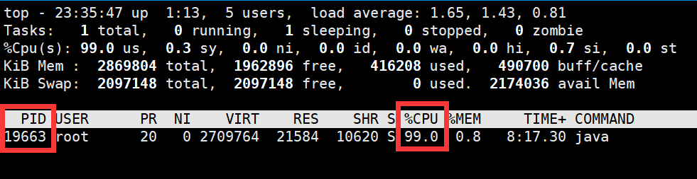
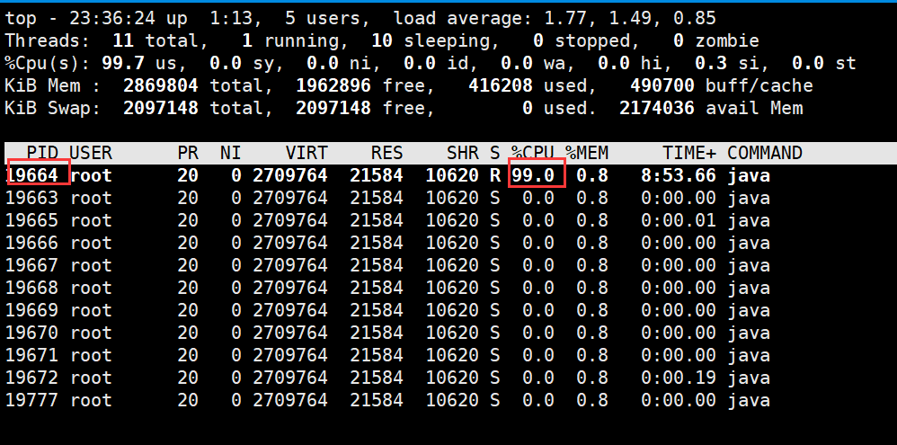
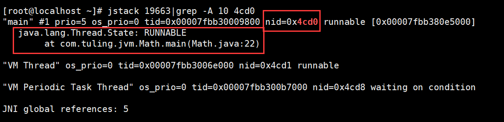

# Java 线上问题排查手册

线上出问题时，最让人紧张的往往不是不会敲命令，而是不知道该先看哪里。本文把 Java 服务最常见的线上问题，按 CPU、内存、线程、数据库、网络、日志六类整理成册，每个问题都按**"现象 → 怎么定位 → 怎么解决 → 怎么预防"**四步展开，命令都标注了用途和容易看错的地方。

读者假设：有 1 年左右 Java 经验，会写 CRUD，还没独立处理过线上故障。文中所有命令以 Linux 与 JDK 17、MySQL 8.0 为基准；涉及版本差异的地方会单独注明，例如 JDK 8 与 JDK 9+ 的 GC 日志参数就完全不同。

## 本文导读

下面按章节列出内容与用途，可以按需跳读。

- **第一章 排查方法论**：通用套路——五个固定动作、标准排查流程、大规模故障应急、偶发问题跟踪。
- **第二章 典型排查场景速查表**：出故障时先查表，按现象找到第一个该敲的命令；并列出工具输出中最容易读错的字段。
- **第三章 CPU 飙高**：从 `top` 到 `jstack`，最终定位到具体代码行。
- **第四章 JVM 内存与 GC**：OOM 六步排查、频繁 Full GC、大文件导入导出、堆转储与 GC 日志的正确用法。
- **第五章 Java 进程突然退出**：进程"无缘无故"消失时的检查顺序。
- **第六章 线程与并发**：线程栈怎么读、死锁怎么定位、高并发下的数据不一致怎么查。
- **第七章 数据库**：连接池爆满、慢 SQL、MySQL 死锁。
- **第八章 服务间调用超时**：定位思路与六类治理措施。
- **第九章 系统与接口变慢**：分层排查顺序与网络层命令。
- **第十章 日志、监控与告警**：大量错误日志的收敛办法。
- **附录**：常见术语与默认值速查。

读法建议：第一次读按顺序通读，建立框架；真正出故障时直接跳到第二章查表，再回到对应章节看细节。

## 一、排查方法论：先想清楚，再敲命令

线上排查最大的浪费不是命令敲错，而是**方向错了**——花两小时查数据库，最后发现是磁盘写满。本章先建立一套通用套路，后面每个具体问题都是这套套路的实例。

### 1.1 五个固定动作

排查故障和医生看病很像：先问症状（现象），再做检查（收集证据），然后对症下药（处置），最后给出生活方式建议（预防）。把这套流程固定成五个动作，可以避免慌乱中漏掉关键步骤。

| 动作 | 要回答的问题 | 产出物 |
| --- | --- | --- |
| 1. 确认现象 | 到底"不正常"在哪？响应慢、报错、还是数据错？ | 一句话的问题描述 + 首次发生时间 |
| 2. 划定影响面 | 全量用户还是部分用户？单机还是全集群？ | 影响范围、严重级别 |
| 3. 收集证据 | 日志、监控、线程栈、堆转储、慢查询 | 可回溯的原始数据 |
| 4. 定位与处置 | 根因是什么？先止血还是先修复？ | 处置动作 + 验证结果 |
| 5. 复盘与预防 | 同类问题怎么不再发生？ | 改进项、监控项、文档 |

其中第 3 步最关键：**证据必须在现场收集**。进程重启、日志滚动、连接断开之后，很多信息就永久丢失了。所以看到异常的第一反应应该是"先留证据"，而不是"先重启试试"。

### 1.2 标准排查流程

下面这套流程适合大部分线上问题，可以按顺序走，也可以根据现象直接跳到某一环。核心原则是：**先看整体，再看局部；先排除环境，再怀疑代码**。

| 阶段 | 做什么 | 常用手段 |
| --- | --- | --- |
| 问题确认与信息收集 | 明确表现（响应慢／不可用／数据异常）、影响范围、发生时间（持续还是间歇）、环境信息（服务器配置、JDK 版本、应用版本） | 用户反馈、监控面板、变更记录 |
| 快速响应 | 评估严重程度；严重时先降级、限流或回滚版本 | 预案、开关、发布系统 |
| 日志分析 | 应用日志查异常堆栈；系统日志（`/var/log/messages`、`/var/log/syslog`）查内核与 OOM 记录；中间件日志查数据库、缓存、消息队列 | `grep`、ELK |
| 监控数据分析 | 系统层（CPU、内存、磁盘 I/O、网络）、JVM 层（GC 日志、堆使用、线程数）、应用层（响应时间、吞吐量、错误率） | Prometheus、Grafana、APM |
| 网络分析 | 防火墙与端口开放情况、网络延迟与丢包率 | `ping`、`ss`、`traceroute` |
| 数据库分析 | 慢查询日志、连接数与锁等待、关键 SQL 的执行计划 | 慢日志、`SHOW PROCESSLIST`、`EXPLAIN` |
| 代码级分析 | 线程转储看线程状态、堆转储看内存、回顾最近的代码变更 | `jstack`、`jmap`、代码 diff |
| 性能剖析 | 用 Arthas、JProfiler 等做 CPU 与内存热点分析；用 Prometheus、Grafana、SkyWalking 做全链路跟踪 | 采样剖析、链路追踪 |
| 复现问题 | 在测试环境复现，尽量模拟生产的流量与数据量 | 压测工具 |
| 根因分析 | 基于全部证据给出根因，而不是"最像的那个原因" | 5 Why、时间线对齐 |
| 解决方案 | 短期方案快速止血，长期方案消除根因 | 修复单、优化项 |
| 验证与监控 | 测试环境验证 → 灰度上线 → 持续观察指标 | 回归测试、监控对比 |
| 复盘与总结 | 写清问题报告，沉淀经验，更新文档与最佳实践 | 复盘会、知识库 |

**案例**：某 Java 应用响应时间从 200ms 涨到 2000ms。

1. 问题确认：接口 P99 从 200ms 升到 2000ms，影响全部用户。
2. 日志分析：应用日志里出现大量 GC 警告。
3. 监控数据：JVM 监控显示老年代使用率高、Full GC 频繁。
4. 线程分析：线程转储显示多个线程卡在等待数据库连接。
5. 数据库分析：连接池耗尽，同时存在大量慢查询。
6. 代码审查：最近的变更中，一处数据库连接没有正确释放。
7. 根因：连接未释放 → 连接池耗尽 → 请求排队等待 → 对象在内存中堆积 → Full GC 频繁。
8. 解决方案：修复连接释放的 bug、优化相关 SQL、适当增大连接池。
9. 验证与监控：修复后响应时间恢复正常，GC 频率明显下降。

这个案例的启示是：**一个"慢"字背后往往是链条，不是单点**。只看 GC 日志会误判成内存问题，只有把线程栈和连接池数据对起来，才看得到真正的起点。

### 1.3 大规模故障：先止血，再治病

大规模故障指影响核心业务、短时间内无法靠修代码解决的事件（例如支付大面积失败）。此时的目标不是"找到根因"，而是**尽快恢复服务，把损失控制住**。根因分析放到恢复之后。

1. **紧急响应**：召集技术、运营等相关团队的核心成员；通过内部渠道（IM、邮件、电话）通报状况，并暂停一切与故障无关的变更操作；按公司应急预案启动响应机制。
2. **故障隔离**：快速识别并隔离故障区域或模块，防止蔓延；必要时临时停用受影响的服务。
3. **信息收集与初步分析**：收集系统日志、错误日志和监控数据；结合用户反馈判断症状与影响范围；检查近期的代码与配置变更。
4. **制定恢复计划**：制定可快速实施的短期方案，优先恢复核心功能；与业务方沟通方案并取得必要授权。
5. **逐步恢复服务**：分阶段恢复，优先高优先级服务；恢复过程中实时观察性能与稳定性；适时通知用户进展和预计恢复时间。
6. **监控与验证**：恢复后继续密切监控性能、资源与错误日志；逐项验证功能是否正常、是否达到预期性能标准。
7. **全面复盘与改善**：开复盘会，分析原因与响应过程中的问题；针对性优化系统，更新应急预案；补充监控、备份与冗余策略。

**案例**：某电商平台大面积支付失败。

1. 紧急响应：召集支付、数据库、网络团队；通报问题并暂停新的支付请求。
2. 故障隔离：隔离支付系统的故障模块，避免影响订单处理。
3. 信息收集：分析支付网关日志，发现与第三方支付服务连接异常，初步判断为网络或第三方问题。
4. 恢复计划：尝试重建与第三方的连接，同时与第三服务商确认服务状态。
5. 逐步恢复：连接恢复后分批次开放支付功能，观察成功率，稳定后通知用户。
6. 监控验证：持续观察支付服务，并确认相关交易模块正常。
7. 复盘改善：确认网络条件为主要原因，调整负载均衡与路由策略；在应急手册中补充与第三方沟通的指引。

### 1.4 偶发问题：把"偶发"变成"可复现"

偶发问题（一天出现几次、无法稳定重现）最消耗精力。处理它的关键不是"猜"，而是**持续加证据，直到能复现**。

1. **问题识别**：记录发生时间、频率、涉及模块与用户反馈；描述清楚症状（错误信息、错误码、影响人群）。
2. **日志收集与分析**：确保问题模块有足够的日志（入参、关键分支、耗时）；用 ELK、Splunk 等集中查看异常前后的日志；对日志做聚类，找共同特征。
3. **监控与预警**：为该模块设置关键指标（响应时间、错误率）；配置阈值告警；用 Jaeger、Zipkin 等分布式追踪工具还原单个请求的完整路径。
4. **回溯分析**：检查问题发生前后的代码、配置、基础设施变更，找潜在关联；确认服务器、网络、数据库没有资源瓶颈。
5. **重现问题**：根据日志提炼固定的重现步骤；在测试环境按步骤验证，尽量模拟生产的流量与数据量。
6. **根因分析**：借助调试与分析工具对代码行为做细粒度观察；必要时召集相关开发、运维一起讨论，换视角看问题。
7. **制定解决方案**：先有临时措施缓解影响，根因明确后再制定彻底修复计划（可能涉及代码、架构或配置调整）。
8. **实施和验证**：在受控条件下实施；对改动功能做回归测试；阶段性收集用户反馈确认已解决。
9. **监控和跟踪**：修复后持续观察相关指标防止反弹；建立跟踪文档，记录现象、分析过程与结论。
10. **复盘与经验总结**：团队复盘原因与应对过程；提出监控、日志、告警方面的改进；把结论分享给更广的团队。

一句话总结：**偶发问题的解法是"提高观测密度"，而不是"多加日志打印"**——先想清楚要验证哪个假设，再决定打什么日志。

## 二、典型排查场景速查表

本章是"急诊分诊台"：先用现象找到方向，再进对应章节。第二节列出的是**最容易被读错的字段**，很多误判都源于把字段含义记成了另一回事。

### 2.1 现象 → 第一步查什么

| 现象 | 第一个该敲的命令 | 看什么 | 详见 |
| --- | --- | --- | --- |
| 接口整体变慢 | `top`、`vmstat 1` | CPU 是否打满、`r` 队列是否堆积、`si/so` 是否在用 swap | 第九章 |
| 单接口变慢，其他正常 | APM 链路追踪 + 应用日志耗时 | 慢在哪一段：DB、外部调用、还是本地计算 | 9.3 |
| CPU 使用率飙高 | `top` → `top -Hp <pid>` → `printf "%x" <tid>` → `jstack` | 哪个线程在跑、栈顶方法是什么 | 第三章 |
| 内存持续上涨 | `jstat -gcutil <pid> 1000` | 老年代是否只涨不降、Full GC 后是否回落 | 第四章 |
| 报 `OutOfMemoryError` | 看异常类型 + 堆转储文件 | `Java heap space` / `Metaspace` / `GC overhead limit exceeded` | 4.1 |
| Full GC 频繁 | GC 日志 + `jstat` | Full GC 间隔、单次耗时、回收后老年代占用 | 4.3 |
| 请求"卡住"没响应 | `jstack <pid>` | 线程是否大量 `BLOCKED`、是否有 `Found one Java-level deadlock` | 第六章 |
| 进程突然消失 | `dmesg -T`、`/var/log/messages` | 是否被 OOM Killer 杀掉、是否收到信号 | 第五章 |
| 数据库连接拿不到 | `SHOW PROCESSLIST`、连接池指标 | 活跃连接数、`Sleep` 连接是否占满配额、是否有长事务 | 7.1 |
| 某个 SQL 特别慢 | 慢查询日志、`EXPLAIN` | `Query_time`、`Rows_examined`、是否全表扫描 | 7.2 |
| 更新同一行报死锁 | `SHOW ENGINE INNODB STATUS` | `LATEST DETECTED DEADLOCK` 段 | 7.3 |
| 调用下游超时 | 抓包 + 下游监控 | 是网络超时、下游慢、还是连接池被占满 | 第八章 |
| 日志量暴涨 | 日志按异常类型聚合 | 是否是同一异常刷屏、是否有重试风暴 | 第十章 |

### 2.2 工具输出字段：含义与常见误读

> 这一节是全篇最值得先看的部分。很多"排查半天没结论"，是因为一开始就读错了字段。

| 命令 / 字段 | 真实含义 | 常见误读 |
| --- | --- | --- |
| `top` 的 `%CPU` | 默认（Irix 模式）按**单个核**计算，多线程进程可能显示超过 100% | 以为超过 100% 说明程序异常；实际 400% 约等于占满 4 个核 |
| `top -Hp <pid>` 的 `PID` 列 | 线程 ID（十进制） | 直接拿这个十进制数去 `jstack` 输出里搜；`jstack` 里的 `nid` 是**十六进制**，必须先转换 |
| `vmstat` 的 `free` 列 | 完全空闲的物理内存页，**不含** `buff/cache` | 看到 `free` 很小就判断内存不足；Linux 会主动用空闲内存做页缓存，应看 `free -h` 的 `available` 列 |
| `vmstat` 的 `r` / `b` 列 | 可运行进程数 / 因 I/O 阻塞的进程数 | 只看 CPU 使用率不看排队长度；`r` 长期大于核数说明 CPU 已经排队 |
| `vmstat` 的 `si` / `so` 列 | 每秒换入 / 换出到 swap 的内存量 | 认为"有 swap 也没关系"；`si/so` 持续非 0 时性能会断崖式下降 |
| `free` 的 `free` 与 `available` | `free` 是未使用内存；`available` 是**估计可分配给新进程**的内存量（已计入可回收的页缓存） | 用 `free` 判断"内存不足"；判断是否吃紧应看 `available` |
| `iostat` 的 `await` | 单个 I/O 的平均耗时（毫秒），**包含排队时间** | 以为 `await` 只反映磁盘本身的速度；它高说明"排队 + 处理"整体慢 |
| `iostat` 的 `%util` | 设备有 I/O 在处理的**时间占比** | 认为 `%util` 接近 100% 就一定是磁盘瓶颈；对 RAID、SSD 这类可并行处理的设备，该数值不能反映真实性能上限 |
| `iostat` 的第一屏输出 | 自开机以来的平均值 | 直接拿它判断"当前"磁盘压力；应加 `-y` 跳过，或指定采样间隔 |
| `ss -s` 的 `TIME-WAIT` | 主动关闭连接后保留一段时间的状态，属正常的 TCP 机制 | 见到大量 `TIME-WAIT` 就认为"连接泄漏"；除非本地端口接近耗尽 |
| `SHOW PROCESSLIST` 的 `Time` | 线程**停留在当前状态**的秒数，不是这条语句的总耗时 | 把 `Time` 当"SQL 执行了多久"；要看真实执行时间应看慢查询日志的 `Query_time` |
| `SHOW PROCESSLIST` 的 `Command` | `Sleep` 表示会话空闲、但**连接仍然占着** | 只统计"正在执行"的连接，忽略大量 `Sleep` 连接同样会把 `max_connections` 用满 |
| `SHOW PROCESSLIST` 的 `Info` | 不带 `FULL` 时只显示语句前 100 个字符 | 以为看到的就是完整 SQL；排查长语句要用 `SHOW FULL PROCESSLIST` |
| `EXPLAIN` 输出 | 优化器给出的**估算**：访问类型、预估扫描行数（`rows`） | 以为 `EXPLAIN` 会显示每条操作的耗时；它不报时间，要看实际耗时用 `EXPLAIN ANALYZE`（MySQL 8.0.18+）或慢查询日志 |
| 慢查询日志的 `Query_time` | 语句执行时间，**不含**获取初始锁的时间；等锁另记在 `Lock_time` | 把 `Query_time` 与"用户感知耗时"直接对比，忽略排队与取锁时间 |
| GC 日志的 `200M->175M(260M)` | 回收前占用 → 回收后占用（堆总容量） | 只看"回收后还剩多少"，不看"这次到底回收掉多少"；Full GC 前后几乎不变才说明真泄漏 |
| GC 日志的 `Times: user=10.23 ... real=3.23` | `user` 是各 GC 线程 CPU 时间之和，`real` 是墙钟时间 | 以为 `user` 大于 `real` 是数据错误；并行回收时这是正常现象 |

### 2.3 常用命令清单

```bash
# 1. 系统整体：谁在吃 CPU、内存够不够、swap 有没有在用
top
vmstat 1 5            # 每秒采样 1 次，共 5 次；关注 r、free、si、so、wa
free -h               # 看 available 列，而不是 free 列
df -h                 # 磁盘空间；df -i 看 inode

# 2. 磁盘 I/O
iostat -x 1 5         # -x 扩展信息，1 秒一次；关注 await、aqu-sz、%util

# 3. JVM
jps -l                          # 当前用户的 Java 进程
jstat -gcutil <pid> 1000 10     # 每 1 秒打印一次 GC 统计，共 10 次
jstack -l <pid> > td.txt        # 线程栈（-l 附带锁信息）
jcmd <pid> Thread.print > td.txt  # 等价写法，JDK 8+ 推荐
jmap -dump:format=b,file=heap.hprof <pid>   # 堆转储，pid 不能漏
jcmd <pid> GC.heap_dump /path/heap.hprof    # 等价写法

# 4. 网络
ss -s                            # 各状态 socket 数量概览
ss -tnp state established        # 已建立连接及对应进程
ss -ltnp                         # 监听端口
netstat -anp 2>/dev/null | head  # 老系统可能只有 netstat

# 5. 内核与进程死亡线索
dmesg -T | tail -50              # -T 显示可读时间；查 OOM Killer 记录
```

> 注意：`jstack`、`jmap` 这类工具在 JDK 中标注为"实验性/不受支持"，不同发行版行为可能有差异；容器环境下要确保与业务进程使用**同一个 JDK**，否则可能附加失败。

## 三、CPU 飙高：从进程一路定位到代码行

CPU 飙高是最好定位的一类问题，因为它有唯一确定的线索——**线程**。只要把"哪个线程在跑"对应到"代码的哪一行"，问题基本就解决了一半。

### 3.1 现象：怎么判断 CPU 真的高

- 应用监控或系统监控出现 CPU 使用率告警，通常是持续几分钟以上。
- 接口变慢、吞吐下降，但内存、磁盘、数据库看起来都正常。
- `top` 里某个 Java 进程长期占满单核或多核。

需要先排除一种假象：**`%CPU` 超过 100% 不等于异常**。`top` 默认按单核计算，8 核机器上一个多线程进程跑到 400%，只是占满了 4 个核。

### 3.2 怎么定位：五步找到那行代码

**第 1 步：确定是哪个进程**

用 `top` 找出占用 CPU 较高的 Java 进程，记下 PID。

```bash
top
```

（按 `P` 可以强制按 CPU 排序；容器里可以在 `top` 内按 `c` 显示完整命令行，避免认错进程。）



**第 2 步：确定是哪个线程**

用 `top -Hp <pid>` 查看该进程内各线程的 CPU 占用，记下占用最高的线程 ID（这一列是**十进制**）。

```bash
top -Hp <pid>
```



**第 3 步：把线程 ID 转成十六进制**

`jstack` 输出里的线程标识 `nid` 是十六进制，所以必须先转换。例如线程 ID `19664` 对应 `0x4cd0`。

```bash
printf "%x\n" 19664
```

**第 4 步：抓线程栈，找到对应线程**

```bash
# 取 nid=0x4cd0 那个线程所在位置及其后 20 行，从中可以看到导致 CPU 飙高的调用链
jstack 19663 | grep -A 20 "nid=0x4cd0"
```

> 小技巧：如果 `jstack` 输出量大、一次抓不准，可以连续抓 3 次（间隔几秒），**在多次快照中都出现在栈顶的方法**才是真正的热点。



**第 5 步：读栈，回到代码**

从栈顶往下看，第一个属于你业务包名的方法，就是"正在干活"的位置。栈的结构是"下面调用上面"，所以越靠上越接近当前执行点。

### 3.3 常见成因

**死循环**：最常见，特征是单线程 100%，栈顶固定在某一行不变化。

```java
while (true) {
    // 耗 CPU 的操作
}
```

**频繁 GC**：多个线程都在做 GC 相关工作，栈里会出现 `GCTaskThread`、`VM Thread` 等；用 `jstat -gcutil` 可确认。

```java
List<Object> list = new ArrayList<>();
while (true) {
    list.add(new Object());
    if (list.size() > 10000) {
        list.clear();
    }
}
```

**锁竞争（自旋）**：加锁顺序不一致或锁粒度过大，线程反复自旋重试，CPU 高但业务吞吐低。

```java
public class BadSynchronization {
    private static final Object lock1 = new Object();
    private static final Object lock2 = new Object();

    public static void method1() {
        synchronized (lock1) {
            synchronized (lock2) {
                // 操作
            }
        }
    }

    public static void method2() {
        synchronized (lock2) {
            synchronized (lock1) {
                // 操作
            }
        }
    }
}
```

**密集计算**：算法复杂度太高，例如朴素递归求斐波那契，n 稍大就会指数级膨胀。

```java
public long fibonacci(long n) {
    if (n < 2) return n;
    return fibonacci(n - 1) + fibonacci(n - 2);
}
```

### 3.4 怎么解决

- 死循环：补退出条件；`while(true)` 改成带超时或带中断检查的循环。
- 频繁 GC：按第四章的方法处理内存问题（先看是不是对象分配速率过高）。
- 锁竞争：统一加锁顺序、缩小临界区，或改用 `java.util.concurrent` 下的并发容器。
- 密集计算：优化算法、加缓存、把大任务拆分或异步化。

### 3.5 怎么预防

- 关键接口压测时同时观察 CPU 曲线与线程栈，提前发现热点。
- 给 CPU 使用率设置分级告警（例如 5 分钟均值 > 70% 提醒，> 90% 升级）。
- 代码评审时重点关注：无界循环、递归无基准条件、锁内做耗时操作。

### 3.6 进阶了解（可跳过）

初学可以略过本节。若需要更系统地定位热点，可用 JDK 自带的 Java Flight Recorder（JFR，低开销的运行时采样工具）录制一段时间的执行情况，再用 JDK Mission Control（JMC）打开分析；也可以在测试环境用 Arthas 的 `profiler` 命令生成火焰图。这类采样工具的价值在于**按方法统计 CPU 时间占比**，比单次线程快照更全面。

## 四、JVM 内存与 GC

内存类问题的共同点是"不会立刻报错，而是越来越慢，最后突然崩"。本章覆盖四种典型形态：OOM、频繁 Full GC、大文件导入导出撑爆内存，以及支撑这些分析的堆转储与 GC 日志本身怎么用对。

先建立一个比喻：**堆（Heap）就像一间办公室，GC 是定时打扫的保洁**。你不断往房间里堆东西（创建对象），保洁只清理"已经没人认领"的物品（不可达对象）。如果每样东西都还有人抓着不放，房间迟早会被塞满——这就是内存泄漏。

### 4.1 OOM 问题如何排查

OOM（`OutOfMemoryError`，内存溢出错误）表示 JVM 已经无法再分配所需内存，通常由内存泄漏或内存配置不足导致。

#### 第 1 步：确认 OOM 的类型

| 异常信息 | 含义 | 常见原因 |
| --- | --- | --- |
| `java.lang.OutOfMemoryError: Java heap space` | 堆内存不足 | 大对象、集合无限增长、缓存无上限、一次加载过多数据 |
| `java.lang.OutOfMemoryError: Metaspace` | 元空间（存放类元数据的区域）不足，JDK 8 及以上 | 动态生成类过多（反射、字节码增强、热部署不清理） |
| `java.lang.OutOfMemoryError: GC overhead limit exceeded` | 花在 GC 上的时间过多却回收不出空间 | 堆几乎被存活对象占满，属于"内存泄漏的晚期症状" |

关于第三种，官方给出的判定条件是：**超过 98% 的时间在做 GC，却只回收出不到 2% 的堆空间**。可以用 `-XX:-UseGCOverheadLimit` 关掉这个保护，但那只是让程序多撑一会儿，不解决根因。

#### 第 2 步：提前埋好"黑匣子"

OOM 发生时进程可能直接退出，所以必须在启动参数里预先配置自动转储：

```bash
# JDK 9+ 写法：统一日志 + OOM 时自动 dump
java -XX:+HeapDumpOnOutOfMemoryError \
     -XX:HeapDumpPath=/path/to/dump \
     -Xlog:gc*:file=gc.log:time \
     -jar your-application.jar
```

```bash
# JDK 8 写法（旧参数，JDK 9 起被统一日志取代）
java -XX:+HeapDumpOnOutOfMemoryError -XX:HeapDumpPath=/path/to/dump \
     -XX:+PrintGCDetails -XX:+PrintGCDateStamps -Xloggc:/path/to/gc.log \
     -jar your-application.jar
```

三步取证：**错误日志**（确认异常类型与发生时间）、**堆转储**（分析是谁占了内存）、**GC 日志**（看内存是缓慢上涨还是瞬间打满）。

#### 第 3 步：分析堆转储

常用工具是 Eclipse Memory Analyzer（MAT）。基本操作：

1. 打开堆转储文件（`.hprof`）。
2. 看 **Histogram** 视图，按对象类型排序，找出实例数与占用内存最大的类型。
3. 看 **Leak Suspects Report**，让工具自动给出可疑的泄漏点。
4. 用 **Dominator Tree** 看"谁持有谁"，顺着引用链找到业务代码。

例如通过 MAT 发现 `java.util.ArrayList` 的实例占用了大量内存，再顺着引用链查到它被一个静态字段持有，就锁定了问题代码。

#### 第 4 步：识别问题代码

- **大对象集合**：`List`、`Map` 等容器无上限增长。
- **长生命周期对象**：本该短命的请求对象被静态字段、缓存、`ThreadLocal` 长期持有。

常见场景：自定义缓存没有过期或清理机制；把每次请求的数据都塞进一个全局集合；`ThreadLocal` 用完不 `remove()`。

#### 第 5 步：修复代码

问题代码：

```java
List<Object> largeList = new ArrayList<>();

public void processData(List<Object> data) {
    largeList.addAll(data); // 无限制增长
}
```

修复后（有界 + 清理）：

```java
private static final int MAX_SIZE = 10000;

public void processData(List<Object> data) {
    if (largeList.size() + data.size() > MAX_SIZE) {
        largeList.clear(); // 清理，避免无限增长
    }
    largeList.addAll(data);
}
```

如果确认是"应用确实需要更多内存"，再考虑调大堆：

```text
-Xmx4g -Xms2g
```

调大之前先想清楚：**内存泄漏的问题调大堆只是延后爆炸时间**，而且会拉长单次 Full GC 的停顿。

#### 第 6 步：验证与监控

- 用接近生产的负载压测，确认修复后内存曲线平稳、不再持续上涨。
- 持续监控堆使用率、GC 频率，并设置告警阈值。

### 4.2 完整案例：高负载下堆内存溢出

**场景**：一个 Java Web 应用在压测中抛出 `java.lang.OutOfMemoryError: Java heap space`。

1. 配置 JVM 参数以捕捉现场：

```bash
java -XX:+HeapDumpOnOutOfMemoryError -XX:HeapDumpPath=/path/to/dump \
     -Xlog:gc*:file=gc.log:time -jar app.jar
```

2. 收集 OOM 发生时的堆转储文件。
3. 用 MAT 打开：Histogram 中 Session 对象占用大量内存；在 Dominator Tree 中确认这些 Session 被一个全局 Map 持有。
4. 问题定位：自定义 Session 管理模块没有正确释放过期 Session，永不过期的 Session 逐步耗尽内存。
5. 修复：实现超时机制，定期或每次请求后清理过期 Session。

```java
public void cleanupSessions() {
    sessions.entrySet().removeIf(entry -> entry.getValue().isExpired());
}
```

6. 配置与验证：把堆从 `-Xmx512m` 调到 `-Xmx1g`，再跑压测确认内存稳定。
7. 监控与告警：配置堆使用率与 GC 频率告警。

结论：**"加内存"是缓解，"清理过期对象"才是修复**。两者可以同时做，但不要只做前者。

### 4.3 频繁 Full GC 问题如何排查

Full GC 会暂停所有应用线程（Stop-The-World），频繁发生就意味着应用在"反复停摆"。判断标准不是"Full GC 次数多"，而是**回收后老年代占用是否降得下来**。

#### 第 1 步：开启并收集 GC 日志

```bash
# JDK 9+：统一日志，带时间戳写入文件
-Xlog:gc*:file=/path/to/gc.log:time,uptime,level,tags
```

```bash
# JDK 8：旧参数（JDK 17 上 -XX:+PrintGCDateStamps 已不被识别，不要再照抄）
-XX:+PrintGCDetails -XX:+PrintGCDateStamps -Xloggc:/path/to/gc.log
```

#### 第 2 步：分析 GC 日志

用 GCViewer 等工具打开日志，重点看三个数字：**Full GC 的频率**、**单次耗时**、**回收后老年代占用**。

示例（JDK 8 Parallel GC 的输出格式）：

```text
2023-05-15T14:30:45.123+0800: [Full GC (Ergonomics) [PSYoungGen: 20M->0M(60M)] [ParOldGen: 180M->175M(200M)] 200M->175M(260M), [Metaspace: 30M->30M(1024M)], 3.2345678 secs] [Times: user=10.23 sys=0.25, real=3.23 secs]
```

这段日志的读法：

- `PSYoungGen: 20M->0M(60M)`：新生代回收前 20M，回收后 0M，容量 60M。
- `ParOldGen: 180M->175M(200M)`：老年代回收前 180M，回收后 175M——**几乎没回收掉**，这是典型的"存活对象占满老年代"。
- `200M->175M(260M)`：整个堆从 200M 降到 175M，总容量 260M。
- `3.2345678 secs` + `Times: user=10.23 ... real=3.23`：墙钟耗时约 3.2 秒；`user` 是各 GC 线程的 CPU 时间之和，并行回收时大于 `real` 属正常。

本例中的现象：Full GC 约每 10 分钟一次，每次约 3 秒，回收后老年代仍在 80% 以上。

#### 第 3 步：实时观察内存分布

用 VisualVM 或 JConsole 连接进程，观察：

- Eden 区：频繁填满后触发 Minor GC（新生代回收）。
- Survivor 区：经常接近满载。
- 老年代：持续增长，Full GC 后也难以下降。

#### 第 4 步：分析堆内存

```bash
# 注意：末尾的 pid 不能漏，否则 jmap 只会打印用法
jmap -dump:format=b,file=heap_dump.hprof <pid>
```

用 MAT 分析后发现有大量 `com.example.Order` 对象长期占据老年代，且都是历史订单数据。

#### 第 5 步：定位代码

```java
public class OrderService {
    private static final List<Order> allOrders = new ArrayList<>();

    public void processOrder(Order order) {
        // 处理订单
        allOrders.add(order);  // 问题所在：持续添加订单到静态列表
    }
}
```

#### 第 6 步：临时缓解

```text
-Xms4g -Xmx4g -XX:NewRatio=2 -XX:SurvivorRatio=8
```

说明：`-Xms` 与 `-Xmx` 设成一样可以避免堆反复伸缩；`NewRatio=2` 表示老年代:新生代 = 2:1；`SurvivorRatio=8` 表示 Eden 与单个 Survivor 的比例为 8:1。**注意这两项在多数服务端默认值下本就如此**，改动前先用 `java -XX:+PrintFlagsFinal -version | grep -E "NewRatio|SurvivorRatio"` 确认实际生效值，否则容易"调了个寂寞"。

#### 第 7 步：优化代码

```java
public class OrderService {
    private static final int MAX_ORDERS = 10000;
    private static final Queue<Order> recentOrders = new LinkedList<>();

    public void processOrder(Order order) {
        recentOrders.offer(order);
        if (recentOrders.size() > MAX_ORDERS) {
            recentOrders.poll();  // 移除最旧的订单
        }
    }
}
```

同时增加定时任务，把已处理的订单落库并从内存中清除。

#### 第 8 步：验证改进

重新部署后观察 GC 日志与内存曲线，并做负载测试。示例中的改善结果：Full GC 降到每小时 1~2 次、单次耗时 1 秒以内、老年代稳定在 60% 左右（具体数字取决于应用特征，仅供参考）。

小结：**先看 GC 日志定性，再用堆转储定量**。如果 Full GC 后老年代能降到合理水位，问题在"分配太快"；如果降不下来，问题在"有人一直持有"。

### 4.4 文件导入导出导致 OOM 如何排查

处理大文件时，如果把整个文件内容读进内存，堆再大也可能被撑爆。

#### 第 1 步：确认内存溢出

- 应用日志中出现 `java.lang.OutOfMemoryError: Java heap space`。
- 用 JConsole、VisualVM 观察，内存曲线在导入开始时陡升。

#### 第 2 步：拿到堆转储

```bash
java -XX:+HeapDumpOnOutOfMemoryError -XX:HeapDumpPath=/path/to/dumpfile \
     -jar your-application.jar
```

用 MAT 或 JVisualVM 打开，找到占用最多的对象类型。

#### 第 3 步：检查代码

```java
public void importData(File file) throws IOException {
    BufferedReader reader = new BufferedReader(new FileReader(file));
    String line;
    List<String> data = new ArrayList<>();
    while ((line = reader.readLine()) != null) {
        data.add(line); // 将整个文件内容加载到内存
    }
    process(data);
    reader.close();
}
```

问题很清楚：文件有多大，内存占用就有多大（还要乘上字符串对象本身的开销）。

#### 第 4 步：优化代码

四条思路：

1. **逐行处理**：读一行处理一行，不保留全量数据。
2. **选择紧凑的数据结构**：必须暂存时，用数组或更紧凑的结构，而不是 `List<String>`。
3. **流式处理**：用 Java 8 的 Stream 做管道式处理（注意流式不等于不占内存，关键还是不要收集全量结果）。
4. **外部暂存**：中间结果写临时文件或数据库，处理完再汇总。

优化后：

```java
public void importData(File file) throws IOException {
    try (BufferedReader reader = new BufferedReader(new FileReader(file))) {
        String line;
        while ((line = reader.readLine()) != null) {
            processLine(line); // 逐行处理
        }
    }
}

private void processLine(String line) {
    // 处理每一行数据
}
```

#### 第 5 步：JVM 与系统配置

- 在评估硬件条件后适度增加堆：

```text
-Xmx4096m   # 最大堆调整为 4GB
```

- 根据应用特征调整垃圾回收器参数（见 4.6）。

#### 第 6 步：验证与上线

- 用更大的文件在测试环境验证，观察内存是否保持平稳（而不是"能跑完就行"）。
- 上线后用 APM 与 JVM 监控跟踪内存曲线。

#### 案例回顾

某应用导入大 CSV 时 OOM：

1. 日志确认 OOM 类型为 `Java heap space`。
2. 用 `jmap` 生成堆转储，MAT 分析显示 `java.util.ArrayList` 占用最多。
3. 确认所有文件内容都被加进了这个集合。
4. 改为逐行处理。
5. 同时把 `-Xmx` 调大（作为缓冲，不作为唯一手段）。
6. 用不同大小的文件测试，确认内存稳定。
7. 上线并配置内存与 GC 告警。

小结：**大文件处理的第一原则是"不要一次性加载"**；第二原则是"如果必须暂存，就要有上限和清理"。

### 4.5 堆转储与 GC 日志：工具用法的几个坑

这一节是"操作细节"，但踩坑率极高，单独列出来。

**（1）`jmap` 必须带 pid**

```bash
# 正确：末尾是进程号
jmap -dump:format=b,file=heap.hprof 12345

# 只导出存活对象（会触发一次 Full GC，线上慎用）
jmap -dump:live,format=b,file=heap.hprof 12345
```

漏掉 pid 时，`jmap` 只会打印用法说明，不会有任何转储文件产生——这个"什么都没发生"很容易被误判成"工具坏了"。

**（2）JDK 9+ 推荐用 `jcmd`**

```bash
jcmd <pid> GC.heap_dump /path/heap.hprof   # 生成堆转储
jcmd <pid> Thread.print > td.txt           # 线程栈，等价于 jstack
jcmd <pid> GC.class_histogram              # 类直方图，快速看谁占内存
```

`jcmd` 是 JDK 7 起提供的统一命令入口，比 `jmap`、`jstack` 更稳定，容器中兼容性也更好。

**（3）GC 日志格式有代际差异**

同一件事，两种写法：

| 场景 | JDK 8 及以前 | JDK 9 及以上（统一日志） |
| --- | --- | --- |
| 打开 GC 日志 | `-XX:+PrintGCDetails -Xloggc:gc.log` | `-Xlog:gc*:file=gc.log:time,uptime,level,tags` |
| 加时间戳 | `-XX:+PrintGCDateStamps` | 装饰器 `time` |
| 动态修改日志级别 | 不支持 | `jcmd <pid> VM.log output=... ` |

需要注意的兼容问题：`-XX:+PrintGCDateStamps` 在 JDK 17 上已经**不被识别**，启动会直接失败（`Unrecognized VM option`）；`-XX:+PrintGCDetails`、`-Xloggc` 虽仍可用，但会打印"已废弃，将改用 -Xlog"的警告。所以抄参数前先确认目标 JDK 版本。

JDK 9+ 的真实输出长这样（JDK 17 + G1，实测样例）：

```text
[2026-11-18T16:04:12.330+0800][0.021s][info][gc,start    ] GC(0) Pause Young (Normal) (G1 Evacuation Pause)
[2026-11-18T16:04:12.340+0800][0.031s][info][gc          ] GC(0) Pause Young (Normal) (G1 Evacuation Pause) 21M->21M(190M) 9.813ms
```

读法：`[时间][JVM 启动后秒数][级别][标签]` 是装饰器；`GC(0)` 是第几次回收；`21M->21M(190M)` 是回收前→回收后（堆容量）；`9.813ms` 是这次停顿耗时。因为 G1 是按区域回收，"年轻代"的概念被弱化了，所以看不到 `PSYoungGen`、`ParOldGen` 这类分代字段。

### 4.6 进阶了解（可跳过）

初学可略过。做参数调优前，建议先弄清三个概念：

- **堆的分代**：新生代（Eden + 两个 Survivor）放新对象，老年代放活得久的对象。绝大多数对象"朝生夕死"，所以新生代回收（Minor GC）频繁但很快，老年代回收（Full GC）少见但很慢。
- **堆大小的默认值**：不指定时由 JVM 按物理内存推算，服务端 64 位 JVM 的默认最大堆通常是物理内存的 1/4，未必适合容器环境。容器里务必显式设置 `-Xmx`，并让容器内存限额留出堆外空间（元空间、线程栈、直接内存）。
- **参数是否生效**：用 `-XX:+PrintFlagsFinal` 打印最终生效值，比背默认值可靠。

```bash
java -XX:+PrintFlagsFinal -version | grep -E "MaxHeapSize|NewRatio|SurvivorRatio|UseG1GC"
```

注意：调整堆和回收器属于"最后手段"。线上频繁 Full GC 的绝大多数根因是代码持有对象过多，而不是参数不对。

## 五、Java 进程突然退出

进程"突然没了"是最容易误判的一类问题：日志没有异常、监控只是断线，看起来毫无线索。实际上进程退出无非三种原因——**被 JVM 自己终止（异常）、被操作系统终止（资源）、被人为终止（发布/重启/误杀）**。按这个顺序排查，很快就能收敛。

### 5.1 现象

- 服务不可用，但机器还在，端口不通。
- 日志在某个时间点之后完全停止，没有 shutdown 记录。
- 容器环境里表现为 Pod 重启、退出码非 0。

### 5.2 怎么定位

**第 1 步：看日志**

- 应用日志：搜索异常、`ERROR`、未处理异常。重点关注三类"共性问题"：

| 异常 | 含义 |
| --- | --- |
| `java.lang.OutOfMemoryError` | 内存不足，可能是堆、元空间或线程数超限 |
| `java.lang.StackOverflowError` | 栈溢出，通常是递归缺少终止条件 |
| `java.lang.NoClassDefFoundError` | 运行时找不到类，常见于依赖冲突或打包缺失 |

- 系统日志：`/var/log/messages`、`/var/log/syslog`，以及 `dmesg -T`，看是否有内核层面的记录。

**第 2 步：确认有没有堆转储**

```bash
# 启动时就要配好，事后无法补
-XX:+HeapDumpOnOutOfMemoryError -XX:HeapDumpPath=/path/to/dump
```

有转储文件，说明是 JVM 因内存问题主动退出；没有转储但日志有 OOM，说明转储路径不可写或参数没生效。用 MAT 分析转储，识别占用内存最多的对象。

**第 3 步：检查系统资源**

- CPU：`top` / `htop` 看是否有异常尖峰（进程已死时看历史监控更有价值）。
- 内存：`free -m`（重点看 `available`）或 `vmstat` 看是否有过度消耗。
- 磁盘：`df -h` 看空间是否写满，`df -i` 看 inode 是否耗尽——inode 满同样会导致写日志失败。

**第 4 步：分析代码与依赖**

- 代码审查：最近的变更是否引入了错误。
- 外部库：是否使用了不兼容或有已知漏洞的第三方库。
- 常见场景：未关闭的文件句柄或数据库连接、死锁或线程泄漏导致的资源耗尽。

**第 5 步：检查环境配置**

- JVM 参数：`-Xmx`（最大堆）与 `-Xms`（初始堆）是否合理；容器内存限额是否小于 `-Xmx` 加堆外开销。
- 环境依赖：JDK 版本、操作系统版本与补丁、时区与字符集。

**第 6 步：监控与验证**

- 加强 Prometheus、Grafana 等监控，设置合理的告警阈值。
- 在接近生产的环境验证修复，并用自动化测试覆盖关键场景。

### 5.3 案例：递归没有终止条件

**问题描述**：某 Java Web 应用运行一段时间后进程消失。

**排查过程**：

1. 日志分析：应用日志出现 `java.lang.StackOverflowError`，并伴随反复的递归调用；系统日志没有内存溢出记录，但有 CPU 使用率偏高的记录。
2. 堆转储：已配置 `-XX:+HeapDumpOnOutOfMemoryError`，但没有生成转储文件，可以排除"堆内存不足"。
3. 系统资源：`top` 显示进程 CPU 接近 100%，疑似死循环或无限递归。
4. 代码分析：递归函数缺少退出条件。

```java
public int computeFactorial(int n) {
    // 缺少 n == 0 的退出条件
    return n * computeFactorial(n - 1);
}
```

修复：

```java
public int computeFactorial(int n) {
    if (n == 0) return 1;
    return n * computeFactorial(n - 1);
}
```

5. 环境配置：确认 `-Xms4g -Xmx4g` 与机器内存匹配。
6. 监控验证：在测试环境压测验证，并补充 Grafana 面板与告警。

### 5.4 怎么预防

- 启动参数统一由部署模板管理，避免"某台机器漏配 dump 参数"。
- 对 `dmesg` 中的 OOM Killer 记录做采集和告警（容器环境看容器的退出码 137）。
- 递归、`while(true)`、深层循环这类代码在评审时列为重点检查项。
- 为进程添加优雅停机的 shutdown hook，至少记录一条"我要退出了"的日志，方便区分"被杀"还是"自己退出"。

## 六、线程与并发

线程类问题的共同特征是：**CPU 可能不高、日志可能没报错，但请求就是不动了**。这时候唯一可靠的证据是线程栈（thread dump）——所有线程在某一瞬间的"集体照"。

### 6.1 线程栈怎么读

抓取方式：

```bash
jstack -l <pid> > threaddump.txt    # -l 会附带锁的持有信息
jcmd <pid> Thread.print > threaddump.txt
```

Windows 下可以在控制台按 `Ctrl+Break` 输出到标准输出；IDE（IntelliJ IDEA、Eclipse）的调试面板也能一键导出。

读栈的三个要点：

1. **先看线程状态分布**：`RUNNABLE` 多且都在业务方法上，说明在正常干活；大量 `BLOCKED` 说明抢锁失败；大量 `WAITING`/`TIMED_WAITING` 要区分"正常等任务"还是"卡在外部调用"。
2. **死锁会直接告诉你**：JVM 检测到循环等待时会打印 `Found one Java-level deadlock`，这一段是整个文件里最值钱的信息。
3. **对照业务线程名**：给线程池起有意义的名字（如 `order-query-`），排查时一眼就能看出是哪个业务卡住了。

下面是一个真实的死锁片段结构（字段含义已在注释中说明）。

```text
Found one Java-level deadlock:
=============================
"Thread-1":
waiting to lock monitor 0x000000000f8cba48 (object 0x00000000d66b4db0, a java.lang.Object),
which is held by "Thread-2"
"Thread-2":
waiting to lock monitor 0x000000000f8cba58 (object 0x00000000d66b4dc0, a java.lang.Object),
which is held by "Thread-1"

Java stack information for the threads listed above:
===================================================
"Thread-1":
at com.example.MyClass.methodA(MyClass.java:10)
- locked  (a java.lang.Object)
- waiting to lock  (a java.lang.Object)
"Thread-2":
at com.example.MyClass.methodB(MyClass.java:20)
- locked  (a java.lang.Object)
- waiting to lock  (a java.lang.Object)
```

读法：`Thread-1` 已经持有 A 锁，正在等 B 锁；`Thread-2` 已经持有 B 锁，正在等 A 锁。双方都不释放，形成闭环。

### 6.2 Java 死锁：两个人都攥着对方要的钥匙

死锁的比喻很直白：两个人各拿一把钥匙，但都要开对方的锁，谁都不肯先松手，于是永远僵住。

#### 现象

- 应用挂起，部分请求永远不返回，但进程还在、CPU 不高。
- 相关线程一直处于 `BLOCKED`，日志不再推进。
- 数据库连接被慢慢耗光（因为线程卡住不释放连接）。

#### 怎么定位

1. 抓线程栈（见 6.1），搜索 `deadlock`。
2. 根据栈中的类名与行号定位到源码。
3. 审查代码中的加锁顺序。

典型的循环加锁代码：

```java
public class DeadlockExample {
    private final Object lock1 = new Object();
    private final Object lock2 = new Object();

    public void methodA() {
        synchronized (lock1) {
            System.out.println("Method A: Holding lock 1...");
            try { Thread.sleep(100); } catch (InterruptedException e) {}
            synchronized (lock2) {
                System.out.println("Method A: Holding lock 2...");
            }
        }
    }

    public void methodB() {
        synchronized (lock2) {
            System.out.println("Method B: Holding lock 2...");
            try { Thread.sleep(100); } catch (InterruptedException e) {}
            synchronized (lock1) {
                System.out.println("Method B: Holding lock 1...");
            }
        }
    }
}
```

问题：`methodA` 先锁 `lock1` 再锁 `lock2`，`methodB` 先锁 `lock2` 再锁 `lock1`，两者交叉。

在本地复现（**只在测试环境跑，生产环境不要执行**）：

```java
public class DeadlockDemo {
    public static void main(String[] args) {
        DeadlockExample example = new DeadlockExample();

        Thread t1 = new Thread(() -> example.methodA(), "Thread-1");
        Thread t2 = new Thread(() -> example.methodB(), "Thread-2");

        t1.start();
        t2.start();
    }
}
```

#### 怎么解决

三种常见手段，按推荐顺序：

**① 统一加锁顺序**（最简单有效）

```java
public void methodA() {
    synchronized (lock1) {
        synchronized (lock2) {
            // 操作
        }
    }
}

public void methodB() {
    synchronized (lock1) { // 调整顺序，与 methodA 保持一致
        synchronized (lock2) {
            // 操作
        }
    }
}
```

**② 改用显式锁并保持顺序**

```java
private final Lock lock1 = new ReentrantLock();
private final Lock lock2 = new ReentrantLock();

public void methodA() {
    lock1.lock();
    try {
        lock2.lock();
        try {
            // 操作
        } finally {
            lock2.unlock();
        }
    } finally {
        lock1.unlock();
    }
}

public void methodB() {
    lock1.lock(); // 确保同样顺序锁定
    try {
        lock2.lock();
        try {
            // 操作
        } finally {
            lock2.unlock();
        }
    } finally {
        lock1.unlock();
    }
}
```

**③ 用 `tryLock` 加超时**

```java
if (lock1.tryLock(1, TimeUnit.SECONDS)) {
    try {
        if (lock2.tryLock(1, TimeUnit.SECONDS)) {
            try {
                // 业务操作
            } finally {
                lock2.unlock();
            }
        } else {
            // 拿不到第二把锁就放弃，避免无限等待
        }
    } finally {
        lock1.unlock();
    }
}
```

验证：改动后重新跑并发测试，确认线程栈中不再出现 deadlock；为多线程场景补充单元测试。

#### 怎么预防

- 设计上尽量**不加锁**：用不可变对象、`java.util.concurrent` 下的并发容器与原子类，减少自己管理锁的机会。
- 必须加锁时，在类注释里写清"锁的获取顺序"，让后来的人不要破坏它。
- 临界区里不做 RPC、不查数据库、不睡眠——持锁时间越长，死锁窗口越大。

### 6.3 高并发下的数据不一致（线程安全）

线程安全问题的表现比死锁隐蔽：**数据错了，但系统看起来是好的**。常见症状是同一个订单状态时对时错、计数偏小、库存超卖。

#### 排查思路

1. **问题识别**：明确症状（数据不一致、死锁、性能下降）与影响范围。
2. **代码审查**：检查 `synchronized`、`volatile`、`Lock` 是否用对；共享资源的访问是否真的受保护；是否误用了非线程安全集合（如 `HashMap`、`SimpleDateFormat`）。
3. **日志分析**：查错误日志；对并发操作打点，确认是否有多个线程同时处理同一条数据。
4. **性能分析**：用 VisualVM、JProfiler 找 CPU 热点；观察是否过度 GC。
5. **线程转储分析**：`jstack` 看是否存在死锁或长时间等待。
6. **模拟重现**：用 JMeter 等做高并发压测，或写多线程单元测试。
7. **专业工具**：Java Flight Recorder（JFR）记录运行时行为，JMC 分析；SpotBugs（FindBugs 的后继）做静态检查，能发现一部分并发隐患。
8. **修复与验证**：改完后在压测环境做充分验证。

#### 案例：订单状态时对时错

1. 问题识别：订单状态有时显示已支付、有时显示未支付。
2. 代码审查：状态更新方法没有任何同步或原子性保护。
3. 日志分析：日志显示多个线程几乎同时更新同一订单。
4. 性能分析：VisualVM 显示订单处理方法是 CPU 热点。
5. 线程转储：多个线程同时停留在订单处理方法中。
6. 模拟重现：JMeter 高并发下单，成功复现。
7. 专业工具：用 JFR 捕获线程行为。
8. 修复验证：给状态更新加锁（或改成数据库条件更新），重新压测确认问题消失。

```java
public class OrderService {
    private final ReentrantLock lock = new ReentrantLock();

    public void updateOrderStatus(Order order, String newStatus) {
        lock.lock();
        try {
            order.setStatus(newStatus);
            orderRepository.save(order);
        } finally {
            lock.unlock();
        }
    }
}
```

> 提醒：`synchronized` 或 `ReentrantLock` 只能保护**单个 JVM 内**的并发。多实例部署时，必须靠数据库条件更新（`UPDATE ... WHERE status = '待支付'`）或分布式锁来保证。

#### 怎么预防

- 优先用不可变对象与无状态设计；可变共享状态越少，线程安全问题越少。
- 明确并发模型：单实例靠锁，多实例靠数据库或分布式协调。
- 对"读-改-写"这类操作，优先用原子类或数据库的原子更新，而不是"先查再改"。

## 七、数据库

数据库是 Java 服务最常出问题的下游。本章三个问题经常互相伪装：连接池爆满可能是慢 SQL 引起的，慢 SQL 可能是锁等待引起的，锁等待又可能表现为死锁。

### 7.1 连接池爆满如何排查

理解连接池，可以想象成**出租车候客站**：车（数据库连接）只有固定几辆，乘客（请求）排队上车。车不够或者有人下车不还车，队伍就会越来越长，最后新乘客直接被拒。

#### 现象

- 应用日志出现"获取连接超时""`Connection is not available`"类错误。
- 接口大面积超时，但数据库 CPU 并不高。
- 监控面板上连接池活跃数长期贴着上限。

#### 怎么定位

**第 1 步：确认问题**

- 查应用日志中与数据库连接相关的错误。
- 看连接池监控（有的话）：活跃连接数、等待线程数、获取连接的平均耗时。
- 用数据库客户端查看当前活跃连接数。

**第 2 步：收集信息**

连接池配置（最大/最小连接数、超时时间）、当前活跃连接数、数据库与应用服务器的资源使用（CPU、内存、磁盘 I/O）、近期的代码变更或流量激增。

**第 3 步：看数据库侧的连接都在干什么**

```sql
SHOW PROCESSLIST;
```

它显示当前所有连接及其状态、正在执行的查询。要看完整语句用：

```sql
SHOW FULL PROCESSLIST;
```

> 关键提醒：`Time` 列是"线程停留在**当前状态**的秒数"，不是这条 SQL 的总执行时间；`Command = Sleep` 表示会话空闲但**连接没释放**，大量 `Sleep` 连接同样会把连接数配额占满。另外，不带 `FULL` 时 `Info` 只显示语句前 100 个字符。

**第 4 步：检查应用代码是否有连接泄漏**

```java
public void leakyMethod() {
    Connection conn = null;
    try {
        conn = dataSource.getConnection();
        // 使用连接进行操作
    } catch (SQLException e) {
        e.printStackTrace();
    }
    // 没有在 finally 块中关闭连接
}
```

正确写法（`try-with-resources`，异常路径也能归还连接）：

```java
public void correctMethod() {
    try (Connection conn = dataSource.getConnection();
         PreparedStatement ps = conn.prepareStatement("SELECT 1")) {
        // 使用连接进行操作
    } catch (SQLException e) {
        // 记录日志
    }
}
```

> 注意：对连接池来说，`close()` 不是"关闭物理连接"，而是"把连接还回池里"。所以"我调了 close 也没用"这类疑问，通常是因为 `close()` 没被执行到（异常路径、提前 return）。

**第 5 步：核对连接池配置（以 HikariCP 为例）**

```java
HikariConfig config = new HikariConfig();
config.setMaximumPoolSize(10);
config.setConnectionTimeout(30000);
config.setIdleTimeout(600000);
config.setMaxLifetime(1800000);
```

| 参数 | 含义 | HikariCP 默认值 |
| --- | --- | --- |
| `maximumPoolSize` | 池内连接总数上限（含空闲与在用） | 10 |
| `connectionTimeout` | 从池里取连接的最长等待时间（毫秒），超时抛异常 | 30000（30 秒），最小 250 |
| `idleTimeout` | 连接允许空闲的最长时间；**仅在 `minimumIdle < maximumPoolSize` 时生效** | 600000（10 分钟），最小 10000 |
| `maxLifetime` | 连接的最长寿命；应比数据库或中间件强制的连接超时**短几秒** | 1800000（30 分钟），最小 30000 |
| `leakDetectionThreshold` | 连接被借出超过该时长就打"疑似泄漏"日志 | 0（关闭），开启最小 2000 |

其中 `leakDetectionThreshold` 是排查泄漏最实用的开关：线上临时打开它，日志会直接告诉你哪段代码借了连接没还。

**第 6 步：用监控工具观察**

用 JConsole 或 VisualVM 连接应用，观察连接池的活跃数、空闲数、等待线程数变化趋势；Spring Boot 应用也可以用 Actuator 的 `metrics` 端点暴露 HikariCP 指标。

**第 7 步：确认数据库本身是否健康**

```sql
-- 看 InnoDB 各等待事件的累计耗时，判断瓶颈类型
SELECT * FROM performance_schema.events_waits_summary_global_by_event_name
WHERE event_name LIKE '%wait/synch/mutex/innodb/%'
ORDER BY sum_timer_wait DESC;
```

如果数据库侧有大量慢查询或锁等待，连接自然迟迟不归还——这时候要接着看 7.2 与 7.3。

#### 怎么解决

按"先止损、再根治"的顺序：

1. 优化慢查询（让连接尽快归还）。
2. 修复连接泄漏代码。
3. 资源允许时适度增大 `maximumPoolSize`（注意：连接数不是越大越好，过多连接会加剧数据库上下文切换与锁竞争）。
4. 读多写少时考虑读写分离，数据量大时考虑分库分表。
5. 补上连接池监控与告警（使用率超过 80% 预警）。

#### 完整案例

某查询长时间运行导致连接无法释放：

1. `SHOW FULL PROCESSLIST` 发现一条运行很久的查询：

```text
+----+------+-----------------+------+---------+------+--------------+------------------+
| Id | User | Host            | db   | Command | Time | State        | Info             |
+----+------+-----------------+------+---------+------+--------------+------------------+
| 1  | root | localhost:3306  | mydb | Query   | 3600 | Sending data | SELECT * FROM ...|
+----+------+-----------------+------+---------+------+--------------+------------------+
```

2. 分析发现是全表扫描的大查询：

```sql
SELECT * FROM large_table WHERE non_indexed_column = 'some_value';
```

3. 优化：加索引并限制返回行数。

```sql
ALTER TABLE large_table ADD INDEX idx_non_indexed_column (non_indexed_column);
SELECT * FROM large_table WHERE non_indexed_column = 'some_value' LIMIT 1000;
```

4. 应用代码也有问题（连接未关闭）：

```java
public List<Data> fetchData(String value) {
    Connection conn = dataSource.getConnection();
    try {
        PreparedStatement stmt = conn.prepareStatement(
                "SELECT * FROM large_table WHERE non_indexed_column = ?");
        stmt.setString(1, value);
        ResultSet rs = stmt.executeQuery();
        // 处理结果集
    } catch (SQLException e) {
        e.printStackTrace();
    }
    // 连接未关闭
    return dataList;
}
```

5. 修正为规范写法：

```java
public List<Data> fetchData(String value) {
    List<Data> dataList = new ArrayList<>();
    String sql = "SELECT column1, column2 FROM large_table "
            + "WHERE non_indexed_column = ? LIMIT 1000";
    try (Connection conn = dataSource.getConnection();
         PreparedStatement stmt = conn.prepareStatement(sql)) {
        stmt.setString(1, value);
        try (ResultSet rs = stmt.executeQuery()) {
            while (rs.next()) {
                dataList.add(new Data(rs.getString("column1"), rs.getInt("column2")));
            }
        }
    } catch (SQLException e) {
        logger.error("Error fetching data", e);
    }
    return dataList;
}
```

6. 调整连接池配置（示例，需结合实际压测）：

```java
HikariConfig config = new HikariConfig();
config.setMaximumPoolSize(20);        // 增大上限，需评估数据库承受能力
config.setConnectionTimeout(30000);
config.setIdleTimeout(600000);
config.setMaxLifetime(1800000);
```

7. 加监控：用 Spring Actuator 或自定义指标跟踪连接池使用率，接近上限时告警。

#### 怎么预防

- 统一用 `try-with-resources` 管理连接、语句、结果集，从写法上杜绝泄漏。
- 查询要有超时（MySQL 8.0 的 `max_execution_time` 只作用于 `SELECT`），避免单条查询长期占用连接。
- 连接池指标纳入监控大盘，`maxLifetime` 小于数据库 `wait_timeout`，防止用到"已被服务端关闭"的死连接。

### 7.2 慢 SQL 如何排查

慢 SQL 是性能问题里性价比最高的排查对象：**定位明确、优化效果立竿见影**。

#### 现象

- 接口耗时里数据库占比很高（APM 或日志打点可看出）。
- 慢查询日志持续增长。
- 数据库 CPU 或磁盘 I/O 偏高。

#### 怎么定位

**第 1 步：收集并识别慢 SQL**

- 打开数据库慢查询日志。
- 在应用层记录 SQL 执行时间（适合定位"某接口调了哪几条 SQL"）。
- 用 APM 工具（如 SkyWalking、New Relic、Dynatrace）看数据库调用耗时。

```sql
-- 查看当前配置
SHOW VARIABLES LIKE 'slow_query_log%';
SHOW VARIABLES LIKE 'long_query_time';
SHOW VARIABLES LIKE 'log_output';

-- 临时开启（需要相应权限，且重启后失效；生产操作前先评估）
SET GLOBAL slow_query_log = 'ON';
SET GLOBAL long_query_time = 2;   -- 阈值：慢于 2 秒的语句
```

三个容易忽略的点：

1. `long_query_time` 的默认值是 **10 秒**，且慢查询日志**默认是关闭的**。
2. 判定标准是"执行时间**达到或超过** `long_query_time`"，不是"大于"。
3. 只有 `log_output` 包含 `FILE`（默认如此）时才会写文件；`SET GLOBAL` 不会持久化，重启即失效，要长期生效需改配置文件或使用 8.0 的 `SET PERSIST`。

日志里每条慢语句前都有一行统计信息，重点看两个字段：`Query_time`（执行时间，不含获取初始锁的时间）和 `Rows_examined`（扫描了多少行）。**扫描行数远大于返回行数，通常意味着索引没用上。**

**第 2 步：取出慢 SQL 原文**

从慢查询日志或应用日志中提取完整 SQL（参数已展开的版本更有参考价值）。

```sql
SELECT orders.id, orders.date, customers.name FROM orders
JOIN customers ON orders.customer_id = customers.id
WHERE orders.date BETWEEN '2023-01-01' AND '2023-12-31'
ORDER BY orders.date DESC;
```

**第 3 步：看执行计划**

```sql
EXPLAIN SELECT orders.id, orders.date, customers.name FROM orders
JOIN customers ON orders.customer_id = customers.id
WHERE orders.date BETWEEN '2023-01-01' AND '2023-12-31'
ORDER BY orders.date DESC;
```

不同数据库的执行计划命令：

| 数据库 | 命令 |
| --- | --- |
| MySQL | `EXPLAIN`（估算）；`EXPLAIN ANALYZE`（实际执行并给出真实耗时，8.0.18+） |
| Oracle | `AUTOTRACE` 或 `DBMS_XPLAN` |
| PostgreSQL | `EXPLAIN ANALYZE` |

**第 4 步：检查表与索引**

- 索引使用情况：过滤条件、连接条件、排序字段是否都有可用索引。
- 统计信息：是否最新（统计信息过期会让优化器选错索引）。
- 数据量：涉及表的规模，评估查询复杂度是否本身就不合理。

```sql
CREATE INDEX idx_order_date ON orders(date);
CREATE INDEX idx_customer_id ON orders(customer_id);
```

**第 5 步：优化 SQL 设计**

- 拆分复杂多表查询，分阶段取数。
- 只查必要列，避免 `SELECT *`（可能破坏覆盖索引）。
- 注意聚合与排序是否用上了索引；警惕 `LIKE '%xx'`、函数包裹列、隐式类型转换等导致索引失效的写法。

优化后（先在子查询里缩小范围，再关联）：

```sql
SELECT o.id, o.date, c.name
FROM (SELECT id, date, customer_id FROM orders
      WHERE date BETWEEN '2023-01-01' AND '2023-12-31') AS o
JOIN customers c ON o.customer_id = c.id
ORDER BY o.date DESC;
```

**第 6 步：配置与硬件**

调整缓冲池与连接池参数；检查 CPU、内存瓶颈；了解流量峰值，必要时做分区或分片。

**第 7 步：验证**

压测对比优化前后的耗时与扫描行数，并持续观察慢查询日志是否还在增长。

#### 完整案例

某电商订单列表页加载缓慢：

1. 慢查询日志确认问题 SQL：

```sql
SELECT * FROM orders WHERE order_date BETWEEN '2023-01-01' AND '2023-12-31';
```

2. `EXPLAIN` 显示 `type=ALL`（全表扫描）。
3. 确认 `order_date` 无索引，创建索引：

```sql
CREATE INDEX idx_order_date ON orders(order_date);
```

4. 收窄返回列（避免把大字段一起拖出来）：

```sql
SELECT id, customer_id, order_date FROM orders
WHERE order_date BETWEEN '2023-01-01' AND '2023-12-31';
```

5. 再 `EXPLAIN` 确认索引被使用，扫描行数明显下降。
6. 视情况调整数据库缓冲池等参数。
7. 端到端压测，确认响应时间下降。
8. 上线后用 APM 持续观察。

#### 怎么预防

- 慢查询日志长期开启，阈值按业务定（例如 1 秒），并定期 review。
- 上线前对新增 SQL 做执行计划评审；大表变更（加索引、改字段）走评审流程。
- 分页查询避免超大 `OFFSET`；列表页杜绝 `SELECT *`。

### 7.3 MySQL 死锁如何排查

数据库死锁和 Java 死锁本质相同（循环等待），但表现不同：**MySQL 会自动检测并回滚其中一个事务**，所以业务看到的是"偶发的更新失败"，而不是"服务卡死"。

#### 复现一个死锁

建表并插入初始数据：

```sql
CREATE TABLE products (
    id INT PRIMARY KEY,
    name VARCHAR(100),
    stock INT
);

CREATE TABLE orders (
    id INT PRIMARY KEY,
    product_id INT,
    quantity INT
);

INSERT INTO products VALUES (1, 'Product A', 100);
INSERT INTO products VALUES (2, 'Product B', 200);
INSERT INTO orders VALUES (1, 1, 5);
INSERT INTO orders VALUES (2, 2, 10);
```

事务 1（先 products 后 orders）：

```sql
START TRANSACTION;
UPDATE products SET stock = stock - 5 WHERE id = 1;
-- 模拟延迟
DO SLEEP(2);
UPDATE orders SET quantity = quantity + 5 WHERE id = 1;
COMMIT;
```

事务 2（先 orders 后 products，顺序相反）：

```sql
START TRANSACTION;
UPDATE orders SET quantity = quantity - 5 WHERE id = 1;
-- 模拟延迟
DO SLEEP(2);
UPDATE products SET stock = stock + 5 WHERE id = 1;
COMMIT;
```

两个事务同时执行，就会互相等待对方持有的行锁。

#### 现象

- 应用日志出现 `Deadlock found when trying to get lock; try restarting transaction`。
- 偶发的更新失败、重试后成功。
- 高峰期错误率抬高。

#### 怎么定位

1. 在应用日志里搜死锁关键字，记录发生时间与涉及的 SQL。
2. 查看最近一次死锁的详细信息：

```sql
SHOW ENGINE INNODB STATUS;
```

在输出中找到 `LATEST DETECTED DEADLOCK` 段：

```text
------------------------
LATEST DETECTED DEADLOCK
------------------------
*** (1) TRANSACTION:
TRANSACTION 8-131, ACTIVE 6 sec starting index read
mysql tables in use 1, locked 1
LOCK WAIT 3 lock struct(s), heap size 1136, 2 row lock(s)
                                                       MySQL thread id 8, OS thread handle 140286124944128, query id 57 localhost root updating
UPDATE products SET stock = stock - 5 WHERE id = 1

*** (2) TRANSACTION:
TRANSACTION 8-132, ACTIVE 4 sec starting index read
mysql tables in use 1, locked 1
3 lock struct(s), heap size 1136, 2 row lock(s)
                                             MySQL thread id 9, OS thread handle 140286124680960, query id 58 localhost root updating
UPDATE orders SET quantity = quantity - 5 WHERE id = 1

*** WE ROLL BACK TRANSACTION (1)
```

读法：两个事务各持有一把行锁、又都在等对方的那把；最后一行说明 InnoDB 选择了回滚事务 1 来打破循环。**看这段的价值不在于"谁被回滚了"，而在于看出两条 SQL 的加锁顺序相反。**

#### 怎么解决

1. **保持一致的访问顺序**：让所有事务按相同顺序访问表和行（例如总是先 `products` 再 `orders`）。这是最有效的办法。
2. **缩小事务范围**：不要在事务里做 RPC、发消息、等待用户输入；越短的事务持锁时间越短。
3. **使用乐观锁**：用版本号或状态条件更新，避免长时间持有排他锁。

```sql
ALTER TABLE products ADD COLUMN version INT DEFAULT 0;

-- 更新时检查版本号
UPDATE products
SET stock = stock - 5, version = version + 1
WHERE id = 1 AND version = 0;
```

4. **补齐索引**：`WHERE` 条件没有索引时，InnoDB 会锁住更多行（甚至接近全表），冲突概率大幅上升。确认 `products.id`、`orders.id` 以及业务条件列都有合适索引。
5. **尽量使用行级锁**：InnoDB 默认行级锁，避免 `LOCK TABLES` 这类会导致表级锁的操作。

#### 怎么预防与监控

```sql
-- 把所有死锁记录写入 MySQL 错误日志（便于事后统计）
SET GLOBAL innodb_print_all_deadlocks = 1;

-- 查看当前运行中的事务，找长事务
SELECT * FROM information_schema.INNODB_TRX;

-- 查看行锁等待关系（MySQL 8.0；5.7 请用 information_schema.INNODB_LOCK_WAITS）
SELECT * FROM performance_schema.data_lock_waits;
```

> 说明：`performance_schema.data_lock_waits` 展示的是"谁在等谁的行锁"；`data_locks` 展示当前持有的锁。若想按等待事件排查互斥量竞争，才用 `events_waits_current` 并按 `wait/synch/mutex/innodb%` 过滤——**行锁等待不在这个视图里**，这是常见的查错方向。

#### 结论

预防死锁的关键是：**统一加锁顺序 + 缩短事务 + 补齐索引 + 持续监控**。业务代码还要做好"死锁是可重试错误"的心理准备：捕获死锁异常后做有限次重试，往往比追求"永不死锁"更现实。

### 7.4 进阶了解（可跳过）：执行计划怎么看

初学可以先记住三条：`type`、`key`、`rows`。

- `type`：访问类型，从好到坏大致是 `system > const > eq_ref > ref > range > index > ALL`。看到 `ALL` 基本就是全表扫描。
- `key`：实际使用的索引。为 `NULL` 说明没走索引。
- `rows`：**估算**要扫描的行数，不是实际行数。
- `Extra`：出现 `Using filesort`、`Using temporary` 通常意味着额外排序或临时表，是优化重点；`Using index` 表示覆盖索引，是好事。

需要特别强调：**`EXPLAIN` 不输出耗时**。它给出的是优化器的估算，想看真实耗时和真实行数要用 `EXPLAIN ANALYZE`（MySQL 8.0.18 起），或者直接看慢查询日志的 `Query_time`。

## 八、服务间调用超时

微服务架构里，一次用户请求可能要经过 5~10 次内部调用。任何一环变慢，都会被上游放大成"接口超时"。这类问题的难点在于：**超时日志通常只出现在调用方，真正的慢点在别处**。

本章先讲怎么定位，再讲六类治理措施。

### 8.1 现象与怎么定位

**现象**

- 调用方日志出现 `Read timed out`、`TimeoutException`、`feign.RetryableException`。
- 上游接口 P99 飙升，但每个下游服务的平均耗时看起来都正常（**平均值骗人，要看分位数**）。
- 高峰期偶发，低峰期自愈。

**定位顺序（从近到远）**

1. **确认是谁超时**：是"连接超时"（连不上）还是"读超时"（连上了但迟迟不回）？前者多为网络或下游没起来，后者多为下游处理慢。
2. **看链路追踪**：用 SkyWalking、Jaeger 等看单次请求的耗时分布，定位到具体哪一跳。
3. **对照下游指标**：下游的 QPS、耗时分位、线程池队列、GC、数据库耗时。
4. **检查连接池与线程池**：调用方的 HTTP 连接池、下游的业务线程池是否被打满（打满时表现为"请求排队"而非"下游慢"）。
5. **抓包确认网络**：见 9.4，确认是否存在重传、RST、DNS 解析慢。

**超时时间怎么设**

经验做法是：**超时时间应为下游正常耗时的 2~3 倍**。例如某接口通常在 200ms 内返回，客户端超时设为 500ms~1000ms 比较合理（此为经验值，需结合自身压测数据调整）。设得太短会误杀正常请求并引发重试风暴；设得太长会让线程长期被占用，故障时雪崩更快。

同时要保证**超时时间沿着调用链递减**：上游的超时必须大于下游的超时之和，否则上游先放弃，下游还在白干。

### 8.2 措施一：优化服务自身性能

**减少不必要的逻辑**：审查业务逻辑，去掉冗余计算和无意义的转换。例如请求处理中做了大量数据转换，但其中一部分对后续业务没有意义，可以移除。

```java
public User getUserInfo(String userId) {
    return userDao.findById(userId);
}
```

**优化算法**：用更高效的算法处理数据，例如把时间复杂度较高的冒泡排序换成快速排序。

```java
// 优化后：快速排序
public static void quickSort(int[] arr, int low, int high) {
    if (low >= high) {
        return;
    }
    int pivot = arr[low];
    int i = low, j = high;
    while (i < j) {
        while (i < j && arr[j] >= pivot) j--;
        if (i < j) arr[i++] = arr[j];
        while (i < j && arr[i] <= pivot) i++;
        if (i < j) arr[j--] = arr[i];
    }
    arr[i] = pivot;
    quickSort(arr, low, i - 1);
    quickSort(arr, i + 1, high);
}
```

**数据库优化**：

- 加索引：为高频查询字段建索引。例如经常按手机号查用户，就在手机号字段上建索引（索引就像字典的部首目录，能直接翻到目标页）。
- 优化查询语句：避免复杂的嵌套与关联查询，必要时拆成多条简单查询，在应用层拼装。

### 8.3 措施二：优化网络与通信协议

**调整超时时间**：根据服务实际响应时间和网络状况设置，方法见 8.1。

**选择合适的通信协议**：对内部高频调用，可用更轻量的协议，如 HTTP/2 或 gRPC（基于 HTTP/2 的二进制 RPC 框架，自带接口定义与代码生成）。

```java
// 服务接口（由 proto 文件生成）
public interface UserService {
    void getUser(UserRequest request, StreamObserver<UserResponse> responseObserver);
}

// 实现服务
public class UserServiceImpl extends UserServiceGrpc.UserServiceImplBase {
    @Override
    public void getUser(UserRequest request, StreamObserver<UserResponse> responseObserver) {
        UserResponse response = UserResponse.newBuilder()
                .setId(request.getId())
                .setName("User Name")
                .build();
        responseObserver.onNext(response);
        responseObserver.onCompleted();
    }
}

// 客户端调用
public class UserClient {
    public static void main(String[] args) {
        ManagedChannel channel = ManagedChannelBuilder.forAddress("localhost", 50051)
                .usePlaintext()
                .build();
        UserServiceGrpc.UserServiceStub stub = UserServiceGrpc.newStub(channel);
        UserRequest request = UserRequest.newBuilder().setId(1).build();
        stub.getUser(request, new StreamObserver<UserResponse>() {
            @Override
            public void onNext(UserResponse value) {
                System.out.println("User Name: " + value.getName());
            }

            @Override
            public void onError(Throwable t) {
                t.printStackTrace();
            }

            @Override
            public void onCompleted() {
                System.out.println("Completed");
            }
        });
    }
}
```

> 选型提醒：换协议只解决"单次调用的传输开销"，如果瓶颈在下游的数据库或业务逻辑，换协议几乎没有收益。先定位瓶颈，再谈选型。

### 8.4 措施三：容错机制：熔断与重试

**熔断器模式**：当某个下游持续失败时，直接快速失败（不再真的发请求），避免线程被拖死、故障向上蔓延。它像家里的空气开关——电流异常就跳闸，保护整条线路。

```java
@HystrixCommand(fallbackMethod = "fallbackGetUser")
public User getUser(String userId) {
    return restTemplate.getForObject("http://user-service/users/" + userId, User.class);
}

public User fallbackGetUser(String userId) {
    return new User(userId, "Fallback User");
}
```

> 版本提醒：Hystrix 已进入**维护模式**（不再积极开发，最后一个正式版本为 1.5.18），Netflix 官方建议新项目考虑 Resilience4j 等替代方案；国内项目也常用 Sentinel。Spring Cloud 新版本已不再默认集成 Hystrix。上面的写法适合维护存量系统时对照阅读。

**重试机制**：网络抖动导致的偶发失败，可以在客户端做有限次重试。

```java
@FeignClient(name = "user-service", configuration = FeignConfig.class)
public interface UserClient {
    @GetMapping("/users/{userId}")
    User getUser(@PathVariable("userId") String userId);
}

@Configuration
public class FeignConfig {
    @Bean
    public Retryer feignRetryer() {
        return new Retryer.Default(1000, 3000, 3);
    }
}
```

`new Retryer.Default(1000, 3000, 3)` 的三个参数分别是：初始重试间隔 1000ms、最大间隔 3000ms、最多尝试 3 次（**含第一次调用**，也就是最多重试 2 次）。间隔按 1.5 倍递增，到上限后取上限值。

两条必须遵守的纪律：

1. **只对幂等操作重试**。查询可以重试；下单、扣款这类非幂等操作重试会造成重复数据，除非接口本身支持幂等键。
2. **重试要有上限和退避**。无限重试会把"下游抖动"放大成"下游被打死"，这就是重试风暴。

### 8.5 措施四：服务降级

降级是"主动放弃一部分功能，保住核心链路"。

**核心业务优先**：剥离非核心功能，避免拖慢核心链路。

```java
public class ProductService {
    public ProductResponse getProductInfo(String productId) {
        Product product = productDao.findById(productId);
        // 剥离非核心功能，不加载评论信息
        return new ProductResponse(product);
    }
}
```

**简化响应内容**：响应过大导致传输慢时，返回精简数据。

```java
public class NewsService {
    public List<NewsBrief> getNewsList() {
        return newsDao.findBriefNewsList();
    }
}
```

降级需要**提前设计开关**，否则故障时来不及改代码。常见做法是把"是否加载评论""是否展示推荐"这类开关放到配置中心，出问题时一键关闭。

### 8.6 措施五：优化服务架构：异步与分批

**异步通信**：同步调用造成瓶颈时，改用消息队列解耦。

```java
// 生产者
@Service
public class OrderProducer {
    @Autowired
    private RabbitTemplate rabbitTemplate;

    public void sendOrder(Order order) {
        rabbitTemplate.convertAndSend("order-exchange", "order.routing.key", order);
    }
}

// 消费者
@Service
public class OrderConsumer {
    @RabbitListener(queues = "order-queue")
    public void processOrder(Order order) {
        System.out.println("Processing order: " + order.getId());
    }
}
```

异步化的代价是"最终一致"：用户下单成功后，积分可能过几秒才到账。要对业务方讲清楚这一点。

**任务分批处理**：批量任务耗时长（甚至超时）时，拆成多个小批次。

```java
public class DataProcessor {
    public void processData(List<Data> dataList) {
        int batchSize = 100;
        for (int i = 0; i < dataList.size(); i += batchSize) {
            int endIndex = Math.min(i + batchSize, dataList.size());
            List<Data> batch = dataList.subList(i, endIndex);
            processBatch(batch);
        }
    }

    private void processBatch(List<Data> batch) {
        System.out.println("Processing batch of size: " + batch.size());
    }
}
```

### 8.7 措施六：监控和告警

**暴露指标**：以 Spring Boot 为例，引入 Actuator 与 Micrometer 后暴露 Prometheus 指标。

```text
# application.properties
# 暴露指标端点（生产环境建议按需收窄，不要全开）
management.endpoints.web.exposure.include=health,info,prometheus
# Spring Boot 2.x 的写法；3.x 的属性名有变化，以所用版本文档为准
management.metrics.export.prometheus.enabled=true
```

**网络层观测**：需要看原始流量时用 `tcpdump` 抓包（服务器侧），再用 Wireshark 打开分析。注意抓包本身有开销，且涉及数据安全，必须限时、限量、经审批。

**配置告警规则**：Prometheus 的告警规则文件需要遵循 `groups → rules` 的结构（不能把告警规则直接写在 `prometheus.yml` 的抓取配置里）。

```yaml
# alert-rules.yml
groups:
  - name: app-latency
    rules:
      - alert: HighResponseTime
        # 示例：P95 响应时间超过 500ms 持续 1 分钟；指标名按实际埋点替换
        expr: histogram_quantile(0.95, sum by (le) (rate(http_server_requests_seconds_bucket[5m]))) > 0.5
        for: 1m
        labels:
          severity: warning
        annotations:
          summary: "接口响应变慢"
          description: "P95 响应时间超过 500ms，已持续 1 分钟。"
```

告警要落到人：配合 Alertmanager 分发到 IM、电话或 PagerDuty、Opsgenie 之类的值班工具，并建立"谁响应、多久响应、怎么升级"的机制。**没有响应人的告警等于没有告警。**

### 8.8 进阶了解（可跳过）：自定义消息协议

初学可略过。当通信量很大、且需要精细控制序列化与半包处理时，会考虑自定义二进制协议。下面是一个基于 Netty 的最小实现，用于理解"协议 = 头部 + 长度 + 消息体"这个基本结构。

API 工具包：

```java
@Data
public class Header {
    // sessionId, reqType, contextLen
    private long sessionId;
    private byte reqType;
    private int contextLen;
}

@Data
public class MessageRecord {
    private Header header;
    private Object body;
}

public enum OpCode {
    REQ((byte) 0), RES((byte) 1), PING((byte) 2), PONG((byte) 3);

    private final byte code;

    OpCode(byte code) {
        this.code = code;
    }

    public byte code() {
        return this.code;
    }
}

// 解码器
public class MessageRecordDecoder extends ByteToMessageDecoder {
    @Override
    protected void decode(ChannelHandlerContext ctx, ByteBuf byteBuf, List<Object> list) throws Exception {
        System.out.println(">>>>>>>>> 开始解码 >>>>>>>>>>>>");
        MessageRecord record = new MessageRecord();
        Header header = new Header();
        // 按消息协议顺序读取
        header.setSessionId(byteBuf.readLong());
        header.setReqType(byteBuf.readByte());
        header.setContextLen(byteBuf.readInt());
        record.setHeader(header);
        if (header.getContextLen() > 0) {
            byte[] contents = new byte[header.getContextLen()];
            byteBuf.readBytes(contents);
            ObjectInputStream ois = new ObjectInputStream(new ByteArrayInputStream(contents));
            record.setBody(ois.readObject()); // 反序列化用 IO 流
            System.out.println("反序列化的消息： " + record);
            list.add(record);
        } else {
            System.out.println("msg can't be null");
        }
    }
}

// 编码器
public class MessageRecordEncoder extends MessageToByteEncoder<MessageRecord> {
    @Override
    protected void encode(ChannelHandlerContext ctx, MessageRecord messageRecord, ByteBuf byteBuf) throws Exception {
        System.out.println(">>>>>>>>> 开始编码 >>>>>>>>>>");
        Header header = messageRecord.getHeader();
        byteBuf.writeLong(header.getSessionId());
        byteBuf.writeByte(header.getReqType());
        Object body = messageRecord.getBody();
        if (body != null) {
            ByteArrayOutputStream bos = new ByteArrayOutputStream();
            ObjectOutputStream oos = new ObjectOutputStream(bos);
            oos.writeObject(body);
            byte[] bytes = bos.toByteArray();
            byteBuf.writeInt(bytes.length); // 解码器读取 long、byte 之后读这里写入的长度
            byteBuf.writeBytes(bytes);
        } else {
            // 消息体为空，则长度为 0
            byteBuf.writeInt(0);
        }
    }
}
```

客户端：

```java
public class ClientHandler extends ChannelInboundHandlerAdapter {
    @Override
    public void channelRead(ChannelHandlerContext ctx, Object msg) throws Exception {
        MessageRecord record = (MessageRecord) msg;
        System.out.println("Client received msg : " + record);
        super.channelRead(ctx, msg);
    }
}

public class ProtocolClient {
    public static void main(String[] args) {
        EventLoopGroup worker = new NioEventLoopGroup();
        Bootstrap bootstrap = new Bootstrap();
        bootstrap.group(worker).channel(NioSocketChannel.class)
                .handler(new ChannelInitializer<SocketChannel>() {
                    @Override
                    protected void initChannel(SocketChannel socketChannel) throws Exception {
                        socketChannel.pipeline().addLast(
                                        new LengthFieldBasedFrameDecoder(1024 * 1024, 9, 4, 0, 0))
                                .addLast(new MessageRecordEncoder())
                                .addLast(new MessageRecordDecoder())
                                .addLast(new ClientHandler()); // 处理服务端返回的消息
                    }
                });
        try {
            ChannelFuture future = bootstrap.connect(new InetSocketAddress("localhost", 8888)).sync();
            System.out.println("服务端连接成功");
            Channel channel = future.channel();

            // 开始传输消息
            for (int i = 0; i < 10; i++) {
                Header header = new Header();
                header.setSessionId(i);
                header.setReqType(OpCode.REQ.code());
                MessageRecord record = new MessageRecord();
                record.setHeader(header);
                record.setBody("hello " + i);
                channel.writeAndFlush(record);
            }
            channel.closeFuture().sync();
        } catch (InterruptedException e) {
            e.printStackTrace();
        } finally {
            worker.shutdownGracefully();
        }
    }
}
```

服务端：

```java
public class ProtocolServer {
    public static void main(String[] args) {
        EventLoopGroup boss = new NioEventLoopGroup();
        EventLoopGroup work = new NioEventLoopGroup();
        ServerBootstrap bootstrap = new ServerBootstrap();
        bootstrap.group(boss, work).channel(NioServerSocketChannel.class)
                .childHandler(new ChannelInitializer<SocketChannel>() {
                    @Override
                    protected void initChannel(SocketChannel socketChannel) throws Exception {
                        // 第一个 handler 处理半包问题
                        socketChannel.pipeline().addLast(
                                        new LengthFieldBasedFrameDecoder(1024 * 1024, 9, 4, 0, 0))
                                .addLast(new MessageRecordEncoder())
                                .addLast(new MessageRecordDecoder())
                                .addLast(new ServerHandler());
                    }
                });
        try {
            ChannelFuture channelFuture = bootstrap.bind(8888).sync();
            System.out.println("服务已启动");
            channelFuture.channel().closeFuture().sync();
        } catch (InterruptedException e) {
            e.printStackTrace();
        } finally {
            work.shutdownGracefully();
            boss.shutdownGracefully();
        }
    }
}
```

这段代码里的关键点只有两个：

1. **半包/粘包处理**：`LengthFieldBasedFrameDecoder(maxFrameLength, lengthFieldOffset, lengthFieldLength, ...)`。本例中头部固定 8+1+4 = 13 字节，长度字段从第 9 个字节开始、占 4 字节，所以参数是 `9, 4`。参数写错会表现为"偶尔解析出错""消息被截断"。
2. **编解码的对称性**：编码按 `long → byte → int(len) → body` 的顺序写，解码必须按同样顺序读，否则会读出乱码或直接抛异常。

另外，示例用 Java 原生序列化（`ObjectOutputStream`）只是为了讲清结构；生产环境通常用 Protobuf、Kryo 等更紧凑、跨语言的序列化方案。

## 九、系统与接口变慢

"变慢"是最常见的线上反馈，也是最难直接回答的问题——因为它同时可能是 CPU、内存、磁盘、数据库、网络、下游任何一层的症状。本章给出一套**分层排除**的顺序，先定位到层，再定位到点。

分层排查就像查水管漏水：先看总水表（整体负载），再分段关阀（应用、数据库、外部调用），最后才拆某一截管子（代码）。

### 9.1 分层排查顺序

| 层次 | 看什么 | 判断依据 |
| --- | --- | --- |
| 入口层 | 是否所有接口都慢？是否所有用户都慢？ | 只慢个别接口 → 进应用层；只慢部分用户 → 查网络与地域 |
| 系统层 | CPU、内存、磁盘 I/O、网络带宽 | 资源打满 → 先扩容或限流，再谈优化 |
| 应用层 | 线程池、连接池、队列长度 | 有排队 → 是"处理能力不足"而不是"单次太慢" |
| JVM 层 | GC 频率与停顿、堆使用 | Full GC 频繁 → 转第四章 |
| 数据库层 | 慢查询、锁等待、连接数 | 转第七章 |
| 外部依赖 | 下游接口耗时、第三方服务 | 转第八章 |

**先分清"变慢"和"排队"**：如果线程池队列在涨、连接池在等，这是处理能力不足（要么加资源，要么降流量）；如果队列不满但每次处理都变慢，才是真的"单次变慢"。两者解法完全不同。

### 9.2 系统整体响应缓慢

#### 现象

- 首页或核心接口耗时从 200ms 涨到数秒。
- 用户投诉集中，监控大盘多个指标同时变差。

#### 怎么定位

1. **问题确认**：收集用户反馈的具体表现与时间点；从不同客户端、不同网络访问，确认问题是否普遍存在（排除单点网络问题）。
2. **检查系统资源**：CPU 用 `top`/`htop`；内存看 `free -h` 的 `available` 与 `vmstat` 的 `si/so`；磁盘 I/O 用 `iostat -x`（`dstat` 也可）；网络流量用 `ss -s`、`iftop` 观察带宽与异常流量。
3. **应用监控**：用 APM 工具看性能曲线；做关键路径分析，定位响应时间占比最大的环节；看错误率是否同步上升。
4. **数据库性能**：查慢查询日志；看连接池使用率是否见顶；用数据库工具检查锁等待与事务阻塞。
5. **检查应用变更**：回顾最近的代码、配置、SQL 变更以及发布记录，确认问题出现前是否有新版本上线。
6. **线程与 GC 分析**：抓线程转储看是否有阻塞或死锁；看 GC 日志确认 Full GC 是否过于频繁。
7. **网络分析**：`ping`/`traceroute` 判断延迟与丢包；检查 DNS 解析是否变慢（见 9.4）。
8. **负载评估**：确认当前请求量是否超过系统设计容量；在测试环境模拟同等负载看能否复现。
9. **修复方案**：针对性处理，如优化查询、增加资源、回滚变更；再做代码与配置层面的调优。
10. **验证与监控**：观察性能是否恢复，并持续监控一段时间确认彻底解决。

#### 案例

1. 确认问题：首页加载时间从 200ms 增加到 5s。
2. 系统资源：`top` 显示 CPU 接近 100%，主要是 Java 进程。
3. 应用监控：APM 显示某个 API 调用耗时过长，占了大部分响应时间。
4. 数据库：慢查询日志里有一条复杂 JOIN 查询耗时很长。
5. 变更检查：最近上线的新功能新增了一张表，但忘了建索引。
6. 修复：优化 SQL 并补充索引。
7. 验证：部署后重新压测，响应时间恢复。

### 9.3 单个接口响应很慢

当只有个别接口慢时，范围就小得多，可以像"顺藤摸瓜"一样逐段计时。

#### 怎么定位

1. **初步确认**：识别受影响的接口（用户反馈、监控告警）；确认是所有用户、特定用户还是特定环境。
2. **系统资源检查**：用 `top`、`htop`、`vmstat` 确认不是整体资源问题。
3. **应用监控**：用 SkyWalking 或 Prometheus 看该接口的响应时间、吞吐量、错误率；看具体请求的分布式追踪，找出最耗时的 span。
4. **日志埋点**：在接口入口记录开始与结束时间，算出处理时长；进一步在关键步骤之间加埋点，定位到具体环节。

```java
@RestController
public class ExampleController {

    private static final Logger LOGGER = Logger.getLogger(ExampleController.class.getName());

    @GetMapping("/example")
    public ResponseEntity<String> exampleEndpoint() {
        long startTime = System.currentTimeMillis();

        simulateSlowOperation();

        long duration = System.currentTimeMillis() - startTime;
        LOGGER.info("exampleEndpoint processed in " + duration + " ms");

        return ResponseEntity.ok("Response");
    }

    private void simulateSlowOperation() {
        try {
            Thread.sleep(3000); // 模拟慢操作
        } catch (InterruptedException e) {
            Thread.currentThread().interrupt();
        }
    }
}
```

5. **数据库性能**：用慢查询日志分析 SQL，检查索引是否缺失、查询是否可优化。

```sql
-- 检查 MySQL 慢查询配置
SHOW VARIABLES LIKE 'slow_query_log%';
SHOW VARIABLES LIKE 'long_query_time';
SHOW VARIABLES LIKE 'log_output';

-- 测试环境开启（生产须评估后再操作）
SET GLOBAL slow_query_log = 'ON';
SET GLOBAL long_query_time = 1;  -- 单位：秒
```

6. **外部依赖分析**：给所有外部调用加超时控制，并记录耗时。

```java
public void callExternalAPI() {
    try {
        URL url = new URL("http://external-service/api");
        HttpURLConnection connection = (HttpURLConnection) url.openConnection();
        connection.setConnectTimeout(3000); // 3 秒连接超时
        connection.setReadTimeout(5000);    // 5 秒读取超时

        // 处理响应
    } catch (IOException e) {
        Logger.getLogger("ExternalApi")
                .severe("External API call failed: " + e.getMessage());
    }
}
```

7. **调整应用配置**：确认线程池大小合理，避免因池太小导致请求排队。

```java
@Configuration
public class AsyncConfiguration {

    @Bean(name = "taskExecutor")
    public Executor taskExecutor() {
        ThreadPoolTaskExecutor executor = new ThreadPoolTaskExecutor();
        executor.setCorePoolSize(5);
        executor.setMaxPoolSize(10);
        executor.setQueueCapacity(500);
        executor.setThreadNamePrefix("CoreExecutor-");
        executor.initialize();
        return executor;
    }
}
```

> 线程池参数的经验公式：对 CPU 密集型任务，核心线程数约等于核数；对 I/O 密集型任务可适度放大（如核数 × 2）。队列容量不要设得过大——队列越长，"排队时间"就越难被监控发现，用户等待 30 秒而系统显示"正常"是典型陷阱。

8. **监控和验证**：用 JMeter 或 Gatling 对修复后的接口压测，确认响应时间与负载表现符合预期。
9. **沉淀经验**：记录排查、分析与解决过程，定期回顾线上问题处理流程。

### 9.4 网络层怎么查

网络问题在应用日志里通常表现为"超时"，需要单独取证。

| 检查项 | 命令 | 关注点 |
| --- | --- | --- |
| 连通性与延迟 | `ping <host>` | 是否丢包、RTT 是否稳定 |
| 路由 | `traceroute <host>` / `mtr <host>` | 哪一跳开始变慢（`mtr` 更适合持续观察） |
| DNS 解析 | `dig <domain>` / `getent hosts <domain>` | 解析耗时、是否命中错误的 IP |
| 端口与监听 | `ss -ltnp` | 服务是否真的在监听、监听在哪个地址 |
| 连接状态 | `ss -tnp state established`、`ss -s` | `CLOSE-WAIT` 多说明应用没关连接；`TIME-WAIT` 多通常是正常现象 |
| 抓包 | `tcpdump -i eth0 -nn port 8080 -w cap.pcap` | 是否有重传、RST、握手失败；用 Wireshark 打开分析 |

几个常见误判：

- `netstat` 属于老的 net-tools，很多新发行版默认不再安装；`ss` 是 iproute2 提供的替代品，输出更快、信息更全。两者输出字段并不完全一致，抄命令时注意。
- `TIME-WAIT` 是 TCP 正常挥手后的等待状态，数量大不代表故障；只有当本地端口接近耗尽、出现大量"无法建立连接"时才需要处理（可调整内核参数或改用连接复用）。
- `CLOSE-WAIT` 大量堆积才是真问题：说明对端已关闭连接，而本地应用迟迟没有 `close()`——本质是代码里漏了关闭。

## 十、日志、监控与告警

日志是排查的"黑匣子"，但日志爆炸本身也会变成故障：磁盘写满、日志采集堵塞、关键信息被淹没。本章讲怎么把"大量错误日志"收敛成"几条可行动的线索"。

### 10.1 大量错误日志如何排查

#### 现象

- 日志量在短时间内成倍增长，磁盘使用率快速上升。
- 监控告警刷屏，值班人员无法判断优先级。
- 应用本身可能还"能用"，但风险在累积。

#### 怎么定位

1. **集中收集**：用 ELK Stack（Elasticsearch + Logstash + Kibana）、Splunk 等集中存储与检索日志，避免逐台机器 `grep`；日志格式统一，至少包含时间戳、级别、线程名、类名、错误信息与堆栈。
2. **分类与排序**：按异常类型归类（`NullPointerException`、`SQLException`、`TimeoutException` 等）；按影响范围与严重程度排序，先处理"影响核心链路且量在涨"的那一类。
3. **快速定位**：用关键字搜索常见异常；做时间窗口分析，看错误是集中爆发还是持续缓慢增长；结合当时的系统状态（发布、扩容、下游抖动）。
4. **深入调查**：根据堆栈定位代码段并审查；检查外部依赖（数据库、第三方服务）的状态与配置；核对配置项；对比生产与测试环境的差异。
5. **解决问题**：修复代码 bug；调整超时、连接池等配置；把有问题的依赖升级到稳定版本；必要时用重启、限流等临时措施先缓解。
6. **验证和监控**：在测试环境验证修复；生产部署后密切观察错误量与系统指标；收集用户反馈确认彻底解决。
7. **总结和优化**：记录原因、方案与修复过程；把经验整理进知识库；针对暴露的薄弱环节做长期优化。

#### 案例：大量 `NullPointerException`

1. 收集：用 ELK 拉出全部 `NullPointerException` 日志。
2. 分类：发现绝大多数集中在同一个模块。
3. 定位：通过堆栈定位到具体代码行（注意看 `Caused by` 与第一个业务包名的栈帧）。
4. 调查：某个对象在特定条件下没有正确初始化。
5. 解决：修复代码，确保对象使用前已初始化。
6. 验证：测试环境验证后上线，观察日志量回落。
7. 总结：记录问题与方案，补充空值校验与单元测试。

### 10.2 日志与告警的工程化底线

- **日志分级要真实**：不要把所有异常都打成 `ERROR`；可恢复的重试失败用 `WARN`，否则告警会被稀释。
- **打印必要上下文**：至少包含请求 ID、用户标识、关键参数（注意脱敏）、耗时。
- **避免在循环里打日志**：一条日志在循环里打一万次，足以拖垮磁盘和采集链路。
- **告警要可行动**：每条告警都应能回答"我要做什么"。做不到的告警应当降级为看板指标，而不是半夜打电话。
- **采样与限流**：对高频重复日志做采样或限速（如"每分钟最多 N 条"），保留首末各若干条以便还原。

### 10.3 复盘怎么写

复盘不是写检查，而是写"下次怎么更快"：

1. **时间线**：从第一个异常信号到恢复，逐条列出时间点与动作。
2. **根因**：直接原因 + 深层原因（例如"连接泄漏"是直接原因，"缺少连接池监控与代码规范"是深层原因）。
3. **影响**：影响用户数、持续时长、业务损失。
4. **做对了什么 / 做错了什么**：具体到动作，不评价人。
5. **改进项**：每项都要有负责人和截止时间，并区分"监控类""代码类""流程类"。

## 附录：常见术语与默认值速查

下面两张表把前文反复出现的术语和关键默认值集中列出，排查时可以直接对照，不必回头翻章节。

| 术语 | 一句话解释 |
| --- | --- |
| 堆（Heap） | JVM 存放对象的内存区域，受 `-Xmx` 限制 |
| 新生代 / 老年代 | 堆的两个逻辑分区：新对象在新生代，活得久的晋升到老年代 |
| 元空间（Metaspace） | 存放类元数据的区域，JDK 8 起取代永久代 |
| Minor GC / Full GC | 新生代回收（快而频繁）/ 整堆回收（慢而少见，会暂停业务线程） |
| 堆转储（heap dump） | 某一时刻整个堆的对象快照，用于分析"谁占了内存" |
| 线程转储（thread dump） | 某一时刻所有线程的调用栈快照，用于分析"谁卡住了" |
| OOM | `OutOfMemoryError`，内存不足 |
| 连接池 | 复用数据库连接的容器，连接数有上限，用完要归还 |
| 慢查询日志 | 记录执行时间超过阈值的 SQL |
| 执行计划 | 数据库优化器给出的"打算怎么查"，用 `EXPLAIN` 查看 |
| 死锁 | 两个及以上线程/事务互相等待对方持有的资源 |
| 熔断 | 下游持续失败时快速失败，避免故障扩散 |
| 降级 | 主动关闭非核心功能，保住核心链路 |
| 限流 | 限制单位时间内的请求量，保护系统不被打穿 |

| 参数 / 配置 | 默认值或经验值 | 备注 |
| --- | --- | --- |
| MySQL `long_query_time` | 10 秒 | 慢查询日志默认关闭 |
| HikariCP `maximumPoolSize` | 10 | 不是越大越好 |
| HikariCP `connectionTimeout` | 30000ms | 最小 250ms |
| HikariCP `maxLifetime` | 1800000ms | 应短于数据库 `wait_timeout` |
| Feign `Retryer.Default` | 间隔 100ms、最大 1s、最多 5 次 | 自定义时注意"含首次调用" |
| `-Xmx` 默认值 | 物理内存的 1/4（服务端 64 位） | 容器环境务必显式设置 |

## 参考与出处

本文在事实核对阶段参考了以下公开资料，此处只列文字来源，不附链接；具体结论以对应版本的官方文档为准。

- Oracle. Java Platform, Standard Edition HotSpot Virtual Machine Garbage Collection Tuning Guide（第 6 章：Parallel Collector，含 GC 时间占比与 `OutOfMemoryError` 的判定说明）. 2018
- Oracle. Java SE 17 工具文档：`jmap`、`jcmd`、`java` 命令手册. 2021
- OpenJDK. JEP 158: Unified JVM Logging. 2017；JEP 271: Unified GC Logging. 2017
- Oracle. MySQL 8.0 Reference Manual：SHOW PROCESSLIST、EXPLAIN Output Format、The Slow Query Log、The data_lock_waits Table. 2024
- Michael Kerrisk. Linux 手册页：free(1)、vmstat(8)、iostat(1)、ss(8)（sysstat 与 procps-ng、iproute2 项目）. 2024
- Netflix. Hystrix 项目说明（维护模式声明）. 2018
- Brett Wooldridge. HikariCP 项目文档（配置项与默认值）. 2024
- OpenFeign. Retryer / DefaultRetryer 源码说明. 2024
