# 网络专题知识汇总

> 面向 1 年以内 Java 经验的开发者。每个主题按"是什么 → 为什么需要 → 怎么用"展开，术语首次出现时给出解释，抽象机制配一个生活化比喻。

## 本文导读

- 一、实时消息推送的六种方案
- 二、I/O 模型与多路复用
- 三、HTTP 协议基础与版本演进
- 四、HTTP 接口与 RPC 接口
- 五、代理、反向代理与负载均衡
- 六、URL、URI 与 URN
- 七、WebSocket：从握手到实战
- 八、TCP/IP 协议栈与传输层
- 九、网络性能：延迟与带宽
- 十、Web 安全与跨域
- 十一、DNS、IP 地址与 Cookie
- 参考资料

## 阅读说明

本文把网络方向的知识拆成若干个相对独立的主题：实时消息推送、I/O 模型与多路复用、HTTP、HTTP 与 RPC 接口、代理、URL/URI、WebSocket、TCP/IP 协议栈、网络性能、Web 安全、DNS 与常见概念。章节之间没有强依赖，遇到具体问题时可以直接跳到对应章节阅读。

几个约定：

- 术语首次出现时用括号给出英文原名，并解释一句它解决什么问题。
- 抽象机制尽量只给**一个**生活化比喻，避免比喻之间互相干扰。
- 涉及协议细节、版本差异的地方会标注依据（如"RFC 9112 规定"或"HTTP/1.1 起"）。
- 标有 `### 进阶了解（可跳过）` 的小节涉及实现细节与调优，初学阶段可以先略过，不影响后续阅读。

## 一、实时消息推送的六种方案

本章解决一个问题：服务端如何**主动**把消息送到客户端。先看四个真实场景，再依次介绍短轮询、长轮询、SSE、MQTT、WebSocket 和第三方推送平台，最后给出一张选型对比表。

### 从四个真实场景说起

推送（push）指服务端在数据发生变化时，主动把消息发给客户端，而不是等客户端来问。下面四类场景的共同点是：用户什么都没做，但界面需要"自己动起来"。

**场景一：短视频互动**。刷短视频时，别人评论或点赞了你的视频，系统主动推送一条动态。


**场景二：在线聊天**。和别人聊天时，双方的每条消息都需要即时到达。

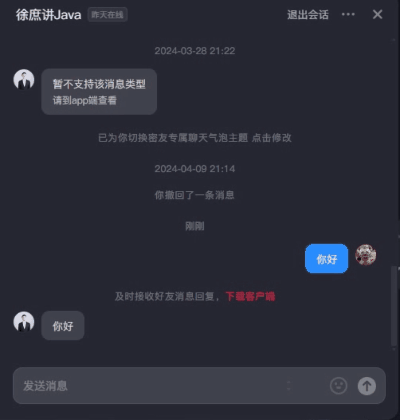

**场景三：多人在线游戏**。玩家需要实时知道别人出的牌和释放的技能。

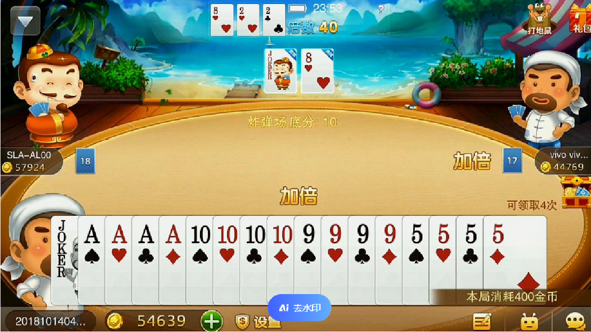

**场景四：共享设备**。在线下使用共享单车这类设备时，手机点击"开锁"，系统把开锁指令实时下发到车上。


在浏览器只能"发请求—收响应"的年代，实现这四类需求有三条路：让客户端不停去问（轮询），让服务器把响应挂住不返回（长轮询），或者换一种连接方式（SSE、WebSocket、MQTT）。下文逐一说明。

### 短轮询

轮询（polling）指客户端按固定间隔反复向服务器询问"有没有新数据"，短轮询是最简单的一种。

**是什么**：浏览器用定时器每隔一段时间（比如 1 秒）请求一次未读消息数接口，服务器立刻返回当前结果，浏览器再渲染页面。

**为什么需要**：它是唯一不需要服务端做任何改造的方案，接口写好后前端加个定时器就能跑，适合快速验证需求。

**怎么用**：一个 JS 定时器就够了。

```javascript
setInterval(() => {
  // 方法请求
  messageCount().then((res) => {
      if (res.code === 200) {
          this.messageCount = res.data
      }
  })
}, 1000);
```

**缺点**：数据并不会频繁变化，但无论后端有没有新消息，客户端都会按周期发请求，白白消耗带宽和服务器资源。可以把它想成每隔一分钟下楼看一眼信箱——绝大多数时候是空跑，但你必须走这一趟。

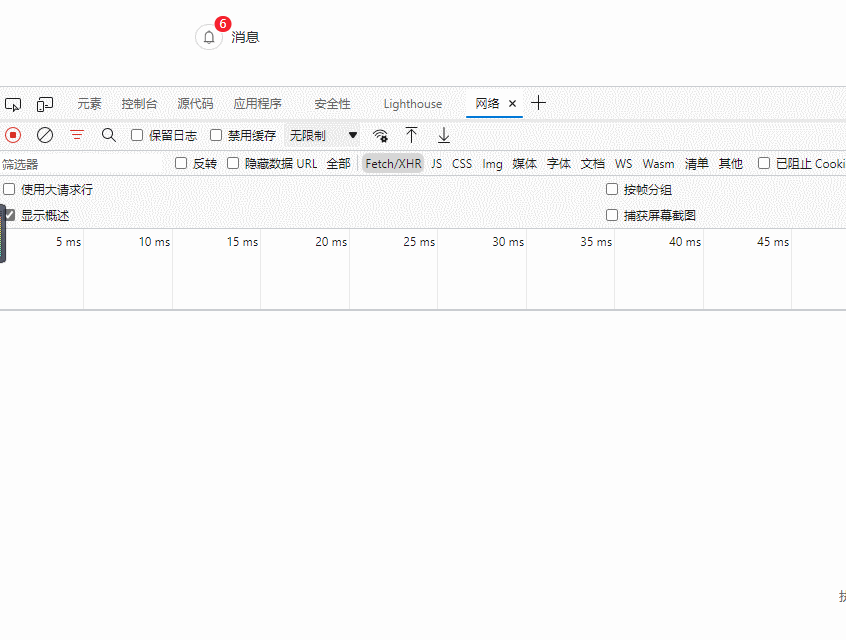

### 长轮询

长轮询（long polling）是短轮询的改进版：目标是在减少无效请求的同时，保证消息的相对实时性。它在中间件里应用得很广，例如配置中心 Nacos、Apollo，消息队列 Kafka、RocketMQ 都用到了长轮询。

**核心思路**：客户端发起请求后，服务端**不立刻返回**，而是把请求挂起；直到有新数据、或者到达超时时间，才把响应返回。客户端收到响应后立刻再发起下一次请求，如此循环。

在 Spring MVC 里，这个"挂起"由 `DeferredResult` 完成。它是 Servlet 3.0 异步请求机制之上的一层封装（"延迟结果"），可以让容器线程先释放出来去处理别的请求，业务处理完再调用 `DeferredResult.setResult(...)` 提交响应。这样单个线程能扛住更多挂起的请求，系统吞吐量随之提升。

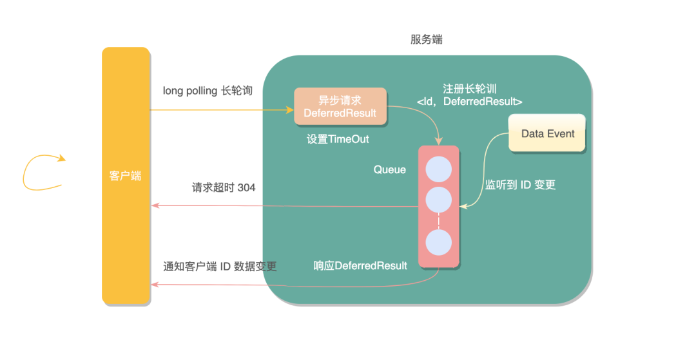

**为什么需要 Multimap**：同一个 ID 可能被多个客户端同时监听，所以用 Guava 提供的 `Multimap`（一个 key 对应多个 value）存放所有挂起的请求。一旦监听到这个 key 发生变化，就把对应的所有长轮询请求一起响应。前端收到"数据变更"的信号后，主动去查未读消息数接口，再更新页面。

```java
@Controller
@RequestMapping("/polling")
public class PollingController {

    // 存放监听某个Id的长轮询集合
    // 线程同步结构
    public static Multimap<String, DeferredResult<String>> watchRequests = Multimaps.synchronizedMultimap(HashMultimap.create());

    /**
     * 设置监听
     */
    @GetMapping(path = "watch/{id}")
    @ResponseBody
    public DeferredResult<String> watch(@PathVariable String id) {
        // 延迟对象设置超时时间
        DeferredResult<String> deferredResult = new DeferredResult<>(TIME_OUT);
        // 异步请求完成时移除 key，防止内存溢出
        deferredResult.onCompletion(() -> {
            watchRequests.remove(id, deferredResult);
        });
        // 注册长轮询请求
        watchRequests.put(id, deferredResult);
        return deferredResult;
    }

    /**
     * 变更数据
     */
    @GetMapping(path = "publish/{id}")
    @ResponseBody
    public String publish(@PathVariable String id) {
        // 数据变更 取出监听ID的所有长轮询请求，并一一响应处理
        if (watchRequests.containsKey(id)) {
            Collection<DeferredResult<String>> deferredResults = watchRequests.get(id);
            for (DeferredResult<String> deferredResult : deferredResults) {
                deferredResult.setResult("我更新了" + new Date());
            }
        }
        return "success";
    }
}
```

请求超过设定的超时时间后，Spring 会抛出 `AsyncRequestTimeoutException`。用 `@ControllerAdvice` 做全局捕获，统一返回一个约定好的状态码即可；前端识别到该状态码后，立刻发起下一次长轮询。

```java
@ControllerAdvice
public class AsyncRequestTimeoutHandler {

    @ResponseStatus(HttpStatus.NOT_MODIFIED)
    @ResponseBody
    @ExceptionHandler(AsyncRequestTimeoutException.class)
    public String asyncRequestTimeoutHandler(AsyncRequestTimeoutException e) {
        System.out.println("异步请求超时");
        return "304";
    }
}
```

> 注意：304 的规范语义是"资源未修改"，只应出现在带 `If-None-Match` / `If-Modified-Since` 的条件请求里，而且响应不能带消息体（RFC 9110）。上面用 304 当作"长轮询超时"的信号，是前后端自定义的约定，不符合规范语义但能工作；如果重新设计，更清晰的做法是返回 204 或自定义业务码。

**验证流程**：页面先发起 `/polling/watch/10086` 监听变更，请求被挂起；数据没有变化时一直挂到超时，前端随即再发起一次长轮询。此时手动访问 `/polling/publish/10086`，挂起的请求立刻得到响应，前端处理完业务逻辑后再次发起请求，循环往复。

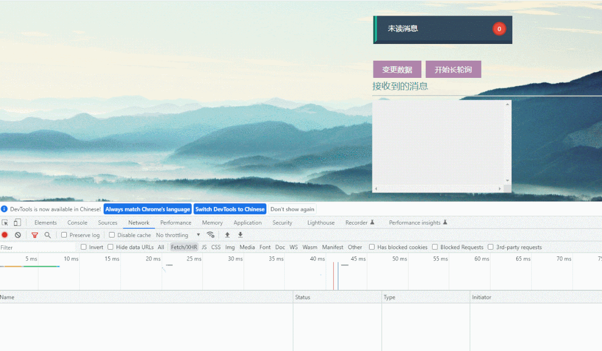

**局限**：长轮询比短轮询省掉大量无效请求，但每个客户端始终要维持一个"挂起—到达—重连"的循环，请求数量依然偏多，这是它不够完美的地方。

### SSE

SSE（Server-sent Events，服务器发送事件）是浏览器原生支持的一种服务端推送机制。它基于 HTTP 协议：服务端不再返回一次性的数据包，而是返回 `text/event-stream` 类型的数据流，有数据变更时就往这条流里写。

**为什么需要**：很多场景只需要"服务端 → 客户端"的单向通知，用 WebSocket 属于用牛刀杀鸡；SSE 复用现成的 HTTP 通道，服务端只要保持响应不关闭即可。

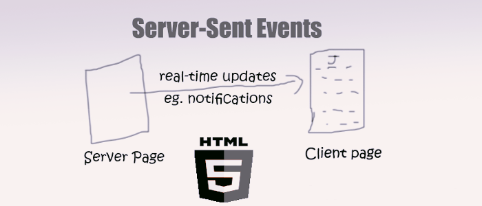

**怎么理解**：整体思路类似在线看视频——视频流是持续不断地推给浏览器的，也可以理解成一次耗时很长、边下边播的下载。

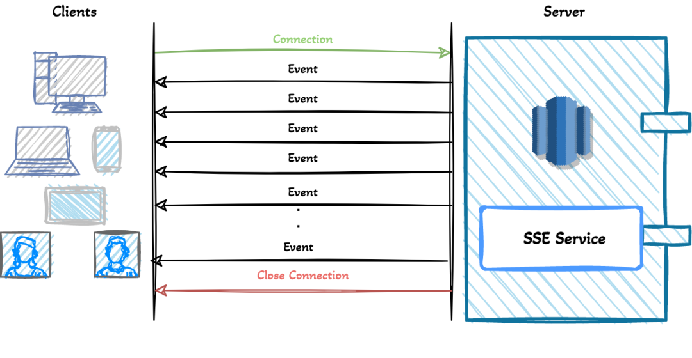

SSE 和 WebSocket 作用相似，都能建立服务端与浏览器的通道、实现服务端推送，但差别不小：

+ **SSE 基于 HTTP 协议，不需要额外的协议或专用服务器；WebSocket 需要服务端实现独立的握手与帧协议。**
+ **SSE 是单向通信，只能服务端发给客户端；WebSocket 是全双工通信，双方可以同时收发。**
+ **SSE 实现简单、开发成本低，服务端保持一个响应流即可；WebSocket 的数据需要按帧解析，开发门槛更高。**
+ **SSE 断线后浏览器会自动重连；WebSocket 需要自己实现重连逻辑。**
+ **SSE 只能传文本（UTF-8），二进制数据需要先编码；WebSocket 原生支持二进制帧。**

**怎么选**：技术没有好坏之分，只有是否合适。WebSocket 提供了更丰富的双向、全双工能力，对游戏、即时通信这类需要双向近实时更新的场景更有吸引力。但如果不需要从客户端发数据，只需要服务端推送状态更新——比如站内信、未读消息数、状态变更、股票行情、监控指标——SSE 在实现难度和成本上都更有优势。SSE 还自带 WebSocket 在设计上没提供的便利：自动重连、事件 ID（`Last-Event-ID` 用于断点续传）、自定义事件类型。

前端只需发起一次 HTTP 请求，带上用户唯一 ID，打开事件流并监听服务端推送的事件：

```javascript
    let source = null;
    let userId = 7777
    if (window.EventSource) {
        // 建立连接
        source = new EventSource('http://localhost:7777/sse/sub/'+userId);
        setMessageInnerHTML("连接用户=" + userId);
        /**
         * 连接一旦建立，就会触发open事件
         * 另一种写法：source.onopen = function (event) {}
         */
        source.addEventListener('open', function (e) {
            setMessageInnerHTML("建立连接。。。");
        }, false);
        /**
         * 客户端收到服务器发来的数据
         * 另一种写法：source.onmessage = function (event) {}
         */
        source.addEventListener('message', function (e) {
            setMessageInnerHTML(e.data);
        });
    } else {
        setMessageInnerHTML("你的浏览器不支持SSE");
    }
```

服务端的实现更简单：为每个连接创建一个 `SseEmitter` 对象，放进 Map 里统一管理。

```java
private static Map<String, SseEmitter> sseEmitterMap = new ConcurrentHashMap<>();

/**
 * 创建连接
 *
 * @date: 2022/7/12 14:51
 */
public static SseEmitter connect(String userId) {
    try {
        // 设置超时时间，0表示不过期。默认30秒
        SseEmitter sseEmitter = new SseEmitter(0L);
        // 注册回调
        sseEmitter.onCompletion(completionCallBack(userId));
        sseEmitter.onError(errorCallBack(userId));
        sseEmitter.onTimeout(timeoutCallBack(userId));
        sseEmitterMap.put(userId, sseEmitter);
        count.getAndIncrement();
        return sseEmitter;
    } catch (Exception e) {
        log.info("创建新的sse连接异常，当前用户：{}", userId);
    }
    return null;
}

/**
 * 给指定用户发送消息
 *
 * @date: 2022/7/12 14:51
 */
public static void sendMessage(String userId, String message) {

    if (sseEmitterMap.containsKey(userId)) {
        try {
            sseEmitterMap.get(userId).send(message);
        } catch (IOException e) {
            log.error("用户[{}]推送异常:{}", userId, e.getMessage());
            removeUser(userId);
        }
    }
}
```

模拟服务端推送一条消息，可以看到客户端收到的内容与预期一致。


**注意**：SSE 不支持 IE 浏览器，在其它主流浏览器上兼容性良好。

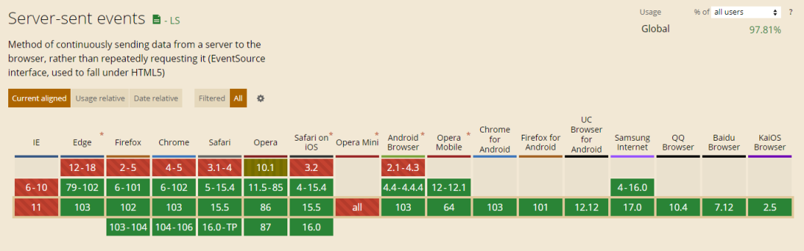

**一个容易踩的坑**：在 HTTP/1.1 下，浏览器对同域名的并发连接数有限制（约 6 个），每开一个 SSE 连接就占掉一个，多标签页时很容易被耗尽；改用 HTTP/2 后连接可以复用，这个限制会消失（HTTP/2 的并发流的数量由两端协商，默认常见值为 100）。

### MQTT

**是什么**：MQTT 是一套轻量级的发布/订阅（publish/subscribe）消息协议，由 OASIS 标准化，是物联网（IoT，Internet of Things）领域的常用传输协议。它早期常被展开为 "Message Queuing Telemetry Transport"，官方规范并未强制这个全称，记住"基于 TCP 的发布/订阅消息协议"即可。

**为什么需要**：该协议把消息的发布者（publisher）与订阅者（subscriber）解耦——发布者只负责把消息发到某个主题（topic），订阅者只负责订阅自己关心的主题，彼此不需要知道对方存在。因此它能在不可靠的网络环境中，为远程设备提供可靠的消息服务，使用方式与传统 MQ 有些类似。

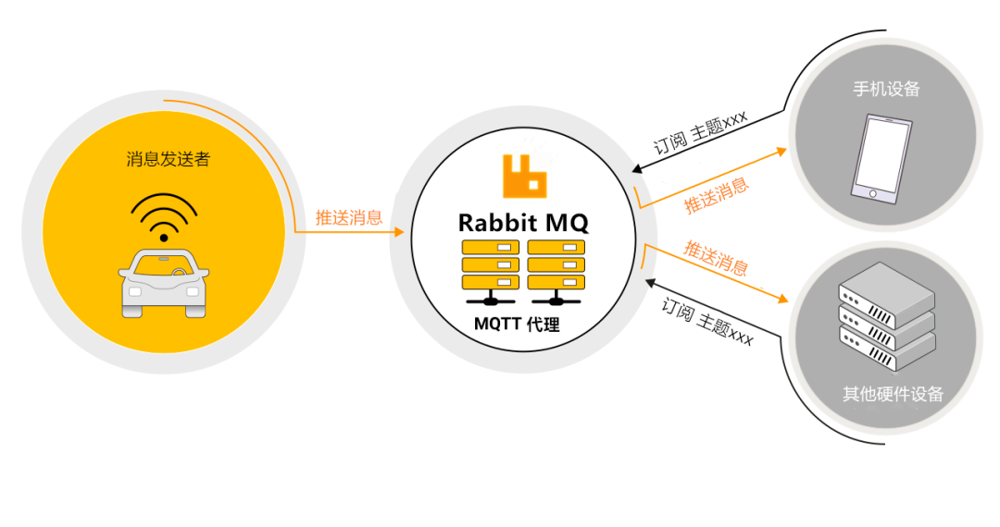

**协议位置**：TCP 位于传输层，MQTT 位于应用层，构建在 TCP/IP 之上。也就是说，只要设备支持 TCP/IP 协议栈，就能使用 MQTT。

**为什么物联网偏爱 MQTT，而不是更常见的 HTTP？**

+ **HTTP 是"请求—响应"式的同步协议，客户端发请求后必须等响应。而物联网设备受环境制约严重——带宽低、延迟高、网络不稳定，异步消息模型更合适。**
+ **HTTP 是单向的：要拿到消息，客户端必须主动发起连接。而物联网里的设备和传感器往往就是客户端，它们无法被动接收来自网络的指令。**
+ **很多场景需要把一条指令广播给网内所有设备。用 HTTP 实现既困难又昂贵，而 MQTT 的发布/订阅天然支持一对多。**

**服务质量**：MQTT 定义了三个 QoS 等级——QoS 0 至多一次（可能丢）、QoS 1 至少一次（可能重复）、QoS 2 恰好一次（开销最大）。报文格式与各等级的确认流程可查阅 OASIS 的 MQTT 规范（3.1.1 与 5.0 版本）。

### WebSocket

WebSocket 是最常见的一种消息推送实现方式，上一节的 SSE 对比中也反复提到它。

**是什么**：WebSocket 是一种在单个 TCP 连接上进行全双工通信的协议。浏览器和服务器只需完成一次握手，之后这条连接就保持打开，双方可以随时互相发数据，直到某一方主动关闭。

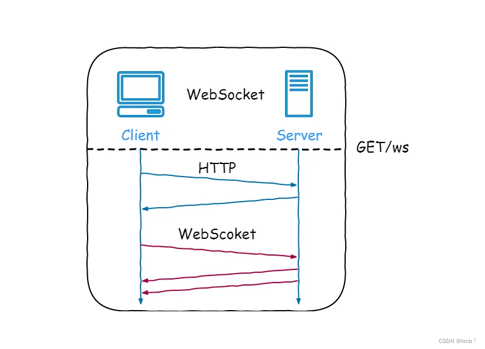

（图片源于网络）

**怎么用**：以 Spring Boot 为例，先引入 WebSocket 相关依赖，这比 SSE 多了一步开发成本。

```xml
<dependency>
    <groupId>org.springframework.boot</groupId>
    <artifactId>spring-boot-starter-websocket</artifactId>
</dependency>
```

服务端用 `@ServerEndpoint` 注解把当前类标注为一个 WebSocket 端点，客户端通过 `ws://localhost:7777/webSocket/10086` 这样的地址连接上来。

```java
@Component
@Slf4j
@ServerEndpoint("/websocket/{userId}")
public class WebSocketServer {
    //与某个客户端的连接会话，需要通过它来给客户端发送数据
    private Session session;
    private static final CopyOnWriteArraySet<WebSocketServer> webSockets = new CopyOnWriteArraySet<>();
    // 用来存在线连接数
    private static final Map<String, Session> sessionPool = new HashMap<>();
    /**
     * 链接成功调用的方法
     */
    @OnOpen
    public void onOpen(Session session, @PathParam(value = "userId") String userId) {
        try {
            this.session = session;
            webSockets.add(this);
            sessionPool.put(userId, session);
            log.info("websocket消息: 有新的连接，总数为:" + webSockets.size());
        } catch (Exception e) {
        }
    }
    /**
     * 收到客户端消息后调用的方法
     */
    @OnMessage
    public void onMessage(String message) {
        log.info("websocket消息: 收到客户端消息:" + message);
    }
    /**
     * 此为单点消息
     */
    public void sendOneMessage(String userId, String message) {
        Session session = sessionPool.get(userId);
        if (session != null && session.isOpen()) {
            try {
                log.info("websocket消: 单点消息:" + message);
                session.getAsyncRemote().sendText(message);
            } catch (Exception e) {
                e.printStackTrace();
            }
        }
    }
}
```

前端初始化时打开 WebSocket 连接，监听连接状态，接收服务端数据或向服务端发送数据。

```javascript
    var ws = new WebSocket('ws://localhost:7777/webSocket/10086');
    // 获取连接状态
    console.log('ws连接状态：' + ws.readyState);
    //监听是否连接成功
    ws.onopen = function () {
        console.log('ws连接状态：' + ws.readyState);
        //连接成功则发送一个数据
        ws.send('test1');
    }
    // 接听服务器发回的信息并处理展示
    ws.onmessage = function (data) {
        console.log('接收到来自服务器的消息：');
        console.log(data);
        //完成通信后关闭WebSocket连接
        ws.close();
    }
    // 监听连接关闭事件
    ws.onclose = function () {
        // 监听整个过程中websocket的状态
        console.log('ws连接状态：' + ws.readyState);
    }
    // 监听并处理error事件
    ws.onerror = function (error) {
        console.log(error);
    }
    function sendMessage() {
        var content = $("#message").val();
        $.ajax({
            url: '/socket/publish?userId=10086&message=' + content,
            type: 'GET',
            data: { "id": "7777", "content": content },
            success: function (data) {
                console.log(data)
            }
        })
    }
```

页面初始化时建立连接，之后就可以双向通信了。

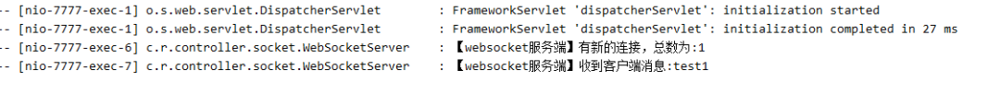


### 第三方推送平台与自研平台

上面的五种方案都需要自己写代码。实际业务中还有一种更省事的选择：直接买第三方推送服务。付费平台省去了大部分开发与运维工作，接入即可使用，例如 goEasy、极光推送都是常见的三方服务商。

一般大型公司则会自研消息推送平台。站内信只是平台上的一个触点，短信、邮件、微信公众号、小程序——凡是能触达用户的渠道，都可以接入统一推送平台。

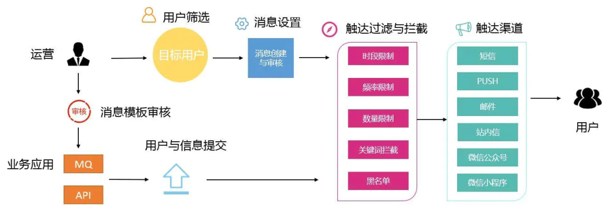

（图片来源于网络）

消息推送系统内部相当复杂：消息内容的审核与维护、推送人群的圈定、触达过滤拦截（推送频次、时段、数量、黑白名单、关键词等）、推送失败补偿……涉及大数据量与高并发的场景也很多。相比之下，本文给出的示例实现只是这套体系里很小的一部分，不要直接照搬到生产环境。

### 六种方案怎么选

实际选型要结合业务特点：消息的实时性要求、客户端数量、是否双向通信、团队开发成本。

| 方案 | 实时性 | 服务端压力 | 实现复杂度 | 典型场景 |
| --- | --- | --- | --- | --- |
| 短轮询 | 取决于轮询间隔 | 高（大量空请求） | 最低 | 后台管理系统里不敏感的通知 |
| 长轮询 | 较好（秒级） | 中（请求被挂起） | 中 | 配置中心、消息队列的客户端拉取 |
| SSE | 好 | 低（一条连接一条流） | 低 | 站内信、未读消息数、行情、监控大屏 |
| MQTT | 好 | 低（取决于 Broker） | 中高（需 Broker） | 物联网设备、弱网环境、海量设备 |
| WebSocket | 最好（毫秒级） | 低（长连接） | 中高 | 聊天、协同编辑、游戏、双向实时交互 |
| 第三方/自研平台 | 好 | 由平台承担 | 最低（接入） | 需要多渠道触达的运营类推送 |

## 二、I/O 模型与多路复用

本章回答一个很实际的问题：一台机器上几万个连接，为什么不能用"一个连接一个线程"扛住？答案藏在文件描述符、阻塞/非阻塞、多路复用这几个概念里。理解它们，也就理解了 Netty、Nginx、Redis 为什么这么设计。

### 什么是文件描述符

要理解 I/O，先要理解文件描述符（file descriptor，简称 fd）。

在 Linux 里有一句经典说法：everything is file（一切皆文件）——文件 IO、网络 IO、管道 IO 都被抽象成"文件"。那么读写数据时，程序怎么知道操作的是哪个"文件"？答案就是文件描述符。

它本质上只是一个**非负整数**，由内核分配，可以理解为指向某个打开文件的引用（句柄）。**有了文件描述符，进程可以对文件一无所知**：文件在磁盘的哪个位置、是否已被加载到内存、由谁管理，这些统统交给操作系统处理，进程只需要拿着这个数字去调用 `read` / `write` 即可。

可以把它想成储物柜的编号：你只需要记住"第 12 号柜子"，不必关心柜子在仓库的哪个角落、由谁搬运。

### 什么是 I/O 多路复用

**先说结论**：I/O 多路复用（I/O multiplexing）是一种在单个线程中管理多个 I/O 操作的技术。它允许一个进程或线程同时监视多个文件描述符，并在其中任意一个就绪（可读、可写或异常）时执行相应操作，而不必为每个 fd 阻塞等待。

**为什么需要**：假设现在有 1 万个连接（1 万个文件描述符），对比三种处理方式就能看出问题。

+ **BIO（Blocking I/O，阻塞式 I/O）**
    - 单线程：`accept` 一个请求后，如果 `recv` 或 `send` 阻塞，就无法 `accept` 其它请求（必须等上一个请求读写完），根本处理不了并发。
    - 多线程：`accept` 后开线程去 `recv`，确实能并发，但请求数一增加就要增加线程。大量线程占用可观的内存，线程切换也带来开销；而实际同一时刻真正有读写事件的连接通常只占一小部分（经验值，随业务差异很大），为每个连接常驻一个线程是明显的浪费。
+ **NIO（Non-blocking I/O，非阻塞式 I/O）**
    - 服务端 `accept` 后把连接加入 fd 集合，然后每次遍历整个集合去 `recv`（非阻塞），没数据就立即返回。问题在于：每次都要轮询**所有** fd，包括大量根本没有事件发生的 fd，CPU 全花在空转上。
+ **I/O 多路复用**
    - 服务端用单线程通过 `select` / `epoll` 等系统调用获取"有事件的 fd 列表"，只遍历这些 fd 做 `accept` / `recv` / `send`，因此能用少量线程支撑大量并发连接。
    - 与 BIO、NIO 最本质的区别是**获取就绪 fd 的方式变了**：BIO、NIO 都是程序主动去轮询，多路复用则是把 fd **交给内核监控**，某个 fd 可读写时由内核通知应用程序处理——从"主动轮询"变成"被动等待通知"。

三个系统调用的分工：`accept` 用于建立连接，`recv` 用于接收客户端发来的数据，`send` 用于向客户端发送数据。

### 阻塞 I/O 与非阻塞 I/O

**阻塞 I/O（Blocking I/O）**：程序发起 I/O 调用后会一直等待，直到操作完成才继续执行。就像在咖啡店点单后站在柜台前干等，咖啡没做好之前什么也做不了。如果 I/O 耗时较长，整个线程就被"卡"住了。

**非阻塞 I/O（Non-blocking I/O）**：程序发起 I/O 调用后立即返回，内核用返回值告诉它"现在还没数据"；程序可以先去干别的，稍后再来检查。就像点完单拿个取餐号去回消息，好了再回来取。

**区别**：

+ 阻塞 I/O：调用期间线程无法做别的事，一个线程只能服务一个连接，并发能力受线程数限制。
+ 非阻塞 I/O：调用立即返回，线程可以继续处理别的任务；但需要配合轮询、回调或事件驱动机制来判断"什么时候好了"，否则就是空转浪费 CPU。

实践中，非阻塞 I/O 通常与多路复用（select/poll/epoll）或事件驱动框架（如 Netty）配合使用：由内核告诉你哪个连接就绪，再去读写，避免无意义的轮询。

### 同步 I/O 与异步 I/O

**同步 I/O**：调用方发起 I/O 后，需要等待（或被通知后自己）完成数据从内核缓冲区到用户缓冲区的拷贝，才继续往下走。程序执行流与 I/O 完成是"绑定"的。

**异步 I/O**：调用方提交请求后立即返回，内核在**整个操作（包括数据拷贝）完成后**再通知调用方。程序不需要关心数据是怎么搬过来的。

**区别与联系**：

+ 同步 I/O 关注"谁来搬数据"——由调用方发起并等待；异步 I/O 关注"搬完了再叫我"——由内核完成并通知。
+ 同步/异步描述的是**结果通知机制**，阻塞/非阻塞描述的是**调用是否立即返回**，这是两个不同维度，不要混为一谈。常见的组合有：阻塞 + 同步（BIO）、非阻塞 + 同步（NIO 轮询）、多路复用 + 同步（epoll + 自己读写）。

| 模型 | 调用是否立即返回 | 数据拷贝由谁完成 | 典型实现 |
| --- | --- | --- | --- |
| 阻塞 I/O | 否 | 调用方（在内核协助下） | `InputStream.read()` |
| 非阻塞 I/O | 是（可能返回"未就绪"） | 调用方 | `SocketChannel` + 轮询 |
| I/O 多路复用 | 是（等待事件） | 调用方 | `select` / `poll` / `epoll` |
| 异步 I/O | 是 | 内核 | Linux `io_uring`、Windows IOCP |

**优缺点小结**：

+ 同步方式简单直观、易于理解和调试，适合逻辑线性的任务；缺点是等待期间线程被占用，高并发下需要靠线程池硬撑。
+ 异步方式能显著提高并发能力与资源利用率；缺点是编码复杂，需要处理回调、状态管理、异常传播，调试也更困难。

选择哪种方式，取决于业务的并发规模与团队维护成本，而不是"异步一定更好"。

### 进阶了解（可跳过）：select、poll 与 epoll

这三种都是 Linux 上实现 I/O 多路复用的系统调用，目标相同：让一个程序同时监控多个 fd 的读写就绪情况。

1. **select**
    - 优点：可移植性极好，几乎所有类 Unix 系统都支持。
    - 缺点：每次调用都要把整个 fd 集合从用户态拷到内核态，并由内核线性扫描；单个进程能監控的 fd 数量受 `FD_SETSIZE` 限制（默认编译值通常是 1024）；fd 数量增大后效率明显下降。
2. **poll**
    - 优点：用链表结构表示 fd 集合，取消了 `FD_SETSIZE` 的固定上限；可移植性同样不错。
    - 缺点：依然是线性扫描，fd 很多时效率不高；每次调用仍需在用户态与内核态之间传递整个集合。
3. **epoll**
    - 优点：内核用红黑树维护关注的 fd，就绪的 fd 通过就绪链表返回，**只处理有事件的 fd**，避免了全量扫描；支持水平触发（LT）与边缘触发（ET）两种模式；适合海量并发连接。
    - 缺点：仅 Linux 可用，可移植性差；编程模型比 select 复杂，需要处理事件循环与回调。
    - 补充：epoll 没有 `FD_SETSIZE` 那样的固定上限，但仍然受进程可打开文件数（`ulimit -n`）等系统资源约束。

**适用场景**：

+ fd 数量少、且要求跨平台：select 或 poll 足够，代码也更简单。
+ 高并发、海量连接：epoll 更合适，因为它把"遍历所有 fd"变成了"只处理就绪 fd"。

### Java NIO 的核心组件

传统 Java I/O（`java.io`）是阻塞式的：一个线程读一个流，读的时候线程被占住。Java NIO（New I/O，Java 1.4 引入）提供了面向缓冲区和通道的模型，配合选择器可以做到一个线程管理多个连接。可以类比成自助餐厅：不必等一道菜做完才能动，可以同时照看多个取餐口。

NIO 的核心组件：

1. **通道（Channel）**：连接程序与文件、套接字的双向管道，可读可写，替代了单向的 InputStream/OutputStream。
2. **缓冲区（Buffer）**：数据的容器，读写都先经过 Buffer（写入 → `flip()` → 读取 → `clear()`/`compact()`）。像盛菜的盘子，装进去再取出来。
3. **选择器（Selector）**：NIO 的关键，一个线程通过它监视多个通道的就绪状态（可读、可写、可接受连接），实现单线程管理多连接。

补充说明：常被列为"通道适配器"的东西并不是并列的核心组件，而是 `java.nio.channels.Channels` 工具类提供的桥接方法（如 `Channels.newChannel(InputStream)`），用于把老的流包装成通道。另外，文件相关的 NIO API（`Path`、`Files`、`AsynchronousFileChannel` 等）属于 Java 7 引入的 NIO.2（`java.nio.file`）。

### 缓冲区为什么重要

缓冲区（buffer）是一块临时存放数据的内存区域，等待被处理或传输。像做作业时用的草稿纸：不必每写一个字就交一次，可以攒一段再整理。

网络传输中，数据往往不能一次传完，链路也会有延迟和抖动，因此需要缓冲区来"存货"，再按节奏收发。它的价值主要有三点：

1. **减少系统调用**：攒够一批再读写，避免每个字节都触发一次内核调用。
2. **批量处理**：程序可以一次处理大块数据，不必等每个小数据块到齐。
3. **削峰与解耦**：生产者和消费者的速度不一致时，缓冲区吸收抖动，减少等待。

需要留意一个常见误解：缓冲区**不负责可靠性**。"缓冲区能防止数据丢失，一部分丢了其它部分还能传"的说法不成立——可靠、有序、不重复的传输是 TCP 的职责，应用层缓冲区丢数据就是丢数据。缓冲区解决的是"速度不匹配"和"系统调用太频繁"，不是"丢包"。

### 流（Stream）与 InputStream / OutputStream

Java 中 `java.io` 的流是对"有序字节序列"的抽象，分为两个方向：

+ **InputStream（输入流）**：从数据源（文件、网络连接、内存数组）**读**数据。可以想成一根把数据引进程序的管道。
+ **OutputStream（输出流）**：把数据**写**到目的地（文件、网络连接）。是同一根管道向外流的方向。

用法上的两个要点：

- 字节流处理的是字节，字符流（`Reader` / `Writer`）在其上加了字符编码转换，处理文本时优先用字符流并显式指定编码（如 `StandardCharsets.UTF_8`）。
- 流要关闭，推荐用 try-with-resources，异常路径也能保证释放；套一层 `BufferedInputStream` / `BufferedOutputStream` 可以显著减少系统调用次数。

另外提醒：`java.io` 里的流与 Java 8 的 `java.util.stream.Stream` 只是名字相同，后者是集合的函数式处理管道，与 I/O 无关。

## 三、HTTP 协议基础与版本演进

本章讲 HTTP 是什么、各个版本分别解决了什么问题、状态码怎么读，以及 HTTPS 到底加密了什么。这些是排查接口问题的基本工具——绝大多数"接口慢""跨域报错""缓存不生效"的问题，根子都在这一章。

### HTTP 是什么

HTTP（HyperText Transfer Protocol，超文本传输协议）是万维网的基础通信协议，用于在客户端（如浏览器）和服务器之间传输超文本（HTML、图片、视频等）以及其它资源。

它有三个关键特点：

| 特点 | 含义 | 带来的影响 |
| --- | --- | --- |
| 无状态（stateless） | 每个请求相互独立，服务器不记得上一次请求的信息 | 需要 Cookie、Session、Token 等机制补上"记忆" |
| 请求—响应模式 | 每次交互都由客户端发起请求、服务器返回响应 | 服务器无法主动推送（这正是 WebSocket 存在的理由） |
| 报文可读（HTTP/1.x） | 请求行、头部都是纯文本，肉眼可读 | 便于调试，但头部冗长、解析开销大；HTTP/2 起改为二进制分帧 |

### 版本演进与各版本特性

| 版本 | 关键特性 | 解决的问题 |
| --- | --- | --- |
| HTTP/0.9 | 只有 GET，响应只有 HTML 正文 | 最初的极简版本，已废弃 |
| HTTP/1.0 | 增加请求头、状态码、多种内容类型 | 能传图片等非 HTML 资源；但默认每次请求新建 TCP 连接 |
| HTTP/1.1 | 默认持久连接、管道化、`Host` 头支持虚拟主机、分块传输编码、更强的缓存控制 | 复用连接减少握手开销；一台服务器可承载多个域名 |
| HTTP/2 | 二进制分帧、单连接多路复用、HPACK 头部压缩、流优先级 | 解决 HTTP/1.1 的队头阻塞与头部冗余，头部压缩可显著减少重复头部的传输量 |
| HTTP/3 | 基于 QUIC（跑在 UDP 之上），内置 TLS 1.3 | 避免 TCP 层的队头阻塞，弱网下建连与恢复更快 |

目前互联网上最常见的仍然是 HTTP/1.1 与 HTTP/2，但 HTTP/3 的占比在持续上升——它在 2022 年随 RFC 9114 正式发布，已进入标准化阶段。

### 常见状态码及其含义

HTTP 状态码是服务端返回的三位数字，用来表示请求的处理结果，按首位数字分为五类：1xx 信息、2xx 成功、3xx 重定向、4xx 客户端错误、5xx 服务端错误。

| 状态码 | 含义 | 典型场景 |
| --- | --- | --- |
| 200 OK | 请求成功，响应体里是请求的内容 | 打开网页、调用接口成功 |
| 301 Moved Permanently | 资源已**永久**移到新地址 | 域名迁移、http 跳 https |
| 302 Found | 资源**临时**位于另一个地址 | 登录后临时跳转 |
| 304 Not Modified | 资源未修改，可直接用本地缓存 | 条件请求（带 `If-None-Match`）命中缓存 |
| 400 Bad Request | 请求报文有误，服务器无法理解 | 参数格式错误、JSON 不合法 |
| 404 Not Found | 请求的资源不存在 | 地址写错、资源被删除 |
| 500 Internal Server Error | 服务端处理请求时出错 | 代码抛异常、配置错误 |

几个容易混淆的点：

- **301 与 302**：301 表示永久移动，客户端和搜索引擎会更新地址；302 表示临时移动，后续请求仍应使用原地址。历史上部分客户端会把 301 后的 POST 改成 GET，如果需要保留原方法，应使用 308 Permanent Redirect。
- **304 不能带消息体**：它的作用是告诉客户端"你缓存的版本还有效"，响应只带 `ETag`、`Cache-Control` 等头部（RFC 9110）。
- **重定向依赖 `Location` 头**：服务端应在 3xx 响应里给出新地址，客户端才会自动跳转。

### HTTPS 与 HTTP 的区别

HTTP 的问题是明文传输：数据在链路上经过的任何设备都能看到内容，也能被篡改。HTTPS 就是"HTTP over TLS"——在 HTTP 和 TCP 之间插入一层 TLS，把 HTTP 报文整体加密后再传输（RFC 9110 定义 `https` 方案的默认端口为 443）。

**为什么需要**：登录密码、支付信息、身份凭证一旦明文传输，等于公开。TLS 同时提供机密性、完整性和身份认证。

**怎么工作**：网站需要向证书颁发机构（CA，Certificate Authority）申请一张证书，证书里包含域名、公钥和 CA 的签名。浏览器访问时先与服务器完成 TLS 握手，验证证书链是否可信、域名是否匹配、是否过期，然后协商出会话密钥，后续数据全部用这个密钥加密。

> 术语说明：习惯上说的"SSL 证书"其实指 TLS 证书。SSL 是 TLS 的前身（SSL 3.0 之后改名为 TLS），现在应统一称 TLS。

TLS 1.3（RFC 8446）把完整握手压缩到**一次往返（1-RTT）**，并支持会话恢复时的 0-RTT；握手过程会协商协议版本、选择加密算法、验证服务器身份、生成共享密钥，四件事一次完成。

总结：

+ HTTP 用于传输数据，但不加密，不适合承载敏感信息。
+ HTTPS 在 HTTP 之下加了 TLS，数据被加密，能防窃听、防篡改。
+ HTTPS 需要 CA 签发的证书来证明"你连的确实是这个网站"，而不是中间人。

## 四、HTTP 接口与 RPC 接口

本章对比两种常见的接口通信方式。它们都能完成"调用远端服务"这件事，但设计取向不同：HTTP 接口面向资源和通用性，RPC 接口面向方法调用和性能。

### HTTP 接口

HTTP 是一种应用层通信协议，主要作用是在服务器和客户端之间传输数据，核心是"客户端发请求、等待服务器响应"。

+ 在 Web 应用中，HTTP 主要用来传输 HTML、CSS、JavaScript 等资源。
+ 在接口设计上，HTTP 接口通常采用 RESTful 风格：用 HTTP 方法（GET、POST、PUT、DELETE 等）表示操作类型，用统一资源标识符（URI）表示资源。这样设计出来的接口可读性好、易维护、易扩展。

### RPC 接口

RPC（Remote Procedure Call，远程过程调用）是一套调用范式：让客户端像调用本地方法一样调用远程服务器上的函数。

+ RPC 通常使用二进制序列化协议通信，例如 ProtoBuf、Thrift、Msgpack；也可以跑在 HTTP 或裸 TCP 之上。
+ 接口定义通常用接口定义语言（IDL，Interface Definition Language）描述。IDL 可以把接口和数据结构编译成多种编程语言的代码，从而支持跨语言通信。

### 区别与相同点

**主要区别**：

1. **通信格式不同**：HTTP/1.x 的报文头部是纯文本；RPC 框架普遍使用二进制序列化，体积更小、解析更快。（注意 HTTP/2 起报文也改为二进制分帧，"HTTP 一定是文本协议"的说法只对 HTTP/1.x 成立。）
2. **调用方式不同**：HTTP 接口通过 URL 定位资源，RPC 接口通过方法名 + 参数调用。
3. **参数传递方式不同**：HTTP 接口用 URL 参数、请求体（JSON/表单）；RPC 接口用方法参数，由框架负责序列化。
4. **接口描述方式不同**：HTTP 接口常用 OpenAPI/RESTful 约定描述；RPC 接口用 IDL 描述。
5. **性能取向不同**：RPC 通常有更小的报文开销和连接复用、批量调用等优化，在内部服务间的高频调用中往往更快；但这不是绝对结论，具体差距取决于序列化方式、网络环境和调用模式。

**相同点**：两者都是接口通信手段，都需要定义接口、参数和返回值，都要通过网络传输；都能支持多种数据格式与编解码方式，可以按需求选择。

### 应用场景

HTTP 接口适合浏览器与服务器之间的通信，也适合对外暴露的开放 API：通用性好，任何语言、任何工具（curl、Postman、浏览器）都能调，调试成本低。

RPC 接口适合内部服务之间的高频调用、跨语言协作，以及高并发、高吞吐的分布式场景，例如大型分布式计算、大数据处理。

## 五、代理、反向代理与负载均衡

本章讲清三个容易混为一谈的概念：代理、反向代理、负载均衡。它们的共同点是"站在中间转发请求"，区别在于站在谁那一边、为谁服务。

### 什么是代理

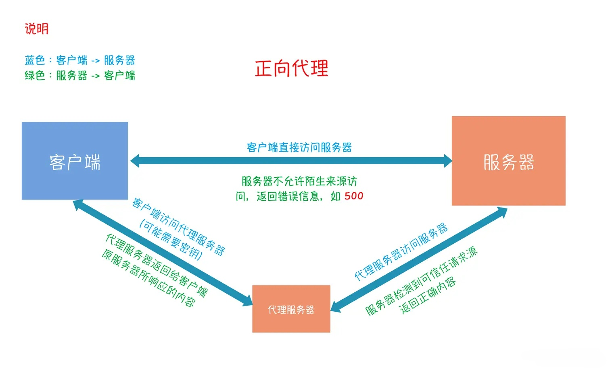

代理（proxy）是一种网络服务模式：它充当客户端和目标服务器之间的中介。客户端不直接与目标服务器通信，而是把请求发给代理服务器，由代理转发给目标服务器；响应也经由代理返回。

**为什么需要**，代理的主要作用包括：

1. 访问控制：控制对特定资源的访问，落实安全策略。
2. 性能优化：缓存常见请求的结果，减少服务器负载、加快响应。
3. 匿名性：隐藏客户端的真实身份。
4. 内容过滤：过滤请求和响应，例如屏蔽不良网站。
5. 监控：记录流量与访问日志。

这种"代表客户端去访问服务器"的代理，也叫**正向代理**。它像你委托的跑腿小哥：商家只知道小哥来了，不知道是你点的单。

### 什么是反向代理

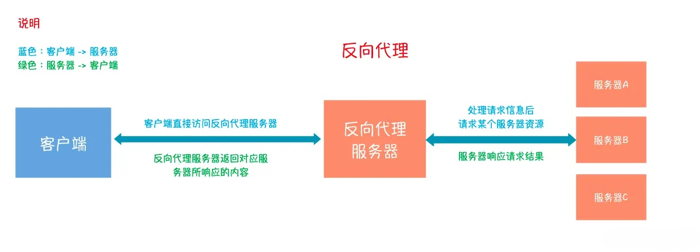

反向代理（reverse proxy）是代理的另一种形式：它位于客户端与服务器之间，但客户端通常不知道它的存在。客户端请求先到达反向代理，由它转发给后端的一组服务器之一，响应再经它返回。

反向代理的主要作用包括：

1. 负载均衡：把请求分发到多台后端服务器，平衡压力。
2. 故障转移：后端某台机器故障时，自动把流量切到健康节点。
3. TLS 终端：在代理层完成 TLS 加解密，减轻后端负担。
4. 缓存静态内容：缓存不常变化的内容，提高响应速度。
5. 访问控制：统一控制对后端服务器的访问。
6. 隐藏服务器细节：不向客户端暴露后端拓扑与具体实现。

| 对比项 | 正向代理 | 反向代理 |
| --- | --- | --- |
| 站在谁那边 | 客户端 | 服务端 |
| 谁知道它的存在 | 客户端知道，服务器不知道真实客户端 | 客户端不知道，服务器知道代理 |
| 典型用途 | 科学上网、内网出口、访问审计 | 负载均衡、TLS 卸载、缓存、网关 |
| 部署位置 | 靠近客户端 | 靠近服务器 |

### 反向代理就是负载均衡吗

不是。反向代理可以承担负载均衡的任务，但两者并不等同。

负载均衡是一种"把工作量（如网络流量）分摊到多台服务器"的策略概念，目标是优化资源使用、最大化吞吐量、最小化响应时间、避免单点过载。

反向代理通常**包含**负载均衡能力，同时还提供 TLS 终端、缓存、访问控制等额外功能。因此可以说：反向代理是一种多功能的网络服务，负载均衡是它的一项能力，而不是它的定义。

## 六、URL、URI 与 URN

本章区分三组常被混用的术语。它们的发音相近、写法相似，但在规范和实际使用中层级关系很明确：URI 是总称，URL 和 URN 是它的两个子集。

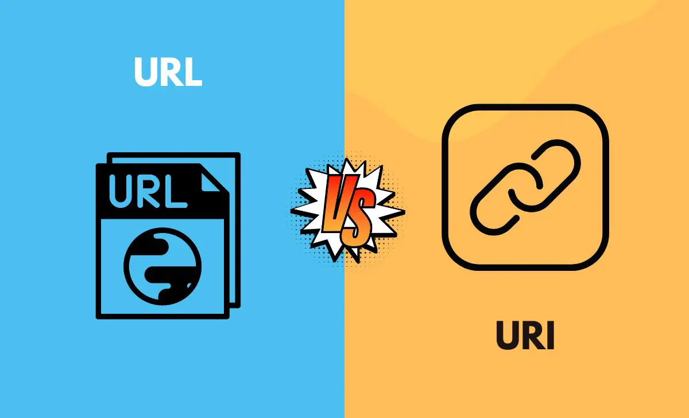

互联网的使用因人而异：有人用它查资料，有人用它交换信息。浏览网页时几乎每天都会遇到 URL 和 URI 这两个词，很多人并不清楚它们的区别。

### 什么是 URL

URL（Uniform Resource Locator，统一资源定位符）用来描述资源**在哪里**、以及**用什么方式**取到它。它的唯一目的是帮助用户找到目标资源：点击一个 URL 就能访问对应内容。

URL 一定包含协议（scheme）部分，例如以 `http` / `https` 开头的 Web 资源、以 `ftp` 开头的文件资源，甚至以 `mailto` 开头的邮件地址。协议之后的部分指向具体资源，如主机名、路径、查询参数。

按 RFC 3986 的定义，URL 是 URI 的一个子集：它在标识资源的同时，还通过描述主要访问机制（例如网络位置）提供了定位手段。

### 什么是 URI

URI（Uniform Resource Identifier，统一资源标识符）是一串字符，通过资源的**位置**和/或**名称**来标识网络上的资源，让资源可以被标准化地识别。

它分为三类：定位器（locator）、名称（name），或者两者兼有。因此 URI 既可以是 URL，也可以是 URN，或者同时具备两种性质。RFC 3986 建议：在不需要强调具体类型时，统一使用"URI"这个更宽泛的术语。

### 什么是 URN

URN（Uniform Resource Name，统一资源名称）只关注资源的**名字**，不关心它放在哪里。它的目标是提供一个长期有效、全局唯一的标识符：无论资源搬到什么位置、甚至已经不存在，这个标识符依然指向同一个"身份"。

URN 通常归属于某个命名空间，例如 ISBN（国际标准书号）用于唯一标识书籍。URN 的结构随命名空间而异，核心诉求是唯一性与持久性，因此在数字图书馆、学术出版等需要长期引用的领域很有价值。

### 三者的关系与对比

| 比较项 | URL | URI | URN |
| --- | --- | --- | --- |
| 全称 | 统一资源定位符 | 统一资源标识符 | 统一资源名称 |
| 关注点 | 资源在哪里、怎么取 | 标识资源（位置或名称皆可） | 资源叫什么 |
| 层级 | URI 的子集 | 总称 | URI 的子集 |
| 举例 | 协议 + 域名 + 路径组成的地址串 | 一切符合语法的标识符 | `urn:isbn:9787115473899` |

理解层级关系时容易绕晕：URL 包含了 URI 的全部信息（还更多），为什么反而是"子集"？这里说的是**类型层级**而非"包含关系"——URL 是 URI 的一种特例，就像 `ArrayList` 是 `List` 的一种实现。用 Java 的继承来类比：URI 是父类，URL 是子类；子类拥有父类的全部特征，还多了"定位"这一能力，但子类的适用范围比父类窄。

需要注意，同一个 URI 方案并不天然属于"名称"或"定位"中的某一类，具体取决于命名机构对标识符的维护方式。因此 RFC 3986 建议新文档统一使用"URI"这一通用术语。

## 七、WebSocket：从握手到实战

本章讲清楚三件事：WebSocket 为什么会出现、握手是怎么完成的、以及它和 HTTP 该如何取舍。第一章的推送方案里已经用过 WebSocket 的客户端代码，本章补齐它背后的协议细节。

### 为什么有了 HTTP 还需要 WebSocket

**HTTP 的模型**：HTTP 跑在 TCP 之上，采用的是"客户端发起请求、服务器返回响应"的模式。在一次请求—响应之内，数据只能朝一个方向流动；同一条连接上虽然可以连续发多个请求（HTTP/1.1 默认持久连接，见第三章），但每个请求都必须由客户端先发起。也就是说，服务器无法在没人提问的时候主动开口。

这就是所谓"半双工"的直观含义：同一条连接上，同一时刻只有一方在发数据。

**为什么不够用**：打开一个网页，每点一次按钮，前端发一次请求、后端回一次响应，这种模式能满足大部分场景。但网页游戏、协同编辑、即时通信这类应用，需要客户端和服务器**互相主动**地高频发数据，靠"你问一句我答一句"就无法满足实时性要求了。

**HTTP/2 的 Server Push 曾经试图缓解这个问题**，但主流浏览器后来陆续移除了该特性，所以它并不能作为服务端主动推送的通用方案。

因此需要一套基于 TCP 的新应用层协议，让连接建立之后双方对等——这就是 WebSocket。

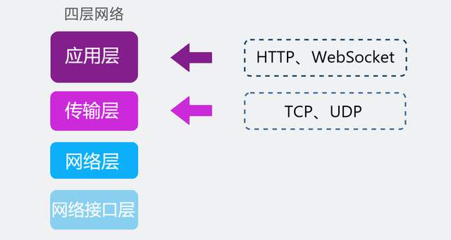

### WebSocket 是什么

WebSocket 是一种用于在单个 TCP 连接上进行**全双工通信**的网络协议（全双工：双方可以同时收发数据，像打电话而不是对讲机）。它先用一个类似 HTTP 的握手建立连接，随后在这条持久连接上收发数据帧。

连接一旦建立就一直保持打开，直到某一方主动关闭，因此不需要为每条消息反复建连、断连——这正是它适合实时应用的原因。

### 连接是怎么建立的

WebSocket 的握手复用了 HTTP：客户端发一个带升级意图的 HTTP 请求，服务端同意后返回 101，连接随即"切换协议"。

按 RFC 6455 的规定，客户端发出的握手请求长这样：

```http
GET /chat HTTP/1.1
Host: server.example.com
Upgrade: websocket
Connection: Upgrade
Sec-WebSocket-Key: dGhlIHNhbXBsZSBub25jZQ==
Origin: http://example.com
Sec-WebSocket-Version: 13
```

服务端接受时返回：

```http
HTTP/1.1 101 Switching Protocols
Upgrade: websocket
Connection: Upgrade
Sec-WebSocket-Accept: s3pPLMBiTxaQ9kYGzzhZRbK+xOo=
```

几个关键点：

- `101 Switching Protocols` 是握手成功的唯一标志。返回任何其它状态码，都表示握手没有完成，此时仍然按 HTTP 语义处理。
- `Sec-WebSocket-Key` 是客户端生成的随机串；服务端把它和一个固定 GUID 拼接后做 SHA-1、再 Base64 编码，放进 `Sec-WebSocket-Accept` 返回。客户端校验这个值，校验不通过就不建立连接。
- 握手完成后，双方改用 WebSocket 自己的帧格式通信（文本帧、二进制帧、关闭帧、ping/pong 帧），不再受 HTTP 报文格式约束。

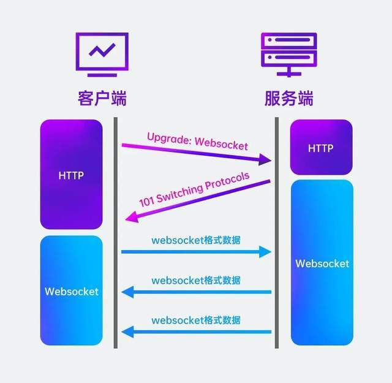

端口方面：`ws` 默认用 80，`wss`（TLS 加密）默认用 443（RFC 6455）。

### 实际用途与不适合的场景

**实时数据展示**：后端持续产生数据（行情、监控指标、进度），前端需要不间断刷新。WebSocket 在一条已打开的连接上持续推送，比反复发 HTTP 请求更快。

**聊天类应用**：消息的发送、广播、回执都在同一条连接上完成，通信轻量、延迟低。

**游戏应用**：服务端需要不间断地接收和下发状态，且不能因为刷新 UI 而中断。

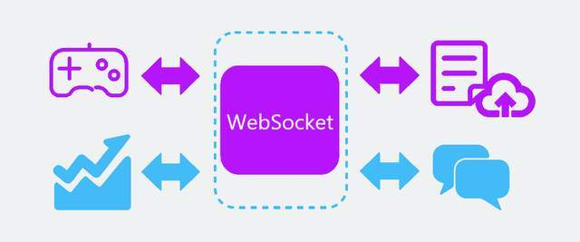

**不适合的场景**：数据交互周期很长（甚至几小时一次），或者只需要一次性取数据。这类场景用普通 HTTP 请求更划算——为一次交互维持一条长连接，反而浪费服务端资源（每个连接都要占用内存和文件描述符）。

### WebSocket 与 HTTP 怎么选

HTTP 是无状态协议，擅长 RESTful、SOAP 这类"一问一答"的接口；WebSocket 是有状态的双向通道，擅长持续的数据流。两者不是替代关系，同一个系统里常常并存：普通业务接口走 HTTP，实时通道走 WebSocket。

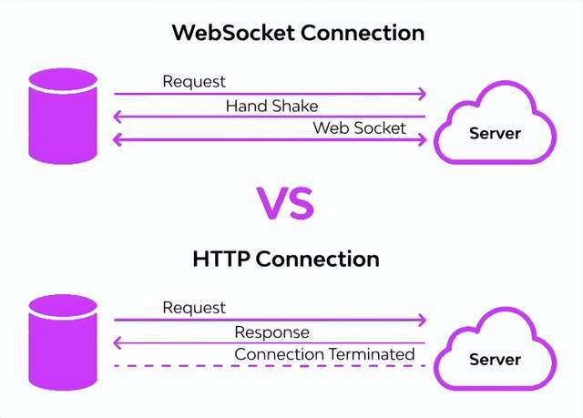

关于连接管理，这里要澄清一个常见误解：**HTTP/1.1 起，连接默认就是持久的**（RFC 9112 第 9.3 节），多个请求可以复用同一条 TCP 连接，只有显式带上 `Connection: close` 才会在响应后断开。所以"HTTP 每个请求都要新建连接"只适用于 HTTP/1.0 的默认行为。WebSocket 与 HTTP 的真正差别在于：HTTP 的连接由客户端驱动、一问一答；WebSocket 的连接建立后双方对等，谁都可以随时发数据。

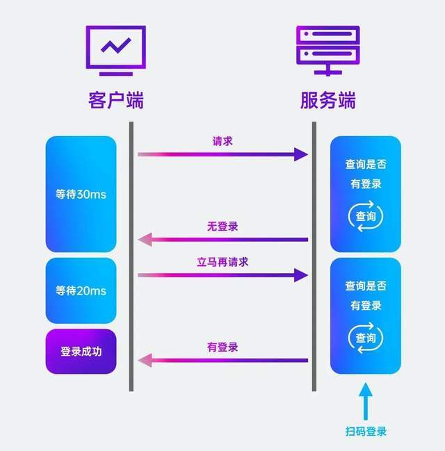

### ws 与 wss：加密的连接

WebSocket 使用的是标准 TCP 连接，因此任何支持 TCP 的网络都能跑。它的 URI 前缀有两种：`ws://`（明文）和 `wss://`（加密），两者都可以和任意域名或 IP 组合。

`wss` 的含义就是"WebSocket over TLS"：在 TCP 之上先建立 TLS（Transport Layer Security，传输层安全）连接，再由它承载 WebSocket 流量，默认端口 443。TLS 提供三件事——机密性（别人看不到内容）、完整性（内容被改动会发现）、身份认证（确认连的是真服务器）。证书的校验流程与 HTTPS 完全一样。

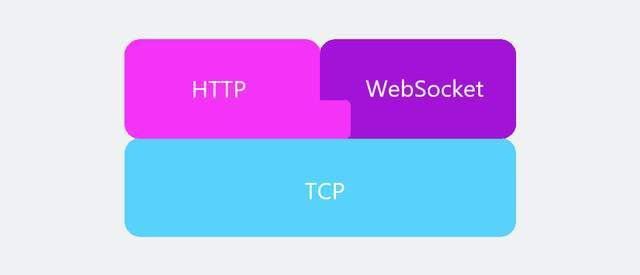

需要澄清一个常见误解：并不存在所谓"WebSocket 安全握手协议（Secure Handshake Protocol）"这种独立机制。WebSocket 的安全性来自两处——握手阶段复用 HTTP 的 `Origin` 头做来源校验（服务端据此防止跨站 WebSocket 劫持），以及传输阶段用 TLS 加密。

最后强调一点：**WebSocket 不是"基于 HTTP 的新协议"**。它只在建立连接时借用了一次 HTTP 请求，握手完成后就与 HTTP 再无关系。

### 进阶了解（可跳过）

WebSocket 帧头只有 2~14 字节，比 HTTP 报文头轻得多，这是它适合高频小消息的原因之一。生产环境中还需要处理心跳（定时 ping/pong，防止中间设备把空闲连接回收）、断线重连（指数退避）、消息序号与去重（网络抖动可能造成乱序或重复）、以及集群下的会话路由（连接在 A 节点，消息却从 B 节点发出，需要靠 Redis 发布订阅或消息队列转发）。这些内容初学可以略过。

## 八、TCP/IP 协议栈与传输层

本章讲网络分层，以及传输层两个主角 TCP 与 UDP 的差别，最后解释"粘包拆包"这个高频疑问。分层是理解网络问题的框架：出问题时先定位在哪一层，再看该层的具体协议。

### 分层模型：OSI 七层与 TCP/IP 四层

计算机网络用分层来组织通信：每一层只解决一类问题，并向上层提供服务。像一栋多层办公楼，每层各管一摊，靠内部楼梯（层间接口）协作。

需要先更正一个常见混淆：下面列出的**七层是 OSI 参考模型**，而严格意义上的 TCP/IP 模型是**四层**。日常交流中常说的"TCP/IP 五层/七层"是两者的混合说法，理解时把七层看作"职责划分"，把四层看作"实际实现的归并"即可。

| OSI 七层 | 职责 | TCP/IP 四层对应 |
| --- | --- | --- |
| 应用层 | 为用户程序提供网络服务（HTTP、FTP、SMTP、DNS） | 应用层 |
| 表示层 | 数据格式转换、加密、压缩 | 应用层 |
| 会话层 | 建立、管理、终止会话 | 应用层 |
| 传输层 | 端到端数据传输（TCP、UDP） | 传输层 |
| 网络层 | 寻址与路由（IP） | 网际层 |
| 数据链路层 | 相邻设备间的帧传输、差错检测 | 网络接口层 |
| 物理层 | 比特流在物理介质上传输 | 网络接口层 |

逐层看职责：

1. **物理层**：最底层，处理电缆、光纤、无线等物理连接，把比特流送到对端设备，像电线传输电流。
2. **数据链路层**：在直接相连的设备之间传输数据帧，解决"同一段链路上怎么传、怎么发现错误"。
3. **网络层**：负责跨网络的寻址与路由，用 IP 地址找到目标设备，决定数据包怎么一跳跳过去，像导航系统。
4. **传输层**：负责端到端的可靠传输。TCP（Transmission Control Protocol）提供可靠、有序的字节流；UDP（User Datagram Protocol）更轻量，不保证可靠与顺序。
5. **会话层**：建立、管理和终止通信会话，保证交互次序。
6. **表示层**：负责数据格式转换、加密与压缩，让双方能正确解释数据。
7. **应用层**：最接近用户，HTTP、FTP、SMTP、DNS 都在这一层，浏览器、邮件客户端等程序在此工作。

### TCP 与 UDP 的差别

| 对比项 | TCP | UDP |
| --- | --- | --- |
| 连接 | 面向连接（三次握手建连、四次挥手断开） | 无连接，直接发数据报 |
| 可靠性 | 确认重传、按序交付、去重 | 不保证送达、不保证顺序 |
| 数据形态 | 字节流，没有消息边界 | 保留数据报边界，一次发一次收 |
| 流量与拥塞控制 | 有（滑动窗口、拥塞控制） | 无 |
| 头部开销 | 最小 20 字节 | 固定 8 字节 |
| 典型应用 | HTTP/1.1、HTTP/2、SSE、MQTT、数据库连接 | DNS 查询、音视频通话、实时游戏、HTTP/3（QUIC 基于 UDP） |

一句话选择：要"不丢不乱"就用 TCP，要"低延迟、能容忍丢一点"就用 UDP。HTTP/3 之所以选 UDP，是因为它在 QUIC 里自己实现了可靠传输与多路复用，从而绕开 TCP 层的队头阻塞。

### 粘包与拆包

**现象**：发送方连续 `write` 了三条消息，接收方一次 `read` 却读到了两条半；或者一条消息被拆成两段才收全。

**原因**：TCP 是**字节流**协议，不保留应用层的消息边界。RFC 9293 明确说明：TCP 分段与应用层的读写次数之间没有任何对应关系——一次 `write` 可能被拆成多个段发送，多个 `write` 也可能被合并到一个段里。所以"粘包/拆包"不是 TCP 的缺陷，而是**应用层没有自己定义消息边界**导致的。

| 说法 | 澄清 |
| --- | --- |
| TCP 会"粘包" | TCP 只是字节流，合并与拆分是正常行为，问题在应用层未定界 |
| UDP 也会粘包 | 不会，UDP 保留数据报边界（但可能丢包、乱序） |
| 加个 `Thread.sleep` 能解决 | 不能，只能降低发生概率，属于不可靠做法 |

**怎么解决**：在应用层自己定界，常见三种做法。

1. **长度字段（最常用）**：消息头里写死消息体长度，接收方先读固定长度的头，再按长度读体。Netty 提供的 `LengthFieldBasedFrameDecoder` 就是这套思路的通用实现。
2. **分隔符**：用特殊字符（如 `\r\n`、`\0`）标记消息结束，接收方按分隔符切分。对应 Netty 的 `DelimiterBasedFrameDecoder`。注意分隔符不能出现在消息体里，否则需要转义。
3. **固定长度**：每条消息长度固定，不足补位。实现最简单，但浪费带宽、不够灵活。

此外，使用 JSON、XML 等自带结构描述的高层格式时，仍需要先解决"一条完整报文在哪里结束"，通常还是靠前两种方式。

## 九、网络性能：延迟与带宽

本章区分两个最常被混用的性能指标。它们共同决定"网络快不快"，但优化的方向完全不同：延迟决定"等多久"，带宽决定"一次能搬多少"。

**网络延迟（latency，也叫延时）**：数据从发送端到接收端所需的时间，通常以毫秒计。可以理解为信息在网络中的"旅行时间"。延迟高，交互就迟钝：游戏里操作与画面不同步、视频通话有明显滞后、网页首屏迟迟不出来。

**带宽（bandwidth）**：单位时间内能传输的数据量，通常用 Mbps（兆比特每秒）表示。带宽决定"管道有多粗"。带宽不足时，大文件下载慢、高清视频会降码率、多设备同时用网会互相挤占。

一个比喻可以同时说明两者：把网络想成一条高速公路，延迟是"从 A 到 B 要开多久"，带宽是"这条路有几条车道"。车道再多，路程远依然要开很久；路程再近，只有一条车道也会堵。

| 指标 | 影响什么 | 典型优化手段 |
| --- | --- | --- |
| 延迟 | 交互响应、实时性 | 就近部署、CDN、减少往返次数（连接复用、HTTP/2 多路复用）、避免串行请求 |
| 带宽 | 吞吐量、加载体积 | 压缩（gzip/br）、图片与视频转码、按需加载、扩容 |

**注意单位换算**：运营商说的 100 Mbps 是"兆比特每秒"，而下载工具显示的 MB/s 是"兆字节每秒"，1 字节 = 8 比特，所以 100 Mbps 的理论峰值约 12.5 MB/s（实际还要扣除协议开销）。

**两者要一起看**：带宽再高，如果延迟很大（例如跨洋链路），小请求密集的交互依然会慢；延迟再低，如果需要传输几十 GB 数据，带宽就是瓶颈。理想状态是低延迟 + 足够带宽。

## 十、Web 安全与跨域

本章讲两个在开发中最常撞见的安全话题：CSRF（跨站请求伪造）与 CORS（跨域资源共享）。前者是"别人借你的身份干坏事"，后者是"浏览器默认不许跨站取数据，需要服务端明确授权"。

### CSRF：跨站请求伪造

**是什么**：CSRF（Cross-Site Request Forgery）是一种攻击方式：攻击者诱导已登录的用户，在不知情的情况下向目标站点发起一个带身份的请求，从而完成转账、改密码、发消息等操作。关键在于浏览器会自动带上目标站点的 Cookie，服务端无法区分"用户本人操作"和"被诱导的请求"。

**攻击怎么发生**：

1. 用户在银行站点登录，Cookie 保存在浏览器里。
2. 用户访问了攻击者的页面，页面里藏着一个指向银行的表单或图片请求。
3. 浏览器发出请求时自动带上银行 Cookie，银行认为是本人操作，于是执行了转账。

**怎么防**：

1. **CSRF Token**：登录后由服务端下发一个随机令牌，页面每次提交都带上；服务端校验令牌是否匹配，不匹配就拒绝。因为攻击者无法读取目标站点的页面内容，也就拿不到令牌。
2. **校验 `Origin` / `Referer` 头**：检查请求来源是否同站，不同站就拒绝。`Origin` 比 `Referer` 更可靠——`Referer` 可能被浏览器隐私策略裁剪或省略。
3. **Cookie 的 `SameSite` 属性**：设置 `SameSite=Lax` 或 `Strict`，让浏览器在跨站请求中不发送该 Cookie。这是目前最基础也最有效的一道防线，主流浏览器已默认 `Lax`。
4. **敏感操作二次确认**：改密码、支付等操作要求重新输入密码或验证码，攻击者拿不到这些信息，请求就无法完成。

> 需要澄清一个常见误解：**同源策略并不能防住 CSRF**。同源策略限制的是"跨源读取响应"，而 CSRF 攻击只要求"请求发出去"，并不需要读响应——普通表单提交、`` 请求都能跨源发出。因此同源策略是 CORS 的基础，却不是 CSRF 的防线。

### CORS：跨域资源共享

**先理解"同源"**：协议、域名、端口三者完全相同才算同源。举例来说：`a.com` 与 `b.com` 域名不同，不同源；同一个域名一个用 http、一个用 https，协议不同，不同源；`a.com:8080` 与默认端口的 `a.com`，端口不同，也不同源。

**为什么需要**：浏览器出于安全考虑实施同源策略——默认不允许页面读取另一个源的响应。这样可以防止恶意站点读取你在其它站点的数据。但现代 Web 应用常常由多个服务组成（前端在 `www.a.com`，接口在 `api.a.com`），同源策略会把正常业务也拦掉，于是需要一套"经服务端同意后放行"的机制，这就是 CORS（Cross-Origin Resource Sharing）。

**怎么工作**：CORS 是一套响应头约定，浏览器据此判断是否放行。

- 服务端在响应中返回 `Access-Control-Allow-Origin`，声明允许哪些源访问。写 `*` 表示任意源，但此时不能同时携带凭证（Cookie）。
- 对"非简单请求"（如自定义头、`PUT`/`DELETE` 方法、`Content-Type: application/json`），浏览器会先发一个 `OPTIONS` 预检请求，服务端用 `Access-Control-Allow-Methods`、`Access-Control-Allow-Headers` 回应允许的方法与头部，预检结果会被缓存一段时间（`Access-Control-Max-Age`）。
- 需要携带 Cookie 时，前端要设置 `withCredentials`，服务端必须返回具体源而不是 `*`，并加上 `Access-Control-Allow-Credentials: true`。

**重要提醒**：CORS 是**浏览器**的安全机制。服务端到服务端的调用（curl、Postman、后端 HTTP 客户端）不受 CORS 限制，所以"接口在 Postman 能通、在浏览器报跨域"是正常现象——问题出在响应头，而不是接口本身。CORS 也不是访问控制手段：它只限制浏览器读取响应，不能阻止别人直接调用你的接口，接口鉴权仍需单独做。

## 十一、DNS、IP 地址与 Cookie

本章收尾三个最基础的概念：域名怎么变成 IP、IP 地址是什么、网站怎么"记住"你。它们几乎是所有 Web 排查问题的起点——"解析不了""连不上""登录状态丢了"。

### DNS 是什么

DNS（Domain Name System，域名系统）负责把人类好记的域名翻译成机器使用的 IP 地址。

互联网上有无数台主机，用数字记地址非常困难。DNS 就像一本全球分布式的大电话簿：你报出名字（`www.example.com`），它告诉你号码（`93.184.216.34`）。

**为什么需要分布式**：域名数量以亿计且时刻变化，没有任何一台机器能存下并实时维护全部记录。因此 DNS 采用层级分治：根域名服务器 → 顶级域（如 `.com`）服务器 → 权威域名服务器，每层只管自己那一小段。

### 域名解析的完整流程

以访问 `www.example.com` 为例：

1. 浏览器先查自己的缓存，再看操作系统 hosts 文件与本地 DNS 缓存。
2. 都没有命中时，向配置的**递归解析器**（通常是运营商或公共 DNS）发起查询。
3. 递归解析器查不到缓存，就问**根服务器**：`.com` 谁来管？根服务器返回 `.com` 顶级域服务器的地址（这个过程叫"委派"，referral）。
4. 递归解析器再问 `.com` 服务器：`example.com` 谁来管？得到该域权威服务器的地址。
5. 递归解析器向**权威服务器**查询 `www.example.com` 的 A 记录，拿到 IP。
6. 递归解析器把结果返回给客户端，并按记录的 TTL（生存时间）缓存一段时间，后续相同查询直接命中缓存。

常见记录类型：

| 类型 | 含义 | 示例 |
| --- | --- | --- |
| A | 域名 → IPv4 地址 | `example.com → 93.184.216.34` |
| AAAA | 域名 → IPv6 地址 | `example.com → 2606:2800:...` |
| CNAME | 域名别名，指向另一个域名 | `www → example.com` |
| MX | 邮件服务器 | `example.com → mail.example.com` |
| NS | 该域的权威服务器 | `example.com → ns1.example.com` |

**实践提示**：解析异常时，先 `ping` 看是否解析到预期 IP，再用 `nslookup` / `dig` 直接向公共 DNS 查询，就能区分是本地缓存问题、还是解析记录本身没生效（改 DNS 记录后要等 TTL 过期）。

### IP 地址与 IPv4/IPv6

IP 地址是给网络中的设备分配的标识，作用类似寄信时写的门牌地址：有了它，数据才能找到目的地，也能让回包找到你。

| 对比项 | IPv4 | IPv6 |
| --- | --- | --- |
| 长度 | 32 位 | 128 位 |
| 写法 | 点分十进制，四组 0~255，如 `192.168.1.1` | 冒号分隔的十六进制，如 `2001:0db8:85a3:0000:0000:8a2e:0370:7334` |
| 地址空间 | 约 43 亿个，已基本分配完毕 | 约 3.4×10³⁸ 个，足够长期使用 |
| 现状 | 仍是最广泛使用的版本 | 逐年增长，移动网络与云环境推进较快 |

IPv4 地址枯竭的缓解手段包括 NAT（网络地址转换，让多台内网设备共用一个公网地址）和私有地址段（如 `10.0.0.0/8`、`172.16.0.0/12`、`192.168.0.0/16`）。IPv6 的书写可以省略前导零，并允许用 `::` 压缩一段连续的 0，但 `::` 在一个地址中只能出现一次。

### Cookie 及其在 Web 开发中的作用

Cookie 是浏览器保存在本地的一小段文本（单个 Cookie 通常不超过 4KB），随请求自动发送给同一站点的服务器。它是 HTTP"无状态"的补丁：没有它，服务器每次请求都不认识你。

**典型用途**：

- **记住登录状态**：登录后服务端下发一个会话 ID，浏览器后续请求自动带上，服务端据此认出用户。刷新页面、关掉浏览器再打开仍是登录态（取决于 Cookie 的过期时间）。
- **保存轻量偏好**：例如购物车标识、语言、主题。真正敏感或体积大的数据应存在服务端，Cookie 里只放标识。

**关键属性**：

| 属性 | 作用 |
| --- | --- |
| `Domain` / `Path` | 限定 Cookie 生效的域名与路径 |
| `Expires` / `Max-Age` | 过期时间；不设置则为会话 Cookie，关浏览器即失效 |
| `HttpOnly` | 禁止 JS 读取，降低 XSS 窃取风险 |
| `Secure` | 只在 HTTPS 连接中发送 |
| `SameSite` | 限制跨站发送，防 CSRF（`Strict` / `Lax` / `None`） |

**注意事项**：Cookie 会随每个同域请求自动发送，因此不要塞大对象；它可能被用于跨站跟踪，隐私合规上需要说明用途；登录态更推荐"Cookie 存短时令牌 + 服务端校验"，而不是把用户信息明文放进 Cookie。

## 参考资料

- R. Fielding, M. Nottingham, J. Reschke. RFC 9110：HTTP Semantics. 2022
- R. Fielding, M. Nottingham, J. Reschke. RFC 9112：HTTP/1.1. 2022
- M. Thomson, C. Benfield. RFC 9113：HTTP/2. 2022
- M. Bishop. RFC 9114：HTTP/3. 2022
- I. Fette, A. Melnikov. RFC 6455：The WebSocket Protocol. 2011
- T. Berners-Lee, R. Fielding, L. Masinter. RFC 3986：Uniform Resource Identifier (URI): Generic Syntax. 2005
- E. Rescorla. RFC 8446：The Transport Layer Security (TLS) Protocol Version 1.3. 2018
- P. Mockapetris. RFC 1034：Domain Names - Concepts and Facilities. 1987
- W. Eddy. RFC 9293：Transmission Control Protocol (TCP). 2022
- OASIS. MQTT Version 5.0 Specification. 2019
- MDN Web Docs. Using server-sent events（SSE 使用指南）. 2024
