# 项目设计场景题：典型系统设计解析

> 本合集收录常见的系统设计类问题，每篇按「问题是什么 → 为什么难 → 怎么设计 → 关键权衡」展开，
> 面向 1 年以内经验的 Java 开发者，术语首次出现会给出解释，抽象方案配生活化比喻。

## 本文导读

- 1. 如何设计一个秒杀系统
- 2. 一文分清 OA、CRM、ERP、MES、HRM、SCM、WMS、KMS 等
- 3. 美团内部性能优化实践
- 4. 千万级实时聊天系统如何设计
- 5. 百亿级超大流量红包架构方案
- 6. 如何实现一个登录功能
- 7. 微博系统设计：怎么应对热点事件的突发访问压力
- 8. 12306抢票系统设计
- 9. 查离当前外卖员5公里的订单
- 10. 搜索引擎设计：信息搜索怎么避免大海捞针
- 11. 短URL生成器设计：百亿短URL怎样做到无冲突
- 12. 京东电商大促高可用保障实践
- 13. 微服务架构常用十种设计模式
- 14. 字节二面：100WQPS短链系统怎么设计
- 15. 京东内部 Redis 性能优化最佳实践
- 16. 10WQPS 的会员系统，如何设计
- 17. 给你一亿个 Redis key，如何高效统计
- 18. 如何实现一个文件上传功能
- 19. 如果系统QPS突然提升100倍你会怎么设计
- 20. 阿里内部设计模式最佳实践
- 21. 互联网大厂高并发限流解决方案
- 22. 携程门票秒杀系统优化实践
- 23. RestfulAPI 设计最佳实践
- 24. 携程亿级高并发架构改造实践
- 25. 喜马拉雅自研网关技术实践
- 26. 网盘系统设计：万亿GB网盘如何实现秒传与限速
- 27. 如何从零搭建 10WQPS 高并发优惠券系统
- 28. 短视频系统设计：如何支持三千万用户同时在线看视频
- 29. 如何设计一个微博系统
- 30. 美团即时物流架构落地实践
- 31. 喜马拉雅亿级推送系统实践
- 32. 接口被刷百万QPS，怎么防？
- 33. OA、ERP 这类 CRUD 项目如何提炼亮点
- 34. B站亿级API网关重构之路
- 35. 闲鱼交易业务状态机方案实践
- 36. 海量数据的计数器要如何设计
- 37. Effective Java 最佳应用实践
- 38. 50万QPS下如何设计未读数系统
- 39. 线上问题如何快速排查
- 40. 电商平台中订单未支付过期如何实现自动关单
- 41. 一次搞定 MySQL 分库分表
- 42. 接口流量突增的预案设计
- 43. 面试中如何结合项目场景考察
- 44. 你们系统有没有防盗链，怎么做的？
- 45. 百万级数据导出Excel怎么性能优化，避免OOM
- 46. 为什么忘记密码要重置而不是告诉你原密码？
- 47. 电商系统开发中会都遇到了哪些问题？
- 48. 如何管理昵称重复
- 49. 面试问到项目场景问题如何应对
- 50. 1亿个数据取出最大前100个有什么方法
- 51. 秒杀系统瓶颈-日志
- 52. 如何设计一个分布式缓存系统
- 53. 互联网大厂分布式ID解决方案

---

## 1. 如何设计一个秒杀系统

这篇文章讨论一个具体问题：一个已经能跑通"下单—支付"的普通电商系统，怎样改造成能承受瞬时百万级请求的秒杀系统。文中按"设计原则 → 动静分离 → 热点数据 → 流量削峰 → 性能优化 → 减库存 → 请求积压"七段展开，每段都说明问题在哪、难在哪、方案怎么选、代价是什么。

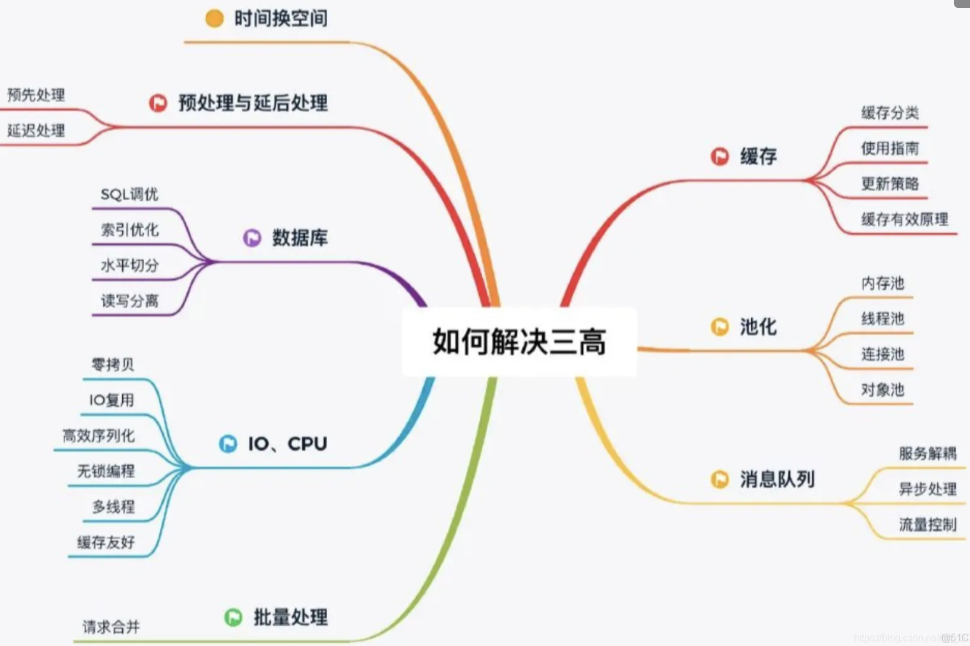


### 一、秒杀系统的 4 要 1 不要

先用一句话说清难度：增删改查写一个秒杀页面很快，让它同时承受高并发访问则完全是另一件事。

要做到这一点，需要回答几个问题：怎样让系统面对百万级请求流量不出故障？如何保证高并发下库存这类数据写得一致？是不是只能靠堆服务器解决？堆机器显然不是最优解——它只是把问题推迟，并且成本随流量线性上升。

秒杀系统本质上是一个要同时满足**大并发、高性能、高可用**的分布式系统。下面五条原则，是在这个目标下反复被验证过的取舍方向。

#### 1. 数据要尽量少

"数据要尽量少"包含两层含义。

第一层是用户请求的数据能少就少，既包括上传给系统的数据，也包括系统返回给用户的数据（通常就是网页）。原因有两条：数据在网络上传输需要时间；无论请求还是响应，服务器都要处理，而服务器写网络时通常要做压缩和字符编码，这些操作都很消耗 CPU。所以减少传输量可以直接降低 CPU 使用。

落地做法例如简化秒杀页面、去掉不必要的页面装修效果。

第二层是系统依赖的数据能少就少，包括完成业务逻辑需要读取和保存的数据——这些数据一般要和后台服务、数据库打交道。调用其他服务会涉及序列化与反序列化，这同样是 CPU 消耗大户，也会增加延时；而数据库本身容易成为瓶颈，所以和数据库打交道越少越好，数据越简单、越小越好。

> 打个比方：搬家时东西越少，车次越少、装卸越省力、路上出意外的概率也越低。请求数据就是这里的"东西"。

#### 2. 请求数要尽量少

页面返回后，浏览器渲染它还要发起额外请求：页面依赖的 CSS、JavaScript、图片，以及 Ajax 请求，这些统称为"额外请求"。

额外请求的代价体现在几处：

- 每建立一个连接都要做 TCP 三次握手；
- 浏览器对同一域名存在并发连接数限制，超出限制的请求只能排队，部分资源（例如 JavaScript）还需要按顺序串行加载；
- 如果不同请求的目标域名不同，还要额外做 DNS 解析，耗时可能更长。

最常见的实践是合并 CSS 和 JavaScript 文件：把多个 JavaScript 文件合并成一个文件一次返回。有些静态资源服务还支持在 URL 中用逗号把多个文件拼成一个响应（常称为 combo 机制），这样一次请求就能取回多个资源。

#### 3. 路径要尽量短

这里的"路径"指用户发出请求到拿到数据之间经过的中间节点数。这些节点可以是一套系统，也可以是一次新的 Socket 连接（例如代理服务器只是新建一条 Socket 连接来转发请求）。每经过一个节点，一般都会多一次连接建立，而每多一条连接就多一份不确定性。

从概率上看，假如一次请求经过 5 个节点，每个节点可用性都是 99.9%，整条路径的可用性就是 0.999 的 5 次方，约等于 99.5%。所以缩短路径能同时带来三个收益：可用性更高、性能更好（中间节点少了，序列化与反序列化也少）、延时更低（网络传输耗时减少）。

#### 4. 依赖要尽量少

"依赖"指完成一次用户请求**必须**依赖的系统或服务，这里强调的是**强依赖**。

例如展示秒杀页面，必须强依赖商品信息和用户信息；而优惠券、成交列表这类对秒杀并非必须的信息属于**弱依赖**，紧急情况下可以直接去掉。

减少依赖的办法是给系统分级：0 级、1 级、2 级、3 级。若 0 级是最重要的系统，那么 0 级系统强依赖的系统同样属于最重要的系统，依次类推。

需要注意，0 级系统要尽量减少对 1 级系统的强依赖，避免重要系统被不重要系统拖垮。例如支付系统是 0 级、优惠券是 1 级，极端情况下可以把优惠券降级，防止支付被优惠券拖垮。

#### 5. 不要有单点

单点是架构上的大忌：单点意味着没有备份，风险不可控。设计分布式系统最重要的原则之一就是"消除单点"。

避免单点的关键，是不要把服务的状态和机器绑定，也就是让服务**无状态化**——服务不持有只存在于本机的状态，就能在机器之间自由迁移。

具体做法例如把与机器相关的配置动态化：这些参数通过配置中心动态推送，服务启动时拉取，在配置中心设置规则就能方便地改变映射关系。

但存储类服务本身很难无状态化，因为数据要落盘，天然和机器绑定。这类场景通常通过多副本冗余来解决单点问题。

#### 不同请求体量下的架构演进

原则讲完，回到秒杀这个具体场景。下面按请求体量从小到大，梳理三个阶段的典型架构，以及每一步改造付出的代价。

**第一阶段：给商品页加一个"定时上架"。** 最省事的做法是只在秒杀开始时才让用户看到购买按钮，库存卖完即结束。这基本等于没做架构改造。

**第二阶段：把秒杀系统独立出来。** 当请求量从万级（1w/s）涨到十万级（10w/s）时，上面的简单架构很快遇到瓶颈，于是做两件事：

- 秒杀系统单独成系统，这样可以有针对性地优化，例如去掉店铺装修功能、降低页面复杂度；
- 部署上单独做一个机器集群，秒杀的大流量就不会影响正常商品购买集群的负载。

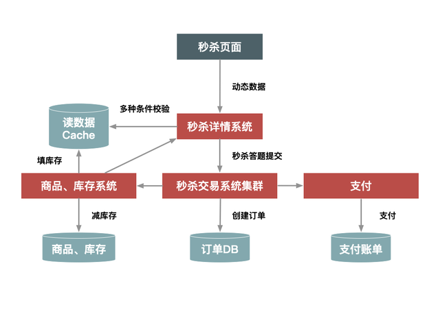

**第三阶段：彻底动静分离 + 服务端本地缓存。** 这个架构仍支撑不了百万级（100w/s）以上的请求量，于是继续升级：

- 对页面做彻底的动静分离，用户秒杀时不需要刷新整个页面，只点击抢购按钮，把需要刷新的数据量降到最低；
- 在服务端对秒杀商品做本地缓存，不再调用依赖系统的后台服务取数据，甚至不查公共缓存集群。这样既减少了系统调用，也避免把公共缓存集群压垮。

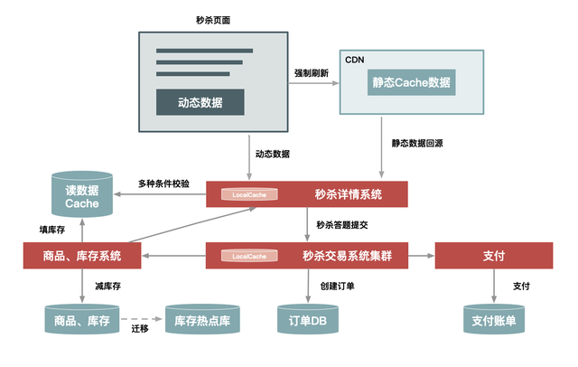

| 阶段 | 请求量级 | 关键改造 | 主要代价 |
| --- | --- | --- | --- |
| 定时上架 | 很低 | 仅前端控制购买按钮可见性 | 没有真正的并发保护 |
| 独立秒杀系统 | 万级到十万级 | 系统拆分、独立集群、页面简化 | 多一套系统要维护；数据要同步 |
| 动静分离 + 本地缓存 | 百万级以上 | 页面只刷局部、数据进本地内存 | 通用性下降，缓存一致性要自己兜底 |

从前几次升级可以看出：越往极致性能走，需要定制的点越多，方案也越"不通用"。要换取极致的性能，就必须在通用性、易用性、成本等方面做出牺牲——这是秒杀系统设计中反复出现的同一个权衡。

### 二、动静分离：把静态数据缓存到离用户最近的地方

这一节解决"页面为什么要拆、怎么拆"的问题。拆开的收益很直接：客户端拿到的数据量大幅下降，服务端可以用缓存直接返回整段 HTTP 响应，请求处理链路被大幅压缩。

#### 为什么值得做动静分离

秒杀场景对系统的要求可以概括为三个字：**快、准、稳**。

要"快"，抽象来看只有两条路：提高单次请求的效率，以及减少没必要的请求。动静分离正是同时踩在这两条路上的方案。

最早的秒杀系统需要刷新整个页面；后来的做法是点一下"刷新抢购"按钮就够了。这个变化的本质就是动静分离：分离之后，客户端需要传输和渲染的数据量大幅减少。

#### 什么是动态数据、什么是静态数据

所谓动静分离，就是把用户请求的数据（例如 HTML 页面）划分为"动态数据"和"静态数据"。

判断标准不是数据存在哪里，而是看页面中输出的数据是否与 **URL、浏览者、时间、地域** 相关，以及是否含有 Cookie 等私密数据。

- 很多媒体类网站，某篇文章的内容不管谁来访问都一样，这是典型的静态数据——尽管它是"动态页面"（由程序渲染而非磁盘上的静态文件）。
- 电商首页每个人看到的内容可能不同，其中根据访问者特征推荐的部分就属于动态数据。

所以"动态"还是"静态"，说的不是数据本身动不动，而是数据中是否含有和访问者相关的个性化数据。并且页面"不包含"这些因素，指的是**页面的 HTML 源码中不含有**。

分离出静态数据后就可以对它做缓存，静态数据的访问效率自然随之提高。

#### 缓存静态数据的三个要点

**第一，把静态数据缓存到离用户最近的地方。** 常见位置有三种：用户浏览器、CDN（内容分发网络，把内容复制到离用户更近的节点上）、服务端 Cache。原则上越靠近用户越好。

**第二，静态化改造要直接缓存 HTTP 连接，而不只是缓存数据。** 静态化改造后，Web 代理服务器根据请求 URL 直接取出对应的 HTTP 响应头和响应体返回，这个响应过程简单到连 HTTP 协议都不用重新组装，甚至不需要解析 HTTP 请求头。

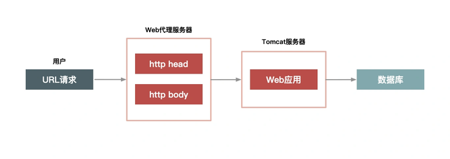

**第三，让谁来缓存也很重要。** 不同语言写的缓存软件处理效率不同。以 Java 为例，Java 系统在处理大量连接请求上并不占优（单连接内存开销较大，Servlet 容器解析 HTTP 协议相对较慢），因此可以不把缓存放在 Java 层，而是直接在 Web 服务器层做，从而屏蔽 Java 语言层面的这些弱点。

#### 如何改造：以商品详情页为例的五个动作

理解了"为什么"和"是什么"，接下来是"怎么做"：把动态页面改造成适合缓存的静态页面，本质是把上面提到的几个影响因素逐一剥离出去。

以商品详情系统为例：

- **URL 唯一化。** 商品详情天然适合，例如每个商品由 ID 标识，用 `item.htm?id=xxxx` 这样的形式作为唯一 URL。之所以要唯一，是因为缓存整个 HTTP 响应时需要一个 Key，而 URL 就是最自然的 Key。
- **分离浏览者相关因素。** 包括是否已登录、登录身份等，这些单独拆出来，通过动态请求获取。
- **分离时间因素。** 服务端输出的时间同样通过动态请求获取。
- **异步化地域因素。** 与地域相关的内容做成异步获取；也可以用动态请求获取，只是异步更合适。
- **去掉 Cookie。** 服务端输出页面里的 Cookie 可以通过软件去掉，例如 Varnish 的 VCL 配置中可以用 `unset req.http.Cookie;` 移除请求头中的 Cookie。注意：这里去掉的是**缓存副本**中的 Cookie，并不是说用户最终收到的页面一定不含 Cookie。

剥离出动态内容之后，如何组织这些内容同样关键。很多动态内容会被页面中其他模块使用（例如判断用户是否已登录、用户 ID 是否匹配），因此应把这些信息 **JSON 化**（用 JSON 格式组织），方便前端取用。

#### 动态内容的两种组装方案：ESI 与 CSI

静态部分靠缓存解决，动态部分通常有两种处理方案。

| 方案 | 做法 | 优点 | 缺点 |
| --- | --- | --- | --- |
| ESI（Edge Side Includes，边缘侧包含） | 在 Web 代理服务器上请求动态内容并拼进静态页面，用户拿到时已是完整页面 | 用户体验好，一次拿到完整页面 | 拼装发生在代理层，对服务端性能有一定影响 |
| CSI（Client Side Include，客户端包含） | 页面先返回，再由浏览器发起独立的异步 JavaScript 请求获取动态内容 | 服务端压力更小 | 用户端页面可能出现延迟，体验稍差 |

ESI 是一份由多家公司联合提交、2001 年发布的 W3C Note 规范，用一套 XML 标记描述"页面里哪一段要从哪里取"，由支持 ESI 的代理（CDN 边缘节点、反向代理）负责拼装。它与 Apache、Nginx 等 Web 服务器上的 SSI（Server Side Includes）思路相近，但并不是同一个规范：SSI 在源站或 Web 服务器上做包含，ESI 的目标是让代理和 CDN 节点也能参与组装。

#### 三种动静分离的架构方案

静态数据和动态数据分离之后，还要在架构上回答一个问题：这些数据在请求路径上如何重新组合后返回给用户。按复杂度从小到大，有三种方案。

**方案 1：实体机单机部署。** 把虚拟机换成实体机以增大缓存容量，并采用一致性 Hash 分组（同一种 Hash 算法把同一批 Key 稳定映射到同一批节点）提升命中率。把缓存分成若干组，是为了在"命中率"和"访问热点"之间取得平衡。

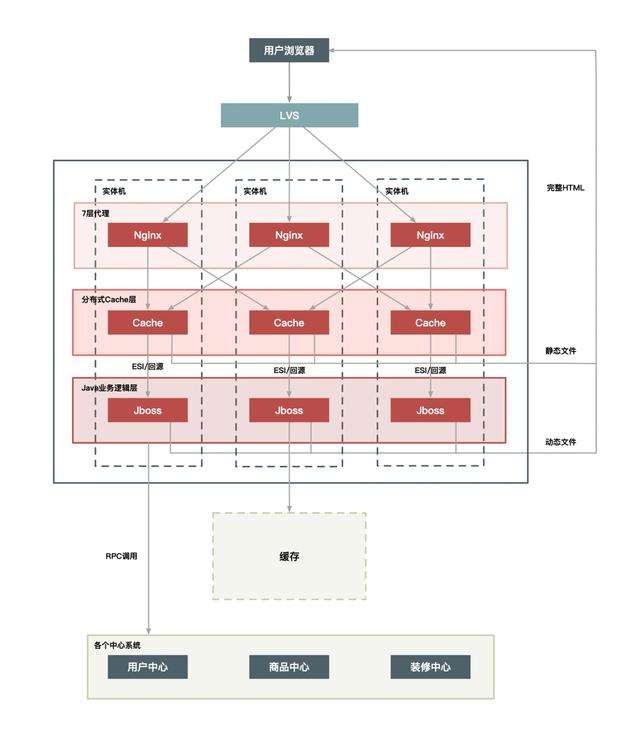

优点是：没有网络瓶颈，能用大内存；既能提升命中率，又能减少 Gzip 压缩；缓存失效压力小，因为采用定时失效方式，例如只缓存 3 秒，过期自动失效。

代价是：Java 进程换成实体机后单机内存变大，但单个 Java 进程很难用满整台实体机的 CPU，造成 CPU 浪费；同一台机器既跑 Java 应用又当缓存用，运维复杂度高。

这是一个折中方案。如果公司里没有其他系统有类似需求，这样做比较合适；如果有多个业务系统都要做静态化改造，更合理的是把缓存层独立出来公用，也就是方案 2。

**方案 2：统一 Cache 层。** 把单机缓存统一剥离出来，形成一个单独的缓存集群。

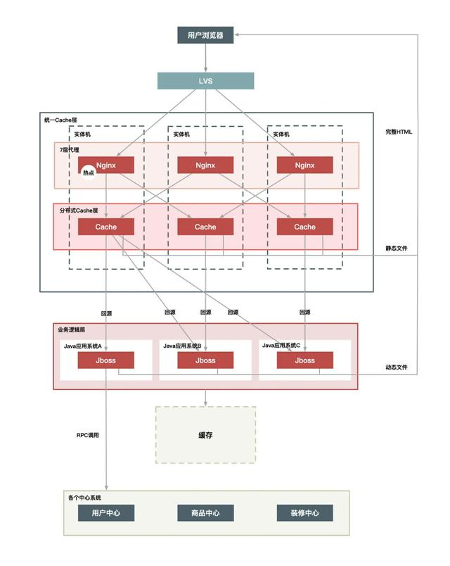

单独一层统一管理可以降低运维成本，也方便接入其他静态化系统。具体优点包括：接入方只需维护自己的 Java 系统，不必单独维护缓存；监控、配置自动化等只需一套方案，升级维护方便；不同系统之间可以共享并动态调配内存，从而更有效地应对突发流量。

但它把风险也集中了：缓存层内部的交换网络可能成为瓶颈；缓存服务器的网卡同样可能是瓶颈；机器数量少，挂一台就会影响很大一部分缓存数据。缓解办法是对缓存再做 Hash 分组——同一组缓存存相同内容，避免热点数据过度集中形成新的瓶颈。

**方案 3：上 CDN。** 系统做完动静分离后，很自然会想到把缓存进一步前移到 CDN，因为 CDN 离用户最近。

但要这么做，有三个问题必须先解决：

- **失效问题。** 静态数据的"相对不变"意味着"可能会变"。例如一篇文章现在不变，发现错别字就要改。如果缓存时效很长，用户会在很长时间里看到错误内容。因此需要保证 CDN 能在秒级把分布在全国各地的缓存同时失效，这对 CDN 的失效系统要求很高。
- **命中率问题。** 缓存最重要的指标是命中率，否则缓存就失去意义。数据铺到全国所有 CDN 节点上必然导致缓存分散，请求命中同一份缓存副本的概率下降，命中率就成了问题。
- **发布更新问题。** 如果业务系统每周都要发布，发布系统必须足够简洁高效，还要考虑出问题时快速回滚和排查的简便性。

因此，把商品详情系统铺到全国所有 CDN 节点并不现实。可行的是选择若干节点试点，而这些节点通常需要满足：靠近访问量集中的地区；离主站相对较远；到主站的网络质量好且稳定；节点容量较大，不占用其他 CDN 太多资源。

还有一点同样重要：**节点不要太多**。基于这些因素，选择 CDN 的二级 Cache 比较合适——二级 Cache 节点数量偏少、容量更大，用户请求先回到二级 Cache，未命中再回源站。


三者对比如下：

| 维度 | 实体机单机部署 | 统一 Cache 层 | 上 CDN |
| --- | --- | --- | --- |
| 缓存位置 | 应用同机 | 独立缓存集群 | 边缘节点（建议二级 Cache） |
| 命中率 | 高（一致性 Hash 分组） | 高（可再 Hash 分组） | 取决于节点数量与分布 |
| 网络瓶颈 | 基本没有 | 内部交换网络、网卡可能成为瓶颈 | 回源链路是瓶颈 |
| 风险集中度 | 单机故障影响小 | 机器少，单台故障影响大 | 失效传播范围大 |
| 运维复杂度 | 高（应用与缓存混部） | 低（统一维护） | 中（需发布与失效体系） |
| 适用 | 单一业务、访问量不大、要求数据可控 | 多个业务系统都有静态化需求 | 访问量大、对静态内容加载速度要求高 |
| 不适用 | 多业务共用、需要弹性伸缩 | 缓存层网络与网卡无法扩容 | 内容频繁变更且无法秒级失效、节点容量不足 |

一般来说，访问量大、对静态内容加载速度要求高的站点（大型电商、视频网站等）更适合上 CDN；而对数据安全性和隐私性要求较高、访问量相对较小的内部系统，更倾向于实体机单机部署，以保证数据可控。

用 CDN 二级 Cache 做缓存，命中率可以接近服务端静态化 Cache 的水平：节点数不多、缓存不分散、访问量集中，命中率问题因此得到缓解，同时用户体验最好，是目前比较理想的 CDN 化方案。

CDN 化部署还有两个特点：整个页面可以缓存在用户浏览器中；如果强制刷新整个页面，请求仍会打到 CDN。也正因为如此，"抢购按钮只刷新局部数据"这种设计，才能在不刷新整页的前提下拿到服务端最新的动态数据。

### 三、CDN 缓存失效的六种应对手段

上一节把"上 CDN"列为可选方案，但它留下的最大隐患是失效：静态数据一旦变更，全国节点上的旧副本必须尽快清掉。这一节按"立即 / 定期 / 事前预防"三类，给出六种可落地的做法。

#### 1. 配置缓存刷新

最直接的方式，适用于必须立即刷新的场景。CDN 服务商通常提供两种刷新方式：

- **目录刷新**：更新整个目录下的所有文件。操作步骤通常是：登录 CDN 控制台 → 选择域名 → 点击"缓存刷新"并选择"目录刷新" → 输入目录路径后确认。
- **URL 刷新**：更新指定文件。步骤同上，只是在刷新类型处选择"URL 刷新"，并输入具体 URL。

#### 2. 用 API 自动化刷新

对能写代码的团队，调用 API 自动刷新更灵活高效。CDN 服务商一般提供缓存刷新、预热等接口。

流程是：先在控制台的访问管理里取得 API 凭证（例如 SecretId、SecretKey），再写脚本调用刷新接口。下面是一段用 HmacSHA1 生成签名的示例：把参数按键名排序、拼接、做 HMAC 计算，再转成十六进制字符串。

```java
import java.io.UnsupportedEncodingException;
import java.net.URLEncoder;
import java.nio.charset.StandardCharsets;
import java.security.NoSuchAlgorithmException;
import java.util.ArrayList;
import java.util.List;
import java.util.Map;
import java.util.TreeMap;
import org.apache.http.NameValuePair;
import org.apache.http.client.utils.URLEncodedUtils;
import org.apache.http.message.BasicNameValuePair;
import javax.crypto.Mac;
import javax.crypto.spec.SecretKeySpec;

/**
 * 调用 CDN 缓存刷新 API：参数排序 + HmacSHA1 签名
 */
public class CDNRefresh {

    public static String getSignature(String secretKey, Map<String, String> params)
            throws NoSuchAlgorithmException, UnsupportedEncodingException {
        // 对参数按键名排序，保证签名串顺序稳定
        TreeMap<String, String> sortedParams = new TreeMap<>(params);
        StringBuilder encodedParams = new StringBuilder();
        for (Map.Entry<String, String> entry : sortedParams.entrySet()) {
            encodedParams.append(entry.getKey())
                    .append("=")
                    .append(URLEncoder.encode(entry.getValue(), StandardCharsets.UTF_8.name()));
            encodedParams.append("&");
        }
        // 去掉最后一个 &
        encodedParams.deleteCharAt(encodedParams.length() - 1);
        // 使用 HmacSHA1 算法生成签名
        Mac sha1Hmac = Mac.getInstance("HmacSHA1");
        SecretKeySpec secretKeySpec =
                new SecretKeySpec(secretKey.getBytes(StandardCharsets.UTF_8), "HmacSHA1");
        sha1Hmac.init(secretKeySpec);
        byte[] hash = sha1Hmac.doFinal(encodedParams.toString().getBytes(StandardCharsets.UTF_8));
        StringBuilder signature = new StringBuilder();
        for (byte b : hash) {
            String hex = Integer.toHexString((b & 0xFF) | 0x100).substring(1, 3);
            signature.append(hex);
        }
        return signature.toString();
    }

    // 构建请求 URL：把参数和签名拼到 URL 上
    public static String refreshCache(String secretId, String secretKey, String urls)
            throws NoSuchAlgorithmException, UnsupportedEncodingException {
        String baseUrl = "https://cdn.api.qcloud.com/v2/index.php";
        Map<String, String> params = new TreeMap<>();
        params.put("Action", "RefreshCdnUrl");
        params.put("SecretId", secretId);
        params.put("Timestamp", String.valueOf(System.currentTimeMillis() / 1000));
        params.put("Nonce", String.valueOf(System.currentTimeMillis()));
        params.put("urls.0", urls);
        // 获取签名
        String signature = getSignature(secretKey, params);
        params.put("Signature", signature);
        // 构建请求 URL
        List<NameValuePair> nameValuePairs = new ArrayList<>();
        for (Map.Entry<String, String> entry : params.entrySet()) {
            nameValuePairs.add(new BasicNameValuePair(entry.getKey(), entry.getValue()));
        }
        String requestUrl =
                baseUrl + "?" + URLEncodedUtils.format(nameValuePairs, StandardCharsets.UTF_8);
        // 发送 GET 请求（示例，实际使用 Apache HttpClient）
        // CloseableHttpClient httpClient = HttpClients.createDefault();
        // HttpGet httpGet = new HttpGet(requestUrl);
        // CloseableHttpResponse response = httpClient.execute(httpGet);
        // try {
        //     // 处理响应
        // } finally {
        //     response.close();
        // }
        return requestUrl;
    }

    public static void main(String[] args) {
        try {
            String secretId = "your_secret_id";
            String secretKey = "your_secret_key";
            String urls = "https://static.example.com/path/to/your/file";
            String requestUrl = refreshCache(secretId, secretKey, urls);
            // 真实场景记录异步日志
            System.out.println(requestUrl);
        } catch (NoSuchAlgorithmException | UnsupportedEncodingException e) {
            // 捕获异常，避免运行时因签名相关异常导致程序崩溃
            e.printStackTrace();
        }
    }
}
```

需要注意：各服务商的签名算法、参数编码方式、时间戳精度并不统一，实现时以对应 API 文档为准；凭证不要写进代码仓库，应放在配置或密钥管理服务里。

#### 3. 定期策略刷新

对内容更新频繁的站点，可以按规则定期刷新缓存，适用于大部分资源都需要定期更新的场景。

一种做法是在 CDN 控制台为不同类型文件设置不同的缓存过期时间：图片、CSS、JS 设长一些，HTML 设短一些。步骤通常是：登录控制台 → 选择域名 → 进入"缓存配置"并选择"缓存规则" → 按文件类型设置过期时间后确认。

#### 4. 合理设置 HTTP 缓存头

通过调整响应头可以更精细地控制缓存行为：

- **Cache-Control**：按需设置 `max-age`、`no-cache`、`public` 等指令，控制 CDN 和浏览器的缓存行为。
- **ETag 与 Last-Modified**：配合条件请求（`If-None-Match`、`If-Modified-Since`）做协商缓存，尽量减少重复传输。

#### 5. 版本控制

静态资源更新时更改文件名或加版本号（例如 `app.20240118.js`），让浏览器缓存自然失效，避免用户拿到旧版本资源。

#### 6. 监控与日志分析

利用 CDN 提供的监控和日志能力，持续观察命中率、回源率、错误率等指标，及时发现并处理异常，反过来校正缓存策略。

小结一下选型：**必须立刻生效的用配置刷新或 API 刷新；可以容忍分钟级延迟的用短 TTL + 定期刷新；可预知资源变更的，优先用版本控制和缓存头，把刷新变成"不需要刷新"。**

### 四、热点数据：二八原则下的发现与保护

秒杀系统里，1% 的商品往往带来 99% 的流量。这一节解决两个问题：怎么提前或实时地"知道"哪些是热点，以及知道之后怎么处理。

#### 什么是"热点"

热点分两类：**热点操作**和**热点数据**。

- **热点操作**：大量刷新页面、大量加购物车、零点集中下单等。对系统而言，这些操作最终会抽象成"读请求"和"写请求"。两者处理方式差别很大：读请求的优化空间较大；写请求的瓶颈一般在存储层，优化思路是依据 CAP 理论做平衡。CAP 指一致性（Consistency）、可用性（Availability）、分区容错性（Partition tolerance）三者无法同时满足，分布式系统通常要在前两者之间取舍。
- **热点数据**：用户热点请求所对应的数据。它又分为静态与动态两种。

**静态热点数据**是可以提前预测的热点。除了报名、预报等方式，还可以通过大数据分析提前发现：分析历史成交记录、用户购物车记录，找出可能更热门、更好卖的商品。

**动态热点数据**是无法提前预测、系统运行过程中临时产生的热点。

热点操作是用户行为，系统不好直接改变，但可以做限制和保护。因此优化的重点落在热点数据上。

#### 如何发现热点数据

一个前提问题容易被忽略：系统怎么知道哪些商品参加了秒杀活动？需要一个机制，提前把普通商品和秒杀商品区分开。

**发现静态热点**的常见做法是商业手段配合技术手段：强制卖家报名参加活动，通过运营系统给参加活动的商品数据打标，再由后台系统对这些热点商品做预处理（例如提前缓存）。

这种方式的副作用是：增加卖家的使用成本；实时性较差；也不够灵活。

**发现动态热点**的价值在于实时性。如果系统能在秒级自动发现热点商品，就能立刻对下游做保护。这不仅对秒杀商品有用，对其他突发的热卖商品同样有价值。

#### 动态热点发现系统的实现思路

整体分三步：

1. **收集热点 Key。** 建一个异步系统，从交易链路上的中间件收集热点 Key，例如 Nginx、缓存、RPC 服务框架等（部分中间件本身已带热点统计模块）。
2. **建立上报与订阅规范。** 定义统一的热点上报格式和订阅下发机制，核心思路是利用交易链路上各系统（详情、购物车、交易、优惠、库存、物流等）之间的访问时间差，把上游已经发现的热点透传给下游，让下游提前保护。例如大促高峰时，详情系统往往是最早感知到热点的，统一接入层的 Nginx 模块就能统计出热点 URL。
3. **汇总与下发。** 上游把热点数据发到热点服务台，下游系统（如交易系统）据此知道哪些商品会被频繁访问，进而做热点保护。


在落地形态上：部署在每台机器上的 Agent 把日志汇总到聚合与分析集群，再由规则筛出热点数据，通过订阅分发系统推送到相应系统。下游拿到数据后可以自己决定怎么用——写入 Cache、直接推到应用服务器内存，或者做拦截。

#### 三个注意事项

1. **抓取日志用异步方式。** 一方面便于保证通用性，另一方面不影响业务系统和中间件的主流程。
2. **与中间件自身的热点保护并存。** 热点服务台提供收集与订阅能力，但每个中间件和应用仍然需要保护自己。
3. **发现要接近实时。** 实践中常把目标定在 3 秒内完成热点发现；只有足够快，动态发现才有意义，才能及时为下游提供保护。

#### 三种处理思路：优化、限制、隔离

**优化。** 最有效的办法是缓存热点数据。若热点数据已做动静分离，静态部分可以长期缓存；而缓存热点数据更多是"临时"缓存——不论静态还是动态数据，都用一个队列短暂缓存数秒，队列长度有限时可用 LRU（Least Recently Used，最近最少使用）淘汰算法替换。

> 可以把它想成便利店门口的临时货架：只摆最常被拿的几样，卖完再补，而不是把整个仓库搬到门口。

**限制。** 本质是保护机制。常见做法是对被访问商品的 ID 做一致性 Hash 后分桶，每个分桶配一个处理队列，从而把某个热点商品限制在一个请求队列里，避免它占用过多服务器资源、导致其他请求始终得不到处理。

**隔离。** 秒杀设计的第一个原则就是把热点数据隔离出来，不让 1% 的请求影响另外 99%，隔离之后也更容易对这 1% 做针对性优化。具体分三个层次：

| 层次 | 做法 | 解决的问题 |
| --- | --- | --- |
| 业务隔离 | 把秒杀做成需要单独报名的营销活动 | 卖家报名后热点变成"已知热点"，可提前预热 |
| 系统隔离 | 分组部署，秒杀申请独立域名，请求落到独立集群 | 运行时互不干扰，容量互不侵占 |
| 数据隔离 | 单独的 Cache 集群或独立数据库承载热点数据 | 避免 0.01% 的数据影响 99.99% 的数据 |

### 五、流量削峰：排队、答题与分层过滤

这一节解决"瞬时流量远超处理能力"的问题。核心思路不是让系统变快，而是把请求在时间轴上摊开、在链路上滤掉，让真正到达数据库的写请求少而有序。

#### 为什么需要削峰

服务器的处理资源是恒定的：用与不用，处理能力都在那里。出现峰值时容易忙不过来，闲时又无事可做；而为了保证服务质量，资源只能按峰值来预估，这必然造成浪费。

这就好比城市因为早晚高峰而采取错峰限行：不是增加道路，而是把出行需求在时间上分散。

削峰有两个直接收益：让服务端处理更平稳；节省服务器资源成本。对秒杀场景来说，削峰本质上是延缓请求的发出、减少并过滤无效请求，遵循的仍是"请求数要尽量少"的原则。

具体手段可分两类：

- **无损方案**：排队、答题、分层过滤——不会丢弃用户已经发出的请求。
- **有损方案**：限流、机器负载保护等强制措施，也能达到削峰保护的目的，但属于不得已的手段。

#### 排队：用消息队列承接洪峰

最容易想到的排队方式是用消息队列缓冲瞬时流量：把同步的直接调用改成异步的间接推送，一端承接瞬时洪峰，另一端平滑地把消息推给下游。消息队列在这里就像水库——拦蓄上游洪水，削减进入下游河道的洪峰。

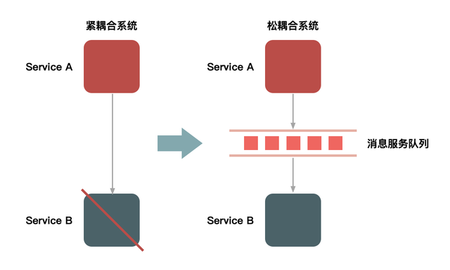

但消息队列不是万能的：如果峰值持续时间足够长，达到了队列的处理上限（例如本机消息积压达到存储空间上限），队列同样会被压垮。此时它虽然保护了下游，但效果和直接丢弃请求差别不大——就像洪水爆发时，水库也可能无济于事。

除了消息队列，还有几种等价的排队方式：

1. 线程池加锁等待；
2. 先进先出、先进后出这类内存排队算法；
3. 把请求序列化到文件中，再顺序读文件恢复请求（例如基于 MySQL binlog 的同步机制）。

#### 答题：既拦机器人，又拉长峰值

早期的秒杀只是刷新页面、点击购买按钮，后来才加上答题和前端 JavaScript 控制。加答题有两个目的。

**目的之一：拦住秒杀器。** 秒杀火热之后，自动化的抢购脚本（秒杀器）随之泛滥，普通用户很难抢到，营销目的落空。加入答题后，下单时间基本被推到 2 秒之后，秒杀器的下单比例明显下降（这是当时业务侧的观察数据，具体比例随活动而异）。


**目的之二：延缓请求，把峰值拉长。** 答题把原本集中在 1 秒内的下单请求拉长到 2~10 秒，相当于按时间做了分片，这对服务端处理并发非常重要。而且请求有先后顺序，靠后的请求到达时库存往往已经没了，根本走不到最后的下单步骤，真正的并发写因此非常有限。类似的思路也出现在支付宝"咻一咻"、微信"摇一摇"这类集中式互动活动中。

答题功能本身怎么设计？整体分三部分：

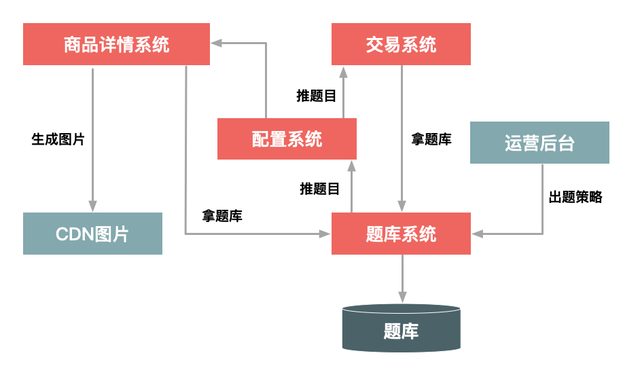

- **题库生成模块**：生成题目与答案。题目本身不需要复杂，关键是让机器算不出答案。
- **题库推送模块**：在答题开始前把题目推送给详情系统和交易系统。推送的目的是保证每次用户请求到的题目唯一，防止作弊。
- **题目图片生成模块**：把题目渲染成图片，并在图片里加入干扰因素，迫使人才能理解题意。另外，答题时网络往往比较拥挤，题目图片应提前推送到 CDN 并预热，否则用户请求题目时图片加载慢，会影响答题体验。

真正的答题校验逻辑很简单：拿用户提交的答案与题目对应答案比对，通过则进入下单流程，否则失败。题目和答案可以用下面这样的 key 做 MD5 加密存储：

- 问题 key：`userId + itemId + questionId + time + PK`
- 答案 key：`userId + itemId + answer + PK`


除了答案正确性，校验还应包含身份维度：是否已登录、Cookie 是否完整、是否重复频繁提交。此外可以对提交时间做限制，例如从开始答题到接受答案必须超过 1 秒——低于 1 秒基本不可能是人工操作。这个阈值属于经验值，可按实际活动的误伤率调整。

#### 分层过滤：用漏斗拦掉无效请求

排队和答题，一个是少发请求，一个是对已发出的请求做缓冲。还有一类方法是在请求前进的每一层就地过滤，这就是"漏斗"式设计。

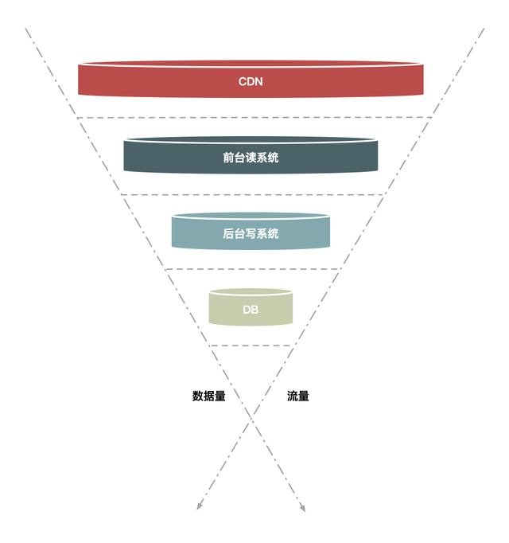

假设请求依次经过 CDN、前台读系统（如商品详情）、后台系统（如交易）和数据库，那么每一层各自承担一部分过滤职责：

- **CDN / 浏览器层**：大部分数据与流量在这里被命中，可以直接拦截掉大部分读请求；
- **前台系统层**：数据（包括强一致性要求的数据）尽量走 Cache，过滤掉无效请求；
- **后台系统层**：做数据二次校验，同时对系统做保护和限流，数据量与请求量进一步减少；
- **数据层**：完成数据的强一致性校验。

像漏斗一样，一层一层把数据量和请求量滤掉，最后到达末端的才是有效请求。

核心思想是：**在不同层次尽可能过滤掉无效请求。** 要做到这点，数据必须分层校验，基本原则有五条：

1. 动态请求的读数据缓存（Cache）在 Web 端，过滤掉无效的数据读；
2. 对读数据不做强一致性校验，避免一致性校验本身成为瓶颈；
3. 对写数据做基于时间的合理分片，过滤掉过期的失效请求；
4. 对写请求做限流保护，把超出系统承载能力的请求过滤掉；
5. 对写数据做强一致性校验，只保留最后有效的数据。

### 六、性能：影响因素、瓶颈定位与五种优化手段

这一节回答三个递进的问题：性能该用什么指标衡量、瓶颈通常在哪里、Java 系统上有哪些确实有效的优化手段。

#### 先定义"性能"

不同设备对性能的定义不同：CPU 主要看主频，磁盘主要看 IOPS（Input/Output Operations Per Second，每秒读写操作次数）。

讨论服务端性能时，常用两个指标：QPS（Query Per Second，每秒请求数）和响应时间 RT（Response Time，服务器处理一次请求的耗时）。

正常情况下 RT 越短、QPS 越高。在单线程处理模型里这几乎是线性的，只要把每次请求的 RT 压到最低，性能就最高。

但 RT 有下限，不可能无限下降，于是引入第二个维度：多线程。此时的关系近似为：

```text
总 QPS = (1000ms / 响应时间 RT) × 线程数量
```

于是性能取决于两个因素：一次响应的服务端耗时，以及处理请求的线程数。

#### 响应时间花在哪里

对多数 Web 系统而言，RT 由两部分组成：CPU 执行时间，以及线程等待时间（RPC 等待、IO 等待、Sleep、Wait 等）。

一个常被忽略的现象：如果一台代理服务器自身不做 CPU 运算，只是给转发的请求人为加一点延时，它的吞吐量并不会因此受多大影响——因为它的资源并没有被消耗，只要增加处理线程数就能弥补延时带来的 QPS 下降。

真正影响性能的是 **CPU 执行时间**，因为它真正消耗服务器资源。因此优化的主攻方向是压缩 CPU 执行时间。需要注意的是，"CPU 时间减半、QPS 翻倍"只在等待时间可忽略、线程数不变的前提下近似成立；等待占比较高时，收益会明显打折。

#### 线程数不是越多越好

单看上面的公式，似乎线程越多 QPS 越高，但这并不成立：线程本身要消耗资源（栈内存、上下文切换），也受下游容量限制。

很多场景流传着一个默认配置："线程数 = 2 × CPU 核数 + 1"。这属于经验值，没有普适的理论保证。更通用的估算思路是把等待占比考虑进来：

```text
线程数 ≈ CPU 核数 × [ (线程等待时间 + 线程 CPU 时间) / 线程 CPU 时间 ]
```

实际取多少，最可靠的办法是通过压测确认——只有压测能同时覆盖业务特征与硬件差异。

#### 如何定位瓶颈

服务器上可能出现瓶颈的地方很多：CPU、内存、磁盘、网络。不同系统关注点不同：缓存系统受限于内存，存储型系统更容易卡在 I/O；而秒杀场景的瓶颈更多出现在 CPU 上。

一个简单的判断办法：当 QPS 达到极限时，看服务器 CPU 使用率是否已经接近打满（例如超过 95%）。如果没有，说明 CPU 还有余量，此时限制往往来自锁竞争或过多的本地 I/O 等待——这是一个经验性的排查切入点，不是硬阈值。

#### 五种优化手段

对 Java 系统来说可优化的点很多，其中比较有效的有五类。

| 手段 | 作用点 | 主要代价 |
| --- | --- | --- |
| 减少编码 | 字符与字节之间的转换 | 需要改造 I/O 路径，可能牺牲可读性 |
| 减少序列化 | RPC 与对象编解码 | 合并部署降低隔离性，扩容粒度变粗 |
| Java 极致优化 | 请求处理链路 | 绕过框架后开发效率下降 |
| 并发读优化 | 缓存单点与热点读 | 本地缓存带来一致性延迟 |
| 多活架构 | 机房级可用性 | 成本高，数据同步复杂 |

**1. 减少编码。** Java 的编码运行相对较慢，这是它的一个弱点。很多场景只要涉及字符串操作（输入输出、I/O）就比较耗 CPU，因为都要把字符转换成字节，而这个转换必须编码。每个字符的编码往往需要查表，查表本身很耗资源。因此减少字符到字节（以及反向）的转换，收益会相当明显。

**2. 减少序列化。** 序列化同样是 Java 性能的大敌，而且序列化往往与编码同时发生，所以减少序列化通常也减少了编码。

序列化大部分发生在 RPC 中，因此减少 RPC 调用就能减少序列化（当前主流序列化协议本身也已做了大量优化）。有一种更激进的方案叫**合并部署**：把两个原本部署在不同机器上的应用合并到同一台机器，并且跑在同一个 Tomcat 容器里、不走本机 Socket，这样调用就不需要序列化。

**3. Java 极致优化。** Java 与通用 Web 服务器（Nginx、Apache 等）相比，处理大并发 HTTP 请求的能力偏弱。因此大流量 Web 系统通常会做静态化改造，让大部分请求和数据由 Nginx 或 Web 代理服务器（Varnish、Squid 等）直接返回，顺带省掉序列化与反序列化，Java 层只处理少量动态请求。针对这些动态请求，还可以进一步：

1. 直接使用 Servlet 处理请求，绕开 MVC 框架中大量用不上的处理逻辑（可省下的时间取决于对框架的依赖程度，属于毫秒级的经验值，需实测）；
2. 直接输出流数据，减少中间对象的拼装。

**4. 并发读优化。** 一个常见误区是"把热点数据放进集中式缓存就解决了"。集中式缓存为保证命中率通常采用一致性 Hash，同一个 key 总是落到同一台机器上，于是单台缓存节点成为新的上限；对超大促级别的热点商品，单节点容量很可能不够。

彻底解决单点瓶颈的思路是用应用层的 LocalCache（本地缓存），即在秒杀系统每台机器上缓存商品相关数据。缓存内容按性质分别处理：

1. 商品标题、描述这类不变的数据，在秒杀开始前全量推送到秒杀机器，一直缓存到秒杀结束；
2. 库存这类动态数据，采用"被动失效"方式缓存一定时间（一般是数秒），失效后再去缓存拉取最新值。

**5. 多活架构。** 可选同城双活（双机房）和异地多活（两地三中心），目的都是提高可用性与容错能力，保证某个机房或数据中心故障时系统仍能提供服务。

| 维度 | 同城双活（双机房） | 异地多活（两地三中心） |
| --- | --- | --- |
| 布局 | 两个机房同城，专线互联 | 两个城市三个机房，其中两个同城、第三个异地 |
| 角色 | 两个机房同时提供服务 | 同城两机房同时提供服务，异地机房主要做数据灾备 |
| 侧重 | 提高可用性 | 数据安全性与可靠性 |
| 代价 | 专线成本；跨机房调用延迟 | 成本更高；异地同步与切换复杂 |

关于延迟，可按以下量级做容量规划参考（实际值取决于链路、设备与协议，需实测）：同机房内约 0.1 毫秒；同城两机房（100 公里内）约 1 毫秒；跨远距离城市（如北京到广州）往返通常在数十毫秒量级。同城双活的延迟主要来自物理距离与专线质量，异地多活还要叠加数据同步的延迟。

### 七、减库存：三种方案的选择与并发控制

减库存是秒杀里最容易出错的一环：它既要保证不超卖，又要承受同一行记录的极高并发写。这一节先讲方案怎么选，再讲数据库层面的并发控制。

#### 大前提：业务是否允许超卖

在讨论技术方案之前，先确认业务约束：有的电商产品对少量超卖不做处理，有的做补偿（例如缺货后补发或赔付），也有的必须强一致、绝对不允许超卖。方案选择的上限由这个约束决定。

#### 三种减库存方式

正常购物流程分两步：下单和付款。点"立即购买"、核对信息、提交订单属于下单；完成付款才算真正买到。

减库存可以放在不同环节，于是有三种方式：

| 方式 | 触发时机 | 优点 | 风险 |
| --- | --- | --- | --- |
| 下单减库存 | 提交订单即扣减 | 最简单，控制最精确，靠数据库事务即可保证不超卖 | 下单不付款会占用库存 |
| 付款减库存 | 支付成功才扣减 | 不会被"下单不付款"占库存 | 高并发下容易超卖，买家可能付不了款 |
| 预扣库存 | 下单先占用，超时自动释放 | 兼顾体验与库存周转 | 逻辑最复杂，仍需防恶意占用 |

**下单减库存**：买家下单后，在商品总库存中减去购买数量。这是最简单的减库存方式，也是控制最精确的一种——下单时直接通过数据库事务控制库存，不会出现超卖。问题在于，有些人下完单并不会付款。

**付款减库存**：下单时不减库存，等到有用户付款后才真正扣减，否则库存继续留给其他买家。因为付款时才减，并发高时可能出现买家下单后付不了款的情况——商品已经被别人买走了。

**预扣库存**：相对复杂一些。买家下单后，库存为其保留一段时间（例如 10 分钟），超过时间自动释放，其他买家可以继续购买。买家付款前，系统会校验该订单的库存是否仍有保留：没有保留则再次尝试预扣；预扣失败（库存不足）则不允许继续付款；预扣成功则完成付款并实际扣减库存。

#### 三种方式各自的问题

购物过程存在两步或多步操作，在不同步骤减库存，就会留下可被恶意买家利用的漏洞。

**下单减库存的漏洞：恶意下单。** 正常情况买家下单后付款概率很高，问题不大。但卖家参加活动时，活动的有效时间正是商品的黄金售卖时间；如果竞争对手恶意把商品全部下单，使库存降为零，商品就无法正常售卖了——而这些人根本不会付款。

**付款减库存的漏洞：超卖。** 假如只有 100 件商品，可能出现 300 人下单成功，因为下单时并不减库存。这在热门活动商品上尤其常见，结果是大量买家下单成功却付不了款，体验很差。

**预扣库存能缓解但解决不了。** 下单先预扣、超时释放，确实缓解了上面两个问题，但没有彻底解决：把有效付款时间设为 10 分钟，恶意买家完全可以在 10 分钟后再次下单，或者一次下单很多件把库存占满。这类问题最终要结合安全与反作弊手段处理，例如：

- 给经常下单不付款的买家识别打标（被打标买家下单时不减库存）；
- 给某些类目设置最大购买件数（例如活动商品一人最多 3 件）；
- 对重复下单不付款的操作做次数限制。

**超卖也要分情况处理。** 在 10 分钟窗口内，下单数量仍可能超过库存：普通商品可以通过补货解决；如果卖家完全不允许库存为负，只能在买家付款时提示库存不足。

#### 秒杀场景为什么选"下单减库存"

预扣库存是目前业务系统中最常见的方案——买机票、买电影票下单后都有"有效付款时间"，超时自动释放订单，都是典型预扣库存。

但秒杀场景不同：参加秒杀的商品通常是"抢到就是赚到"，成功下单却不付款的比例较低；加上卖家对秒杀库存有严格限制，所以秒杀采用**下单减库存**更合理。另外，下单减库存比预扣库存、以及涉及第三方支付的付款减库存逻辑更简单，性能上也更占优势。

#### 保证库存不为负的三种写法

下单减库存在一致性上的核心要求只有一条：大并发下库存字段不能变成负数。常见做法有三种。

**其一，应用层事务判断。** 在事务中扣减并判断扣减后是否小于零，小于零则回滚。

**其二，把库存字段设为无符号整数。** 需要注意它的真实行为与 SQL 模式有关：

- 严格 SQL 模式（strict SQL mode，MySQL 5.7 起默认开启）下，扣成负数会直接报错，更新失败、库存保持不变，符合预期；
- 非严格模式下，越界值会被截断到列类型范围的上界并只给出警告：无符号列上扣成负数时可能变成一个异常的大值（开启 `NO_UNSIGNED_SUBTRACTION` 时则截断为 0），更新"成功"但结果错误。

也就是说，无符号列并不是天然安全，必须确认严格模式已开启。

**其三，用 CASE WHEN 条件更新。**

```sql
UPDATE item
SET inventory = CASE WHEN inventory >= 1 THEN inventory - 1 ELSE inventory END
WHERE id = ?
```

这种写法的隐患是：即使库存不足，SQL 也会"成功执行"（更新 0 行或原值不变），应用层必须检查影响行数才能判断是否真正扣减成功。更直观的等价写法是把条件放进 `WHERE`：

```sql
UPDATE item
SET inventory = inventory - 1
WHERE id = ? AND inventory >= 1
```

影响行数为 1 表示扣减成功，为 0 表示库存不足，语义清晰且只锁一行。

#### 能不能直接在缓存里减库存

在交易环节中，库存既是关键数据也是热点数据——各个环节都可能查询库存。前面的分层过滤已经说明，秒杀中并不需要对库存做精确的一致性读，把库存放到缓存里能大幅提升读性能。

于是有一个更激进的设想：把秒杀商品的减库存直接放到缓存系统中完成（例如放在带持久化能力的 Redis 中）。

判断标准是业务复杂度：

- **适用**：减库存逻辑非常单一，例如没有 SKU 库存与总库存的联动关系，也没有事务要求；
- **不适用**：减库存逻辑复杂，或必须使用事务——这种情况仍然要在数据库里完成。

#### 数据库减库存的真正瓶颈：行锁竞争

MySQL 中同一份数据必然以一行存储，因此会有大量线程竞争 InnoDB 行锁。并发度越高，等待的线程越多，TPS（Transaction Per Second，每秒处理的事务数）下降，RT 上升，数据库整体吞吐严重受影响。

这会引出一个严重后果：单个热点商品影响整个数据库的性能，导致 0.01% 的商品影响 99.99% 商品的售卖。

一个思路是沿用隔离原则，把热点商品放到单独的热点库。但这会带来维护麻烦：热点数据要动态迁移，还要单独维护数据库。而且即使分离了热点库，行锁竞争依然存在。

#### 解决并发锁竞争的三种办法

**办法一：应用层排队。** 按商品维度设置队列，让同一商品的请求顺序执行。这样既能降低同一台机器对同一行记录的并发度，也能控制单个商品占用的数据库连接数，防止热点商品耗尽连接池。

**办法二：数据库层排队。** 应用层排队只能做到单机范围，而应用机器本身很多，控制力有限；能在数据库层做全局排队才是最理想的。针对这种场景，业界有过在 MySQL InnoDB 层加补丁（patch）、对单行记录做并发排队的实践，例如阿里数据库团队的相关工作。这类补丁还配套了 `COMMIT_ON_SUCCESS`、`ROLLBACK_ON_FAIL` 之类的开关，配合 SQL 中的 hint，让事务在最后一条 SQL 执行完后直接根据目标影响行数（`TARGET_AFFECT_ROW`）的结果提交或回滚，省掉应用层再发一次 COMMIT 的网络等待（团队实测在亚毫秒量级，例如约 0.7ms 的经验值）。是否有可用的开源实现，取决于具体版本与分支，落地前需要核实。

排队和锁竞争都要等待，区别在哪？排队是把等待放在可控的队列里（可以限长、可以拒绝、可以按商品隔离），而锁竞争是在数据库内部被动等待，还叠加了死锁检测（InnoDB 会检测死锁，检测本身有开销）以及 Server 层与 InnoDB 层切换的成本。

**办法三：固定机器 + MQ 异步队列。** 让同一商品的请求总是落到同一台机器，再由该机器串行处理。

第一步是用 Nginx 的哈希策略按请求中的唯一值（如商品 ID）做路由：

```nginx
http {
    upstream backend {
        hash $arg_id;  # 按 URL 参数 id 做哈希，例如 /api?id=123
        server backend1.example.com;
        server backend2.example.com;
        server backend3.example.com;
    }

    server {
        listen 80;
        location / {
            proxy_pass http://backend;
        }
    }
}
```

说明：`hash` 指令自 Nginx 1.7.2 起可用，`$arg_id` 是 Nginx 内置变量，表示 URL 中 `id` 参数的值。默认的哈希分片在增删后端时会重映射大量 key，若需要更稳定的映射可加 `consistent` 参数（使用 ketama 一致性哈希）。另外，`$arg_id` 只对 GET 的查询参数有效，POST 场景需要从请求体或 header 中另取关键值。

第二步是用消息队列或内存队列保证顺序处理。

- **Kafka**：支持按 key 分区，相同 key 的消息进入同一个 partition；消费者单线程处理一个 partition 即可保证分区内顺序（多线程消费同一 partition 会破坏顺序）。
- **RabbitMQ**：可以拆多个 queue、每个 queue 一个 consumer；也可以只用一个 queue，在消费端用内存队列做二次排队。

内存队列的最小实现如下：

```java
import java.util.LinkedList;
import java.util.Queue;

/**
 * 单机内的顺序队列：请求先入队，再由单线程顺序取出处理
 */
public class OrderlyQueue {

    private final Queue<Message> messages;

    public OrderlyQueue() {
        this.messages = new LinkedList<>();
    }

    public void addMessage(Message message) {
        messages.add(message);
    }

    public Message getMessage() {
        return messages.poll();
    }
}
```

如果需要跨机器保证"按编号顺序处理"，可以给消息分配自增编号，消费侧按编号取用：

```java
import java.util.HashMap;
import java.util.Map;

/**
 * 按消息编号顺序取用的队列
 */
public class OrderedQueue {

    private final Map<Long, Message> messages;
    private Long currentId;

    public OrderedQueue() {
        this.messages = new HashMap<>();
        this.currentId = 0L;
    }

    public void addMessage(Message message) {
        message.setId(currentId++);
        messages.put(message.getId(), message);
    }

    public Message getMessage(Long id) {
        return messages.get(id);
    }
}
```

把三步串起来：请求按唯一值哈希路由到固定机器 → 消息按 key 进入固定 partition 或 queue → 消费端单线程（或按编号）顺序处理。这样既避免了同一行记录的并发写，也避免了顺序错乱导致的数据不一致。

#### 一个额外优化：合并高频更新

除了热点隔离与排队，还有一类更新可以合并：某些字段（例如商品的 `lastmodifytime`）更新非常频繁，多条 SQL 在很短时间内的效果等价于最后一条，此时可以只执行最后一条，减少数据库更新次数。

### 八、下单请求积压过多时的处置办法

前面几节讲的是"别让请求堆积"，这一节讲"已经堆积了怎么办"。判断依据很简单：消费速度持续低于生产速度，积压量单调上升。下面按"提升消费能力 → 控制生产速度 → 兜底与扩容"的顺序给出七组手段。

#### 1. 增加消费者数量或优化消费者性能

- **水平扩展消费者**：在同一个消费者组内增加消费者，提升该组的消息处理能力（注意分区数/队列数是并行的上限）。
- **优化消费逻辑**：减少每条消息的处理耗时，例如减少不必要的数据库访问、缓存常用数据、优化算法。
- **多线程消费**：若消费者支持多线程且消息无顺序要求，可增加线程数提升消费速率。

#### 2. 控制消息生产速率

- **限流**：对生产者限流，使生产速率不超过消费能力。
- **批量发送**：调整发送策略，用批量发送减少网络请求次数，提高吞吐。

#### 3. 资源优化与网络增强

- **服务器升级**：增加 CPU、扩大内存、提升 I/O 性能。
- **网络优化**：保证带宽与稳定性，避免网络延迟或故障成为瓶颈。

#### 4. 改进错误与异常处理

- **重试策略**：合理设置重试次数与间隔，避免无效重试带来额外负担。
- **死信队列**：无法处理的消息转入死信队列（dead letter queue，专门存放反复消费失败的消息），再定期分析并处理。

#### 5. 系统与配置优化

如果积压发生在 Canal（基于 MySQL binlog 做增量数据订阅与投递的组件）这类同步链路上，还可以从配置侧入手：

- 增加 Canal 实例数量，提升整体并发处理能力，降低单实例负载；
- 为 Canal 的数据选择更合适的存储，例如更高性能的数据库，或做分片、分库存储；
- 把耗时操作异步化，减少阻塞（多线程、异步队列等）；
- 按实际负载调整实例内存大小，提高内存使用效率；
- 调整网络参数，例如增大 Canal 的网络缓冲区，减少传输等待；
- 设置合适的事件队列大小，确保事件能被及时处理。

#### 6. 增加消息队列节点提高吞吐

- **并行处理 binlog 事件**：binlog 接收阶段为保序通常采用串行，但在深度解析（解析阶段）之后，可以把数据分发到多个 Canal 实例并行处理与存储，从而分散压力。
- **引入消息队列**：在解析与存储之间接入 MQ（如 RocketMQ、Kafka），利用其高吞吐与持久化能力实现异步生产与消费，减轻 Canal Server 压力。

#### 7. 临时紧急扩容

积压已经严重影响到线上时，可以采用"临时扩容 + 快速消费"的处理流程：

1. 先修复 consumer 的问题，确认其消费速度已恢复正常，然后把现有 consumer 全部停掉；
2. 新建一个 topic，partition 数量为原来的 10 倍，并临时建立相应数量的 queue；
3. 写一个临时的分发 consumer，消费积压数据但**不做耗时处理**，只把消息均匀轮询写入临时建立的 queue；
4. 临时征用约 10 倍的机器部署 consumer，每批 consumer 消费一个临时 queue 的数据；
5. 积压消费完后，恢复原架构，用原有 consumer 机器继续消费。

这个做法的本质是把 queue 资源和 consumer 资源同时临时放大，用更高的并发度把积压快速消化掉。10 倍是常见经验取值，实际倍数取决于积压量与可用机器数，扩容前务必确认下游数据库能否承受放大后的写入压力。

把这些手段按作用点归纳一下：前四组解决"消费不够快"和"生产太快"，第五、六组针对具体链路的容量与并行度，第七组是应急手段。日常更重要的是把积压量、消费速率做成监控指标并设置告警，让问题在可控阶段被发现。

---

## 2. 一文分清 OA、CRM、ERP、MES、HRM、SCM、WMS、KMS 等

这篇文章解决的问题很具体：企业软件市场里这些三四个字母的缩写经常被混着用，做需求评审时听到"这个功能放 OA 还是放 ERP"很容易接不上话。下面按"管什么对象 → 边界在哪 → 彼此怎么衔接"把八类系统逐一讲清，并给出对比表与选型建议。

### 一、先看全局：八个缩写与职责边界

先说结论：这八类系统并不是并列的"八个竞品"，它们覆盖的是企业不同层面的问题域。理解它们的差别，关键不在于记住功能清单，而在于看每一类系统把哪一类"对象"当作自己的核心资产，以及它明确不管什么。

| 缩写 | 英文全称 | 中文名 | 核心管理对象 | 主要职责 | 通常不管 |
| --- | --- | --- | --- | --- | --- |
| OA | Office Automation | 办公自动化系统 | 员工与内部流程 | 审批流转、公文、日程、内部协作 | 客户、物料、财务账目 |
| CRM | Customer Relationship Management | 客户关系管理系统 | 客户与商机 | 客户档案、销售过程、市场活动、服务工单 | 生产、库存、工资核算 |
| ERP | Enterprise Resource Planning | 企业资源计划系统 | 企业资源与账务 | 业财一体化、采购销售库存、生产计划、成本核算 | 车间工序级执行、库内作业 |
| MES | Manufacturing Execution System | 制造执行系统 | 车间生产现场 | 工单排程、过程监控、质量追溯、设备与物料 | 财务核算、客户关系 |
| HRM | Human Resource Management | 人力资源管理系统 | 组织与员工 | 招聘、人事档案、考勤排班、薪酬绩效 | 业务流程审批、销售 |
| SCM | Supply Chain Management | 供应链管理系统 | 供应链上下游节点 | 需求预测、采购、库存策略、物流协同、供应商关系 | 内部审批、人事 |
| WMS | Warehouse Management System | 仓储管理系统 | 仓库内的库位与货品 | 收货上架、波次拣货、库位管理、库存可视化 | 采购议价、生产排程 |
| KMS | Knowledge Management System | 知识管理系统 | 知识与经验 | 知识库、检索、共享协作、知识分析 | 业务交易数据 |

一个容易上手的比方：把一家制造企业想成一家大型餐厅。OA 是前厅的传菜与点单流程，CRM 负责记住常客的口味和消费记录，ERP 是总的账本加采购计划，MES 盯的是后厨每一道菜的火候和出餐节奏，WMS 管的是冷库货架怎么摆、怎么取，SCM 谈的是供应商和每天送货的车，HRM 安排厨师与服务员的排班和工资，KMS 存的是菜谱和踩过的坑。同一个"订单"进来，八套系统各管一段，谁也不该越界去替别人记账。

需要提前知道的一点：现实中的产品边界并不像表格这么干净。ERP 往往自带人力模块和库存模块，WMS 与 ERP 都在记库存，MES 与 ERP 都要排产。这类重叠怎么取舍，放在第十一节讨论。

### 二、办公协作类：OA

OA 通常是企业信息化的第一个系统，多数员工对"管理系统"的第一印象就来自它。它的技术难点不在功能清单，而在流程引擎的灵活性和全员并发下的稳定性。

#### OA 是什么

办公自动化（Office Automation，OA）系统利用计算机技术、网络技术和通信技术，把传统的办公流程和业务活动做数字化、自动化改造，形成以信息共享、协同工作和流程审批为核心的办公平台。它的目标是提高内部办公效率、降低办公成本、优化资源配置，并加强企业内部沟通协作。

#### 为什么需要它

OA 面对的用户是全体员工，处理的是高频、跨部门、金额不大但环节很多的日常事务。这类事务如果靠纸质单据和口头传递，最大的问题不是慢，而是"看不见"：单据走到谁手里、卡在哪一步、上周那份报销到底批没批，全靠问人。OA 把这些环节变成有状态的流程实例，进度和留痕才成为可能。

#### 核心功能

1. **公文管理**：对企业各类公文（通知、通告、报告、请示等）做电子化管理与流转，覆盖起草、审核、签发、分发、阅办、归档等环节，确保公文处理规范、及时、可追溯。
2. **流程审批**：把费用报销、采购申请、请假、合同审批等业务流程自动化。通过预设的流程模板和审批规则，系统自动把待办推送给相应审批人，减少纸质传递和人工干预。
3. **日程管理**：支持日程的创建、编辑、查询与提醒，方便员工规划时间；同时支持共享日程，便于团队成员了解彼此安排、协调会议与进度。
4. **知识管理**：构建内部知识共享平台，存储和管理文档资料、规章制度、技术手册、案例经验等知识资产，促进知识沉淀与传承。
5. **即时通讯与协作**：集成即时通讯，支持实时沟通、文件传输、语音视频通话，并提供在线会议、协同编辑文档等能力，打破时间与空间限制，尤其适用于远程办公和分布式团队。

#### 设计原则

1. **简洁直观的操作界面**：面向全员使用，界面要尽量简洁明了、操作方便，降低学习成本，让员工能快速上手。
2. **流程驱动的设计理念**：以企业实际业务流程为核心，通过可视化流程设计器，让管理员和业务人员能灵活定制、调整审批流程，使系统贴合业务实际。
3. **高度的集成性与兼容性**：OA 需要与 ERP、CRM、HRM 等系统交换数据，因此要具备开放性，提供标准化的数据接口和集成方案。
4. **安全可靠的运行保障**：OA 承载大量敏感信息和核心业务数据，需要身份认证、权限控制、数据加密、备份恢复等措施，防止泄露、篡改和丢失。

#### 典型界面要点

| 界面 | 布局要点 | 交互要点 |
| --- | --- | --- |
| 主页仪表盘 | 模块化布局：待办事项、日程安排、公告通知等常用入口，新建公文、发起流程、搜索文档等快捷按钮，以及本月审批通过率、知识文档访问量等统计图表；支持按个人习惯调整模块位置、增减显示内容 | 突出关键信息，让用户一屏内看到"该我做什么"并快速进入常用操作 |
| 流程审批 | 以流程图展示审批走向，每个节点标注审批人、审批状态、审批意见；当前待办提供业务表单展示区和同意、拒绝、退回等操作按钮 | 支持审批中加批注、传附件；自动记录审批历史与流转轨迹，可随时追溯 |
| 知识管理 | 树状目录或标签分类展示文档；列表以摘要形式给出标题、作者、发布时间、浏览次数；支持关键词搜索与模糊查询；详情页提供预览、下载、评论、点赞 | 支持多人在线协同编辑并实时保存；提供版本管理，可查看、恢复历史版本 |

#### 边界与权衡

OA 的流程引擎常被借去跑合同、采购、付款等业务性流程，接入快、成本低，代价是流程数据与业务数据分家，后续统计和审计要跨系统拼。OA 里的知识管理功能与独立的 KMS 也存在重叠：文档量小、以制度文件为主时用 OA 足够；一旦需要语义检索、知识图谱、贡献度分析，就该独立建 KMS。

### 三、客户管理类：CRM

CRM 常被误解成"销售用的通讯录"。它真正有价值的部分是让销售过程变得可度量：把一次成交拆成可跟踪的阶段，才可能回答"这个月转化率为什么下降"。

#### CRM 是什么

客户关系管理（Customer Relationship Management，CRM）系统用于管理企业与客户之间的关系。它把客户信息、销售流程、市场活动、客户服务等数据和流程整合起来，为企业提供统一的客户视图，以提升客户满意度、促进销售增长、提高客户忠诚度。

#### 为什么需要它

客户资料如果散落在销售个人的微信、Excel 和邮箱里，人一走客户就跟着走。CRM 的第一价值不是"管销售"，而是把客户资产从个人手里收归企业；第二价值才是让销售过程可度量——线索从哪来、卡在哪个阶段、转化率多少。

#### 核心模块

1. **客户信息管理**：集中存储客户基本信息、联系方式、偏好、购买历史，为精准营销和个性化服务提供数据基础。
2. **销售流程自动化**：覆盖潜在客户开发、商机跟进、报价生成、订单处理到回款管理，缩短销售周期、提升成交率。
3. **市场营销管理**：支持活动策划、目标客户筛选、渠道管理、效果评估，优化营销资源投放。
4. **客户服务管理**：整合电话、邮件、在线聊天等服务渠道，实现问题快速响应、跟踪处理与满意度反馈。
5. **数据分析与报表**：对客户、销售、市场数据做挖掘分析，为经营决策提供依据。

其中"客户分析"常引用 **RFM 模型**（Recency 最近一次消费、Frequency 消费频次、Monetary 消费金额），用三个维度给客户分层，代替凭感觉判断谁是大客户；在此基础上还可以做客户生命周期预测，判断哪些客户有流失风险。

#### 设计原则

1. **以客户为中心**：功能设计和流程优化围绕客户需求展开，帮助企业真正理解并满足客户期望。
2. **简洁易用的界面**：销售、市场、客服等角色背景不同，界面要直观、操作要轻，才可能被真正使用。
3. **灵活性与可扩展性**：业务在变，系统要能增减模块、调整流程，并能与 ERP、OA 等集成。
4. **数据安全与隐私保护**：客户数据是核心资产，需要严格的访问控制、加密、备份，并符合隐私保护相关法规。

#### 典型界面要点

| 界面 | 布局要点 | 交互要点 |
| --- | --- | --- |
| 客户信息管理 | 列表用表格展示客户名称、联系方式、所属行业、客户等级，支持多条件筛选与排序；详情页用标签页分类展示基本信息、联系人、往来记录、跟进情况 | 配色以蓝白灰为主，用少量强调色突出 VIP 等级等关键记录 |
| 销售流程跟进 | 按销售阶段（线索开发、意向跟进、报价、签约、回款）顺序可视化排布，每阶段配操作按钮和录入区，并给出销售漏斗、趋势图 | 支持拖拽把客户在阶段间推进；按流程节点自动提醒，如跟进任务到期、回款预期预警 |
| 市场营销活动 | 分活动策划、执行监控、效果评估三区；策划区提供模板与拖拽式编辑器；监控区实时展示发送状态、送达率、点击率 | 用柱状图、折线图、饼图做可视化，并对比活动前后销售数据与转化率评估投入产出 |

#### 边界与权衡

CRM 与 SCM 都可能管订单：CRM 关注"这单能不能成、客户体验如何"，SCM 关注"这单能不能按时交付、成本多少"。实践中通常由 ERP 或订单中心作为唯一订单源，CRM 只做过程跟踪与客户侧视图，避免两边各记一份订单状态。

### 四、资源管理类：ERP

ERP 是这几类系统里体量最大、实施周期最长的一种，也是边界上最容易和其他系统打架的一种。理解它的关键，是把"业务动作"和"财务结果"看成同一件事的两面。

#### ERP 是什么

企业资源计划（Enterprise Resource Planning，ERP）系统是集成化的企业管理软件。它把企业内部的人力、物力、财力、信息等资源，以及财务、采购、销售、库存、生产、人力等主要业务流程统一管理，实现资源优化配置与高效利用，提升运营效率和管理水平。

ERP 的立身之本是**业财一体化**：业务动作发生时财务凭证随之生成，而不是月底靠人手工汇总。

#### 为什么需要它

当企业只有一两个车间、几十个 SKU 时，Excel 能撑住。一旦出现"销售接了单但库存不足""采购下了单但财务没预算""成本算不清到底哪款产品赚钱"，就说明各环节数据已经各说各话。ERP 的价值在于用统一的数据模型和口径，让计划、执行、核算共用一套数字，打破信息孤岛。

#### 核心模块

**1. 财务管理**

- **总账管理**：记录收入、支出、转账等全部财务交易，自动生成资产负债表、利润表、现金流量表等报表，为财务分析提供数据支持。
- **应收应付管理**：跟踪企业与客户、供应商之间的往来账款，支持发票开具、收付款、账龄分析，优化资金流动与信用管理。
- **固定资产管理**：对设备、厂房、车辆等做全生命周期管理，包括购置、折旧计提、转移、处置，保证计价准确与资产有效利用。
- **成本核算**：把标准成本与实际成本做对比，从料、工、费三个方向分析差异来源，为定价和降本提供依据。

**2. 供应链管理**

- **采购管理**：从需求预测、供应商选择与评估、采购订单生成与跟踪，到货物验收入库，优化采购流程、降低采购成本，保证物料及时供应。
- **销售管理**：覆盖销售订单处理、报价、发货配送、退货，并提供销售预测与分析，提升销售效率与客户满意度。
- **库存管理**：实时监控库存水平，支持出入库、盘点、预警，减少积压与缺货风险。

**3. 生产制造**

- **生产计划与调度**：依据市场预测和销售订单制定生产计划与排产，合理安排设备、人员、物料，保证交期。
- **物料需求计划（MRP，Material Requirements Planning）**：根据生产计划和产品结构（BOM）自动推算需要什么料、需要多少、什么时候采购，避免短缺或过剩。
- **生产过程监控**：采集设备状态、生产进度、质量检测等现场数据，实现生产过程可视化与实时控制。

**4. 人力资源管理**

- **员工信息管理**：集中存储基本信息、工作经历、教育背景、技能特长，为人力决策提供数据。
- **招聘与入职管理**：从职位发布、简历筛选、面试安排到录用通知做系统化管理，并支持新员工快速入职与培训安排。
- **绩效与薪酬管理**：建立绩效考核体系，定期评估与反馈，并据结果做薪酬调整与激励。

#### 设计原则

1. **集成性**：通过统一的数据模型和接口标准，把财务、供应链、生产、人力等模块连成整体，保证数据一致与实时，这是 ERP 的核心。
2. **可配置性**：不同企业的流程、组织、管理需求差异很大，系统要能定制模块、流程、字段、报表格式，并支持参数化设置与权限管理。
3. **易用性**：使用者横跨财务、采购、销售、生产、管理层，专业背景和计算机水平差异大，界面需风格统一、导航清晰，同时保证响应速度和稳定性。
4. **安全性**：涉及财务数据、客户资料、生产计划等敏感信息，需要防火墙、身份认证、权限控制、加密、备份等多层防护，并具备审计与监控能力，记录操作行为与系统状态。

#### 典型界面要点

| 界面 | 布局要点 | 交互要点 |
| --- | --- | --- |
| 财务管理 | 仪表盘式布局，页面上方用图表展示资产负债率、净利润率、现金流量等指标；下方是总账查询、应收应付明细、固定资产卡片等报表与操作区 | 支持一键按模板生成报表并导出 Excel、PDF；录入时提供智能提示与自动补全，减少输错 |
| 供应链管理 | 以流程为导向，采购、销售、库存分设标签页或模块区；模块内用卡片展示订单状态跟踪、履行进度、库存预警；侧边或顶部放全局搜索与快捷导航 | 支持可视化流程操作，如把采购申请拖拽转为采购订单并查看审批进度；库存提供实时监控大屏，可按区域钻取 |
| 生产制造 | 围绕计划与执行布局：甘特图展示生产订单的计划开始/结束时间与实际进度，任务看板列出各产线、班组任务与负责人，设备监控区展示运行参数与故障报警 | 支持移动端与扫码，工人可在手机或平板上接任务、报数据、反馈问题；支持批量导入导出与数据校验；可按订单、物料批次、设备参数、操作人员做质量追溯 |
| 人力资源管理 | 个人工作台与集中管理结合：普通员工看到个人信息、考勤、绩效、培训；HR 看到员工列表、组织架构图、招聘进度、绩效统计 | 用折叠面板、标签页分层展示复杂信息；集成简历自动筛选；绩效支持在线自评、上级评价与反馈沟通；支持自定义报表 |

#### 边界与权衡

ERP 的强项是"账要准、数要通"，弱项是"现场要快"：车间工序级的实时报工、库内的波次拣货，ERP 通常做不细，于是才有 MES 和 WMS。反过来，如果企业规模不大、业务简单，硬上全套 ERP 会把流程做得比业务还重，这是 ERP 项目失败最常见的原因之一。

### 五、生产制造类：MES

MES 是把计划落到工位上的那一层。它和 ERP 的分界线看起来很清楚，实际项目里最常争论的恰恰是"排产到底归谁"。

#### MES 是什么

制造执行系统（Manufacturing Execution System，MES）用于管理和监控制造过程。它面向车间生产，位于企业计划层（如 ERP）与底层工业控制系统（如 SCADA，数据采集与监控系统）之间，起桥梁作用：向上承接生产计划，向下采集设备与工艺数据，通过实时收集、处理、分析现场数据来优化生产活动，提高效率、质量与资源利用率。

#### 为什么需要它

ERP 排的是"这个月生产 5 万件"，但车间真正要回答的是"今天这条线先做哪张工单、3 号机台的模具还能用多久、这批不良品是哪批原料做的"。计划层的时间粒度是天或周，现场的时间粒度是分钟，中间这段空白正是 MES 填的。

#### 核心模块

1. **生产过程管理**：对从原材料到成品的全过程做精细化管理，包括任务分配、执行、监控、报工；通过条码、RFID（射频识别）实现全程追溯，保证过程透明可控。
2. **生产排程管理**：综合生产订单、设备状态、人员配置做智能排程与调度，支持拖拽调整工单计划，实现快速灵活排产。
3. **质量管控**：在生产过程中设置多级品质预警，实时监控质量数据，自动做质量分析并生成多维度报告，如 **SPC**（Statistical Process Control，统计过程控制）分析报告。
4. **设备管理**：基于精益生产 **TPM**（Total Productive Maintenance，全员生产维护）思想，做设备状态监控、预防性维护计划、故障报警与处理，减少停机、提升 **OEE**（Overall Equipment Effectiveness，设备综合效率，由可用率、性能率、良品率相乘得出）。
5. **物料管理**：覆盖物料采购、入库、领用、退库的全生命周期，通过条码或 RFID 实现精准追溯，优化库存水平、减少积压与浪费。
6. **数据采集与分析**：实时采集设备运行参数、产量、质量等现场数据，通过统一的 BI（商业智能）数据平台做分析，生成多层次管理报表，帮助发现瓶颈。

#### 应用场景

1. **生产调度与排程优化**：接收 ERP 的生产计划，结合车间实际产能做智能调度，并随实时数据自动调整，保证交期。
2. **生产过程控制与监控**：实时监控设备状态、工艺参数与产品质量，发现异常立即报警并指导操作人员纠正。
3. **质量追溯**：为每个批次或订单建立生产档案，存储从原材料到成品的关键数据，出现质量问题时快速定位源头并整改预防。
4. **设备维护管理**：通过状态监控提前预测故障、安排预防性维护，减少非计划停机，延长设备寿命。
5. **物料追溯与管理**：实现物料从采购到使用的全程追溯，保证质量与合规，同时优化库存、降低成本。

#### 典型界面要点

| 界面 | 布局要点 | 交互要点 |
| --- | --- | --- |
| 生产监控大屏 | 以图表和仪表盘展示设备状态、生产进度、产量等关键指标，大屏布局，信息直观 | 支持触摸操作与鼠标悬停查看详情；数据实时刷新，保证时效性 |
| 质量管控 | 分区展示检测标准、实时检测数据、质量分析报告，表格与图表结合 | 数据超范围自动报警并弹出处理建议；支持手动录入与自动采集两种方式 |
| 设备管理 | 用树状结构或车间平面图展示设备分布，图标旁标注设备名称、运行状态、关键性能指标 | 点击图标进入详情，查看维护记录与故障历史；支持维护任务在线派发与结果反馈，形成闭环 |
| 物料管理 | 分类导航加列表，列表含物料编号、名称、规格、库存数量、出入库记录，支持多条件筛选排序 | 低于安全库存或超过最大库存时自动预警；支持扫码出入库 |

#### 边界与权衡

MES 与 ERP 的接缝在"计划"上：月度/周计划归 ERP，日/班次排产归 MES，接口通常传递工单与完工汇报。MES 项目最容易踩的坑是与设备联调——设备型号杂、协议不统一，采集层的工作量往往超过软件本身。若产线自动化程度很低、数据全靠人填，MES 的收益会大打折扣。

### 六、人力管理类：HRM

HRM 的复杂度来自规则而不是界面：同一条考勤记录，在不同班次、不同工时制度下算出来的结果可能完全不同。

#### HRM 是什么

HRM（Human Resource Management）即人力资源管理系统，是一套集成化的数字工具，围绕招聘、员工信息、考勤排班、薪资结算、绩效分析、员工自助服务等环节，把人力资源工作连成一条链，实现数据共享与流程协同。

#### 为什么需要它

人事工作的特点是"规则多、算得细、错不起"：一次调薪要牵动社保基数、个税、绩效系数；一次组织调整要同步权限、审批流、成本中心。用表格维护这些关系，短期能跑，长期一定会出现同一员工在三个表里三个状态的情况。HRM 把员工当作唯一主数据，其他环节围绕它计算。

#### 核心模块

1. **招聘管理**：职位发布、简历筛选、面试安排、候选人状态跟踪、录用通知全流程线上化。可把职位同步到多个招聘平台或公司官网，支持自定义职位详情、任职要求、薪资范围，提高人岗匹配度。
2. **员工信息管理**：集中存储与维护个人资料、工作经历、教育背景、合同信息，覆盖入职、转正、调岗、离职的全周期，作为 HRM 的核心主数据，为日常运营和决策提供准确、及时的数据。
3. **考勤与排班**：集成考勤与智能排班，结合打卡技术、GPS 定位实时掌握出勤；支持手机、指纹、网页等多种打卡方式与拍照、Wi-Fi 等校验方式，获取打卡位置；支持定制考勤、班次、假期时段，自动生成考勤报表。
4. **薪资结算**：把绩效、考勤数据接入薪资计算，减少人为误差；支持基本工资、奖金、津贴、提成等多种薪资方案，自动计算个人所得税、社保公积金等扣减项，生成薪资明细，支持电子发放与员工自助查询历史。
5. **绩效与分析**：支持定制 KPI（关键绩效指标）与绩效反馈，可对不同岗位、部门设置个性化指标，提供自评、上级评估、同事评估等多维度评估，并记录结果用于奖惩、晋升、培训决策。
6. **员工自助服务**：员工可自助完成请假申请、报销提交、工资单查看，既改善体验，也减少 HR 事务性工作量。

#### 设计原则

1. **易用性**：界面简洁、操作方便，提供直观的导航与搜索，让员工和管理者都能快速找到功能与信息。
2. **协作性**：支持多用户同时操作，提供任务分配与进度跟踪，具备实时协作能力。
3. **安全性**：具备用户认证、权限控制、数据加密等机制，通过角色与权限限制敏感数据访问，防止泄露。
4. **智能化**：引入人工智能与机器学习，做招聘的智能匹配与筛选、绩效的智能评估、员工发展的智能规划；通过分析历史数据与行为模式，自动推荐候选人、评估绩效、规划职业路径。

关于第 4 点需要补充一句现实提醒：简历初筛在很多企业已由系统自动完成，投递后长时间没有回音，未必是"没人看"，而是没通过关键词或匹配度阈值。

#### 应用场景

1. **大型企业**：员工多、流程复杂，需要集中化、标准化管理，提升管理效率与决策质量。
2. **中小型企业**：需要高效灵活的工具支撑人力配置，提升竞争力。
3. **人力资源服务机构**：为多个客户提供专业服务，需要支持多客户、多项目的管理并按实际情况灵活配置。

#### 典型界面要点

| 界面 | 布局要点 | 交互要点 |
| --- | --- | --- |
| 招聘管理 | 以流程为导向，职位发布、简历筛选、面试安排、候选人跟踪分设标签页或模块区，用卡片展示发布状态、筛选结果、面试进度 | 支持拖拽把合格简历移入面试安排并查看状态流转；面试安排可在线改时间、地点、面试官并自动发送通知 |
| 员工信息管理 | 表格展示员工编号、姓名、部门、职位、入职日期，支持多条件筛选排序；详情页用标签页分类展示基本信息、工作经历、教育背景、合同 | 一键进入编辑页修改补充信息并可上传证明材料；自动记录变更历史，可追溯 |
| 薪资管理 | 模块化布局，薪资方案、核算、发放、报表分析分区；核算区用表格展示基本工资、奖金、津贴、扣除项，支持按员工、部门、薪资项筛选汇总 | 按预设规则自动从员工信息、考勤、绩效取数计算；支持参数调整完成不同场景核算，并导出、打印 |

#### 边界与权衡

HRM 与 OA 在请假、报销上必然重叠：通常由 OA 承载审批流，HRM 承接审批结果做考勤与薪资计算，接口方向是单向的。HRM 与 ERP 的人力模块如何取舍，取决于企业是否需要"人力成本进产品成本核算"——需要时，工时报工数据要能回流 ERP。

### 七、供应链类：SCM

SCM 管的是企业之间的协同，所以它的难点不在功能，而在数据共享的意愿和预测的准确性。

#### SCM 是什么

SCM（Supply Chain Management）即供应链管理系统，通过协调商流、物流、信息流和资金流，把采购、生产、库存、物流、销售等环节连接起来，实现数据共享与资源优化，提升整条链的协同性与效率。

#### 为什么需要它

单个企业的优化不等于整条链的优化。采购为了压价大批量下单，库存成本转移给了自己；销售为了冲量承诺短交期，压力转移给了生产和物流。SCM 要处理的是这种跨企业、跨环节的博弈：需求预测不准，牛鞭效应（终端需求的小幅波动沿供应链向上游逐级放大）就会让上游库存剧烈震荡。

#### 核心模块

1. **需求预测与计划**：基于历史数据和市场趋势预估需求量，制定生产与采购计划，避免积压与浪费，灵活应对市场变化。
2. **采购管理**：优化采购流程，在保证原材料及时到位的同时控制成本，并与供应商建立稳定合作以保证质量与供应连续性。
3. **库存管理**：实时监控库存水平，防止过多或过少，掌握库存状况以避免缺货或积压。
4. **物流与配送管理**：协调运输与仓储，通过优化运输路径、仓储布局和配送计划，缩短交付时间、降低物流成本。
5. **供应商关系管理（SRM，Supplier Relationship Management）**：维护供应商关系，通过信息共享、风险共担、利益共享，提高供应链响应速度与灵活性。
6. **生产与运营管理**：优化生产计划，在保证质量与效率的同时降低生产成本，把原材料转化为满足市场需求的成品。

#### 设计原则

1. **易用性**：界面简洁、操作方便，提供直观导航与搜索，降低学习成本。
2. **协作性**：支持多用户同时操作，提供任务分配与进度跟踪，具备实时协作能力。
3. **安全性**：具备认证、权限控制、加密等机制，限制敏感数据访问，防止泄露。
4. **智能化**：用人工智能与机器学习做库存智能预测、自动分类、优化布局；结合历史销售数据、天气、市场趋势等外部变量预判需求，自动调整货位分布，减少无效搬运。

#### 应用场景

1. **制造业**：需要准确的订单信息与库存报告来优化供应链，实现高效管理。
2. **零售业**：需要快速响应市场变化，做到库存精准管理与订单快速履行。
3. **物流业**：需要高效管理运输与仓储，优化配送路径，提高运输效率、降低成本。

#### 典型界面要点

| 界面 | 布局要点 | 交互要点 |
| --- | --- | --- |
| 需求预测 | 实时数据仪表盘，用图表展示预测数据、历史销售趋势、市场分析；下方是预测列表与操作区 | 按历史数据与市场趋势自动生成预测，也可手动调整参数；支持点击图表数据点钻取明细 |
| 供应商管理 | 用树状结构或平面图展示供应商分布，图标旁标注名称、合作状态、关键绩效指标 | 点击进入详情查看合作历史与评估报告；支持在线签合同、下单采购、跟踪物流 |
| 物流优化 | 地图可视化展示仓库位置、运输路线、配送区域，用颜色和图标区分运输中、已送达、异常等状态 | 实时跟踪货物状态并自动更新；出现延误、丢失等异常时报警；按实时交通与交付要求自动规划路径 |

#### 边界与权衡

SCM 与 ERP 的库存、采购模块高度重叠，区别在范围：ERP 管"我这家企业"的库存与采购，SCM 管"我和供应商、承运商之间"的协同。企业规模不大时，ERP 自带的采购与库存通常够用；一旦涉及多级供应商、跨区域调拨、VMI（供应商管理库存）等协同场景，才需要独立 SCM。

### 八、仓储物流类：WMS

WMS 的收益几乎全部来自三件事：少走路、少找货、少出错。因此它的核心不是页面表单，而是库位模型和作业策略。

#### WMS 是什么

WMS（Warehouse Management System）即仓库管理系统，用于管理和优化仓库运作。它把收货、上架、拣选、包装、发货等仓库流程集成并自动化，提供实时的仓库数据与分析，提升仓库的效率、准确性和可视化程度。

#### 为什么需要它

仓库的难点不在"有多少货"，而在"货在哪、下一步谁去取"。同样是 1000 件商品，摆在 10 个货位和 1000 个货位，拣货效率差一个量级。WMS 的核心是**库位**这一层粒度：把每一件货绑定到具体库位，再按订单结构规划行走路径，让人少走冤枉路。

#### 核心模块

1. **库存管理**：实时跟踪库存水平与位置，保持记录准确，减少丢失与错放；避免积压和过期，确保客户下单后不会出现"系统有货、实际无货"。
2. **接收和存放**：货物到仓时校验数量与质量，并指导存放位置，以最优方式利用空间。常配合三维库位建模，按周转率与体积智能推荐储位，简化收货流程、提高空间利用率。
3. **订单管理**：简化订单履行全流程，包括订单接收与处理、领料清单生成、包装说明、运输标签创建、订单状态追踪，减少错误、加快处理。
4. **拣选和包装**：通过智能拣选路线、波次拣选或批量拣选策略、按灯拣选或语音拣选、AGV（自动导引运输车）调度、包装站管理、质量控制检查来优化作业，减少拣货员行走时间与差错。
5. **数据和分析**：提供详细报表并分析数据，识别趋势、瓶颈与改进机会，支撑仓库运营决策。

#### 设计原则

1. **易用性**：界面简洁、操作方便，提供直观导航与搜索，让仓内各岗位快速找到功能与信息。
2. **协作性**：支持多用户同时操作，提供任务分配与进度跟踪，并具备实时协作能力，如在线编辑、版本控制。
3. **安全性**：具备认证、权限控制、加密等机制，保护仓库数据，限制敏感数据访问。
4. **智能化**：用人工智能与机器学习做库存智能预测、自动分类、优化布局；结合历史销售、天气、市场趋势等外部变量预判需求，自动调整货位分布，减少无效搬运。

#### 应用场景

1. **电商行业**：订单量大且波动剧烈，需要实时监控库存、及时处理订单、准确配送。典型如大促期间靠波次拣货与路径优化支撑库内作业。
2. **制造业**：需要准确的订单信息与库存报告，支撑供应链优化与高效管理。
3. **第三方物流**：一家仓库服务多个货主，需要多仓库、多货主的管理能力，并按实际情况灵活配置。

#### 典型界面要点

| 界面 | 布局要点 | 交互要点 |
| --- | --- | --- |
| 库存管理 | 实时数据仪表盘展示库存水平、周转率、安全库存预警；下方是库存列表与操作区 | 一键盘点与调整，结果可导出多种格式供分享和进一步分析 |
| 拣货管理 | 以流程为导向，拣货任务分配、路径优化、进度跟踪分设标签页或模块区，用卡片展示任务状态、最优路径、已完成量 | 拖拽把任务分配给拣货员并实时查看进度；提供多种拣货策略，按仓库布局与实时数据自动调整路径 |
| 数据分析与报表 | 仪表盘展示入库效率、出库效率、库存准确率等指标；下方是报表列表与分析区 | 支持自定义报表，如周转率分析、订单处理时效；支持点击图表数据点钻取明细 |

#### 边界与权衡

WMS 与 ERP 都记库存，实践中通常由一方做"账本"、另一方做"作业"：ERP 记数量与金额（财务口径），WMS 记库位、批次、效期（作业口径），通过出入库单据同步。两边都改库存是常见事故来源，接口设计要明确谁是主数据。

### 九、知识管理类：KMS

KMS 看上去最简单，落地却最难——它考验的不是技术，而是组织愿不愿意把经验写下来。

#### KMS 是什么

KMS（Knowledge Management System）即知识管理系统，用于收集、整理、存储、分享和应用组织内外部知识资源。它把分散在不同部门、不同员工手里的知识集中成统一知识库，方便员工快速查找，从而提高组织效率、促进知识共享与创新。

#### 为什么需要它

人员流动会带走经验，重复问题会被反复踩，新人上手靠"问人"而不是"查文档"——这三件事的共同点是没有把知识当作资产来管理。KMS 的价值不是"存文件"，而是让知识可检索、可维护、可度量（谁在看、谁在贡献、哪些内容过期了）。

#### 核心模块

1. **知识库管理**：创建、组织、管理知识库，可按分类、标签、目录组织，使知识存储有序、便于检索与维护，支持不同业务领域的分类管理。
2. **知识内容管理**：创建、编辑、维护知识内容，支持文档、图片、视频等多种格式，提供版本控制与权限管理，保证内容准确、及时更新。
3. **搜索与检索**：提供关键字搜索、标签搜索、分类搜索，并可支持语义搜索（按含义而非字面匹配）与关联推荐，帮助用户在大量知识中快速定位与工作相关的内容。
4. **知识共享与协作**：支持多用户同时编辑与共享，可评论、讨论、反馈，打破知识孤岛，增强团队协作。
5. **知识分析与挖掘**：分析知识内容，提取有价值的信息与洞察，发现知识关联和模式，为决策提供支持。
6. **统计与报表**：提供知识库使用情况、内容更新情况等统计与报表，帮助评估知识管理效果，为持续改进提供依据。
7. **安全与权限管理**：设置用户权限与角色，确保只有授权用户可访问、编辑，防止知识泄露与滥用。

#### 设计原则

1. **易用性**：界面简洁、操作方便，提供直观导航与搜索；同时保证响应速度与稳定性，让日常查阅顺畅。
2. **协作性**：支持多人同时编辑与共享，提供评论、讨论、反馈，具备在线编辑、版本控制等实时协作能力。
3. **安全性**：具备认证、权限控制、加密等机制，通过角色与权限限制敏感知识访问。
4. **智能化**：用人工智能与机器学习做知识智能推荐、自动分类、知识图谱构建；分析用户行为与偏好，提供个性化推荐，提高获取知识的精准度。

#### 应用场景

1. **企业内部知识管理**：整合技术文档、市场分析报告、客户案例等资源，方便员工随时查阅与分享，促进协作与创新。
2. **科研机构成果管理**：用于保存、传播和利用科研成果，支持科研与知识产出流程，科研人员可共享研究成果、学术论文、实验数据（原文举了某高校的 KMS 案例）。
3. **智能知识管理**：结合大语言模型与知识图谱，通过自然语言处理理解用户问题并给出精准答案，提升知识服务效率（原文以达观智能知识管理系统为例）。

#### 典型界面要点

| 界面 | 布局要点 | 交互要点 |
| --- | --- | --- |
| 知识库管理 | 树状目录或标签分类展示知识库；列表以摘要形式给出标题、创建时间、更新时间、浏览次数，支持关键词搜索与模糊查询 | 支持拖拽在分类间调整知识库；自动记录访问与编辑历史，可追溯 |
| 知识共享社区 | 社交化布局，含热门话题、最新讨论、知识专家等模块，用户可发起讨论、分享、点赞评论 | 有人回复或新讨论时实时通知；按兴趣与行为推荐相关内容与话题 |
| 知识分析与报表 | 仪表盘展示知识访问量、贡献者、热门类别等指标；下方是报表列表与分析区 | 支持自定义报表，如使用趋势、贡献统计；支持图表钻取做多维分析 |

#### 边界与权衡

KMS 最大的风险不是建不起来，而是"建起来没人写"。若没有把知识贡献纳入考核、没有明确的内容责任人，知识库会迅速退化成过期文档堆。另一处权衡是开放与安全：知识越开放共享价值越高，但涉密内容一旦放开就收不回来，通常需要按项目或部门做可见域，而不是全公司一个库。

### 十、横向对比：一条业务链上它们怎样接力

把八类系统放在同一张表里对比，最容易看出各自的价值焦点。

| 系统类型 | 核心对象 | 数据特征 | 价值焦点 |
| --- | --- | --- | --- |
| OA | 企业员工 | 流程/协作数据 | 效率提升 |
| CRM | 客户 | 商机/交互数据 | 收入增长 |
| ERP | 企业资源 | 业财一体化数据 | 成本控制 |
| MES | 生产现场 | 过程质量数据 | 良率提升 |
| SCM | 供应链节点 | 物流/库存数据 | 供需平衡 |
| WMS | 仓库 | 库位/作业数据 | 周转率优化 |
| KMS | 知识资产 | 文档/经验数据 | 组织能力沉淀 |

它们在同一条业务链上的接力关系，可以用两个场景看清楚：

```text
销售场景：CRM 捕获订单 → ERP 生成生产计划 → MES 调度车间 → WMS 安排发货
成本分析：MES 采集工时 → ERP 核算成本 → SCM 优化采购 → HRM 计算人力投入
```

需要注意，上图是逻辑流向，不是系统直连。真实项目里通常由消息队列或集成平台承接，且每一段都要约定主数据归属，否则会出现"订单在三个系统里三种状态"。

### 十一、选型建议与关键权衡

按企业类型给一个粗略的优先级参考（不是标准答案，取决于业务复杂度）：

| 企业类型 | 优先组合 | 理由 |
| --- | --- | --- |
| 初创企业 | OA + CRM | 先把内部协作和客户资产管住，成本最低 |
| 制造业 | ERP + MES + WMS | 计划、执行、仓储三段闭环，缺一段就会在交期或库存上失控 |
| 零售业 | CRM + SCM + WMS | 需求波动大，胜负在库存周转与履约速度 |
| 知识密集企业 | OA + KMS | 核心资产是经验，协作与沉淀优先 |

真正难的不是"选哪几个"，而是处理三组权衡：

1. **一体化还是最佳组合**：一体化套件（如 ERP 自带 WMS 模块）集成成本低、口径统一，但单一模块深度往往不够；按域选专业产品能力强，代价是集成与主数据治理成本高。
2. **流程规范还是业务灵活**：ERP/MES 会固化流程，规范化带来可审计、可核算，但也会拖慢一线的临时变通；上线前要留出例外通道，否则现场会用 Excel 绕开系统。
3. **功能重叠怎么切**：库存、订单、人力、知识这几块在多套系统里都有。可操作的原则是"一个对象只有一个主数据源，其余系统只做视图或作业"，并在接口层写清楚谁写谁读。

### 十二、行业解决方案与核心应用架构

下图是行业解决方案及其核心应用架构的示意，可以看到各系统在整体架构中的层次位置与集成关系。

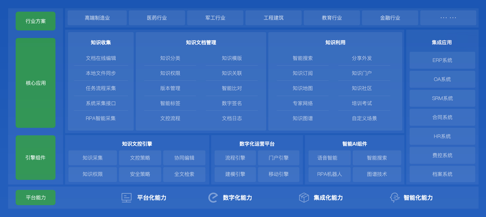

### 附录：本文出现的其他缩写

正文里出现的其他缩写集中列在这里，便于回头查阅。

| 缩写 | 全称 | 一句话说明 |
| --- | --- | --- |
| MRP | Material Requirements Planning | 物料需求计划，按生产计划和 BOM 推算物料需求与采购时机 |
| SRM | Supplier Relationship Management | 供应商关系管理，管准入、评估、分级与协同 |
| OEE | Overall Equipment Effectiveness | 设备综合效率，可用率 × 性能率 × 良品率 |
| SPC | Statistical Process Control | 统计过程控制，用控制图等统计方法监控过程稳定性 |
| TPM | Total Productive Maintenance | 全员生产维护，以预防性维护减少设备停机 |
| RFID | Radio Frequency Identification | 射频识别，非接触式自动识别标签，用于追溯 |
| AGV | Automated Guided Vehicle | 自动导引运输车，仓库内自动搬运设备 |
| RFM | Recency / Frequency / Monetary | 客户分层模型，按最近消费、频次、金额打分 |
| KPI | Key Performance Indicator | 关键绩效指标 |
| BI | Business Intelligence | 商业智能，把业务数据加工成报表与看板 |
| SCADA | Supervisory Control and Data Acquisition | 数据采集与监控系统，位于 MES 之下的控制层 |
| BOM | Bill of Materials | 物料清单，描述一个产品由哪些物料构成 |
| VMI | Vendor Managed Inventory | 供应商管理库存，由供应商负责补货决策 |

---

## 3. 美团内部性能优化实践

这篇文章把"线上性能优化"从凭经验调参，整理成一套可复用的模式语言：先定义问题与目标，再描述三种典型的性能恶化路径，最后给出七种优化模式及其代价。它的价值不在于某个技巧，而在于让你在系统变慢时有一套固定的分析顺序可循。

### 一、性能优化的三个目标与一处内在矛盾

先界定范围。一般而言，性能优化指降低响应时间和提高系统吞吐量两件事；但在流量高峰时，性能问题往往表现为服务可用性下降，所以性能优化也可以包括提高服务可用性。

需要提前接受的是：这三者在某些情况下相互矛盾，不可兼得。两个典型例子：

- 增加缓存可以降低平均响应时间，但缓存变大后可用线程数会受内存限制，反而压低系统吞吐量。
- 为了提高可用性，对异常请求重复调用是常见做法，但它会拉长响应时间，同样压低吞吐量。

对很多互联网公司而言，系统还面临三个持续存在的挑战：

1. 用户数量日益增长；
2. 业务日渐复杂；
3. 数据急剧膨胀。

这些挑战在性能上表现为同一个命题：**在保持或降低系统 TP95 响应时间的前提下，不断提高吞吐量，并提升流量高峰期的服务可用性**。

**TP95**（也写作 P95）是响应时间的一个分位指标：把一段时间内的请求耗时从低到高排序，取第 95 百分位那个值，意思是 95% 的请求不慢于它。相比平均值，它更能反映"慢请求"的严重程度——平均值会被大量快请求拉低，而用户感受到的卡顿通常来自尾部。

在这个命题下，三个目标的方向恰好一致，改进手段也可以复用。本文即针对这类场景给出优化方案。

### 二、为什么用"模式"来讲性能优化

讲性能优化的文章和图书已经很多，但较少有人用"模式"的方式组织。这里借鉴《设计模式：可复用面向对象软件的基础》（Design Patterns: Elements of Reusable Object-Oriented Software，常简称 GoF 设计模式，1994 年出版）的阐述结构，对每种性能优化模式依次讲四件事：

1. 取一个贴切的名字，便于理解和记忆；
2. 讲清动机与原理；
3. 结合真实案例做剖析；
4. 总结收益与代价。

**关于案例的说明**：所有案例都来自真实项目，但做了简化与抽象，原因有两点。

一方面，系统里可优化的问题很多，而一个特定模式只能解决几类问题，所以案例会突出与模式相关的那部分。

另一方面，任何一类问题都需要多维度数据来描述，而启用某个模式的前提通常是"多维数据的组合值超过了某个临界点"；精确定义单维度的临界点已经很难，多维度组合的临界点更难。因此案例做了一定简化以确保取值落在适用范围内。由此得出的方案只是**可行方案**，不保证是当时问题的最优解。

案例项目全部基于 Java 开发，严格说这些模式适用的场景是"基于 Java 搭建的服务"。Java 与 C++ 的主要差异在垃圾回收机制，所以除与 GC 紧密相关的模式外，这些模式同样适用于 C++ 服务；其他语言则需要考虑语言差异。

### 三、四个设计原则：问题为什么会被设计出来

这一节值得单独看。下文的各种性能问题之所以出现，部分原因是工程师遵循了某些更深层的设计原则。有些原则看起来与"优秀设计"相悖，却被广泛使用——理解它们，才能理解为什么这些问题反复出现。

#### 最小可用原则

最小可用原则（也叫快速接入原则）有两个关注点：强调快速接入、快速完成；实现核心功能可用。

它被普遍运用，目标是缩短测试周期、增加试错机会、避免过度设计。为了快速接入，必须最大限度复用已有的解决方案或系统；反过来说，一个方案只要满足基本需求，就符合该原则的应用条件。代价是：过度强调快速接入会提高重构风险，因此基于该原则设计系统时，需要**预先为重构留出空间**。

#### 经济原则

经济原则关注成本。它看起来很像最小可用原则，但关注点不同：最小可用原则是通过缩短开发周期、快速接入来实现风险可控，而"快"并不等于"便宜"——为了快速接入，有时要付出很高的成本。

#### 代码复用原则

代码复用分两个层次。

**第一个层次是方案复用**：使用已有的解决方案，或调用已存在的共享库（Shared Library）。这是一个很实用主义的原则，出发点是最大限度利用手头已有的东西，即使这个方案并不好；形式可以是共享库，也可以是已存在的服务。

**第二个层次是共用代码库**：直接在现有代码库中开发，所有功能在同一套代码里完成。这样做有两个好处：

1. 充分利用代码库已有的基础设施，快速接入新业务；
2. 直接调用原有代码的基础功能，避免网络调用或进程间调用开销，性能更好。

从架构角度看，方案复用类似微服务架构（Microservice Architecture，有观点认为它是一种形式的 SOA，即面向服务的架构），共用代码库则接近单体架构（Monolithic Architecture）。微服务倾向面向接口编程，要求设计可复用的组件（Library 或 Service），通过分层组织组件来实现良好的架构。

共用代码库的代价也很明确，常见的问题有五点：

1. 缺乏美感；
2. 很难重构；
3. 容易过早优化（关于"三思而后优化"的讨论可参考高德纳的相关论述）；
4. 不可重用；
5. 限制眼界。

微服务是很多互联网公司的主流架构，典型采用者包括 Amazon 等；单体架构也有坚持者，例如原文以 Tripadvisor 的全球网站共用一套代码库为例，Linux 内核最终也选择了宏内核（monolithic kernel）形态——后者更多是性能与实现复杂度的取舍，而非纯粹的架构偏好。

#### 奥卡姆剃刀原则

系统设计与代码编写要遵循奥卡姆剃刀原则：如无必要，勿增实体（Entities should not be multiplied unnecessarily）。

一个系统的代码量通常随功能增加而变多；系统的健壮性有时候也要靠异常处理代码来实现，异常考虑越周全，异常处理代码量越大。但代码量增大，引入 Bug 的概率也随之增大，系统反而更不健壮。再往下推，异常处理代码本身也要考虑健壮性，就形成了无限循环。所以该原则的要求是：一个功能模块如非必要就不要，一段代码如非必写就不写。

它与最小可用原则的区别在于适用范围：最小可用原则主要用于产品的 MVP（Minimum Viable Product，最小可行产品）阶段，而这里的奥卡姆剃刀主要指系统设计与代码编写两个层面。两者是不同概念——MVP 阶段包含设计与编码，但成熟系统的迭代阶段同样需要设计与编码。

### 四、三种性能恶化模式（反模式）

在讲优化模式之前必须先讲"恶化模式"，原因有三点：

1. 很多优化模式的目标之一，就是避免系统进入某种恶化模式；
2. 不同的优化模式可能在避免同一种恶化模式；
3. 同一种优化模式，在不同阶段可能在避免不同的恶化模式。

统一在这里讲清楚，后文就不必重复解释。为了便于区分，恶化模式统一命名为"某某反模式"（AntiPattern，指看似合理、实际会让系统持续变坏的做法）。

#### 1. 长请求拥塞反模式（High Latency Invocating AntiPattern）

这是单次请求时延变长，进而导致系统性能恶化甚至崩溃的模式。

对多线程服务而言，大量请求变慢会造成线程堆积、内存占用上升，最终通过以下三条路径之一恶化系统：

1. 线程数变多导致线程之间争抢 CPU，反过来进一步延长单次请求时间；
2. 线程数增多、线程内缓存变大，内存消耗剧增；对 Java 服务而言会触发更频繁的 full GC（全堆回收，会暂停应用线程），单次请求时间因此更长；
3. 内存占用上升导致操作系统内存不足、被迫使用 Swap（把内存页换到磁盘），严重时服务彻底崩溃。

典型恶化流程如下图：


这种恶化非常普遍，所以识别它很重要。典型场景：某复杂业务系统依赖多个服务，其中一个服务响应变慢，整体响应时间随之变长，随后出现 CPU、内存、Swap 报警。进入该模式的标识包括：被依赖服务可用性变低、响应时间变长、服务中某段计算逻辑耗时变长。

#### 2. 多次请求杠杆反模式（Levered Multilayer Invocating AntiPattern）

客户端一次用户点击，往往会触发多次服务端请求，这是第一次"杠杆"；每个服务端请求又触发多个更底层服务的请求，这是第二次"杠杆"。两次放大叠加，最底层服务的调用量可能是用户操作量的成千上万倍。

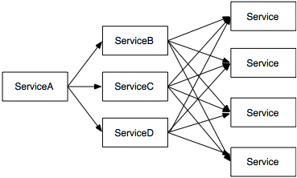

这种现象非常常见。以推荐系统为例：一个用户列表请求会有多个算法参与，每个算法召回多个列表单元（商家或团购），每个列表单元又有多种属性和特征，而这些特征数据分散在不同服务和机器上——客户端的一次页面展现，可能引发成千上万次最底层调用。对存在这种杠杆的分布式系统，性能恶化与流量之间往往呈指数关系，而不是线性关系。

#### 3. 反复缓存反模式（Recurrent Caching AntiPattern）

为了降低响应时间，系统往往在本地内存里缓存大量数据。缓存越多，命中率越高，平均响应时间越快——这本身没错。


恶化的原因是**无节制地使用缓存**：缓存挤占堆内存，GC 压力上升，响应时间反而变差，于是又有人加更多缓存来"救"，形成正反馈。使用缓存的指导原则是：必须全局考虑、精细规划，确保"数据全量缓存"的极端情况下，系统仍然不会频繁 full GC。

### 五、七种性能优化模式

下面七种模式，有的用于远离恶化模式，有的直接优化性能。每种都按"原理与动机 → 案例 → 代价与边界"展开。

#### 1. 水平分割模式（Horizontal Partitioning Pattern）

**原理与动机**

典型的服务端运行流程包含四个环节：接收请求、获取数据、处理数据、返回结果。一次请求中，"获取数据"和"处理数据"往往发生多次。在完全串行执行的系统里，一次请求的总响应时间满足：

```text
一次请求总耗时 = 解析请求耗时 + Σ(获取数据耗时 + 处理数据耗时) + 组装返回结果耗时
```

大部分耗时长的服务，时间主要花在中间两个环节。对非计算密集型系统来说，主要耗时又在"获取数据"上。

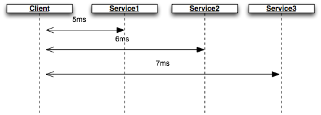

水平分割的做法是：先把整个请求流程切成若干**必须相互依赖**的 Stage（阶段），每个 Stage 内部包含若干**相互独立**的业务处理（含计算与数据获取）；然后 Stage 之间串行，Stage 内部并行。这样一次请求总耗时等于各 Stage 耗时之和，而单个 Stage 的耗时等于其内部最长的那个业务处理耗时。

由此得到两个关键优化点：减少 Stage 数量、降低每个 Stage 耗时。

- 减少 Stage 数量：深入分析一次请求内不同业务之间的依赖关系并解耦，把能并行的业务尽量放进同一个 Stage，最终把流程分解成若干无法再独立运行的 Stage。
- 降低单个 Stage 耗时：一是在 Stage 内部继续尝试水平分割（递归水平分割）；二是把那些"放哪个 Stage 都能并行"的流程，放到耗时最长的 Stage 内部并行执行，避免拉长原本较短的 Stage。

水平分割不仅能降低平均响应时间，也能降低 TP95 响应时间（这两者有时相互矛盾），因此往往能大幅提高吞吐量与高峰期可用性，并显著降低进入长请求拥塞反模式的概率。

**案例**

挑战是为用户提供高性能的个性化列表服务：每次列表请求有多个算法参与，每个算法基本遵循"召回 → 特征获取 → 计算"的模式，优化前算法之间是顺序执行的。采取的措施是：

1. 算法之间改为并行计算；
2. 每个算法内部，把多次特征获取做并行处理；
3. 调度线程调度工作线程时，耗时最长的线程最先调度、最后收尾。

一个示意性的 Java 写法（仅表达"Stage 内并行"的结构，不是原案例代码）：

```java
// 示意：把同一 Stage 内相互独立的取数任务并行化，再统一等待
List<CompletableFuture<Feature>> tasks = sources.stream()
        .map(src -> CompletableFuture.supplyAsync(() -> src.fetch(key), pool))
        .collect(Collectors.toList());

CompletableFuture.allOf(tasks.toArray(new CompletableFuture[0])).join();
```

**代价与边界**

对成熟系统做水平切割意味着重大重构，工程师必须非常熟悉业务和系统，因此要谨慎。难点主要有三：

1. 并行计算把原本单线程的工作交给多线程，提高了系统复杂度；多线程引入的安全问题让系统更脆弱，且多线程程序测试困难，重构后很难与原系统在业务上保持一致。
2. 对一开始就按单线程模式编写的系统，有些流程逻辑上可并行，但代码层面因相互引用已难以拆分。并行重构往往意味着重复撰写共用代码，增大整体代码量，违背奥卡姆剃刀原则。
3. 紧耦合的具体成因：假设 A、B 两段逻辑可并行，单线程代码先处理 A 再处理 B；写 B 时若发现它需要的资源已在处理 A 时产生，工程师往往直接复用 A 的结果，A 与 B 因此紧耦合。并行化必须拆解它们之间的公共代码，这通常要引入新的抽象、调整数据结构的可见域。

有两种情况收益不明显：

1. 一次请求中每个流程要获取和缓存的数据量都很大，流程之间存在大量共享数据，但请求之间几乎不共享。此时顺序执行可以把数据缓存在线程局部存储（ThreadLocal，每个线程独立的数据副本）中，减少重复取数；改成水平分割后，同一次请求里不同流程会多次获取并缓存同一类数据，对内存本就紧张的系统可能引发频繁 full GC，反而落入反复缓存反模式。
2. 某一个流程的耗时远大于其他所有流程之和。此时水平分割无法实质性缩短响应时间。

总体上，水平分割能降低平均响应时间与 TP95、降低高峰期崩溃概率；虽然重构复杂，但模式本身极易理解——只要熟悉业务，能识别出可并行流程，就能动手。

#### 2. 垂直分割模式（Vertical Partitioning Pattern）

**原理与动机**

在节奏快的公司里，新需求一波接一波。基于代码复用原则，工程师常在一个系统里实现大量相似却互不相干的功能。随着功能增强，系统实际上越来越脆弱——表现为响应时间变长、吞吐量下降或可用性降低。原因主要是两类冲突：资源使用冲突和可用性不一致冲突。

- **资源使用冲突**：不同业务功能并存于同一运行系统，意味着资源共享，也意味着资源使用冲突。
- **可用性不一致冲突**：不加区分地把不同可用性要求的业务放进一个系统，会拉低整体可用性。当多种业务糅在一起时，在运维和机器层面对不同业务分别调配可用性、可靠性会变得很困难；而高峰流量导致系统濒临崩溃时，最有效的止血手段往往是运维——最有效手段失效，就等于核心业务可用性下降。

垂直分割的思路是按业务功能切分，有两种方式：**部署垂直分割**（按可用性要求把系统分类，不同可用性业务部署在不同机器上，高可用业务单独部署）和**代码垂直分割**（不同业务系统不共享代码，彻底消除资源使用冲突）。

**案例**

美团客户端的多个页面都有推荐列表。虽然需求来源不同，但为了快速接入，基于共用代码库原则，所有推荐业务共享同一套代码、同一套部署。一段时间后发现 push 推荐和首页"猜你喜欢"推荐资源消耗巨大：尤其在 push 推荐高峰时刻，CPU 和内存频繁报警，系统不停 full GC，导致用户进入客户端时首页出现大片空白。

分析后得出两个结论：

1. 首页"猜你喜欢"对用户体验影响更大，应给予最高可用性保障，push 推荐可给予较低保障；
2. 两者都需要很大的本地缓存，内存使用冲突严重；响应时间都很长，CPU 使用冲突也严重。

采取的措施是：

1. 把首页"猜你喜欢"推荐单独部署，push 推荐和其他资源要求不高的推荐部署在另一个集群；
2. 新承接的推荐业务新建一套代码，避免影响首页这种最高可用性的业务。

按原文给出的结果，首页"猜你喜欢"的 TP95 响应时间降低了 40%，其他推荐产品的可用性和高峰吞吐量也有提升。这类数字来自单一项目的实测，换环境不一定可复现，但方向可靠：**先把可用性等级不同的业务在部署上隔开，收益最快**。

**代价与边界**

缺点主要有两个：

1. 维护成本增加。代码库数量增多会提高开发维护成本，部署集群变多会增加运维工作量。
2. 代码不共享带来重复编码。

缓解重复编码的一个思路是抽出共享库（Shared Library），但这种耦合可能让部署机器引入"未部署业务"的开销。所以共享库要减少静态代码的初始化开销，并把缓存初始化之类的重活交给上层系统。

垂直分割简单而有效，特别适合"系统已经出问题、又需要快速止血"的场景：部署层面的分割既安全又见效，而且它与"简单加机器"不是一回事——多数情况下即使不增加机器，仅靠部署分割，整体吞吐量和可用性都可能提升，短期看几乎是零成本方案。代码层面的分割则需要在业务承接效率与系统可用性之间做折中。

#### 3. 恒变分离模式（Runtime 3NF Pattern）

**原理与动机**

基于性能的设计要求"变化的数据"与"不变的数据"分开，这一点与面向对象的设计原则相悖：面向对象为了便于整体把握对象，往往把紧密相关的数据组装进一个类、存进一张表，即使存在部分冗余。

恒变分离的原理很像数据库设计中的第三范式（3NF）。3NF 要求非主属性不传递依赖于候选键，也就是同一组非主属性不该在大量记录中重复出现；恒变分离解决的则是系统**运行期**恒定数据被重复创建、传输、存储和处理的问题。按 3NF 的思路：如果一张表的每条记录都依赖一组大量重复出现的非主属性，就应为这组属性定义新实体（新表），原表改为依赖新实体的 ID。

**案例**

挑战是提供一个高性能、高一致性的团购服务（DealService）。系统存在多次请求杠杆问题：客户端一次请求会导致几十次 DealService 读取，每次读取上百个团购详情，单机需要支撑每秒万次级别的吞吐量。

系统框架示意见下图：


每个 DealService 定期从持久层同步所有发生变化的 deal 信息，全部保存在内存中。最初数据库只有一张表 DealModelTable，程序里只有一个实体类 DealModel。由于销量、价格、用户评价等信息频繁变化，为满足高一致性，服务每分钟需要从数据库同步几万条记录。随着团购数量与用户活跃度上升，出现了三个问题：

1. 团购服务网卡频繁报警；由于这是高性能低延迟服务，又导致大量客户端超时异常；
2. 频繁 full GC：每条数据库记录更新都会让运行系统中的老 DealModel 实体被销毁、新实体被创建；
3. 数据库从库滞后于主库，数据一致性下降，原因是写入量巨大。

采取的措施是：

1. 把 DealModelTable 中的销量、价格、用户评价等常变信息单独建表 VariableDealModel；
2. 代码中为这些常变数据创建单独的类 VariableDealModel；
3. DealService 对两张表分别同步；
4. 若 DealModelTable 的记录更新，销毁老实体、创建新实体；
5. 若只是 VariableDealModel 的记录更新，仅修改对应属性。

示意性的表结构（仅表达拆分思路）：

```sql
-- 示意：把"几乎不变"与"频繁变化"的字段拆到两张表，按主键关联
CREATE TABLE deal_base (
  deal_id     BIGINT PRIMARY KEY,   -- 门店主键
  title       VARCHAR(128),
  category_id BIGINT
);

CREATE TABLE deal_variable (
  deal_id    BIGINT PRIMARY KEY,    -- 与 deal_base 一一对应
  sales      INT,                   -- 销量，频繁变化
  price      DECIMAL(10, 2),        -- 价格，频繁变化
  review_cnt INT                    -- 评价数，频繁变化
);
```

按原文结果，这些措施大幅降低了网络传输量、缓解了主从同步压力，客户端超时异常从高峰时的 9% 降到 0.01% 以下（低于万分之一）。同样是单项目实测数据。

**代价与边界**

三个缺点：

1. 不符合面向对象的设计原则。原本概念统一的实体被切成多个，会给理解带来困难，增加维护成本，也提高引入 Bug 的概率（面向对象之所以流行，一个重要原因正是容易理解）。
2. 增加类不变量（Class invariant，指一个对象在任何时刻都必须成立的条件）的维护难度。很多情况下类不变量靠语言的封装特性维持；一个类变成多个类后可能被破坏。若必须维护跨实体的不变量，通常要把不变的属性从不可变实体移到可变实体中。
3. 一张表变成多张，也增加维护成本。

有两种情况收益有限：

1. 易变数据引发的操作与传输并不频繁，不是系统的主要操作；
2. 易变数据占整体比例很高，杠杆效应不显著，无法从根本上解决问题。

所以适用需要两个条件同时成立：易变数据占比很低（越低杠杆越大），且易变数据引发的操作恰是系统的主要操作。此时如果性能已经出问题，牺牲一点可维护性是值得的。反之，大多数系统的数据都同时包含易变、少变、不变的属性，盲目拆分会让复杂度指数级上升，设计者必须在高性能与高可维护性之间找平衡点。

#### 4. 数据局部性模式（Locality Pattern）

**原理与动机**

数据局部性模式是针对多次请求杠杆反模式的解法。在大数据、强调个性化服务的时代，一个服务消费几十种不同类型的数据很常见，而每种数据服务又可能需要一个集群（多台机器）来支撑。这意味着客户端的一次请求可能引发服务端成千上万次调用。开发中导致数据服务数量暴增的原因主要有两个：

1. 缓存滥用以及缺乏规划；
2. 数据量太大，无法在一台机器上提供全量数据服务。

核心思想是合理组织数据服务、减少调用次数，可从服务端与客户端两侧入手。

服务端的手段是重新规划服务。对数据量太大、单机存不下全量的场景，建议采用 Bigtable（Google 的分布式宽表存储，按行键有序分片）或类似方案提供数据服务，原则是：

1. 数据由尽可能少的服务器提供；
2. 经常被一起使用的数据尽量放在同一台服务器上。

客户端有三个手段：

1. **本地缓存**：对一致性要求不高、命中率较高的数据服务，本地缓存可减少服务端调用次数；
2. **批处理**：对由单机或等价机器集群提供的数据服务，尽量把多个请求合并成一次；
3. **客户端 Hash**：对需要按 Hash 把请求分配到不同机器的服务，尽量在客户端完成 Hash，落入同一等价集群的请求用批处理调用。

**案例**

挑战来自推荐、个性化列表和个性化搜索服务，它们需要获取各种用户、商家和团购信息，包括基本属性与统计属性。最初不同属性由不同服务提供：有的是 RPC 服务（远程过程调用，像调本地方法一样调远端服务），有的是 Redis，有的是 HBase 或数据库。

客户端每个用户请求都会触发多个算法；每个算法召回几十甚至几百个团购或商家 ID，而这些基础属性被均匀分散在几十台 Redis 上，于是产生大量 Redis 请求——极端情况下，一次客户端请求触发的团购基础数据请求就超过上千次。


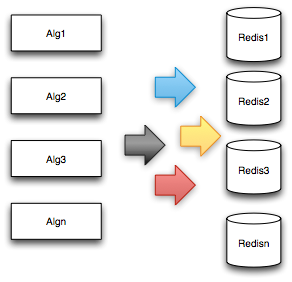

按数据局部性原则采取了三项措施：

1. 用大内存服务器存储全部团购与商家基础信息，每个算法一次网络请求即可取回所需数据；
2. 服务端改为多线程提供服务，避免 Redis 单线程模型下"单个请求慢拖垮后续请求"的连锁效应；
3. 借鉴 Bigtable 的数据组织方式，把用户多种特征按"用户维度 + 特征类型"两个维度索引，确保同一用户的信息只落在一台机器上。

**代价与边界**

它不适用于系统初级阶段。初级阶段的主要设计原则往往是最小可用原则，原因有二：一是很难预测服务的数据是否长期有效、未来调用量多大；二是工程师可能还无法预测最终的调用模式，而不同调用模式对应不同的数据局部性方案。对已被大量使用的数据服务做这种重构，必然改变老的调用方式，既引入新 Bug，也意味着巨大工作量。

需要说明的是，数据局部性并非大数据的产物——CPU 缓存、编译器优化里早就有同样的思想，所以很容易被理解。虽然初级阶段应尽量避免过度设计，但掌握这个模式对设计可扩展、可重用的系统很有帮助。

#### 5. 避免蚊子大炮模式（Avoiding Over-generalized Solution Pattern）

**原理与动机**

"用大炮打蚊子"本意是大材小用，但细想一下：用大炮打蚊子，成功率并不高。对工程师而言，为了快速承接业务、遵循方案复用原则，总是尽量利用现有系统，这让系统功能越来越强大，也越来越"重"。

这个模式是经济原则在运行期的应用：要求用最节省资源（CPU、内存等）的方式解决问题，因为资源浪费会带来未来的潜在风险。接到需求时，要思考的不只是"如何复用现有系统以缩短开发时间"，还要估算现有系统为处理每个新需求所需的运行成本，以及新需求的预期访问量。

**案例**

挑战是为移动用户查找附近的商家。公司有很完善的搜索系统和资深搜索工程师，所以"查附近商家"的第一方案往往是调用搜索服务。

分析后认为，求最短直线距离更合适的算法是 **k-d tree**（k 维树，一种把空间按坐标轴递归切分的二叉树，适合低维最近邻查询）。快速实现基于 k-d tree 的 LBS（基于位置的服务）方案后，用 4 台服务器解决了 30 多台搜索服务器难以解决的问题。

原文给出的性能数字是：平均响应时间从高峰时的 100ms 降到 300ns，"性能提高了几百倍"。这里需要提醒：100ms 与 300ns 相差约五个数量级，与"几百倍"的说法并不自洽，原文也没有交代这两个数的统计口径。引用时建议只说"数量级上的显著改善"，不要直接外推具体倍数。

补充一点技术边界：k-d tree 在维度较低时查询接近 O(log N)，维度升高后会退化，甚至不如暴力比较。它适合"经纬度二维最近邻"这类场景，不适合高维特征检索。

**代价与边界**

这个模式的困境与数据局部性模式类似：都与最小可用原则冲突。在系统设计初级阶段追求最优方案往往意味着过度设计，会让项目在时间和成本上失控；而为每个问题都找最优解也是不现实的奢求。

设计阶段它是一个需要权衡的选择——在开发成本与运行成本之间找平衡点。当很多功能已经融入一个通用系统并产生性能问题时，拆出每个功能点的影响并不容易；此时"分开部署、共用代码库"的原则可以先帮你快速定位问题，再有针对性地解决"大炮打蚊子"。

#### 6. 实时离线分离模式（Sandbox Pattern）

**原理与动机**

这个模式的极端要求是：离线服务永远不要调用实时服务。它简单易懂，但严格说不是系统设计模式，而是一种管理规范。具体建议有三条：

1. 如果离线程序需要访问在线服务，应给离线程序单独部署一套服务；
2. 类似 MapReduce（分布式批处理计算模型）的云端多进程离线程序，禁止直接访问在线服务；
3. 分布式系统永远不要直接写传统的 DBMS（数据库管理系统）。

**案例**

因违反该模式导致的事故非常常见。原文举了两例：一次是离线程序频繁向 Tair 集群（一种分布式 KV 缓存）写数据，每次写 10M，最终使整个集群宕机；另一次是 Storm（分布式实时流计算系统）直接写 MySQL，导致数据库连接数被耗尽，在线系统无法连接数据库。

**代价与边界**

为了实现隔离，可能需要为在线与离线环境分别部署，多套环境的运维成本必须考虑。另一方面，在线数据在离线环境中往往很难获取，这正是很多离线系统直接访问在线系统的原因。但遵守该模式是重要的安全管理准则：任何违背它的行为都意味着系统性安全漏洞，都会提高线上故障概率。

#### 7. 降级模式（Degradation Pattern）

**原理与动机**

降级模式是性能保障的最后一道防线。理论上不存在绝对没有漏洞的系统，也可以说，最好的安全措施就是为"处于崩溃状态的系统"准备预案。不管设计多完善，总有意料之外的情况会让性能恶化直至崩溃，所以对高可用服务而言，降级设计必须在设计之初就做。

一套良好的降级方案通常包含五个环节：

1. 设计阶段就确定"开始恶化"的量化指标（如响应时间、内存使用量）；
2. 系统开始恶化时，第一时间报警；
3. 收到报警后，人工手动让系统进入降级状态，或由智能程序自动降级；
4. 区分所依赖服务的必要性，一般分为必要服务与可选服务：必要服务在降级状态下要提供快速返回的权宜方案（缓存是常见选择），可选服务则果断不调用；
5. 系统远离恶化状态后，人工恢复或由智能程序自动升级。

典型降级策略有三种，区别在于牺牲的是什么：**流量降级**牺牲一部分用户——主动拒绝处理部分流量，让系统正常服务未降级的流量；**效果降级**牺牲一部分效果——返回不完整或精度更低的结果；**功能性降级**牺牲一部分功能——关闭非核心功能。

**案例**

原文的系统大量使用了智能降级程序：系统恶化时自动降级部分流量，恢复正常后自动升级回正常状态。

**代价与边界**

为了让系统具备降级能力，需要写大量代码，而降级代码往往比正常业务代码更难写、更容易出错，因此并不符合奥卡姆剃刀原则。确定使用降级模式后，还要权衡三种策略的利弊：大多数面向 C 端的系统倾向于效果降级与功能性降级，但有些功能模块（如下单）不能做效果或功能性降级，只能做流量降级。对无法接受降级后果的系统，必须通过其他方式提高可用性。

总的来说，降级是一种设计安全准则：任何高可用要求的服务都应按它设计，违背这条原则的系统或早或晚都会因某些问题崩溃而降低可用性。但降级并非零成本，也不符合最小可用原则，所以对处于 MVP 阶段或可用性要求不高的系统，它不是必须采纳的原则。

### 六、其他零散的优化建议

有些不适合用模式归纳的手段，这里给出总结性建议：

1. **删除无用代码有时就能解决性能问题**。例如有些代码已不再被调用却仍会被初始化，甚至占用大量内存；有些代码仍在被调用，但对业务而言已经无用，白白消耗 CPU。
2. **避免跨机房调用**。跨机房调用经常成为性能瓶颈，尤其是"伪 batch 调用"——在调用方看来是一次批量调用，内部实现却是顺序的单个调用，这种写法对性能的影响往往非常巨大。

### 七、七种模式速查表

把七种模式收进一张表，便于排查问题时先列出候选方案，再按代价做取舍。

| 模式 | 主要针对 | 核心手段 | 主要代价 |
| --- | --- | --- | --- |
| 水平分割 | 长请求拥塞；平均响应时间与 TP95 偏高 | 流程切 Stage，Stage 间串行、Stage 内并行，减少 Stage 数并压缩单 Stage 耗时 | 重大重构；多线程复杂度与测试难度；可能重复代码 |
| 垂直分割 | 资源使用冲突、可用性不一致冲突 | 按可用性要求做部署分割；不同业务不共享代码 | 维护成本上升；重复编码；共享库的耦合开销 |
| 恒变分离 | 网络传输量大、同步压力大、频繁 full GC | 易变数据与稳定数据分表、分类、分别同步 | 违背面向对象直觉；类不变量难维护；表变多 |
| 数据局部性 | 多次请求杠杆 | 数据尽量集中到少数机器、常一起用的放一起；客户端本地缓存、批处理、客户端 Hash | 不适合系统初期；重构老调用模式风险大 |
| 避免蚊子大炮 | 通用系统承担了不该承担的高频小需求 | 用成本匹配的专用方案（如 k-d tree 代替搜索集群） | 与最小可用原则冲突；选型与拆分成本 |
| 实时离线分离 | 离线任务打垮在线服务 | 离线单独部署；禁止离线直连在线服务与直接写 DBMS | 多套环境运维成本；离线取数变难 |
| 降级 | 极端情况下的可用性保底 | 定义恶化指标、报警、自动/手动降级、区分必要与可选服务 | 降级代码量大且易错；策略选择需业务判断 |

### 八、关键权衡：什么时候不该用这些模式

模式是工具，不是规范。下面几组权衡决定"该不该用"，也是技术评审时最常被追问的部分。

1. **响应时间、吞吐量、可用性三者不可能同时最优**。加缓存、加重试都能局部改善某一项，但会挤压另外两项；优化前先明确当前阶段最该保的是哪一个。
2. **性能与可维护性是对价关系**。恒变分离、水平分割、代码垂直分割都在牺牲可读性或一致性来换性能，只有在"性能已经出问题且该路径是主要路径"时才值得。
3. **初级阶段优先最小可用**。数据局部性、避免蚊子大炮、降级这三种模式都明确不适合 MVP 阶段：此时调用模式未知，过早按最优结构设计，改起来比推倒重来更贵。
4. **先能定位，再谈优化**。多种功能混在一个系统里时，连"是哪块慢"都说不清；"分开部署、共用代码库"往往是最省事的第一步，它同时解决了定位问题与止血问题。
5. **警惕正反馈型恶化**。反复缓存反模式的危险在于"越慢越加缓存、越加缓存越慢"，所以任何缓存方案都要先回答一个问题：数据全量缓存时，GC 还撑得住吗？

### 出处

原文为技术团队内部性能优化实践分享（《美团内部性能优化实践》），文中案例、指标与架构图均来自该文；设计模式的阐述方式借鉴 GoF《设计模式：可复用面向对象软件的基础》（1994）。文中涉及的 3NF、k-d tree、OEE 等术语定义参考了公开的行业资料与官方文档。

---

## 4. 千万级实时聊天系统如何设计

这篇用一个"千万级在线、峰值强互动"的 IM（Instant Messaging，即时通讯）系统做样本，回答三个问题：一条消息该复制给谁、ID 该怎么发、在线状态与扩缩容怎么兜住。重点在架构取舍和可复核的容量推导，而不是堆名词。

### 整体架构与消息流转

先看全局。一个 IM 系统的组成基本固定：接入层维持长连接、逻辑层处理会话与消息、消息中心（消息队列 + 存储）负责削峰与持久化、在线状态与路由信息放在缓存里。

整体架构如下：


核心流程（一条消息从发送方到接收方要经过哪些环节）：

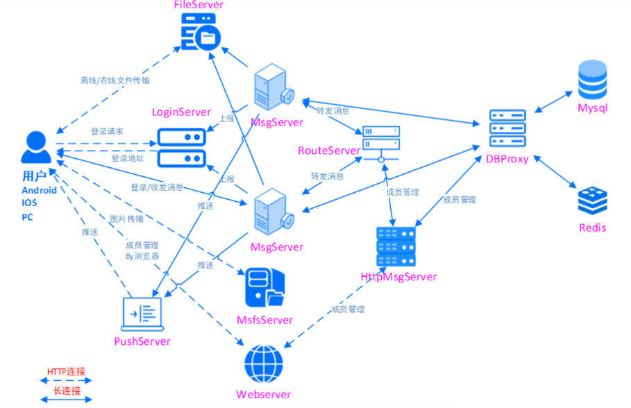


消息分发流程（服务端决定把消息推给哪些连接）：


消息拉取流程（客户端或前端机主动取消息）：

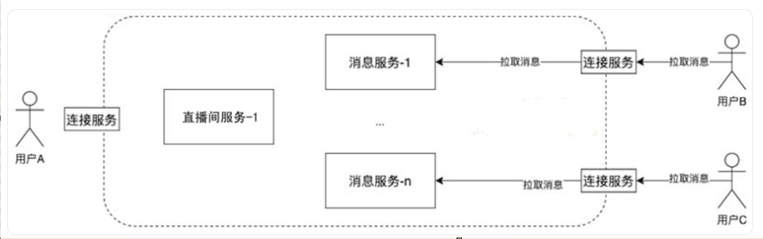

长连接消息分发的整体架构：


部署形态通常是容器化的 Kubernetes 集群，消息服务按"聊天室/直播间"做分片，扩缩容时按分片迁移：


### IM 的核心功能范围

IM 不只是"发消息"。除了单聊、群聊的文字/语音，还包含会话列表、未读数、历史记录、多终端同步、在线状态、消息撤回与已读回执等；直播场景还要叠加弹幕、礼物、系统广播等类型。


功能一多，架构上的分歧点就集中在两处：消息写几次（扩散策略），以及消息靠什么排序和去重（ID 设计）。下面先看业界怎么选。

### 业界方案类比

不同产品的选择能帮助理解扩散策略的边界。下表是原文梳理的四家做法，注意其中"群人数上限"这类业务参数会随产品策略调整，只能当作观察窗口，不宜当成结论。

| 产品 | 扩散策略 | 关键设计 | 由此产生的约束 |
| --- | --- | --- | --- |
| 微信 | 写扩散为主，推拉结合 | 多数据中心自治、每用户只归属一个数据中心、三园区容灾、Paxos 保证一致；ID 采用"申请 DB 步长 + 用户级递增" | 群聊也走写扩散，写放大明显，因此群人数有上限（长期为 500 人，具体以官方为准） |
| 钉钉 | 早期写扩散，为支持万人群转向读扩散 | 依赖自研表格存储（Tablestore）能力，例如主键列自增 | 需要额外的消息中心与拉取链路 |
| Twitter | 写扩散起步，后改为写读结合 | Snowflake ID 全局递增；Fanout Service 写 Timelines Cache（用 Redis），Timeline Service 读取，Timeline Mixer 混合大 V 内容与推荐 | 大 V 的写放大过高，必须对大账号单独处理 |
| 抖音 | 分级流量池 + 消息类型分离 | 服务端以 Go 为主，容器化弹性伸缩；直播间消息按类型分链路处理 | 消息时效性要求高、群关系松散 |

微信部分展开两点。第一，多数据中心各自持有全量数据，中心之间通过自研消息队列同步；为保证一致性，每个用户只属于一个数据中心，连错中心会被引导回所属中心，跨用户访问也走自己所属的中心。第二，ID 采用"按步长向 DB 申请号段 + 用户级递增"：仲裁服务生成路由表（记录 uid 号段到 AllocSvr 的映射）并同步给 AllocSvr 与客户端；AllocSvr 宕机时由仲裁服务把号段重新调度到其它 AllocSvr。

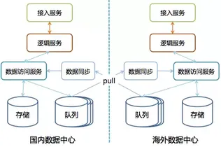


Twitter 值得参考的是"Feeds 系统与 IM 系统在扩散问题上的共性"：Timeline 就是"某个人要看到的消息序列"，和 IM 的信箱本质相同。Snowflake 生成的 ID 在全局范围内随时间递增，Fanout Service 负责把一条推文写进粉丝的 Timeline 缓存。

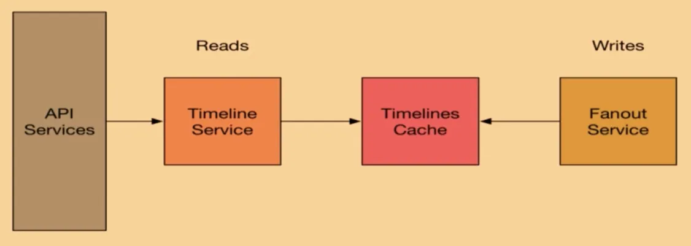

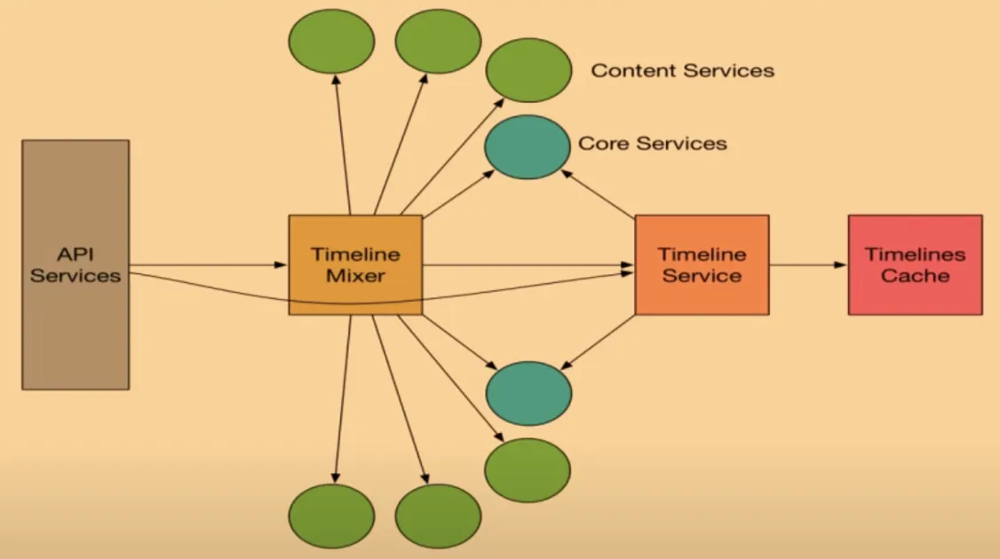

抖音直播间消息与纯 IM 场景的差别，主要体现在三点：过时消息价值低（要求更及时）、群关系松散（随时进出）、进群后不需要补发离线期间的历史消息。此外，用户发言、直播间通告、刷礼物等消息类型要走不同的处理链路。

### 技术难点一：读扩散与写扩散

这是 IM 里最核心的一次取舍。可以用一个生活场景记住区别：写扩散像"群发快递，每人门口放一份"，发的时候累，看的时候伸手就拿；读扩散像"小区公告栏"，发的时候只贴一张，看的时候各自跑去公告栏。

#### 读扩散

原理：发送消息时不写入每个收信人的信箱，而是先写入消息中心；用户读取时，再从消息中心（以及各自的会话信箱）拉取。A 与每个聊天对象、每个群之间都有一个信箱（有些资料称 Timeline），A 查看消息时要读取所有有新消息的信箱。

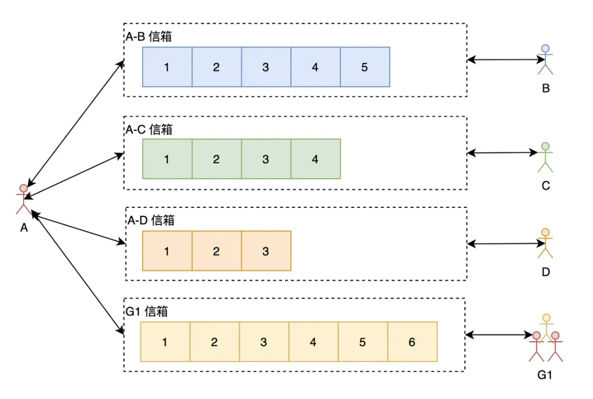

优点：

- 写操作很轻，单聊和群聊都只需往对应信箱写一次。
- 每个信箱天然就是两个人的聊天记录，查看和搜索历史记录都方便。

缺点：

- 读操作很重：一次会话列表刷新可能要访问多个信箱，冷启动时读放大会集中打到存储上。

#### 写扩散

原理：发送消息时把消息扩散写入收信人信箱。单聊写双方信箱；群聊写所有群成员信箱，必要时再单独写一份群聊历史记录。


单聊与群聊的处理差异：

- 单聊：往自己和对方信箱各写一份；若还要支持"两个人完整历史"的高效查询，通常会再写一份会话维度的记录（从个人信箱回溯理论上可行，但效率低）。
- 群聊：往所有群成员信箱各写一份，需要群历史时再写一份。群越大，写放大越明显。

优点：

- 读操作很轻，读自己的信箱即可。
- 多终端同步容易实现，每个终端读同一份信箱。

缺点：

- 写操作很重，尤其群聊。

术语对照：在 Feeds 系统中，写扩散也叫 Push、Fan-out 或 Write-fanout；读扩散也叫 Pull、Fan-in 或 Read-fanout。

#### 两种扩散方式的对比

| 维度 | 读扩散 | 写扩散 |
| --- | --- | --- |
| 单条消息写入次数 | 1 次（写入消息中心/会话信箱） | 约等于收信人数（群聊为 N） |
| 读路径成本 | 高，需聚合多个信箱 | 低，只读自己信箱 |
| 历史记录 | 天然按会话聚合，便于搜索 | 需额外写一份会话记录 |
| 多端同步 | 需要各端各自拉取并合并 | 天然支持，读同一信箱 |
| 群规模扩展性 | 好，人数增加不放大写 | 差，人数增加线性放大写 |
| 架构复杂度 | 高，需维护动态会话队列与端侧感知 | 低，模型简单 |
| 典型瓶颈 | 存储读 QPS、冷启动读放大 | DB 写入 RT 与存储容量 |

#### 写放大的容量推导

用原文给出的案例参数做一次可复核的估算（这些数字是特定业务的实测/预估，不是通用指标）：

- 假设：主互动群规模按 500 人设计，平均群规模约 320 人；单个 DB 库可承接约 120 万次/秒写入。
- 单条群消息产生的写入份数 ≈ 平均群规模 = 320。
- 单库能承载的上行消息速率 ≈ 1,200,000 ÷ 320 = 3750 条/秒，工程上取整为"约 3K/s"。
- 再考虑同一个集群还要承接营销活动、交易、物流等通知类消息，聊天消息实际可用的上行额度还要更低。

也就是说，写扩散把"1 条上行"变成"320 条写入"，当峰值互动用户数远大于该额度时，写路径必然先到瓶颈。这正是钉钉、Twitter 后来引入读扩散或混合模式的直接原因。

#### 选型的优缺点清单

写扩散：

- 优点：架构简洁；单聊群聊统一写入用户维度的同步队列，集中取数；推拉两种模式下存储模型与处理逻辑都简单，且天然支持个性化数据。
- 缺点：群消息存在 1:N 写入扩散，存储压力放大 N 倍，在线用户收消息延迟增大；多个群的消息混在同一同步队列里，无法按会话做优先级与隔离。

读扩散：

- 优点：消除 N 倍写放大，降低下行端到端扩散耗时；提升上行集群整体吞吐；可以做到会话级别的同步优先级队列，实现差异化服务。
- 缺点：架构更复杂，要维护每个动态会话的消息同步队列，端侧还要实时感知新增队列；客户端冷启动要分散读取多个队列，给存储带来读 QPS 压力。

#### 混合模式

原理：单聊等"低并发、弱互动"场景继续用写扩散；群聊等"高并发、强互动"场景先写消息中心，用户在线时按需拉取，离线时才用写扩散写入离线消息队列。这样在"云—端一体化数据同步"下按消息类型分别处理。

这条路线上的持续优化方向包括：优化消息中心缓存以提高拉取效率；对同步队列按会话优先级做更细的调度；引入分布式消息队列、大数据存储等以应对用户规模增长。

原文给出的项目结果：覆盖数千万互动群用户，把一条上行消息在群内到达其他用户端侧的目标控制在 500ms 以内（这是该项目的目标值，不是普适指标），从而让群内强互动成为可能。

### 技术难点二：唯一 ID 设计

IM 里需要唯一 ID 的地方主要有两个：会话 ID 与消息 ID。ID 的作用不只是"唯一"，它还决定了消息能不能高效分页、能不能被检测出丢失。

常见的 ID 方案有五类：UUID、Snowflake 类算法、按步长向 DB 申请号段、基于 Redis 或 DB 的自增、以及按业务规则拼接生成。

#### 消息 ID 为什么要递增

不递增的代价：

- 用字符串：浪费存储空间，也无法利用存储引擎"相邻键放在一起"的特性，写入与读取都变慢。
- 用随机数字：同样失去局部性，随机 IO 增多；而且随机数本身很难保证唯一。

递增的好处：

- 便于检测消息丢失。会话级别连续递增时，下一条消息 ID 不连续即可发现缺口并请求补发。
- 消息本质是时序数据，递增 ID 让分页拉取可以用"大于上次 ID"的条件走索引，分页性能更好。

#### 三种递增范围

| 递增范围 | 含义 | 典型代表 | 适用架构 |
| --- | --- | --- | --- |
| 全局递增 | 整个系统内随时间递增，通常用 Snowflake 一类算法（严格说只是 worker 级递增） | Twitter | 读扩散。每条消息需携带上一条消息 ID，前端据此判断是否丢消息 |
| 用户级递增 | 只保证单个用户内递增，不同用户之间可重复 | 微信 | 写扩散。信箱时间线 ID 用户级递增，消息 ID 仍全局递增；读扩散下必要性不大 |
| 会话级递增 | 只保证单个会话内递增，不同会话之间可重复 | QQ | 读扩散。会话内连续递增即可快速发现丢失，避免全量拉取 |

#### 连续递增与单调递增

连续递增指 ID 严格按 1、2、3……n 排列；单调递增只要求后生成的比前面的大，不要求连续。

QQ 的消息 ID 是会话级连续递增的典型例子：一旦下一条消息的 ID 不连续，客户端就去服务端补拉，从而避免丢消息。也可以用"定时全量拉取"来兜底，但当用户有上千个会话时，轮询次数与读压力都不可接受，因此不适合替代 ID 连续性检测。

若使用单调递增，则当前消息需要携带前一条消息的 ID（相当于把聊天消息串成链表），才能判断是否丢失。

可落地的组合：

- 写扩散：信箱时间线 ID 用用户级递增，消息 ID 全局递增，只需保证单调递增。
- 读扩散：消息 ID 用会话级递增，最好做到连续递增。
- ID 生成器：分布式环境可用 Snowflake 一类算法保证高并发下的唯一性与性能。Snowflake 的位分配在 Twitter 开源实现中为：1 位符号位、41 位毫秒时间戳、5 位数据中心 ID、5 位机器 ID、12 位序列号，同一 worker 每毫秒最多 4096 个 ID。
- 丢消息检测：除依赖 ID 递增，还可叠加心跳与定时拉取策略提高同步可靠性。
- 存储优化：按 ID 递增特性设计索引与分区，避免热点与全表扫描。

#### 会话 ID 设计

会话 ID 有一种简单高效的生成方式：按规则拼接 from_user_id 与 to_user_id。若两者都是 32 位整型（约 43 亿），可以直接用位运算拼成一个 64 位会话 ID：

```java
long conversationId = ((long) fromUserId << 32) | (toUserId & 0xFFFFFFFFL);
```

这样不依赖中心化发号器，两个用户任意方向都能算出同一个 ID；代价是需要保证单聊双方 ID 的拼接顺序一致（例如固定"小的在前"）。

### 技术难点三：直播间消息分发与回放

直播间的消息模型和普通 IM 不同：一条弹幕可能要触达几十万人，写扩散完全不成立，因此走"广播 + 拉取"的读扩散思路。

#### Kafka + 处理机 + Redis

链路是：Kafka → 处理机 → Redis。前端机接收用户消息并写入 Kafka，处理机消费后写入 Redis 的有序集合，客户端/前端机按分数（时间戳）区间拉取。

具体优化措施：

- 前端机：写入消息时为每条消息打统一时间戳。延迟小时只写入 Kafka 的一个 partition；延迟大时把这类直播消息写入多个 partition 以并行化。
- 处理机：根据延迟情况和消息所在 partition 数量选择写入方式。延迟小则加锁串行写 Redis；延迟大则取消锁。组合起来是四个档位：

| partition 数 | 是否加锁 | 最大并发度 |
| --- | --- | --- |
| 1 个 | 加锁串行 | 1 |
| 多个 | 加锁串行 | Kafka partition 个数 |
| 1 个 | 不加锁并行 | 处理机线程池线程数 |
| 多个 | 不加锁并行 | partition 个数 × 处理机线程池线程数 |

- 延迟判断：处理机拿到消息后用"当前时间 − 消息时间戳"算出延迟，按延迟长短自动选档位，以适应系统当前负载。
- 档位粒度：精确到"某个直播间的某种消息类型"，并实时调整处理机线程池大小，避免某类消息挤占资源。

#### Redis 从库瓶颈与本地缓存

用户频繁轮询最新消息，会让 Redis 从库执行大量 ZRANGEBYSCORE（按分数区间取有序集合成员，命令名在原文中拼写有误）操作，负载过重。

解决办法：

- 本地缓存：前端机约每 1 秒从 Redis 拉一次直播间消息，用户轮询时直接读本地缓存；只缓存"最新消息"这种轻量结构。
- 动态调整返回数量：小直播间允许返回时间跨度更大的消息；大直播间对时间跨度和条数限制更严，且只对大直播间开启本地缓存。

为什么不全量开启本地缓存？因为成本。按原文参数估算：

- 直播间 1000 个 × 每直播间 5 种消息类型 × 前端机 40 台 = 200,000 次/秒，即 20 万 QPS。
- 通用公式为：QPS = 直播间数 × 每直播间消息类型数 × 前端机台数 ÷ 拉取间隔（秒）。间隔为 1 秒时，结果即上述数值。
- 只有热门直播间值得付这笔缓存成本，因此按热度开关。

#### 视频数据的采集、编码与传输

这部分是直播系统的通用知识，按"采集 → 编码 → 传输 → 存储 → 特效 → 并发"梳理。

采集与预处理：从摄像头或屏幕录制等源获取原始视频数据，做格式转换与预处理（缩放、裁剪、旋转等），再交给后续环节。实现上从硬件信号读取开始，经驱动与相关 API 把数据送到应用层，再用图像处理库处理。优化方向是选用高效图像处理库、合理设置线程池以利用多核 CPU，并按实际需求选择分辨率、帧率等参数，在保证观感的前提下降低计算量。

编码标准：

| 标准 | 特点 | 适用场景 |
| --- | --- | --- |
| H.264 | 压缩效率与兼容性平衡，生态最广 | 通用直播、需要广泛兼容的终端 |
| H.265 | 同画质下压缩效率更高，可降低带宽占用，但编码复杂度更高 | 带宽紧张、终端支持较好的场景 |
| MPEG-4 | 通用编码标准，兼容性较好，压缩效率相对较低 | 兼容老设备或特定封装场景 |

编码参数的取舍主要在码率控制、分辨率与帧率：按设备性能与显示需求设定分辨率，避免无谓的计算与传输；画面变化小的直播内容可适当降帧率以减少数据量。

传输流程与协议：源端采集编码后，通过传输协议把流送到流媒体服务器，服务器再分发给各客户端解码播放。

| 协议 | 定位 | 说明 |
| --- | --- | --- |
| RTMP | 实时消息传输协议 | 常用于直播上行推流，基于 TCP，延迟较低 |
| RTSP | 实时流协议 | 按 RFC 2326 的定义，它是"网络遥控器"：负责会话的建立与控制（SETUP/PLAY/PAUSE/TEARDOWN），媒体数据本身通常由 RTP 等协议承载 |
| WebRTC | 网页实时通信 | 浏览器原生的实时音视频能力，低延迟，适合连麦、互动直播 |

保证流畅与低延迟的常用手段：

- 抗丢包：前向纠错（FEC，多发冗余数据以便直接恢复）与自动重传请求（ARQ，丢了再要）配合使用，可靠性与延迟之间按场景取舍。
- 缓冲控制：合理设置播放缓冲，缓冲越大越流畅但延迟越高，需要按业务定指标。
- 就近分发：用 CDN 把流缓存到离用户更近的节点，缩短传输距离。
- 自适应码率：针对 4G、5G、Wi-Fi 等网络环境动态切换码率。

#### 视频存储与检索

海量直播数据的常见做法：

- 分布式存储：如 HDFS、Ceph，把数据分散到多节点以获得高可用与可靠性。
- 对象存储：把视频文件作为对象管理，便于提取元数据与检索。
- 分层存储：按热度把热门视频放在高性能存储，冷门内容放低成本归档存储。

检索与管理：建立基于元数据（标题、标签、上传时间、时长等）的索引；用视频内容分析（分类、目标检测等）提取关键特征辅助检索；元数据与索引交给数据库管理系统，支持高效查询与更新。

#### 视频特效与并发处理

美颜、滤镜通常在采集后的预处理阶段或编码前对视频帧处理：美颜依赖人脸检测与识别，对肤色、肤质、五官做分析与优化，再用平滑滤波、锐化等算法处理人脸区域；滤镜把预设的颜色映射表或图像处理算法应用到每帧，改变色彩风格、亮度与对比度，可借助 OpenCV 一类库实现。

提升特效性能的方向：减少不必要的图像处理步骤、选用更高效的算法与数据结构；把计算密集的像素运算交给 GPU 并行执行；为特效任务设置合理的线程优先级，保证关键任务及时响应。

多线程的用法：把采集、预处理、编码、传输拆成不同任务分配到不同线程并行；用线程池管理线程数量与生命周期，避免频繁创建销毁；多路流场景下为每路流分配一个或多个线程独立处理以提高吞吐。

多线程下的一致性：对共享的视频数据用 synchronized 或 Lock 保护，保证同一时刻只有一个线程修改；使用线程安全的集合类传递数据；通过合理设计与调度避免数据竞争与死锁。

Java 程序的性能优化：减少不必要的对象创建以降低 GC 压力，优化算法的时间与空间复杂度；用 VisualVM、JProfiler 等工具做性能监控与瓶颈定位；对热点代码段做针对性优化（如方法内联、循环展开，注意这类手段收益依赖 JIT 实现，需实测）；必要时从架构层面引入分布式与负载均衡提升整体吞吐。

#### 视频回放数据

直播消息通常只存缓存且过期时间很短；弹幕需要支持回放，直播结束后数据仍留在 Redis 里，回放时会与直播流量争抢同一个 Redis 的 CPU 资源。

解决办法：

- 直播结束后把数据备份到 MySQL 持久化（原文给出的经验值是 15–30 分钟内生成可回放数据）。
- 单独增加一组回放 Redis，与直播数据隔离，缓存相同的 SortedSet 结构以保持一致。
- 前端机增加回放的本地缓存，减少对回放缓存的访问。
- 回放读取顺序为：本地缓存 → Redis → MySQL；前端机定期把回放数据拉到本地缓存，频率按直播间热度与数据变化频率动态调整，本地缓存与回放缓存都只存部分数据以控制容量。

### 技术难点四：动态扩缩容与海量在线用户

聊天室人数决定了压力大小，需要及时发现热门直播间并提前扩缩容。

扩缩容的难点在于"人跟着分片走"：消息服务扩缩容时，大部分成员要按一致性哈希（把节点与 key 映射到同一个环上，增减节点只影响相邻区段）重新路由到新节点，这会打破当前平衡并触发一次整体人员迁移。

聊天室自动销毁时，要先判断该聊天室是否归属本节点；不是则跳过销毁逻辑，避免误删 Redis 数据。


四个动作上的处理：

1. 扩容时：按聊天室活跃程度逐步转移人员，而不是一次性全量迁移。
2. 有消息时：消息服务遍历本节点缓存的用户做通知拉取，过程中判断该用户是否属于本节点，不属于就同步加入其应在的节点。
3. 拉消息时：若本机缓存列表里没有该用户，消息服务向聊天室服务确认其是否在聊天室中；在则同步加入，不在则丢弃请求。
4. 缩容时：消息服务从公共 Redis 取全量成员，按落点计算筛出属于本节点的用户，放入用户管理列表。

海量在线用户的管理分工：

- 聊天室服务：管理所有人员的进出，人员列表变动异步写入 Redis。
- 消息服务：只维护属于自己分片的聊天室人员；用户主动进出房间时，按一致性哈希算出落点并同步给对应消息服务。

保活与离线判定：

- 聊天室服务把广播下发给所有消息服务，由消息服务触发通知拉取。
- 消息服务检测用户的拉取情况：活跃聊天室中，30 秒内没有拉取，或累计 30 条消息未拉取，就判定离线并踢出，同时同步给聊天室服务做下线处理。
- 利用 TCP keepalive 探测客户端崩溃、中间网络断开、中间设备超时删除连接表等情况，使服务端能及时释放半开连接。
- 客户端智能心跳在极低电量和流量开销下上报存活、定期刷新 NAT 内外网 IP 映射，并在网络变更时自动重连。


### 技术难点五：实时性、消息时序与优先级

#### 协议选择与并发度估算

常见四种通信方式：

| 方式 | 特点 | 公开资料中提到的使用方 |
| --- | --- | --- |
| 自研 TCP 协议 | 可控性最强，需自己处理粘包、心跳、重连 | 部分同城配送业务（如 58 到家） |
| UDP | 延迟低，需自行保证可靠性与有序 | 早期 QQ |
| HTTP 长轮询 | 兼容性最好，服务端连接与延迟开销大 | 早期微信网页版 |
| WebSocket | 全双工、浏览器原生支持，实时性好 | 直播与网页 IM（如抖音） |

无论用哪种方式，都能做到实时通知；真正影响实时性的是"处理消息的方式"。原文给的估算是：

- 假设用 MQ 推送一个万人群消息，单个人推送耗时 2ms，串行推完 10000 人需要 10000 × 2ms = 20s，其后的消息会被阻塞 20s。
- 若要求 10ms 内推完，则并发度应为 10000 ÷ (10ms ÷ 2ms) = 10000 ÷ 5 = 2000。
- 结论：每个环节都要单独压测并核算吞吐，任何一环不够，整体实时性就不成立。

#### 消息为什么会乱序

用 HTTP 而非长连接发送时容易乱序：后端多为集群部署，请求会落到不同服务器，网络延迟与处理速度差异会让后发的消息先完成。

解决思路与代价：

| 方案 | 做法 | 代价 |
| --- | --- | --- |
| 前端串行发送 | 上一条发完再发下一条 | 体验变差，一般不建议 |
| 带前端顺序号 | 接收方按顺序号排序 | 前端逻辑复杂；历史列表中间插入消息观感差、可能漏读，可改为切换窗口时重排、收到即追加到末尾 |
| 异步发送确认 | 消息到达服务端并入 MQ 即算成功，失败再补通知 | 依赖 MQ 的分片策略，选错仍会乱序 |

异步确认方案下 MQ 分片策略的取舍：

- 按 to_user_id 分片：多端同步时可能乱序。同一发送方先发 m1 再发 m2，不同队列处理速度不同，其它端可能先收到 m2。
- 按 conversation_id 分片：同样会导致多端同步乱序。
- 按 from_user_id 分片：对"保证发送顺序"更友好，是较好的选择。
- 若为了性能在推送前先写 MQ，则按 to_user_id 分片更合适（保证同一接收方的推送顺序）。

#### 消息优先级

消息控速的本质是对消息做取舍，因此需要先分级。原文的划分逻辑：

1. 白名单消息：级别最高，一般是系统通知或管理类信息。
2. 高优先级消息：仅次于白名单，未特殊配置的消息默认落在这里。
3. 低优先级消息：最低，多为普通文字消息。

具体哪些业务（VIP、礼品、弹窗等）落在哪一级应由业务侧通过配置接口设定。服务端对三类消息执行不同限速策略，高并发时低优先级消息被丢弃的概率最大；三类消息分别存三个消息桶，客户端按"白名单 > 高优先级 > 低优先级"的顺序拉取。

#### 互动消息分离处理

实时收发文字、语音是核心业务；弹幕和礼物属于另一类：

- 礼物涉及付费，一般由业务服务器发送。
- 弹幕可通过聊天室长连接发送。

千万级直播间消息量太大，需要从消息量、消息体大小、消息比例三方面优化，因此设计基于优先级队列的弹幕服务。

第一步是压缩消息体：项目初期就优化消息格式，例如把礼物展示所需的资源文件预加载到 App 中，礼物消息只传业务编号，可显著减小消息体积。

第二步是分级流控：上层按下层能支撑的处理能力设计较粗粒度的本地流控；弹幕反垃圾阶段需要全局控量，采用分布式全局流控；弹幕广播阶段再按广播需求做一次流控。

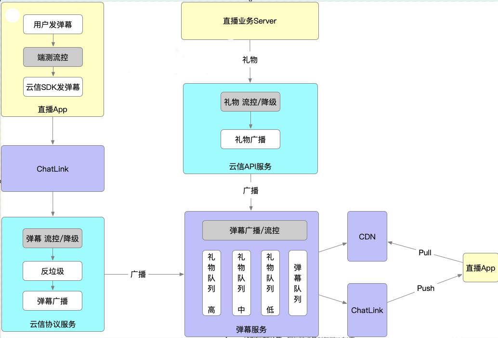

上行消息通过反垃圾检测后进入弹幕服务：先按业务划分队列（系统广播、高优先级礼物、低优先级、弹幕），再按队列分配消息比例，最后根据"单位时间（1 秒）内用户应收到的消息量"计算各队列该投递多少条。若前一个队列消息不足，可把剩余额度叠加到下一个队列，保证每个周期发够量。

弹幕可通过长连接或 CDN 广播。千万级在线场景下优先选 CDN 方案，以利用边缘加速能力。

### 技术难点六：在线状态、冷热分离与接入层

#### 用户在线状态

很多 IM 需要展示在线、忙碌等状态，存储方案主要有两种。

方案一：Redis 存储。每次心跳更新 Redis 中的状态键。之所以心跳也要更新，是因为状态需要 TTL 兜底——客户端异常退出时不会主动上报离线，只能靠过期判断。即使使用 TCP 长连接，也不能仅凭"连接还在"就认定用户在线，半开连接要靠 keepalive 探测或应用层心跳才能发现。Redis 单机容量与吞吐有限，生产上通常用 Redis Cluster 或 Codis 提升可靠性与性能。


方案二：分布式一致性哈希存储。把用户状态放在 Status Server 集群，按一致性哈希定位。扩容或缩容前必须先迁移用户状态，否则短期内会出现状态不一致；同时要用虚拟节点避免数据倾斜。


落地步骤：

- 客户端：登录时上报，服务端在 Redis 建立该用户键并置为在线；之后定时（如每 30 秒）发心跳，可携带设备类型、网络状况；心跳可基于 WebSocket 等实时通道发送。
- 服务端：收到心跳即更新状态与最后心跳时间；定期（如每分钟）扫描，把超过一定时间（如 5 分钟）未心跳的用户置为离线；对外提供查询接口，直接读 Redis 返回。

两个典型问题与优化：

- 问题一：海量定时心跳本身消耗资源，是否必要。可用"互动即刷新"降低心跳频率。
- 问题二：网络抖动或消息可靠性问题导致误判离线。
- 优化：收到点赞、评论等互动消息时顺带刷新在线状态，并按互动频率判断活跃度；对活跃用户放宽判定窗口（原文给的参数是默认超过 1 小时判定，活跃用户给到 2 小时或直接不踢），同时动态调整心跳频率与巡检次数。

#### 数据冷热分离

IM 历史消息有很强的时间序列特征：越久远的消息被访问的概率越低、价值越低。

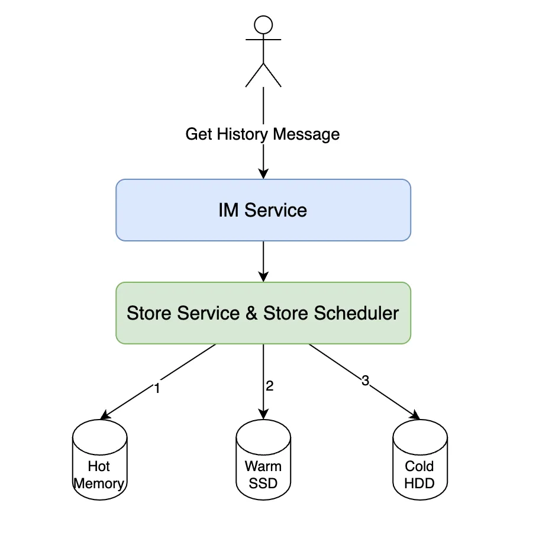

若需要保存数年甚至永久的消息（电商 IM 常见），冷热分离就很有必要，常用架构是 HWC（Hot-Warm-Cold，热—温—冷三层）：热层放近期高频数据用高性能存储，温层放中期数据用性价比存储，冷层放归档数据用低成本存储。

#### 接入层负载均衡

| 方案 | 优点 | 缺点 |
| --- | --- | --- |
| 硬件负载均衡（F5、A10 等） | 性能强、稳定性高 | 价格昂贵 |
| DNS 负载均衡 | 实现简单 | 切换与扩容生效慢；可配 IP 数量有限；策略简单 |
| DNS + 4 层 + 7 层 | 7 层负责业务路由，4 层承担大流量转发 | 架构层次多，运维复杂 |
| DNS + 4 层 | 4 层稳定、少改动，适合长连接 | 策略灵活性有限 |

为什么要加 4 层？因为 7 层负载均衡很耗 CPU 且需要频繁扩缩容，大型站点可能需要很多台 7 层设备，而 4 层只需少量即可承接流量。该架构对 HTTP 这类短连接应用尤其有效；长连接接入层则更适合"DNS + 4 层"。

若长连接接入层需要更灵活的分配策略或灰度能力，可引入调度服务：


Access Schedule Service 可以按灰度策略、就近原则、最少连接数等策略分配 Access Service。

### 小结

这套设计的取舍可以归结为三句话：扩散策略决定写放大与读放大如何分配，混合模式是群聊场景的现实解；ID 的递增范围决定了丢消息检测的成本，会话级连续递增配读扩散最省；实时性、时序、优先级都是"每个环节单独核算吞吐"的结果，没有全局银弹。

---

## 5. 百亿级超大流量红包架构方案

这篇拆解"春节红包"这类瞬时超高并发业务的两套真实架构：微信红包（2016 年春节前的重构）与字节红包（2022 年春节，预估峰值 360 万 QPS）。重点回答：金额不能错、入账不能重、系统不能被打垮时，架构该怎样分层与降级。

### 背景：红包的量级与真实难点

红包业务的特殊性在于：流量高度集中在除夕几个小时内，请求峰值是平时的数十倍，而每一笔都涉及真实资金。这决定了它既要扛住流量，又不能靠"简单丢弃"来扛。

公开数据显示，微信红包的除夕收发量在 2016 年为 80.8 亿个，峰值收发约 40.9 万个/秒；2017 年除夕进一步增长到 142 亿个（以上为微信当年公布的数据，仅用于说明量级）。除红包外，同期还有叠加的外部流量：据当年公开报道，春晚直播期间讨论春晚的微博约 5191 万条、网友互动量约 1.15 亿、网友抢微博红包总次数超过 8 亿次（均为 2016 年前后的公开数据，未经一手来源复核，仅用于说明量级）。

在这种量级下，问题不再是"接口能不能返回",而是三件事：

- 写入放大：一次"发红包"要落订单、落用户列表、落资金流水，任何一处成为瓶颈都会堵住主链路。
- 热点竞争：一个大群里几百人同时抢同一个红包，会集中竞争同一行数据库记录。
- 资金正确性：入账要多级容错，宁可慢、不可错；最终必须能对平账。

国内公开资料中，被反复提及达到亿级以上瞬时并发的两个场景是微信红包与字节红包，它们都在单位时间内承受了远超日常的请求负载。

### 微信红包架构（2016 年春节前）

2015 年春晚"摇一摇"之后，红包业务量出现指数级增长，2016 年除夕因此成为一次架构大考。当时的调整集中在四件事：异地（南北）架构、缓存体系优化、拆红包并发策略、存储优化。

红包在信息流上可以拆成两个维度：

- 订单维度：贯穿发、抢、拆、详情列表，属于交易类信息，是资金侧的关键数据。
- 用户维度：收红包列表、发红包列表，属于展示类信息，允许最终一致。

#### 南北分布与订单路由

微信用户在国内有深圳、上海两个接入点，习惯称深圳为南、上海为北。用户就近接入后，不同业务可按自身特性选择部署方式。红包的订单层采用南北独立体系，数据不同步：

- 用户就近接入，发红包时分配订单归属地，并在单号上打南北标识。
- 抢、拆、查详情时，接入层按单号上的标识把流量引到对应一侧，形成闭环。

由此产生四种组合：

| 发红包用户 | 抢红包用户 | 订单落点 | 是否跨城 |
| --- | --- | --- | --- |
| 深圳 | 深圳 | 深圳 | 否，深圳闭环 |
| 深圳 | 上海 | 深圳 | 是，上海接入后经专线跨城到深圳闭环 |
| 上海 | 上海 | 上海 | 否，上海闭环 |
| 上海 | 深圳 | 上海 | 是，深圳接入后经专线跨城到上海闭环 |

好处是南北系统分摊流量、降低单侧故障风险。


用户维度数据则按"写多读少"的特点处理：查询入口藏在钱包里较深的位置，访问量不大，且被视为可旁路的非关键信息，实时性要求不高。因此只在发、拆红包时从订单维度拆出用户数据写入请求，由 MQ 异步写入深圳；后台定时对账保证完整性。

南北的流量比例可以灵活调控：订单落深圳还是上海只需在接入层做逻辑，配合后台管理系统可实现秒级容量调配；据此还能在 DB 故障时把流量整体切到另一侧，实现 DB 级容灾。

#### 预订单：先落缓存再落库

用户点击"发红包"到真正支付之间有一个转化漏斗，部分请求最终不会付款。如果每次都直接落库，会产生大量废单。

做法是支付前订单先落缓存，并利用缓存的原子 incr 操作顺序生成红包订单号。好处是缓存操作轻量，同时显著减少 DB 废单；只有支付成功的订单才真正落库。

#### 拆红包入账异步化

核心思路是信息流与资金流分离：

1. 拆红包时在 DB 记下拆红包凭证。
2. 通过异步队列请求入账。
3. 入账失败由补偿队列重试；最终用红包凭证与用户账户入账流水对账，保证最终一致。


这个设计的理论基础是"快慢分离"：入账是一个分布式事务，属于慢接口；而拆红包凭证落地很快。用户抢完红包最关心的是详情列表里谁"手气最佳"，很少关心钱是否已经到账，因此展示凭证即可满足体验。

#### 双层缓存

- 第一层用 ckv（微信内部的全量 KV 缓存）做全量缓存；第二层在数据访问层 dao 里加本机内存缓存，缓存住所有读请求。
- 降级链：查询失败或不存在时降级到内存缓存；内存缓存也失败或记录不存在时降级到 DB。
- DB 本身不做读写分离。
- 写路径上，DB 写完成后由 dao 同步内存缓存、业务服务层同步 ckv，失败由异步队列补偿；定时把 ckv 与 DB 备机对账，保证最终一致。这里容忍少量不一致，换取写路径更短。

#### 高并发控制

并发压力主要来自"大群多人同时抢同一个红包"，本质是竞争 MySQL 行锁。四层控制：

1. 按红包订单路由，逻辑块垂直 sticky。按红包订单划分逻辑单元，单元内闭环；服务间 RPC 调用时用红包订单号的哈希值作为 key 找下一跳地址，同一个红包的所有拆、查请求都落到同一台逻辑机、同一个 DB 上处理。


2. dao 层本机内存缓存限并发。以红包订单号为 key 对拆请求做原子计数，控制同一时刻能进 DB 的并发数。该策略依赖第 1 条的路由，确保同一红包的请求都到同一台机器。

3. 多层级流量控制。

- 发红包控制：这是业务入口，控制住入口即控制住整体并发，链路上做多层流控，确保有效红包量级可控。
- 抢红包控制：领取分"抢"和"拆"两步。抢只查缓存不请求 DB，本身就有收敛作用；已领完、已领过、已过期的流量直接拦截；对有权进入拆环节的请求再做一次限流，最终进入拆环节的流量大幅减少且都是有效请求。
- 拆时内存缓存控制：即第 2 条。

4. DB 简化与拆分。

- 订单表只存关键字段（用户、单号、金额、时间、状态），头像、昵称、祝福语等非关键字段只存缓存。这些字段对交易不重要却占大量空间；cache 不命中时可从实时接口补偿查询，从而压缩订单库容量。
- 双重维度分库分表：用订单 hash 与订单日期两个维度，表名形如 `db_xxx.t_x_dd`，其中 x 为订单 hash 值，dd 为 01–31 的循环日。hash 维度把订单打散到不同 DB 均衡压力；日期循环日维度避免单表无限膨胀，每天都从一张空表开始。
- 冷热分离：红包订单访问热度极不均衡，热数据集中在一两天内且迅速衰减。线上热库只存几天数据，其余定时迁移到低成本冷库；循环日表也让历史数据迁移更容易。

#### 红包金额算法

红包要满足两个约束：钱必须发完，每个人至少拿到 1 分。原文描述的算法是"上下水位 + 二倍均值"：

1. 若只剩一个红包，本轮直接使用全部余额。
2. 计算下水位：本轮最少领多少才能保证后续每轮都还能领到（若剩余金额允许后续每轮都拿到上限，下水位即 1 分；否则按后续每轮拿 200 元反推本轮至少要带走多少）。
3. 计算上水位：本轮最多领多少才能保证后面每人都还有钱（若本轮拿 200 元后剩余仍够后续每轮 1 分，上水位为 200 元；否则按后续每轮 1 分反推）。
4. 用均值收敛上水位：若上水位大于两倍"剩余金额均值"，则取两倍均值。也就是说，每轮最高不超过剩余红包均值的两倍。
5. 取随机数对上水位取余；若结果小于下水位，则直接按下水位发放。

按这套规则写的示例实现（金额单位为分）：

```java
// total: 本轮剩余金额（分）；count: 本轮剩余个数；MAX: 单包金额上限（分）
long upper = Math.min(total - (count - 1), 2L * total / count);   // 上水位，且不超过两倍均值
long lower = Math.max(1L, total - (count - 1) * MAX);             // 下水位，保证后面每人还能领到
long amount = Math.max(lower, ThreadLocalRandom.current().nextLong(upper)); // 随机后兜住下水位
```

这种"二倍均值"思路是业界流传最广的红包拆分方式，具体参数各产品不同；它的效果是金额分布相对均匀，同时又不会出现极端值。

#### 柔性降级方案

系统任何环节都可能异常，因此每个环节都要有预案。

| 故障点 | 降级动作 | 影响 |
| --- | --- | --- |
| 下单缓存故障 | 降级直落 DB，并用独立 ID 生成器生成订单号 | 失去"少废单"的优化，DB 压力上升 |
| 抢红包时缓存故障 | 降级 DB 查询，同时打开 DB 限流保护开关 | 防止 DB 被打垮导致整体不可用 |
| 缓存故障时缺少展示字段 | 头像、昵称改为实时接口查询，失败再降级默认头像昵称 | 展示质量下降，核心交易不受影响 |
| 资金入账异常 | 单据实时落地，入账按大额实时、小额异步、全部异步、事后凭单据批量入账四级降级 | 到账延迟，但账最终对平 |
| 用户列表压力大 | 列表走 MQ 异步写 + 定时对账；缓存只存两屏，压力大时限制只查两屏 | 翻页受限 |

原则可以概括为：单据必须实时落地，真实入账可实时可异步，最终保证一致。这套调整经过 2016 年春节的实际检验。

### 字节红包体系（2022 年春节）

#### 业务背景与目标

2022 年春节活动要支持八端 APP 的奖励互通：抖音、抖音火山、抖音极速版、西瓜、今日头条、头条极速版、番茄小说、番茄畅听。用户在任意一端参与活动，所得奖励在其他端都能查看与提现使用。

玩法包括集卡、朋友页红包雨、红包雨、集卡开奖、烟火大会等；奖励类型十余种，涵盖现金红包、补贴视频红包、商业化广告券、电商券、支付券、消费金融券、保险券、信用卡优惠券、茶饮券、电影票券、dou+ 券、文创券、头像挂件等。

核心挑战与目标：

- 挑战：预估峰值 360 万 QPS 的发奖请求；奖励类型多、发放场景多；稳定性、体验、资金安全、运营能力需要全方位保障。
- 奖励入账：数据高可靠，提供统一错误处理、入账幂等、预算控制。
- 奖励展示与使用：支持查看、提现（现金）、使用卡券与挂件。
- 稳定性：资源扩容、限流、熔断、降级、兜底、资源隔离。
- 资金安全：幂等、对账、监控报警，保证应发尽发、不少发。
- 活动隔离：内部测试、灰度放量、正式活动三阶段的数据互不影响。

#### 产品链路与发放场景

以抖音红包雨现金红包入账为例：登录抖音 → 参与活动 → 活动钱包页 → 点击提现 → 提现页 → 提现结果页；钱包页也可进入活动钱包页。

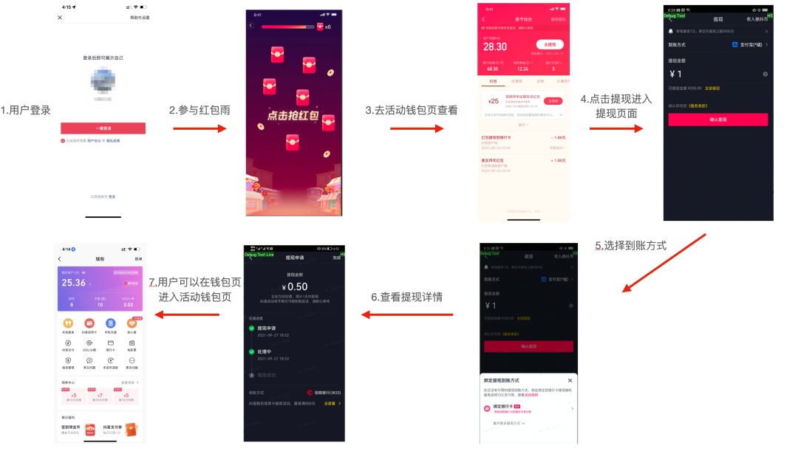

发放场景主要有两类：集卡（抽卡发券、锦鲤发大额现金、开奖瓜分奖金与优惠券）；红包雨（发现金、卡券、视频补贴红包，其中现金与卡券的峰值最高各约 180 万 QPS）。


角色分工：UG 负责玩法实现（集卡、红包雨、烟火大会等业务逻辑与稳定性）；钱包方向负责大流量下的奖励入账、展示、使用与资金安全；资产中台负责其中的奖励发放与展示。

#### 钱包资产中台架构


两个核心层次：

- 资产订单层：收敛八端的奖励入账链路，统一接口协议对接上游活动方，同时提供预算控制、补偿、订单号幂等。
- 活动钱包 API 层：统一奖励展示链路，并支撑大流量读取。

发放模型的关键概念：


- 活动 ID：唯一区分一个活动，本次春节分配了一个单独的母活动 ID。
- 场景 ID：与一种具体奖励类型一一对应，定义该场景发奖的唯一配置。可配置项包括账单文案、是否需要补偿、限流配置、是否做库存控制、是否需要对账，并提供可插拔能力供业务选择性接入。
- 订单号：资产订单层以订单号维度做发奖幂等。

```text
${actID}_${scene_id}_${rain_id}_${award_type}_${stage}
```

订单号从设计层面保证同一场景下每个用户最多领一次，从而不超发。（原文该字段记作 `statge`，疑为 `stage` 的笔误。）

#### 难点一：八端奖励互通

八个端要统一对接，但抖音系与头条系 APP 属于不同账号体系，无法直接用用户 ID 打通。

解决方案分两步：

1. 为每个用户生成唯一的 actID。
2. 以手机号作为最高优先级标识：不同端登录手机号相同，则 actID 一致。

奖励数据绑定在 actID 上，入账与查询都走 actID 维度，实现八端互通。

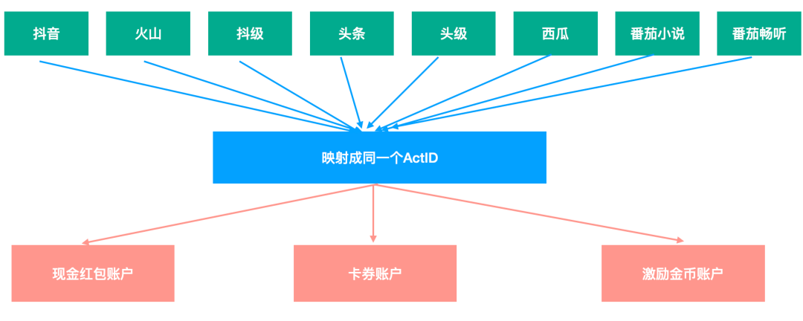

#### 难点二：高并发入账与 token 方案

现金红包是最关键的一环：预估最大流量 180 万 TPS、金额价值高、用户对到账速度极其敏感。

传统两种方案都不合适：

| 方案 | 思路 | 优点 | 缺点 |
| --- | --- | --- | --- |
| 同步入账 | 按预估流量申请同等计算与存储资源 | 开发简单、不易出错 | 资源浪费。原文压测数据：支撑 30 万发红包需 152 个数据库实例，若支撑 180 万，按 6 倍线性外推约需 900 余个实例（原文记为 1152 个，量级一致但数值不同，应含冗余），且未计缓存等其他资源 |
| 异步入账 | 只申请部分资源，实际入账能力低于预估 | 开发简单、不浪费资源 | 体验差。活动期间入账延迟可达十几分钟，用户看不到奖励也无法提现，客诉量大 |

最终方案是"红包雨 token"：异步入账 + 较少的分布式存储 + 较复杂的逻辑。前提是接受"压单"——按预估估算，实际入账最低只需支撑 30 万 TPS，与预估发放 180 万之间允许有差距。

设计目标：在 180 万发放与 30 万入账的 gap 下，让用户在查看与使用中完全感知不到压单。展示相关数据（余额、累计收入、红包流水）与使用（提现）都不能受影响。

具体设计：

- 每次给用户发红包时生成一个加密 token（非对称加密），内含红包金额、actID、发放时间等元信息。
- token 同时存客户端与服务端，互为容灾备份；每个用户维护一个 token 列表。
- 每次发红包在 Redis 记录该 token 的入账状态。
- 用户在钱包页看到的现金流水与余额 = 已入账红包列表 + token 列表 − 已入账/入账中的 token 列表。
- 进入提现页或点击提现时，对未入账 token 强制入账，保证提现时余额等于应入账总额，不阻塞提现流程。


token 使用 protobuf 编码。原文的单测结论是：存储消耗比 JSON 少约一半，节省网络带宽与存储成本，序列化与反序列化的 CPU 开销也更低。

```go
// 红包雨 token 结构
type RedPacketToken struct {
	AppID      int64  `protobuf:"varint,1,opt" json:"AppID,omitempty"`      // 端 ID
	ActID      int64  `protobuf:"varint,2,opt" json:"UserID,omitempty"`     // ActID
	ActivityID string `protobuf:"bytes,3,opt"  json:"ActivityID,omitempty"` // 活动 ID
	SceneID    string `protobuf:"bytes,4,opt"  json:"SceneID,omitempty"`    // 场景 ID
	Amount     int64  `protobuf:"varint,5,opt" json:"Amount,omitempty"`     // 红包金额
	OutTradeNo string `protobuf:"bytes,6,opt"  json:"OutTradeNo,omitempty"` // 订单号
	OpenTime   int64  `protobuf:"varint,7,opt" json:"OpenTime,omitempty"`   // 开奖时间
	RainID     int32  `protobuf:"varint,8,opt" json:"rainID,omitempty"`     // 红包雨 ID
	Status     int64  `protobuf:"varint,9,opt" json:"status,omitempty"`     // 入账状态
}
```

安全性：采用非对称加密，降低 token 在客户端被破解的风险；若加密算法被黑产突破，可通过监控报警发现并降级处理。

#### 难点三：依赖治理与降级

功能越复杂、依赖越多，稳定性风险越高。核心功能（把红包入账、幂等、预算控制）强依赖数据库事务一致性，但中间链路上的弱依赖必须能降级。

现金红包入账的"最短路径"是：只依赖服务实例的计算资源与 MySQL 存储。


| 所属服务 | 依赖 | 是否强依赖 | 降级方案 | 降级后影响 |
| --- | --- | --- | --- | --- |
| 资产中台 | 配置中心（tcc） | 是 | 降级读本地缓存 | 无 |
| 资产中台 | 分布式 KV（bytekv） | 否 | 主动开关，跳过并依赖下游幂等 | 无 |
| 资金交易层 | 分布式锁 Redis | 否 | 被动降级，调用失败直接跳过 | 基本无 |
| 资金交易层 | token Redis | 否 | 主动开关，不调用 Redis | 用户能感知到账延迟，客诉增多 |
| 资金交易层 | MySQL | 是 | 主库异常联系 DBA 切主 | 故障期间发红包不可用 |

#### 难点四：卡券预算控制

大流量集中发券场景下，钱包侧与算法策略配合做库存控制，防止超发：

1. 资产中台维护每个卡券模板 ID 的消耗发放量。
2. 每次发放前读取该模板的消耗量与总库存，并设置阈值：剩余量低于 10% 后不再发该券，改用兜底券或祝福语兜底。
3. 发放时用 Redis incr 原子累加消耗量，再与总库存比对，超过则拒绝，作为最后一道兜底。


两个已知问题与优化方向：

- 单 key 计数在大流量下会形成热 key，需要拆分 key。
- Redis 操作超时会返回"处理中"，上游重试会导致多消耗库存、实际少发。本次活动的做法是在预估库存基础上加约 5% 的量来缓解。

#### 难点五：热 key 的读写

该场景最大读约 180 万 QPS、写约 30 万 QPS，典型特征是热点 key、更新延迟不敏感、非强一致（数值一直累加），同时容灾降级要到位。最终展示金额与产品预估发放值的误差小于 1%（原文数据）。


方案一：拆分多 key 加本地缓存兜底。单 key 读写会集中到一个实例，原文压测的单实例瓶颈约 3 万 QPS（经验值，随规格与命令而异），因此拆成 100 个 key：

- 写：按 actID % 100 选择 key，用 incr 累加。由于无法保证幂等，超时不重试。

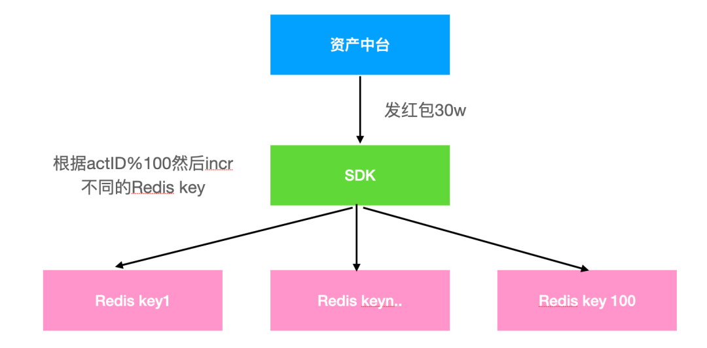

- 读：优先读本地缓存；本地缓存为 0 时，把 100 个 key 的值累加后返回。

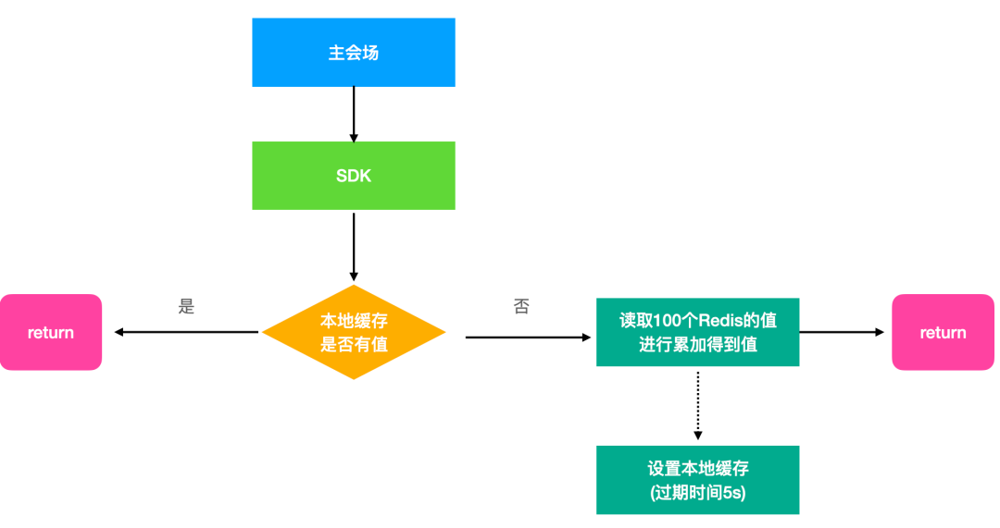

问题：拆 100 个 key 带来读扩散，需要更多 Redis 资源；读取超时可能导致某次累加漏掉部分 key，返回值比上一次更小；做容灾还要再申请一套备份 Redis，存储成本翻倍。

方案二：本地合并 + 定时同步。在方案一基础上，写请求先在本地缓存合并、原子累加；读请求直接返回本地缓存值，从而省掉额外存储。Redis 作为中心化存储，保证各实例最终读到相同的值。

每个容器实例启动时注册定时任务，分读任务与写任务：

- 读：每秒执行一次，读取 Redis 单 key 的值，若大于本地缓存则更新本地缓存；对外 SDK 直接返回本地缓存值。注意实例启动后的第一秒本地没有数据，需要阻塞读直到有值。
- 写：本地缓存不过期，因此只需处理并发写；用 Go 的 `atomic.AddInt64` 做本地原子累加；定时任务先把本地写缓存复制到 amount 变量，再把 amount 的值 incr 到 Redis 单 key 上，实现单 key 持续累加。
- 容灾：备份 Redis 集群双写；主机群故障时用配置开关切到备份集群读取；两套集群的一致性由定时任务兜底。

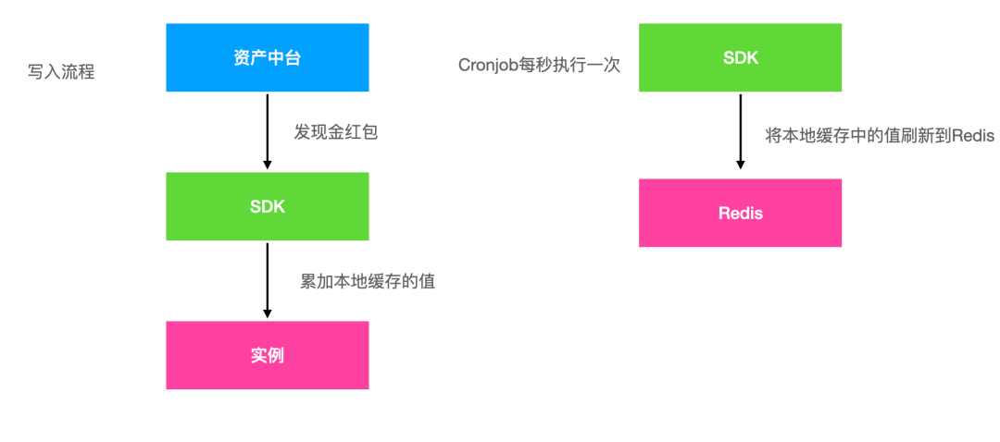

关键容量换算——本方案调用 Redis 的流量与实例数成正比，而不是与请求量成正比：

- 读侧为主会场服务，约 2 万个实例；写侧为资产中台，约 8 千个实例。
- 每次定时任务每个实例产生 1 次调用，因此 Redis 需要支撑的 QPS ≈ (20000 + 8000) ÷ 任务间隔（秒）= 2.8 万 ÷ 间隔。
- 压测结论是单实例可支撑单 key 约 2 万次 get 与 8 千次 incr，因此把间隔设为 1 秒；实例数继续增长时，可延长间隔。

| 方案 | 优点 | 缺点 |
| --- | --- | --- |
| 方案一（拆 100 key） | 实现成本简单 | 浪费存储；容灾难做；不能保证一直累加（读超时会回退） |
| 方案二（本地合并 + 定时同步） | 节约资源；容灾简单且省成本 | 实现稍复杂，要处理好并发原子累加 |

最终选择方案二上线。

#### 难点六：资金安全与对账

三件事保障大流量、大预算下的资金安全：

1. 整体预算控制拦截。
2. 单笔红包金额上限拦截。
3. 资金对账，分两个层次：
   - 小时级对账：红包雨、集卡、烟火红包支持 h+1 小时级对账，部分场景兜底 h+2 再次核对。
   - 准实时对账：对红包雨已入账数据反查资产中台与活动侧，做准实时比对。

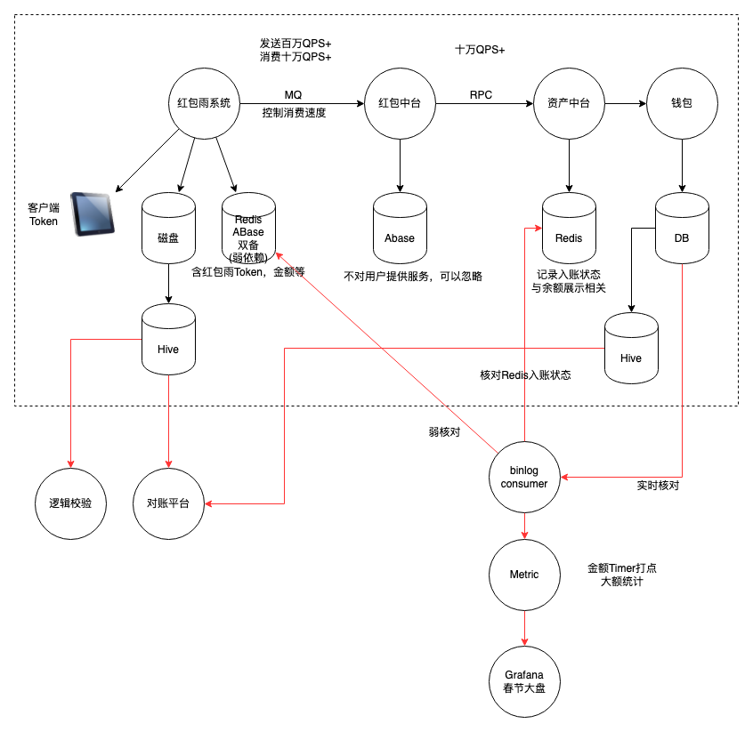

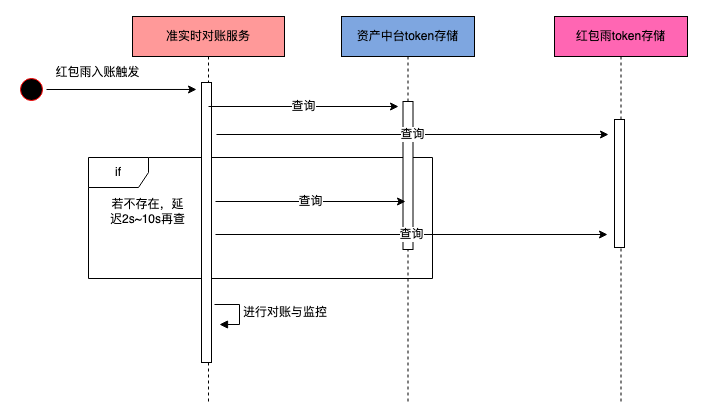

准实时对账的监控报警能及时发现异常入账，触发后按紧急预案处理。

### 可复用的通用模式

#### 限流

- 分层：API 层 Nginx 入流量限流、分布式入流量限流、分布式出流量限流，三者均为公司级公共中间件。
- 定容量：先做单实例压测，按"单实例承压能力 × 预估流量"扩容，同时受下游承压能力约束。
- 集群限流本质是实例维度限流：每实例 QPS = 总限流 QPS ÷ 实例数。机器多、单机 QPS 低时该算法不准，必须靠压测校准并持续调整。
- 分布式限流两种用法：低 QPS、精度要求高时用 Redis 计数（使用方自备集群）；高 QPS、精度要求低时退化为"总 QPS ÷ 实例数"的单实例限流。
- 目标：防止预期外流量把自身打垮、避免雪崩，保住核心业务与核心体验。

#### 降级

- 每个核心功能都要有对应降级方案；本次春节准备了 26 个降级开关，关键时刻"弃车保帅"。
- 以现金红包为例，完全降级后的方案只依赖容器与 MySQL；MySQL 主库问题走切主（本次实际未触发，但必须提前设计）。

#### 资源隔离

- 不重复造轮子：资产中台日常也在支撑抖音资产发放，活动复用现有接口与代码流程。
- 集群隔离：为活动创建专用集群，底层存储资源隔离，活动流量与常规流量互不影响。

#### 存储预估

- 既要验证 Redis/MySQL 能扛住流量，也要按参与人数与发放数据预估容量是否够用。
- 以公司 Redis 组件为例：可垂直扩容（单实例最大 10G），也可水平扩容（单机房上限 500 实例）；由于三机房同步，容量只需按单机房上限计算。
- 必须留 buffer：水平扩容很慢，突发容量不足只能靠配置开关提前摘掉依赖，因此要提前设计。

#### 压测

- 压测前先建好整链路监控大盘，便于过程中快速发现问题。
- MySQL 在大流量活动前做小流量预热并提前建链，减少正式活动时的建链耗时。
- 压测流量要带压测标，支持全链路识别并做特殊逻辑，与线上流量互不干扰；但压测流量的业务处理流程要与线上保持一致。
- 验证计算与存储是否扛得住：制定压测计划、渐进提升流量、实时观察指标。
- 压测数据要与线上隔离：MySQL、KV 建压测表；Redis 等用带压测前缀的 key；压测后及时清理（优先用短过期时间，忘记设置则按前缀脚本删除）。
- 压测后复盘存储指标是否符合预期。

#### 微服务与 SDK 聚合

微服务按职责与核心数据模型拆分，能提升迭代效率、互不影响；但超大流量、链路复杂的场景下，跨服务 RPC 极其消耗计算资源。本次活动的做法是资产中台提供 SDK 包代替 RPC 做链路聚合，对外提供查询余额、判断是否领取过奖励、强制入账等基础能力。原文称该方式承接的访问流量最高上千万，相比纯微服务架构节约了上万核 CPU（公司内部数据，属经验值）。

### 演进方向

- 梳理上下游需求与痛点，完善资产中台基础能力与服务架构，提供一站式服务，让活动方专注业务逻辑。
- 加强实时与离线数据看板，让发放数据展示更清晰准确。
- 加强配置化与文档建设，降低对接成本、提升接入效率。

### 出处

微信红包 2016 年春节架构实践（公开技术分享整理，2016）；字节跳动 2022 年春节红包活动技术实践（公开技术分享整理，2022）。文中性能与容量数字均来自原文披露的压测或预估，属特定环境经验值，不可直接套用。

---

## 6. 如何实现一个登录功能

这篇解决什么问题：把"输入用户名密码、点一下登录"这种最朴素的实现，扩展成一套能讲清楚**认证流程、安全边界、性能与扩展取舍**的登录设计。读完之后，你应当能画出一次登录从浏览器到数据库、再回到浏览器的完整链路，并说清每个环节为什么必须存在。

### 一、问题是什么：最小登录实现

一个能跑起来的登录功能，通常只有三部分：

1. **前端页面**：包含用户名、密码输入框和提交按钮，负责收集输入、发出登录请求。
2. **后端逻辑**：接收请求，校验用户名和密码是否匹配，返回登录结果。
3. **数据存储**：用户表里存着用户名和密码，后端查表比对。

这个版本能演示功能，但放到真实系统里几乎处处是洞：密码可能明文入库、可以无限次尝试、会话无法在多台服务器间共享、被刷接口时数据库直接被打穿。所以问题不在于"能不能登录"，而在于**登录这条链路上有多少个必须做对的决定**。

### 二、为什么难

登录的难点不在代码量，而在它同时踩在三个领域的交叉点上：

- **安全**：认证（authentication，确认"你是谁"）和授权（authorization，确认"你能做什么"）是两件事，登录只解决前者，但实现方式会直接影响后者是否可信。
- **状态**：HTTP 本身是无状态的，登录成功后必须额外引入"会话"这个概念，把一次次独立请求串成同一个人。
- **规模**：登录是所有流量的入口，QPS 高、失败请求多、还可能被恶意刷，任何一处放大都会变成全站故障。

一个生活化的比喻：登录像小区门禁。门禁卡是凭证，保安核对卡与人对不对得上是认证，访客条有有效期是会话超时，进出记录是审计日志。只装一把锁（比对密码）不叫门禁系统，能查、能封、能追才叫。

### 三、怎么设计

#### 3.1 分层架构

把职责拆开，是让登录功能可维护的第一步。典型分为四层：

| 层次 | 职责 | 常见实现 |
| --- | --- | --- |
| 表示层 | 与用户交互，收集用户名密码，展示登录结果 | HTML/CSS/JavaScript，或 Vue、React 等前端框架 |
| 业务逻辑层 | 认证、授权、密码加解密、验证码、风控判断 | Spring Boot 服务、Spring Security |
| 数据访问层 | 查询、更新用户信息，屏蔽具体 SQL | MyBatis、Spring Data JPA |
| 持久层 | 真正存储用户数据 | MySQL 等关系型数据库，Redis 作缓存 |

第四层是持久层，负责数据的最终落地。有的资料把它写作"层持久"，指的是同一层。分层带来的直接好处是：换数据库只动数据访问层，改认证策略只动业务逻辑层。

#### 3.2 一次完整的认证流程

这是登录功能的主干。下面这条链路同时覆盖注册、登录、后续鉴权和登出，实际项目基本都能映射到其中某几步。

| 步骤 | 做什么 | 为什么必须做 |
| --- | --- | --- |
| 1. 注册 | 密码用 bcrypt 哈希后入库，同时保存算法标识与 cost | 数据库泄露时明文密码等于全泄露 |
| 2. 打开登录页 | 服务端下发 CSRF Token 并写入会话，页面全程走 HTTPS | 后续提交需要证明"请求来自本站页面" |
| 3. 前端校验 | 非空、长度、字符集检查 | 只优化体验，**不能**当作安全边界 |
| 4. 提交凭证 | 用 POST 提交，凭证放请求体 | 避免密码出现在 URL、浏览器历史和访问日志里 |
| 5. 入口防护 | 按 IP、账号做频率限制；失败达阈值后要求验证码 | 拦住撞库和暴力破解 |
| 6. 查用户 | 参数化查询按用户名取记录 | 防 SQL 注入，也保证走索引 |
| 7. 校验密码 | 用 `PasswordEncoder.matches()` 比对，而不是自己拼哈希 | bcrypt 的盐和 cost 都存在哈希串里，必须由算法自己还原 |
| 8. 建立会话 | 重新生成 Session ID 或签发 Token，写入服务端存储 | 防会话固定攻击（攻击者预先塞给你一个已知 ID） |
| 9. 下发凭证 | `Set-Cookie` 带 `HttpOnly`、`Secure`、`SameSite`，或返回 Token 由前端保管 | 降低 XSS 窃取和 CSRF 风险 |
| 10. 后续鉴权 | 过滤器/拦截器校验会话或 Token，解析出用户身份 | 每个受保护接口都要走这一步 |
| 11. 登出与失效 | 服务端删除会话，客户端清 Cookie；改密码后让旧会话全部失效 | "退出登录"必须真的退得掉 |

两个容易忽略的细节：

- **失败提示要统一**。无论"用户不存在"还是"密码错误"，都返回同一句"用户名或密码错误"。否则攻击者可以靠提示差异枚举出哪些账号真实存在。
- **失败路径也要消耗时间**。用户不存在时如果直接返回，响应会明显快于密码错误，同样能用来枚举账号。常见做法是走一次等价的哈希计算再返回。

#### 3.3 密码存储：为什么必须哈希而不是加密

哈希（hash）是把任意长度输入压成固定长度摘要的**单向**函数，理论上无法从摘要反推原文；加密（encryption）是**双向**的，有密钥就能还原。OWASP 的密码存储指南要求：密码应当用 Argon2id、bcrypt、PBKDF2 这类慢哈希保存，而不是明文或可逆加密；只有极少数确实需要还原明文去对接旧系统的场景，才考虑可逆加密并严格管理密钥。

只有哈希还不够，还要加盐（salt，每个用户独有的一段随机值）：

- 没有盐，攻击者可以用彩虹表（预计算的"常见密码 → 哈希值"对照表）批量反查。
- 有盐之后，同一个密码在两个用户那里得到的哈希也不同，攻击者只能一个个单独破解。

bcrypt 是 Java 生态里最常见的密码哈希选择之一，它把盐和 cost（计算强度）直接编进哈希串，所以校验时不需要你手动传盐。几个必须知道的点：

- **cost 每加 1，计算量大约翻倍**。OWASP 建议 bcrypt 的 work factor 不低于 10；具体取值要在自己的服务器上实测，让单次哈希耗时控制在 1 秒以内。
- **bcrypt 只处理密码的前 72 字节**（多数实现如此）。要么限制密码长度，要么先做一次带密钥的 HMAC 再交给 bcrypt，不要直接用 SHA-256 预哈希后拼接，那样会引入空字节截断和"密码 shucking"问题。
- **不要用 MD5、SHA-1、SHA-256 存密码**。它们被设计成算得越快越好，正好方便攻击者用 GPU 批量猜。
- **要预留升级通道**。以后调高 cost 或换算法时，在用户下次登录成功那一刻用新参数重新哈希并覆盖旧值即可。

```java
import org.springframework.security.crypto.bcrypt.BCryptPasswordEncoder;
import org.springframework.security.crypto.password.PasswordEncoder;

public class PasswordService {

    // cost = 12，具体取值按服务器实测调整
    private final PasswordEncoder encoder = new BCryptPasswordEncoder(12);

    /** 注册：入库的永远是哈希，不是明文 */
    public String encodeForStorage(String rawPassword) {
        return encoder.encode(rawPassword);
    }

    /** 登录：把用户输入和库里的哈希串比对，内部会取出盐和 cost 重算 */
    public boolean verify(String rawPassword, String storedHash) {
        return encoder.matches(rawPassword, storedHash);
    }
}
```

#### 3.4 会话管理：Session、服务端 Token、JWT 怎么选

会话（session）是"登录成功"这个事实在服务端的表示。HTTP 无状态，所以每次请求都要带上一个能证明身份的凭证。

| 维度 | 服务端 Session | 服务端 Token（存 Redis） | 无状态 JWT |
| --- | --- | --- | --- |
| 状态存放 | 服务端内存或会话存储 | Redis 等集中存储 | 客户端持有，服务端不存 |
| 能否随时踢人下线 | 能 | 能 | 不能，只能等过期或另建黑名单 |
| 水平扩展 | 需会话共享 | 天然支持 | 天然支持 |
| 每次请求开销 | 一次会话存储读 | 一次 Redis 读 | 只做签名校验，最省 |
| 体积 | Cookie 里只有 ID | Token 一般几十字节 | 携带声明，体积较大 |
| 主要风险 | 会话固定、会话劫持 | Token 泄露 | 无法撤销、密钥泄露即全线失守 |

选择经验：单体应用或需要"管理员强制下线"的场景，服务端 Session 更简单；微服务、多端（App、小程序、Web）并存时，常用"服务端 Token + Redis"或"短期 JWT + 刷新令牌"的组合。

如果用 Cookie 承载凭证，属性要配齐：

| 属性 | 作用 |
| --- | --- |
| `HttpOnly` | 禁止 JavaScript 读取，降低 XSS 窃取会话的概率 |
| `Secure` | 只在 HTTPS 下发送 |
| `SameSite=Lax` 或 `Strict` | 跨站请求不自动带 Cookie，缓解 CSRF |
| `Path` / `Max-Age` | 限定作用路径与有效期 |

#### 3.5 安全设计要点

| 威胁 | 原理 | 主要防护 |
| --- | --- | --- |
| 暴力破解、撞库 | 用字典或泄露的账号密码批量尝试 | 失败计数与锁定、验证码、IP 频率限制、MFA |
| SQL 注入 | 用户输入被拼进 SQL，变成可执行语句 | 参数化查询、最小权限、输入格式校验 |
| 传输窃听 | 明文 HTTP 被抓包 | 全站 HTTPS/TLS、HSTS |
| CSRF（跨站请求伪造） | 借用户已登录的 Cookie 发起非本意请求 | CSRF Token、`SameSite`、校验 `Origin`/`Referer` |
| XSS（跨站脚本） | 注入的脚本在他人浏览器执行 | 输出编码、CSP、输入过滤 |
| 会话固定 | 攻击者预先设定会话 ID 再诱导登录 | 登录成功后重建 Session ID |
| 用户枚举 | 从错误提示或响应时间差异推断账号是否存在 | 统一错误文案、失败路径耗时对齐 |

另外两个基础能力：多因素认证（MFA，在密码之外再要求一类证据，如短信码、动态令牌、指纹）和登录审计（记录时间、IP、设备、结果），前者提高攻击成本，后者是事后追查的唯一依据。

#### 3.6 技术选型

| 部分 | 选型 | 说明 |
| --- | --- | --- |
| 前端 | HTML/CSS/JavaScript，或 Vue、React | 负责表单与交互，安全校验一律以后端为准 |
| 后端 | Spring Boot + Spring Security | Spring Security 提供认证过滤器链、密码编码器、CSRF 防护等现成能力 |
| 数据库 | MySQL | 存用户基本信息，用户名建唯一索引 |
| 缓存 | Redis | 存会话、验证码、失败计数等临时数据 |

### 四、常见追问：安全方面

#### 4.1 如何防止暴力破解攻击

思路是"让每次尝试都变贵"。三种手段通常组合使用：

| 手段 | 触发条件 | 效果 | 代价 |
| --- | --- | --- | --- |
| 失败计数 + 锁定 | 同一账号连续失败 5 次 | 锁 15 分钟或转人工验证 | 可能被用来恶意锁死他人账号 |
| 验证码 | 连续失败 3 次后 | 拦住自动化脚本 | 影响正常用户体验 |
| IP 黑名单 | 同一 IP 短时间内大量失败 | 阻断单点扫描 | NAT 环境下可能误伤同网用户 |

第一种手段的注意点是：**计数必须带时间窗口**。如果只记次数不记时间，锁定就永远不会自动解除，或者反过来一分钟后就被清空，两种都不对。下面这个实现用"次数 + 首次失败时间"判断窗口：

```java
import java.util.concurrent.ConcurrentHashMap;
import java.util.concurrent.Executors;
import java.util.concurrent.ScheduledExecutorService;
import java.util.concurrent.TimeUnit;

public class LoginAttemptTracker {

    /** 每个账号的失败记录：次数 + 首次失败时间戳 */
    private record Attempt(int count, long firstFailAt) {
    }

    private static final int MAX_FAILS = 5;
    private static final long LOCK_MILLIS = TimeUnit.MINUTES.toMillis(15);

    private final ConcurrentHashMap<String, Attempt> attempts = new ConcurrentHashMap<>();
    private final ScheduledExecutorService cleaner = Executors.newSingleThreadScheduledExecutor();

    public LoginAttemptTracker() {
        // 定期清理已经过期的记录，避免 Map 无限增长
        cleaner.scheduleAtFixedRate(this::cleanUp, 1, 1, TimeUnit.MINUTES);
    }

    public void recordFailedLogin(String username) {
        long now = System.currentTimeMillis();
        attempts.compute(username, (k, old) -> {
            if (old == null || now - old.firstFailAt() > LOCK_MILLIS) {
                return new Attempt(1, now);
            }
            return new Attempt(old.count() + 1, old.firstFailAt());
        });
    }

    public boolean isAccountLocked(String username) {
        Attempt a = attempts.get(username);
        if (a == null || a.count() < MAX_FAILS) {
            return false;
        }
        // 锁定窗口已过则视为解锁
        return System.currentTimeMillis() - a.firstFailAt() <= LOCK_MILLIS;
    }

    public void reset(String username) {
        attempts.remove(username);
    }

    private void cleanUp() {
        long now = System.currentTimeMillis();
        attempts.entrySet().removeIf(e -> now - e.getValue().firstFailAt() > LOCK_MILLIS);
    }
}
```

多实例部署时，这张表要换成 Redis 计数（`INCR` + 过期时间），否则用户在 A 机器失败 4 次、切到 B 机器又能重新试 5 次。

第二种手段是验证码：触发后要求输入图形码或短信码，验证码本身存 Redis 并设短过期时间，**校验成功后立即删除**，保证一次性。

```java
import java.security.SecureRandom;
import java.util.concurrent.TimeUnit;

import org.springframework.data.redis.core.StringRedisTemplate;

public class CaptchaService {

    private static final SecureRandom RANDOM = new SecureRandom();
    private static final String KEY_PREFIX = "captcha:";

    private final StringRedisTemplate redisTemplate;

    public CaptchaService(StringRedisTemplate redisTemplate) {
        this.redisTemplate = redisTemplate;
    }

    public void sendCaptcha(String phoneNumber) {
        String captcha = String.format("%06d", RANDOM.nextInt(1_000_000));
        // 发送验证码到用户手机
        sendSms(phoneNumber, captcha);
        // 5 分钟过期；同一手机号重复发送会覆盖旧值
        redisTemplate.opsForValue().set(KEY_PREFIX + phoneNumber, captcha, 5, TimeUnit.MINUTES);
    }

    /** 校验成功后立刻删除，确保一个验证码只能用一次 */
    public boolean verify(String phoneNumber, String input) {
        String key = KEY_PREFIX + phoneNumber;
        String expected = redisTemplate.opsForValue().get(key);
        if (expected == null || !expected.equals(input)) {
            return false;
        }
        redisTemplate.delete(key);
        return true;
    }

    private void sendSms(String phoneNumber, String captcha) {
        // 调用短信服务商接口
    }
}
```

这里把随机数从 `java.util.Random` 换成了 `SecureRandom`：`Random` 是可预测的伪随机序列，用来生成验证码会被猜出规律。

第三种手段是 IP 维度：同一 IP 短时间内失败过多就暂时拒绝。它的作用对象是"扫描器"，不是"某个人"，所以阈值一般比账号维度宽松。

```java
import java.util.concurrent.ConcurrentHashMap;
import java.util.concurrent.Executors;
import java.util.concurrent.ScheduledExecutorService;
import java.util.concurrent.TimeUnit;

public class IpBlacklistTracker {

    private static final int MAX_FAILS_PER_MINUTE = 10;
    private static final long WINDOW_MILLIS = TimeUnit.MINUTES.toMillis(1);

    /** 时间戳必须用 long，用 int 存毫秒会在 24 天后溢出成负数 */
    private record IpStat(int count, long windowStart) {
    }

    private final ConcurrentHashMap<String, IpStat> ipStats = new ConcurrentHashMap<>();
    private final ScheduledExecutorService cleaner = Executors.newSingleThreadScheduledExecutor();

    public IpBlacklistTracker() {
        cleaner.scheduleAtFixedRate(this::cleanUp, 1, 1, TimeUnit.MINUTES);
    }

    public void recordFailedLogin(String ip) {
        long now = System.currentTimeMillis();
        ipStats.compute(ip, (k, old) -> {
            if (old == null || now - old.windowStart() > WINDOW_MILLIS) {
                return new IpStat(1, now);
            }
            return new IpStat(old.count() + 1, old.windowStart());
        });
    }

    public boolean isIpBlacklisted(String ip) {
        IpStat stat = ipStats.get(ip);
        return stat != null && stat.count() >= MAX_FAILS_PER_MINUTE
                && System.currentTimeMillis() - stat.windowStart() <= WINDOW_MILLIS;
    }

    private void cleanUp() {
        long now = System.currentTimeMillis();
        ipStats.entrySet().removeIf(e -> now - e.getValue().windowStart() > WINDOW_MILLIS);
    }
}
```

生产环境更推荐把这层逻辑交给网关或 WAF（Web 应用防火墙），它们能拿到真实 IP、支持按路径和 UA 细分策略，也不必让业务代码维护状态。

#### 4.2 如何防止 SQL 注入攻击

SQL 注入的本质是**把数据当成了代码**：本该作为"值"的用户输入，被拼进 SQL 字符串后变成可执行片段，于是 `' OR '1'='1` 这类输入就能改变查询语义。正确的解法不是"把坏字符过滤掉"，而是让数据和语句从一开始就分离——即参数化查询（把 SQL 模板和参数分开传给数据库，由驱动负责转义与类型绑定）。

MyBatis 里的关键区别：

| 写法 | 行为 | 安全性 |
| --- | --- | --- |
| `#{username}` | 生成 `?` 占位符，走 `PreparedStatement` 绑定 | 安全 |
| `${username}` | 直接字符串拼接进 SQL | 不可用于外部输入，仅限排序字段白名单等场景 |

```xml
<select id="findByUsername" resultType="User">
    SELECT id, username, password
    FROM users
    WHERE username = #{username}
</select>
```

输入格式校验（如用户名 4~20 位字母数字）仍然要做，但定位是**纵深防御**，用来拦掉明显非法的输入、控制数据质量；它不能替代参数化查询，因为黑名单式过滤永远堵不全。

```java
import javax.validation.constraints.Pattern;

public class UserValidator {

    // 用户名：4 到 20 位字母和数字
    @Pattern(regexp = "^[a-zA-Z0-9]{4,20}$", message = "用户名必须是 4 到 20 位的字母和数字组合")
    private String username;

    // 密码：6 到 20 位字母和数字（实际项目建议放宽符号集，并允许多字节字符）
    @Pattern(regexp = "^[a-zA-Z0-9]{6,20}$", message = "密码必须是 6 到 20 位的字母和数字组合")
    private String password;
}
```

需要注意包名：Spring Boot 3 / Jakarta EE 9 之后，`javax.validation`、`javax.persistence` 统一改名为 `jakarta.validation`、`jakarta.persistence`，从旧项目复制代码时最容易在这里编译失败。

Hibernate 的 HQL 和 Criteria 同样支持参数绑定，效果与 `#{}` 一致：

```java
import org.hibernate.Session;
import org.hibernate.query.Query;

public class UserRepository {

    private final SessionFactory sessionFactory;

    public UserRepository(SessionFactory sessionFactory) {
        this.sessionFactory = sessionFactory;
    }

    public User findByUsername(String username) {
        try (Session session = sessionFactory.openSession()) {
            Query<User> query = session.createQuery("FROM User WHERE username = :username", User.class);
            query.setParameter("username", username);
            return query.uniqueResult();
        }
    }
}
```

```java
import org.hibernate.Criteria;
import org.hibernate.Session;
import org.hibernate.criterion.Restrictions;

public class LegacyUserRepository {

    private final SessionFactory sessionFactory;

    public LegacyUserRepository(SessionFactory sessionFactory) {
        this.sessionFactory = sessionFactory;
    }

    /** Criteria API 已废弃（Hibernate 5.2 起标记为 legacy），新项目建议用 JPA Criteria 或 Specification */
    public User findByUsername(String username) {
        try (Session session = sessionFactory.openSession()) {
            Criteria criteria = session.createCriteria(User.class);
            criteria.add(Restrictions.eq("username", username));
            return (User) criteria.uniqueResult();
        }
    }
}
```

存储过程也能做到参数化：过程体内部的 `p_username` 是参数，不是拼接串。

```sql
DELIMITER //
CREATE PROCEDURE GetUserByUsername(IN p_username VARCHAR(255))
BEGIN
    SELECT id, username, password
    FROM users
    WHERE username = p_username;
END //
DELIMITER ;
```

```java
import java.sql.CallableStatement;
import java.sql.Connection;
import java.sql.ResultSet;
import java.sql.SQLException;

import javax.sql.DataSource;

public class ProcedureUserRepository {

    private final DataSource dataSource;

    public ProcedureUserRepository(DataSource dataSource) {
        this.dataSource = dataSource;
    }

    public User findByUsername(String username) {
        try (Connection connection = dataSource.getConnection();
             CallableStatement stmt = connection.prepareCall("{CALL GetUserByUsername(?)}")) {
            stmt.setString(1, username);
            try (ResultSet rs = stmt.executeQuery()) {
                if (!rs.next()) {
                    return null;
                }
                User user = new User();
                user.setId(rs.getLong("id"));
                user.setUsername(rs.getString("username"));
                user.setPassword(rs.getString("password"));
                return user;
            }
        } catch (SQLException e) {
            throw new IllegalStateException("查询用户失败", e);
        }
    }
}
```

动态查询最容易出问题，因为条件多、拼串冲动大。Spring Data JPA 的 `Specification` 用表达式树构造条件，值依然是绑定参数：

```java
import java.util.ArrayList;
import java.util.List;

import javax.persistence.criteria.Predicate;

import org.springframework.data.jpa.domain.Specification;
import org.springframework.data.jpa.repository.JpaSpecificationExecutor;
import org.springframework.data.repository.CrudRepository;

public interface UserRepository extends CrudRepository<User, Long>, JpaSpecificationExecutor<User> {
}

public class UserSearchService {

    private final UserRepository userRepository;

    public UserSearchService(UserRepository userRepository) {
        this.userRepository = userRepository;
    }

    public List<User> search(String username, String email) {
        Specification<User> spec = (root, query, cb) -> {
            // 关联查询时可能出现重复行，去重避免结果里同一条微博出现多次
            query.distinct(true);
            List<Predicate> predicates = new ArrayList<>();
            if (username != null && !username.isEmpty()) {
                // 值仍然是绑定参数；但 LIKE 的通配符来自用户输入，必要时需转义 % 和 _
                predicates.add(cb.like(root.get("username"), "%" + username + "%"));
            }
            if (email != null && !email.isEmpty()) {
                predicates.add(cb.like(root.get("email"), "%" + email + "%"));
            }
            return cb.and(predicates.toArray(new Predicate[0]));
        };
        return userRepository.findAll(spec);
    }
}
```

其余三层防护同样必要：

- **数据库最小权限**：应用账号只给 `SELECT/INSERT/UPDATE/DELETE` 且限定到具体库表，不要给 `DROP`、`ALTER`、`FILE` 这类权限。注入成功后攻击者的下一步往往是提权，权限越小损失面越小。
- **安全测试**：用 OWASP ZAP、Burp Suite 之类的工具定期扫描注入点。
- **代码审查**：把"SQL 中出现字符串拼接"列为必查项，让 `Statement` 拼串在评审阶段就过不去。

#### 4.3 如何保证密码传输的安全性

传输环节的核心是 HTTPS（HTTP over TLS，用 TLS 对 HTTP 报文加密并验证服务端身份）。除此之外还有几个配套动作：

| 环节 | 风险 | 措施 |
| --- | --- | --- |
| 网络传输 | 被中间人抓包得到明文密码 | 全站 HTTPS，启用 HSTS 强制浏览器只用 HTTPS |
| URL 与日志 | 密码进 URL 会被浏览器历史、代理日志、服务端访问日志记下 | 只走 POST 请求体，日志脱敏 |
| 前端处理 | 只在前端哈希并不能防重放——抓到的哈希本身就是可用凭证 | 前端哈希不能替代 HTTPS |
| 服务端存储 | 库被拖走后密码泄露 | 用 bcrypt 等慢哈希存储，永不保存明文 |

需要强调：前端做一次哈希再提交，不等于安全。攻击者抓到的哈希串可以直接用来重放登录请求；它唯一的价值是避免原始密码出现在服务端日志里，属于附加手段，不能替代 TLS。

### 五、性能方面

#### 5.1 系统高并发时如何保证性能

高并发下登录接口的压力主要来自三处：数据库连接、密码哈希的 CPU 消耗、以及会话存储的读写。对应手段如下：

**第一，会话放缓存。** 把"会话 ID → 用户 ID"写进 Redis 并设置过期时间，鉴权时读缓存而不是查库：

```java
import java.util.UUID;
import java.util.concurrent.TimeUnit;

import org.springframework.data.redis.core.StringRedisTemplate;

public class UserCacheService {

    private static final String KEY_PREFIX = "session:";

    private final StringRedisTemplate redisTemplate;

    public UserCacheService(StringRedisTemplate redisTemplate) {
        this.redisTemplate = redisTemplate;
    }

    public String cacheUserSession(Long userId) {
        String sessionId = UUID.randomUUID().toString();
        redisTemplate.opsForValue().set(KEY_PREFIX + sessionId, String.valueOf(userId), 30, TimeUnit.MINUTES);
        return sessionId;
    }

    public Long getUserId(String sessionId) {
        String value = redisTemplate.opsForValue().get(KEY_PREFIX + sessionId);
        return value == null ? null : Long.valueOf(value);
    }
}
```

**第二，配置连接池。** 连接池（connection pool）预先建立并复用一批数据库连接，避免每次请求都经历 TCP 握手和认证。HikariCP 是 Spring Boot 默认的连接池实现：

```yaml
spring:
  datasource:
    url: jdbc:mysql://localhost:3306/mydb
    username: root
    password: password
    driver-class-name: com.mysql.cj.jdbc.Driver
    hikari:
      maximum-pool-size: 20
      minimum-idle: 5
      idle-timeout: 30000
      max-lifetime: 60000
      connection-timeout: 30000
```

这里有两个容易被忽略的坑：

- `max-lifetime` 必须**小于数据库端的连接空闲超时**（MySQL 对应 `wait_timeout`），否则池里可能留着已被服务端单方面关闭的连接，取出来就报"连接已关闭"。示例中的 60 秒偏保守，生产上一般取几分钟量级并留出安全余量。
- `maximum-pool-size` 不是越大越好。连接数超过数据库的处理能力后，多出来的连接只是把压力转移到数据库的排队上。

**第三，把非关键路径异步化。** 发短信验证码、写登录日志这类操作不需要挡在响应链路上：

```java
import org.springframework.scheduling.annotation.Async;
import org.springframework.scheduling.annotation.EnableAsync;
import org.springframework.stereotype.Service;

@EnableAsync
@Service
public class AsyncLoginService {

    @Async
    public void sendSmsAsync(String phoneNumber, String captcha) {
        // 异步发送短信验证码，失败需单独重试与告警
        sendSms(phoneNumber, captcha);
    }

    private void sendSms(String phoneNumber, String captcha) {
        // 调用短信服务商接口
    }
}
```

注意 `@Async` 要走 Spring 代理：同类内部直接调用不会异步；线程池也需要显式配置，否则默认池满后会拒绝任务。

**第四，别忘了 bcrypt 本身是 CPU 密集型操作。** 它的"慢"是刻意设计的，cost 每加 1 单次校验的计算量约翻倍。登录 QPS 一高，CPU 往往先于数据库成为瓶颈（具体能撑多少要压测，不同服务器差异很大）。正确做法是限流 + 适当降低 cost + 增加实例，而不是把 cost 降到 4 这种几乎没有防护意义的水平。

#### 5.2 如何优化登录流程的响应时间

先定位再优化：把登录链路的各段耗时打点（DNS、TLS 握手、网关、应用、SQL、缓存），找出真正的瓶颈，而不是凭感觉调参。

| 手段 | 做法 | 收益 | 代价 |
| --- | --- | --- | --- |
| 索引优化 | 给 `username` 建索引 | 把全表扫描变成索引查找 | 写入略慢、占空间 |
| 减少网络往返 | 合并接口，一次拿齐登录后首页所需数据 | 少几次 RTT | 接口耦合度上升 |
| 异步日志 | 用 Log4j2 的 AsyncLogger 或 Logback 的 AsyncAppender | 主线程不再等磁盘 | 崩溃时可能丢最后一批日志 |
| 缓存热点数据 | 用户基础信息、权限列表进 Redis | 少查库 | 需处理缓存一致性 |

```sql
CREATE UNIQUE INDEX idx_username ON users (username);
```

用户名字段本来就该唯一，所以这里用唯一索引：既加速查询，也顺带在数据库层阻止重复注册。

合并请求的典型写法是把"查用户 → 校验密码 → 建会话"一次做完，只返回必要信息：

```java
import org.springframework.http.ResponseEntity;
import org.springframework.web.bind.annotation.PostMapping;
import org.springframework.web.bind.annotation.RequestBody;
import org.springframework.web.bind.annotation.RestController;

@RestController
public class LoginController {

    private final UserRepository userRepository;
    private final PasswordEncoder passwordEncoder;
    private final UserCacheService userCacheService;

    public LoginController(UserRepository userRepository,
                           PasswordEncoder passwordEncoder,
                           UserCacheService userCacheService) {
        this.userRepository = userRepository;
        this.passwordEncoder = passwordEncoder;
        this.userCacheService = userCacheService;
    }

    @PostMapping("/login")
    public ResponseEntity<String> login(@RequestBody LoginRequest request) {
        User user = userRepository.findByUsername(request.getUsername());
        // 用户不存在与密码错误返回同一文案，避免账号枚举
        if (user == null || !passwordEncoder.matches(request.getPassword(), user.getPassword())) {
            return ResponseEntity.status(401).body("用户名或密码错误");
        }
        String sessionId = userCacheService.cacheUserSession(user.getId());
        return ResponseEntity.ok(sessionId);
    }
}
```

### 六、扩展性方面

#### 6.1 如何支持第三方登录

登录方式本身也需要可扩展。除用户名密码外，常见形态还有手机号 + 短信验证码、邮箱 + 邮件链接、第三方账号（微信、QQ 等）；多因素认证也可以做成用户能自主开关的选项。这些方式的差异集中在"凭证怎么验证"这一步，验证通过之后的会话签发、权限加载、审计记录应当复用同一条链路，否则每加一种登录方式就要复制一遍逻辑。

先厘清一个常被说错的点：**OAuth 2.0 是授权框架，不是认证协议**。它的目标是让第三方应用拿到访问资源的令牌（token，代表授权结果的凭证），规范本身并没有定义"如何确认用户身份"。OpenID Connect（OIDC）才是在 OAuth 2.0 之上补出的身份层，通过 ID Token 告诉应用"这个人是谁"。

| 协议 | 解决什么 | 典型用途 |
| --- | --- | --- |
| OAuth 2.0 | 授权：允许第三方在限定范围内访问资源 | 获取用户头像、昵称、好友列表 |
| OpenID Connect | 认证：在 OAuth 2.0 之上提供身份断言 | 用微信、Google 等账号登录本站 |
| SAML 2.0 | 企业级单点登录的断言协议 | 对接企业 IdP、ADFS |

实际接入时最常用的是授权码模式（authorization code flow），步骤是：应用把用户重定向到授权服务器 → 用户在那边登录并同意授权 → 授权服务器带着授权码跳回应用的回调地址 → 应用用授权码 + client secret 在服务端换取令牌 → 用令牌取用户信息 → 与本地账号绑定。

两个安全细节：`state` 参数用来防 CSRF（回调时必须校验一致），`nonce` 用来防 ID Token 重放。

```yaml
spring:
  security:
    oauth2:
      client:
        registration:
          weixin:
            client-id: your-client-id
            client-secret: your-client-secret
            scope: snsapi_login
            redirect-uri: http://localhost:8080/login/oauth2/code/weixin
        provider:
          weixin:
            authorization-uri: https://open.weixin.qq.com/connect/qrconnect
            token-uri: https://api.weixin.qq.com/sns/oauth2/access_token
            user-info-uri: https://api.weixin.qq.com/sns/userinfo
            user-name-attribute: openid
```

各平台的端点地址、scope 名称、返回字段都不相同，上面只是结构示例，实际值必须按平台文档填写；微信的开放平台登录在细节上也并非完全标准的 OAuth 2.0 实现。

自定义用户信息处理可以继承 `DefaultOAuth2UserService`，在拿到第三方用户后完成"绑定或新建本地账号"：

```java
import org.springframework.security.oauth2.client.userinfo.DefaultOAuth2UserService;
import org.springframework.security.oauth2.client.userinfo.OAuth2UserRequest;
import org.springframework.security.oauth2.client.userinfo.OAuth2UserService;
import org.springframework.security.oauth2.core.OAuth2AuthenticationException;
import org.springframework.security.oauth2.core.user.OAuth2User;
import org.springframework.stereotype.Service;

@Service
public class CustomOAuth2UserService implements OAuth2UserService<OAuth2UserRequest, OAuth2User> {

    private final DefaultOAuth2UserService delegate = new DefaultOAuth2UserService();

    @Override
    public OAuth2User loadUser(OAuth2UserRequest userRequest) throws OAuth2AuthenticationException {
        OAuth2User user = delegate.loadUser(userRequest);
        // 用 openid / unionid 查找本地绑定关系，没有则引导用户绑定手机号
        return user;
    }
}
```

这一块还能继续深挖的方向包括：四种授权模式各自的适用场景与取舍、refresh token 的存储与轮换、client secret 不能放在前端、以及第三方账号与本地账号合并时的冲突处理。

#### 6.2 如何实现系统的水平扩展

水平扩展（scale out）指加机器而不是加配置。前提是应用**无状态**：会话不放在本机内存里，任何一台机器都能处理任何一次请求。做法是负载均衡 + 集中式会话存储 + 按业务拆分服务。

```yaml
spring:
  cloud:
    gateway:
      routes:
        - id: auth-service
          uri: http://localhost:8081
          predicates:
            - Path=/api/auth/**
        - id: user-service
          uri: http://localhost:8082
          predicates:
            - Path=/api/user/**
```

```nginx
upstream auth-service {
    server auth-service-1:8081;
    server auth-service-2:8081;
}

server {
    listen 80;
    location /api/auth/ {
        proxy_pass http://auth-service;
    }
}
```

```yaml
spring:
  redis:
    cluster:
      nodes:
        - 192.168.1.1:6379
        - 192.168.1.2:6379
        - 192.168.1.3:6379
```

拆成微服务后，登录相关的认证服务、用户服务、会话服务可以独立扩容；API 网关统一做路由、鉴权和限流。代价是调用链变长、排障变难，所以要配合链路追踪。

### 七、数据一致性方面

#### 7.1 分布式环境下如何保证数据一致性

用户信息一旦分散在多个服务，就存在"改了一个、另一个还是旧值"的问题。强一致（所有副本同时更新成功才算成功）代价高，多数登录相关场景选择**最终一致性**：先写主库，再通过消息队列通知其他服务更新，允许短暂不一致。

```java
import org.springframework.amqp.rabbit.core.RabbitTemplate;
import org.springframework.stereotype.Service;

@Service
public class UserEventPublisher {

    private final RabbitTemplate rabbitTemplate;

    public UserEventPublisher(RabbitTemplate rabbitTemplate) {
        this.rabbitTemplate = rabbitTemplate;
    }

    public void publishUserUpdateEvent(String userId) {
        UserUpdateEvent event = new UserUpdateEvent(userId);
        rabbitTemplate.convertAndSend("user-exchange", "user.update", event);
    }
}
```

消息队列带来新问题：重复投递。所以消费端必须**幂等**（同一消息处理多次与处理一次结果相同），常见做法是用业务唯一键 + 去重表。

并发更新则用分布式锁（在多个进程之间互斥的锁，通常借 Redis 或 ZooKeeper 实现）：

```java
import java.util.concurrent.TimeUnit;

import org.redisson.api.RLock;
import org.redisson.api.RedissonClient;

public class DistributedLockService {

    private final RedissonClient redisson;

    public DistributedLockService(RedissonClient redisson) {
        this.redisson = redisson;
    }

    public void updateUserWithLock(String userId) {
        RLock lock = redisson.getLock("user:update:lock:" + userId);
        boolean locked = false;
        try {
            // 最多等 10 秒拿锁，拿到后 30 秒自动释放
            locked = lock.tryLock(10, 30, TimeUnit.SECONDS);
            if (locked) {
                // 更新用户信息
            }
        } catch (InterruptedException e) {
            Thread.currentThread().interrupt();
        } finally {
            // 只有真正持锁的线程才能解锁，否则会抛 IllegalMonitorStateException
            if (locked && lock.isHeldByCurrentThread()) {
                lock.unlock();
            }
        }
    }
}
```

这把锁有三个坑：锁的过期时间要覆盖业务耗时（否则业务没跑完锁就释放了，Redisson 的看门狗机制会定期续期，前提是没显式指定 leaseTime）；解锁必须判断持有者；锁只能保证互斥，不能替代事务。

#### 7.2 如何处理会话同步问题

| 方案 | 原理 | 优点 | 缺点 |
| --- | --- | --- | --- |
| 会话粘滞 | 负载均衡按 IP 或 Cookie 把同一用户固定到同一台机器 | 改造最小 | 节点故障即丢会话；NAT 下分布不均 |
| 会话复制 | 节点之间广播同步会话 | 无需外部存储 | 节点多时同步开销大，扩容慢 |
| 集中式存储 | 会话统一放 Redis 等 | 天然支持弹性伸缩 | 引入一次网络调用，需保证 Redis 高可用 |

```nginx
upstream auth-service {
    ip_hash;
    server auth-service-1:8081;
    server auth-service-2:8081;
}

server {
    listen 80;
    location /api/auth/ {
        proxy_pass http://auth-service;
    }
}
```

`ip_hash` 是最简单的粘滞实现，但移动网络和公司 NAT 会让大量用户共用一个出口 IP，导致流量倾斜。因此更推荐集中式存储：

```java
import java.util.concurrent.TimeUnit;

import org.springframework.data.redis.core.StringRedisTemplate;

public class SessionService {

    private static final String KEY_PREFIX = "session:";

    private final StringRedisTemplate redisTemplate;

    public SessionService(StringRedisTemplate redisTemplate) {
        this.redisTemplate = redisTemplate;
    }

    public void createSession(String sessionId, String userId) {
        redisTemplate.opsForValue().set(KEY_PREFIX + sessionId, userId, 30, TimeUnit.MINUTES);
    }

    public String getUserIdBySessionId(String sessionId) {
        return redisTemplate.opsForValue().get(KEY_PREFIX + sessionId);
    }
}
```

### 八、如果这套登录用在银行交易系统，还要加强什么

银行场景的假设是：攻击者有组织、有资源，单点失守的代价是资金损失。所以加强项集中在"多一道验证、多一层留痕"。

#### 8.1 身份认证加强

- **多因素认证**：用户名密码 + 动态口令 / 短信码 / 指纹 / 人脸。动态口令可由硬件令牌、手机短信或 App 生成。生物特征的价值在于难以复制、难以转借。
- **数字证书**：用证书做身份认证，私钥存放在 USB Key 这类硬件介质中，签名操作不出设备。金融行业常见由第三方 CA（如中国金融认证中心）签发证书。
- **一次性密码**：登录时向预留手机号发送一次性密码，具有时效性和一次性，被截获也无法重复使用。

#### 8.2 数据加密加强

- **国密算法**：SM2 是椭圆曲线公钥密码算法（用于签名、密钥交换），SM3 是密码杂凑算法（对应哈希），SM4 是分组密码算法（对应对称加密），均属我国商用密码标准体系。用于满足自主可控与合规要求。
- **传输加密**：用 TLS 保护通道，实践中普遍要求 TLS 1.2 及以上，禁用已知不安全的套件。具体到"多少位加密"取决于协商出的套件，说"128 位以上"只是笼统描述。

#### 8.3 会话管理加强

- **会话超时**：设置较短的空闲超时（如 15 分钟），无操作自动登出，防止用户离开工位后被他人操作。
- **限制并发登录**：同一账户不允许多设备同时在线，或检测到异地/多端并发时拦截并通知用户确认。

#### 8.4 交易安全控制

- **交易限额**：按风险等级和交易类型设置单笔、日累计限额，用户可在范围内自行调整。
- **交易授权**：大额或关键操作需要多人复核，如企业网银的制单、复核、主管多角色审批。

#### 8.5 安全审计与监控

- **实时监控预警**：对登录与操作行为建模，发现异地登录、异常大额转账等及时告警。
- **安全审计**：完整记录登录时间、IP、操作内容，按合规要求保留一定期限，供事后追溯。

#### 8.6 客户端安全防护

- **安全控件**：早期主流做法，通过在客户端加装控件隔离键盘输入与木马，代价是兼容性差、用户体验差。
- **设备指纹**：当前更主流的做法，采集设备型号、系统、浏览器特征生成稳定标识，对陌生设备追加验证。

#### 8.7 应用安全加固

- **代码安全审计**：把注入、XSS 等常见漏洞纳入开发流程与工具扫描。安全责任无法外包——代码是谁写的，漏洞就是谁的责任。
- **定期安全评估**：漏洞扫描、渗透测试、配置基线检查组合进行。

#### 8.8 安全意识

- **用户侧**：提示不要在不可控终端登录、及时更新系统与浏览器补丁。
- **研发侧**：代码泄露防范、常见漏洞原理、密钥管理规范等培训。

### 九、换到其他领域，应该加强哪一面

| 领域 | 核心诉求 | 加强点 |
| --- | --- | --- |
| 多租户系统 | 租户间数据隔离 | 独立库或独立表空间；登录时校验租户归属；按租户设资源配额 |
| 物联网 | 海量设备身份可信 | 设备证书或预共享密钥认证；轻量加密算法保护传输；证书生命周期管理（更新、吊销） |
| 政务系统 | 合规与可追溯 | 国密算法；全量访问审计；按角色分级授权 |
| 金融支付 | 交易不可抵赖 | 实时风控；每笔交易数字签名；多因素认证 |
| 企业级应用 | 组织与权限复杂 | 对接 LDAP/AD 统一认证；RBAC 细粒度授权；单点登录（SSO） |
| 区块链应用 | 身份自主、数据不可篡改 | 去中心化身份（DID）；智能合约执行授权逻辑；关键数据哈希上链 |
| 移动应用 | 设备易丢失 | 生物特征快速登录；敏感数据应用内加密存储；强制安全更新 |
| 云计算环境 | 数据与网络隔离 | 静态数据加密；VPC 网络隔离；定期合规审计 |
| 教育平台 | 未成年人信息保护 | 家长监护模式；学生数据分类保护；面向师生的安全教育 |
| 医疗系统 | 患者隐私 | 病历加密存储与传输；最小必要访问控制；访问与修改全程留痕 |

### 十、进阶了解（可跳过）

初学阶段可以略过，等遇到过相关问题再回来：

- **时序攻击**：字符串比较若"发现不同就立即返回"，比较耗时会泄露"前几位是否正确"。密码、令牌的比对应使用库提供的恒定时间比较（较新 JDK 的 `MessageDigest.isEqual` 即为时间恒定实现）。
- **JWT 的坑**：必须固定校验算法（拒绝 `alg: none` 与算法混淆）、校验 `iss`/`aud`/`exp`、密钥长度足够；JWT 一旦签发就无法撤销，需要短有效期 + 刷新令牌 + 黑名单兜底。
- **会话固定**：登录成功后必须换新 Session ID，否则攻击者事先给受害者植入的 ID 会在登录后变成有效凭证。
- **密码哈希迁移**：老系统用 MD5 存密码时，可在登录成功瞬间用 bcrypt 重新哈希覆盖，实现无感升级。

### 参考与说明

- OWASP. Password Storage Cheat Sheet（密码存储建议：慢哈希、加盐、bcrypt 的 72 字节输入上限与 work factor 下限）。
- IETF. RFC 6749: The OAuth 2.0 Authorization Framework. 2012.
- OpenID Foundation. OpenID Connect Core 1.0（OAuth 2.0 之上的身份层，定义 ID Token）。
- 银行与行业实践部分来自公开技术分享与行业资料，未逐条标注来源；具体实现以各机构自身规范为准。

<!-- ARTICLE: 微博系统设计：怎么应对热点事件的突发访问压力 -->

---

## 7. 微博系统设计：怎么应对热点事件的突发访问压力

这篇解决什么问题：设计一个支持十亿级用户的微博类信息流系统，重点回答两个问题——信息流本身怎么架构，以及当某个大 V 发布热点内容、流量在几分钟内暴涨时，系统怎么不被压垮。

### 一、问题是什么：一条明星微博为什么能让系统崩

微博（microblog）是一种允许用户发布简短文本（早期限制 140 个字符）并公开传播的微型博客。假设要做一个面向全球、支持 10 亿用户的产品，代号 Weitter，它的功能并不复杂：发微博、关注、刷微博。

真正的麻烦来自一个结构性事实：**部分账号拥有海量粉丝**。一位明星宣布结婚或离婚，粉丝会集中转发、评论、围观，短时间内形成远超日常峰值的访问量。这种由单一热点事件引发的突发高并发，处理不当会让系统崩溃；而崩溃本身又会成为话题的一部分，引来更多围观，形成正反馈。

所以 Weitter 的技术挑战有两层：一是信息流系统本身的架构，二是大 V 热点消息带来的突发流量如何被吸收，保证可用性。

### 二、为什么难

- **写会放大**。一条微博只需写一次，但如果每个粉丝的收件箱都要插一条记录，几千万粉丝就意味着几千万次写入。热点事件恰好发生在"粉丝最多"的账号上，放大的倍数也最大。
- **读也放大**。刷一次微博要取 20 条，如果每条都要回源查库，10 万 QPS 的刷新请求会变成 200 万 QPS 的数据库查询。
- **热点集中**。流量不是均匀分摊到所有 key 上，而是砸在同一个 key（某条微博、某个用户的时间线）上，单机、单分片、单缓存节点都可能被单点打穿。
- **数据量惊人**。按后文的估算，每天新增 2 亿条微博、60TB 多媒体文件，单机数据库既存不下也写不动。

一个生活化的比喻：微博像全城订报。推模式是"每出一期报纸，就挨家挨户往订户信箱里塞一份"——平时可行，但若某期报纸有一千万订户，光送报就把人累死；拉模式是"报纸只放报摊，订户自己来取"——送报轻松了，可早高峰报摊会被挤爆。真实系统要在两者之间找平衡。

### 三、需求分析

#### 3.1 功能需求

核心功能三个，外加一组互动功能：

1. **发微博**：发布不超过 140 字的文本，可带图片和视频。
2. **关注好友**：用户可以关注其他用户。
3. **刷微博**：打开主页看到关注对象最近发布的微博；下拉或点刷新则更新到最新，最新一条在最上面；一次返回 20 条，滑到底部继续加载后续 20 条，按时间倒序。
4. **互动**：收藏、转发、评论。

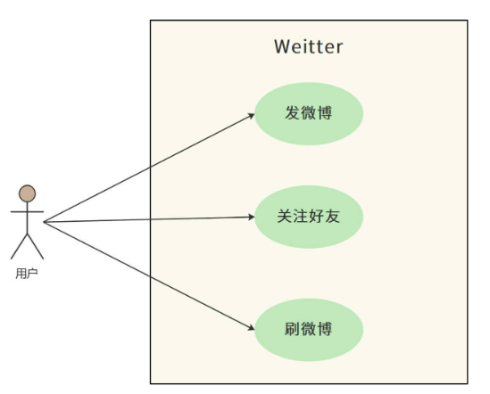

#### 3.2 性能指标估算

前提假设：按 10 亿用户设计，日活（DAU，每日活跃用户数）按 20% 估算，即约 2 亿；每个日活用户每天发 1 条微博，平均有 500 个关注者。

**发微博的存储空间**

- 文本：每条 140 字，UTF-8 下汉字通常占 3 字节，即 140 × 3 = 420 字节；再加上微博 ID、用户 ID、时间戳、经纬度等约 80 字节，单条约 500 字节。每天 2 亿条 ≈ **100GB/天**（2 亿 × 500B = 10¹¹ 字节）。
- 多媒体：按每 5 条带 1 张图（500KB）、每 10 条带 1 个视频（2MB）估算，每天约 **60TB**（2 亿 ÷ 5 × 500KB = 20TB，2 亿 ÷ 10 × 2MB = 40TB）。

**刷微博的并发量**

- 假设 2 亿日活用户每天刷 2 次，每次上滑或进入他人主页共 10 屏，每屏 20 条，则每天刷新 40 亿次，对应 40 亿次查询接口调用，平均 QPS ≈ 40 亿 ÷ 86400 ≈ **4.6 万**。
- 峰值按平均值 2 倍估算，系统需要支撑约 **10 万 QPS**。

**网络带宽**

10 万 QPS × 每次 20 条 = 每秒 200 万条微博。按同样的图文比例，图片 200 万 ÷ 5 × 500KB = 200GB，视频 200 万 ÷ 10 × 2MB = 400GB，合计约 600GB/s，换算成比特约 **4.8Tb/s**。

上述换算统一按十进制单位（1GB = 10⁹ 字节）计算，量级结论不受影响。这些数字都是**按假设推算的估算值**，用于判断架构方向（必须用缓存、必须用 CDN、必须分片），不是实测指标。

| 指标 | 推算结果 | 对架构的含义 |
| --- | --- | --- |
| 文本存储 | 约 100GB/天 | 单机可写，但一年就是数十 TB，需分片 |
| 多媒体存储 | 约 60TB/天 | 必须用对象存储/分布式文件系统 |
| 平均 QPS | 约 4.6 万 | 数据库无法直接承接，需多级缓存 |
| 峰值 QPS | 约 10 万 | 需限流与弹性扩容 |
| 出口带宽 | 约 4.8Tb/s | 必须靠 CDN 消化绝大部分 |

### 四、概要设计

业务逻辑简单、并发量与数据量巨大，所以架构核心就是解决高并发。整体部署模型如下：


系统分为"Get 请求"与"Post 请求"两条链路，分别对应刷微博和发微博，两者有重合部分。

#### 4.1 读链路（Get）

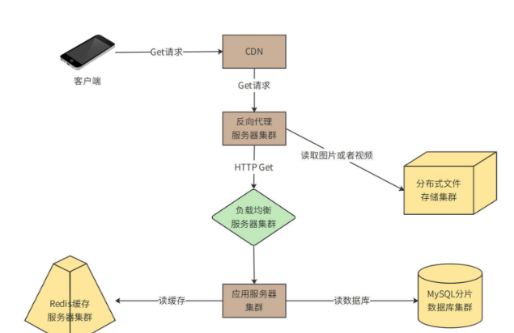

1. 用户经 CDN（内容分发网络，把静态资源缓存到离用户最近的节点）访问数据中心。图片、视频这类极耗带宽的请求绝大部分由 CDN 命中，4.8Tb/s 中 90% 以上可以被 CDN 消化。
2. 未命中的请求到达反向代理服务器，先查本地缓存；命中则直接返回。
3. 图片、视频未命中时，从分布式文件存储集群读取（这些文件是用户发微博时上传的）。
4. 微博内容类请求若本地缓存未命中，经负载均衡到达应用服务器。
5. 应用服务器先从 Redis 取当前用户关注对象的最新微博，拼出一页结果；若缓存中的数据凑不满 20 条，再回落到 MySQL 分片数据库查询。

#### 4.2 写链路（Post）


1. 客户端不经过 CDN 和反向代理，直接经负载均衡到达应用服务器。
2. 应用服务器把微博同时写入 Redis 缓存集群和分片数据库。
3. 写数据库不是直接写：发表微博、关注、评论等写操作先进消息队列，由消费者按可控速率消费并落库。

第 3 步是关键设计——**用消息队列削峰**。突发写请求先堆在队列里，数据库按自己的处理能力消费，避免瞬时压力把库打挂。

| 链路 | 经过组件 | 目的 |
| --- | --- | --- |
| 读 | CDN → 反向代理 → 应用 → Redis → MySQL | 尽量在靠前的位置返回，逐级回退 |
| 写 | 负载均衡 → 应用 → Redis + 消息队列 → MySQL | 削峰，保护数据库 |

### 五、详细设计

#### 5.1 微博的发表/订阅问题

用户关注好友后，如何快速拿到所有好友的最新微博，是微博的核心业务问题。有两种基本解法。

**推模式（写扩散）**：建一张用户订阅表，好友发微博时，立刻为每个粉丝插入一条"粉丝 ID + 微博 ID"记录。用户刷新时只需按自己的 ID 查出所有订阅记录，按时间排序即可。


推模式实现简单、读取极快，但写放大严重：几千万粉丝的账号发一条微博，就是几千万次插入，数据库直接崩。

**拉模式（读扩散）**：发微博只写一条记录，用户刷新时去查自己关注的每个好友的微博列表，再合并排序。


拉模式把写压力降到最低，代价是读压力剧增：关注了多少人就要查多少次。若一个用户关注了几千人，一次刷新就是几千次查询。

| 维度 | 推模式 | 拉模式 |
| --- | --- | --- |
| 写成本 | 粉丝数 × 1 次插入 | 1 次写入 |
| 读成本 | 1 次查询 | 关注人数次查询 |
| 大 V 发博 | 写风暴，可能打崩库 | 无额外压力 |
| 冷用户 | 白写很多无人读的记录 | 无浪费 |
| 适合场景 | 粉丝少、读多写少 | 关注关系稀疏、粉丝量差异大 |

对策分两层：

- **限制关注数**：普通用户关注上限 2000，VIP 用户 5000。这是把拉模式的读放大控制在可预期范围内最直接的手段。
- **尽量走缓存**：刷新时优先从缓存拼结果，减少真正落到数据库的查询次数。

即使如此，纯拉的读压力仍然过大，所以最终采用**推拉结合**：

- 在线的活跃用户，用推模式提前把新微博写进其收件箱（时间线缓存），刷新时直接读；
- 用户离线后，系统不再为其写入，甚至可以删除其时间线列表；等其下次登录刷新时，再用拉模式现场重建。

如何判断用户是否在线？一方面按最近操作时间间隔推断，另一方面可以用模型预测用户的上线时间，在系统空闲时段提前构建时间线。这是一个把"写压力从高峰挪到低谷"的思路。

#### 5.2 缓存使用策略

10 万 QPS 刷新、每请求 20 条，若全部回源，数据库要承受 200 万 QPS——即使分片也撑不住。所以必须大量使用缓存。

但缓存空间有限，不可能缓存所有数据。常见做法是 LRU（最近最少使用）淘汰：空间不足时删掉最久没被访问的数据。需要注意，Redis 的 LRU 是**近似实现**——它随机采样若干 key，淘汰其中最久未访问的，而不是维护全局精确顺序。

LRU 在微博场景下并不合适。原因在拉模式下：刷新时必须保证关注对象的最新微博都能出现，而某个粉丝很少的好友，其微博很可能因为长期无人访问被 LRU 淘汰。系统无法预知"这个好友的数据缓存里有没有"，只能保守地全部回源查询，缓存就失去了意义。

于是 Weitter 改用**时间淘汰**：把最近一定天数内发布的微博全部缓存，刷新时只在缓存里查；凑够 20 条就直接返回，不够再回库。

最终参数：缓存 7 天内发布的全部微博，约占 700GB 空间。缓存结构是"用户 ID → 该用户近 7 天微博 ID 列表"，微博 ID 与微博内容再各自作为 key/value 缓存。

另一个问题是**单条热点微博**。明星的离婚声明会被海量用户同时读取，压力全部集中在同一个缓存 key 上，单台 Redis 节点会被打穿。对此启用**本地缓存**：应用服务器在进程内存里缓存特别热门的内容，构建页面时优先查本地。

本地缓存的策略是：对关注者超过 100 万的大 V，缓存其 48 小时内发布的全部微博。


| 策略 | 解决的问题 | 代价 |
| --- | --- | --- |
| CDN 缓存 | 图片视频的出口带宽 | 回源与缓存刷新延迟 |
| 反向代理缓存 | 减少应用层请求 | 需处理失效 |
| Redis 时间淘汰 | 保证时间线可拼装，避免回源 | 空间换命中率（约 700GB） |
| 本地缓存热点 | 单 key 热点打穿单个 Redis 节点 | 多实例间数据可能短暂不一致 |

#### 5.3 数据库分片策略

每天新增 2 亿条微博，一年约 700 亿条，单机数据库无论写入还是存储都不可行，必须分片（sharding，把数据按规则分散到多台数据库）。

分片键有两个选择。

**按用户 ID 哈希分片**：一个用户的全部微博落在同一台服务器上。

- 优点：按用户查其微博只访问一台服务器。
- 缺点：大 V 的数据访问会成为热点，压垮那台机器；发博特别频繁的用户也会让该分片增长过快。

**按微博 ID 哈希分片**：数据分布更均匀。

- 优点：避免按用户分片的热点聚集。
- 缺点：查某个用户的全部微博要访问所有分片，集群整体压力大。

| 维度 | 按用户 ID 分片 | 按微博 ID 分片 |
| --- | --- | --- |
| 数据分布 | 受用户活跃度影响，可能倾斜 | 较均匀 |
| 查某人的微博 | 单分片，快 | 需扫全部分片 |
| 大 V 热点 | 集中在单分片，风险高 | 分散 |
| 单用户写入暴涨 | 该分片增长过快 | 分散 |

权衡结论：用户 ID 分片带来的热点可以用缓存优化来缓解，单用户写入暴涨可以用"每人每天最多发 50 条"的上限约束。因此最终选择按用户 ID 分片。

### 六、限流：避免超预期的高并发压垮系统

限流是一种经典的高可用手段：当大量用户突然涌入，或有攻击者发起 DoS（Denial of Service，拒绝服务）攻击时，主动拒绝一部分请求，把负载压到系统能承受的水平。这样虽然部分用户失败，但系统整体仍可用——比整体崩溃、所有人都访问不了要好。

这里设计一个限流器组件，代号 Diana。

#### 6.1 需求：限流器要做什么

Diana 定位为**组件**而非独立系统：部署在微服务网关或其他 HTTP 服务器入口，以过滤器（filter）方式拦截请求，对超限请求返回"请求过多"的 HTTP 响应。

- 规则可通过配置文件获取，支持本地配置与远程配置，远程优先。
- 限流维度包括：
  - **全局限流**：限制整个系统处理的请求总数；
  - **账号限流**：限制单个账号发送的请求数；
  - **设备限流**：限制单个客户端设备的请求数；
  - **资源限流**：限制某个 URL 的访问请求数。
- 遵循开闭原则：未来新增规则类型时，不改现有代码、不破坏现有配置文件。

#### 6.2 部署与处理流程


请求经负载均衡到达网关服务器（网关本质上也是一个 HTTP 服务器）。限流器是网关过滤器责任链（Chain of Responsibility，请求依次经过一串处理器，任一环节可截断）中的一环，与签名校验、权限校验等过滤器并列。

请求进入限流器后，按策略判断是否超限：超限则直接返回响应，不再往下走；未超限则继续经过后续过滤器，最终调用微服务。

关于状态码，这里要更正一个常见错误：**"请求过多"对应的状态码是 429 Too Many Requests**（RFC 6585 定义），而 **503 Service Unavailable 表示服务暂时不可用**（如过载、维护）。限流器拒绝请求时语义上应返回 429，并可带 `Retry-After` 告知客户端何时重试；只有当系统确实处于不可服务状态时才用 503。工程上也有把限流响应统一成 503 以配合前端降级逻辑的做法，但含义要说清楚，不能把 503 叫成"Too Many Requests"。

#### 6.3 限流模式：本地与远程

判断是否超限，本质是数"单位时间内已经处理了多少请求"。这个计数可以记在本地，也可以记在远程。

| 模式 | 计数位置 | 全局效果 | 优点 | 缺点 |
| --- | --- | --- | --- | --- |
| 本地限流 | 每台网关自己的内存 | 总阈值 = 单机阈值 × 节点数 | 无网络开销、最快 | 节点数变化时总阈值漂移 |
| 远程限流（分布式） | Redis 等集中存储 | 全局精确共享一个阈值 | 阈值可控、可动态调整 | 每次请求多一次网络往返 |

举例：配置为每秒 50 次，若本地记录当前秒内已达 50，则这一秒内后续请求全部拒绝。若系统部署 100 台网关，每台本地限流 50，整系统每秒最多处理 5000 次——这个数字会随扩容自动变大，需要重新评估。

远程限流则让所有网关共享同一份计数，用 Redis 记录单位时间内的请求数。实现时要注意"读-改-写"的原子性：应使用 `INCR` 配合过期时间，或用 Lua 脚本把自增与设置过期合并成一次原子操作。

#### 6.4 高可用：降级策略

限流器本身不能成为故障点。设计上要能自动降级：

- 配置中心不可用 → 使用本地配置；
- Redis 不可用 → 降级为本地限流。

降级意味着精确性下降（阈值可能不再全局准确），但保证限流功能仍在工作，这比直接放行或直接拒绝全部请求都更合理。

#### 6.5 配置文件设计

Diana 用 YAML 配置，示例如下：

```yaml
Url: /
rules:
  - actor: all
    unit: second
    rpu: 50
    algo: W
    scope: local
  - actor: device
    unit: second
    rpu: 10
    algo: TB
    scope: global
```

配置项共 7 个：

| 配置项 | 含义 | 取值 |
| --- | --- | --- |
| `Url` | 限流的资源路径 | `/` 表示所有请求；路径可互相包含，如 `/` 包含 `/sample` |
| `rules` | 该路径下的规则列表 | 可配置多条 |
| `actor` | 限流对象 | `account`（账号）、`device`（设备）、`all`（全部） |
| `unit` | 时间单位 | `second`、`minute`、`hour`、`day` |
| `rpu` | 单位时间允许的请求数（request per unit） | 如 unit=second、rpu=100，即每秒 100 次 |
| `algo` | 限流算法 | `W`/`window`、`SW`/`sliding window`、`LB`/`leaky bucket`、`TB`/`token bucket` |
| `scope` | 阈值生效范围，同时决定计数位置 | `local` 记本地，`global` 记远程 |

匹配顺序上，先匹配父路径再匹配子路径：例如先看 `/` 的规则是否触发，未触发再匹配 `/sample`。

#### 6.6 算法一：固定窗口（Window）

把配置里的时间单位 `unit` 当作一个窗口，每个窗口内只允许通过 `rpu` 个请求。


时间轴被切成一个个窗口，每个窗口有开始和结束时间。窗口开始时计数器清零，每来一个请求计数 +1，超过 `rpu` 就拒绝。窗口结束后进入下一个窗口，计数再次清零。


处理流程有两个变量：窗口计数器、当前窗口结束时间。请求到来时先判断当前时间是否已超过窗口结束时间：超过则重置这两个变量，未超过则计数 +1 并判断是否超限。

计数器可以记本地，也可以记远程，对应配置中的 `local` 与 `global`。

**缺陷**：跨窗口边界时，实际通过的请求数可能达到 `rpu` 的两倍。设 `rpu = 100`，第一个窗口结束前一刻来了 100 个请求（未超限，全部通过），紧接着进入第二个窗口计数清零，又来 100 个请求（同样未超限）。在跨越边界的极短时间内，系统承受了 200 个请求。

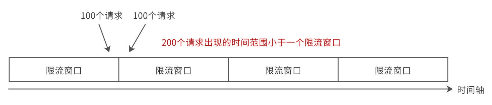

#### 6.7 算法二：滑动窗口（Sliding Window）

改进思路是把窗口内部再切成若干小时间片，让窗口在时间轴上滑动：每滑过一个小时间片就形成一个新的限流窗口，然后在这个窗口内执行固定窗口算法。

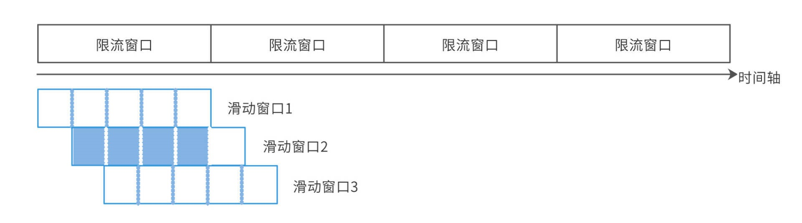

因为任意一段短时间内的请求必然落在某个滑动窗口里，那个"边界双倍"的漏洞就被堵住了。

实现上只改重置逻辑：固定窗口重置为"窗口结束时间 + 1 个 unit"，滑动窗口重置为"窗口结束时间 + 1 个时间片"；并且重置时计数器不为 0，而要设为当前窗口内已经过去的那几个时间片的请求总数（例如窗口分 5 片、已过 4 片，就把这 4 片的计数加总作为初值）。

代价是需要按时间片保存计数，内存与计算量都比固定窗口大。

#### 6.8 算法三：漏桶（Leaky Bucket）

漏桶模拟一个底部有孔的水桶：水从上面流入，从底部匀速漏出；流入太快就溢出。


对应到限流：请求先进入一个固定容量的桶，系统以固定速率从桶中取出请求处理；超过容量就溢出，返回拒绝响应。因此漏桶不仅能限流，还能**平滑处理速度**。

实践中常用队列当桶：


队列为空时，请求从尾部入队，应用从头部按固定速率出队处理。写入快于读取时队列被填满，入队失败的请求直接拒绝。

但用队列意味着把请求处理异步化了（入队线程和出队线程不是同一个），不适合同步网关场景；若网关本身是异步模型（如基于异步框架 Flower 实现的网关），则可以直接用队列。

Diana 面对的是同步网关，因此不用队列，改用**阻塞等待**：按配置算出请求之间的最小间隔（限流每秒 10 次即间隔 100ms），请求到达后根据"最近一次处理时间"和"当前排队的线程数"计算自己需要 sleep 多久，从而让请求每隔 100ms 被放行一个。

伪代码如下（按"计算的 sleep 时长决定谁来放行"的逻辑整理）：

```text
初始化：
  间隔时间 = 100ms
  阻塞线程数 = 0
  桶容量 = 配置的并发等待上限
  最近请求处理时间戳 = 0

long sleep时间() {
  if (阻塞线程数 >= 桶容量) {
    return MAX_TIME;          // 超过容量，直接拒绝
  }
  阻塞线程数++;                // 请求进入排队
  return 间隔时间 * 阻塞线程数 - (now - 最近请求处理时间戳);
}
```

线程 sleep 结束后继续执行，需要更新两个变量：

```text
最近请求处理时间戳 = now;
阻塞线程数--;
```

这段逻辑会被多线程并发执行，必须加锁。

漏桶的明显缺点：即使系统资源空闲，多个请求同时到达时也只能一个一个慢慢处理，浪费算力。所以除非场景明确需要"匀速输出"，一般不推荐。

#### 6.9 算法四：令牌桶（Token Bucket）

令牌桶维护一个固定容量的桶，以恒定速率往桶里放令牌（token）；请求到达时必须取到一个令牌才能继续，取不到就被限流。桶满后新令牌溢出丢弃。

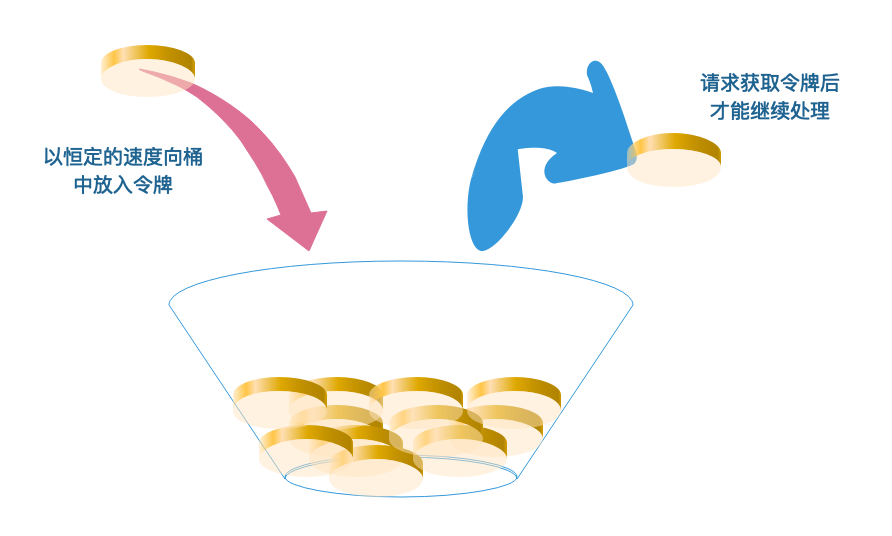

看起来需要专门线程生成令牌、需要数据结构模拟桶，其实不然：只要在请求取令牌时按时间差算出应有多少令牌即可，无需后台线程。

```text
初始化：
  最近生成令牌时间戳 = 0
  总令牌数 = 0
  令牌生成时间间隔 = 100ms
  令牌数上限 = 桶容量

boolean 获取令牌() {
  // 1. 按时间差算出这段时间应补充的令牌数（只取整，余数留在时间戳里）
  应补令牌数 = (now - 最近生成令牌时间戳) / 令牌生成时间间隔;
  总令牌数 = min(令牌数上限, 总令牌数 + 应补令牌数);
  // 只推进"已经兑换成令牌"的那部分时间，避免每次把不足一个令牌的余数抹掉
  最近生成令牌时间戳 = 最近生成令牌时间戳 + 应补令牌数 * 令牌生成时间间隔;

  // 2. 有令牌就取走一个，没有就拒绝
  if (总令牌数 >= 1) {
    总令牌数--;
    return true;
  }
  return false;
}
```

这里有个容易忽略的细节：如果每次取令牌后都把"最近生成令牌时间戳"直接设成 `now`，不足一个令牌的零头时间就被丢弃了，长期运行后实际放行速率会低于配置值。正确做法是只推进已经换算成令牌的那段时间。

令牌桶与漏桶的关键差别：漏桶限制的是**流出速率**（恒定），令牌桶限制的是**平均速率 + 允许突发**（桶里攒下的令牌可以一次性用掉）。因此在"尽量利用资源、又要防雪崩"的通用场景里，令牌桶综合效果更好，Diana 也把它作为默认算法。

#### 6.10 四种算法对比

| 算法 | 是否平滑输出 | 是否允许突发 | 实现复杂度 | 典型适用场景 | 配置缩写 |
| --- | --- | --- | --- | --- | --- |
| 固定窗口 | 否 | 边界处可超 2 倍 | 低 | 粗粒度保护、对精度要求不高 | `W` |
| 滑动窗口 | 较平滑 | 窗口内受控 | 中 | 需要较准确控制每秒请求数 | `SW` |
| 漏桶 | 是（恒定速率） | 不允许 | 中（同步网关需阻塞） | 下游处理能力固定、要求匀速 | `LB` |
| 令牌桶 | 平均速率受控 | 允许（受桶容量限制） | 中 | 通用限流、允许短时突发 | `TB` |

### 七、权衡与踩坑清单

- **估算数字只是方向**。100GB/天、10 万 QPS、4.8Tb/s 都是按假设推出来的量级，用来判断"要不要 CDN、要不要分片、要不要限流"，落地前必须用真实监控数据校准。
- **推拉结合的关键是"谁在线"**。在线判定不准，就会出现"该推的没推、推了没人读"的浪费；离线用户的时间线要及时回收，否则缓存被大量僵尸列表占满。
- **本地缓存会带来短暂不一致**。多实例各自缓存热点内容，更新时无法同时失效，通常用很短的 TTL 兜底，接受秒级不一致。
- **分片键一旦定下就很难改**。按用户 ID 分片意味着大 V 的热点必须靠缓存和限流兜住，这是用架构复杂度换查询效率的选择。
- **限流阈值要能动态调整**。阈值写死在配置里，遇到突发只能改配置重启；远程配置 + 降级策略是必要的基础设施。
- **限流不是万能的**。它保护的是"系统整体可用"，代价是牺牲一部分用户请求；对核心交易类接口，更合理的组合是限流 + 排队 + 降级返回兜底数据。

### 参考与说明

- 容量估算方法与推拉模式分析参考自公开的微博类系统架构设计资料，文中数字为按假设条件推算的估算值。
- IETF. RFC 6585: Additional HTTP Status Codes（429 Too Many Requests）. 2012.
- IETF. RFC 9110: HTTP Semantics（503 Service Unavailable）. 2022.
- 限流算法（固定窗口、滑动窗口、漏桶、令牌桶）为通用算法，可参考 Guava RateLimiter、Sentinel 等开源实现的文档说明。

---

## 8. 12306抢票系统设计

这篇讲清一个具体问题：把全国火车票放到线上卖，为什么"扣库存、查余票、防黄牛"这三件事都特别难，12306 这类系统又用了哪些手段把春运峰值扛下来。重点不是记结论，而是看清每一步的代价。

### 1 系统挑战：规模到底有多大

先看量级，才能理解后面为什么每个方案都要做取舍。公开报道中常被引用的几个说法是：

- 春运一个月的售票量，相当于欧洲铁路一年的总量；
- 高峰期的瞬时并发请求达到百万级，属于同类系统里最高的 QPS 之一；
- 单日页面浏览量到过千亿量级，春运峰值据称达到 1500 亿次，约为"双 11"峰值的数倍。

需要注意，这些数字来自媒体与官方口径的混合报道，PV（页面浏览量）、接口请求数、并发连接数的统计方式并不相同，不宜互相换算或直接比较。工程上把它们理解为**量级**即可，不必当成精确指标。


QPS（Queries Per Second，每秒请求数）是衡量系统瞬时压力的常用指标；同样是"一亿次访问"，集中在一分钟内和一整天内，对系统的要求完全不同——这正是 12306 全部难点的起点。

### 2 难点一：请求集中爆发

平时余票查询的 QPS 并不高，压力几乎全部堆在春节前后的几十天里。这种曲线带来一个直接后果：**自动扩容来不及**。大规模服务器的采购、交付、部署到上线，往往以月为单位，而流量高峰只给你几天时间准备。

所以总的思路只有两条：

- **拦**：在请求到达核心业务之前挡掉大部分，经验上可以拦掉 80%~90% 的无效或恶意流量；
- **摊**：把留下来的请求分散到更多节点、更多时间片上。

具体到每一层，可以做的事如下。

| 层次 | 常用手段 | 代价 / 注意点 |
| :--- | :--- | :--- |
| 客户端（APP / 浏览器） | JS 限制单位时间内的提交次数、按钮防抖 | 实现简单，但会误杀网络慢的正常用户 |
| 边缘与 CDN | 动静分离，静态资源走 CDN，余票查询单独入口 | 页面动态化程度越高，可分离的部分越少 |
| 站点层 | uid（用户标识）校验、Token 校验、鉴权防刷、拦截恶意发包、限流降级、监控预警 | 需要持续维护风控规则，规则太严会误伤 |
| 服务层 | 多级缓存（CDN → Nginx → 本地 Ehcache → Redis → 数据库 BufferPool）、读写分离、请求队列分批削峰、负载均衡 | 每加一层缓存就多一份一致性成本 |
| 数据层 | 数据库缓存、读写分离、集群、SQL 优化、分析型数据库、数据湖 | 分片后跨库查询和统计变复杂 |

每一层都可以再加负载均衡，通过多网关、多中心、多数据库实例把流量分散开。整体是**纵向的多级缓存**：请求从外到内一层层过滤，越往里流量越小。


### 3 难点二：区间库存互相影响

它跟普通电商最大的不同在库存：电商的库存是**静态、互不相干**的，而车票的库存是**动态变化、彼此影响**的。

先看电商里常见的组合品：A 品由 B 品和 C 品按比例组合而成，用户下单传的是 A 这个 SKU（Stock Keeping Unit，最小库存单位），扣减时却要把 B 和 C 各扣一遍。再复杂也是"一行记录减一"。

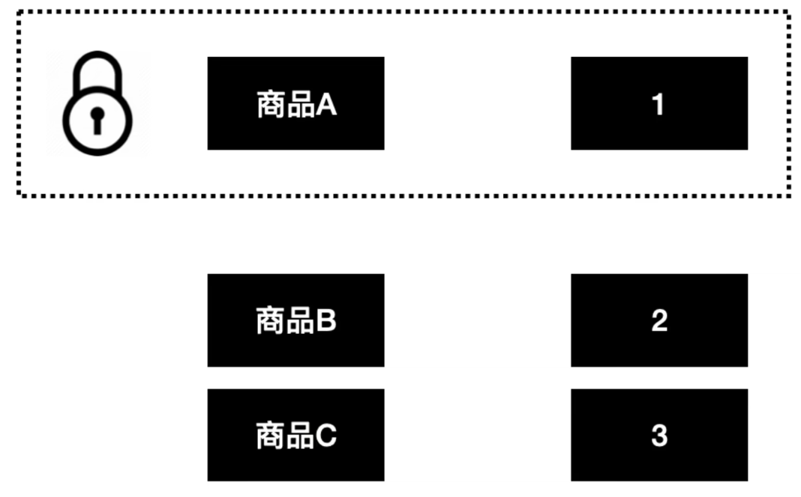

车票不是这样。一列车跑的是"杭州 → 武汉 → 长沙 → 成都"，同一个座位可以被切成多段售卖：

- 杭州 → 成都，占用整条线路；
- 武汉 → 成都，只占用后半段。

这两个行程属于同一个车次、同一个座位。所以每卖出一张"武汉 → 成都"的票，"杭州 → 成都"的可售数量也会少一张。


举个极端的例子：车上只有一个座位，车次是 A → B → C。如果卖出 B → C 却不扣减 A → C 的库存，那么当两个用户分别买了 A → C 和 B → C，车开到 B 站时车上会有两个人，而座位只有一个。这就是"超卖"。

四个站点的完整影响关系如下（乘客买 B → C）：

| 区间 | 是否扣减 | 原因 |
| :--- | :--- | :--- |
| B → C | 扣 | 本区间被占用 |
| A → C | 扣 | 包含 B → C 段 |
| B → D | 扣 | 包含 B → C 段 |
| A → D | 扣 | 包含 B → C 段 |
| A → B | 不扣 | 不含 B → C 段，旅客在 B 站才上车，"我下车你上车"，不冲突 |

如果再加上席别——一等座、硬卧、软卧、硬座、无座——每种席别都有一套自己的区间库存，组合数量会再翻好几倍。

一句话概括：**车票库存不是一个数字，而是一张"区间 × 席别"的矩阵**，任何一次售卖都会在这张矩阵上划掉一片区域。

### 4 难点三：锁膨胀与大事务

跨区间扣减带来的第二个问题是并发控制。一次下单要修改多个区间的库存，这些修改通常被放在同一个事务里，于是一次下单就可能涉及几十次 `UPDATE`。

长途车中间经过十几个站点，热门线路还常常没有直达车次、需要中途换乘，涉及的站点排列组合非常多，仅计算"这次购买影响哪些区间"就相当耗性能。


由此产生连锁反应：

1. 行锁（数据库对单行记录的写锁）竞争激烈，同一车次的热门区间会被反复加锁；
2. 锁的范围膨胀，事务被拉长，持锁时间变长；
3. 数据库连接与线程被迅速占满，数据库成为瓶颈；
4. 接口响应变慢，排队变长，进一步放大重试流量。

一个具体例子：买一张 G335 北京西到高牌店东的票，需要把"北京西 → 沿途所有站点"的库存都减一，而不是只减北京西到高牌店东这一段。

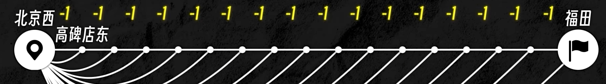

此外，中间站点之间还要判断是否互斥：同一座位在重叠区间不能被重复售卖。席别维度（硬座、硬卧、软卧、无座）再叠加上来，扣减逻辑就异常复杂了。

### 5 难点四：热点区间与限售

火车站之间每一个区间都是一份独立库存，中间区间被扣掉之后，远端区间的库存也要跟着扣。极端情况下，某些中间站特别火爆，两端的旅客就可能**永远买不到票**。

从业务角度解决很简单：**预留票 + 限售**。放票时只放一部分，并限定这部分只能买长途；短途超出范围就不卖了。

代价也很直接：旅客可以"多买几站"来绕过限制（买长途票、中途下车），于是又出现"短途无票、长途有票"的怪现象。

这与 7.4 节"预留票与队列分级"是同一套机制，后面会从旅客视角再讲一次。

### 6 核心支撑：内存计算与数据同步

余票查询占了全部访问量的 90% 以上，而且一次查询往往要读多个区间、多个席别的库存——这种"一次读请求扩散成多次读"的模式叫**读扩散**。读扩散的瓶颈几乎全在 IO 上，所以 12306 选择把库存数据整体放进内存。

它用的产品是 **Pivotal GemFire**，一类叫"分布式内存数据网格"（in-memory data grid）的中间件：把多台机器的内存汇总成一个逻辑上的大节点来管理，并尽量让业务运算和它需要的数据落在同一个节点上，减少跨节点的网络通信。可以把它想成"把很多台机器的内存拼成一块超大的白板，谁要算账就走到写着自己数据的那块白板前算"。


GemFire 也有不足：数据量大时，新增节点触发的数据自动重分配可能耗时较久。12306 的做法是根据往年压测经验提前把内存加够（据其经验，几十 T 内存即可把全部业务数据放进内存），避免频繁扩容；同时用 GemFire Pulse、Prometheus 等工具盯住实时指标。

#### 6.1 为什么不用 Redis

面对读多写少的场景，第一反应通常是加一层 Redis 缓存，但 12306 选的是 Pivotal GemFire。两者的差别不只是「开源免费还是商业收费」：

| 维度 | Redis | Pivotal GemFire |
| :--- | :--- | :--- |
| 定位 | 缓存与数据结构服务器 | 分布式内存数据网格，可把计算放到数据所在节点 |
| 授权 | 开源免费 | 商业产品，需要授权 |
| 数据分布 | 分片 + 主从复制，客户端负责路由 | 集群内分区 + 副本，节点间自动重分布 |
| 典型用户 | 互联网业务的缓存层 | 银行、投行等对延迟敏感的实时交易系统 |

当时的瓶颈主要在 IO 上（读扩散），需要的不是「再快一点的缓存」，而是「把整个数据集放进内存、并且让计算就近执行」，GemFire 提供的正是这个能力；代价是商业授权和更复杂的运维。

#### 6.2 放票、扣减与同步链路

库存相关的表大致分三张（第 8 节会展开）：

- **车次表**：车次编号、发车时间等，属于比较稳定的数据；
- **座位表**：每个座位的车厢、行、列，以及该座位的售卖情况；
- **余票表**：按"区间 × 席别"统计的余票数量，由座位表定时计算得到，用来加速查询。

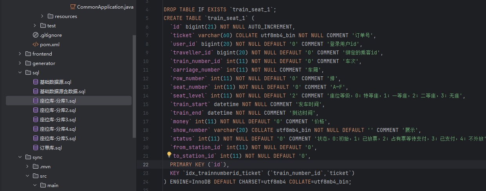


扣减库存用的关系型数据库是 Sybase（商业数据库）。放票与同步的链路是：后台管理系统放票 → 更新数据库余票 → 变更日志被订阅组件捕获 → 异步同步到内存网格与本地缓存 → 查询余票直接读内存，下单扣减也先落内存。

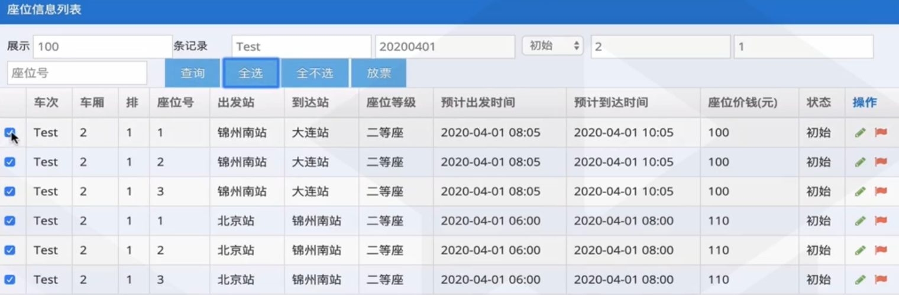


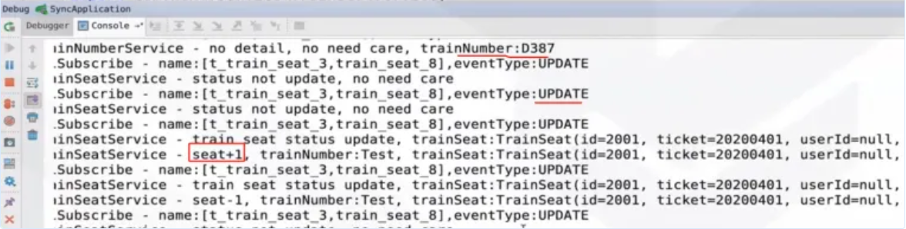

相比查询流量，扣减库存的流量小得多，完全可以由数据库承载；扣减完成后再同步回内存网格，由内存网格承担查询流量。引入内存网格之后，读扩散带来的查询瓶颈基本被解决。

### 7 业务侧解法：预售、候补、验证码、查询上云、预留票

#### 7.1 预售与候补车票

早期 12306 是"整点放票"，所有人在同一秒涌入，峰值极高。后来改为分时段售票，例如提前 15 天预售，把抢票压力按时间区间摊开，峰值明显下降。

候补购票是 2019 年 5 月上线的功能，主要解决两件事：

- **退票回流的公平性**：过去有人退票或改签，车票会回到公共票池，谁刷得快谁买到；现在车票按顺序优先卖给候补登记的人，不回到票池公开出售。
- **削峰**：候补本质是一个异步过程——先排队登记，有没有票再通知你。只要异步了，就可以用消息队列或定时任务慢慢消费，系统压力大幅下降。

购票队列本身也分档：同一个需求可能对应 30 分钟出票、10 分钟出票、秒级出票等不同队列。


#### 7.2 黄牛、抢票软件与验证码

黄牛的"秘密武器"是外挂：用高性能服务器不断刷新和监控 12306，刷票速度往往是正常购票的几十倍。市面上通行的"抢票软件"原理与黄牛并无本质区别——它们做的事就是"盯着票池，一有回流立刻下单"。

候补机制正好切断了这条路：车票不再回到公开票池，而是按候补顺序分配，抢票软件的快就失去了意义。

验证码是另一道闸门。2013 年起，购票验证码从字母数字升级为图形验证码，据当时媒体统计，到 2015 年底图形验证码题材接近 600 种，排列组合后多达 30 万种。


对抗手段也在升级：黑灰产可以雇人做图形识别，机器搞不定的交给人工。这并不能彻底防住，但抬高了灰产成本——人工比机器贵，流量占比就会下降。


代价是**必然存在误杀**：验证码越难，正常用户越容易输错。12306 之所以敢这么做，是因为它几乎没有竞争对手，火车票在春运期间近乎必需品，可以用一部分用户体验换系统稳定性。打个比方：楼下餐厅本来是排队就能吃上饭，如果整条街的饭票都被人提前包了，你排多久都没用——那时候"让谁先吃"比"吃得舒不舒服"更重要。

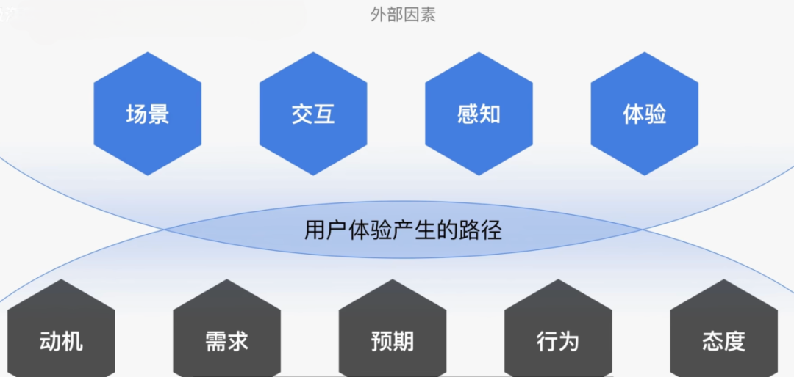

真正有效的防黄牛手段其实是管理手段：封禁第三方代购、购票必须人脸识别。

#### 7.3 动态云服务与「查余票」「购票」分离

天量的余票查询是影响性能的最主要原因，大约占 90% 以上的访问流量。更棘手的是峰谷悬殊：工作日和春运之间差着几个数量级，时间区间非常明显。

如果完全靠自建机器硬扛，会同时遇到两个问题：

- 平时大量机器闲置，资源浪费；
- 峰值超出初始评估时无法兜底，因为大规模服务器的采购、交付、部署到上线以月计，做不到"即插即用"。

以往的做法是从几个关键入口做流量控制，保障系统可用，但会影响体验。2015 年，12306 与阿里云合作，把架构中比较"重"（高消耗、低周转）的余票查询模块独立出来，在云上部署一套查询系统，按量付费、分钟级扩容，最终把 75% 的余票查询业务迁到了云上；2019 年春运，日访问量达到 297 亿次的量级（与 1 节的 PV 口径不同，不可直接对比）。

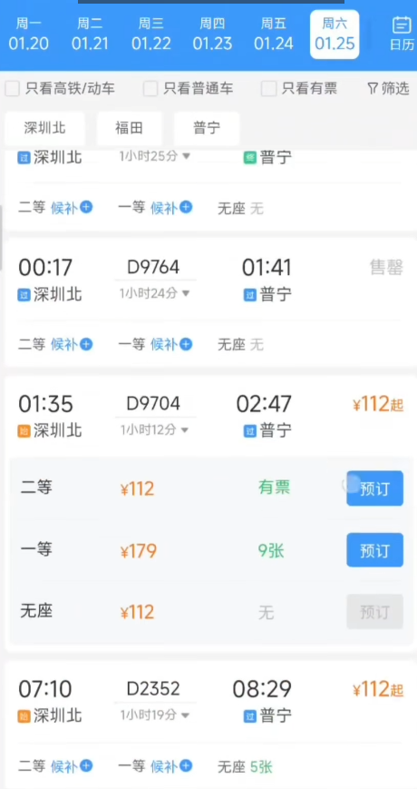

查询与下单分离也带来一个副作用：两个系统的数据存在时间差，第三方平台又可能误报，于是出现"页面显示还有 1 张票，但你反复抢都抢不到"的现象。官方对此的解释是抢票软件误导；从架构上看，根因是"查询看到的库存"与"下单扣减的库存"本就不是同一份数据。

#### 7.4 预留票与队列分级

很多旅客会发现"线上没票，其他渠道或线下却有票"，原因就是**候补 + 预留票**：系统不会把所有票都打进一个池子任人抢购；很多车次限制终到站，还有一部分预留票会在开车前的固定时间放出，重点车次的预留票甚至只能在代售点取。

排队也分等级。现实中老年人、残障人士、军人有特殊通道，线上购票同样能识别优先级，对队列做优先区分。所以有时排队一张票要 30 分钟，有时要几小时——这不完全取决于抢购人数，也可能与请求频率被识别后做了降级有关（对应抢票软件宣传的"低速/快速/高速/极速/光速"档位，不同档位的出票效率不同）。


这也是"短途无票、长途有票"现象的来源：长途票价更高，运营方倾向于优先保障长途旅客，于是按区间预留票额。

### 8 技术侧解法：余票库存的位图表示

这一节的设计思路来自对 12306 的推测性分析，不一定是它真实的实现，但作为"区间库存怎么高效表示"的练习非常典型。

#### 8.1 三张表与二进制 sell 字段

需要三张表来表达余票：

1. **车次表**：车次编号、发车时间等，稳定数据；
2. **座位表**：每个座位的车厢、行、列，以及该座位的售卖情况；
3. **余票表**：由座位表定时计算出的"区间 × 席别"余票数量，避免每次查询都去算座位表。

（严格说还应有站点表和车厢表，这里省略。）

余票表相当于数据库里的**物化视图**：把耗时的计算结果提前算好存下来，用空间换查询时间，再把结果放进缓存。

座位表里用一个 `sell varchar(50)` 字段表示售卖情况。若车次有 4 个站 A → B → C → D，则 `sell` 长度取 3，第 1 位表示 A → B 是否卖出，第 2 位表示 B → C，第 3 位表示 C → D：

| 乘客购买 | sell 值 | 说明 |
| :--- | :--- | :--- |
| 无 | 000 | 三段都空 |
| B → C | 010 | 第 2 位置 1 |
| 再买 C → D | 011 | 第 2、3 位为 1 |
| 想买 B → D | 不允许 | 第 2 位已为 1，区间重叠 |

用位来表示区间占用，把"排列组合判断"变成了按位与/或运算，这就是它能简化的原因。

#### 8.2 示例：G1 车次，北京南 → 上海虹桥

8.1 讲的是数据库里的表示（用字符位记录区间占用），下面换成缓存里的表示——本质上还是同一件事，只是把「哪个座位卖到了哪一段」压缩成一串 bit，便于做位运算。

以 G1 为例，沿途停靠北京南、济南西、南京南、上海虹桥，可售组合有 6 种：

1. 北京南 - 济南西
2. 北京南 - 南京南
3. 北京南 - 上海虹桥
4. 济南西 - 南京南
5. 济南西 - 上海虹桥
6. 南京南 - 上海虹桥


如果直接用 Redis 的 bitmap（位图，用一串二进制位表示"每个座位是否已售"）：

- **上限**：Redis 的 String 类型单个 key 最大 512MB，换算成 bit 是 512 × 1024 × 1024 × 8 ≈ 43 亿位，理论上够用；
- **但大 key 会拖慢性能**：所以实际要按车厢拆分（软卧、软座、硬座的座位数量级分别在 36、60、118 上下，属于经验值，具体车型不同），避免单个 key 过大。

为了演示，这里假设每个区间先发售 10 张，一个 key-value 就够：

- **Key 设计**：车次\_城市\_车厢（席别已通过车厢区分），例如 `G1_110000_08`；
- **Value 设计**：bitmap，`0` 表示可售，`1` 表示已售。

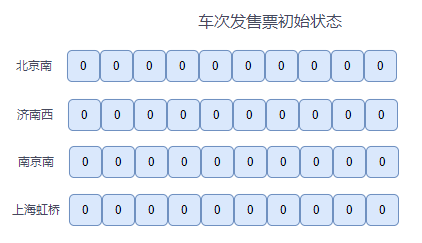

想买"北京南 → 南京南"时，只需把北京南、济南西、南京南三段的位图做**按位或**，看是否还有为 0 的位，就得到该行程的余票情况。

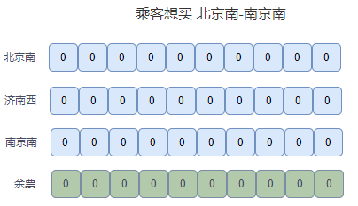

选定某个座位下单时，代码层要把这三个站点对应的同一个 offset 都置为 1：

```text
SETBIT G1_110000_08 <offset_北京南> 1
SETBIT G1_110000_08 <offset_济南西> 1
SETBIT G1_110000_08 <offset_南京南> 1
```

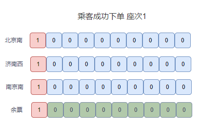

多位乘客分别购买短途、中途、全程票之后，位图大致长这样（同一 offset 上多个 1 表示该座位在这些区间已被占用）：

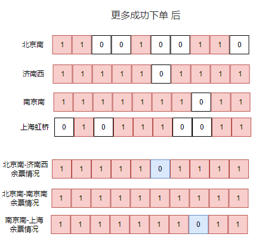

这也解释了一个日常现象：**一站到底比中途换乘难买得多**，因为全程票要求整条线路上同一个座位全空。

#### 8.3 中间站太火爆怎么办

还剩一个问题：A → B → C → D 的车次里，如果 B → C 的乘客特别多，A → D 是不是就买不到了？

答案还是预留票：运营部门按实际客流和盈利情况（长途票价更贵，通常更愿意保障长途旅客），为各个区间预留不同票额。这样某个区间再火爆，也不会把长途票全部吃掉。

### 9 取舍清单

| 目标 | 主要手段 | 代价 |
| :--- | :--- | :--- |
| 扛住瞬时峰值 | 分层拦截 + 限流降级 + 多级缓存 | 误杀正常请求，规则维护成本高 |
| 抗读扩散 | 库存全量进内存网格（GemFire） | 商业授权、扩容重分配耗时、需提前备足内存 |
| 库存一致 | 区间 × 席别建模，位图/位运算扣减 | 事务变大、行锁竞争激烈 |
| 削峰 | 分时段预售、候补异步队列 | 旅客等待时间变长，需要通知机制 |
| 防黄牛 | 候补 + 验证码 + 封禁第三方 + 实名/人脸 | 用户体验下降，验证码必然误杀 |
| 成本与弹性 | 查询上云、按量付费 | 查询与下单数据存在时间差 |

### 10 附录：分库分表与数据同步的核心代码

这一节把前面提到的分片与同步落到代码上，初学可以先看结构，不必逐行读懂。

#### 10.1 分片配置与 CDC 订阅

票务数据的写入最终仍要落到关系库，并按车次维度分库分表。下面是分片配置的写法（Spring + ShardingSphere 风格的 API），核心是"以 `train_number_id` 为分片键，先分库再分表"：

```java
@Bean(name = "trainSeatShardingDataSource")
public DataSource trainSeatShardingDataSource(@Qualifier(DataSources.TRAIN_SEAT_DB_1) DataSource trainSeatDB1,
                                              @Qualifier(DataSources.TRAIN_SEAT_DB_2) DataSource trainSeatDB2,
                                              @Qualifier(DataSources.TRAIN_SEAT_DB_3) DataSource trainSeatDB3,
                                              @Qualifier(DataSources.TRAIN_SEAT_DB_4) DataSource trainSeatDB4,
                                              @Qualifier(DataSources.TRAIN_SEAT_DB_5) DataSource trainSeatDB5
) throws SQLException {
    ShardingRuleConfiguration shardingRuleConfiguration = new ShardingRuleConfiguration();
    // 设置分库的映射
    Map dataSourceMap = Maps.newHashMap();
    dataSourceMap.put(DataSources.TRAIN_SEAT_DB_1, trainSeatDB1);
    dataSourceMap.put(DataSources.TRAIN_SEAT_DB_2, trainSeatDB2);
    dataSourceMap.put(DataSources.TRAIN_SEAT_DB_3, trainSeatDB3);
    dataSourceMap.put(DataSources.TRAIN_SEAT_DB_4, trainSeatDB4);
    dataSourceMap.put(DataSources.TRAIN_SEAT_DB_5, trainSeatDB5);
    // 设置表策略：1、6 落在 DB1，2、7 落在 DB2，依此类推
    TableRuleConfiguration tableRuleConfiguration = new TableRuleConfiguration();
    tableRuleConfiguration.setLogicTable("train_seat");
    tableRuleConfiguration.setActualDataNodes(
            DataSources.TRAIN_SEAT_DB_1 + ".train_seat_1," +
                    DataSources.TRAIN_SEAT_DB_2 + ".train_seat_2," +
                    DataSources.TRAIN_SEAT_DB_3 + ".train_seat_3," +
                    DataSources.TRAIN_SEAT_DB_4 + ".train_seat_4," +
                    DataSources.TRAIN_SEAT_DB_5 + ".train_seat_5," +
                    DataSources.TRAIN_SEAT_DB_1 + ".train_seat_6," +
                    DataSources.TRAIN_SEAT_DB_2 + ".train_seat_7," +
                    DataSources.TRAIN_SEAT_DB_3 + ".train_seat_8," +
                    DataSources.TRAIN_SEAT_DB_4 + ".train_seat_9," +
                    DataSources.TRAIN_SEAT_DB_5 + ".train_seat_10"
    );
    // 分库策略与分表策略都使用 train_number_id 作为分片键
    tableRuleConfiguration.setDatabaseShardingStrategyConfig(new StandardShardingStrategyConfiguration(
            "train_number_id", new TrainSeatDatabaseShardingAlgorithm()));
    tableRuleConfiguration.setTableShardingStrategyConfig(new StandardShardingStrategyConfiguration(
            "train_number_id", new TrainSeatTableShardingAlgorithm()));
    shardingRuleConfiguration.getTableRuleConfigs().add(tableRuleConfiguration);
    return ShardingDataSourceFactory.createDataSource(dataSourceMap, shardingRuleConfiguration,
            new ConcurrentHashMap(), new Properties());
}
```

余票从数据库同步到内存网格，靠的是订阅数据库变更日志（CDC，Change Data Capture）。若底层是 MySQL 系数据库，常用 Canal：它伪装成从库，读取 binlog（二进制日志）后推给业务方。

> 需要说明一处原文的不自洽：Canal 依赖 MySQL 的 binlog 协议，而文中提到扣减库存用的是 Sybase。若数据库确实是 Sybase，应改用其自带的复制服务或同类 CDC 工具获取变更日志，而不是 Canal。

```java
private void canalSubscribe() {
    // 创建链接
    CanalConnector connector = CanalConnectors.newSingleConnector(new InetSocketAddress(AddressUtils.getHostIp(),
            11111), "train", "", "");
    int batchSize = 1000;
    new Thread(() -> {
        try {
            log.info("canal subscribe");
            connector.connect();
            connector.subscribe(".*\\..*");
            connector.rollback();
            while (true) {
                Message message = connector.getWithoutAck(batchSize); // 获取指定数量的数据
                long batchId = message.getId();
                int size = message.getEntries().size();
                if (batchId == -1 || size == 0) {
                    safeSleep(100);
                    continue;
                }
                try {
                    log.info("new message, batchId:{}, size:{}", batchId, size);
                    handleEntry(message.getEntries());
                    connector.ack(batchId); // 提交确认
                } catch (Exception e1) {
                    log.error("canal data handle exception, batchId:{}", batchId, e1);
                    connector.rollback(batchId); // 处理失败，回滚数据
                }
            }
        } catch (Exception e3) {
            log.error("canal subscribe exception", e3);
            safeSleep(1000);
            canalSubscribe();
        }
    }).start();
}

private void handleEntry(List entrys) throws Exception {
    for (CanalEntry.Entry entry : entrys) {
        if (entry.getEntryType() == CanalEntry.EntryType.TRANSACTIONBEGIN
                || entry.getEntryType() == CanalEntry.EntryType.TRANSACTIONEND) {
            continue;
        }
        CanalEntry.RowChange rowChange;
        try {
            rowChange = CanalEntry.RowChange.parseFrom(entry.getStoreValue());
        } catch (Exception e) {
            throw new RuntimeException("rowChange.parse exception , data:" + entry.toString(), e);
        }
        CanalEntry.EventType eventType = rowChange.getEventType();
        String schemaName = entry.getHeader().getSchemaName();
        String tableName = entry.getHeader().getTableName();
        log.info("name:[{},{}],eventType:{}", schemaName, tableName, eventType);
        for (CanalEntry.RowData rowData : rowChange.getRowDatasList()) {
            if (eventType == CanalEntry.EventType.DELETE) {
                handleColumn(rowData.getBeforeColumnsList(), eventType, schemaName, tableName);
            } else {
                handleColumn(rowData.getAfterColumnsList(), eventType, schemaName, tableName);
            }
        }
    }
}

// 根据变更日志处理结果同步 NoSQL
private void handleColumn(List columns, CanalEntry.EventType eventType, String schemaName, String tableName)
        throws Exception {
    if (schemaName.contains("train_seat")) {          // 处理座位变更
        trainSeatService.handle(columns, eventType);
    } else if (tableName.equals("train_number")) {     // 处理车次信息变更
        trainNumberService.handle(columns, eventType);
    } else {
        log.info("drop data, no need care");
    }
}

private void safeSleep(int mills) {
    try {
        Thread.sleep(mills);
    } catch (Exception e2) {
        // 忽略中断
    }
}
```

查询侧还有一个"按起止站查车次"的需求：乘客只关心"北京 → 大连"有哪些车，而车次表里存的是"北京 → 锦州 → 大连"。这类查询落到 Elasticsearch（简称 ES，基于倒排索引的搜索数据库），key 用 `fromStationId_toStationId`，value 是经过该区间的车次列表。原文此处代码被截断，这里保留其结构：遍历有序的站序列表，拼出所有区间键，再对每个键做一次"不存在则新建、存在则追加车次名"的批量写。

```java
private void saveES(List detailList, TrainNumber trainNumber) throws Exception {
    // key 形如 fromStationId_toStationId，如：北京-大连 对应 D386、D387
    List keys = Lists.newArrayListWithExpectedSize(detailList.size() * detailList.size());
    if (detailList.size() == 1) {
        keys.add(trainNumber.getFromStationId() + "_" + trainNumber.getToStationId());
    } else {
        // 多段行程：detailList 已按站序排好，两层循环拼出全部区间
        for (int i = 0; i < detailList.size(); i++) {
            for (int j = i + 1; j < detailList.size(); j++) {
                keys.add(...);  // 取出第 i、j 个站点的 id 拼成区间键
            }
        }
    }
    // 批量 upsert：文档不存在则新建，存在则把车次名追加到 train_number 字段
    BulkRequest bulkRequest = new BulkRequest();
    for (Object key : keys) {
        GetResponse getResponse = esClient.prepareGet(TrainEsConstant.INDEX, TrainEsConstant.TYPE, key.toString()).get();
        Map dataMap = Maps.newHashMap();
        Map map = getResponse.getSourceAsMap();
        if (!getResponse.isExists() || map == null) {
            dataMap.put(TrainEsConstant.COLUMN_TRAIN_NUMBER, trainNumber.getName());
            bulkRequest.add(new IndexRequest(TrainEsConstant.INDEX, TrainEsConstant.TYPE, getResponse.getId()).source(dataMap));
            continue;
        }
        String origin = (String) map.get(TrainEsConstant.COLUMN_TRAIN_NUMBER);
        Set set = Sets.newHashSet(Splitter.on(",").trimResults().omitEmptyStrings().split(origin));
        if (!set.contains(trainNumber.getName())) {
            dataMap.put(TrainEsConstant.COLUMN_TRAIN_NUMBER, origin + "," + trainNumber.getName());
            bulkRequest.add(new UpdateRequest(TrainEsConstant.INDEX, TrainEsConstant.TYPE, getResponse.getId()).doc(dataMap));
        }
    }
    BulkResponse bulkResponse = esClient.bulk(bulkRequest);
    log.info("es bulk, response:{}", JsonMapper.obj2String(bulkResponse));
    if (bulkResponse.hasFailures()) {
        throw new RuntimeException("es bulk failure");
    }
}
```

这段代码有两个值得注意的点：一是**幂等**，追加前先判断车次名是否已存在，避免重复消费导致列表膨胀；二是**批量**，逐条写 ES 在高并发同步下会成为瓶颈，改用 Bulk 请求把网络往返次数降下来。

<!-- ARTICLE: 查离当前外卖员5公里的订单 -->

---

## 9. 查离当前外卖员5公里的订单

这篇解决一个具体问题：1000 万条订单里，怎么在毫秒级找出"离当前外卖员 5 公里内"的订单。答案不是写一条 SQL 让数据库硬算，而是"空间索引粗筛 + 内存地理索引 + 缓存兜底"的组合。

### 1 问题拆解：难点到底在哪

这道题的表面要求只有一句"查 5 公里内的订单"，但 1000 万条数据放在那里，逐个算距离是不现实的：假设每条记录算一次球面距离需要几十纳秒，扫完 1000 万条也要零点几秒的纯 CPU 时间，还没算磁盘 IO，更不可能同时撑住成百上千个骑手每秒都在查。

所以真正被考察的是四件事：

1. **数据怎么存**：订单的地理位置用什么类型、建什么索引；
2. **范围怎么筛**：如何避免全表扫描，把候选集快速缩小；
3. **位置怎么更新**：骑手位置每秒都在变，怎么实时写进去还不拖垮系统；
4. **量级怎么扩**：单机扛不住时，怎么拆服务、加缓存、做集群。

这类题不绑定某个技术栈，回答时按"存储 → 索引 → 查询 → 缓存 → 架构"的完整链路讲，比只报一个中间件名字更有说服力。同样的思路可以套用到"附近的人""打车派单""导航找附近车辆"等场景。

### 2 数据库方案：空间索引与两次过滤

#### 2.1 数据模型

订单表除了业务字段，关键是两个坐标字段（或用几何类型表示一个点）：

| 订单编号 | 下单时间 | 用户编号 | 状态 | 纬度 | 经度 |
| :--- | :--- | :--- | :--- | :--- | :--- |
| 001 | 2024-01-01 12:00:00 | 1001 | 未配送 | 30.23 | 110.34 |

经纬度分开存的好处是简单直观，缺点是没法直接建空间索引；要建空间索引，通常要把两个坐标合成一个几何类型的值。

#### 2.2 空间索引是什么

空间索引是把二维（或三维）位置按网格或树形结构组织起来的索引，查询时先定位"可能包含目标数据的那一小块区域"，再在块内精确判断，避免全表扫描。

它的原理可以类比成字典按拼音首字母分区：找"zhang"不用从第一页翻，直接跳到 Z 区。空间索引常见的实现是 **R-Tree**（R 树），它用**最小外接矩形**（MBR，Minimum Bounding Rectangle）一层层把数据包起来，查询时把与目标区域不相交的矩形整块剪掉。

MySQL 的用法：

- 用 `POINT` 类型存位置（一个点包含经度、纬度两个坐标）；
- 为它建 `SPATIAL INDEX`（空间索引）；
- 查询时用空间关系函数缩小范围。

版本上要注意：较早的 MySQL 只有 MyISAM 引擎支持空间索引，MySQL 5.7 起 InnoDB 也支持；MySQL 8 的空间列通常要显式声明 SRID（空间参考系标识，4326 表示 WGS84 经纬度坐标系），查询里与列上的 SRID 保持一致才能用上索引。各版本的具体限制有差异，动手前先用 `SELECT VERSION()` 确认。

#### 2.3 把「5 公里」换成经纬度差

地球表面 1 度纬度大约 111.32 公里（这是平均值，赤道略小、两极略大，做范围查询够用）。经度方向要乘以纬度的余弦，因为越靠近两极，同样的经度差对应的实际距离越短：

```text
纬度方向：Δlat = 5 / 111.32 ≈ 0.0449°
经度方向：Δlon = 5 / (111.32 × cos(30.22°)) ≈ 5 / (111.32 × 0.8636) ≈ 0.0520°
```

以骑手位置 (110.35, 30.22) 为中心，取 ±0.045° 纬度、±0.052° 经度，就得到一个把 5 公里圆包在里面的矩形。用这个矩形去走空间索引，能先把候选集从 1000 万缩到几百条。

#### 2.4 为什么要两次过滤

矩形是圆的近似，四个角上的点距离中心其实超过 5 公里（最远到对角线，约为半径的 1.41 倍）。所以只用矩形判断会**多召回**一批不该出现的订单。

标准做法是两段式：

1. 用 `MBRContains`（判断一个几何对象的最小外接矩形是否包含另一个）走空间索引，粗筛出候选；
2. 再用 `ST_Distance_Sphere`（按球面计算两点距离，单位米）精算，过滤掉角落里的点。

```sql
-- order_location 定义为带 SRID 的 POINT，并建空间索引
CREATE TABLE orders (
    order_id       BIGINT PRIMARY KEY,
    order_status   TINYINT      NOT NULL,
    order_location POINT        NOT NULL SRID 4326,
    SPATIAL INDEX idx_order_location (order_location)
);

-- 1) 外接矩形粗筛（走空间索引）
-- 2) 球面距离精算（去掉矩形四角多召回的点）
SELECT order_id,
       ST_Distance_Sphere(order_location, ST_SRID(POINT(110.35, 30.22), 4326)) AS dist_m
FROM orders
WHERE order_status = 0
  AND MBRContains(
        ST_SRID(ST_GeomFromText(
            'POLYGON((110.298 30.175, 110.402 30.175, 110.402 30.265, 110.298 30.265, 110.298 30.175))'
        ), 4326),
        order_location)
  AND ST_Distance_Sphere(order_location, ST_SRID(POINT(110.35, 30.22), 4326)) <= 5000
ORDER BY dist_m
LIMIT 50;
```

几点实践提醒：

- 原文示例里的 `DistanceSphere()` 函数名有误，MySQL 中的正确名称是 `ST_Distance_Sphere`；另外它的两个参数顺序都按"点、点"传入即可，不涉及"x 减 5 再除 111.32"这种写法。
- 多边形必须首尾闭合（示例里第一个点和最后一个点相同）。
- 一定要用 `EXPLAIN` 确认走了空间索引，而不是退化成全表扫描。
- 这条 SQL 单次可能只要几十毫秒，但骑手每秒都在查，数据库很快就会成为瓶颈——所以真正的答案在下一节。

### 3 缓存方案：Redis GEO（核心）

#### 3.1 是什么

Redis 从 3.2 起提供 GEO（地理）相关命令，底层并不是新数据结构，而是**有序集合**（sorted set）：成员是订单号，分值（score）是经纬度编码成的 52 位整数。所以它天然支持"按分值范围扫描"，也就支持按地理范围检索。

一句话比喻：把每个订单钉在一张巨大的网格地图上，查"附近"就是取当前格子及周围几个格子里所有的钉子。

#### 3.2 写入：GEOADD 的参数顺序

`GEOADD key longitude latitude member`，注意**经度在前、纬度在后**（与日常口语"纬度、经度"相反，也和部分地图 SDK 相反，这是最常见的踩坑点）：

```bash
# 订单 order_001，经度 110.34，纬度 30.23
GEOADD orders_location 110.34 30.23 order_001
```

原文示例里把 member 写在坐标前面的顺序是错的，按那个顺序 Redis 会报参数错误。

还有两个硬限制：

- 经度范围 -180 ~ 180；
- 纬度范围约 -85.05112878 ~ 85.05112878（这是 Web 墨卡托投影能表示的范围，极区无法索引）。

超出范围会直接报错。

#### 3.3 查询：GEOSEARCH

从 Redis 6.2 起，官方推荐 `GEOSEARCH`，它同时支持圆形和矩形范围，并取代了已标记为废弃的 `GEORADIUS` / `GEORADIUSBYMEMBER`：

```bash
# 以骑手位置为中心，半径 5000 米，由近到远取前 50 单，并返回距离
GEOSEARCH orders_location FROMLONLAT 110.35 30.22 BYRADIUS 5000 m ASC WITHDIST COUNT 50
```

原文示例中的 `NEARBY` 并不是 GEOSEARCH 的参数，正确写法是 `FROMLONLAT 经度 纬度` 或 `FROMMEMBER 成员名`。常用选项：

| 选项 | 作用 |
| :--- | :--- |
| `FROMLONLAT lon lat` | 以给定坐标为中心 |
| `FROMMEMBER member` | 以集合中已有成员的位置为中心（如"以骑手自己为中心"） |
| `BYRADIUS r m/km` | 圆形范围 |
| `BYBOX w h m/km` | 矩形范围，适合"手机屏幕视野内"这类需求 |
| `ASC` / `DESC` | 按距离升序 / 降序 |
| `WITHDIST` | 返回每个成员到中心的距离 |
| `COUNT n [ANY]` | 只取前 n 个；加 `ANY` 找到 n 个就返回，更快但不保证最近 |

#### 3.4 为什么快，精度如何

- **快**：数据在内存里，且只需要检查覆盖目标范围的 1+8 个 geohash 格子，不需要遍历全部成员。
- **精度**：Redis 用 Haversine 公式按**球面**算距离，官方文档说明地球并非标准球体，最坏情况下误差可达 0.5%。对"附近 5 公里"这类业务完全够用；如果业务对误差极敏感，要换更精确的地理计算方案。

内存估算（经验值，取决于订单号长度和 Redis 版本）：有序集合每个成员除成员字符串本身，还有分值、哈希表/跳表的额外开销，通常按每成员 100 字节量级估。1000 万条订单大约 1GB 级；如果只保留"未完成订单"，数据量会小一个数量级，这个估算才站得住。

#### 3.5 缓存怎么更新（一致性）

订单状态和位置都在变，缓存必须跟着变。常见三种触发方式：

| 方式 | 做法 | 评价 |
| :--- | :--- | :--- |
| 定时批量同步 | 每分钟把"状态有变化"的订单批量刷进 Redis | 实现简单，延迟最大 1 分钟，适合位置类数据 |
| 变更事件驱动 | 业务写完库后发消息（MQ），消费者更新 Redis | 延迟低，需要消息可靠性与幂等 |
| 数据库触发器 | 表字段更新时触发存储过程，再通知后端 | 不推荐：触发器在高并发写入下开销大、难维护 |

第三种是原文提到的做法，这里保留知识点但给出实践建议：生产上更常见的是 **binlog 订阅（CDC）或业务侧发消息**，而不是在数据库里挂触发器。

一致性上采用**旁路缓存**思路：更新数据库 → 删/改缓存 → 由消息补偿，允许短暂不一致，靠版本号或时间戳防止旧值覆盖新值。

#### 3.6 一次查询的完整链路

1. 从骑手服务取出骑手当前位置（经纬度）；
2. 用 `GEOSEARCH` 查出 5 公里内的订单号及距离；
3. 用订单号批量取订单详情（如 `HMGET` 或 `MGET`，一次网络往返拿多条）；
4. 组装后返回给骑手客户端。

下图是这条链路依赖的核心：经纬度被编码成 bit 串，位置越接近，编码前缀相同的位数越长，于是「按前缀找附近」成为可能。

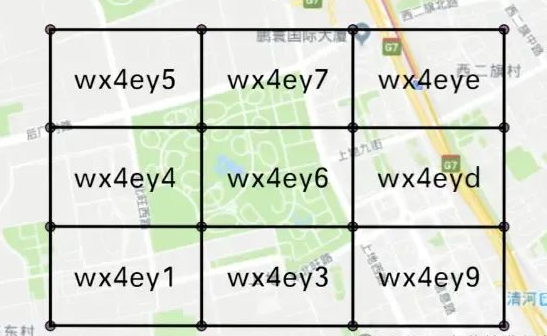

两个细节：

- 骑手位置本身也要设过期时间（例如 5 分钟）。如果设备断网不再上报，缓存里的位置会自动失效，避免系统拿一个几分钟前的位置派单。
- 骑手位置建议单独存一个 key（如 `rider:location:{id}`，value 为经纬度+时间戳），不要和订单集合混在一起。

### 4 GeoHash 原理与边界问题

#### 4.1 三步：二分、交错、编码

GeoHash 把二维坐标压成一维字符串，步骤只有三步：

1. **二分**：对经度在 [-180, 180]、纬度在 [-90, 90] 上反复二分，大于中值记 1、小于记 0，得到两串二进制；
2. **交错**：按"经度一位、纬度一位"交替拼接成一串；
3. **编码**：每 5 位一组，用 32 个字符的字母表 `0-9 b-z`（去掉 a、i、l、o 这四个易混字母，共 32 个）编码成 1 个字符。

注意：字母表不是任意的"0-9A-Za-z"，而是上面这套 geohash 专用字母表，这是原文示例里写错的一处。

以经纬度 (116.3111126, 40.085003) 为例，经度的二分过程：

| bit | left | mid | right |
| :--- | :--- | :--- | :--- |
| 1 | -180 | 0 | 180 |
| 1 | 0 | 90 | 180 |
| 0 | 90 | 135 | 180 |
| 1 | 90 | 112.5 | 135 |
| 0 | 112.5 | 123.75 | 135 |
| 0 | 112.5 | 118.125 | 123.75 |
| 1 | 112.5 | 115.3125 | 118.125 |
| 0 | 115.3125 | 116.71875 | 118.125 |
| 1 | 115.3125 | 116.015625 | 116.71875 |
| 0 | 116.015625 | 116.3671875 | 116.71875 |
| 1 | 116.015625 | 116.19140625 | 116.3671875 |
| 1 | 116.19140625 | 116.279296875 | 116.3671875 |
| 0 | 116.279296875 | 116.323242188 | 116.3671875 |
| 1 | 116.279296875 | 116.301269532 | 116.323242188 |
| 0 | 116.301269532 | 116.31225586 | 116.323242188 |

15 位二分后得到经度串 `110100101011010`（第 1 位表示"大于 0"，所以是 1）。

纬度同理，得到 `101110010000001`：

| bit | left | mid | right |
| :--- | :--- | :--- | :--- |
| 1 | -90 | 0 | 90 |
| 0 | 0 | 45 | 90 |
| 1 | 0 | 22.5 | 45 |
| 1 | 22.5 | 33.75 | 45 |
| 1 | 33.75 | 39.375 | 45 |
| 0 | 39.375 | 42.1875 | 45 |
| 0 | 39.375 | 40.78125 | 42.1875 |
| 1 | 39.375 | 40.078125 | 40.78125 |
| 0 | 40.078125 | 40.4296875 | 40.78125 |
| 0 | 40.078125 | 40.25390625 | 40.4296875 |
| 0 | 40.078125 | 40.166015625 | 40.25390625 |
| 0 | 40.078125 | 40.1220703125 | 40.166015625 |
| 0 | 40.078125 | 40.1000976563 | 40.1220703125 |
| 0 | 40.078125 | 40.0891113282 | 40.1000976563 |
| 1 | 40.078125 | 40.0836181641 | 40.0891113282 |

交错后得到 30 位：`11100 11101 00100 11000 10100 01001`，每 5 位查表得到 `w x 4 s n 9`，即前缀 `wx4sn9`（完整编码为 `wx4sn9r0j65s`，可用任意 geohash 库复核）。

位数可以自由取：位数越多精度越高，计算量也越大，按业务精度权衡即可。

#### 4.2 精度和长度的关系

每个字符贡献 5 个二进制位，其中 3 位给一个方向、2 位给另一个方向（交替决定）。所以每加一个字符，格子边长大约缩小为原来的 1/5.66（2^2.5）。以第 k 个字符长度计算：总位数 5k，纬度方向约 `5k/2` 位，格子高度 = 180° / 2^(5k/2)。

| 编码长度 | 格高（纬度方向） | 格宽（北纬 30° 附近） |
| :--- | :--- | :--- |
| 5 位 | 180/2^12 ≈ 0.044° ≈ 4.9 km | 360/2^13 ≈ 0.044° × cos30° ≈ 4.2 km |
| 6 位 | 180/2^15 ≈ 0.0055° ≈ 0.61 km | 360/2^15 ≈ 0.011° × cos30° ≈ 1.06 km |
| 7 位 | 180/2^17 ≈ 0.0014° ≈ 0.15 km | 360/2^18 ≈ 0.0014° × cos30° ≈ 0.13 km |

可以看到 geohash 的常见参考表（6 位约 1.2km × 0.61km）就是这么推出来的，并非实测值。

#### 4.3 边界问题：最近的不一定真最近

geohash 按格子划分，两个点距离很近却可能被分在相邻的两个格子里，编码前缀完全不同。于是出现这样的坑：

- A 与 B 的编码前缀相同（同格），A 与 E 跨格；
- 按"前缀匹配"找，会认为 A、B 更近；
- 但实际距离上 A 到 E 可能比 A 到 B 更近。


解决办法不复杂：**以目标点所在格为中心，把周围 8 个邻格一起查**（"格 > 扩"：范围判断靠扩格子，而不是只靠编码前缀），对召回的候选再按真实距离精算排序。Redis GEO 内部做的正是"查 1+8 个区域，再丢掉范围外的元素"。

顺带纠正原文一处示例错误：原文说 (39.91°N, 116.39°E) 的 geohash 是 `z3czrbvzbv`，实际计算结果以 `wx4g09...` 开头（该点在北京市区），可以自己用 geohash 库验证。

### 5 分布式架构与实时定位

#### 5.1 服务怎么拆

| 拆法 | 示例 | 好处 |
| :--- | :--- | :--- |
| 按业务功能拆 | 订单服务、配送员服务、用户服务、支付服务 | 独立开发、部署、扩容 |
| 按业务流程拆 | 下单、接单、配送、完成各由子服务负责 | 不同阶段负载差异大，可分别扩容（接单瞬间 QPS 高，配送阶段主要是位置更新） |

- **订单服务**：订单创建、修改、查询；写入走主库，查询走从库 + 缓存；热点数据（未接单订单）常驻 Redis；与支付服务交互维护支付状态。
- **配送员服务**：管理骑手信息、在线状态、位置；接收位置上报并落库落缓存；骑手查附近订单时调用订单服务的空间查询接口。

#### 5.2 负载均衡与集群

- **硬件负载均衡**：如 F5 BIG-IP，按轮询、最小连接数、加权轮询等算法分发，性能强、成本高；
- **软件负载均衡**：Nginx、HAProxy，部署灵活，可按策略转发并动态调整；
- **客户端负载均衡**：服务内部用负载均衡库（如 Spring Cloud LoadBalancer、Ribbon 一类组件）按实例健康度和负载选目标。

关键服务多实例部署，实例间共享数据库与缓存。订单数据可用分布式数据库（如 TiDB，兼容 MySQL 协议、自动分片、Raft 保证强一致），缓存用 Redis 集群（主从复制 + 分片）。

#### 5.3 服务间通信

| 方式 | 特点 | 适用 |
| :--- | :--- | :--- |
| RESTful API | 通用、易集成，但 HTTP 封装/解析有开销 | 对外接口、跨团队调用 |
| gRPC | 二进制协议、低延迟、强类型 | 内部高频调用 |
| 消息队列（Kafka、RabbitMQ） | 异步、解耦、可削峰 | 状态变更通知、位置广播 |

数据同步分两类：关键数据（位置、状态）走实时同步，用消息队列推送；统计类数据（各区域订单量、平均配送时长）走定时同步，每小时批量导给分析服务。

#### 5.4 监控与日志

- **指标监控**：Prometheus 主动拉取各服务暴露的指标端点，存入时序数据库；Grafana 做大盘与告警（例如订单服务响应时间超过 200ms 告警）。
- **日志**：ELK（Elasticsearch + Logstash + Kibana）收集、索引、可视化，用图表看各接口调用频率与错误率，快速定位超时或参数解析问题。

#### 5.5 骑手位置怎么实时进来

| 环节 | 常见做法 | 说明 |
| :--- | :--- | :--- |
| 定位 | GPS / 北斗 / AGPS | GPS 开阔环境可达米级；北斗在亚太覆盖更好，可与 GPS 融合；AGPS 借基站辅助，缓解城市峡谷与室内信号弱 |
| 传输 | MQTT / WebSocket | MQTT 轻量、省电，QoS 1 表示"至少送达一次"，适合位置上报；WebSocket 双向长连接，服务端可主动下发派单 |
| 接收 | 独立接入服务 | 解析 JSON，做完整性、经纬度范围、时间戳合理性校验，异常丢弃或要求重发 |
| 存储 | 更新数据库 + 更新缓存 | 库里留历史轨迹，缓存里放最新位置，并设置过期时间 |

服务端处理位置上报的伪代码如下（原文此处被截断，这里补成可读形式）：

```javascript
// 客户端：采集并上报位置
function updateDeliverymanLocation(riderId, lon, lat) {
  const locationData = {
    riderId: riderId,
    lon: lon,
    lat: lat,
    timestamp: getCurrentTime()
  };
  sendLocationDataToServer(locationData);
}

function sendLocationDataToServer(locationData) {
  if (websocket.isConnected()) {
    websocket.send(JSON.stringify(locationData));
  } else {
    logError("WebSocket 连接不可用，等待重连");
  }
}

// 服务端：校验、落库、写缓存
function handleLocationUpdate(locationData) {
  if (!isValid(locationData)) {
    logError("位置数据无效");
    return;
  }
  updateDatabaseLocation(locationData);
  updateCacheLocation(locationData);
  setCacheExpiration(locationData.riderId, 5 * 60); // 5 分钟后过期
}

function isValid(locationData) {
  return locationData.riderId != null
    && locationData.lon >= -180 && locationData.lon <= 180
    && locationData.lat >= -85.05 && locationData.lat <= 85.05
    && Math.abs(Date.now() - locationData.timestamp) < 60 * 1000; // 时间戳偏差不超过 1 分钟
}
```

拿到实时位置后，派单可以做得更聪明：结合骑手当前位置、在手订单数、预计送达时间，用最近邻等策略选人；骑手偏离路线（比如堵车）时可以基于新位置重新评估，必要时把订单转给更合适的人。

### 6 关键权衡与踩坑清单

| 选择 | 优点 | 代价 | 适用场景 |
| :--- | :--- | :--- | :--- |
| MySQL 空间索引 + 两次过滤 | 数据强一致、能带条件精确过滤 | 高并发读会打满数据库 | 订单量中等、查询不密集、要求精确 |
| Redis GEO | 内存级响应、原生支持半径与距离排序 | 内存成本、需与数据库同步 | 高频派单查询 |
| geohash 前缀匹配 | 实现简单、可做分片键 | 有边界问题，必须扩邻格 | 自建地理索引、数据分片 |
| 定时批量同步缓存 | 简单、对数据库压力可控 | 最多延迟一个周期 | 位置类、容忍短暂不一致 |
| 变更事件同步 | 延迟低 | 需处理消息丢失与重复（幂等） | 订单状态、金额类 |

几个高频踩坑点：

1. **经纬度顺序**：`GEOADD` 是"经度在前"，写反了位置会跑到地球另一边，而且不报错（只要在合法范围内）。
2. **只查一个格子**：geohash 边界会导致漏召回，必须查邻格。
3. **只用矩形**：矩形面积是内切圆的 4/π ≈ 1.27 倍，会多召回约 27% 的候选，必须二次精算。
4. **位置不设过期**：骑手掉线后位置一直留在缓存里，系统会朝一个"幽灵位置"派单。
5. **大 key**：把全国订单塞进一个 GEO key，单 key 过大影响集群迁移和查询延迟，应按城市或区域拆分。

#### 6.1 补充：原文留下的待解问题

原文中"最近的可能不是最近"这一小节以一个待解问题结尾（提示语是"格 > 扩，码 > 点"），本文按通行做法给出了结论：查询范围要按格子向外扩，最终排序要按点的真实距离，两者缺一不可。

<!-- ARTICLE: 搜索引擎设计：信息搜索怎么避免大海捞针 -->

---

## 10. 搜索引擎设计：信息搜索怎么避免大海捞针

这篇讲清一个具体问题：面对全网规模的网页，怎么做到输入几个词就能在毫秒级返回结果，并且把最该看的排在最前面。答案由三块拼成——网页怎么存、索引怎么建、结果怎么排序。

### 1 总体架构：一条数据流水线

假设要开发一个针对全网内容的搜索引擎，产品名叫 Bingoo。它要解决三个技术挑战：

1. 爬虫抓回来的海量网页，怎么高效地存和管；
2. 用户输入搜索词时，怎么快速找到包含这些词的网页；
3. 怎么给结果排序，让排在前面的正好是用户想看的。

对应到系统组成，就是分布式爬虫、索引构造器、网页排名算法和搜索器四部分。


整条流水线是单向的：爬虫抓网页 → 存进分布式文件系统 HDFS（Hadoop Distributed File System，把大文件切成块分散存放在多台机器上的文件系统）→ 索引构造器读出网页、分词、建索引 → 搜索器根据索引找网页、按排名返回。

### 2 网页怎么存：14 字节头 + 压缩正文

为了省空间，网页先压缩再存；为了能顺序扫描，所有网页采用同一种"定长头 + 变长体"的格式连续存放。


| 字段 | 长度 | 作用 |
| :--- | :--- | :--- |
| docID | 8 字节（长整型） | 网页编号，全系统唯一 |
| URL 长度 | 2 字节 | 后面 URL 字符串占多少字节 |
| 正文长度 | 4 字节 | 压缩后正文占多少字节 |
| URL | 变长 | 网页地址 |
| 压缩后的正文 | 变长 | 网页内容 |

读取时先读 14 字节头（8+2+4），从头部拿到两个长度，再按长度把 URL 和正文读出来。这样做的两个好处：

- **不用分隔符**：靠长度就能定位，避免"正文里恰好出现分隔符"的解析歧义；
- **支持流式顺序读**：从头往后扫即可，不用随机跳转，对 HDFS 这种大文件顺序读最友好。

### 3 索引：从正排到倒排

索引构造器读网页、解压、提取单词，先建正排索引，再翻转成倒排索引。这是整个搜索引擎的核心。

#### 3.1 先建正排：docID → 单词列表

正排索引（forward index）就是"这篇网页里有哪些词"：key 是 docID，value 是单词列表。

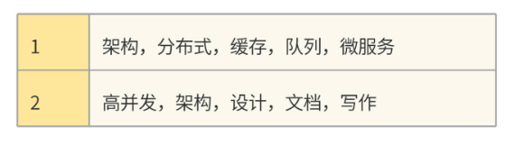

提取单词这一步，中英文差别很大：

- 英文单词之间有空格，按空格切即可；
- 中文没有空格，必须用**分词器**（把连续汉字切成词的组件），例如"高并发架构"切出来是"高并发"和"架构"两个词。

#### 3.2 再翻成倒排：单词 → docID 列表

遍历所有正排索引，把"文档 → 词"翻转成"词 → 文档"，就得到倒排索引（inverted index）：key 是单词，value 是包含该词的 docID 列表。


所有单词构成一个**词典**，实现上就是一张 Hash 表：key 是单词，value 是该词对应的网页列表在磁盘上的地址。

互联网网页的数量极大，但用到的单词数量其实有限。据 Google 早年公布的口径，256MB 内存大约能放下 1400 万个单词，接近英文词汇的总量——这个数字可以理解为"量级参考"，随语言和统计方式变化。

于是存储分层很清楚：

- **词典放内存**：单词数量有限，全部驻留内存，查询时一次 Hash 定位；
- **网页列表放磁盘**：每个词的 docID 列表可能很长，全部放内存不现实；
- **热词列表进内存当缓存**：少数高频词的列表整段缓存，减少磁盘读。


这样，搜索一个单词时只需查一次词典拿到地址，再按地址读列表，就能拿到全部相关网页。搜索器按 docID 取出网页摘要，海量数据的"快速检索"就完成了。

#### 3.3 构建加速：64 个索引桶并行

建索引的过程要不断修改列表、还要排序，很多操作需要加锁同步。对海量网页来说，这种串行构建太慢。

解决办法是按 docID 取模分成 64 个桶，每个桶内独立建索引，多线程并行处理。因为桶之间没有共享数据，锁竞争基本消失，整体速度接近线性提升。

#### 3.4 顺带产出：链接关系表

建索引时还会调用 URL 提取器，把网页里包含的链接抽出来，形成"docID → docID"的链接关系表：前一个 docID 是当前网页，后一个是被链接网页。

这张表就是后面 PageRank 的输入。一个网页通常包含很多链接，所以这张表的数据量比网页本身还大，也是按分布式方式存储和计算的。

### 4 多词查询：求交集与三种加速

用户输入一句话时，搜索器先分词，再分别查倒排索引，最后对多个结果列表**求交集**。

例如搜索"高并发架构"，分词得到两个词：

```text
高并发 -> 2, 3, 5, 7
架构   -> 1, 2, 4
```

同时包含两个词的网页只有 docID = 2 这一篇，所以交集结果是 {2}。

求交集有多种算法，差别很大：

| 方法 | 做法 | 复杂度 | 问题 |
| :--- | :--- | :--- | :--- |
| 双层循环 | 每个元素和另一列表逐个比 | O(m × n) | 千万级列表不可用 |
| 拉链法 | 两列表按 docID 排序后同步前进 | O(m + n) | 千万级仍然偏慢 |
| 分片并行 | 按 docID 区间切片，多线程各算一片 | O((m + n) / 片数) | 需要额外合并结果 |
| 跳表 | 在链表上加多级索引，跳跃式比较 | 约 O(m·log(n/m)) | 实现复杂、占额外空间 |

#### 4.1 拉链法

把两个列表先按 docID 排序，然后两个指针同步前进：

- 谁当前的 docID 更小，谁往前走一步；
- 两者相等，就是交集元素，记录下来，两个都前进；
- 任一指针走到末尾，结束。


元素个数相近时，总比较次数约为 2n，即 O(m + n)，远优于双层循环。

#### 4.2 分片并行

即使 O(m + n)，千万级数据还是慢。可以按 docID 区间切片并行：假设 docID 分布在 [0, 1 万亿)，每个倒排列表平均 1000 万个 docID，按 1000 亿一段切成 10 段，每段约 100 万个 docID。两个列表只在对应段内求交集，起 10 个线程并行，理想情况下耗时降到 1/10。

#### 4.3 跳表

现实中两个 1000 万的列表求交集，结果可能只有几万条，也就是说绝大多数比较都是"不相等"的。

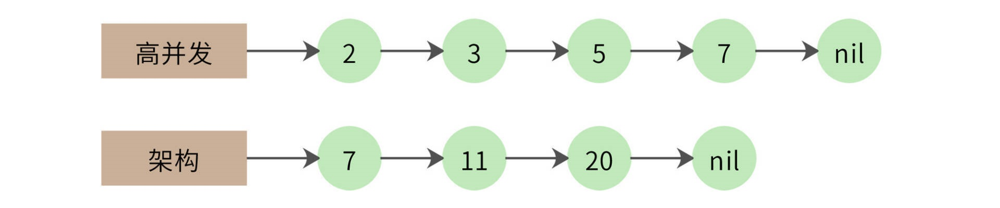

极端例子：第一个列表要遍历到最后一个元素，才和第二个列表的第一个元素相同。前面那些元素能不能跳过？

**跳表**（skip list）就是为此设计的：在链表上再建多层索引，上层每隔几个元素抽一个，先在上层大步跳，接近目标再下沉到下层细找。


用它做交集，可以把"逐元素比较"变成"按目标值跳跃"，比较次数大幅下降。原文给出的"O(log n)"是数量级的粗略说法；更细的分析结果与两个列表长度之比有关，常见结论是可降到 O(m·log(n/m)) 量级（m 为较短列表长度）。工程上记住结论即可：**跳表用额外空间换比较次数**。

#### 4.4 再加一层缓存

倒排索引已经够快了，但热门查询（比如突发热点词）会被反复请求。把"搜索词 → 结果列表"整体缓存起来，可以同时省掉磁盘读和集合计算，这是最划算的一层优化。

### 5 排序：PageRank 怎么打分

有了候选网页，还要决定谁排前面。Bingoo 用 PageRank：它只看网页之间的链接关系，不看网页内容。

核心思想是"投票"：

- 网页 A 里有指向网页 B 的链接，就等于 A 给 B 投了一票；
- 得票越多的网页越重要；
- 越重要的网页投出的票，权重越高。


以 A、B、C、D 四个网页为例：B 链接了 A 和 D，C 链接了 A、B、D，D 链接了 A。若所有网页初始都是 1 分，则：

- B 有 2 个出链，每个链接分出 1/2 分，于是给 A、D 各 1/2；
- C 有 3 个出链，每个 1/3 分，给 A、B、D 各 1/3；
- D 有 1 个出链，给 A 1 分。

于是 A 在一次迭代后的分值是：

```text
PR(A) = PR(B)/2 + PR(C)/3 + PR(D)/1
```

一般地，等号右边每一项的分子是"链向 A 的网页的分值"，分母是该网页的出链数量。所有网页同时按这个规则重新分配分值，重复迭代，直到各页分值基本稳定，就得到一张重要度排名表。

#### 5.1 自环问题与阻尼系数

如果某个网页只链接自己，别的网页不断给它送分，它却一分不出，迭代次数越多它的分值越高，这显然不合理。


解决办法是引入"随机跳转"：假设用户有 α 的概率点击当前页面的链接，有 1−α 的概率直接在地址栏输入一个新网址（相当于随机跳到任意页面）。业界常用经验值是 α = 0.85，即 1−α = 0.15。

四个网页时，公式变成：

```text
PR(A) = α × (PR(B)/2 + PR(C)/3 + PR(D)/1) + (1 − α)/4
```

最后一项 `(1 − α)/4` 表示随机跳转落到 A 的概率，分母 4 是网页总数。

推广到 N 个网页，任意页面 Pi 的计算公式是：

```text
PR(Pi) = α × Σ ( PR(Pj) / L(Pj) )  +  (1 − α) / N
          Pj ∈ M(Pi)
```

其中 M(Pi) 是所有链向 Pi 的网页集合，L(Pj) 是 Pj 的出链数量，N 是网页总数。Bingoo 要排全世界的网页，所以 N 是万亿级——这也是 PageRank 必须离线分布式计算、而不能在查询时实时算的原因。

计算过程是：所有页面初始值设为 1 → 代入公式得到新值 → 再用新值迭代 → 直到分值变化足够小为止。迭代收敛后排序，用户搜索时直接按这个分值给结果排序。

需要补充一句：现代搜索引擎的排序是多种信号的加权，除了链接权重，还会考虑内容相关性、时效性、语言与地域、点击行为等。PageRank 是其中一类基础信号，不是全部。

### 6 关键权衡

| 设计点 | 选择 | 收益 | 代价 |
| :--- | :--- | :--- | :--- |
| 词典存放 | 全量放内存 Hash 表 | 单词查询 O(1) | 内存成本，词表增长要扩容 |
| 网页列表存放 | 磁盘 + 热词缓存 | 容量几乎不受限 | 冷词查询要读盘 |
| 索引构建 | 64 桶分片并行 | 近似线性加速 | 桶数固定，扩缩容要重分布 |
| 交集算法 | 拉链法 → 分片 → 跳表 | 从 O(m×n) 降到接近线性甚至更低 | 实现复杂度、额外索引空间 |
| 结果缓存 | 整词结果缓存 | 省磁盘读与集合计算 | 缓存一致性与内存占用 |
| 排序 | PageRank 离线迭代 | 排序质量高、查询时零计算 | 需要全量链接图，迭代成本高 |

一句话总结这一篇：**存得紧凑（定长头 + 压缩）、查得准（倒排 + 交集）、排得对（链接投票）**，三者各自独立又可组合，这就是搜索引擎避开"大海捞针"的全部秘密。

<!-- ARTICLE: 短URL生成器设计：百亿短URL怎样做到无冲突 -->

---

## 11. 短URL生成器设计：百亿短URL怎样做到无冲突

这篇解决一个具体问题：把长链接变短之后，百亿级别的短 URL 怎么保证**不冲突、不可猜、还扛得住每秒数万次跳转**。文中先把容量算清楚，再对比三种生成算法的取舍，最后给出一个可落地的预生成方案。

### 1 需求分析

社交媒体上经常要分享链接，但有些 URL 很长：域名之后跟着多层路径和查询参数，几十甚至上百个字符，发出去排版难看、还容易被截断。期望的形式是 `1.cn/ScW4dt` 这样 6 个字符的短码，用户点击后重定向到原始长链接。

要开发的产品叫 Fuxi（伏羲），预计管理**百亿级**短 URL、并发吞吐**数万级**。这个量级该用什么存储？关系数据库还是别的方案？并发能力怎么提上去？这是本篇要回答的问题。

#### 1.1 用例与访问时序

短 URL 生成器（也叫短链接生成器）对外是一个 HTTP 服务，短域名解析到它。一次完整访问是：

1. 业务应用调用 Fuxi，传入长 URL，拿到短 URL 并展示给用户；
2. 用户在浏览器点击短 URL，请求到达 Fuxi；
3. Fuxi 返回 HTTP 重定向响应，浏览器再访问原始长 URL。


用例有五个：

1. 客户端为每个长 URL 生成**唯一**的短 URL 并存储；
2. 用户访问短 URL 时，Fuxi 重定向到原始长 URL；
3. 短 URL 可以自动生成，也可以由用户自定义（前提是该短码未被占用）；
4. 管理员可通过后台检索、查看使用情况；
5. 短 URL 有有效期（2 年），后台定时任务清理过期数据，同时回收短码资源。

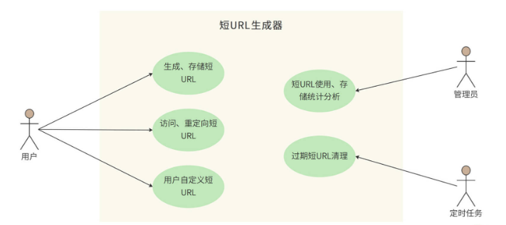

#### 1.2 容量、吞吐与长度估算

估算过程要能复核，下面每一步都给出算式。

**存储容量**

```text
每月新增     5 亿条
有效期       2 年 = 24 个月
总量         5 亿 × 24 = 120 亿条
单条记录     ≈ 1 KB（长 URL + 短码 + 元数据）
总空间       120 亿 × 1 KB = 12 TB（不含副本冗余）
```

**读吞吐**

```text
每条短 URL 平均被访问 100 次
每月访问量   5 亿 × 100 = 500 亿次
每月秒数     30 × 24 × 3600 = 2,592,000 秒
平均 QPS     500 亿 / 2,592,000 ≈ 19,290 ≈ 2 万
峰值（按平均 2 倍估）≈ 4 万 QPS
```

**网络带宽**

```text
每次重定向响应：长 URL 约 500 B + 响应头约 500 B ≈ 1 KB
峰值带宽：4 万 × 1 KB = 40 MB/s = 40 × 8 = 320 Mb/s
```

**短码长度**

短码用 Base64 字符集（64 个字符）编码，长度 n 的可表示空间是 64^n：

| 长度 | 可表示数量 | 是否够用（需求 120 亿） |
| :--- | :--- | :--- |
| 6 | 64^6 = 687 亿 | 够用，占用率约 17% |
| 7 | 64^7 ≈ 4.4 万亿 | 富余很多，但短码变长 |

结论：6 个字符即可，形如 `1.cn/ScW4dt`。

#### 1.3 非功能需求

1. **高可用**：服务器或数据库宕机不能导致服务失效；
2. **高性能**：80% 请求 < 5ms，99% 请求 < 20ms，平均 < 10ms；
3. **不可猜测**：既不能猜出某个短码是否存在，也不能由短码推出长 URL。

第 3 条最容易被忽略，却直接决定算法选型。

### 2 概要设计

短 URL 生成器的设计核心就是"长 URL → 6 字符短码"这个函数怎么实现。有三种思路，差别在于唯一性、可猜测性和性能。

#### 2.1 单向散列函数生成短 URL

最常见的思路：长 URL 经 MD5 或 SHA-256 计算得到 128 位或 256 位散列值，再做 Base64 编码：

- MD5：128 位 → Base64 后 22 个字符；
- SHA-256：256 位 → Base64 后 43 个字符。

然后截取前 6 个字符作为短码。


问题在于**截断会引入冲突**：MD5/SHA-256 本身几乎不会碰撞，但只保留 6 个字符（36 位信息）后，不同长 URL 完全可能得到相同短码。因此每次生成都要先查库确认这个短码有没有被别的长 URL 占用，冲突就重算（换算法或换截取位置），重算后仍可能冲突。

代价是：**一次生成要多次访问存储**，无法满足 5ms 的性能目标。

#### 2.2 自增长短 URL

另一种免冲突的做法：维护一个自增的二进制自然数，把它做 Base64 编码当短码。这样生成的短码必然唯一，甚至可以短于 6 个字符——自然数 0 的 Base64 编码是 `A`，于是 `1.cn/A` 就是一个合法短码。

但它违反第 3 条需求：短码**可预测**。某一时段生成的一批短码会集中在连续的数值区间里，知道其中一个，就能通过自增/自减遍历其他短码。

#### 2.3 预生成短 URL（Fuxi 的选择）

Fuxi 的做法是**离线预生成**：提前生成一大批互不冲突的短码，存成文件；线上请求来了，直接从池子里取一个，不参与计算。

预生成用随机数实现：6 个字符，每个字符取 0~63 的随机数映射到 Base64 字符。随机必然可能重复，所以生成时要检查是否已存在——用**布隆过滤器**（Bloom filter，一种用少量内存判断"某元素一定不存在 / 可能存在"的概率型结构）做判重。

两个细节值得说明：

- 预生成是**离线**的，跑多久都不影响线上性能；
- 布隆过滤器只会"误判存在"（假阳性），不会"误判不存在"，所以最坏情况是丢掉一个本来可用的短码，绝不会放出重复短码——误差方向是安全的。

Fuxi 上线前就生成了全部 144 亿条短码并存入文件系统（需求 120 亿，加 20% 冗余）。

#### 2.4 整体部署与读写流程

Fuxi 的业务逻辑不复杂，真正的挑战是两个：**高并发读怎么扛**、**预生成的短码怎么存和取**。前者靠负载均衡 + 分布式缓存，后者靠 HDFS + HBase。


**生成短 URL 的流程**

1. 应用请求生成短 URL（输入长 URL）；
2. 请求经负载均衡到达短 URL 服务器集群；
3. 短 URL 服务器再经负载均衡调用**预加载服务器集群**——这些服务器早已从 HDFS 预生成文件中加载了一批短码到内存；
4. 预加载服务器从内存链表返回一个短码；
5. 短 URL 服务器把"短码 → 长 URL"的映射写入 HBase。


**访问短 URL 的流程**

1. 浏览器请求短 URL，经负载均衡到短 URL 服务器；
2. 先查缓存（Redis）：命中则直接构造重定向响应返回；
3. 未命中则查 HBase：存在则回写缓存并返回重定向；
4. HBase 也没有，返回 404。

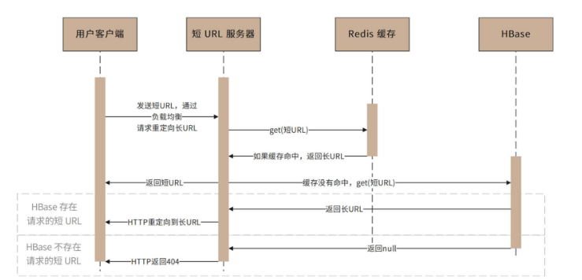

**过期清理与高可用**

- 清理任务每月跑一次，删除超过 2 年的数据，并把回收的短码**追加写回**预生成文件，实现短码复用；
- 应用服务器、文件服务器、数据库服务器全部集群部署，单机故障不影响可用性；
- 性能上，80% 以上请求由缓存返回。按经验值，Redis 响应在 1ms 量级，加上服务端处理，请求耗时 < 3ms，满足"80% < 5ms"；未命中的走 HBase，按经验值平均 10ms 左右，也满足 99% < 20ms。

**缓存该放多少**

业界经验是 80% 以上的访问集中在最近几天生成的短码上，因此 Fuxi 只缓存最近 6 天的数据：

```text
最近 6 天新增：5 亿 / 30 × 6 = 1 亿条
每条 1 KB
所需内存：1 亿 × 1 KB = 100 GB
```

这就是"缓存该多大"的推导过程——不是拍脑袋，而是"热点时间窗 × 每天新增量 × 单条大小"。

#### 2.5 三种方案对比

| 方案 | 唯一性 | 可猜测性 | 生成性能 | 实现复杂度 |
| :--- | :--- | :--- | :--- | :--- |
| 单向散列 + 截断 | 需查库校验，可能冲突 | 较低（取决于散列） | 差（多次查存储） | 中 |
| 自增自然数 | 天然唯一 | 高，可被遍历 | 好 | 低 |
| 预生成 + 布隆过滤器 | 离线保证唯一 | 随机，不可猜 | 好（内存取一个） | 中（需文件与偏移量管理） |

### 3 详细设计

详细设计关注三件事：重定向响应码怎么选、预生成文件怎么读、多台服务器怎么不重复地取短码。3.6 之后的内容是同一系统的 WebSocket 网关实现细节，一并保留。

#### 3.1 重定向响应码：301 还是 302

| 状态码 | 语义 | 浏览器行为 | 对服务端的影响 |
| :--- | :--- | :--- | :--- |
| 301 | 永久重定向 | 缓存跳转结果，之后不再请求短 URL | 省流量，但**无法统计**访问次数 |
| 302 | 临时重定向 | 每次访问都请求短 URL | 压力更大，但能统计、能动态调整 |

Fuxi 选 302：它的架构本就能承受这些读请求，而访问统计是产品需求，不能丢。

#### 3.2 短 URL 预生成文件及预加载

144 亿条短码，每条 6 字节，文件大小：

```text
144 亿 × 6 B = 86.4 GB
```

文件格式极其简单：所有短码的 ASCII 码**无分隔符**连续存放，下面是一个存了 3 个短码的示例：

```plain
Wdj4FbOxTw9CHtvPM1
```

因为定长，读取可以按偏移量算：预加载服务器第一次启动时加载 1 万个短码，就是从文件头读 60,000 字节（1 万 × 6 B，约 60 KB），并把当前偏移量记为 60,000 字节；下次再加载 1 万个，就从 60 KB 处继续读 60 KB。

多台预加载服务器同时启动会读到同一批短码，因此必须互斥。Fuxi 用了一个巧妙的办法：**借助文件系统写锁的互斥性**。

访问顺序是：

```text
写打开偏移量文件 → 读偏移量 → 读打开短码文件 → 从偏移量读 60KB
→ 关闭短码文件 → 修改偏移量 → 关闭偏移量文件
```

"写打开"本身是互斥操作：第一台服务器写打开偏移量文件后，其他服务器无法同时写打开，也就无法完成"读 60KB + 改偏移量"这一组操作，从而保证并发安全。

#### 3.3 内存里的短码链表

加载到内存的 1 万个短码用链表组织：

- 每取用一个，头指针后移一位，并把前一个节点的 `next` 置为 null，让用过的节点可以被垃圾回收；
- 当剩余长度不足 2000 时，触发异步线程再加载 1 万个，挂到链表尾部。

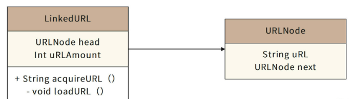

| 类 | 成员 | 职责 |
| :--- | :--- | :--- |
| URLNode | `url`（短码字符串）、`next`（下一个节点） | 链表元素 |
| LinkedURL | `head`（头指针）、`urlAmount`（剩余数量） | 链表主体，`acquireURL()` 从头部取出短码并让 `urlAmount` 减一 |

原文在这个类的说明处被截断（3.4、3.5 两节内容缺失，只保留了类图附近的片段），可确认的设计意图是：**扣减数量与取用必须原子**，否则并发取用会取到同一个短码。

#### 3.6 连接清理与缓存映射清理（原文此处有截断）

原文 3.6 的正文同样被截断，从残留代码可以还原出逻辑：遍历当前注册的客户端集合，把"过期时间"与最后活跃时间 `lastTs` 比较——未过期的留在集合里继续处理，已过期的调用 `clearRedisMapping(client.Id, client.Uid, lastTs, clearTimeout)` 清理该连接在 Redis 里的映射，最后统一调用 `WsClose()` 关闭连接。

```go
// 原文节选：遍历连接，按过期时间清理 Redis 映射并关闭连接
for _, client := range clients {
    if lastTs < int64(expireTime) {
        clients = append(clients, client)
    } else {
        dispatcher.clearRedisMapping(client.Id, client.Uid, lastTs, clearTimeout)
    }
    return true
}
for _, cli := range clients {
    cli.WsClose()
}
```

这段代码本身有 bug（`return true` 写在循环体内，第一次迭代就会返回），保留它是为了说明意图：**清理要按"最后活跃时间 + 过期阈值"判断，先清缓存映射，再关连接**，顺序反了会留下脏映射。

#### 3.7 自定义 Headers

网关与 API 层之间用 Kafka 传递指令。把指令和参数放进 Kafka 的 **Headers**，而不是消息体，是为了**避免网关层为了读指令去解码消息体**——解码是纯 CPU 开销，在百万连接下很贵。

例如通过 `X-XX-Operator` 判断是广播，再读 `X-XX-Guid`（文件编号），对该文件内的所有用户推送消息。

| 字段 | 说明 | 取值示例 |
| :--- | :--- | :--- |
| X-ID | WebSocket 连接 ID | 连接唯一标识 |
| X-Uid | 用户 ID | 用户唯一标识 |
| X-Guid | 文件 ID | 用户所在分片文件 |
| X-Inner | 网关内部操作指令 | 用户加入、用户退出 |
| X-Event | 网关事件 | Connect / Message / Disconnect |
| X-Locale | 语言类型 | 语言类型设置 |
| X-Operator | API 层操作指令 | 单播、广播、网关内部操作 |
| X-Auth-Type | 鉴权类型 | SDKV2、主站、微信、移动端、桌面 |
| X-Client-Version | 客户端版本 | 客户端版本 |
| X-Server-Version | 网关版本 | 服务端版本 |
| X-Push-Client-ID | 客户端 ID | 客户端 ID |
| X-Trace-ID | 链路 ID | 链路 ID |

在 Kafka Headers 中写入 trace id 和时间戳，就能追踪某条消息的完整消费链路以及各阶段的时间消耗。

#### 3.8 消息接收与发送

第一版实现是"一连接三 goroutine"：

```go
type Packet struct {
    // ...
}

type Connect struct {
    *websocket.Conn
    send chan Packet
}

func NewConnect(conn net.Conn) *Connect {
    c := &Connect{
        send: make(chan Packet, N),
    }
    go c.reader() // 读
    go c.writer() // 写
    return c
}
```

压测发现：每个连接占 3 个 goroutine（含主 goroutine），每个 goroutine 都要单独的内存栈，单机承载连接数受限，主要瓶颈就是内存；而且大部分时间 `c.writer()` 处于闲置状态。

goroutine 是 Go 里的并发执行单位，由 Go 运行时调度，底层是运行在用户态的协程，创建和切换成本远低于操作系统线程——但它仍然要占栈内存，数量一多，内存就成为硬约束。

于是改成"两 goroutine + 主动写"：

```go
type Packet struct {
    // ...
}

type Connect struct {
    *websocket.Conn
    mux sync.RWMutex // 写操作互斥
}

func NewConnect(conn net.Conn) *Connect {
    c := &Connect{}
    go c.reader() // 只保留读 goroutine
    return c
}

func (c *Connect) Write(data []byte) (err error) {
    c.mux.Lock()
    defer c.mux.Unlock()
    // ...
    return nil
}
```

保留读 goroutine，是因为用轮询方式从缓冲区读数据可能引入延迟或锁问题；写改成"谁要发谁调用 Write"，用互斥锁保证同一连接上的写不交错。

也调研过 gev、gnet 这类基于事件驱动的轻量网络库，实测在大量连接场景下可能出现消息延迟，所以没有在生产使用。

#### 3.9 核心对象缓存

确定收发模型后，网关的核心对象是 Connection，围绕它实现了 run、read、write、close。因为连接会被频繁创建销毁，用 `sync.Pool`（对象池，复用对象以减少 GC 压力）来复用：

```go
var ConnectionPool = sync.Pool{
    New: func() interface{} {
        return &Connection{}
    },
}

func GetConn() *Connection {
    cli := ConnectionPool.Get().(*Connection)
    return cli
}

func PutConn(cli *Connection) {
    cli.Reset()          // 归还前必须清空状态，否则会串数据
    ConnectionPool.Put(cli)
}
```

#### 3.10 数据传输过程优化

两件事：把消息体压小、把包大小调到合适。

**序列化**：用 MessagePack 替代 JSON 等文本格式，二进制编码体积更小，解析 CPU 也更省。

**MTU 探测**：MTU（Maximum Transmission Unit，最大传输单元）是网络一次能传输的最大数据包字节数。超过路径上某台设备的 MTU 就会分片甚至丢弃，太小又浪费带宽。

```bash
ping -s {a} {ip}
```

`-s` 指定 ICMP 负载大小 a。当 a = 1400 时，实际发出的 IP 包为 1428 字节：

```text
1400（ICMP 负载）+ 8（ICMP 首部）+ 20（IP 首部）= 1428 B
```

a 设得过大，表现是应答超时（说明路径上过不去），实际环境就会分包。所以先用 ping 逐步加大 a，找到不分片的最大值，再据此控制应用层单包大小。


如果 a 设置过大会导致应答超时，在实际环境包大小超过该值时会出现分包的情况。

在调好 MTU 的同时用 MessagePack 压缩消息体，进一步减小包体积、降低 CPU 消耗。

#### 3.11 基础设施支持

服务用 EGO 框架（一套 Go 微服务框架）开发，获得的能力包括：业务日志打印、异步日志输出、动态日志级别调整（便于线上排查）、微服务监控体系（CPU、P99、内存、goroutine 数等指标）。


客户端 Redis 监控：

客户端 Kafka 监控：

自定义监控大盘：


### 4 性能压测

这一节是一台 16 核 32G 网关机承载 50 万 WebSocket 连接的压测记录，四组场景分别加压，结论比数字更有价值。

#### 4.1 压测准备

- 服务机：1 台 16 核 32G 虚拟机，目标承载 48 万连接；
- 客户机：8 台 4 核 8G 虚拟机，每台开放 6 万个端口（单机可用端口有限，所以要多台压）。

#### 4.2 场景一：用户上线

50 万在线用户陆续建立连接。

| 服务 | 配置 | 数量 | CPU% | Mem% |
| :--- | :--- | :--- | :--- | :--- |
| WS-Gateway | 16 核 32G | 1 台 | 22.38% | 70.59% |

单个网关每秒建立连接数的峰值为 1.6 万个/秒，每个用户占用内存约 47 KB。可以反向校验：50 万 × 47 KB ≈ 23.5 GB，约为 32 GB 的 73%，与实测 70.59% 基本吻合。

#### 4.3 场景二：全量广播 + 用户回执（50 万在线）

测试 15 分钟，50 万在线，每 5 秒向所有用户推一条消息，用户有回执。推送内容形如：

```text
42["message",{"type":"xx","data":{"type":"xx","clients":[{"id":xx,"name":"xx","email":"xx@xx.xx","avatar":"ZgG5kEjCkT6mZla6.png","created_at":1623811084000,"name_pinyin":"","team_id":13,"team_role":"member","merged_into":0,"team_time":1623811084000,"mobile":"+xxxx","mobile_account":"","status":1,"has_password":true,"team":null,"membership":null,"is_seat":true,"team_role_enum":3,"register_time":1623811084000,"alias":"","type":"anoymous"}],"userCount":1,"from":"ws"}}]
```

测试进行 5 分钟后服务异常重启，原因是内存使用量超过限制。


分析内存去向：

分析内存超过限制的原因：

- 新增的广播代码占 9.32% 内存；
- 接收用户回执的部分占 10.38% 内存。

新增的广播代码用掉了 9.32% 的内存。

接收用户回执消息的部分消耗了 10.38% 的内存。

把在线用户降到 48 万后重测：

| 服务 | 配置 | 数量 | CPU% | Mem% |
| :--- | :--- | :--- | :--- | :--- |
| WS-Gateway | 16 核 32G | 1 台 | 44% | 91.75% |

连接建立峰值 1 万个/秒，接收数据峰值 9.6 万条/秒，发送数据峰值 9.6 万条/秒。

#### 4.4 场景三：全量广播，无需回执（50 万在线）

测试 15 分钟，50 万在线，每 5 秒推送一条，用户不回执。

| 服务 | 配置 | 数量 | CPU% | Mem% |
| :--- | :--- | :--- | :--- | :--- |
| WS-Gateway | 16 核 32G | 1 台 | 30% | 93% |

连接建立峰值 1.1 万个/秒，发送数据峰值 10 万条/秒。除内存占用过高外，没有其他异常。

连接数建立峰值：1.1w 个 / s，发送数据峰值 10w 条 / s，出内存占用过高之外，其他没有异常情况。

火焰图显示内存消耗极高，主要落在"每 5 秒定时广播"这段逻辑上：

内存消耗极高，分析火焰图，大部分消耗在定时 5s 进行广播的操作上。

#### 4.5 场景四：50 万在线 + 每秒 4 万用户上下线

| 服务 | 配置 | 数量 | CPU% | Mem% |
| :--- | :--- | :--- | :--- | :--- |
| WS-Gateway | 16 核 32G | 1 台 | 46.96% | 65.6% |

连接建立峰值 18570 个/秒，接收数据峰值 329949 条/秒，发送数据峰值 393542 条/秒，未出现异常。


#### 4.6 压测结论

| 场景 | 关键压力 | 表现 | 瓶颈 |
| :--- | :--- | :--- | :--- |
| 一：仅上线 | 连接建立 | CPU 22%、内存 71% | 内存（单连接约 47KB） |
| 二：广播 + 回执 | 全量推送 + 回执 | 5 分钟后 OOM 重启 | 内存（广播 9.32% + 回执 10.38%） |
| 三：广播无回执 | 全量推送 | CPU 30%、内存 93% | 内存（定时广播的对象分配） |
| 四：频繁上下线 | 连接抖动 | CPU 47%、内存 66% | CPU 与连接管理 |

结论很清楚：**这类长连接网关的第一瓶颈是内存，不是 CPU**。每 5 秒一次的全量广播会持续产生临时对象，GC 来不及回收就会顶到内存上限。可行的优化方向包括：广播时复用序列化后的字节切片（不要每个连接各编一次）、限制单次广播的并发写入量、用对象池复用消息体、降低广播频率或按分片广播。

---

## 12. 京东电商大促高可用保障实践

这篇文章回答一个很具体的问题：一次电商大促（如 618、11.11）来临前，负责一个后端系统的团队到底该做哪些事，才能让系统在流量峰值下不出事。全文按"大促是什么 → 我的系统在链路中的哪个位置 → 备战目标 → 事前事中事后 → 流量沙漏防护"的顺序展开，最后给出可以直接照抄的评估清单、指标清单和常见故障来源。

### 一、大促是什么：618、11.11 与黑色星期五

讨论备战之前，先把对象说清楚。电商大促是电商平台组织的大型销售推广活动，通过优惠、折扣等手段提升销售额与站点流量，通常挂在特定节日或人造节点上（"11.11""618""黑色星期五"等）。对大促备战来说，重要的不是活动名字，而是它带来的流量形态：**在某几个时间点，请求量会在几分钟内抬升到平日的数倍甚至数十倍，而这些请求又高度集中在少数几个接口上**。

#### 1.1 三个典型活动

| 活动 | 时间 | 起源与特点 |
| --- | --- | --- |
| 618 | 每年 6 月，6 月 1 日"开门红"至 6 月 18 日 | 京东的店庆月主战场，近几年会提前到 5 月 20 日左右开始预售。2010 年起以满减、优惠券等形式起步，从单品类、跨店铺逐步扩展到百亿补贴，已持续十余年 |
| 11.11 | 每年 11 月 11 日 | 起源于 2009 年 11 月 11 日淘宝商城（后更名天猫）的促销日，现已成为全行业乃至全球零售业关注的大促节点。有统计称 2012 年 11 月 11 日全网销售额超过了美国的"网购星期一"（Cyber Monday） |
| 黑色星期五 | 美国感恩节（11 月第四个星期四）的次日 | 关于名称起源有多种说法，较常见的一种是：商家用红色墨水记亏损、黑色墨水记盈利，这一天之后年度营收由"红"转"黑"，店员也用这个词自嘲当天异常忙碌。它通常是一年中销售额第二或第三高的一天，最高峰多在圣诞节前 |

与之对应的还有 Cyber Monday（感恩节假期后第一个周一，主打线上购物），以及兴起于法国、葡萄牙、德国等地的同类促销。此外，苏宁 818、国美 418 属于平台自造节；拼多多、抖音、快手等更多是借势 11.11 与 618 来提升平台的 GMV（成交总额）。

> 上表中的时间与规模属于公开报道口径，各平台每年都会调整节奏与玩法，具体以当年公告为准。来源见文末"参考与出处"。

### 二、先清家底：商业模式与四条业务链路

这一节解决"我的系统重要吗、有多重要"这个问题。近几年"新零售""无界零售""全渠道"等概念频繁出现，业务形态变复杂之后，同一个系统在不同大促场景下的重要性差别很大——所以脱离链路谈"备战"没有意义。


判断标准可以归纳成一句话：**先明确自己的系统在整个业务链路中的位置，再看它提供的核心功能是否涉及资损、用户体验、交易阻碍，或者会影响公司名誉、品牌、集团战略与营销计划。** 命中任意一条，它就该被当作重点保障对象。

#### 2.1 四条业务链路

按营销、交易、仓储、配送、售后划分，京东零售的系统大致落在四条链路上：

| 链路 | 主要作用 | 在大促中的定位 |
| --- | --- | --- |
| 营销链路 | 吸引流量、聚集流量、完成流量转化 | 大促的起点与核心环节之一，直接决定流量规模 |
| 交易链路 | 把流量变成订单和成交额 | 大促真正的目标核心链路，重要性最高 |
| 履约链路 | 把订单变成"货已发出、已送达" | 承接交易结果，出问题表现为发货慢、超时 |
| 售后链路 | 处理取消、退换、退款、判责 | 兜底环节，出问题直接影响资金与口碑 |

每条链路的主要环节如下（箭头表示先后顺序）：

- **营销链路**：营销策略方案制定 → 营销方案采销／商家宣讲 → 营销方案外部市场公关 → 营销活动创建 → 营销活动审核 → 营销活动投放 → 促销招商 → 商家报名 → 商家选品、发品 → 营销活动商品审核 → 营销活动、优惠券、商品的投放与推荐
- **交易链路**：登录（网站／APP／小程序／H5）→ 京东首页（搜索与推荐）→ 商品详情页 → 购物车 → 结算页 → 收银台（支付）→ 订单（列表页、详情页）→ 资金对账
- **履约链路**：订单拆分、转移、下传、出管 → POP 商家（采销／供应商）接单 → 发货、拣货、打包、出库、打印面单 → 分拣、配送、自提 → 确认收货
- **售后链路**：拒收／订单取消／退货、换货、退款 → 商家审核／快速退款／纠风判责 → 暂停修改订单、拦截物流返仓、原路（部分）退款、上门维修、换新单 → 财务对账 → 客户满意度评价

上面这些链路还远没有覆盖全部，时效保证、开寄发票、预售先款／先货、商品评价、直播空间、店铺评价、客服处理等分支都省略了。这恰好说明一件事：**想保障整个平台的大促稳定，如果平均用力，一定做不好。** 必须区分重点。

### 三、备战目标：一个"稳"字

大促备战的总目标可以只用一个字概括：稳。设计一个系统通常要看五个要素——功能性、可用性、性能效率、安全、扩展性（秒杀这类场景会更强调高并发）；大促备战的落点几乎全部压在**可用性**上：保障交易核心链路更稳，更好地支撑用户下单，促成交易。

这里的可用性（Availability）指系统在给定时间内可正常提供服务的能力，工程上常用平均无故障时间、平均故障间隔时间、平均修复时间以及停机时长来衡量。大促期间对它的要求比平时更高，因为故障窗口恰好落在流量最高的时段。

难的地方不在目标，而在资源。管理者、项目、产品、研发、测试面对的是同一个约束：人力、物力、财力永远不足。资源有限就决定了决策方式——**集中优势力量，打在目标最薄弱的环节上**，方案才能真正落地。

> 这就像急诊分诊：床位和医生永远不够用，正确的做法不是按挂号顺序挨个看，而是先救有生命危险的那几个。大促备战里的"有生命危险"，就是交易核心链路上的资损与下单阻塞。

### 四、备战思路：事前、事中、事后

大促备战是一个有完整故事线的事件。领域驱动设计（DDD，一种以业务领域为中心组织系统设计的方法）里的"事件建模"正好印证了这一点：把人类活动按"点—线—面—体"梳理时，"线"往往是最合适的中间表达层次。备战思路就沿这条故事线拆成三段：**事前、事中、事后**。

#### 4.1 事前：基于现状提前安排

1. 参加部门／集团大促启动会，及时获取最新备战导向与战略内容，例如京东的"三道防线"战略提法。
2. 盘点资源：人员、应用、上下游依赖、中间件、数据库；约定本次大促的 SLA（服务等级协议，即对可用性与响应时间的承诺）、值班上下游群、问题反馈群、大促备战手册。
3. 改造可以降低故障发生概率的事项：梳理核心链路，改造链路上的薄弱点；改造日志，使其能按不同场景输出；规范备战指南方案。
4. 用宣讲增强备战感知：从大促封版需求开始做意识宣讲，完善监控大盘，补充关键日志，治理报警邮件与短信，整理历届大促指标的同环比对照数据表。
5. 宣讲会之后进入日检：成立应急故障虚拟小组，基于历史故障与常见问题整理故障手册，制定限流、降级预案等指南手册。


#### 4.2 事中：保持警惕的执行状态

1. 每日邮件通报指标报表。
2. 每日收集错误日志并跟进反馈、解决。
3. 每日对监控报警做根因分析。
4. 每日站会同步当天系统应用与人员情况。
5. 跟进部门／集团的大促备战日例会。

#### 4.3 事后：基于结果复盘

1. **业务目标达成情况**：某个营销活动做得好的、待改善的、可以萃取经验的分别是什么。
2. **产研测团队的需求保障情况**：大促前期与期间上线的需求，上线质量与收益达成如何。
3. **指标与成本**：系统指标、资源成本、人力成本投入。流程与工具成熟之后，在业务变化不大的情况下，成本投入应当逐年下降。
4. **文档资产沉淀**：每次大促都是系统的一次历练，期间形成的文档全部归档，下次可直接复用。
5. **待办事项持续跟踪**：很多团队只记录了时间和责任人，缺少一张真正的跟踪表，导致事情没有下文。

### 五、战术核心：流量沙漏防护原理

前面讲的是战略与组织层面。真正落到系统上，整个防护工作围绕一个模型展开：**流量沙漏防护原理**。请求从用户侧进来，依次经过 CDN、Nginx、业务网关／前端应用，再到后端应用（含中后台系统）以及它依赖的组件和其他应用；流量像沙漏里的沙子，越往下通道越窄、越集中。沙漏最窄也最复杂的那一段，就是后端应用的稳定性保障，也是日常故障最集中的地方。


沿这条链路，逐段看每层该做什么。

#### 5.1 CDN 与动静分离

CDN（内容分发网络）把静态资源缓存到离用户最近的节点，动静分离则是把页面里的静态部分与需要实时计算的部分拆开。核心应用基本都完成了前后端分离，因此这一层的优化通常最简单；但由于历史原因和组织结构调整，仍有不少应用界面由后端维护与渲染，这类系统在大促前就值得单独排期处理。

#### 5.2 网关安全保障

网关通常分两类：

| 类型 | 主要职责 |
| --- | --- |
| 技术网关 | 安全、鉴权、防刷、防攻击、限流、降级 |
| 业务网关（偏 BFF 层） | 业务接口适配、字段裁剪、聚合 |

这一层要面对的是热点流量峰值的不确定性、用户行为的不确定性以及安全攻击。实践中需要与风控团队配合，把黑产异常流量、异常 IP、异常 Cookie 自动加入黑名单并执行限流。

#### 5.3 后端应用

后端应用的类型、功能、面向用户不同，高可用手段就不同。按性质大致可分为任务类、工具类、支撑业务类、核心业务类；按应用分级定义清楚之后，再从硬件资源、容器资源、应用资源、监控报警、链路等维度评估健康度，治理薄弱环节。公司级的应用健康度平台能给出应用"画像"，便于快速诊断和定位。

> 京东内部有一套自己的组件与平台命名（例如 JSF 服务调用框架、JMQ 消息队列、JIMDB 缓存、UMP 监控、DUCC 配置中心、JDOS 容器平台），第七节的清单里会出现这些名字。换成你所在公司的技术栈，指标含义基本一一对应。

### 六、后端应用评估：五个维度

有了沙漏模型，还需要一个可执行的检查表。评估后端应用时，可以从功能性、性能效率、可用性、可维护性、成本五个维度拆出可观测的"特征"，再对应到具体措施：

| 考虑因素 | 特征 | 措施／关注点 |
| --- | --- | --- |
| 功能／适用性 | 合适原则 | 系统需求是否可理解 |
| 性能效率 | 全面性 | 页面、接口、功能的加载时间 |
| 性能效率 | 时间性 | RT（响应时间）、吞吐量 |
| 性能效率 | 资源利用率 | 内存、磁盘空间、CPU 使用率 |
| 性能效率 | 可扩展性 | 代码与架构设计 |
| 可用性 | 全面性 | 平均无故障时间、平均修复时间、平均故障间隔时间 |
| 可用性 | 稳定性 | 平均停机时间 |
| 可用性 | 容错性 | 错误崩溃、代码覆盖率、多机房容灾、冗余备份 |
| 可维护性 | 全面性 | 应用维护的人力投入 |
| 可维护性 | 模块化 | 结构清晰、边界清晰 |
| 可维护性 | 可重复使用性 | 代码、功能的复用情况 |
| 可维护性 | 可测试性 | 代码覆盖率 |
| 可维护性 | 可分析性 | 复杂性、代码圈复杂度、服务间交互耦合 |
| 可维护性 | 可变更性 | 代码规模、变更频率、代码耦合、服务单一职责 |
| 成本 | 全面性 | 开发、测试、部署维护的成本 |
| 成本 | 基础设施 | 云／本地基础设施成本 |

用法很直接：逐行对照打分，分数低且落在核心链路上的项，就是本次大促要治理的薄弱点。

### 七、应用健康度：一份可照抄的指标清单

这一节把上面的"容错性""资源利用率"等抽象项落到具体指标上。下面这份清单来自京东内部的应用健康度评估体系，按基础资源、容器、应用、监控报警、链路五组展开。不同公司平台的名字不同，但指标本身的含义是通用的，可以直接当作大促前的自检提纲。

**基础资源类**：应用跨集群、应用跨机房、应用跨 POD（容器组）、应用 POD 分布、缓存 POD 分布、网络 TCP 重传、应用容器 CPU、缓存 CPU、消息队列 CPU、数据库 CPU、缓存分片拓扑、缓存分片 POD、数据库主从、数据库机房、数据库规格、消息队列 POD、VIP 机房数量、后端机房数量、错误后端 IP、集群环境一致性。

**容器类**：容器存活、应用模块化、GIT 分支、灰度更新超时、CPU 利用率、内存使用率、Swap 使用率、磁盘繁忙、磁盘使用率（根目录、export 分区）、网络连通性、网络流入／流出、TCP 连接数、系统时间偏差。

**应用类**（组件版本与 JVM、连接池、缓存、数据库、消息六组）：

- 组件版本：JSF、JIMDB、JMQ2、JMQ4、UMP、DUCC、LOG4J、JVM。
- JVM：Full GC／Young GC 次数、XMX 最大堆、XMS 最小堆、堆外内存、ParallelGCThreads、GCConcGCThreads、CICompilerCount、Metaspace、CMS 回收阈值、新生代大小、HeapDump 配置、Server 模式。
- 日志与调用：日志清理策略、JSF 超时时间、JSF 跨单元／跨环境／跨机房调用、JSF 重试次数、负载均衡策略、JSF 限流、JSF 动态别名、JSF 黑名单、同机房部署、别名命名规范、混合环境部署、HTTP 网关 timeout、最大连接数、初始连接数、connectTimeout、SocketTimeout、maxWait、时区设置。
- 缓存（JIMDB）：FAILOVER 状态、热 KEY、大 KEY、慢日志、扫描过期频率、服务端版本一致性、风险版本、淘汰策略、Swap 交换区、绑核、CPU 模式、网卡软中断、读超时、跨单元调用、连接超时、等待超时。
- 数据库：慢 SQL、优先治理慢 SQL、含外键表、索引过多表、自增溢出表、大表。
- 消息队列：接入方式、最大线程数、sendTimeout、tp99 异常次数、积压、broker 主机负载、broker 主机磁盘繁忙。
- 存活探活：应用实例存活、应用 Port 存活、应用 URL 存活、JSF Provider 接口存活、JSF Consumer 接口存活。
- 预发环境：空应用、纯预发应用、单实例应用、预发流量过大、预发资源过多、不活跃预发分组。
- 缓存服务端：依赖缓存集群异常 Server OPS 次数、Server CPU 利用率、Server 内存使用率与 RSS、Server 网络流入／流出、Server 连接数。
- 缓存代理（JED）：QPS、连接数、主从延迟。

**监控报警类**：主机层（CPU、负载、内存、Swap、磁盘繁忙与使用率、网络连通性、TCP 连接数与重传、网络流入／流出、系统时间偏差）；组件层（服务提供方、缓存、消息生产、MySQL、SpringMVC 组件报警）；JVM 层（CPU、内存、线程数、FULLGC／YOUNGGC 次数）；方法层（TP99、TP999、可用率及其配置合理性、调用次数）；端口与 URL 存活；OPS 次数；连接数；主从断开与复制延迟；消息积压与重试；日志关键字报警配置。

**链路类**：链路超时、链路超时涉及的缓存组件。

清单看起来很长，实际用法是分组扫描：先看有没有"单实例""单机房""无容灾"这类结构性问题，再看阈值类指标（连接池、超时、限流）是否合理，最后看报警是否真的能触达值班人。

### 八、常见故障来源：八类高频问题

应用自身的指标之外，大促故障更多来自三方因素。下面八类问题在复盘中反复出现：

1. **接口定义不合理、业务周知不到位**：新上的业务需求在某个时刻产生脉冲流量，直接打挂薄弱依赖。
2. **上下游依赖不稳定**：遇到性能瓶颈时，业务系统强依赖对方且无法降级，只能被动等待恢复。
3. **机房层面没有容灾**：通信光缆被挖断、信号中断等问题会导致网络瘫痪、故障不可用。
4. **中间件使用策略异常**：没有做业务幂等、重试次数与时间未受控，下游承接不住脉冲流量而不可用。
5. **容量水位到阈值未扩容**：中间件与数据库容量已接近上限，未及时扩容，最终拖垮业务系统。
6. **数据库被拖垮**：应用操作数据库时线程阻塞、死锁、慢 SQL 集中出现。
7. **热点数据打偏**：操作缓存或 ES（Elasticsearch，搜索引擎）时出现热点商品，流量分布不均。
8. **内存泄漏与 JVM 配置不合理**：堆大小、GC 参数、堆外内存未按实际负载设置。

回到沙漏模型：这张清单正好对应沙漏的各段——上半段是流量来源与网关，中段是依赖与中间件，下半段是数据库与缓存。


### 九、复盘、角色分工与关键权衡

电商大促对参与者是一次很好的成长机会：能补齐知识盲区，也能更深入地理解所在团队的核心业务。业务运营、产品、研发、测试都值得了解一遍备战流程。

不同角色关注点不同：

| 角色 | 关注重点 |
| --- | --- |
| 一线负责人（"大促备战师"） | 事前吃透核心链路业务、梳理事项；有一份能宣导到每个人的备战手册；做到精兵强将、人人互为备份；监控报警可视化大屏，能第一时间发现业务异动 |
| 事业部／集团架构师 | 清晰的备战路线与里程碑，盯住重点事项与日例会的跟进；人数超过几十人后，备战更多是"管人、管流程"而不是"管应用"，因此要责任到部门、到人，靠日例会压缩信息差 |

把全文的取舍集中成一张表：

| 关键权衡 | 常见踩坑 | 建议做法 |
| --- | --- | --- |
| 全量治理 vs 抓核心 | 平均用力，核心链路仍然薄弱 | 先按资损、交易阻碍、体验、品牌影响给系统分级，资源向核心倾斜 |
| 强依赖 vs 可降级 | 依赖方一慢，自己线程池先满 | 每个强依赖都要有超时、重试上限与降级返回值 |
| 限流阈值定多少 | 阈值拍脑袋，压测过的容量没写进配置 | 以压测结论为准，并预留安全系数；限流要能动态调整 |
| 只看平均值 | 平均 RT 正常，尾部请求已经超时 | 同时看 TP99／TP999 与方法可用率 |
| 扩容时机 | 等水位报警才扩容，扩容本身又需要时间 | 按大促预估峰值提前扩容，并为弹性扩容留出验证过的流程 |
| 预案有没有用 | 文档齐全但从未演练 | 赛前演练＋"谁有权按下开关"写清楚 |
| 变更风险 | 大促期间仍有非必要上线 | 严格执行封版，变更必须走审批与灰度 |

一句话总结：大促备战不是把监控盘做大，而是**在资源有限的约束下，把确定会出问题的地方提前找出来，并且准备好"出事时怎么收场"**。

### 参考与出处

- 维基百科. 黑色星期五（购物）、双十一、网络星期一 相关词条.
- 京东零售大促备战内部实践材料（活动节奏、三道防线战略、应用健康度指标清单均为其内部口径）.
- 上述活动的时间、规模数据属公开报道口径，逐年调整，具体以各平台当年公告为准。

<!-- ARTICLE: 微服务架构常用十种设计模式 -->

---

## 13. 微服务架构常用十种设计模式

这篇文章回答一个问题：拆成微服务之后，那些反复出现的麻烦（数据库怎么分、跨服务事务怎么做、前端要调十几个接口怎么办、下游挂了怎么不跟着挂）分别有哪些成熟解法。文中先交代微服务架构的定义与优缺点，再逐个讲十种常用模式——每种都给出"解决什么问题、什么时候用、什么时候别用、一个简短示例"，最后给出组合与选型顺序。

### 一、什么是微服务架构

微服务架构（Microservices Architecture）指把大型复杂系统按功能或业务需求**垂直切分**成更小的子系统，这些子系统以独立部署的子进程存在，彼此之间通过轻量级、跨语言的同步调用（如 REST、gRPC）或异步消息进行通信。

下面是基于微服务架构的商业 Web 应用的组件视图：


微服务架构的重要特征：

- 整个应用程序被拆分成相互独立、但内部仍包含多个模块的子进程。
- 与模块化单体（Modular Monoliths）或 SOA（面向服务架构）相反，微服务按业务范围或领域做**垂直**拆分。
- 微服务的边界是"外部"的：服务之间通过网络调用（RPC 或消息）通信，而不是进程内的方法调用。
- 每个微服务是独立进程，可以独立部署。
- 它们以轻量级方式通信，不需要智能通信通道（即把路由、转换等逻辑放在通道里的 ESB 式做法）。

> 可以把它想成一家从"一个大食堂"改成"一条美食街"：每家店独立采购、独立营业、独立装修，彼此的边界是柜台而不是后厨；代价是你想吃一顿饭，得自己跑几家店，还得接受某家店今天没开门。

### 二、微服务架构的优点

- 更好的开发规模：团队可以按服务并行推进。
- 更快的开发速度。
- 支持迭代开发，或对遗留系统做现代化的增量开发。
- 能充分利用现代软件开发生态（云、容器、DevOps、Serverless）。
- 支持水平扩展与细粒度扩展（哪个服务热就扩哪个）。
- 单个服务体量小，降低了开发人员的认知复杂度。

### 三、微服务架构的缺点

- 组件数量高一个数量级：服务、数据库、进程、容器、框架都变多了。
- 复杂性从代码转移到了基础设施。
- RPC 调用与网络通信大量增加。
- 整个系统的安全性管理更具挑战。
- 整个系统的设计变得更困难。
- 引入了分布式系统固有的复杂性（网络分区、部分失败、时钟不同步等）。

### 四、何时使用微服务架构

- 大规模 Web 应用开发。
- 跨团队的企业级应用协作开发。
- 长期收益优先于短期收益（前期投入的基础设施成本需要时间摊平）。
- 团队里有能够设计微服务架构的架构师或高级工程师。

反过来看：如果系统规模不大、只有一个团队、上线节奏也不快，单体应用往往是更划算的选择——这也是后文 Strangler 模式存在的前提。

### 五、十种模式总览

十种模式按"数据 → 通信 → 边界 → 稳定性 → 交付"分组，先看全景再逐个展开：

| 模式 | 解决什么问题 | 引入的代价 |
| --- | --- | --- |
| 独享数据库 | 服务之间在数据库层强耦合 | 跨服务事务与数据共享变难 |
| 事件源 | 需要记录状态变化全过程、需要可重放 | 读模型难做，复杂度上升 |
| CQRS | 读写负载差异大、读模型难从事件推导 | 最终一致性、系统更复杂 |
| Saga | 跨服务的事务一致性，且不能用两阶段提交 | 要写补偿逻辑，难调试 |
| BFF | 不同端（Web／App）的 API 需求不同 | 代码重复、需要额外设计 |
| API 网关 | 客户端要连很多服务、横切关注点分散 | 可能成为单点与瓶颈 |
| Strangler | 单体迁移到微服务不能一次推翻 | 过渡期架构复杂、端到端测试变难 |
| 断路器 | 同步调用链上的级联故障 | 异常处理、监控与人工复位 |
| 外部化配置 | 配置与代码混在一起、环境切换要重新打包 | 需要选框架、需要配置管理 |
| 消费端驱动的契约测试 | 服务提供方改接口悄悄改坏消费方 | 额外的测试开发与集成工作 |

### 六、独享数据库（Database per Microservice）

**解决什么问题**：公司把单体拆成一组微服务时，第一个要决策的就是数据库。单体时代用一个大中央库，迁到微服务后很多架构师倾向"库先不动"——短期省事，但这是反模式：微服务会在数据库层严重耦合，团队授权、独立开发这些目标都会落空。

更好的做法是每个微服务拥有自己的数据存储，服务之间在数据库层就不存在强耦合。这里的"数据库"指**逻辑上的数据隔离**：微服务可以共享同一个物理数据库实例，但应当使用独立的库、集合或表。这也有助于检验微服务是否按领域驱动设计（DDD）正确拆分。


**优点**

- 数据由服务完全所有。
- 各服务开发团队之间的耦合度降低。

**缺点**

- 服务间共享数据变得更困难。
- 在应用范围保证 ACID 事务（原子性、一致性、隔离性、持久性）变得困难许多。
- 如何拆分原有的单体数据库是一项极具挑战的设计工作。

**何时用**：大型企业级应用；团队需要完全掌控各自的微服务，以扩大开发规模、提升迭代速度。

**何时别用**：小规模应用；所有微服务由同一个团队开发。

**简短示例**：订单服务与库存服务各自持有 `order_db` 与 `stock_db`，库存只允许通过库存服务的接口变更，订单服务不得直接连 `stock_db`。

**可用技术示例**：所有 SQL、NoSQL 数据库都支持数据的逻辑分离（独立的表、集合、结构或库）。

### 七、事件源（Event Sourcing）

**解决什么问题**：使用了独享数据库之后，微服务之间需要交换数据。对弹性、可伸缩、可容错的系统来说，应该通过交换**事件**做异步通信。这时常需要"更新数据库并发送消息"这样的原子操作，而在大数量分布式场景下，关系数据库上的两阶段提交（2PC，一种先准备再统一提交的分布式事务协议）无法伸缩；多数 NoSQL 数据库则根本不支持它。

事件源（Event Sourcing）的思路是：传统数据库直接存业务实体的当前"状态"，而事件源把每一次状态变更事件都存下来，实体本身不直接存。也就是说，业务实体的所有更改被保存为一系列**不可变事件**；因为数据是一系列事件而不是"就地更新"的结果，各服务可以重放事件来计算出所需的状态。


```java
// 示意：事件源里只追加事件，当前状态由重放得到
public class Account {

    private final List<AccountEvent> events = new ArrayList<>();

    public void deposit(long amount) {
        events.add(new Deposited(amount));   // 只追加，不修改历史
    }

    public long balance() {                  // 重放事件，算出余额
        long sum = 0;
        for (AccountEvent e : events) {
            sum += e.delta();
        }
        return sum;
    }
}
```

**优点**

- 为高可伸缩系统提供原子性操作。
- 自动记录实体变更历史，具备时序回溯能力。
- 松耦合、事件驱动的微服务。

**缺点**

- 从事件存储中读取实体成为新挑战，通常需要额外的数据存储（即 CQRS）。
- 整体复杂性上升，通常需要领域驱动设计支撑。
- 系统要处理事件重复（幂等）与事件丢失。
- 变更事件结构（schema）成为新的难题。

**何时用**：使用关系数据库的高可伸缩事务型系统；使用 NoSQL 数据库的事务型系统；弹性高可伸缩的微服务架构；典型的消息驱动或事件驱动系统（电商、预订、预约）。

**何时别用**：使用 SQL 数据库、伸缩性要求不高的事务型系统；服务之间可以简单同步交换数据（例如直接调 API）的微服务架构。

**简短示例**：账户余额不存字段，只存"存入／支出"事件流；对账时重放到任意时间点即可还原当时余额。

**可用技术示例**：事件存储——EventStoreDB、Apache Kafka、Confluent Cloud、AWS Kinesis、Azure Event Hub、GCP Pub/Sub、Azure Cosmos DB、MongoDB、Cassandra、Amazon DynamoDB；框架——Lagom、Akka、Spring、akkatecture、Axon、Eventuate。

### 八、命令和查询职责分离（CQRS）

**解决什么问题**：用了事件源之后，从事件存储里读数据就变难了——要拿到一个实体，得处理它的全部事件。同时读写往往还有不同的一致性与吞吐量要求。

CQRS（Command Query Responsibility Segregation，命令与查询职责分离）把系统的**修改部分（命令）**与**读取部分（查询）**分开。它有两种容易混淆的形态：

**简单形式**：同一份存储，但读和写使用不同的实体或 ORM 模型。


*图：CQRS 的简单形式*

它有助于强化单一职责原则与关注点分离，得到更简洁的设计。

**高级形式**：读写使用不同的数据存储，通常结合事件源。写存储是"记录的系统"（system of record），也就是整个系统的核心源头。


*图：CQRS 的高级形式*

- 写存储：读频繁的应用可用 OLTP 数据库（任何提供 ACID 事务保证的关系或非关系数据库），或分布式消息系统；写频繁、要求写可水平伸缩时，需要选写扩展性好的数据库。标准化数据保存在写存储中。
- 读存储：常用为搜索（如 Apache Solr、Elasticsearch）或读操作（KV 数据库、文档数据库）优化过的非关系数据库；需要 SQL 查询的地方可用读可伸缩的关系数据库。非标准化、经过特殊优化的数据保存在读存储中。
- 数据从写存储**异步**复制到读存储，因此两者之间存在延迟，但最终一致。

**优点**

- 事件驱动的微服务中，数据读取速度更快。
- 数据可用性更高。
- 读写系统可独立扩展。

**缺点**

- 读存储是弱一致的（最终一致性）。
- 整体复杂性上升；用得不当的 CQRS 会显著危害整个项目。

**何时用**：高可扩展的微服务架构中使用事件源时；复杂领域模型中，读操作需要同时查询多个数据存储时；读写负载差异明显的系统。

**何时别用**：没必要存储大量事件的微服务架构（用事件存储快照计算实体状态更合适）；读写负载相近的系统。

**简短示例**：下单写入 `order_db` 后发一条事件，搜索服务消费事件并写入 Elasticsearch，商品列表页只查 ES，不做多表 JOIN。

**可用技术示例**：写存储——EventStoreDB、Apache Kafka、Confluent Cloud、AWS Kinesis、Azure Event Hub、GCP Pub/Sub、Azure Cosmos DB、MongoDB、Cassandra、Amazon DynamoDB；读存储——Elasticsearch、Solr、Cloud Spanner、Amazon Aurora、Azure Cosmos DB、Neo4j；框架——Lagom、Akka、Spring、akkatecture、Axon、Eventuate。

### 九、Saga

**解决什么问题**：微服务各自独享数据库后，跨服务的一致性成了大难题。传统两阶段提交要么不可伸缩（关系数据库场景），要么不被支持（多数非关系数据库），于是需要另一种分布式事务方案。

Saga 的思路是：把跨多个服务的业务事务实现为"一串本地事务的可靠协调序列"。协调机制（常用异步消息）保证 Saga 一定有个结局——要么所有步骤都成功，要么在某个本地事务因违反业务规则失败时，用**补偿事务**撤销前面已完成步骤的改动。Saga 概念在 1987 年就被提出，最初是数据库中长事务的替代方案。


Saga 的协调方式有两种：

| 方式 | 也叫 | 做法 | 特点 |
| --- | --- | --- | --- |
| 事件编排 | Choreography | 每个微服务产生并监听其他服务的事件或消息，自行决定是否执行下一步 | 分散协调，无中心节点，链路难追踪 |
| 命令编排 | Orchestration | 由一个协调器（orchestrator）告诉各参与方该执行哪个本地事务 | 集中协调，流程清晰，协调器是新增组件 |

**优点**

- 为高可伸缩或松耦合的、事件驱动的微服务架构提供一致性事务。
- 为使用不支持 2PC 的非关系数据库的微服务架构提供一致性事务。

**缺点**

- 需要处理瞬时故障，并提供幂等性（同一操作重复执行结果不变）。
- 难以调试，复杂性随微服务数量增加而增加。
- 缺少隔离性：并发执行的多个 Saga 可能互相看到中间状态，需要额外的防护设计。

**何时用**：使用事件源的高可伸缩、松耦合微服务；使用分布式非关系数据库的系统。

**何时别用**：使用关系数据库、伸缩性要求不高的事务型系统；服务之间存在循环依赖的系统。

**简短示例**：下单 Saga = 扣库存 → 扣优惠券 → 创建订单；若"创建订单"失败，则依次补偿"退回优惠券""回滚库存"。

**可用技术示例**：Axon、Eventuate、Narayana。

### 十、面向前端的后端（BFF）

**解决什么问题**：现代商业应用里前后端分离，Web 端与移动端通过 API 或 GraphQL 连接后端微服务。两端屏幕尺寸、性能、能耗、网络带宽都不同，API 需求自然也不同；如果共用同一套后端接口，就会互相迁就。

BFF（Backends For Frontends，面向前端的后端）为每种特定 UI 定制一个后端。它还带来其他好处：作为下游微服务的封装，减少 UI 与下游之间的频繁通信；在高安全要求场景中，BFF 能为部署在 DMZ（隔离区）网络中的下游微服务提供更高的安全性。


**优点**

- 分离各 BFF 的关注点，可以针对具体 UI 做优化。
- 提供更高的安全性。
- 减少 UI 与下游微服务之间的频繁通信。

**缺点**

- BFF 之间会出现代码重复。
- UI 一多（智能电视、Web、移动端、PC 桌面版），BFF 数量随之膨胀。
- 需要仔细设计与实现：BFF 不应包含业务逻辑，只应包含特定客户端逻辑与行为。

**何时用**：应用有多个 API 需求不同的 UI；出于安全需要在 UI 与下游微服务之间加一层；UI 开发使用微前端。

**何时别用**：虽然有多个 UI，但使用的 API 相同；核心微服务并不部署在 DMZ 网络中。

**简短示例**：App 首页一个接口返回"商品名＋价格＋库存＋是否包邮"，由 App BFF 并行调用商品、价格、库存三个服务后拼装；Web 端 BFF 则返回更完整的字段。

**可用技术示例**：任何后端框架都能支持（Node.js、Spring、Django、Laravel、Flask、Play 等）。

### 十一、API 网关

**解决什么问题**：微服务架构中，UI 通常要连多个微服务。如果服务粒度很细（例如 FaaS，函数即服务），客户端要连的服务会多到难以管理；这些服务及其 API 还在不断演进。大型企业还希望统一处理一批横切关注点（SSL 终止、身份验证、授权、限流、日志等）。

API 网关位于客户端与后端微服务之间，充当门面（facade）：它可以是反向代理，把请求路由到合适的后端服务；也可以把一次客户端请求扇出（fan-out）到多个微服务，聚合响应后返回；还能承载必要的横切关注点。


```yaml
# 示意：Spring Cloud Gateway 的路由配置，把 /api/orders/** 转到订单服务
spring:
  cloud:
    gateway:
      routes:
        - id: order-service
          uri: http://order-service:8080
          predicates:
            - Path=/api/orders/**
          filters:
            - StripPrefix=2
```

**优点**

- 前端与后端服务之间松耦合。
- 减少客户端与微服务之间的调用次数。
- 通过 SSL 终止、身份验证与授权实现更高安全性。
- 横切关注点集中管理：日志、监控、限流、负载均衡。

**缺点**

- 可能成为微服务架构中的单点故障。
- 额外的网络调用带来延迟增加。
- 不做扩展就很容易成为整个应用的瓶颈。
- 额外的维护与开发成本。

**何时用**：复杂微服务架构中它几乎是必需品；大型企业里，API 网关是集中化安全与横切关注点的必要工具。

**何时别用**：安全与集中管理不是首要考虑的私人项目或小公司；微服务数量相当少时。

**简短示例**：上例中客户端只认网关域名，订单服务换端口、换机房都不影响客户端；鉴权、限流、访问日志统一下沉到网关。

**可用技术示例**：Amazon API Gateway、Azure API Management、Apigee、Kong、WSO2 API Manager。

### 十二、Strangler（扼杀者）

**解决什么问题**：想在运行中的项目里用微服务架构，就得把遗留的或现有的单体应用迁过去。直接重写风险极高，可能破坏应用可用性，而且用户等不了那么久。

Strangler 模式（名称来自榕树：藤蔓缠住宿主树生长，最终取而代之）的做法是：**用新的微服务逐步替换单体的特定功能**，把单体增量地迁移到微服务架构，而不是一次性推翻。


**优点**

- 安全地把单体应用迁移到微服务。
- 可以并行迁移已有功能与开发新功能。
- 迁移节奏可控。

**缺点**

- 在单体与新的微服务之间共享数据存储变得困难。
- 增加门面层（API 网关）会带来额外延迟。
- 端到端测试变得困难。

**何时用**：把大型后端单体应用增量迁移到微服务。

**何时别用**：后端单体本身很小，全量替换更划算；无法拦截客户端对遗留单体的请求（无法把流量按路径切分）。

**简短示例**：先把"商品评价"从单体里抽出成独立服务，网关按 `/review/**` 把流量切到新服务，其余路径继续回源单体；验证稳定后再抽下一个模块。

**可用技术示例**：API 网关与后端应用框架的组合。

### 十三、断路器（Circuit Breaker）

**解决什么问题**：微服务之间常用同步调用。瞬时故障（网络慢、超时、暂时不可用）靠重试可以解决；但如果对方**彻底挂了**，重试就没有意义，还会持续占用宝贵资源（线程被阻塞、CPU 周期被浪费），并沿调用链引发级联故障。这时"快速失败"是更好的选择。

断路器的做法是：让一个代理代为发起请求，统计最近一段时间内的失败数量，据此决定是继续请求，还是直接返回异常。它的工作原理与电气断路器类似——电流异常时先跳闸，保护整条线路。


断路器有三种状态：

| 状态 | 行为 | 如何切换 |
| --- | --- | --- |
| 关闭（Closed） | 正常把请求路由到目标服务，并统计给定时段内的失败数 | 失败数超阈值则跳闸，进入打开状态 |
| 打开（Open） | 请求直接快速失败并返回异常，不再真正调用 | 等待一段超时时间后，进入半开状态 |
| 半开（Half-Open） | 只放行有限数量的请求做试探 | 试探成功则回到关闭；任一失败则重新打开 |

**优点**

- 提高微服务架构的容错性与弹性。
- 阻止故障向其他微服务级联扩散。

**缺点**

- 需要较复杂的异常处理。
- 需要配套日志与监控。
- 应当支持人工复位（运维要能手动打开或关闭断路器）。

**何时用**：微服务之间使用同步通信的、紧耦合的架构；一个微服务依赖多个其他微服务。

**何时别用**：松耦合、事件驱动的微服务架构；微服务不依赖其他服务。

**简短示例**（Spring Cloud CircuitBreaker + Resilience4j 的注解形式）：

```java
@CircuitBreaker(name = "stockService", fallbackMethod = "fallbackStock")
public Stock queryStock(String skuId) {
    return stockClient.get(skuId);        // 远程调用，可能超时或失败
}

// 熔断打开后直接走这里：返回"库存未知"，让页面降级展示
public Stock fallbackStock(String skuId, Throwable cause) {
    return Stock.unknown(skuId);
}
```

**可用技术示例**：API 网关、服务网格、各类断路器库（Hystrix、Resilience4j、Polly）。

### 十四、外部化配置（Externalized Configuration）

**解决什么问题**：每个业务应用都有一堆面向基础设施的配置参数（数据库、网络、依赖服务地址、凭据、证书路径），而企业应用通常还要跑在多种环境（本地、开发、生产）中。把这些配置写进代码内部是糟糕实践：生产凭据很容易被泄露；改任何参数都要重新构建应用——在拥有数百个服务的微服务架构里，这个代价会被放大数百倍。

更好的做法是把所有配置外部化，让**构建过程与运行环境分离**：生产的配置文件只在运行时注入，或通过环境变量传入，从而把安全风险降到最低。（这也是 12-Factor App 方法论中的"配置"原则：把配置存在环境变量里。）

**优点**

- 生产配置不在代码库里，安全漏洞面最小化。
- 修改配置参数不需要重新构建应用。

**缺点**

- 需要选择一个支持外部化配置的框架。
- 需要额外的配置管理与权限控制（谁能改生产配置、改了怎么回滚）。

**何时用**：任何重要的生产应用都必须使用外部化配置。

**何时别用**：做概念验证（PoC）阶段可以暂时从简。

**简短示例**（Spring Boot 从环境变量取值，仓库里只放占位符）：

```yaml
spring:
  datasource:
    url: ${DB_URL}
    username: ${DB_USER}
    password: ${DB_PASSWORD}
```

**可用技术示例**：几乎所有企业级现代框架都支持外部化配置；配置中心类产品可进一步提供灰度、版本与审计能力。

### 十五、消费端驱动的契约测试（Consumer-Driven Contract Testing）

**解决什么问题**：微服务通常由不同团队开发，彼此同步或异步通信。提供方悄悄改了接口字段或消息格式，消费方往往到上线才发现——这类事故在服务数量多时尤其难排查。

消费端驱动的契约测试把这件事前移：**由消费方团队针对它依赖的提供方服务，编写一套包含请求与预期响应（同步）或预期消息（异步）的测试套件**，这套测试就是显式的"约定"（contract）。提供方在每次构建时跑这些契约，一旦改动破坏了约定，立刻失败。

**优点**

- 提供方意外更改 API 或消息时，能被快速自动发现。
- 更少意外、更健壮，在服务数量多的企业应用中尤其明显。
- 改善团队自主性：消费方不必等提供方的联调窗口。

**缺点**

- 需要额外开发与集成提供方一侧的契约测试，两边可能用完全不同的测试工具。
- 契约测试与真实服务不匹配时，反而可能导致生产故障。

**何时用**：大型企业业务应用中，不同服务由不同团队开发时。

**何时别用**：所有微服务由同一团队负责的小型简单应用；提供方服务相对稳定、不处于活跃开发状态。

**简短示例**：消费方声明"调用 `GET /users/42` 必须返回 200，且响应体包含 `id` 与 `name` 字段"；提供方把该契约纳入流水线，删掉 `name` 字段时构建直接红。

**可用技术示例**：Pact、Postman、Spring Cloud Contract。

### 十六、怎么选：组合顺序与三条经验

十种模式不是并列的十道菜，而是有先后关系的一组工具。实践中常见的推进顺序是：

1. **先定数据边界**：独享数据库决定了服务边界是否真的独立；边界划错，后面所有模式都在补救错误。
2. **再决定一致性方案**：跨服务事务优先考虑 Saga（配事件源或事务性发件箱），避免把 2PC 引入高并发主链路。
3. **然后处理通信入口**：客户端入口收敛到 API 网关，按端拆 BFF；同步调用链上补断路器与超时。
4. **最后补交付与运维**：外部化配置、契约测试，以及迁移期用的 Strangler。

三条经验：

- **模式是代价交换，不是能力展示**：CQRS、事件源、Saga 都明确增加了系统复杂度，官方文档本身也反复提醒"慎用"。系统还小时，单体 + 清晰模块往往更划算。
- **一致性要求要分层**：资金、库存这类必须强一致的写操作，和商品列表这类可以最终一致的读操作，不该用同一套方案。
- **先能观测，再谈容错**：断路器、Saga 补偿、CQRS 同步延迟，都依赖链路追踪与指标；没有观测能力的容错配置，出问题时只能靠猜。

### 参考与出处

- Martin Fowler. bliki 词条：Circuit Breaker. 2014；Strangler Fig. 2004／2024；CQRS. 2011.
- Michael Nygard. Release It! Design and Deploy Production-Ready Software. 2007（断路器模式的普及来源）.
- Chris Richardson. microservices.io 模式目录：Saga、Database per Service.
- Sam Newman. Pattern: Backends For Frontends. 2015.
- Ian Robinson. Consumer-Driven Contracts: A Service Evolution Pattern. 2006.
- Adam Wiggins. The Twelve-Factor App：III. Config（配置存于环境变量）.

<!-- ARTICLE: 字节二面：100WQPS短链系统怎么设计 -->

---

## 14. 字节二面：100WQPS短链系统怎么设计

这篇文章用"设计一个百万级 QPS 的短链系统"这道题，把分布式 ID、布隆过滤器、分库分表、多级缓存、HTTP 重定向、进制转换这几块知识串成一条完整的推导链。读完之后，你应该能自己从"一条短链怎么生成、怎么跳转"推到最后"存储怎么分片、缓存怎么分层"。

### 一、背景：为什么要把 URL 变短

短网址的作用是替代长 URL 在互联网上传播和引用，例如腾讯微博的 `url.cn`、新浪的 `sinaurl.cn`。在 QQ、微博上发布网址时，平台会自动识别并转换，例如 `url.cn/2hytQx`。

把长链接变短，通常有六个原因：

1. **节省长度**。URL 本身没有信息量，原始 URL 很长时会占用宝贵的屏幕空间。微博一条只有 140 字，链接若占掉近一半篇幅就不可接受；链接变短，可编辑的正文就变多。
2. **便于内容管控**。部分网址可能包含违规、暴力、广告信息，平台可通过用户举报后让该短链不再出现在应用中。同样的 URL 经过同一套算法得到同样的短地址，管控才有落点。
3. **便于行为分析**。对一批网址做流量、点击统计，可以挖掘用户关注点，为后续决策提供依据。
4. **提升带宽利用率、节约成本**。短网址与短 ID 传输的字节更少。
5. **提升平台兼容性**。链接太长时，有些平台无法自动识别为超链接。
6. **更简洁、更安全**。不暴露原始访问参数，也能在一定程度上规避关键词、域名屏蔽。

### 二、原理：一次短链跳转发生了什么

短链系统的核心只有一句话：**把长的 URL 转化成短的 URL**。

客户端访问时的工作流程：

1. 用短地址 A 访问短链服务。
2. 短链服务做地址转换与映射，把短 URL 还原成对应的长 URL。
3. 短链服务返回 302 重定向给客户端。
4. 客户端再跳到原始地址。


原始 URL 怎么变短？简单说就是**用编号替代原始地址**；编号怎么进一步变短？**用更大的进制表示**。这两句话就是整个系统的设计骨架。

### 三、进制选择：62 进制与 128 进制

#### 3.1 六十二进制表示法

短网址都非常短，比如 `xxx.cn/EYyCO9T`，其中 `EYyCO9T` 只有 7 位。这 7 位就是用 62 进制表示的：`0-9`、`a-z`、`A-Z`，即 10 个数字 + 26 个小写字母 + 26 个大写字母 = 62 个字符。

不同进制、不同位数能表示的编号数量差别很大：

| 进制 | 6 位可表示的数量 | 7 位可表示的数量 | 说明 |
| --- | --- | --- | --- |
| 10 进制 | 10^6 − 1 = 999,999 | 10^7 − 1 = 9,999,999 | 位数一多就很长 |
| 16 进制 | 16^6 − 1 = 16,777,215 | 16^7 − 1 ≈ 2.68 亿 | 已经用上 A B C D E F |
| 62 进制 | 62^6 − 1 = 56,800,235,583（约 568 亿） | 62^7 = 3,521,614,606,208（约 3.5 万亿） | 大小写＋数字全用上，长度最短 |

几个容易记混的数值边界（Java 中）：

- `int` 占 4 字节，范围约 ±21 亿（−2,147,483,648 ～ 2,147,483,647）。
- `long` 占 8 字节，范围约 ±922 亿亿（±9.22×10^18），足够放 62 进制 7 位以内的编号。

短网址长度可以按需要调整：要更多容量就加位数；即使只留 6 位，62^6 也有约 568 亿的空间。8 位 62 进制（62^8 ≈ 218 万亿）对绝大多数系统已经绰绰有余。只要算法得当，覆盖范围不是瓶颈。

编码过程还可以自定义 62 个字符的排列顺序。典型用途是做**弱加密**：A 站点让字母 `c` 表示 32，B 站点让 `c` 表示 60，同一套编号在不同站点编出不同字符串，字符表就相当于一本密码本。

#### 3.2 128 进制表示法

标准 ASCII 码用 7 位二进制（最高位补 0）表示 128 个字符，包含大小写字母、数字 0-9、标点符号，以及美式英语里使用的控制字符。既然 62 进制已经能缩短，用 128 进制（如果字符集够用）岂不是更短？理论上是的，字符集更大的进制，同样位数能放更多编号。

但实践中很少这么做，原因是**可用字符的问题**：128 个字符里包含大量不常用字符，例如 `#`、`%`、`&`、`*`，还有控制字符。短链要给人看、要能被复制粘贴、要能被各种客户端正确解析，于是通用性和记忆性变差。所以 62 进制（数字＋大小写字母）是一个权衡后的折中。

### 四、功能拆解：发号、存储、映射

假设短地址长度为 8 位，62^8 足够一般系统使用。系统核心包含三个功能：**发号、存储、映射**，可以归为两个模块。

**发号与存储模块**

- 发号：用发号器为每个长地址分配一个号码 ID，并且要防止地址二义性——即防止同一个长地址多次请求得到不同的短地址。
- 存储：把号码与长地址存入数据库；把号码转成 62 进制，作为最终短地址返回给用户。

**映射模块**

用户拿着 62 进制的短地址来请求时：

- 转换：把 62 进制的字符串转回 10 进制，因为系统内部用的是 `long` 类型的 10 进制 ID。
- 映射：在数据库中查出对应的长地址。
- 通过 302 重定向，把用户请求导向目标地址。

> 可以把整个系统想成图书馆的索书号：发号器是给每本新书编一个唯一编号（同一本书不能编两个号），存储是把编号和书名登记进目录，映射就是读者报编号、管理员查目录、把他带到书架。编号越短，写起来越快，但可用的编号空间也越小。

### 五、发号器：五种 ID 方案的对比与选型

发号器的职责有两条：为每个长地址分配唯一号码 ID；防止地址二义性。下面五种分布式 ID 方案，是在这道题里必须能对比着说清楚的。

#### 5.1 方案一：用地址的哈希编码作为 ID

对原始 URL 做哈希得到一个整数，直接当短链 ID。哈希算法（把任意长度的输入映射成固定长度输出的算法）大致分两类：加密哈希（MD5、SHA-256 等）与非加密哈希（MurmurHash、CRC32、DJB 等）。

- **MD5**：MD5 消息摘要算法（MD5 Message-Digest Algorithm），广泛使用的密码散列函数，产生 128 位（16 字节）的散列值；由美国密码学家 Ronald Linn Rivest 设计，1992 年公开，并在 RFC 1321 中规范。
- **CRC**：循环冗余校验（Cyclic Redundancy Check），根据网络数据包或文件等数据产生简短固定位数校验码的散列函数，由 W. Wesley Peterson 于 1961 年发表。它在发送或存储前计算并附加到数据后面，接收方据此判断数据是否发生变化；由于易于用硬件实现、便于数学分析，尤其擅长检测传输通道干扰引起的错误，因此应用广泛。
- **MurmurHash**：非加密型哈希函数，适用于一般哈希检索。由 Austin Appleby 在 2008 年提出，之后出现多个变种；与一些流行哈希函数相比，对规律性较强的键，MurmurHash 的随机分布表现更好。它被不少开源项目采用，例如 libstdc++（4.6 起）、nginx 的部分模块、Hadoop、Redis、Memcached、Cassandra、HBase、Lucene 等。计算位数可以是 128 位、64 位、32 位，位数越多碰撞概率越低。

把长链做 MurmurHash 得到一个整数哈希值，短链就形如：

```text
固定短链域名 + 哈希值 = www.weibo.com/888888888
```

再把 10 进制的哈希值转成 62 进制，域名部分也能显得更紧凑：

```text
www.weibo.com/abcdef
```

**问题在哪**：哈希会碰撞——两个不同的长 URL 可能算出同一个哈希值，于是两个不同的长链指向同一个短链。碰撞概率随数据量上升而增大，这种方案因此不适合做短链 ID。

#### 5.2 方案二：数据库自增 ID

完全依赖数据源：所有 ID 存在数据库里，建表时用 `auto_increment` 主键或序列生成。单体应用时期这是最常用的办法。

高并发下它有两个性能问题，解决思路是**批量发号**：

1. 提前为每台机器发放一个 ID 区间 `[low, high]`，机器在自己内存里用 `AtomicLong` 原子类保证自增，减少对数据库的依赖；
2. 区间快用完时，再向数据库申请下一个区段；
3. 为了提升写入并发，引入**队列缓冲 + 批量写入**：上一批号码发放完之后，一次性把记录批量写入数据库，获取与写入都异步进行，保证服务持续高并发。

例如每次从数据库取 10000 个号码在内存中发放，剩余不足 1000 个时重新申请 10000 个，上一批发完后再批量写入数据库。

但这种方案更适合单库场景。分布式数据库下，各库的自增主键会冲突，得再用别的办法（例如设置不同步长）打补丁，局限性明显。

| 维度 | 内容 |
| --- | --- |
| 优点 | 非常简单；有序递增，方便分页和排序 |
| 缺点 | 分库分表后同一张表的自增 ID 容易重复，无法直接使用；整体吞吐较低；即使做单独数据库＋预生成，也会因事务锁在高并发下形成单点瓶颈 |
| 适用场景 | 单数据库实例的表 ID（含主从同步场景）、按天计数的流水号等 |
| 不适用 | 分库分表场景、全系统唯一 ID 场景 |

所以高并发场景很少用 MySQL 自增主键做 ID。

#### 5.3 方案三：分布式中间件生成 ID

数据库不行，可以用分布式、高性能的中间件，比如 Redis、MongoDB 的自增主键，或其他分布式存储的自增能力——代价是引入额外的中间件依赖。

以 Redis 为例，通过 `INCR`／`INCRBY` 原子命令能保证生成的 ID 唯一且有序，本质上与数据库方案一致，只是吞吐更高。

| 维度 | 内容 |
| --- | --- |
| 优点 | 整体吞吐量比数据库高 |
| 缺点 | Redis 实例或集群宕机后，找回最新的 ID 值比较困难 |
| 适用场景 | 计数类场景，如访问量、订单流水号（日期 + 流水号） |

超高并发下，远程生成 ID 的性能仍然不如本地生成。

#### 5.4 方案四：UUID、GUID

- **UUID**：按公开标准计算，标准版本（v1）会用到时间戳与网卡 MAC 地址等要素；结构上包含当前日期时间、时钟序列、全局唯一的 IEEE 机器识别号。需要注意 UUID 有多个版本：v4 完全随机、不含 MAC 地址，因此"一定包含网卡地址"只对 v1 成立。
- **GUID**：微软对 UUID 标准的实现。UUID 还有其他实现，不止 GUID 一种。

这两者都不依赖数据源，是真正的全球唯一 ID。

| 维度 | 内容 |
| --- | --- |
| 优点 | 不依赖任何数据源，本地计算，无需网络，速度很快，全球唯一 |
| 缺点 | 没有顺序性；比较长（128 位），作为数据库主键或索引会降低索引效率、占用更多空间 |
| 适用场景 | 对存储空间不苛刻的场景，如链路追踪 ID、日志存储 |

#### 5.5 方案五：Snowflake（雪花算法）

Snowflake ID 属于**本地生成 ID**，这点与 Redis、MongoDB 的远程生成 ID 不同。本地生成性能高，远程生成性能低。

原理是用 `long`（64 位）按规则分段填充：1 位符号位 + 时间戳（毫秒级）+ 集群／机器 ID + 序列号。Twitter 2010 年开源的初版采用 41 位时间戳 + 10 位机器标识 + 12 位序列号，各段位数可以按实际需要调整；其中集群 ID 与机器 ID 通常要依赖外部配置或数据库记录来分配，避免重复。

| 维度 | 内容 |
| --- | --- |
| 优点 | 高性能、低延迟、去中心化、按时间总体有序 |
| 缺点 | 要求机器时钟同步；必须解决**时钟回拨**问题——某台机器系统时钟回拨可能造成 ID 冲突或乱序 |
| 适用场景 | 分布式应用环境的数据主键 |

关于吞吐量：12 位序列号意味着同一毫秒内单机最多产生 4096 个 ID，理论峰值约 400 万/秒；实际能力取决于实现与部署，常见经验值是单机每秒几十万到百万级。具体数字应由自己的压测得出，不宜直接引用别人的结论。

#### 5.6 技术选型

五种方案逐一排除：

- 不用地址的哈希编码做 ID：会碰撞，且无法保证"同长链同短链"。
- 不用数据库自增 ID：分库分表后冲突、单点瓶颈。
- 不用 Redis、MongoDB 的分布式 ID：远程调用开销大，宕机后 ID 恢复麻烦。
- 不用 UUID：无序且太长，做主键伤索引。

**最终选择 Snowflake**：从发号性能、整体有序（对 B+ 树索引更友好）两个角度出发最合适。剩下的问题就是时钟回拨。常见解决思路包括：检测到回拨时等待时钟追上、直接抛异常让上层重试、切换到备用 workerId，或把时间位延长。工程实现可以参考 Twitter 官方代码、百度 UID 生成器、ShardingSphere 的 ID 生成器，再结合自身部署形态设计。

### 六、存储：分库分表的两个维度

这批数据非常结构化，用结构化数据库 MySQL 存储即可。表结构极简，两列：

| 字段 | 类型 | 说明 |
| --- | --- | --- |
| `id` | `BIGINT` | 发号器给出的分布式 ID（雪花 ID 是 64 位，用 `int` 存不下） |
| `surl` | `VARCHAR` | 原始长链 |

```sql
-- 示意：主键是发号器给的 ID，原始 URL 单独存一列
CREATE TABLE short_url (
  id    BIGINT        NOT NULL COMMENT '雪花 ID，同时是短链编码的来源',
  surl  VARCHAR(2048) NOT NULL COMMENT '原始长链',
  PRIMARY KEY (id)
) ENGINE = InnoDB;
```

接下来的问题是海量数据与高并发下的分库分表。分析按两大维度做**分治**：

- **数据容量（存储规模）的分治**：单表行数、单行大小决定要拆多少张表、多少个库。按 `id` 取模或按范围分片都可以，关键是让"按短链 ID 查长链"这条主查询只落在一个分片上。
- **访问流量（吞吐量规模）的分治**：读多写少的系统，读侧靠缓存与从库扩展，写侧靠分片打散。


需要注意一个结构性矛盾：主键是**发号器给的 ID**，而二义性检查要按**原始 URL** 判断是否已生成过。这两条路径的查询键不同，因此分片键只能迁就其中一条，另一条必须靠额外手段（见下一节）。具体拆法是：先确认"日增数据量"与"峰值读写 QPS"两组输入，再据此定分片数与副本数；不同项目的思路基本相通。

### 七、二义性检查：布隆过滤器与多级缓存

地址二义性指同一个长地址多次请求得到不同的短地址。生产短址时必须做二义性检查，才能实现长短链真正的一对一。

最直接的做法是**每次去数据库里查**，但代价很大：

- 数据库主键是短链 ID，不是原始 URL；
- 按原始 URL 做存在性检查，还得额外建索引；
- 数据库性能有限，撑不住超高并发的二义性检查。

所以不能每次都查库。常见方案是用 Redis 布隆过滤器（Bloom Filter）记录已经生成过的原始 URL。

布隆过滤器的结构是"位数组（bitset）+ 多次哈希"：宏观上是空间换时间，不存储原始 URL 的内容，只记录"是否存在"，因此非常省内存。数据量很大时，它同时满足时间与空间要求。

```bash
# RedisBloom 模块的典型用法：先按预期元素数与误判率建过滤器
BF.RESERVE short_url_filter 0.001 100000000
BF.ADD    short_url_filter "https://example.com/a"
BF.EXISTS short_url_filter "https://example.com/a"
```


布隆过滤器的价值在于能迅速判断一个元素是否在集合中。常见使用场景：

1. **黑名单**：反垃圾邮件，从数十亿垃圾邮件列表里判断某邮箱是否为垃圾邮箱（同理用于垃圾短信）。
2. **URL 去重**：网页爬虫避免重复爬取同一地址。
3. **单词拼写检查**。
4. **缓存穿透防护**：把所有可能存在的数据放进布隆过滤器，请求不存在的数据时迅速返回，避免缓存与数据库被打穿。
5. **ID 校验**：订单系统查询某订单 ID 是否存在，不存在直接返回。

它比用缓存去重省空间得多，代价是**不太精确**。

**判定规则是：说存在不一定存在，说不存在一定不存在。** 布隆过滤器相当于一个不太精确的 set，用 `contains` 判断时，判断为不存在则一定不存在；判断为存在则可能不存在（误判）。

因此对原始 URL 的处理策略是：

- 布隆过滤器判断为**不存在** → 直接生成新的短链。
- 布隆过滤器判断为**存在** → 可能是误判，还需要回查数据库确认。

误判率通常很低，合理设置位数组大小与哈希次数后可以压到 1% 以下（经验值，取决于容量规划）。但有人会追问：如果峰值 100 万 QPS，1% 也意味着每秒约 1 万次数据库回查，数据库还是扛不住。补充两点：

- 100 万 QPS 是"生成短链"的峰值假设，而生成请求远少于跳转请求；实际回查量应按写入侧的 QPS 估算，而不是按整站 QPS。
- 回查本身可以再加一层缓存：把"最近／最热门"的原始 URL 到短链的对应关系存在 K-V 存储或本地缓存里，命中就不必落库。

具体做法例如：在本地缓存 Caffeine 中存放**最近生成**的"长链 → 短链"映射，并配合过期机制淘汰，从而保证频繁使用的 URL 总是对应同一个短链；不频繁使用的 URL 则不保证命中，从而大幅降低空间消耗。需要注意，Caffeine 默认的淘汰策略并不是纯 LRU，而是 W-TinyLFU（带频率统计的准入策略）；如果确实需要严格 LRU 语义，要显式选择对应实现或自己维护。

另外，标准布隆过滤器**不支持删除元素**，所以它适合"只增不改"的去重集合；短链一旦生成就不再撤销，正好符合这个前提。

### 八、映射模块：把 ID 换成长链

跳转是读操作，量级远高于写入，因此这一层是缓存的主战场。按"本地缓存 → 分布式缓存 → 数据库"逐级兜底：

1. **本地缓存（如 Caffeine）**：存最热的 ID → 长链映射，命中直接返回，无需网络往返。
2. **分布式缓存（如 Redis）**：存全量或大部分 ID → 长链映射，作为本地缓存未命中后的第二层。
3. **数据库**：只有前面都没命中时才查库，查回后按策略回填缓存。

简单的缓存方案是：把热门长链（需要对长链被请求的次数计数）、最近的长链（例如用 Redis 保存最近一小时的数据）等放进缓存；请求命中缓存时直接取对应的短链返回，不需要再做生成操作。

### 九、301 还是 302：一个必须做的取舍

301 是永久重定向，302 是临时重定向，两者对缓存的影响完全不同：

| 状态码 | 语义 | 浏览器行为 | 服务端影响 |
| --- | --- | --- | --- |
| 301 | 永久重定向 | 第一次拿到长链后，下次再访问短链不再请求短链服务器，直接用本地缓存 | 减轻服务器压力，但服务端拿不到访问次数 |
| 302 | 临时重定向 | 每次访问短链都会请求短链服务器（除非响应头用 `Cache-Control` 或 `Expires` 明确指示缓存） | 服务器压力更大，但能在服务端统计每一次访问 |

使用 301 虽然减压，但服务端就统计不到短链的访问次数了；如果这条链接正好是某个活动的入口，就无法分析活动效果，也没法做大数据分析。而 302 虽然增加服务器压力，却便于在服务端统计访问数。对有统计需求的系统来说，这点代价通常是值得的；具体选哪种，要结合实际情况决定。

顺带说明两个规范细节：301 响应默认可被缓存，302 默认不缓存（除非显式给出新鲜度信息）；另外用 301 处理 POST 时，浏览器可能把后续请求改成 GET，需要保持方法不变时应使用 308。

### 十、另一条路线：以哈希值为基础的实现步骤

前面主线选择的是"发号器 + 62 进制"路线，好处是天然唯一、整体有序。另一条路线以哈希值为基础，实现步骤更短，但必须显式处理冲突与二义性。把这条路线完整走一遍：

1. **校验长链合法性**：生成短链前先校验输入的长链接，确保不是恶意链接或无效链接（协议、域名、长度、是否命中黑名单）。
2. **计算哈希值**：用非加密型哈希（如 MurmurHash3）对长链计算，得到固定长度的哈希值。选择算法时要考虑性能与分布均匀性。
3. **转换为短链标识**：把哈希值转成 62 进制字符串（字符集通常是 `[0-9][A-Z][a-z]`），有效缩短长度。
4. **处理哈希冲突**：哈希可能冲突，常见处理方式有两种——检查数据库中是否已存在相同短链标识，若存在且对应长链不同，则拼接随机字符串或改用分布式 ID 重新生成；或者干脆用雪花算法生成唯一 ID，从源头避免冲突。
5. **存储映射关系**：把短链与长链的映射存入数据库，同时用缓存（如 Redis）提升查询性能。
6. **重定向访问**：用户访问短链时，服务端按短链标识查出长链，用 HTTP 302 临时重定向过去；同时记录访问信息（IP、时间、来源等）。
7. **监控与统计**：在重定向过程中收集访问信息，如 PV／UV、来源、浏览器类型等，并做可视化分析。

两条路线的差异可以这样理解：发号器路线是"先有唯一编号，再编码成短链"，二义性问题在发号阶段就解决了；哈希路线是"先算指纹，再编码"，指纹重复时必须回查确认。前者多一个发号组件，后者多一套冲突处理逻辑。

### 十一、容量速算与关键权衡

设计题最后一定要落到数字上。下面只给公式与假设，具体数值按自己的业务替换：

假设每天新增 1 亿条短链，每条记录（ID + 平均 200 字节的 URL + 索引开销）按 0.5 KB 估算，则每天新增约 50 GB，一年约 18 TB；若保留 3 年，就是 50 TB 量级，单表显然放不下，需要按容量分片。峰值写入按"日增量的 10% 集中在 1 小时内"估算，则写入 QPS 约为 1 亿 × 10% ÷ 3600 ≈ 2800；而读（跳转）通常是写的 10 倍以上。把这些数字写出来，分片数、缓存容量、发号器 QPS 才有依据。

把全文的取舍集中成一张表：

| 关键决策 | 可选方案 | 本文选择与理由 |
| --- | --- | --- |
| 短链标识来源 | 哈希值 / 自增 ID / 雪花 ID | 雪花 ID：本地生成、无碰撞、整体有序 |
| 进制 | 10／16／62／128 | 62 进制：长度与可读性的折中 |
| 存储 | 单库 / 分库分表 | 按 ID 分片；二义性检查走布隆过滤器，避免按 URL 全库扫描 |
| 二义性检查 | 直接查库 / 布隆过滤器 + 回查 | 布隆过滤器挡掉绝大部分请求，误判才回查 |
| 跳转状态码 | 301 / 302 | 需要统计就选 302，纯跳转且要省资源可选 301 |
| 缓存层级 | 单层 Redis / 本地 + Redis | 多级缓存，热点数据放本地 |

几个常见追问与要点：

- **短链被爆破怎么办**：字符集固定时短链是可枚举的，可通过自定义字符表（弱加密）、限制单 IP 生成频率、对敏感链接做鉴权来缓解。
- **缓存与数据库不一致**：先更新库再删除缓存，配合过期时间；跳转场景容忍短暂不一致。
- **布隆过滤器与数据库不一致**（如数据迁移后重建）：布隆过滤器需要能按数据库重建或双写，否则会漏判"已存在"。
- **发号器成为单点**：发号器必须多实例部署，且各实例的 workerId 不能重复，这正是雪花算法要解决机器标识分配的原因。

### 参考与出处

- RFC 1321. The MD5 Message-Digest Algorithm. 1992.
- W. Wesley Peterson. Cyclic Codes for Error Detection. 1961.
- Austin Appleby. MurmurHash 系列算法. 2008.
- Twitter. Snowflake（分布式自增 ID 生成器）开源实现. 2010.
- RFC 9110. HTTP Semantics：301 Moved Permanently、302 Found.
- Redis 官方文档：RedisBloom 模块中 BF.RESERVE／BF.ADD／BF.EXISTS 命令。
- Ben Manes. Caffeine 缓存库 Wiki：Efficiency（W-TinyLFU 淘汰策略）。

---

## 15. 京东内部 Redis 性能优化最佳实践

线上 Redis 一旦变慢，最先要回答的不是"怎么优化"，而是"它到底有没有变慢、慢在哪一环"。这篇先给出一套可执行的定位方法（基准延迟、慢日志、bigkey、过期与淘汰、fork、内存大页、AOF 刷盘），再把结论落到高并发写入场景里 Redis 的四种典型用法（库存扣减、分布式锁、异步下单、限流）。原文档中被误标为独立章节的几段内容，已合并进本篇并按"定位 → 优化 → 写热点用法"重排。

### 一、先建立基准：Redis 真的变慢了吗

"延迟 2 毫秒算不算慢"没有统一答案，它取决于这台机器的 CPU、内存、网卡和虚拟化环境。所以第一步不是看监控曲线，而是先在**生产用的这台服务器上**测出它自己的基线：只有知道空闲时能跑多快，才能判断当前延迟是否异常。

测基线要用 `redis-cli --intrinsic-latency`，参数是测试时长（单位秒），示例中的 120 表示连续压测 120 秒。这个命令不经过网络，只测 Redis 主线程自身的调度延迟，因此能排除"业务服务器到 Redis 服务器"这一段网络的干扰。

```bash
# 在 Redis 服务器本机执行，参数为测试秒数
redis-cli --intrinsic-latency 120
```

```text
Max latency so far: 17 microseconds.
Max latency so far: 44 microseconds.
Max latency so far: 94 microseconds.
Max latency so far: 110 microseconds.
Max latency so far: 119 microseconds.
36481658 total runs (avg latency: 3.2893 microseconds / 3289.32 nanoseconds per run).
Worst run took 36x longer than the average latency.
```

这段输出说明：该实例在 120 秒内的最大响应延迟是 119 微秒（约 0.119 毫秒），平均每次执行约 3.3 微秒。这个 119 微秒就是这台机器的"基线"。

再看实际运行时的访问延迟分布，用 `--latency-history` 按固定时间窗口统计最小、最大、平均延迟：

```bash
redis-cli -h 127.0.0.1 -p 6379 --latency-history -i 1
```

```text
min: 0, max: 1, avg: 0.13 (100 samples) -- 1.01 seconds range
min: 0, max: 1, avg: 0.12 (99 samples) -- 1.01 seconds range
min: 0, max: 1, avg: 0.13 (99 samples) -- 1.01 seconds range
min: 0, max: 1, avg: 0.10 (99 samples) -- 1.01 seconds range
min: 0, max: 1, avg: 0.13 (98 samples) -- 1.00 seconds range
min: 0, max: 1, avg: 0.08 (99 samples) -- 1.01 seconds range
```

判断标准可以先用一条经验法则：**运行时的延迟达到基线的 2 倍及以上，就按"变慢"处理**。这不是精确定义，但比拍脑袋定一个"1 毫秒以内都算正常"要可靠得多。

网络这一段也要单独看一眼。用 iPerf 这类工具打满带宽，确认网卡、交换机、专线的吞吐没有成为瓶颈：

```bash
# 服务器端（-M 用于指定 MTU，如果带上这个参数就必须再跟一个数值，例如 -M 1400）
iperf -s -p 12345 -i 1
```

```text
------------------------------------------------------------
Server listening on TCP port 12345
TCP window size: 4.00 MByte (default)
------------------------------------------------------------
[  4] local 172.20.0.113 port 12345 connected with 172.20.0.114 port 56796
[ ID] Interval       Transfer     Bandwidth
[  4]  0.0- 1.0 sec   614 MBytes  5.15 Gbits/sec
[  4]  1.0- 2.0 sec   622 MBytes  5.21 Gbits/sec
[  4]  2.0- 3.0 sec   647 MBytes  5.42 Gbits/sec
[  4]  3.0- 4.0 sec   644 MBytes  5.40 Gbits/sec
[  4]  4.0- 5.0 sec   651 MBytes  5.46 Gbits/sec
[  4]  5.0- 6.0 sec   652 MBytes  5.47 Gbits/sec
[  4]  6.0- 7.0 sec   669 MBytes  5.61 Gbits/sec
[  4]  7.0- 8.0 sec   670 MBytes  5.62 Gbits/sec
[  4]  8.0- 9.0 sec   667 MBytes  5.59 Gbits/sec
[  4]  9.0-10.0 sec   667 MBytes  5.60 Gbits/sec
[  4]  0.0-10.0 sec  6.35 GBytes  5.45 Gbits/sec
```

```bash
# 客户端（-w 为 TCP 窗口大小，两端应使用一致的 MTU 设置）
iperf -c 172.20.0.113 -p 12345 -i 1 -t 10 -w 20K
```

```text
------------------------------------------------------------
Client connecting to 172.20.0.113, TCP port 12345
TCP window size: 40.0 KByte (WARNING: requested 20.0 KByte)
------------------------------------------------------------
[  3] local 172.20.0.114 port 56796 connected with 172.20.0.113 port 12345
[ ID] Interval       Transfer     Bandwidth
[  3]  0.0- 1.0 sec   614 MBytes  5.15 Gbits/sec
[  3]  1.0- 2.0 sec   622 MBytes  5.21 Gbits/sec
[  3]  2.0- 3.0 sec   646 MBytes  5.42 Gbits/sec
[  3]  3.0- 4.0 sec   644 MBytes  5.40 Gbits/sec
[  3]  4.0- 5.0 sec   651 MBytes  5.46 Gbits/sec
[  3]  5.0- 6.0 sec   652 MBytes  5.47 Gbits/sec
[  3]  6.0- 7.0 sec   669 MBytes  5.61 Gbits/sec
[  3]  7.0- 8.0 sec   670 MBytes  5.62 Gbits/sec
[  3]  8.0- 9.0 sec   667 MBytes  5.59 Gbits/sec
[  3]  9.0-10.0 sec   668 MBytes  5.60 Gbits/sec
[  3]  0.0-10.0 sec  6.35 GBytes  5.45 Gbits/sec
```

确认基线和网络都正常之后，才进入下面的逐项排查。

### 二、慢日志：把"慢"定位到具体命令

慢日志（slowlog）是 Redis 内置的耗时记录：只要一条命令的**实际执行时间**超过阈值，就记一笔。注意它统计的是服务端执行命令本身的时间，不含网络收发、也不含排队等待，所以它回答的是"哪条命令吃掉了主线程的 CPU 时间"。

启用前先设两个参数，`slowlog-log-slower-than` 的**单位是微秒**（不是毫秒），`slowlog-max-len` 决定保留多少条：

```bash
redis-cli -h 127.0.0.1 -p 6379
# 执行耗时超过 5000 微秒（即 5 毫秒）就记录，设为 0 表示记录所有命令，设为负数表示关闭
CONFIG SET slowlog-log-slower-than 5000
# 只保留最近 500 条慢日志（默认值较小，排查期可以调大）
CONFIG SET slowlog-max-len 500
# 取最近的 10 条慢查询命令（也可以非交互执行：redis-cli SLOWLOG GET 10）
SLOWLOG GET 10
```

排查时通常能看到两类命令：

1. 复杂度在 O(N) 以上的聚合类命令，例如 `SORT`、`SUNION`、`ZUNIONSTORE`；
2. 复杂度虽然是 O(N)，但 N 特别大的命令，例如一次取回几十万元素的 `LRANGE`、`HGETALL`。

两者变慢的机理并不相同：

| 类型 | 耗时花在哪 | 典型表现 |
| --- | --- | --- |
| 高复杂度命令 | 在内存中做计算，消耗 CPU | OPS 不高，但实例 CPU 使用率很高 |
| N 很大的 O(N) 命令 | 组装返回数据、网络传输 | 网卡出流量飙升，客户端反序列化慢 |

所以有一个很好用的判据：**应用侧 OPS 并不高，但 Redis 实例的 CPU 使用率却一直很高**，大概率是用了复杂度过高的命令。

### 三、bigkey：一个大 key 会拖慢整个实例

如果慢日志里出现的不是聚合命令，而是 `SET`、`DEL` 这种本该很快的命令，就要怀疑实例里存在 bigkey（单个 key 的 value 过大，或容器类型元素过多）。

扫描用 `--bigkeys`，它基于 `SCAN` 遍历整个 keyspace，统计每种类型中最大的 key：

```bash
redis-cli -h 127.0.0.1 -p 6379 --bigkeys -i 1
```

```text
-------- summary -------
Sampled 829675 keys in the keyspace!
Total key length in bytes is 10059825 (avg len 12.13)

Biggest string found 'key:291880' has 10 bytes
Biggest   list found 'mylist:004' has 40 items
Biggest    set found 'myset:2386' has 38 members
Biggest   hash found 'myhash:3574' has 37 fields
Biggest   zset found 'myzset:2704' has 42 members

36313 strings with 363130 bytes (04.38% of keys, avg size 10.00)
787393 lists with 896540 items (94.90% of keys, avg size 1.14)
1994 sets with 40052 members (00.24% of keys, avg size 20.09)
1990 hashs with 39632 fields (00.24% of keys, avg size 19.92)
1985 zsets with 39750 members (00.24% of keys, avg size 20.03)
```

对线上实例执行扫描前，有两点必须注意：

1. `--bigkeys` 会额外产生大量 `SCAN` 请求，把 OPS 顶上去。`-i` 参数就是用来限速的：它表示**每扫描约 100 次后休眠的秒数**，值越大对线上影响越小、扫描越慢。
2. 对 List、Hash、Set、ZSet 这类容器，扫描结果只告诉你"元素最多的 key"，而元素多不等于内存占用大。要判断真实内存，还得用 `MEMORY USAGE <key>` 或者结合业务数据量估算。

bigkey 的危害不止在读写它本身，它会同时放大后面几节的所有问题：过期删除要遍历全部元素、淘汰时要释放大块内存、fork 后的写时复制要整块拷贝、返回给客户端还要占用带宽。

### 四、集中过期：定时任务和你的请求抢主线程

有一种延迟很有规律：平时一切正常，但每到整点、或者每隔固定时长就抖一下。这类现象优先怀疑"大量 key 在同一时刻过期"。

Redis 的过期删除由两部分组成：

1. **被动过期**：客户端访问某个 key 时才判断是否过期，过期就顺手删掉；
2. **主动过期**：主线程里有一个定时任务，默认每秒运行 10 次（`hz` 默认 10），每次从设置了过期时间的 key 中随机取 20 个，删掉其中已过期的；如果这一轮里过期 key 的比例超过 25%，就继续下一轮，直到比例降到 25% 以下，或者本轮执行时间超过约 25 毫秒（默认配置下相当于每个 100 毫秒周期里最多占 25%）才退出。

关键在于：**主动过期的删除动作是在主线程里做的**。当大量 key 同时到期时，主线程要先把这些 key 删完，才能处理客户端请求，于是所有请求一起被推迟。如果被删的还是 bigkey，单次删除的耗时会进一步拉长。而且这种延迟**不会出现在慢日志里**——慢日志只记录命令真正操作数据的耗时，而过期删除发生在命令执行之前。

处理思路是把过期时间打散：在基础 TTL 上叠加一个随机偏移（例如在原定过期时间上加 0～5 分钟的随机值），让到期时间均匀分布，而不是全部落在同一秒。

### 五、内存达到 maxmemory：淘汰同样要花时间

把 Redis 当纯缓存用时，一般会设 `maxmemory`（内存上限）并指定淘汰策略（`maxmemory-policy`）。当已用内存达到上限，Redis 在写入新数据前必须先腾出空间，这段"踢人"的时间同样计入请求延迟。

```text
maxmemory 4gb
maxmemory-policy allkeys-lru
```

常用策略及适用场景如下（`allkeys-` 前缀表示在所有 key 中挑，`volatile-` 前缀表示只在**设置了过期时间**的 key 中挑）：

| 策略 | 挑选范围 | 淘汰依据 | 说明 |
| --- | --- | --- | --- |
| `noeviction` | 不淘汰 | 达到上限后写入直接报错 | 默认策略，数据不可丢时用 |
| `allkeys-lru` | 全部 key | 最近最少使用 | 纯缓存场景的常用默认值 |
| `allkeys-lfu` | 全部 key | 访问频率最低 | Redis 4.0+ |
| `allkeys-random` | 全部 key | 随机 | 访问频率接近时可用 |
| `volatile-lru` | 仅带 TTL 的 key | 最近最少使用 | 缓存与持久数据混布时常用 |
| `volatile-lfu` | 仅带 TTL 的 key | 访问频率最低 | Redis 4.0+ |
| `volatile-random` | 仅带 TTL 的 key | 随机 | — |
| `volatile-ttl` | 仅带 TTL 的 key | 剩余存活时间最短 | 能预判"谁该先走"时最有效 |

两点补充：`volatile-*` 系列在实例里一个带 TTL 的 key 都没有时，行为等同 `noeviction`；较新的 Redis（8.6 起）还增加了 `allkeys-lrm` / `volatile-lrm`（最近最少修改），适合读多写少、希望先淘汰"很久没被改过"的数据的场景。

LRU 的实现值得单独说一句，因为它直接决定了淘汰耗时。Redis 并不维护精确的访问时间链表（太费内存），而是**随机采样一小批 key（`maxmemory-samples` 默认 5），从中挑最久没被访问的淘汰**；从 3.0 起还会把候选 key 放进一个"淘汰池"里反复比较。比喻来说，这像要从一屋子人里找出最久没说话的那个，你不做全屋点名，只随机抽几个人比一比——结果大概率正确，成本却低得多。

淘汰发生在命令执行之前，因此**写 OPS 越高，这部分延迟越明显**；如果被淘汰的是 bigkey，释放内存的耗时会成倍增加。


### 六、fork 耗时：RDB、AOF rewrite 与全量同步

开启后台 RDB 快照或 AOF rewrite（把追加日志重写成紧凑文件）时，Redis 主进程要调用操作系统的 `fork`（创建子进程的系统调用）复制出一个子进程来做持久化。

`fork` 期间主进程需要复制自己的**内存页表**给子进程。内存页表记录"虚拟地址映射到哪块物理内存"，实例越大、页表越长，复制越慢；这段时间主线程完全阻塞，无法处理任何客户端请求。如果机器 CPU 本来就很紧张，fork 可能拖到秒级。

确认手段是看 `INFO` 里的 `latest_fork_usec`，单位微秒，表示上一次 fork 实际阻塞了多久：

```text
# 上一次 fork 耗时，单位微秒
latest_fork_usec:59477
```

`59477` 微秒约等于 59 毫秒，意味着上次持久化时整个实例有近 60 毫秒不可用。这个值越大越危险。

除了持久化，主从第一次建立复制时，主节点也要 fork 出子进程生成 RDB 发给从节点做全量同步，因此同样会带来一次阻塞。


### 七、内存大页：写时复制被放大的那一下

应用程序向操作系统申请内存是以"页"为单位的，常规页大小 4KB。Linux 内核从 2.6.38 开始支持**内存大页**（Transparent Huge Page，THP），允许以内核中 2MB 为单位分配内存——单位变大，单次申请的系统开销就变小，对内存密集型的普通程序通常是好事。

但对 Redis 不一定是。原因在 `fork` 之后的**写时复制**（Copy On Write，COW）：fork 完成后父子进程共享同一份物理内存，主进程一旦要修改某块数据，内核会先把这块内存复制一份，再让主进程改新的副本——"谁要写，谁先复制"。

页是复制的最小粒度。如果开启了大页，客户端明明只改了 10 字节，内核也要按 2MB 为单位复制并重新映射，单次写请求的延迟因此上升；如果改的还是 bigkey，一次要复制的数据块更大，耗时更明显。这也是 bigkey 在本文里第三次出现的原因。

所以常规做法是在部署 Redis 的机器上关闭 THP：

```bash
# 临时关闭，重启后失效
echo never > /sys/kernel/mm/transparent_hugepage/enabled
```

### 八、AOF 刷盘：everysec 也会阻塞主线程

即使 AOF 配置得当，也可能出现延迟。先看 AOF 的工作方式：Redis 执行完写命令后，把命令追加到 AOF 缓冲区（`write` 系统调用），再按配置的策略把缓冲区数据刷到磁盘（`fsync` 系统调用）。

三种刷盘策略的取舍：

| 策略 | 何时 fsync | 数据安全 | 对性能影响 |
| --- | --- | --- | --- |
| `appendfsync always` | 每条写命令后立即刷盘 | 最高，最多丢一条命令 | 最大，磁盘 IO 压力高 |
| `appendfsync everysec` | 后台线程每秒刷一次 | 宕机最多丢约 1 秒数据 | 较小（默认值） |
| `appendfsync no` | 交给操作系统决定 | 最低，取决于内核回写时机 | 最小 |

`everysec` 看起来是最优解，但它并不能完全避免阻塞。设想这条链路：后台线程正在执行 `fsync`，此时磁盘 IO 负载很高，这次 `fsync` 迟迟不返回；主线程 meanwhile 继续接收写请求，把新命令写进 AOF 缓冲区；当主线程需要再次触发刷盘、却发现上一次 `fsync` 还没结束时，它只能等待——主线程因此被阻塞。


会导致磁盘 IO 负载过高的常见来源有两类：

1. 子进程正在执行 AOF rewrite，重写过程会大量读写磁盘；
2. 同一台机器上的其他进程在做大量写文件操作。

第一类最典型：AOF 后台刷盘正好撞上 AOF rewrite。应对方式有几种——把 AOF 放到独立磁盘、把 rewrite 安排在低峰期、或者开启 `no-appendfsync-on-rewrite yes`（重写期间暂不 fsync，代价是这段时间宕机可能丢掉更多数据）。

### 九、优化清单：从定位结果到具体动作

定位清楚之后，优化动作通常集中在调用方式上：

1. 尽量不使用 O(N) 以上的聚合命令，交集、并集、排序这类计算放到客户端做；
2. 必须用 O(N) 命令时，保证 N 足够小，例如用 `HSCAN`、`SSCAN`、`ZSCAN` 分批遍历，而不是一次 `HGETALL` 取全量；
3. 遍历 key 用 `SCAN` 而不是 `KEYS`，后者会一次性遍历整个 keyspace，在大实例上足以让主线程卡住数秒；
4. 批量操作用管道（pipeline）合并往返，但每批命令数要控制，避免单次响应过大。

真正需要长期治理的是数据模型：把 bigkey 拆小（大 Hash 按字段分片、大 List 分段），把集中过期打散，把淘汰策略选到与业务相符的那一档。

### 十、写热点场景：库存扣减、分布式锁、异步下单与限流

前九节讲的是"Redis 为什么慢"。但在大促这类写热点场景里，Redis 往往不是被读慢的，而是被"用错"的——同一份库存被并发扣成负数、同一把锁被误删、同一条消息被重复消费。下面四组用法是这类场景的常见骨架。

#### 10.1 库存超卖：先查后改的竞态

最直观的实现是先查库存、再判断、再更新：

```java
int stock = mapper.queryStock(productId);
if (stock > 0) {
    int count = mapper.updateStock(productId);
    if (count > 0) {
        addOrder(productId);
    }
}
```

问题在于"查询"和"更新"是两次独立的数据库操作，中间没有任何互斥。两个请求可能同时读到 `stock = 1`，然后都执行更新，最终卖出两件——这就是超卖。

最直接的办法是加锁，例如 `synchronized`。它能解决问题，但锁的粒度是单个 JVM：多机部署时各锁各的，而且串行化会明显压低吞吐。

更常见的做法是把"判断 + 扣减"合并进一条 SQL，用数据库的行锁和条件更新保证原子性：

```sql
update product set stock = stock - 1 where id = #{productId} and stock > 0;
```

`stock > 0` 放进 `where` 之后，库存为 0 时这条语句影响行数为 0，业务侧据此判断"没抢到"即可，不再需要先查一次。代价是：所有请求都压到数据库上抢同一行的写锁，数据库连接是昂贵资源，高并发下容易被打满；如果一次事务里更新多行而顺序不一致，还可能互相等待形成死锁。

#### 10.2 Redis 扣减库存：单命令原子不代表组合原子

把库存放到 Redis，用 `DECR` / `INCRBY -1` 扣减，是因为单条命令在 Redis 里是原子执行的——不会被别的命令插进来。但"先判断库存是否足够、再扣减"这个组合不是一条命令，仍然存在竞态，`DECR` 本身也不阻止把库存减成负数。

一个常见的业务约定是：库存为 `-1` 表示不限制库存。按这个约定，组合逻辑可以写进一段 Lua 脚本，由 Redis 一次性执行完（Lua 是 Redis 内置的脚本语言，脚本执行期间整个服务不处理其他命令）：

```lua
local stock = redis.call('get', KEYS[1])
if stock == false then
    return -1
end
if tonumber(stock) < 0 then
    return -1
end
if tonumber(stock) > 0 then
    redis.call('incrby', KEYS[1], -1)
    return stock
end
return 0
```

脚本的返回约定与流程对应如下：

1. key 不存在（商品不存在）→ 返回 `-1`，调用方直接失败返回；
2. 库存值小于 0（即 `-1`）→ 返回 `-1`，表示不限库存，不做扣减；
3. 库存大于 0 → 扣减 1，返回扣减前的库存；
4. 库存等于 0 → 返回 `0`，表示库存不足。

在 Java 侧加载并调用（伪代码，用 StringBuilder 拼脚本只是为了一处维护）：

```java
private static final String STOCK_LUA =
        "local stock = redis.call('get', KEYS[1]);" +
        "if stock == false then return -1; end;" +
        "if tonumber(stock) < 0 then return -1; end;" +
        "if tonumber(stock) > 0 then " +
        "  redis.call('incrby', KEYS[1], -1); return stock; " +
        "end;" +
        "return 0;";

public long deductStock(String productId) {
    Object result = jedis.eval(STOCK_LUA, Collections.singletonList("stock:" + productId),
            Collections.emptyList());
    return Long.parseLong(String.valueOf(result));
}
```

需要注意 Lua 的边界：脚本原子但不具备回滚语义，脚本执行到一半报错，前面已经执行的命令不会撤销，所以脚本要保持短小、可预期；同时脚本会阻塞整个实例，别把耗时循环写进去。

#### 10.3 分布式锁：从 SETNX 到 SET NX PX

缓存里查不到商品时，请求会回源查数据库。如果大量请求同时查一个"缓存和数据库里都没有"的商品，就会一起打到数据库上——这需要用分布式锁把回源收敛成一次。

最原始写法是先 `SETNX` 占位、再 `EXPIRE` 设过期：

```java
if (jedis.setnx(lockKey, val) == 1) {
    jedis.expire(lockKey, timeout);
}
```

这是两条命令。如果 `SETNX` 成功而 `EXPIRE` 失败（网络中断、进程崩溃），这个 key 就再也不会过期，等于永久锁，后果比不锁更糟。

`SET` 命令支持一次带上多个选项，把"不存在才设置"和"设置过期"合成一条命令：

```java
String result = jedis.set(lockKey, requestId, "NX", "PX", expireTime);
if ("OK".equals(result)) {
    return true;
}
return false;
```

| 参数 | 含义 |
| --- | --- |
| `lockKey` | 锁的标识，通常按业务维度拼（如 `lock:product:123`） |
| `requestId` | 本次请求的唯一标识，释放锁时用于校验归属 |
| `NX` | 只在 key 不存在时才设置，等价于"抢占" |
| `PX` | 过期时间单位取毫秒（对应地，`EX` 的单位是秒） |
| `expireTime` | 过期时长，必须大于业务最长执行时间 |

因为只有一条命令，它是原子的。

释放锁不能直接 `DEL`，否则可能删掉别人刚抢到的锁。所以要先比对 `requestId` 再删，而这两步同样要用 Lua 保证原子：

```lua
if redis.call('get', KEYS[1]) == ARGV[1] then
    return redis.call('del', KEYS[1])
else
    return 0
end
```

为什么用 `requestId` 而不是 `userId`？假设用 `userId`：请求 A 的锁恰好到期，同一用户的下一个请求 B 用相同 `userId` 加锁成功；此时 A 执行完毕去释放锁，按 `userId` 校验能通过，于是删掉了 B 的锁。用每次请求唯一的 `requestId`，就能区分"这是我的锁"还是"同一用户的另一个请求的锁"。

还有一个体验问题：1 万个请求同时抢一把锁，只有 1 个成功，其余 9999 个立刻失败返回。这样每一轮都只有 1 个请求进入下一环节，等于把秒杀变成了"均匀摇号"，与"先到先得"的预期不符。自旋锁可以缓解：在限定时间内反复重试，抢不到就短暂休眠再试。

```java
public boolean tryLock(String lockKey, String requestId, int expireTime, long timeout) {
    long start = System.currentTimeMillis();
    boolean acquired = false;
    try {
        while (System.currentTimeMillis() - start < timeout) {
            if ("OK".equals(jedis.set(lockKey, requestId, "NX", "PX", expireTime))) {
                acquired = true;
                return true;
            }
            Thread.sleep(50); // 休眠时长是经验值，按业务压测调整
        }
        return false;
    } catch (InterruptedException e) {
        Thread.currentThread().interrupt();
        return false;
    } finally {
        if (acquired) {
            unlock(lockKey, requestId); // 内部用上面的 Lua 校验归属后再删
        }
    }
}
```

注意 `finally` 里必须用 `acquired` 兜住：没抢到锁却去执行释放，会把别人的锁删掉。

自旋只能缓解，不能消除剩余问题：业务执行时间超过锁的 TTL 时锁会提前失效（需要续期）、同线程重复加锁需要可重入、主从切换时锁可能丢失（需要多节点加锁）。这些能力成熟方案已经封装好，例如 Redisson 提供看门狗自动续期、可重入锁和多节点联锁，通常优先选它而不是自己实现。

#### 10.4 异步下单：消息丢失、重复消费、垃圾消息与延迟消费

秒杀链路里有三个环节：秒杀、下单、支付。真正扛并发的是秒杀，下单和支付的量级小得多。所以常见做法是把下单从主链路拆出来，用消息队列（MQ）异步处理，主链路只负责"抢到资格"。


拆分之后，主链路只做秒杀判定并投递消息，下单由消费者异步完成：


引入 MQ 之后要额外解决四个问题：

| 问题 | 成因 | 常用手段 |
| --- | --- | --- |
| 消息丢失 | 网络异常、broker 宕机、磁盘故障 | 消息发送表 + 定时任务重试 |
| 重复消费 | ack 超时、生产者重试 | 消息处理表 + 幂等判断 |
| 垃圾消息 | 消费一直失败导致无限重试 | 限制最大发送次数 |
| 延迟取消 | 15 分钟未支付需自动关单 | 延迟队列 |

**消息丢失。** 生产者先往"消息发送表"写一条状态为待处理（待发送）的记录，再发送 MQ 消息；消费者处理完业务后回调生产者接口，把状态改为已处理。如果写表成功但发送失败，定时任务（job）会扫描待处理记录重新投递。


**重复消费。** 消费前先查"消息处理表"，存在说明已处理过，直接返回；不存在则执行下单，并把消息写入处理表，再返回。关键点是**下单和写处理表要在同一个事务里**，否则仍会出现"下了单但没记处理表"进而重复下单。


**垃圾消息。** 如果某条消息因为数据问题一直消费失败，job 会不断重投，最终堆积大量无效消息。解决办法是给重试次数设上限：每次重投前检查发送次数，达到上限就不再发送。


**延迟取消。** "下单后 15 分钟未支付自动取消并回退库存"可以用定时任务扫，但扫描间隔决定了实时性。更合适的是延迟队列：下单时投递一条延迟 15 分钟的消息，到期后消费者读取消息并检查订单状态——仍是待支付就改为取消，已支付则直接返回。


#### 10.5 限流：用户、IP、接口与验证码

正常用户点一次秒杀按钮要一两秒，而脚本可以直接调接口，一秒发出成百上千次请求。不做限制的话，大部分商品会被机器抢走。人工点击与脚本请求的差距如下：


限流通常有两种落点：Nginx 层（按 IP、按连接数、按请求速率）和 Redis 层（用计数、令牌桶等自己实现，粒度可以做到用户维度）。


四种常见手段的取舍：

| 手段 | 限的是什么 | 优点 | 代价 |
| --- | --- | --- | --- |
| 同一用户限流 | userId 的请求频次 | 精准，误伤小 | 脚本可注册多账号绕过 |
| 同一 IP 限流 | 出口 IP 的请求频次 | 能挡批量脚本 | 公司、网吧共用出口 IP 时会误伤正常用户 |
| 接口总量限流 | 接口整体 QPS | 保住系统不被打垮 | 攻击流量占满额度后，正常用户也进不来 |
| 验证码 | 单次请求的人工成本 | 基本不误伤 | 增加操作步骤，影响体验；图形验证码还可能被识别破解 |


验证码分两类：普通图形/数字验证码生成快但强度低；滑块验证码生成慢、安全性更高，是目前的主流选择。它的问题是牺牲了体验——秒杀本该"点一下就完事"。

所以还有一类不靠技术手段的办法：**抬高业务门槛，把请求在时间上摊开**。12306 早期的做法是把售票时间从一个整点扩展成多个时段、并把预售期拉长，等于用业务规则削峰；秒杀也可以照此处理，例如只允许会员参与、或只允许达到某等级的用户参与，脚本运营者为了参加活动而付费充值的成本远高于收益。

### 十一、关键权衡

| 现象 | 主要代价 | 代价最小的应对 | 需要注意 |
| --- | --- | --- | --- |
| 延迟抖动、无规律 | 主线程被单条命令占用 | 慢日志定位 → 拆分命令、限制 N | 慢日志不含网络与排队时间 |
| 整点规律抖动 | 大量 key 同时过期 | TTL 加随机偏移 | 打散后仍要保证业务过期语义 |
| 内存到上限后变慢 | 淘汰 + 释放大对象 | 选对淘汰策略、拆 bigkey | `volatile-*` 无 TTL key 时等同 `noeviction` |
| 周期性秒级卡顿 | fork 复制页表 | 控制实例大小、错峰持久化 | 看 `latest_fork_usec` |
| 写请求延迟升高 | COW + 大页放大复制 | 关闭 THP、避免 bigkey | 需在部署层面统一 |
| 磁盘 IO 高时阻塞 | fsync 排队 | 独立磁盘、错峰 rewrite | `everysec` 也会阻塞主线程 |
| 库存被扣成负数 | 判断与扣减非原子 | Lua 合并判断与扣减 | 脚本要短，且无回滚语义 |
| 锁误删、锁不释放 | 加锁/释放非原子 | `SET NX PX` + Lua 释放 | TTL 要大于业务耗时 |
| 消息重复、丢失 | 缺少幂等与补偿 | 发送表 + 处理表 + 次数上限 | 处理表要与业务同事务 |

写热点场景里 Redis 承担的是"原子计数器 + 互斥点 + 削峰缓冲"三种角色，它们的共同要求是：**把需要一起成立的多个判断收进一次原子执行**。命令级原子靠单条命令（`DECR`、`SET NX PX`），组合原子靠 Lua，跨系统一致性靠表 + 补偿。这是本文所有优化动作背后同一件事。

<!-- ARTICLE: 10WQPS的会员系统，如何设计 -->

---

## 16. 10WQPS 的会员系统，如何设计

会员系统是所有业务线下单主流程的公共依赖，它挂掉就等于全公司不能下单，因此容量、可用性和数据准确性三条线必须同时满足。这篇讲一个真实演进过程：存储怎么从单集群走到双中心主备加流量隔离，缓存怎么在"不敢加"和"必须加"之间做选择，主库怎么在不停机的前提下从 SqlServer 迁到 MySQL——每一步都说明它解决了什么问题、又引入了什么新问题。

### 一、问题在哪：一个被所有业务线依赖的基础系统

会员系统本身逻辑不复杂：维护用户的账号、等级、里程、绑定关系。难的是它的位置——订票、酒店、红包、常旅、实名、各类营销活动都要查它。同程与艺龙合并后，同程 App、艺龙 App、两边的微信小程序需要打通统一会员关系：用户在 App 买了火车票，想给他发酒店红包，就必须先查到对应的酒店体系会员卡号，红包才能挂到正确账号上。这些查询的量级按"秒级并发"计，节假日峰值达到每秒 2 万以上，系统按更高的容量目标设计。

由此产生的四个硬约束：

| 约束 | 具体含义 | 直接影响的设计 |
| --- | --- | --- |
| 数据量大 | 全平台会员总量十多亿 | 单库单表不可行，必须分片 |
| 查询维度多 | 手机号、微信 unionid、各体系卡号 | 需要支持多维度检索的存储 |
| 故障恢复要快 | 全公司下单都依赖它，不能靠人工介入 | 必须能自动/一键切换 |
| 数据必须准 | 账号绑错会造成订单互看、误退票 | 一致性优先于极限性能 |

### 二、Elasticsearch 高可用：从单集群到双中心主备

会员关系数据存放在 ES 中，它的可用性直接决定会员查询能不能用。这一节按"集群自带的高可用够不够 → 机房级怎么做冗余 → 流量怎么隔离 → 集群本身怎么调优"四步推进。

#### 2.1 为什么单集群不够

十多亿数据、多个查询维度，最终选了 Elasticsearch（简称 ES，基于 Lucene 的分布式搜索与分析引擎）来存统一会员关系。ES 索引（index）会被切成多个分片（shard）分散到各节点，每个分片还可以有副本（replica）。集群内某个节点宕机时，副本分片会被提升为主分片继续提供服务，这是 ES 自带的高可用能力。


但它挡不住三类故障：整个机房断电、大批机器同时硬件故障、以及突发流量把集群打死。会员系统不允许"等人到机房处理"，所以集群级冗余必须做到机房级。

#### 2.2 双中心主备集群

方案是两个机房各放一套 ES：机房 A 部署主集群，机房 B 部署备集群，会员系统的读写都走主集群，数据通过 MQ 异步同步到备集群。主集群故障时，通过统一配置把读写切到机房 B；主集群恢复后打开开关把故障期间的数据补同步回去，确认一致后再切回。


这个方案的代价是备集群平时不承载读流量（资源利用率低），换来的是"切换即可用"。

#### 2.3 流量隔离：第三个集群

一次节假日的事故改变了判断：某业务上线营销活动，在一次用户请求里循环调用了十几次会员接口，会员系统 TPS 暴涨，几乎把 ES 打爆。问题不在总量，而在**调用方没有优先级之分**——营销流量和下单主流程流量抢同一份资源。

于是把调用方分成两类：与下单主流程强相关的（必须优先保障），以及营销/秒杀类的（量大但不影响下单）。再建一个 ES 集群专门承接后者，与主集群物理隔离，某个营销活动再怎么冲，也只影响自己那一套。


#### 2.4 集群深度优化

优化前的现象很具体：每到饭点（流量高峰）就报警，ES 线程数飙高、CPU 上升、查询变慢，并沿着调用链传导给所有调用方。逐项排查后改了七处：

| 问题 | 判断依据 | 处理方式 |
| --- | --- | --- |
| 分片分布不均，热点节点 | 部分节点分片数明显多于其他节点 | 重新均衡分片，控制单节点分片数 |
| 线程池过大导致 CPU 飙高 | 线程上下文切换频繁 | 按官方默认公式收敛线程数 |
| 单个分片内存过大 | 单分片接近 100GB，查询变慢 | 重建索引，把单分片控制在 50GB 以内 |
| 同一字段同时建 text 和 keyword | 存储量翻倍 | 只保留 keyword，去掉不需要的分词字段 |
| 查询用 query 而非 filter | 无谓的相关度算分消耗 CPU | 改用 filter，跳过算分 |
| 排序在 ES 侧完成 | 排序消耗 ES 算力 | 把结果排序下移到业务 JVM 内存 |
| 查询广播到所有分片 | 每个请求都要等全部 shard 返回再聚合 | 增加 routing key，只打目标分片 |

其中三条值得展开：

- **线程池大小。** ES 官方对 `search` 线程池的默认值是 `int((可用处理器数 * 3) / 2) + 1`，`write` 线程池是处理器数。把线程数调得远高于这个值，CPU 会大量消耗在线程上下文切换上，吞吐反而下降。所以"线程越多越快"是错觉。
- **单分片大小。** 单分片 50GB 以内是社区长期形成的经验区间，不是硬性限制；分片过大时查询、恢复、迁移都会变慢，具体阈值要结合硬件和数据特征实测。
- **routing key。** 默认查询会分发到索引的所有分片，各分片返回结果后再聚合。如果写入时指定了 routing，使同一会员的数据固定落在某个分片上，查询就能只打那一个分片，省掉大量无效请求。

优化后 ES 侧 CPU 使用率明显下降，接口耗时同步下降：


### 三、Redis 缓存：为什么一开始不做，后来又做

会员系统长期不做缓存，理由有两条：一是 ES 集群性能已经够用（当时秒级并发 3 万多、99 线耗时 5 毫秒左右）；二是会员数据对实时一致性要求高——会员是发展了十多年的分布式系统，只要有一个接口在写数据时忘了更新缓存，就会产生脏数据，表现为用户看不到微信订单、App 与微信的等级里程没合并、两边无法交叉营销等。

后来决定做，是因为机票盲盒活动带来的瞬时并发太高。真正动手时遇到一个 ES 特性引发的坑：**ES 是近实时的**，写入后默认要等一次刷新（refresh，默认间隔 1 秒）才能被搜索到。


这条特性会这样污染缓存：用户注销 App 账号，需要更新 ES 删除 App 与微信的绑定关系，但 ES 要 1 秒后才生效。就在这 1 秒内，一个查询请求先查 Redis 未命中，再查 ES 拿到了**旧数据**，并把它写回缓存。1 秒后 ES 更新了，缓存里却还是旧值，于是缓存与 ES 长期不一致。


第一版方案：更新 ES 时加一个 2 秒的分布式锁，并删除该会员的缓存；查询请求若发现该会员已被上锁，说明数据尚未生效，查完就**不回写缓存**，直接返回。


仔细推演会发现仍有漏洞：如果查询请求在更新请求加锁之前的瞬间取到了"无锁"的判断，随后线程被挂起；更新请求随后加锁并删除缓存；等更新完成后查询线程恢复，它按原计划执行回写，脏数据又进了缓存。症结在于"删除缓存"和"更新缓存"这两个动作可能并发，**只要让它们互斥，问题才真正消失**。


实施后统计到的缓存命中率在 90% 以上，ES 压力显著下降。

#### Redis 双中心多集群

缓存本身也要高可用：机房 A 和机房 B 各部署一套 Redis 集群；写缓存时双写，两台都成功才返回成功；读缓存时就近读本机房，降低延迟。这样机房 A 整体故障时，机房 B 仍能提供完整的会员服务。


代价是写延迟取决于较慢的那个机房，且双写失败时需要决定"算成功还是失败"——这里的取舍是偏向一致性：只要有一边没写成功就不算成功。

### 四、会员主库：从 SqlServer 到 MySQL 双中心分库分表

会员的绑定关系在 ES，注册明细在关系型数据库。最早的库是 SqlServer，单机存了十多亿会员数据后达到物理上限，无法继续扩展——而会员库一旦不可写，等于全公司无法注册、无法下单，迁移因此成了必选项。

#### 4.1 MySQL 双中心分库分表

选型是双中心分库分表的 MySQL：会员主库切成 1000 多个分片，每个分片约百万量级；集群采用 1 主 3 从，主库在机房 A、从库在机房 B，两机房通过专线同步，延迟在 1 毫秒内。业务侧通过数据访问路由组件（DBRoute）读写：写路由到机房 A 的主节点，读路由到本地机房的从节点，就近访问。


压测结果是秒级并发 2 万多、平均耗时 10 毫秒以内。机房 A 整体故障时，可把机房 B 的从库提升为主库继续服务。

#### 4.2 不停机迁移

把底层存储从 SqlServer 换到 MySQL，难点有三个：系统一刻不能停（等于给行驶中的汽车换轮子）；十几年的老系统接口庞杂，数据访问层（DAL，Data Access Layer）代码必须重写且不能出错；十多亿存量数据要迁，迁移期间新增的数据也要同步，且要保证两边一致。

方案分三步：全量同步、增量同步、读流量灰度切换。

双写策略是关键取舍：试运行期间**主写 SqlServer，异步写 MySQL**。这样 SqlServer 一定是最全最准的，MySQL 写失败就重试三次，仍失败则记日志人工排查，修好后继续双写，直到一段时间内不再出现失败。


读流量切换用 A/B 平台逐步灰度：先 100% 读 SqlServer，再放 1% 读 MySQL，没问题就继续放大，直到 100%。每一档都要有验证机制——在一次查询里用异步线程同时查两边，比对结果，不一致就记日志人工核查，问题清零后才允许放大流量。


整体节奏如下：

| 阶段 | 动作 | 主要风险 |
| --- | --- | --- |
| 1. 全量同步 | 选流量最低的时段（如深夜）把 SqlServer 数据整体导入 MySQL | 耗时长，期间数据仍在变化 |
| 2. 开启双写 | 新写入实时双写两库 | MySQL 写失败导致不一致 |
| 3. 增量补齐 | 补上"全量同步"与"双写开启"之间那段时间的差额 | 增量遗漏 |
| 4. 观察与比对 | 看双写失败日志、跑数据比对 | 不一致需回退重来 |
| 5. 读灰度 | 从 1% 逐步放到 100% | 放大过快暴露问题 |
| 6. 收尾 | 下线灰度逻辑，读写全部走 MySQL | 回退成本高 |

最耗时的不是迁移本身，而是第 4 步的观察期：一旦发现严重不一致，就要从 SqlServer 重新全量构建 MySQL，再重走灰度。


#### 4.3 MySQL 之外再异构一份 ES

数据库高可用做完，仍有一种情况没覆盖：数据访问组件（dal）本身故障。那次故障中数据库是好的，但大量应用连不上库，创单量直线下降。于是把会员主库的数据再双写一份到 ES——dal 或 MySQL 不可用时，把读写切到 ES；MySQL 恢复后把数据补回，再切回来。


至此同一份会员数据有三处落点：MySQL（权威）、ES（检索 + 兜底）、Redis（缓存）。每多一份，就多一份同步与一致性成本，这是会员系统为"必须可用"付出的代价。

### 五、异常会员关系治理

除了可用性，数据准确性同样是一等公民。设想一个并发缺陷让 A 的 App 账号绑定了 B 的微信账号：两个用户从此能看到彼此的酒店、机票、火车票订单，甚至能取消对方的机票——退票费损失加上客诉，影响远超一次短时不可用。

治理思路是三步：把历史异常账号梳理出来（识别逻辑本身很复杂，需要结合绑定时间、渠道、设备、行为序列交叉判断）→ 在接口层堵住产生异常的路径（加校验、加幂等、加绑定前置条件）→ 持续监控新增异常并回归验证。


### 六、展望：更精细的流控与降级

没有系统能保证百分之百不出问题，所以要有"面向失败的设计"：与其让异常流量把数据库和 ES 一起打死，不如在入口把超出承载能力的部分快速失败，保住大多数正常请求。

**流控分三类：**

| 维度 | 针对的问题 | 触发后的动作 |
| --- | --- | --- |
| 热点账号 | 黑产对同一会员 id 高频重复请求 | 超过阈值即限流 |
| 调用账号 | 某个调用方代码 bug（如循环调用）导致流量倍增 | 按调用账号设置配额 |
| 全局 | 瞬时流量远超系统容量（如 10 万 TPS） | 超出部分快速失败，保住容量内的请求 |


**降级分两类：** 一是基于平均响应时间——依赖接口的平均耗时超过阈值进入准降级状态，若接下来 1 秒内仍持续超阈值，则在后续时间窗口内自动熔断；二是基于异常数与异常比例——1 分钟内异常数超过阈值，或每秒异常数占通过量的比例超过阈值，进入降级并在时间窗口内熔断。

真正的痛点不在规则本身，而在**调用账号的治理**：公司内调用会员接口需要申请账号，账号绑定了使用场景和流控规则；但申请人转岗后往往继续沿用旧账号调用，导致"账号—场景—规则"三者对不上，精细化的流控和降级也就无从谈起。

### 七、关键权衡

| 决策 | 换来了什么 | 付出了什么 |
| --- | --- | --- |
| ES 双中心主备 | 机房级故障可快速切换 | 备集群平时闲置；切换与回切都要补数据 |
| 第三个 ES 集群做流量隔离 | 营销流量不再影响下单主流程 | 多一套集群的运维与成本 |
| 加 Redis 缓存 | 扛住瞬时高并发，命中率 90%+ | 引入缓存一致性问题和一套分布式锁逻辑 |
| Redis 双写 | 单机房故障仍有完整缓存 | 写延迟取决于慢机房，失败处理变复杂 |
| MySQL 双中心分片 | 突破单机上限，读写就近 | 分片路由、跨机房同步、迁移风险 |
| 迁移期"主写 SqlServer + 异步写 MySQL" | MySQL 出问题不影响线上，可随时重来 | 迁移周期长，需要大量比对与人工介入 |
| 主库再异构 ES | dal 组件故障也能兜底 | 三份数据同步，一致性成本最高 |
| 精细化流控与降级 | 异常流量下保住核心请求 | 规则维护成本，账号治理不到位就形同虚设 |

贯穿全文的一条主线是：**先分清哪些流量/数据是"不能等"的，再为它们单独留出资源**。集群隔离、读写分离就近访问、双写、限流降级，本质上都是同一件事的不同层次实现。

<!-- ARTICLE: 给你一亿个Rediskeys，如何高效统计 -->

---

## 17. 给你一亿个 Redis key，如何高效统计

"统计"在 Redis 里不是一种命令，而是一组选择：算共同好友用集合运算，取最新评论用有序集合，记签到用位图，算 UV 用基数估算。每种选择都有明确的适用边界和内存代价，选错就会在数据量上到亿级时被迫重构。这篇按"聚合、排序、二值状态、基数"四类统计展开，再补一个空间维度的邻近统计（GeoHash），并给出选型表。

### 一、四类统计需求与对应的数据类型

先看统计需求本身长什么样：

| 统计需求 | 典型场景 | 需要的能力 | 首选类型 |
| --- | --- | --- | --- |
| 聚合统计 | 共同好友、每日新增好友、两日合计 | 多集合求交、差、并 | Set |
| 排序统计 | 最新评论、排行榜 | 保序 + 按范围取 | List / Sorted Set |
| 二值状态统计 | 签到、是否在线、是否存在 | 每个元素只占 1 bit | Bitmap |
| 基数统计 | 页面 UV、去重计数 | 去重后计数，允许误差 | Set（精确）/ HyperLogLog（估算） |

集合类数据在 Redis 中的共同点是"一个 key 对应一组值"，但它们的底层结构完全不同：Set 是无序去重的集合（元素少时用整数集合/紧凑编码，元素多时转为哈希表），List 是双向链表/紧凑列表，Sorted Set 是带分值的有序集合（底层是跳表 + 哈希表），Bitmap 借用 String 的二进制位，HyperLogLog 则是一段固定长度的概率结构。

### 二、聚合统计：交集、差集、并集

多个集合之间的交、差、并，是社交和营销场景里最常见的统计。以交友系统为例，用 userId 作 key，好友的 userId 作成员：


#### 2.1 交集

统计两个用户的共同好友，就是对两个 Set 求交集。`SINTERSTORE` 会把结果存到新 key 里（如果不想要结果落库，用 `SINTER` 直接返回）：

```text
SINTERSTORE userid:new userid:20002 userid:20003
```

执行后 `userid:new` 里存放的就是 `userid:20002` 与 `userid:20003` 的交集。

#### 2.2 差集

统计"每日新增好友"，要对相邻两天的集合求差：把今天的好友集合减去昨天的。


```text
SDIFFSTORE user:new userid:20201102 userid:20201101
```

`user:new` 即 2020/11/2 相对 11/1 新增的好友。差集还能做"可能认识的人"：把朋友的好友集合，减去已有的共同好友，剩下的就是二度人脉。

#### 2.3 并集

统计两天合计新增（去重后）的好友数，用并集：

```text
SUNIONSTORE userid:new userid:20201102 userid:20201101
```

#### 2.4 阻塞风险与规避

三个命令都是 CPU 密集型操作：交集最坏可达 O(N×M)，并集与差集约为 O(N)，N 是参与集合的元素总数。Redis 处理命令是单线程的，一个几十万元素的交集就能让实例卡住一段时间。

规避方式有两种：把聚合放到从库上做——在集群里指定一个从库专门承担聚合统计，主库和其他从库不受影响；或者只把数据取回客户端，在应用侧计算，代价是网络传输量大。

### 三、排序统计：List 还是 Sorted Set

商品评论要"最新的在最上面"，本质是要求集合保序。Redis 里 List 和 Sorted Set 都是有序的，但"有序"的含义不同：

| 维度 | List | Sorted Set |
| --- | --- | --- |
| 排序依据 | 插入位置（先后顺序） | 成员的分值（score） |
| 分页命令 | `LRANGE key start stop` | `ZRANGEBYSCORE` / `ZRANGE` |
| 能否按业务维度重排 | 不能，只能按插入顺序 | 能，改分值即可 |
| 去重 | 不保证 | 成员唯一 |
| 典型用途 | 时间线、最新 N 条 | 排行榜、按权重排序 |

如果只需要"按时间倒序取前 20 条"，List 足够：写入用 `LPUSH`，读取用 `LRANGE key 0 19`。但业务往往还要按其他条件排序（比如按点赞数、按是否置顶），这时 List 就不够用了——Sorted Set 可以给每个成员算一个分值，检索时按分值取范围。

### 四、二值状态统计：Bitmap

只有 0 和 1 两种取值的状态（签到、是否在线、是否存在）适合用位图表示，它能把内存占用压到极限。先看它为什么省，再看三个基本命令，最后用"连续签到"把命令串成完整方案。

#### 4.1 为什么用位图

签到场景只需要记录"签了"和"没签"两种状态，也就是 0 和 1。若用 Set 存"签到的用户 id"，一亿用户一天就是一亿个整数成员，内存以 GB 计；而用 Bitmap（位图）时，一个用户一天只占 1 bit，一亿用户一年也只有 365 亿 bit。

Bitmap 不是独立的数据类型，它在 String 之上提供位操作：String 的每个字节对应 8 个 bit，整个位图最大 512MB，也就是偏移量最大为 2^32 - 1（偏移量从 0 开始）。

#### 4.2 三个基本命令

| 命令 | 作用 | 注意 |
| --- | --- | --- |
| `SETBIT key offset value` | 把第 offset 位设为 0 或 1 | offset 从 0 开始；会按需扩展字符串 |
| `GETBIT key offset` | 读取第 offset 位 | 越界返回 0 |
| `BITCOUNT key [start end]` | 统计为 1 的位数 | Redis 7.0 起可再加 `BIT` 或 `BYTE` 指定范围单位 |

key 的设计通常按"维度 + 时间"拼接，例如 `userid:10001:202011` 表示 10001 号员工 2020 年 11 月的签到记录。11 月 2 号打卡，对应偏移量 1：

```text
SETBIT userid:10001:202011 1 1
```

查询当天是否打卡：

```text
GETBIT userid:10001:202011 1
```

统计当月打卡次数：

```text
BITCOUNT userid:10001:202011
```

#### 4.3 连续 20 天签到：按位与

要统计"11 月 1 日到 20 日连续打卡"的用户数（假设一亿用户），可以给每天一个 key，各存一亿个 bit，然后用 `BITOP` 对多张位图做按位运算。`BITOP` 支持 `AND`、`OR`、`XOR`、`NOT` 四种运算：


思路是把 20 天的位图逐位相与：某一位在 20 张位图里都是 1，说明该用户 20 天全勤。


最后对结果做 `BITCOUNT` 即可得到人数。

#### 4.4 内存开销

一亿位 = 10^8 / 8 字节 ≈ 12.5MB，按 12MB 估算；20 天约 240MB，压力可以接受但不可忽视。实践中有两点要注意：给位图设置过期时间，让 Redis 自动清理历史记录；`BITOP` 的结果 key 也会占用同等内存，用完要删。

#### 4.5 代码：打卡与连续天数

```java
import org.junit.jupiter.api.Test;
import org.springframework.beans.factory.annotation.Autowired;
import org.springframework.boot.test.context.SpringBootTest;
import org.springframework.data.redis.core.BitFieldSubCommands;
import org.springframework.data.redis.core.StringRedisTemplate;

import java.time.LocalDate;
import java.time.format.DateTimeFormatter;
import java.util.List;

@SpringBootTest
public class TestRedisBitMap {

    private static final String USER_SIGN_KEY = "sign:";
    private static final DateTimeFormatter MONTH = DateTimeFormatter.ofPattern("yyyyMM");

    @Autowired
    private StringRedisTemplate redisTemplate;

    /** 打卡：把"本月第几天"映射成 bit 偏移量，2 号对应下标 1 */
    @Test
    public void sign() {
        Long userId = 999L;                       // 实际取自当前登录用户
        LocalDate today = LocalDate.now();
        String key = USER_SIGN_KEY + userId + ":" + today.format(MONTH);
        int offset = today.getDayOfMonth() - 1;   // 位图下标从 0 开始
        redisTemplate.opsForValue().setBit(key, offset, true);
    }

    /** 统计截至今天的连续签到天数：从最低位开始数连续的 1 */
    @Test
    public void continuousDays() {
        Long userId = 999L;
        LocalDate today = LocalDate.now();
        String key = USER_SIGN_KEY + userId + ":" + today.format(MONTH);
        int dayOfMonth = today.getDayOfMonth();

        // 取出本月 1 号到今天的这些位，作为一个无符号整数
        List<Long> result = redisTemplate.opsForValue().bitField(
                key,
                BitFieldSubCommands.create()
                        .get(BitFieldSubCommands.BitFieldType.unsigned(dayOfMonth))
                        .valueAt(0));
        if (result == null || result.isEmpty() || result.get(0) == null) {
            System.out.println("未签到");
            return;
        }
        long num = result.get(0);
        int count = 0;
        while (num != 0 && (num & 1) == 1) {
            count++;
            num >>>= 1;   // 右移一位，继续看前一天
        }
        System.out.println("连续签到天数：" + count);
    }
}
```

这段代码的关键是"位序"：偏移量 0 对应 1 号，偏移量越大日期越晚，所以最低位是今天，右移即向历史回溯。若某天中断，那一位为 0，循环立刻结束。

### 五、基数统计：HyperLogLog

基数（cardinality）指集合中不重复元素的个数。统计网页 UV 就是典型场景：UV（Unique Visitor）是按访问者唯一标识去重后的访问人数，PV（Page View）是页面被浏览的总次数，同一人刷十次算 1 个 UV、10 个 PV。

用 Set 存访问者 id 能精确去重，但一个页面千万级 UV 就要存上千万个成员，而电商站点页面数量极多，内存扛不住。HyperLogLog 是概率型结构（用固定内存估算基数），代价是有误差：Redis 的实现固定占用最多 12KB，标准误差约 0.81%，可估算到 2^64 个元素。

```text
PFADD p1_uv:2024-08-28 10001 10002 10003 10004
PFCOUNT p1_uv:2024-08-28
```

`PFADD` 会自动去重，`PFCOUNT` 返回估算值。多个 HLL 需要合并时用 `PFMERGE`，合并结果也是估算值。

它的边界要说清楚：HyperLogLog 只保存统计状态，不保存元素本身，所以**取不出成员、也判断不了某个成员是否存在**；它是估算，同一份数据多次 `PFCOUNT` 结果可能不同；需要精确值或需要集合运算时，只能回到 Set。

### 六、选型速查

各类统计的支持情况汇总（原文档的对照表）：


补充三点容易记错的细节：

1. Set 与 Sorted Set 都支持交集、并集；Sorted Set 的差集在 Redis 6.2 之前确实没有对应命令，6.2 起提供了 `ZDIFF` / `ZDIFFSTORE`，所以"Sorted Set 不支持差集"只适用于旧版本。
2. Bitmap 之间可以做与、或、异或、非（`BITOP`），但它们是位图，不能像 Set 那样直接取成员。
3. List 与 Sorted Set 都能排序，区别在排序依据是插入顺序还是分值。

### 七、地理空间邻近：四种算法与 GeoHash

原文档这一段是一个独立的 LBS（Location Based Service，基于位置的服务）案例，因缺少分篇标记，这里作为"空间维度统计"并入本篇：它解决的是"给定一个坐标，如何高效统计出附近的用户"。

#### 7.1 需求与规模

设想一个陌生人交友应用：用户上传资料后，系统推荐位置邻近的人；双方都右滑即配对成功，可开启聊天。目标用户规模按 10 亿设计。


系统采用微服务架构：网关负责限流、鉴权、路由与聚合，业务拆成用户、图片、配对、聊天、推荐、邻近算法等微服务。


其中与本文主题相关的是"邻近算法微服务"：它要回答"距离我 5 公里内有哪些人"，且要是高频、低延迟的。

#### 7.2 距离怎么算

两点间距离用半正矢公式（Haversine formula，按球面计算两点间大圆距离）：


问题在于规模：10 亿用户，每次匹配都和其他所有人算距离再排序，计算量是千亿级，不可能承受。所以真正要解决的不是"怎么算距离"，而是"怎么把候选集缩小到几十、几百个"。

#### 7.3 SQL 邻近算法（不可行）

最直接的做法是把经纬度存进用户表，用范围查询筛出矩形区域：

```sql
select * from users
where latitude between X - D and X + D
  and longitude between Y - D and Y + D;
```

两个问题：一是 10 亿用户分片在几百台服务器上，跨分片做这种查询效率极低；二是用"经纬度各差 D"近似圆形范围，在高纬度地区偏差很大——同样 1 度经度，在赤道约 111 公里，在纬度 60° 处只有约 55 公里。

而且 `between` 会先各自返回一个区间内的所有用户，再做 `and` 求交集，中间结果巨大：


#### 7.4 地理网格

为压缩中间结果，把地球划成网格，用户表记录其所在网格 ID，查询时只在该网格及周围 8 个网格内找：


```sql
select * from users
where latitude between X - D and X + D
  and longitude between Y - D and Y + D
  and gridID in (gridIDx0, gridIDx1, gridIDx2, gridIDx3, gridIDx4,
                 gridIDx5, gridIDx6, gridIDx7, gridIDx8);
```

中间数据量小了一个数量级，但对高频访问的分片库仍然是负担。不过它给了一个重要启示：**网格信息可以完全放进内存**——把所有网格及其用户加载到内存，查询时只在内存里算距离。粗算一下：10 亿用户 × 3 个字段（id、经度、纬度）× 4 字节 = 12GB，可以接受。

剩下的问题变成：网格多大合适？固定网格在人口密度差异极大时必然失衡——陆家嘴一个小网格可能塞进上百万人，可可西里一个大网格可能只有几十人。

#### 7.5 动态网格（四叉树）

解决办法是让网格自适应分裂：初始整个地球是一个网格，当网格内用户超过阈值（案例中取 500）就分裂成 4 个子网格，用户按位置重新分配；子网格继续超限则继续分裂。


这样每个叶子节点内的用户数不超过阈值，城市里网格很细、荒野里网格很大。查找时从根节点开始，按经纬度判断落入哪个象限、逐层下行到叶子节点；再把所有叶子节点按顺序串成双向链表，沿着链表前后取若干节点，就得到地理上相邻的网格。

它的缺点是实现偏复杂，且网格阈值设不好会导致树过高、查找路径变长。

#### 7.6 GeoHash

GeoHash 是另一种网格算法的变形：把二维的经纬度编码成一维字符串，用字符串前缀表达空间邻近，Redis 的 GEO 命令正是基于它。

编码过程分三步。第一步做二分：以纬度为例，初始区间 `[-90, 90]`，取中点 0，若纬度大于中点记 1、否则记 0，然后对所在半区继续二分，重复足够多次，得到一串二进制。经度同理（初始区间 `[-180, 180]`）。位数越多，区间越窄，精度越高。


第二步交织：把经度、纬度的二进制位交替合并（奇数位放经度、偶数位放纬度），得到 25 位二进制。

第三步编码：每 5 位一组，得到 0~31 的整数，按 Base32 字符表映射成一个字符，5 组即 5 个字符。


例如得到字符串 `ezs42` 作为 key，网格内的用户列表作为 value，就构成一张哈希表。5 个字符的 GeoHash 单元格约为 **4.89 公里 × 4.89 公里**，中心点到边界的误差约 ±2.4 公里。需要说明的是，经度方向的单元格宽度随纬度升高而收窄，赤道处最宽。

实践中需要注意"边界问题"：两个地理位置很近的点，可能因为跨越单元格边界而前缀完全不同。所以查邻近时不能只查当前单元格，还要查周围 8 个单元格。

#### 7.7 Redis 的 GEO 实现

Redis 的 GEO 用的是 52 位 GeoHash 编码（精度约 0.6 米），但它并不用哈希表存储，而是把编码后的值放进**有序集合**（底层为跳表）：二维坐标经 Z 阶曲线（把二维空间按 Z 字形连成一条线）压成一维后排序存储。


这样"找附近"就变成"在有序集合里找相邻元素"：定位到自己，沿跳表前后各取若干元素，再算真实距离过滤。GeoHash 相同的点前缀相同，排序后天然聚集。

#### 7.8 案例的最终选择

该案例没有直接用 Redis GEO。它的选择是：经度 13 bit、纬度 12 bit，合计 25 bit、5 个字符的 GeoHash；每个网格约 4.89km × 4.89km（约 25 平方公里）；全球网格数 2^25 ≈ 3355 万个，去掉海洋与无人区后实际需要存储的键不到 500 万个，用普通哈希表即可放下。哈希表的 key 是 GeoHash 字符串，value 是"该网格内所有用户 id 的列表"。

查询时先算用户当前位置的 5 字符 GeoHash，取出同网格用户做匹配；数量不足再取周围 8 个网格继续匹配。

四种方案的对比：

| 方案 | 候选集如何缩小 | 精度 | 实现复杂度 | 适用判断 |
| --- | --- | --- | --- | --- |
| SQL 范围查询 | 经纬度区间 + 网格字段 | 受高纬度影响，偏差大 | 低 | 数据量小、低频查询 |
| 固定地理网格 | 3×3 网格 + 内存计算 | 网格大小决定精度 | 中 | 内存可容纳全量坐标 |
| 动态网格（四叉树） | 自适应分裂 + 叶子链表 | 高，密度自适应 | 高 | 密度差异极大、能接受实现成本 |
| GeoHash | 前缀相同 + 邻域 8 格 | 由编码长度决定（5 字符约 4.9km） | 中 | 通用性最好，也是 Redis GEO 的基础 |

### 八、关键权衡

| 选择 | 省下了什么 | 牺牲了什么 |
| --- | --- | --- |
| 用 Set 做聚合 | 结果精确、命令现成 | 大集合求交会阻塞主线程 |
| 用 Sorted Set 排序 | 可按任意分值重排 | 每个成员多存一个 score，内存更高 |
| 用 Bitmap 记状态 | 每个元素 1 bit，内存极省 | 只适合二值；稀疏 id 会浪费空间（按最大 offset 分配） |
| 用 HyperLogLog 计数 | 固定 12KB，估算上亿基数 | 有约 0.8% 误差，取不出成员 |
| 用 GeoHash 找邻近 | 把二维检索降成一维前缀/范围检索 | 有边界问题，需要查邻域；精度与编码长度绑定 |

四条统计路线背后是同一条原则：**先明确"要不要精确、要不要元素本身、内存上限多少"，再选类型**。精确且要元素，只能 Set；只要数量且能接受误差，HyperLogLog；只要状态，Bitmap；要顺序，List 或 Sorted Set；要位置，GeoHash。

<!-- ARTICLE: 如何实现一个文件上传功能 -->

---

## 18. 如何实现一个文件上传功能

文件上传的"能跑通"和"能上线"之间隔着一整套安全与性能设计：类型校验能不能绕、文件名会不会变成路径穿越、大文件怎么传、元数据与文件如何保持一致。这篇从一个最小实现出发，把分层设计、安全校验、可用代码、性能与扩展逐层补全。

### 一、最小实现与它的缺口

最小可用版本只有两步：前端一个文件输入框加提交按钮，后端把文件写到磁盘某个目录，然后返回成功。

```html
<form id="uploadForm">
    <input type="file" id="file" name="file">
    <button type="submit">Upload</button>
</form>
```

这个版本能演示流程，但几乎没有任何防护：任意类型的文件都能传（包括可执行脚本）、文件名可能带 `../`、没有大小上限（一个 10GB 文件就能打满磁盘）、文件与数据库记录可能对不上。下面按"分层 → 安全 → 代码 → 性能 → 扩展"补齐。

### 二、分层设计

| 层 | 职责 | 关键点 |
| --- | --- | --- |
| 表示层 | 提供上传界面，收集文件与参数 | 前端只做体验性校验，不能当作安全边界 |
| 业务逻辑层 | 类型与大小校验、生成存储路径、编排流程 | 所有安全校验必须在这一层重做一次 |
| 数据访问层 | 把文件名、路径、大小、上传时间写入数据库 | 与文件写入的先后顺序决定一致性 |
| 持久层 | 真正存放文件：本地文件系统、分布式文件系统或对象存储 | 选择决定了扩展方式与运维成本 |

技术选型上，前端可用原生 HTML/JS，也可用 Vue、React 等框架；后端用 Spring Boot，借助依赖注入和 AOP 简化开发；存储可先用本地文件系统，规模上来后换 FastDFS 这类分布式文件系统，或直接用对象存储（如阿里云 OSS）。

### 三、安全设计

上传功能的安全风险集中在四处：类型可伪造、文件名可携带路径、内容可能夹带恶意代码、存储目录权限过宽。下面逐条处理。

#### 3.1 文件类型校验

只校验扩展名或 `Content-Type` 是不够的：两者都由客户端提供，改一个请求头就能伪造。真正可靠的判断是读文件头部的"魔数"（magic number，文件开头的固定字节序列，如 PNG 以 `89 50 4E 47` 开头），必要时再解析文件结构确认完整性。对 Office、PDF 这类复合格式，可以借助专门的解析库检查结构是否异常、是否夹带可执行内容。

#### 3.2 文件名与路径

文件名是路径遍历攻击最常见的入口。攻击者提交 `../../etc/passwd` 或 `..\..\web.config`，如果服务端直接拼接路径，文件就可能写到预期目录之外，甚至覆盖系统文件。因此必须：去掉路径分隔符与特殊字符、限制长度、用服务端生成的名字落盘，原始文件名只存数据库用于展示。

四种常见命名方案：

| 方案 | 做法 | 优点 | 缺点 |
| --- | --- | --- | --- |
| UUID | 生成 UUID 作为文件名 | 唯一、不可猜、实现简单 | 需另存原始文件名；文件名无业务含义 |
| 内容哈希 | 用文件内容的 MD5/SHA-256 作文件名 | 唯一，且可校验完整性、天然去重 | 需计算哈希，大文件有 CPU 开销 |
| 时间戳 + 随机数 | 时间戳拼随机数 | 实现简单、有一定随机性 | 极端并发下仍可能重名，需处理冲突 |
| 原文件名编码 | URL 编码或 Base64 编码原名 | 保留可读性 | 名字变长，仍需解码，安全性提升有限 |

#### 3.3 内容扫描与隔离

对上传内容做病毒扫描（例如在 Java 中调用 ClamAV 的命令行），发现恶意文件直接拒绝。更省事的做法是把上传服务单独部署、与主业务隔离，文件先落在隔离区扫描后再转正——即便真有病毒，也影响不到业务进程。用对象存储时，可借助其自带的扫描与权限能力。

#### 3.4 目录权限

存储目录只允许应用进程读写，其他用户无权访问；目录不配置执行权限；对外访问一律走应用层鉴权，而不是把目录直接暴露成静态资源。

### 四、实现代码

以下是一个可编译运行的完整示例：前端页面、Maven 依赖、控制器、实体类、仓库接口与工具类。其中几处针对原文缺陷做了修正，均在代码注释中标明原因。

#### 4.1 前端页面

```html
<!DOCTYPE html>
<html lang="zh-CN">
<head>
    <meta charset="UTF-8">
    <title>File Upload</title>
</head>
<body>
<h2>File Upload</h2>
<form id="uploadForm">
    <input type="file" id="file" name="file">
    <button type="submit">Upload</button>
</form>
<div id="message"></div>
<script>
    document.getElementById('uploadForm').addEventListener('submit', function (event) {
        event.preventDefault();
        const file = document.getElementById('file').files[0];
        if (!file) {
            document.getElementById('message').innerText = '请选择文件';
            return;
        }
        const formData = new FormData();
        formData.append('file', file);

        fetch('/api/upload', { method: 'POST', body: formData })
            // 后端返回的是纯文本，用 text() 读取；若接口返回 JSON 则改用 json()
            .then(response => response.text())
            .then(text => { document.getElementById('message').innerText = text; })
            .catch(error => console.error('Error:', error));
    });
</script>
</body>
</html>
```

#### 4.2 依赖

```xml
<dependency>
    <groupId>org.springframework.boot</groupId>
    <artifactId>spring-boot-starter-web</artifactId>
</dependency>
<dependency>
    <groupId>org.springframework.boot</groupId>
    <artifactId>spring-boot-starter-data-jpa</artifactId>
</dependency>
```

Spring Boot 对上传有默认大小限制（单个文件与整个请求各有一档，量级在 MB 级），超过会直接抛异常。需要按业务调整：

```text
# application.properties（Spring Boot 2.x/3.x 通用写法）
spring.servlet.multipart.max-file-size=10MB
spring.servlet.multipart.max-request-size=10MB
```

#### 4.3 控制器

```java
import org.springframework.http.ResponseEntity;
import org.springframework.web.bind.annotation.*;
import org.springframework.web.multipart.MultipartFile;

import java.io.File;
import java.io.IOException;
import java.util.Locale;
import java.util.UUID;

@RestController
@RequestMapping("/api")
public class FileUploadController {

    private static final long MAX_SIZE = 10 * 1024 * 1024L;   // 10MB
    private static final String UPLOAD_DIR = "/uploads/";

    private final FileRepository fileRepository;

    public FileUploadController(FileRepository fileRepository) {
        this.fileRepository = fileRepository;
    }

    @PostMapping("/upload")
    public ResponseEntity<String> uploadFile(@RequestParam("file") MultipartFile file) {
        // 1. 类型校验：Content-Type 只能作为第一道粗筛
        String fileType = file.getContentType();
        if (!isValidFileType(fileType)) {
            return ResponseEntity.badRequest().body("Invalid file type");
        }

        // 2. 大小校验
        long fileSize = file.getSize();
        if (fileSize <= 0 || fileSize > MAX_SIZE) {
            return ResponseEntity.badRequest().body("File size exceeds limit");
        }

        // 3. 文件名由服务端生成，只保留清洗后的扩展名
        String fileName = UUID.randomUUID() + "." + getFileExtension(file.getOriginalFilename());

        // 4. 用 File(dir, name) 拼接，避免手写字符串带来的路径问题
        File uploadFile = new File(UPLOAD_DIR, fileName);
        try {
            file.transferTo(uploadFile);
        } catch (IOException e) {
            return ResponseEntity.internalServerError().body("File upload failed");
        }

        // 5. 元数据落库；失败则删除已写入的文件，避免"有文件没记录"
        FileEntity entity = new FileEntity();
        entity.setFileName(file.getOriginalFilename());
        entity.setFilePath(uploadFile.getAbsolutePath());
        entity.setFileSize(fileSize);
        entity.setFileType(fileType);
        entity.setUploadTime(System.currentTimeMillis());
        try {
            fileRepository.save(entity);
        } catch (RuntimeException e) {
            uploadFile.delete();
            return ResponseEntity.internalServerError().body("Save metadata failed");
        }

        return ResponseEntity.ok().body("File uploaded successfully");
    }

    private boolean isValidFileType(String fileType) {
        if (fileType == null) {
            return false;
        }
        String[] allowedTypes = {"image/jpeg", "image/png", "application/pdf"};
        for (String type : allowedTypes) {
            if (type.equalsIgnoreCase(fileType)) {
                return true;
            }
        }
        return false;
    }

    private String getFileExtension(String originalFileName) {
        if (originalFileName == null) {
            return "";
        }
        int dotIndex = originalFileName.lastIndexOf('.');
        if (dotIndex == -1 || dotIndex == originalFileName.length() - 1) {
            return "";
        }
        // 只保留字母数字，防止用扩展名夹带路径或特殊字符
        return originalFileName.substring(dotIndex + 1)
                .toLowerCase(Locale.ROOT)
                .replaceAll("[^a-z0-9]", "");
    }
}
```

#### 4.4 实体类

```java
import javax.persistence.*;

@Entity
public class FileEntity {

    @Id
    @GeneratedValue(strategy = GenerationType.IDENTITY)
    private Long id;

    private String fileName;
    private String filePath;
    private long fileSize;
    private String fileType;
    private long uploadTime;

    // getter / setter 省略
}
```

Spring Boot 3.x 起 JPA 的实现从 `javax.persistence` 迁到了 `jakarta.persistence`，包名需要相应替换；用 Spring Boot 2.x 时保持 `javax`。

#### 4.5 仓库接口

```java
import org.springframework.data.jpa.repository.JpaRepository;

public interface FileRepository extends JpaRepository<FileEntity, Long> {
}
```

#### 4.6 文件名与哈希工具类

```java
import java.io.File;
import java.io.IOException;
import java.io.InputStream;
import java.nio.file.Files;
import java.security.MessageDigest;
import java.security.NoSuchAlgorithmException;
import java.util.UUID;

public class FileUploadUtil {

    private static final String ILLEGAL = "[\\\\/:*?\"<>|]";

    /** 方案一：UUID + 清洗后的原名 */
    public static String generateUniqueFileName(String originalFileName) {
        String safeName = originalFileName.replaceAll(ILLEGAL, "");
        return UUID.randomUUID() + "-" + safeName;
    }

    /** 方案二：按内容哈希命名（流式计算，避免大文件整体读入内存） */
    public static String calculateFileHash(File file) throws IOException {
        try {
            MessageDigest digest = MessageDigest.getInstance("SHA-256");
            try (InputStream in = Files.newInputStream(file.toPath())) {
                byte[] buffer = new byte[8192];
                int len;
                while ((len = in.read(buffer)) != -1) {
                    digest.update(buffer, 0, len);
                }
            }
            return toHex(digest.digest());
        } catch (NoSuchAlgorithmException e) {
            throw new IllegalStateException("SHA-256 不可用", e);
        }
    }

    /** 方案三：时间戳 + 随机数 */
    public static String generateFileNameWithTimestamp(String originalFileName) {
        String safeName = originalFileName.replaceAll(ILLEGAL, "");
        return System.currentTimeMillis() + "-" + (int) (Math.random() * 1000) + "-" + safeName;
    }

    /** 方案四：保留原名但做 URL 编码 */
    public static String encodeFileName(String originalFileName) {
        return java.net.URLEncoder.encode(originalFileName,
                java.nio.charset.StandardCharsets.UTF_8);
    }

    /** 字节数组转十六进制字符串：直接调用 toString() 只会得到 [B@1a2b3c 这类无意义结果 */
    private static String toHex(byte[] bytes) {
        StringBuilder sb = new StringBuilder(bytes.length * 2);
        for (byte b : bytes) {
            sb.append(String.format("%02x", b));
        }
        return sb.toString();
    }
}
```

### 五、性能与扩展

大文件上传的两个核心手段是分块与并发控制：

| 手段 | 解决的问题 | 做法 | 注意 |
| --- | --- | --- | --- |
| 分块上传 | 单次请求过大、失败要重传全部 | 前端按固定大小切片，逐片上传；后端以 `@RequestPart` 接收分片 | 需要额外维护分片序号、合并逻辑、临时文件清理 |
| 并发控制 | 大量并发上传耗尽连接与磁盘 IO | 用信号量（`Semaphore`）或线程池限制同时处理数 | 限流阈值要按磁盘与带宽实测 |
| 元数据缓存 | 频繁查库读文件信息 | 用 Redis 缓存文件名、路径、大小等元数据 | 文件删除/替换时同步失效缓存 |

分块上传还要考虑断点续传：记录已上传的分片编号，重传时跳过已完成部分；合并完成后校验整体哈希，确认分片没有缺失或损坏。

扩展性上有两条主线：存储可替换（本地文件系统 → FastDFS 或对象存储 OSS/COS，只改存储适配层）；服务可独立（把上传拆成独立微服务，通过 API 网关统一路由与鉴权，便于横向扩容）。

### 六、常见追问

- **如何防止恶意文件上传？** 三重校验：`Content-Type` 粗筛、文件魔数精判、必要时解析文件结构；再叠加病毒扫描与隔离部署；存储目录最小权限。
- **如何防止路径遍历？** 文件名只取扩展名并清洗字符，落盘名由服务端生成（UUID/哈希），路径用 `new File(dir, name)` 拼接而不是字符串相加。
- **如何处理大文件？** 分块上传 + 断点续传 + 合并校验；同时调大框架的上传大小限制，并注意磁盘剩余空间监控。
- **如何支持多种存储？** 抽象一层存储接口（保存、读取、删除），用配置切换本地/分布式/对象存储实现。
- **如何保证文件与元数据一致？** 先写文件再写库；写库失败则删除文件；写文件失败直接返回错误不写库；对账任务定期比对磁盘文件与数据库记录。

### 七、关键权衡

| 决策 | 收益 | 代价 |
| --- | --- | --- |
| 用 UUID 命名 | 无冲突、不可枚举 | 丢失可读性，必须存原始文件名 |
| 用内容哈希命名 | 天然去重、可校验完整性 | 计算开销，相同内容共享同一文件需注意删除语义 |
| 前端校验 | 体验好、省流量 | 完全可绕过，必须后端重做 |
| 分块上传 | 大文件可靠、可续传 | 服务端状态管理复杂，需要清理残留分片 |
| 上传服务独立部署 | 故障与风险隔离 | 多一次网络跳转与运维成本 |
| 元数据缓存 | 降低数据库压力 | 缓存与文件状态可能不一致，需要失效策略 |

一句话总结：上传功能的难点不在"存文件"，而在**边界**——信任边界（哪些校验必须在服务端）、路径边界（文件能写到哪）、资源边界（大小、并发、磁盘）、一致性边界（文件与记录谁先谁后）。

---

## 19. 如果系统QPS突然提升100倍你会怎么设计

这篇文章回答一个系统设计问题：当接口的 QPS（Query Per Second，每秒请求数）突然涨到原来的 100 倍，应该从哪几层动手改造，才能让系统活下来。文中按"架构拆分 → 服务通信 → 异步解耦 → 存储 → 缓存 → 稳定性"的顺序，把每种手段解决了什么问题、又引入了什么新问题讲清楚。

先给一个总的回答：硬件层面机器要扛得住，架构上做好微服务拆分，代码层面把缓存、削峰、解耦处理好，数据库层面做读写分离和分库分表，稳定性方面要有监控，熔断、限流、降级该有的都要有，出问题能及时发现。这样就有了一个初步的设计框架。

### 一、先分层：高并发改造到底在改什么

高并发改造不是"上一套中间件"，而是在不同层次上分别解决不同性质的瓶颈。可以先把手段列成一张表，后面每一节再展开。

| 层次 | 典型手段 | 主要解决什么 | 代价或新问题 |
| --- | --- | --- | --- |
| 硬件/部署 | 加机器、集群、负载均衡 | 单机容量上限、单点故障 | 成本线性上升，流量集中在少数节点时仍然会挂 |
| 架构 | 微服务拆分 | 代码耦合、发布牵连、局部扩容 | 分布式事务、链路变长、调用关系复杂 |
| 通信 | RPC 替代 HTTP | 通信开销大、接口耗时长 | 需要维护注册中心、序列化兼容性 |
| 异步 | 消息队列 | 同步链路太长、峰值打穿下游 | 消息丢失、重复、积压、顺序问题 |
| 存储 | 读写分离、分库分表 | 单库连接数、单表数据量 | 主从延迟、跨库查询、分布式 ID |
| 缓存 | 本地缓存 + Redis | 热点读流量打到数据库 | 一致性、击穿、穿透、雪崩 |
| 稳定性 | 熔断、限流、降级、预案、核对 | 故障扩散、流量过载 | 需要压测数据支撑阈值，配置本身就是风险 |

一个生活化的类比：这像给一条经常堵死的老街做改造——先拓宽车道（加机器），再把混行的车流按车型分流（拆服务），然后修辅路和蓄车场（缓存、队列），最后在路口装红绿灯和限高杆（限流、熔断）。每一层都有用，但只做其中一层都不够。

### 二、微服务架构的演化：从单体到拆分

这一节说明微服务是怎么来的。理解了它解决的原始问题，才能理解后面那些"新问题"为什么必然出现。

互联网早期，单体架构就足以支撑日常业务：所有业务服务都在一个项目里，部署在一台物理机器上，交易、会员、库存、商品全部混在一起。流量一上来，单体架构的问题就暴露了——机器挂了，所有业务全部不可用。


于是出现了集群架构：单机扛不住压力，最简单的办法就是横向扩容，用负载均衡把流量分摊到不同机器上，暂时解决了单点导致服务不可用的问题。


但随着业务发展，在一个项目里维护所有业务场景，开发和维护越来越困难：一个简单需求改动就要发布整个服务，代码合并冲突越来越频繁，线上故障的可能性也越大。微服务的架构模式就此诞生——把每个独立业务拆开、独立部署，开发和维护成本降低，集群能承受的压力也提高了，不再出现"改一个点牵动全身"的情况。


从高并发的角度看，上面这些动作可以归为一类：通过服务拆分和增加物理机器，提高了整体抗压能力。但拆分不是免费的，它带来的问题正是后面每一节要处理的内容。

#### 拆分之后必然出现的新问题

- 一个业务跨越多个服务，本地事务不够用了，需要处理分布式事务一致性。
- 服务之间要通信，HTTP 的通信效率和路由、容错能力不够，需要 RPC 框架。
- 同步调用链太长，任何一环变慢都会拖垮整条链路，需要消息队列做异步和解耦。
- 数据库成为所有流量的终点，需要读写分离、分库分表，于是又要处理主从延迟和分布式 ID。
- 缓存顶住了大部分读流量，但引入了缓存与数据库的一致性、击穿、穿透、雪崩。
- 系统组件变多，故障点变多，需要熔断、限流、降级、预案、离线核对来兜底。

### 三、服务间通信：为什么用 RPC

微服务拆分带来的便利是显而易见的，但服务之间的通信马上成为新问题。这一节说明 RPC 解决什么，以及 Dubbo 这个典型实现的工作方式和几个关键配置。

RPC（Remote Procedure Call，远程过程调用）指的是：调用远程机器上的方法，写起来像调用本地方法一样，框架负责序列化参数、发送请求、接收并反序列化结果。

传统 HTTP 通信方式在服务间高频调用场景下开销偏大：每次请求的报文头、文本序列化都比二进制协议更重。引入 Dubbo 这类 RPC 框架，基于 TCP 长连接 + 二进制序列化，可以降低单次调用的开销。


假设来自客户端的 QPS 是 9000，通过负载均衡分散到 3 台机器就是每台 3000。若把 HTTP 换成 RPC，单次调用耗时下降，单机和整体的 QPS 都会提升——提升多少取决于协议、序列化方式、连接复用情况，必须用压测数据说话，不能凭印象估算。

RPC 框架本身一般自带负载均衡、熔断降级等治理能力，这也是它比"自己写 HTTP 客户端"更适合服务间调用的原因。

#### Dubbo 的工作流程

Dubbo 是国内使用很广的 RPC 框架，它的调用过程可以拆成 5 步：

1. 服务启动时，provider（服务提供者）和 consumer（服务消费者）根据配置连接到注册中心 register，分别向注册中心注册和订阅服务。
2. 注册中心根据订阅关系，把 provider 列表返回给 consumer，consumer 会把这份列表缓存到本地；如果列表有变更，consumer 会收到注册中心的推送。
3. consumer 生成代理对象，并根据负载均衡策略选择一台 provider，同时定时向 monitor（监控中心）上报接口的调用次数和耗时。
4. 拿到代理对象之后，consumer 通过代理对象发起接口调用。
5. provider 收到请求后对数据进行反序列化，再通过代理调用具体的接口实现。


#### Dubbo 的负载均衡策略

负载均衡要解决的是"这一次调用发给哪台机器"。Dubbo 默认使用加权随机，常用策略有四种：

| 策略 | 怎么选 | 特点 |
| --- | --- | --- |
| 加权随机 | 把权重平铺到一维坐标上，随机数落在哪个区间就选哪台 | 调用量越大分布越均匀；但慢节点上堆积的请求会越积越多 |
| 最小活跃数 | 每次请求给活跃数 +1，处理完 -1，优先选活跃数最小的 | 性能好的节点处理得快、活跃数下降快，自然拿到更多新请求 |
| 一致性哈希 | 把 provider 和请求参数都哈希到 `[0, 2^32-1]` 的环上，请求顺时针找到第一个大于等于自身哈希值的节点 | 相同参数的请求总落在同一台，适合有状态的场景；节点故障时只影响环上相邻的一段 |
| 加权轮询 | 按权重比例轮流分配，如权重 5:2:1，则 8 次请求中 A 拿 5 次、B 拿 2 次、C 拿 1 次 | 分配可预期；权重差异大时容易出现短时间集中调用，Dubbo 采用平滑加权轮询缓解 |

以加权随机为例：假设 servers = [A, B, C]，weights = [5, 3, 2]，权重总和为 10。把权重平铺在一维坐标上，`[0, 5)` 属于 A，`[5, 8)` 属于 B，`[8, 10)` 属于 C；生成一个 `[0, 10)` 的随机数，看它落在哪个区间即可。

一致性哈希需要补充两点：Dubbo 默认只对第一个参数做哈希（可用 `hash.arguments` 调整），并且默认使用 160 份虚拟节点（可用 `hash.nodes` 调整），虚拟节点是为了让节点在环上分布更均匀。


除这四种之外，Dubbo 还提供最短响应优先（加权最短响应 + 加权随机，默认统计窗口 30 秒）、P2C（随机取两个节点，选连接数少的那个）、自适应等策略。默认策略是加权随机。

#### Dubbo 的集群容错模式

集群容错要解决的是"调用失败了怎么办"。Dubbo 提供 6 种模式，缺省为 failover 重试：

| 模式 | 行为 | 适用场景 |
| --- | --- | --- |
| Failover（失败自动切换） | 调用失败后自动切换到其他可用节点重试，`retries` 默认 2（不含第一次调用） | 读操作等幂等场景；重试会带来更长延迟 |
| Failfast（快速失败） | 只发起一次调用，失败立即报错 | 非幂等写操作，例如新增记录 |
| Failsafe（失败安全） | 出现异常直接忽略，只记日志 | 写审计日志一类"丢了也不影响主流程"的操作 |
| Failback（失败自动恢复） | 后台记录失败请求，定时重发 | 消息通知类操作 |
| Forking（并行调用） | 并行调用多个 provider，只要一个成功就返回，`forks` 控制最大并行数 | 实时性要求高的读操作；会浪费服务资源 |
| Broadcast（广播） | 逐个调用所有 provider，任意一台报错则最终报错 | 通知所有节点刷新本地缓存、日志等 |

这里有三处容易记错，需要特别注意：

- **失败自动切换（Failover）不是只调一次**。它的 `retries` 默认是 2，且不含第一次调用，也就是一次请求最多会发出 3 次调用。写接口如果配了 Failover，重试会造成重复写入。
- **Failfast 是"快速失败"，Failback 是"失败自动恢复"**。两者名字相近但语义相反：前者立刻抛异常，后者记录后定时重发。
- **Forking 的并行数是可配的**，默认 `forks=2`，并行度越高消耗的资源越多。

### 四、消息队列：把同步调用变成异步事件

MQ（Message Queue，消息队列）在系统里的两个核心作用是削峰填谷和解耦。这一节先讲它能做什么，再讲它最容易出的问题——消息丢失，最后讲事务消息怎么保证最终一致。

对于不需要同步执行的逻辑，可以通过消息队列异步执行，从而缩短接口响应时间。以交易为例：交易完成后要扣库存，还可能要给会员发放积分。发积分本质上属于履约服务，对实时性要求不高，只要保证最终能发放成功即可。这类请求走 MQ 异步处理，系统的抗压能力就上来了。


生活化的类比：MQ 像水库。上游暴雨（流量高峰）时先把水蓄起来，下游渠道按自己的承载能力慢慢放水，渠就不会被冲垮。

#### 消息可靠性：三个环节都可能丢

消息丢失可能发生在三个地方：生产者发送时、MQ 自身存储时、消费者消费时。要保证不丢，三个环节都要处理。

**环节一：生产者丢失**

生产者丢消息的常见原因有两种：发送失败抛了异常但没有重试；或者发送动作"看起来成功"，但过程中网络闪断，MQ 实际没收到。

同步发送一般不会出现"发了不管"的情况，问题主要集中在异步发送。异步发送又分有回调和无回调两种：无回调的方式，生产者发完就不管结果，消息可能悄悄丢掉。用"异步发送 + 回调通知 + 本地消息表"可以做出一个可靠方案，以下单为例：

1. 下单时先保存本地业务数据和 MQ 消息表记录，此时消息状态是"发送中"；如果本地事务失败，下单失败、事务回滚。
2. 下单成功，直接返回客户端成功，同时异步发送 MQ 消息。
3. MQ 回调通知发送结果，据此更新数据库里这条消息的发送状态。
4. 定时任务（JOB）轮询超过一定时间仍未发送成功的消息，进行重试；超时时间按业务配置。
5. 对重试超过一定次数仍不成功的消息，在监控平台告警，人工介入。


对大部分场景来说，异步回调的形式就够了；只有"完全不能丢"的场景才需要上面这套完整方案，因为本地消息表本身也增加了写库压力和清理成本。

**环节二：MQ 自身丢失**

生产者确保把消息发到了 MQ，但 MQ 收到消息后还放在内存里，此时宕机、又没来得及同步给从节点，消息就丢了。

以 RocketMQ 为例：它分为同步刷盘和异步刷盘两种方式，默认是异步刷盘，存在"消息还没落到磁盘上就丢了"的可能；改为同步刷盘可以提高可靠性，代价是写入延迟上升、吞吐下降。

Kafka 也可以通过配置提高可靠性：

```properties
# 只有所有 ISR（in-sync replicas，与 leader 保持同步的副本集合）都确认收到，生产者才算发送成功
acks=all
# 每个分区至少 2 个副本（含 leader）
replication.factor=2
# ISR 中至少保留 2 个副本，acks=all 才可能成功；ISR 数量不足时生产者会直接收到错误
min.insync.replicas=2
# 发送失败时的重试次数，配合 delivery.timeout.ms 一起决定重试窗口
retries=2147483647
```

需要注意，这些配置都会牺牲性能：副本越多、确认越严格，写入延迟和网络开销越大。怎么配要根据业务对"丢消息"的容忍度做权衡。

**环节三：消费者丢失**

典型场景是：消费者刚收到消息，服务器就宕机了，而 MQ 认为这条消息已经被消费，不会重复投递，消息就丢了。

解决办法是消费成功后显式确认：RocketMQ 默认需要消费者回复 ack 确认；Kafka 需要关掉自动提交 offset（位移，即消费进度的位置），改为手动提交。

消费者不返回 ack 时会触发重发，重发的间隔和次数因 MQ 类型而异；超过重试次数后一般会进入死信队列（专门存放无法正常消费的消息），需要人工处理。Kafka 没有内置死信队列，通常要自己实现（例如消费失败后写入另一个 topic）。


#### 事务消息：让"本地事务"和"发消息"变成一个整体

事务消息可以做到分布式事务的最终一致性。所谓"最终一致"，指允许中间状态短暂不一致，但最终结果一致。事务消息是 MQ 提供的、类似 XA 的分布式事务能力。

半事务消息（half message）指 MQ 已经收到生产者的消息，但还没收到二次确认，因此不能投递给消费者的消息。实现原理如下：

1. 生产者先发送一条半事务消息到 MQ。
2. MQ 收到消息后返回 ack 确认。
3. 生产者开始执行本地事务。
4. 本地事务执行成功则发送 commit 到 MQ，失败则发送 rollback。
5. 如果 MQ 长时间未收到生产者的二次确认（commit 或 rollback），会对生产者发起消息回查。
6. 生产者查询本地事务的最终状态。
7. 根据查询结果再次提交二次确认。

收到 commit，MQ 才会把消息投递给消费者；收到 rollback，MQ 回滚这条半消息，不投递。如果回查之后仍无法确认（例如生产者一直返回 unknown），RocketMQ 会在事务超时后按回滚处理，具体超时时间和最大回查次数由版本参数决定，以所用版本的参数限制文档为准。


事务消息只保证"本地事务结果"和"消息是否可投递"一致，不保证消费端一定处理成功，消费端的失败仍需靠重试和幂等来兜底。

### 五、数据库：读写分离与分库分表

对整套系统而言，流量的查询和写入最终都落在数据库上，数据库是支撑高并发能力的核心。这一节讲两条主线的做法：读写分离降低单节点读压力，分库分表解决单表数据量过大的问题。

系统流量通常呈漏斗形状。假设日活用户（DAU）20 万，实际每天来到提单页的请求折合 3 万 QPS，最终转化到下单支付成功的只有 1 万 QPS。读明显多于写，因此读写分离是性价比很高的一步。

#### 读写分离：先解决"读多写少"

读写分离相当于用数据库集群降低单节点压力：主库承担写，从库承担读，读请求被分摊到多个从库上。


代价是主从复制存在延迟：刚写入的数据，从库可能还查不到。对"写完立刻要读到最新值"的场景（例如下单后立刻查订单详情），需要强制走主库，或者用会话粘滞、版本号校验等方式处理。

#### 水平分表：分片键怎么选、分多少张

数据量急剧增长后，单库单表的存储方式撑不住业务发展，需要对数据库做分库分表。对微服务架构而言，垂直拆分（按业务拆库）一般已经做过，剩下的大部分是水平分表。

水平分表（把一个表的数据按规则拆到多张结构相同的表）第一步是确定分片键（sharding_key，决定一行数据落到哪张表的字段）。选键的依据是业务查询场景。

举例：日订单 1000 万，大部分场景来自 C 端，可以用 `user_id` 作为分片键；数据查询只支持最近 3 个月的订单，超过 3 个月做归档。那么需要承载的数据量是 3 个月约 9 亿行（1000 万 × 90 天）。分 1024 张表，每张表大约 100 万行——这个量级是单表比较舒服的区间。

路由很简单：用户 id 为 100，计算 `hash(100) % 1024`，结果就是目标表序号。

需要注意，分片键一旦定下来，后续改动成本极高；如果选错，跨分片查询会变成主要矛盾。

#### 分表之后，主键怎么保证唯一

主键默认是自增的，分表之后不同表的主键必然冲突。常见有三种解法：

| 方案 | 做法 | 代价 |
| --- | --- | --- |
| 设置步长 | 1024 张表分别设置 1～1024 的起始值和步长 | 扩容改表数时要重新规划，运维成本高 |
| 分布式 ID | 自己实现一套 ID 生成算法，或用雪花算法、号段模式等 | 引入额外组件，要处理时钟回拨、机器号分配 |
| 用业务唯一键查询 | 不依赖主键查询，改用订单号这类天然唯一的字段 | 表设计要额外加唯一索引，写放大 |

#### 主从同步的原理

理解主从延迟，先要知道复制是怎么发生的：

1. master 提交完事务后，写入 binlog（二进制日志，记录所有数据变更）。
2. slave 连接到 master，获取 binlog。
3. master 创建 dump 线程，把 binlog 推送给 slave。
4. slave 启动一个 IO 线程，读取同步过来的 binlog，写入 relay log（中继日志）。
5. slave 再启动一个 SQL 线程，读取 relay log 中的事件并在 slave 上执行，完成同步。
6. slave 同时记录自己的 binlog。


MySQL 默认的复制方式是异步复制：主库把日志发给从库后，不关心从库是否处理。这会产生一个风险——主库挂了而从库没处理完，从库升为主库后，这部分日志就丢了。由此引出两个概念。

**全同步复制**：主库写完 binlog 后强制同步到从库，所有从库都执行完成才返回给客户端。可靠性最高，但性能受影响明显。

**半同步复制**：从库收到日志并写入 relay log 成功后返回 ACK，主库只要收到至少一个从库的确认，就认为写操作完成。它在可靠性和性能之间取了一个折中。

### 六、缓存：把大部分读流量挡在数据库之外

缓存是高并发方案里性价比最高的一环。这一节讲清四类典型问题——热 key、击穿、穿透、雪崩——以及各自的解法，最后补充一致性这个绕不开的坑。

在某些业务里，缓存可能承担 90% 以上的热点流量。以秒杀为例：活动前把商品信息预热到缓存，库存数据也提前放进缓存，下单流程完全走缓存扣减，活动结束后再异步写入数据库，数据库承担的压力就小得多。


但要清楚一个数量级差异：十万级 QPS 的读写压力，单机 MySQL 通常很难扛住（经验值，具体取决于硬件、SQL 与索引设计）；而 Redis 这类内存缓存处理同样的量级要轻松得多。这也是"先上缓存"几乎总是第一步的原因。

#### 热 key：流量集中在一台机器上

热 key 问题指：突然有几十万请求集中访问 Redis 上的某一个 key，流量过于集中，可能打满这台机器的网卡或 CPU，进而拖垮整个缓存集群。


两种常见解法：

1. 提前把热 key 打散到不同服务器（例如在 key 上拼随机后缀，读取时随机选一个），降低单点压力。
2. 加二级缓存（本地缓存 + Redis），把热 key 数据提前加载到应用内存，Redis 抖动时还能走内存查询。

#### 缓存击穿：一个 key 过期，请求全打到数据库

缓存击穿指单个高频访问的 key 过期的瞬间，大量请求同时落到数据库上。

这个现象和热 key 很像，区别在于触发点是"过期"。两种解法：

1. 加锁更新：请求查询 A 发现缓存没有，就对 A 加锁，只有一个线程去数据库查并写回缓存，其余请求等锁释放后从缓存读取。
2. 逻辑过期：把过期时间写在 value 里，不真正让 key 过期，由异步线程不断刷新过期时间，避免出现"整点失效"的瞬间。


#### 缓存穿透：查的数据根本不存在

缓存穿透指查询根本不存在的数据：缓存里当然没有，于是每次都打到数据库，缓存形同不存在。


常见解法是加一层布隆过滤器（Bloom Filter，一种用位数组判断"某个元素一定不存在、可能存在"的结构）。写入数据时，用多个散列函数把元素映射到位数组中的 K 个点并置为 1；查询时如果这 K 个点中有任意一个为 0，就可以确定该数据不存在，直接返回，不必查库。


它的代价是误判：多个元素可能落到同一批位置上，导致"不存在的元素被判为可能存在"。位数组越长、元素越少，误判率越低，可按实际情况估算。另外，标准布隆过滤器不支持删除元素（要删除需改用计数型变体）。

#### 缓存雪崩：大面积同时失效

当某一时刻发生大规模缓存失效，例如缓存服务整体宕机，或用同一批 key 在同一时刻集中过期，大量请求直接打到数据库，可能导致整个系统崩溃。这就是雪崩。它和击穿、热 key 的区别是：雪崩指"大规模的缓存都失效了"，而不是单个 key。


三种解法：

1. 不同 key 设置不同的过期时间（例如在基础时间上加随机偏移），避免同时过期。
2. 限流：缓存宕机时限住入口流量，避免同一刻大量请求打崩数据库。
3. 二级缓存：与热 key 的方案相同，缓存不可用时先走本地内存。

#### 缓存与数据库的一致性

引入缓存后，"缓存里的值"和"数据库里的值"就有两个副本，任何一次写操作都可能让它们短暂不一致。

业界最常用的是 Cache-Aside（旁路缓存）模式：读时先查缓存，未命中再查库并回填；写时先更新数据库，再删除缓存。这个顺序不能反——先删缓存再更新库，中间会有窗口让别的请求把旧值重新读回缓存。

无论哪种顺序，都只能做到"最终一致"，做不到强一致。常见的三种组合是：先更新库再删缓存（最常用）、先删缓存再更新库、延时双删（更新库前后各删一次）。它们的差别在于不一致窗口的大小和并发下丢更新的概率，选型时要结合读写比例和业务对脏数据的容忍度。

### 七、稳定性：熔断、限流、降级、预案、核对

前面的改造都是在提升系统能力，这一节讲的是"能力被突破时怎么少受伤"。这部分做不好，前面所有优化都可能在一次故障中归零。


**熔断**

当某个依赖服务挂了或大量超时，要能自动切断对它的调用，不让故障沿调用链扩散。例如营销服务挂了、积分接口大量超时，不应该影响下单主链路；积分扣减这类操作可以事后补偿。

**限流**

对大促、秒杀这类突发流量，如果接口不做限流，可能直接把服务打挂。限流阈值要基于每个接口的压测结果来定，而不是拍脑袋。

**降级**

熔断之后提供的替代方案就是降级的一种。例如营销接口熔断后，短时间不再调用营销服务，直接返回兜底数据，等营销恢复后再切回来。

**预案**

即使有统一配置中心，业务高峰期一般也不允许随意变更。预案是把"紧急情况下该改什么"提前配置好、演练过，需要时一键生效，而不是现场改代码。

**核对**

分布式系统的一致性问题和被攻击导致的数据异常，最终需要核对平台做数据验证兜底。例如下游支付系统的金额和订单系统的金额对账，或校验落库数据是否符合预期。核对是"最后一道防线"，它不防止问题发生，但能保证问题被发现。

### 八、小结

回到最初的问题：怎么设计一个能应对 100 倍 QPS 的系统？答案本身并不复杂——基于已知的知识点，从物理硬件到软件架构、代码优化，用不同的中间件不断提高系统的抗压能力。

真正难的是：每引入一个方案，就会带来一组新问题。微服务拆分带来分布式事务；HTTP 换成 RPC 带来通信效率、路由、容错问题；引入 MQ 带来消息丢失、积压、事务消息、顺序消息的问题；引入缓存带来一致性、雪崩、击穿的问题；读写分离和分库分表带来主从延迟、分布式 ID、事务一致性的问题。为了解决这些问题，又要不断加入熔断、限流、降级、离线核对、预案等手段，去防止和追溯这些副作用。

因此设计时更该问的是：这套方案引入的新问题，我有没有对应的兜底手段？

<!-- ARTICLE: 阿里内部设计模式最佳实践 -->

---

## 20. 阿里内部设计模式最佳实践

这篇文章用一个真实需求——"线路检查工具"——演示模板方法、策略、工厂和函数式收口四种手法，如何把一堆重复代码整理成可扩展的结构。每个模式都会回答三个问题：它解决什么问题、什么时候该用、什么时候不该用。

背景说明：设计模式的价值不在于"用了几个模式"，而在于让新增一个检查项从"改五处代码"变成"加一个类"。下面所有结论都围绕这个目标展开。

### 一、业务场景：为什么需要一个线路检查工具

先看问题本身。脱离场景谈模式，很容易变成背概念。

#### 为什么需要做线路检查

线路检查工具用于校验物流线路相关数据是否符合预期，原因有四条：

- 每逢大促都要做各网络、各行业的线路调整，调整完成后是否达到期望状态，需要检查确认。
- 上下游应用之间的数据一致性需要检查，如果存在不一致，可能在订单履行时造成卡单。
- 有些问题发生后，业务同学需要全面检查一遍线路数据，判断是否符合预期。
- 各领域之间的数据变更缺乏联动性，导致资源和线路出现不一致。

#### 为什么要把工具产品化

一开始这些检查都是临时写代码完成的，问题很明显：

- 每次大促都是技术同学现场写代码捞数据给业务同学，人员流动后代码复用性低，重复劳动多。产品化之后可以沉淀下来，避免重复劳动。
- 时间紧急时现场写的代码通常很简单，往往直接把数据打印到标准输出，再复制出来人工转成 Excel，反复多次占用大量时间。产品化后业务同学可以自己在页面上操作。
- 很多检查每次大促都要做，业务与技术来回沟通成本高。产品化后可以省掉这些沟通。

#### 检查项

以 2020 年双 11 的数据检查为例，共实现 8 项，下面列举其中 4 项：

| 检查项 | 目的 |
| --- | --- |
| 时效对齐检查 | 确保履行分单正常 |
| 弱控线路与表达网络一致性 | 确保履行和路由不会因为线路缺失而卡单 |
| 资源映射和编码映射一致 | 前者用于表达线路，后者用于订单履约，确保两者一致 |
| 检查线路数量 | 统计现存线路的情况 |

这 8 项检查的处理流程高度相似，只有"具体怎么查"这一步不同。这就是后面所有设计的出发点。

### 二、模板方法模式 + 泛型：把固定流程抽出来

#### 问题：流程一样，只有一步不同

8 个检查项的处理流程大致相同：


只有"线路数据检查"这一步的逻辑不一样，其余步骤（参数校验、建任务、上传文件、更新任务状态）完全一致。如果每个检查项都实现一整套流程，必然产生大量重复代码，维护性很差。

#### 模板方法模式解决什么

模板方法模式（Template Method）指：在父类里定义算法的骨架，把其中可变的步骤声明为抽象方法，交给子类实现，父类控制"什么时候调用哪一步"。

生活化的比喻：体检套餐的流程是固定的——登记、抽血、拍片、出报告，但"抽血"这一项具体查什么，由你选的套餐决定；流程本身不需要每个套餐重写一遍。

#### 怎么设计

类继承关系如下：


结构说明：

1. `DataCheckProductService` 是对外提供的服务接口，`dataCheck` 是统一的数据检查入口。
2. `AbstractDataCheckProductService` 是抽象类，在 `dataCheck` 里固定好流程：`commonParamCheck`（参数合法性检查，不合法直接返回）、`createFileName`（创建文件名）、`createTaskRecord`（创建检查任务）、`runDataCheck`（执行数据检查，抽象方法）、`uploadToOSS`（上传结果文件便于下载）、`updateRouteTask`（结束时更新任务为完成）。`dataCheck` 是模板方法，`runDataCheck` 由子类实现，其余是基本方法；各检查项都要用到的方法也放在父类里。
3. `CheckSupplierAndCodeMappingService`、`CheckLandingCoverAreaService`、`CheckAncPathNoServiceService` 是具体检查项子类，必须实现 `runDataCheck`。

不同检查项的结果格式不一样，所以引入泛型（把类型作为参数，编译期就能检查类型安全），使父类流程可以兼容不同的结果类型。

简化后的代码如下（示例为简化版，省略了部分类型参数）：

```java
/**
 * 数据检查工具产品化对外服务接口
 */
public interface DataCheckProductService {
    /**
     * 数据检查
     * @param requestDTO 请求参数
     */
    BaseResult dataCheck(DataCheckRequestDTO requestDTO);
}

/**
 * 数据检查工具产品化服务：模板方法定义整体流程
 */
public abstract class AbstractDataCheckProductService implements DataCheckProductService {

    @Override
    public BaseResult dataCheck(DataCheckRequestDTO requestDTO) {
        try {
            // 1. 参数合法性检查
            Pair paramCheckResult = commonParamCheck(requestDTO);
            if (!paramCheckResult.getLeft()) {
                return BaseResult.ofFail(paramCheckResult.getRight());
            }
            // 2. 创建导出任务
            String fileName = createFileName(requestDTO);
            RouteTaskRecordDO taskRecordDO = createTaskRecord(fileName, requestDTO.getUserName());
            // 3. 进行数据检查
            List resultList = Collections.synchronizedList(new ArrayList<>());
            runDataCheck(resultList, requestDTO);
            // 4. 写入文件并上传
            String ossUrl = uploadToOSS(fileName, resultList);
            // 5. 更新任务为完成状态
            updateRouteTask(taskRecordDO.getId(), DDportTaskStatus.FINISHED.intValue(),
                    resultList.size() - 1, "", ossUrl);
            return BaseResult.ofSuccess(taskRecordDO.getId());
        } catch (Exception e) {
            LogPrinter.errorLog("dataCheck-error, beanName=" + getBeanName(), e);
            return BaseResult.ofFail(e.getMessage());
        }
    }

    /**
     * 进行数据检查：唯一需要子类实现的一步
     * @param resultList 存放检查结果
     * @param requestDTO 请求参数
     */
    public abstract void runDataCheck(List resultList, DataCheckRequestDTO requestDTO);
}

/**
 * 检查资源映射和编码映射一致
 */
public class CheckSupplierAndCodeMappingService extends AbstractDataCheckProductService {
    @Override
    public void runDataCheck(List resultList, DataCheckRequestDTO requestDTO) {
        // 自己的检查逻辑
    }
}

/**
 * 检查区域内落地配必须三级全覆盖
 */
public class CheckLandingCoverAreaService extends AbstractDataCheckProductService {
    @Override
    public void runDataCheck(List resultList, DataCheckRequestDTO requestDTO) {
        // 自己的检查逻辑
    }
}
```

#### 好处与代价

好处有三点：简化代码，每个工具只关心自己的核心检查逻辑，不用管前置后置；提高扩展性，新增检查项只要加一个子类；统一异常捕获，子类有异常直接往外抛即可。

代价是继承带来的耦合：父类改流程，所有子类都受影响；流程中某一步对个别子类不适用时，只能靠"空实现"或钩子方法凑合。

**什么时候用**：多个实现共享同一套流程骨架，只有少数步骤不同，且流程本身需要被统一管控（比如统一加日志、统一异常处理）。

**什么时候别用**：流程差异很大、只是"看起来像"时不要硬套，否则父类会堆满条件判断；更重要的是，**组合优于继承**——如果只是复用几个工具方法，用工具类或委托比继承更灵活。

### 三、策略模式：把"输出格式"和"网络差异"变成可插拔的类

#### 问题：一个新选项带来一堆 if-else

部分检查工具写完后发现结果数据太多，有几万甚至几十万条：一方面检查耗时、结果文件很大、下载慢；另一方面这么多数据给业务同学也很难处理，他们可能只想看总体情况，并不关心具体到哪个地方的线路。

因此在原方案上增加了"统计信息"选项，让用户自行选择"详细信息"还是"统计信息"，页面上就是一个单选框：


疑问随之而来：现在有两种结果处理方式，今后是否会有第三种？完全可能。所以必须考虑扩展性。

此外还有一个类似场景：业务系统中有很多业务网络，不同网络之间有差异，本次实现的检查工具里有几个涉及多个网络，今后可能覆盖所有网络。

#### 策略模式解决什么

策略模式（Strategy）指：把一族可互换的算法分别封装成类，让它们实现同一个接口，由调用方在运行时选择用哪一个。它替换的是"用 if-else 或 switch 选分支"的写法。

生活化的比喻：从公司到机场可以打车、坐地铁、坐机场大巴，目的地不变（同一个接口），选哪种方式由你根据时间和预算决定（运行时选择）。

#### 怎么设计

"详细信息"和"统计信息"各采用一种策略，不同网络使用不同的策略，类图如下：


结构说明：

- `CompareModeStrategy` 对外提供统一的结果处理接口 `doHandle`，策略子类必须实现它。
- `SupplierAndCodeMappingStatisticsStrategy` 与 `SupplierAndCodeMappingDetailStrategy` 分别是"配送资源和编码映射一致性"检查的统计方式与详细方式。
- `LandingCoverAreaStatisticsStrategy` 与 `LandingCoverAreaDetailStrategy` 分别是"落地配覆盖范围"检查的统计方式与详细方式。
- `AbstractCompareModeStrategy` 是抽象类，用于承接所有策略子类共用的方法。

简化后的代码如下：

```java
/**
 * 检查结果策略对外接口
 */
public interface CompareModeStrategy {
    /**
     * 具体操作
     *
     * @param list       原始检查结果
     * @param requestDTO 请求参数
     * @return 结果集
     */
    List doHandle(List list, DataCheckRequestDTO requestDTO);
}

/**
 * 策略公共父类：把子类共用方法和成员抽出来
 */
public abstract class AbstractCompareModeStrategy implements CompareModeStrategy {
    // 子类的共用方法可以放在此类中
}

/**
 * 检查落地配覆盖范围：详细信息
 */
public class LandingCoverAreaDetailStrategy extends AbstractCompareModeStrategy {
    @Override
    public List doHandle(List list, DataCheckRequestDTO requestDTO) {
        List resultList = new ArrayList<>();
        // 检查结果处理逻辑
        return resultList;
    }
}

/**
 * 检查落地配覆盖范围：统计信息
 */
public class LandingCoverAreaStatisticsStrategy extends AbstractCompareModeStrategy {
    @Override
    public List doHandle(List list, DataCheckRequestDTO requestDTO) {
        List resultList = new ArrayList<>();
        // 检查结果处理逻辑
        return resultList;
    }
}
```

不同网络的处理策略类图如下，代码结构类似，不再重复展示：


#### 好处与代价

好处是：扩展性提高，新增结果格式或网络处理逻辑时不必修改其他策略；可读性提高，取代了层层 if-else；不同系列可以采用不同策略，策略之间还能嵌套使用，形成叠加效果。

代价是类的数量会成倍增长——"检查项 × 输出格式"如果每个组合都写一个类，类的数量会很快膨胀（这也是后面工厂模式要解决的问题）；调用方必须知道有哪些策略可选。

**什么时候用**：同一件事有多种可互换的算法，且分支数量会持续增长（例如多种计费规则、多种输出格式、多种渠道对接）。

**什么时候别用**：只有一两个固定分支、且看不到扩展需求时，一个 if-else 更清楚；策略只适合"选择算法"，不适合把一串必须按顺序执行的业务步骤拆成策略。

### 四、工厂模式：把"new 哪个实现"集中到一处

#### 问题：需要造的对象太多，散落在业务代码里

方案里需要构造大量 bean（由容器管理的对象）：模板方法的子类、结果格式策略的子类、网络处理策略的子类。如果在业务逻辑里到处 `new` 或到处查 bean，代码会显得凌乱分散。

#### 工厂模式解决什么

工厂模式把"创建对象"这件事从业务代码里抽出来，集中到一处，让调用方只表达"我要什么"，不关心"怎么造出来"。

生活化的比喻：去餐厅点菜，你只说菜名（入参），不需要知道后厨怎么配菜、用哪个灶（创建过程）。

#### 简单工厂与工厂方法怎么选

- 简单工厂：一个工厂类，根据入参决定返回哪个实现。结构最简单，但新增实现时要改这个工厂类。
- 工厂方法：每个产品对应一个工厂。扩展时只需新增工厂，但类的数量更多。

本方案选择简单工厂：三类 bean 分别由三个工厂决策，因为对象本身由 Spring 容器管理，工厂只做"选哪个"的决策，不负责 `new`。

三个工厂分别是：

- `DataCheckProductFactory`：`getDataCheckProductService` 根据入参决定用哪个数据检查工具。
- `CompareModeStrategyFactory`：决定用哪种输出格式；因为输出策略分了两类（详细信息、统计信息），需要两个参数才能决定。
- `DataCheckNetworkStrategyFactory`：决定用哪种网络处理策略；因为策略分了两类（4PL 网络和其他网络），同样需要两个参数。


三个工厂代码类似，以 `CompareModeStrategyFactory` 为例：

```java
/**
 * 比对结果集方式工厂：只做"选哪个 bean"的决策
 */
@Service
public class CompareModeStrategyFactory {

    /************************ 详细结果的 bean **************************/
    @Resource
    private LandingCoverAreaDetailStrategy landingCoverAreaDetailStrategy;
    @Resource
    private SupplierAndCodeMappingDetailStrategy supplierAndCodeMappingDetailStrategy;

    /************************ 统计结果的 bean **************************/
    @Resource
    private LandingCoverAreaStatisticsStrategy landingCoverAreaStatisticsStrategy;
    @Resource
    private SupplierAndCodeMappingStatisticsStrategy supplierAndCodeMappingStatisticsStrategy;

    /**
     * 获取比对结果的策略
     */
    public CompareModeStrategy getCompareModeStrategy(DataCheckProductEnum productEnum,
                                                      DataCompareModeEnum modeEnum) {
        CompareModeStrategy compareModeStrategy = null;
        switch (modeEnum) {
            case DETAIL_INFO:
                compareModeStrategy = getDetailCompareModeStrategy(productEnum);
                break;
            case STATISTICS_INFO:
                compareModeStrategy = getStatisticsCompareModeStrategy(productEnum);
                break;
            default:
                break;
        }
        return compareModeStrategy;
    }

    /**
     * 获取 详细信息 策略对象
     */
    private CompareModeStrategy getDetailCompareModeStrategy(DataCheckProductEnum productEnum) {
        CompareModeStrategy compareModeStrategy = null;
        switch (productEnum) {
            case CHECK_LANDING_COVER_AREA:
                compareModeStrategy = landingCoverAreaDetailStrategy;
                break;
            case CHECK_SUPPLIER_AND_CODE_MAPPING:
                compareModeStrategy = supplierAndCodeMappingDetailStrategy;
                break;
            default:
                break;
        }
        return compareModeStrategy;
    }
}
```

#### 好处与代价

好处是 bean 的管理集中在一处，条理清晰，便于阅读和维护；新增一个实现，只需要在工厂里补一个分支。

代价是工厂里的 switch 会随实现数量增长，最终可能变成一个几百行的大类。当分支多到一定程度，可以改成"用枚举或字符串做 key 的 Map 注册表"，或者干脆用 Spring 的 bean 名称直接取，把选择逻辑交给配置。

**什么时候用**：同一接口有多个实现，且"选哪个"的规则集中、会变化（按渠道、按业务类型、按配置选择）。

**什么时候别用**：只有一个实现时不要预先造工厂；对象创建过程带复杂依赖时，优先交给 Spring 容器，而不是在工厂里 `new`。

### 五、"代理模式"：用函数式接口收口多线程与异常

#### 问题：业务逻辑散落在多个类，但都需要同一套横切处理

这里的"代理模式"是打着引号的：它不是 GoF 定义的那种代理模式（为其他对象提供一种代理以控制访问），而是借用"代理"的含义——用一个统一的外壳包住业务逻辑。

为什么需要它？因为类太多，业务逻辑分散在模板子类、网络策略、结果输出格式策略里，而这些逻辑都需要多线程执行和异常捕获。如果每个地方都写一遍线程池提交、异常捕获、日志记录，重复代码会非常多。

#### 为什么难

直觉做法是抽一个抽象父类，把这些公共逻辑放进去。但 Java 只允许单继承，这些类已经分别继承了不同的父类，无法再继承一个"公共模板"。

#### 怎么设计

Java 的函数式编程提供了另一条路：把方法当作参数传进另一个方法。所谓函数式编程（这里指函数式接口 + Lambda），就是允许把一段行为作为参数传递。前面那个"方法"是业务逻辑，后面那个"方法"是代理，把业务逻辑交给代理执行，就实现了统一收口。

能承担这个角色的接口主要有四个，都在 `java.util.function` 包里：

| 接口 | 入参 | 返回值 | 典型用途 |
| --- | --- | --- | --- |
| `Consumer<T>` | 1 个 | 无 | 只消费、不返回，本方案用的就是它 |
| `Supplier<T>` | 无 | 1 个 | 延迟生产一个值 |
| `Predicate<T>` | 1 个 | boolean | 条件判断、过滤 |
| `Function<T,R>` | 1 个 | 1 个 | 类型转换、映射 |

本方案使用 `Consumer`，因为它"只消费不返回"：传入一个参数（要检查的仓库编码），没有返回值，正好符合"执行一段检查逻辑"的语义。

简化后的代码如下：

```java
@Service
public class CheckLandingCoverAreaService extends AbstractDataCheckProductService {

    @Override
    public void runDataCheck(List resultList, DataCheckRequestDTO requestDTO) {
        dataCheckUtils.parallelCheckByFromResCodes(requestDTO, requestDTO.getFromResCodeList(), fromResCode -> {
            ExpressNetworkQuery query = new ExpressNetworkQuery();
            query.setNs(NssEnum.PUB.getId());
            query.setStatus(StatusEnum.ENABLE.getId());
            query.setGroupNameList(requestDTO.getGroupNameList());
            query.setBrandCodeList(requestDTO.getBrandCodeList());
            query.setFromResCode(fromResCode);
            List masterExpressNetworkDOS = tmsMasterExpressNetworkService.queryExpressNetworkTimeList(query);
            startCompareWithAnc(resultList, requestDTO, masterExpressNetworkDOS, fromResCode, solutionCodeMap);
        });
    }
}

@Service
public class DataCheckUtils {

    /**
     * 并行处理每个仓：统一负责线程调度与异常捕获
     *
     * @param requestDTO      请求参数
     * @param fromResCodeList 需要检查的仓列表
     * @param checkOperation  具体的业务处理逻辑
     */
    public void parallelCheckByFromResCodes(DataCheckRequestDTO requestDTO,
                                            List fromResCodeList,
                                            Consumer<String> checkOperation) {
        List<CompletableFuture<Void>> futureList = Collections.synchronizedList(new ArrayList<>());
        fromResCodeList.forEach(fromResCode -> {
            CompletableFuture<Void> future = CompletableFuture.runAsync(() -> {
                try {
                    checkOperation.accept(fromResCode);
                } catch (Exception e) {
                    LogPrinter.errorLog("parallelCheckByFromResCodes-error, taskId=" + requestDTO.getTaskId(), e);
                    recordErrorInfo(requestDTO.getTaskId(), e);
                }
            }, DATA_CHECK_THREAD_POOL);
            futureList.add(future);
        });
        // 等待所有线程结束
        futureList.forEach(future -> {
            try {
                future.get();
            } catch (Exception e) {
                LogPrinter.errorLog("parallelCheckByFromResCodes-future-get-error", e);
            }
        });
    }
}
```

`Consumer` 代表的就是一个方法（此处是 Lambda 里的那段检查逻辑）。把它作为 `parallelCheckByFromResCodes` 的参数传进去，多线程和异常处理都在这个方法内完成，既统一收口，又大幅减少重复代码。

好处是：统一收口多种业务逻辑，统一做日志和异常处理；减少重复代码；可维护性较强。

#### 需要留意的坑

- **这不是 GoF 的代理模式**，别在面试或设计文档里把它当"代理模式"讲，说清"函数式接口收口横切逻辑"更准确。
- **线程池一定要隔离**：检查任务和主业务共用同一个线程池，会互相拖垮。示例里的 `DATA_CHECK_THREAD_POOL` 就是独立线程池。
- **ThreadLocal 会丢**：Lambda 在别的线程执行，主线程放进去的用户上下文、traceId 拿不到，需要显式传参或用可传递的上下文包装。
- **异常必须自己接住**：`CompletableFuture.runAsync` 里抛出的异常不会自动冒泡到主线程，`future.get()` 才会抛 `ExecutionException`，两层都要处理。

**什么时候用**：多个类需要同一套横切逻辑（线程、事务、日志、重试），但彼此没有继承关系。

**什么时候别用**：逻辑只有一两处用到时，直接写更直观；Lambda 里塞大段业务代码会降低可读性，超过十几行就该抽回独立方法。

### 六、基类与工具类的取舍

像 `AbstractCompareModeStrategy` 那样，虽然它没有实际业务逻辑，仍然把共用的方法或字段放在里面，目的是减少代码量、提升维护性。

但有时候，并不继承同一个基类的子类们也要共用一些逻辑（例如 `parallelCheckByFromResCodes`），而 Java 限制一个类只能继承一个基类。简单的办法是把这些共用逻辑放到工具类（`DataCheckUtils`）里。

判断标准可以简化为一句：**共享的是"状态"，用基类；共享的是"行为"，用工具类或静态方法**。基类承担状态和模板，工具类承担无状态的计算。

### 七、总结

1. 模板方法管"流程骨架"，策略管"可互换算法"，工厂管"选哪个实现"，函数式接口管"横切逻辑收口"。四者配合，才能把新增检查项的成本压到"只加一个类"。
2. 模式不是目的。判断标准始终是：新增一个需求时，需要改几处代码、有没有重复逻辑、出错时是否容易定位。
3. 把可读性、可扩展性、可维护性的意识带进日常项目：项目紧急时可以先用简单写法顶住，但要留出后续优化的余地。

<!-- ARTICLE: 互联网大厂高并发限流解决方案 -->

---

## 21. 互联网大厂高并发限流解决方案

这篇文章解决一个具体问题：系统容量有天花板，当流量超过天花板时，怎么让系统"有尊严地拒绝"而不是被压垮。文中先厘清限流与高可用的关系，再逐个拆解计数器、漏桶、令牌桶、滑动窗口四种算法（附可复核的推导与对比表），最后说明前端、接入层、代理层、服务层、接口层分别怎么限。

### 一、先分清三个概念：高并发、高可用、限流

这一节把后面反复用到的三个概念和几个指标定义清楚。概念不清，讨论"阈值定多少"就没有共同语言。

#### 什么是高并发

高并发（High Concurrency）指系统运行过程中"短时间内遇到大量操作请求"的状态，常见于秒杀、12306 抢票、双 11、微博热点。它会导致系统在这段时间内执行大量操作，例如资源申请、数据库读写。

需要说明的是，高并发不是设计出来的，而是业务量到了才遇到的：它需要一定的用户基数和业务量。

#### 高并发的四个衡量指标

| 指标 | 含义 | 说明 |
| --- | --- | --- |
| 响应时间（Response Time） | 系统对请求做出响应的时间 | 例如一次 HTTP 请求耗时 200ms，这 200ms 就是响应时间；工程上更关注 P99/P999 这类分位值 |
| 吞吐量（Throughput） | 单位时间内处理的请求数量 | 强调"处理完"，与并发度、资源都相关 |
| QPS（Query Per Second） | 每秒响应请求数 | 互联网领域常与吞吐量混用，严格说 QPS 只统计请求数 |
| 并发用户数 | 同时承载正常使用系统功能的用户数量 | 例如即时通讯系统的同时在线量，一定程度代表并发用户数 |

#### 什么是高可用：几个 9 到底是多少

高可用（HA，High Availability）指通过设计减少系统不能提供服务的时间。若系统一直能提供服务，可用性是 100%；若每运行 100 个时间单位就有 1 个时间单位无法服务，可用性就是 99%。

互联网公司常说的"3 个 9、4 个 9、5 个 9"，指 99.9%、99.99%、99.999% 的可用性。换算方式很直接：

```text
一年 = 365 天 = 8760 小时
停机时间 = 8760 × (1 - 可用性)

99.9%   → 8760 × 0.001    = 8.76 小时
99.99%  → 8760 × 0.0001   = 0.876 小时 = 52.56 分钟
99.999% → 8760 × 0.00001  = 0.0876 小时 = 5.256 分钟
```

按年停机时间再除以 12、52、365，就得到月、周、日的允许停机时长：

| 系统可用性 | 宕机时间/年 | 宕机时间/月 | 宕机时间/周 | 宕机时间/天 |
| --- | --- | --- | --- | --- |
| 90%（1 个 9） | 36.5 天 | 72 小时 | 16.8 小时 | 2.4 小时 |
| 99%（2 个 9） | 3.65 天 | 7.20 小时 | 1.68 小时 | 14.4 分 |
| 99.9%（3 个 9） | 8.76 小时 | 43.8 分 | 10.1 分钟 | 1.44 分 |
| 99.99%（4 个 9） | 52.56 分 | 4.38 分 | 1.01 分钟 | 8.66 秒 |
| 99.999%（5 个 9） | 5.26 分 | 25.9 秒 | 6.05 秒 | 0.87 秒 |

所以：全年停机 52.56 分钟对应 4 个 9（99.99%），全年停机 5.26 分钟对应 5 个 9（99.999%）。

这些"9"本质上是 SLA 的量化表达。SLA（Service Level Agreement，服务等级协议）是服务提供方与使用方就性能与可用性达成的双方认可的约定；9 越多，全年可用时间越长、允许的停机时间越短。

举个直观的例子：某些搜索首页的可用性做到极高，以至于用户会把"这个网站能不能打开"当成判断"自己网络是否连通"的参照。这种被用户当作基础设施的稳定性，就是高可用的目标状态。

#### 高并发下的高可用，和普通高可用不是一回事

普通高可用主要靠多节点部署，防的是服务进程死亡、机器故障、网络故障。

高并发场景的故障原因不一样：流量大、并发高，系统很容易因为"被流量冲垮"而宕机。应对思路也不同——前者靠冗余，后者靠"控制进入系统的流量"。

### 二、保证高可用的六个必备手段

这些手段不是互相替代的关系，而是层层设防：前四个减少故障发生，后两个减少故障损失。


**集群化、多节点部署**：冗余，最基础的高可用设计。

**失败重试**：要区分失败类型。短暂偶发的失败（例如网络抖动）重试即可；确定性失败重试反而会放大请求量，加重被调用系统的负担。经验值：重试次数一般设为 3 次，再多没有明显收益，反而会拉长故障恢复时间。

**快速回滚**：出问题后要有有效的回滚机制。涉及数据修改的发布可能写入脏数据，需要有可靠的回滚流程保证脏数据被清除。除发布流程外，代码控制、集成编译、自动化测试、静态代码扫描等环节也要有规范。

**兜底方案**：系统真的不可用时要有兜底，例如给用户安抚提示，或跳转到静态页以转移请求。

**限流**：流量控制。请求量超过系统最大容量后，访问延迟会上升，超过峰值的流量会拖累整个系统直至宕机。所以要提前做流量控制，对超过峰值的流量**直接拒绝或随机拒绝**。限流要结合业务自定义配置，优先保证核心服务正常响应，非核心服务可以直接关闭。

**降级**：这类手段不防止故障发生，而是故障发生后减小损失。例如系统正常时提供 100% 的服务能力，出故障后通过降级仍能提供 50% 的能力，而不是直接归零。典型场景：依赖服务耗时增加、边缘业务降级。

### 三、限流的核心思想与落点

#### 什么是限流

限流是对并发访问或请求进行限速，或者对一个时间窗口内的请求数进行限速，从而保护系统。达到限制速率后，可以拒绝服务、排队等待或降级处理。

程序中的限流就是限制请求，这些请求既包括客户端发起的请求，也包括应用内服务之间的请求。第三方 API 常限制"每天最多调用几次"，也是同一个思路。

#### 限流可以放在哪几层

限流不是某一个组件的事，而是一条链路上的多点布防。越靠前的限流成本越低（挡在系统外面），越靠后的限流越精确（知道自己真实的处理能力）。

**前端限流**：浏览器、App、小程序。常见做法是 JS 防重复提交（提交后按钮置灰）、验证码、小游戏、问题回答。它挡掉的是明显无效的请求，成本最低，但不可信（可以绕过）。

**接入层限流**：LVS 这类四层负载均衡。可以按地区、按 IP 限流。接入层是请求流量的入口，在这里还能做负载均衡、缓存等控制。

**代理层限流**：Nginx 这类七层代理，可以按 IP、用户、硬件设备号（例如 Android 设备号）限流，也可以限制连接数。

Nginx 里有两个容易混淆的模块，需要分清楚：

| 模块 | 作用 | 算法本质 |
| --- | --- | --- |
| `ngx_http_limit_req_module` | 限制**请求处理速率**（如每个 IP 每秒 10 个请求） | 漏桶 |
| `ngx_http_limit_conn_module` | 限制**并发连接数**（如每个 IP 最多 50 个连接） | 计数器（数当前连接） |

一个常见的记错是把两者说反：`limit_req` 管"速率"，`limit_conn` 管"并发数"。对应的配置示例如下：

```nginx
http {
    # 按客户端 IP 限速：平均 10 请求/秒；zone 定义共享内存区名称与大小
    limit_req_zone $binary_remote_addr zone=perip:10m rate=10r/s;
    # 按客户端 IP 统计并发连接数
    limit_conn_zone $binary_remote_addr zone=conn_perip:10m;

    server {
        location /api/ {
            # burst=20：允许 20 个突发请求进入队列；nodelay：突发部分不延迟，直接处理
            limit_req zone=perip burst=20 nodelay;
            # 单个 IP 最多 50 个并发连接
            limit_conn conn_perip 50;
        }
    }
}
```

几个参数的含义值得记住：`limit_req_zone` 的第一个参数是限流对象（如 URL、服务器地址、客户端 IP），`rate` 是平均速率，`zone` 定义共享内存区的名称和大小（状态存在共享内存里，所有 worker 共享）。`limit_req` 的 `burst` 决定允许多少个请求排队，`nodelay` 表示这些突发请求不延迟、直接放行；不加 `nodelay` 时，超出速率的请求会被延迟处理。被拒绝的请求默认返回 503，可用 `limit_req_status` 修改。

**服务层限流**：Tomcat、Spring Boot 层面，可以限制线程数、HTTP 连接数，在 `server.xml` 的 `Connector` 上配置 `maxConnections`（最大连接数）和 `maxThreads`（最大工作线程数），默认值随版本不同，以所用版本文档为准。

**接口层（API）与业务方法限流**：线程数限流、计数器，以及 Sentinel、Hystrix 这类组件。Hystrix 目前处于维护模式，新项目更多选择 Sentinel 或 Resilience4j。

### 四、四种常见限流算法

这一节逐个拆解四种算法。每种算法都回答三个问题：怎么计数、允许什么样的流量通过、边界在哪里失效。文中所有"上限"都给推导，便于自己复核。

#### 计数器（固定窗口）：最简单，但有临界问题

计数器算法是限流算法里最简单、最容易实现的一种：规定单位时间内处理的请求数量。例如规定某接口一分钟只能访问 100 次。

实现方式：设置一个计数器 counter，每来一个请求就加 1。如果 counter 超过 100，且当前请求与窗口起点的间隔仍在 1 分钟之内，就触发限流；如果间隔超过 1 分钟，则重置 counter，开始新窗口。


它的问题叫临界问题，可以精确推导：

设窗口长度 W = 60 秒，阈值 N = 100，窗口边界在 t = 0、60、120… 处重置。

1. 在 t = 59.9 秒时，瞬间发送 100 个请求——它们全部落在第 1 个窗口内，合法。
2. 在 t = 60.1 秒时，再瞬间发送 100 个请求——窗口已重置，全部合法。
3. 但任取一个长度为 60 秒的区间 [59.9, 119.9]，其中包含 200 个请求。

结论：固定窗口的实际峰值是 2N，与窗口长度无关——只要你在窗口边界两侧各打满一次，就能得到双倍流量。恶意用户可以利用这个漏洞压垮应用。

#### 漏桶算法：把输出速率钉死

漏桶算法把"发请求"比作往桶里注水，把"处理请求"比作桶底漏水：水以任意速率注入，以固定速率流出，桶满则溢出（丢弃）。因为桶容量固定、漏水速率固定，输出速率就被钉死了。

实现上很简单：准备一个队列保存请求，再以固定速率从队列取请求执行。

概念要点：

- 每个请求视作"水滴"放入"漏桶"存储；
- 漏桶以固定速率"漏"出请求执行，桶空了就停止漏水；
- 桶满了，多余的"水滴"被直接丢弃。

实际实现中，请求先进入队列，服务方按固定速率从队列取出执行，过多的请求在队列中排队或被拒绝。

代价也很明显：当短时间内有大量突发请求时，即使服务器当前毫无负载，每个请求也得在队列里等一段时间才能被响应。等待时间的上限约等于"队列容量 ÷ 流出速率"。


下面是一个演示用的简化实现：

```java
package com.example.flow;

import java.time.LocalDateTime;

public class LeakyBucket {

    // 流水速率，固定
    private double rate;
    // 桶的大小（最多容纳多少滴水）
    private double burst;
    // 最后一次刷新的时间
    private int refreshTime;
    // 桶里当前的水量
    private int water;

    public LeakyBucket(double rate, double burst) {
        this.rate = rate;
        this.burst = burst;
    }

    /**
     * 刷新桶里的水量：按流逝的时间把水漏掉
     */
    private void refreshWater() {
        LocalDateTime time = LocalDateTime.now();
        int now = time.getSecond();
        // 流逝的秒数 × 流水速率 = 漏掉的水量；漏多了也不能为负，所以取 max(0, ...)
        water = (int) Math.max(0, water - (now - refreshTime) * rate);
        refreshTime = now;
    }

    /**
     * 尝试放入一滴水：桶没满则放行
     */
    public synchronized boolean tryAcquire() {
        refreshWater();
        if (water < burst) {
            water++;
            return true;
        }
        return false;
    }

    // 漏桶：每秒漏出 1 滴，桶容量 5 滴
    public static LeakyBucket leakyBucket = new LeakyBucket(1, 5);

    public static void main(String[] args) {
        for (int i = 0; i < 10; i++) {
            new Thread(() -> System.out.println(leakyBucket.tryAcquire())).start();
        }
    }
}
```

两个坑需要注意：这段示例用"分钟内的秒数"作为时间基准，跨分钟会回绕，生产实现应使用毫秒时间戳；`burst` 在容量语义上是"桶容量"，命名容易误解为"突发流量"，读代码时要按容量理解。

#### 令牌桶算法：允许一定突发

令牌桶算法的主角还是桶，只不过桶里装的是令牌。请求在处理之前必须先拿到一个可用令牌。系统按固定速率往桶里放令牌，桶有最大容量，桶满时新令牌被丢弃或拒绝；请求到达后取令牌，取到就执行业务，取不到就直接丢弃（或排队）。

概念要点：

- 令牌以固定速率生成；
- 令牌放入桶中，桶满则多余令牌丢弃；请求到达时尝试取令牌，取到即可执行；
- 桶空了，尝试取令牌的请求被直接丢弃。

关键差异在于：桶里可以"攒"令牌，所以空闲一段时间后能容纳一波突发流量。它既能限制长期平均速率，又能接受服务器承受范围内的突发，因此是目前使用最广的一种限流算法。

上限可以精确给出：设令牌生成速率 r（个/秒）、桶容量 b，则任意长度 T 的窗口内最多通过 rT + b 个请求（最坏情况是窗口开始时桶刚好是满的）；长期平均速率不超过 r。


Java 里最常用的实现是 Guava 的 `RateLimiter`：

```java
package com.example.flow;

import com.google.common.util.concurrent.RateLimiter;

public class TokenBucket {

    public static void main(String[] args) {
        // 每秒生成 2 个令牌，即每 500ms 一个
        RateLimiter rateLimiter = RateLimiter.create(2);
        // 第 1 次取 5 个：空闲状态下立即返回 0.0，但会把"欠账"记给下一次调用
        System.out.println(rateLimiter.acquire(5));
        // 第 2 次取 2 个：要还上一次的账，等待约 2.5 秒（5 × 0.5s）
        System.out.println(rateLimiter.acquire(2));
        // 第 3 次取 1 个：等待约 1.0 秒（2 × 0.5s）
        System.out.println(rateLimiter.acquire(1));
    }
}
```

这里的行为依据 Guava 官方文档：请求的令牌数量不影响本次请求被节流的程度，但会影响下一次请求——如果一次昂贵操作落在空闲的 `RateLimiter` 上，它会被立即放行，代价由下一个请求承担。另外，空闲状态下允许最多 `permitsPerSecond` 个令牌的突发。

#### 滑动窗口：用更细的格子逼近"任意窗口"

滑动窗口是计数器算法的升级版。它的思路是：把时间按比例分片，例如把 1 分钟分成 6 格，每格代表 10 秒。每过 10 秒，窗口向右滑动一格；每格有独立的计数器。一个请求在 0:35 到达，就落在 0:30~0:39 这一格；红色虚线框住的 6 个格子计数器之和不能超过 100。

对同样的临界场景，0:59 到达的 100 个请求落在某一格，1:00 到达的请求落在下一格；当时间到 1:00，窗口右移一格，此时窗口内总请求数是 200，超过 100，于是能检测出来并触发限流——这正是固定窗口漏掉的情况。

概念要点：

- 把时间划分为多个区间；
- 每个区间内每来一个请求就把计数器加一，一个时间窗口占据多个区间；
- 每经过一个区间的时间，抛弃最老的区间，纳入最新的区间；
- 当前窗口内各区间的计数总和超过限制，则本窗口内所有请求都被丢弃。

上限可以这样估算：窗口长度 W 分成 k 格，判定时取最近 k 格计数之和不超过 N。但窗口是按格滑动的，边界处最多会多算进约一格的请求量（N/k），因此任意长度为 W 的区间内实际通过数约为：

```text
N + N/k = N × (1 + 1/k)
```

k 越大误差越小：k = 6 时上限约 1.17N（超 16.7%），k = 10 时约 1.1N（超 10%）。代价是每个 key 要存 O(k) 个计数器，粒度越细占用越大。


另一种实现是不分格，直接记录每次通过的时间戳：

```java
package com.example.flow;

import java.time.LocalTime;
import java.util.LinkedList;
import java.util.List;
import java.util.Map;
import java.util.Random;
import java.util.concurrent.ConcurrentHashMap;

/**
 * 滑动时间窗口限流算法（时间戳队列版）
 */
public class SlideWindow {

    /**
     * 队列 id 与队列的映射关系；队列里存的是每次通过时的时间戳，
     * 这样可以支持程序内存在多个互相独立的限流队列
     */
    private static final Map<String, List<Long>> MAP = new ConcurrentHashMap<>();

    private SlideWindow() {
    }

    /**
     * 在指定时间窗口、指定限制次数内，是否允许通过
     *
     * @param listId     队列 id
     * @param count      限制次数
     * @param timeWindow 时间窗口大小（毫秒）
     * @return 是否允许通过
     */
    public static synchronized boolean isGo(String listId, int count, long timeWindow) {
        long nowTime = System.currentTimeMillis();
        List<Long> list = MAP.computeIfAbsent(listId, k -> new LinkedList<>());
        // 还没到限制次数，直接放行，并把当前时间戳放到队首
        if (list.size() < count) {
            list.add(0, nowTime);
            return true;
        }
        // 已达到限制次数，取出第 count 个（也就是最早的那个）时间戳
        Long farTime = list.get(count - 1);
        if (nowTime - farTime <= timeWindow) {
            // 窗口内通过次数已超限，拒绝
            return false;
        }
        // 最早那次已经滑出窗口，替换掉它
        list.remove(count - 1);
        list.add(0, nowTime);
        return true;
    }

    public static void main(String[] args) throws InterruptedException {
        while (true) {
            // 任意 10 秒内，只允许 2 次通过
            System.out.println(LocalTime.now() + " -> " + SlideWindow.isGo("ListId", 2, 10000L));
            Thread.sleep(1000L * new Random().nextInt(2));
        }
    }
}
```

这种写法精度最高（严格按"任意 timeWindow 内 count 次"判定），但每个 key 要保存 count 个时间戳，count 很大时内存开销明显，而且 `synchronized` 会把同一实例上的所有 key 串行化。生产环境通常改用"分格计数 + 原子操作"的方式（Sentinel 的滑动窗口统计就是这一类）。

### 五、对比与选型

把四种算法的关键性质放在一起看，选型就变成了"我需要哪种上限形状"的问题。

| 算法 | 是否允许突发 | 输出是否平滑 | 任意长度 T 窗口内的上限 | 每 key 空间 | 典型实现 | 主要缺点 |
| --- | --- | --- | --- | --- | --- | --- |
| 固定窗口计数器 | 允许（窗口边界可翻倍） | 不平滑 | ≈ 2N | O(1) | Redis `INCR` + 过期、单机计数器 | 临界双倍突发 |
| 滑动窗口 | 部分允许 | 较平滑 | 约 N × (1 + 1/k) | O(k) 或 O(N) | Sentinel 滑动窗口统计、Redis ZSET | 精度换空间，仍非严格 |
| 漏桶 | 不允许（超出排队或丢弃） | 平滑，恒定 r | rT | O(队列容量) | Nginx `limit_req`、队列削峰 | 突发时排队延迟变大 |
| 令牌桶 | 允许（≤ b） | 平均平滑，可突发 | rT + b | O(1) | Guava `RateLimiter`、Bucket4j | 突发可能打穿下游 |

选型建议：

- **只要"总量别超"，且能接受边界双倍**：固定窗口计数器，实现成本最低。
- **要"任意窗口都别超"，且能接受一点误差**：滑动窗口，k 取 6～10 是常见折中。
- **下游很脆弱，必须匀速喂**：漏桶（或令牌桶 + 队列），把突发摊平。
- **既要限长期平均，又想保留突发能力**：令牌桶，调 b 控制突发上限。

一句话判断：漏桶约束的是"出口速率"，令牌桶约束的是"入口速率 + 突发额度"。

### 六、工程落地要点

算法只是基础，真正上线还要解决三个问题。

**单机阈值与集群阈值不是一回事**。单机限流 100 QPS、部署 10 个实例，集群上限并不是 1000 QPS——负载均衡未必均匀，扩缩容还会改变实例数。要么按实例数动态分摊阈值，要么用集中式计数（如 Redis）做集群级限流。

**分布式限流要注意原子性**。"读计数 → 判断 → 写回"三步如果分开执行，并发下会一起通过。常见做法是把这段逻辑写成 Redis 的 Lua 脚本（Lua 脚本在 Redis 中作为一个整体执行，中间不会被其他命令插入），或使用 `INCR` 的返回值直接判断。

**限流之后要给出明确行为**。是排队等待、直接拒绝（返回 429/503）、还是降级返回兜底数据？这一步决定了用户体验，也决定了上游会不会因为超时而重试、把流量放大。同时要有监控：限流触发次数、被限流的接口分布、拒绝后的错误率，缺了这些就无法判断阈值是否合理。

### 七、小结

限流的本质是承认"容量有限"，然后决定超出的部分怎么处理。四种算法的区别可以用一句话概括：计数器管数量，滑动窗口管更精确的数量，漏桶管出口速度，令牌桶管入口速度加突发额度。

工程上更重要的往往不是选哪个算法，而是三件事：阈值有没有压测数据支撑、限流点有没有布在链路的正确位置、限流触发后系统行为是否可控。

<!-- ARTICLE: 携程门票秒杀系统优化实践 -->

---

## 22. 携程门票秒杀系统优化实践

这篇文章整理一个真实业务系统的秒杀改造路径：门票预订交易系统在活动开售瞬间要面对数十倍于日常的流量，文中按"读热点 → 写一致性 → 流量控制 → 可持续治理"四条线，讲清每个瓶颈的成因、改造方案和代价。文中的流量与耗时数字均来自原分享给出的实践数据，属于特定场景下的观测值，不宜直接套用到其他系统。

### 一、业务背景与秒杀的特征

后疫情时代旅游行业快速复苏，各类营销秒杀活动越来越频繁，面对亿级流量的冲击，系统架构面临挑战。研发团队需要保障大流量下的功能稳定性，为国内外用户提供流畅的预订体验，因此对核心的预订交易系统做了应用架构升级，确保系统在高并发下仍能稳定高效运行。

#### 秒杀活动的共同特征

回顾双 11、618、12306 抢票、演唱会抢票这类活动，用户的感受高度相似：

1. **紧张刺激**：活动定时开售，期待与紧张并存。
2. **系统压力**：高峰期系统容易卡顿、宕机，或提示"太火爆"、需要排队，让人焦虑。
3. **结果未知**：全力以赴也未必成功，有时抢到了却无法支付，甚至被退单。

这些感受背后是交易系统的三个技术特征：

- **大流量、高并发、强事务性**：对系统性能提出严峻挑战。
- **时间敏感性**：准时开售，用户争抢热点资源，系统必须实时、准确地响应。
- **履约保障**：从订前到订后都要确保履约顺利，避免用户因系统问题受损。

#### 与传统电商相比的两个不同点

1. **强一致性要求更高**：用户预订后要保证出票，并尽快确认，确保每一笔交易都能履约。
2. **限购规则更复杂**：存在多维度、跨商品组合的限购，用来保障每位用户的公平购票机会，避免囤票。这类规则的计算量和校验点都比普通商品限购多得多。

#### 历史上的几次流量冲击

- 2020 年 8 月 8 日～9 月 1 日"惠游湖北"活动：首次面对日常流量 45 倍（数十万 QPS）的峰值，初期系统出现不稳定，最终成功应对。
- 2021 年 9 月 14 日北京环球影城开业开售：在同期友商竞争中，成为唯一稳定出票且销量最高的交易平台。
- 2023 年 9 月 15 日武汉动物园开园：在供应商系统异常、友商页面卡顿并出现大量退单的情况下，预订依然能顺畅下单。
- 2024 年 4 月 10 日 IU 全球演唱会在两个国际站点同时秒杀：10 秒内售罄，预订过程稳定。

部分活动的峰值流量与日常峰值对比如下：


数据说明：活动的瞬时流量远超系统日常处理能力。如果不做针对性优化，用户会遇到两类问题：

1. **页面打开慢、卡顿、宕机**：直接影响体验，表现为 Redis 或数据库超负载、供应商接口不稳定。
2. **付款后不能确认或只能退款**：订单状态无法及时确认，库存出现超卖或少卖。

要避免这些情况，系统需要在架构、缓存、数据库、流量控制几个方面同时具备可扩展性和灵活性。

### 二、改造目标：稳、准、快

整体目标可以拆成三个字，它们之间是有冲突的，取舍点也正是后面每一项改造的理由。

- **稳**：系统稳定可靠，售卖流程不中断。
- **准**：数据一致，履约准确无误。
- **快**：预订体验流畅，能快速确认。

冲突在于：越"准"（强一致、实时扣减）往往越慢；越"快"（缓存、异步）越容易在中间状态出现短暂不一致。所以大流量场景下的通行做法是——在**不影响最终履约**的前提下，用异步换吞吐。

### 三、读侧瓶颈：Redis 超负载与缓存热点

洪峰到来时页面打开慢、卡顿，最直接的原因之一是缓存层扛不住。这一节讲两个具体问题：热点和大 key。

常规手段是水平扩容，把流量分摊到更多实例。但扩容只能降低"大多数实例"的 CPU 使用率，处理特定热点数据时，各实例的 CPU 使用率仍会不均衡，这就是缓存热点；此外还存在缓存大 key 问题。


#### 缓存热点

如下图，node-1 节点上存在 2 个热点访问，请求量远高于其他节点。缓存热点会导致实例负载不均衡，严重影响响应速度。


**应对方案：热点识别 + 自动构建多级缓存**。思路是把单位时间内高频访问的 key 识别出来（例如同一个 key 1 秒内单机访问 10 次），自动加入本地缓存，或由人工指定 key 加入本地缓存。


秒杀场景下这种做法之所以可行，是因为**短暂的本地缓存对数据一致性的影响有限**：活动信息、商品详情这类数据在几秒内的变化对用户没有实质影响。反过来说，库存这类强一致数据不能随便放本地缓存，否则各实例会各自扣减。

**优化效果**：开启多级缓存后，同一个缓存 key 的访问性能明显提升，对应的 Redis 访问量明显下降。


#### 缓存大 key

大 key 指单个 key 对应的 value 特别大（例如几十万字节的列表或大对象）。它的危害包括阻塞请求、占用大量内存、阻塞网络，不仅降低 Redis 性能，还可能影响整个系统的稳定性。


原分享给出了一组生产环境压测数据：用 memtier-benchmark 压测，200KB 以上的 value 比 10KB 以内的性能慢 3 倍，吞吐能力下降 76%。


**应对方案**有四步：

1. **精简缓存对象**：去掉缓存里的冗余字段，只存页面真正要用的。
2. **压缩缓存对象**：采用压缩比更高的压缩方式，缩小对象体积。
3. **拆分大 key**：精简压缩后仍过大，就按业务逻辑拆成多个小 key。注意拆分后 IO 次数会增加，高负载下性能不一定变好，必须用压测结果评估。
4. **长期治理**：建立机制定期扫描大 key，每周跟进，把隐患消除在日常。

**优化效果**：大 key 治理后，缓存查询耗时从 300μs 优化到 100μs（原分享数据）。


### 四、写侧瓶颈：数据库超负载与缓存更新策略

商品信息的每次变更都会带来缓存失效问题。高并发和秒杀场景下，大量请求可能直接穿透缓存层，对数据库造成巨大压力，甚至引发性能故障。这一节讲缓存更新策略为什么要改。

#### 常见设计的问题

最直觉的做法是：监听数据库变更消息，收到消息后删除对应的缓存 key。这种方式在一般情况下有效，但在高并发大流量场景下有两个突出问题：

1. **缓存击穿**：key 被立即删除后，大量请求在缓存重建完成之前直接访问数据库，数据库压力骤增。
2. **消息处理延迟**：高并发下消息消费可能积压，缓存更新不及时，进一步加剧数据库压力。

#### 优化方案

针对以上问题，做了三项改造：

1. **缓存覆盖更新**：不再删除 key，而是直接把新值覆盖写入缓存。这样缓存始终有值，避免了流量穿透到底层数据库。
2. **消息聚合**：商品变更消息量可能非常大，把一段时间窗口内的多次变更合并成一次处理，减少消息处理频率。
3. **异步更新缓存**：商品变更时不立即更新缓存，而是把更新任务放入异步队列，由后台线程处理，进一步降低对数据库的实时压力。

改造后的流程如下：


#### 覆盖更新的代价

这个方案换来了"缓存不空"，但引入了两个必须处理的副作用，落地时不能忽略：

- **并发覆盖与乱序**：两个变更消息被并发处理，后到的旧值可能覆盖先到的新值。解决办法是给缓存值带版本号或更新时间戳，写入前比较，或用有序队列保证同一 key 的处理顺序。
- **写放大**：每次变更都要写一次缓存，即使这个 key 根本没人读。对变更频繁而访问稀疏的数据，覆盖更新反而不如"删除 + 懒加载"划算。

作为参照，业界最常用的 Cache-Aside（旁路缓存）模式是"先更新数据库，再删除缓存"，读时未命中再回填。它的顺序不能反，否则会出现"删了缓存但库还没更新，请求把旧值重新读回缓存"的窗口。两种做法都不保证强一致，只是不一致窗口的位置和长度不同，选型取决于业务能容忍哪种脏数据。

### 五、外部依赖：供应商系统不稳定

门票业务的特点是要和大量供应商系统对接。供应商系统因大流量导致响应缓慢或被限流，会直接影响自身系统的稳定性和用户体验。


#### 问题表现

与供应商对接订单时，常见两类问题：

1. **被供应商限流**：高并发下供应商会对自己限流，导致订单提交受阻，影响业务流转。
2. **供应商系统不稳定**：订单处理延迟或失败。

#### 应对策略

1. **削峰填谷 / 缓冲池**：用消息队列作为订单提交的缓冲池，订单先写队列，再由后台服务异步处理。把提交高峰削平，减少对供应商系统的瞬时压力。
2. **禁售策略**：
   - **自动禁售**：建立供应商健康度监控，实时监测响应速度、错误率等指标；一旦发现不稳定或被限流，及时触发禁售。
   - **定期重试**：对因供应商问题失败的订单设定重试机制，定期重新提交，并根据供应商恢复情况动态调整重试频率和次数。


**优化效果**：供应商侧的能力波动不再直接决定下单吞吐量。


需要说明的是，禁售是有业务代价的：禁售期间用户看到的是"不可预订"，直接影响 GMV。所以健康度阈值和恢复策略要保守设计，宁可延后恢复，也不要反复禁售—恢复—再禁售。

### 六、流量控制：分层限流

上面的优化提升了系统稳定性，但流量的不确定性依然存在。**即使流量超过系统负载能力，系统也要能正常运行**，因此还需要流量控制。

不同页面对应的流量和系统承载能力不同，需要控制好每个环节的流量：


#### 先算一笔账：为什么要限流

以 70 万人抢购 5000 张票为例：能成功的请求最多 5000 个，占比约 0.7%。如果放开让 70 万个请求都打到下单和库存扣减，其中 99.3% 的计算注定是浪费，还会把真正能成功的请求一起拖慢。

这就是秒杀限流的核心逻辑：**按库存倒推允许进入下游的流量**。假设希望库存在 30 分钟内均匀售完，则每秒只需放行约 5000 ÷ 1800 ≈ 2.8 个"能成功"的请求，再按转化率倒推各层入口阈值。

#### SOA 限流：接口级与应用级

通过服务治理框架对服务接口限流（SOA 限流）。但它的粒度是"接口/应用"，在秒杀场景下会影响其他商品的正常售卖——所以还需要针对秒杀的特殊需求设计自定义限流策略，例如按秒杀商品限流、页面级限流，把流量控制细化到商品维度。


#### 自定义限流：商品级

1. 针对单个秒杀商品设置独立阈值，某个商品超负载也不会影响整体可用性。
2. 对未知的突增流量，支持热点商品自动限流：与 Redis 热 key 发现类似，自动识别热点访问的商品并加入商品级限流。

具体实现上，把 1 秒内的请求流量划分为 10 个独立的 100 毫秒（可配置）滑动窗口，每个窗口平分一部分流量，确保下游服务的并发量得到控制。这种方法既降低了下游压力，也让流量分配更均衡。


为什么用 100ms 而不是 1s 的窗口？因为 1s 的固定窗口允许"前 100ms 打满、后 900ms 空闲"，下游仍会被瞬时打穿；切成 10 个格子后，瞬时峰值被压到原来的 1/10 量级（更细的窗口误差更小，原理与滑动窗口限流一致）。

结合商品级限流能力，控制进入每个页面的流量，形成多层限流防护体系；再根据秒杀库存预估售卖时长，控制进入每个页面的流量比例，服务器资源投入也能大幅减少。

**优化效果**：自定义限流可控制进入每一个页面的流量，超负载也不影响整体可用性，资源投入可控。


### 七、写一致性：库存扣减异步化

下单过程中库存扣减的精确执行，直接影响订单能否成功履约。传统关系型数据库的并发更新存在明显瓶颈：同一行库存被高频更新，行级锁会让请求排队。

**瓶颈**：MySQL 热点行扣减库存（行级锁）。

**技术策略**：扣减库存异步化，分 3 步：


1. **初始化**：秒杀商品设置好活动场次，将秒杀库存同步至 Redis。
2. **扣库存**：活动开始时先从 Redis 扣减库存，再通过消息通知异步扣减数据库库存，把"更新同一行"的峰值削平。
3. **还库存**：发生退订时，先判断数据库中是否有扣减记录；有则先退数据库再退 Redis，没有则重试多次。

#### 为什么是"先 DB 后 Redis"还库存

还库存的顺序与扣减相反，原因是数据库才是扣减记录的权威来源。如果先退 Redis 再退 DB，而 DB 退失败，就会出现"缓存里库存多出来了，但数据库里没退"的不一致，表现为超卖。先确认 DB 侧有记录并完成退款，再回补 Redis，最坏情况只是"少卖"。

扣还库存过程中还会遇到超时等未知情况，细节很多。按照业务"可少买不超卖"的原则，即使过程中存在短暂的数据延迟，也能保证最终一致性。

#### 这套方案的代价

- **Redis 扣减必须原子**：先用 Lua 脚本或 `DECR` 的返回值判断"是否还有库存"，否则并发下会扣成负数。
- **消息可能重复或丢失**：消费端要按订单号做幂等；同时要有定时对账（Redis 库存 + DB 扣减记录），把漏掉的扣减补回来。
- **可少卖是业务让步**：数据延迟期间用户可能看到"还有票"却下单失败，需要前端有明确的失败提示，否则体验更差。

**优化效果**：库存扣减异步化消除了行级锁瓶颈，系统可以支撑数十万单/分钟的交易流量（原分享数据，属于该场景观测值）。

### 八、实现高可用的可持续性

系统是不断演进的，如何保持并持续优化系统能力是新课题。日常的架构健康度治理，加上大型活动和节假日保障体系，是实现高可用"可持续性"的两个支点。

#### 架构健康度治理

基于架构健康度实现系统质量的量化管理，覆盖研发生命周期各环节的跟踪和优化，分为三部分：


- **系统运行健康度**：通过各维度运行时的健康状态和问题反映系统质量。
- **架构设计健康度**：服务数量、调用关系复杂度、循环依赖、调用层级过深等因素都会影响稳定性和性能。
- **工程化健康度**：基于应用的工程质量和效率状态，反映开发的工程化水平。

#### 大型活动和节假日保障体系

无论大型活动还是节假日，都要提前准备应急预案、做好压测，提前保证系统高可用。


### 九、小结

秒杀系统的优化不是"上一个 Redis"就能解决的，它要同时处理四类问题：

| 问题 | 表现 | 主要手段 |
| --- | --- | --- |
| 读热点 | 单实例 CPU 打满、响应变慢 | 热点识别 + 多级缓存、大 key 治理 |
| 写瓶颈 | 热点行行级锁排队 | 库存扣减异步化（Redis 先扣、消息异步落库） |
| 依赖不稳定 | 供应商超时、被限流 | 消息队列缓冲、自动禁售、定期重试 |
| 流量失控 | 超卖、少卖、系统被打挂 | 分层限流（SOA + 商品级 + 页面级滑动窗口） |

贯穿其中的三条经验：一是**缓存更新策略要和一致性要求匹配**，秒杀场景可以用覆盖更新换性能，但要处理乱序与写放大；二是**限流阈值要能由库存和容量推导出来**，而不是凭感觉定；三是**先保证不超卖，再追求不少卖**——这是强一致性业务里最实用的默认取舍。

---

## 23. RestfulAPI 设计最佳实践

这一篇解决的是"接口怎么定才不挨骂"的问题：同一套增删改查，路径写成 `/getPosts` 还是 `/posts`、更新用 PUT 还是 PATCH、失败时返回 200 还是 400，都会长期影响调用方的使用成本。下面按资源命名、方法语义、状态码、版本化、分页与过滤五个部分，给出成对的正反例和取舍理由。

### REST 是什么，为什么值得遵循

REST 是 Representational State Transfer（表述性状态转移）的缩写，由 Roy Fielding 在 2000 年的博士论文中提出。它不是协议，而是一种**软件架构风格**：用统一的接口操作"资源"，让 Web API 更简单、更可扩展、也更容易被不同客户端复用。凡是遵循这套风格约束的 API，通常称为 RESTful API。

把 REST API 理解成"前端的点餐窗口"比较贴切：客户端（前端）不直接进后厨（服务器），而是照着菜单（URL + 方法）点单，窗口负责把请求翻译给后厨。菜单写得清楚，谁都能点；菜单写得随意，只有写菜单的人会用。

REST API 用 URL 唯一标识和定位资源，一个完整的 URL 结构大致如下：


### 资源命名

这一节只解决一件事：URL 里应该出现什么词。核心原则是**URL 表示资源（名词），HTTP 方法表示动作（动词）**，两者不要重复表达同一件事。

#### 用名词表示资源

HTTP 方法本身已经表达了 CRUD（Create/Read/Update/Delete，增删改查）语义，URL 再写一遍动词就是冗余。

| 反例 | 正例 | 问题 |
| --- | --- | --- |
| `GET /getPosts` | `GET /posts` | URL 里出现动词，与方法语义重复 |
| `POST /createPost` | `POST /posts` | 创建动作应由 POST 表达 |

GET、POST、PUT、PATCH、DELETE 是最常用的 HTTP 方法。除此之外还有一些**非 HTTP 标准**的扩展方法，如 COPY、PURGE、LINK、UNLINK，它们依赖服务器或代理支持，通用性差，公开 API 中不建议使用。

#### 集合用复数名词

如果 URL 指向的是一个集合，用复数。`/post/123` 虽然能定位到一条帖子，但它没有传达"123 只是集合中的一员"这一信息；`/posts/123` 则明确表示"posts 集合里 id 为 123 的那一条"。

```plain
// 反例
https://mysite.com/post/123

// 正例
https://mysite.com/posts/123
```

#### 用嵌套表达从属关系

资源之间有从属关系时，用嵌套让层级一目了然。多用户博客平台中，评论属于某篇帖子，检索评论写成 `/posts/{postId}/comments` 就比 `/comments?postId=` 更直观。

嵌套层数建议不超过 3 层。层级越深，URL 越长、越难读，缓存和权限规则也越难写。

#### 非资源请求用动词

有些调用本质上不是"取某个资源"，而是执行一次计算或转换，例如翻译、汇率换算。这类接口没有资源可命名，用动词反而更清楚：

```http
GET /translate?from=de&to=en&text=Hallo
GET /calculate?param1=23&param2=432
```

这类接口的响应不是资源本身，而是操作结果；也正因为不是资源，通常不参与缓存。

#### 路径用连字符，查询参数用下划线

Path 中用连字符（hyphen）分隔单词，这是 Mark Masse《REST API Design Rulebook》中的建议，也利于搜索引擎把 URL 中的单词切开索引：

```plain
// 正例
https://api.example.com/users/john-doe

// 反例
https://api.example.com/users/john_doe
```

Query 中则习惯用下划线（underscore），让"被连接的多个单词属于同一个参数名"这件事更明显：

- 正例：`first_name=john&last_name=doe`
- 反例：`first-name=john&last-name=doe`

两者在技术上都是合法 URL，选哪种取决于团队约定；同一系统内保持一致比选哪一种更重要。复杂场景下也可以混用，用连字符分隔不同语义块：

```plain
name_birthdate=john_doe-2023_06_09
```

其中 `john_doe` 是一个整体，`2023_06_09` 是一个整体，两者之间用连字符分隔。

### 方法语义与幂等性

这一节解决"该用哪个方法"以及"能不能安全重试"的问题。方法选错，轻则语义混乱，重则重试时重复扣款。

**幂等（idempotent）**指同一个请求执行一次和执行多次，对服务器状态产生的预期效果相同。它只约束"预期效果"，不限制服务端记录日志、保留版本历史这类附带行为。

| 方法 | 语义 | 安全 | 幂等 | 典型用途 |
| --- | --- | --- | --- | --- |
| GET | 获取资源 | 是 | 是 | 查询详情、列表 |
| POST | 提交数据，由服务端处理 | 否 | 否 | 新建资源、下单 |
| PUT | 用请求体整体替换目标资源 | 否 | 是 | 全量更新、按已知 ID 创建 |
| PATCH | 局部修改资源 | 否 | 规范未要求 | 改昵称、改状态 |
| DELETE | 删除资源 | 否 | 是 | 删除 |

几点需要在实践中说清楚：

1. **GET 是安全的**，按规范它不改变资源状态，因此可以被缓存、可以预取。服务端记录访问日志不算破坏安全性。
2. **PUT 可以用于创建**：只要创建前客户端就能确定资源 ID（例如 `PUT /articles/1001`），重复提交同一份内容结果一致，属于幂等写入。PUT 成功创建新资源时应返回 201，替换已有资源时返回 200 或 204。
3. **PATCH 不保证幂等**。RFC 5789 明确指出 PATCH 既非安全也非幂等，虽然可以设计成幂等（例如"把状态置为已发布"），但"给余额加 10 元"这类补丁重复执行就会出错。
4. **DELETE 幂等**：第一次删除返回 204，重复删除返回 404 也符合幂等语义——资源状态同样是"已不存在"。

这条性质直接影响客户端能不能自动重试：连接断开且没收到响应时，幂等方法可以放心重发，非幂等方法必须靠业务幂等键兜底。

### 状态码与错误响应

这一节解决"调用方如何判断结果"。HTTP 状态码是分层的第一信号，业务错误码是第二层细节，两者不能互相替代。

#### 用标准状态码表达结果类别

| 状态码段 | 含义 | 常见例子 |
| --- | --- | --- |
| 1XX | 信息性响应，请求已收到，继续处理 | 100 Continue、101 Switching Protocols |
| 2XX | 成功 | 200 OK、201 Created、204 No Content |
| 3XX | 重定向 | 301 永久移动、304 未修改 |
| 4XX | 客户端错误 | 400 参数错误、401 未认证、403 无权限、404 未找到 |
| 5XX | 服务端错误 | 500 内部错误、502 网关错误、503 服务不可用 |

需要注意，**102 Processing 是 WebDAV（RFC 2518）定义的扩展码**，用于告知客户端请求仍在处理，普通业务接口很少使用；1XX 系列本身也不是最终响应。

#### 错误体要有可行动的信息

只给状态码不够，响应体要说明"哪里错了、怎么改"。例如请求 `GET /posts?category=unknow&page=1&size=10` 传了非法分类：

```http
HTTP/1.1 400 Bad Request
Content-Type: application/json
```

```json
{
  "code": 10000,
  "msg": "Invalid category. Valid values are 'biz' or 'tech'"
}
```

把合法取值直接写进 `msg`，调用方不用查文档就能改对，这比只回一句 "参数错误" 有用得多。

#### 错误码统一

同一个服务、乃至同一家公司的不同服务，应共用一套错误码规范。好处有三点：改错误文案只改一处；客户端只需处理预定义码，不必解析五花八门的错误结构；日志里出现同一个码就能直接定位问题类别。

| code | 说明 |
| --- | --- |
| 10000 | 入参有误 |
| 10001 | Token 非法 |
| 10002 | 请求处理超时 |
| 10003 | 记录未找到 |
| 10004 | DB 写入失败 |
| 10005 | DB 更新失败 |
| 10006 | DB 查询失败 |
| 10007 | DB 删除失败 |
| 10008 | JSON 序列化失败 |
| 10009 | JSON 反序列化失败 |

错误码起始值没有统一规定。规模较大的系统常从 10000 或 100000 起步，为后续扩充留出空间；小系统从 1 开始也完全可以。关键是**成段预留**：10000–10999 给通用错误，11000 起按业务域划分，避免两个团队撞码。

### 版本化

这一节解决"接口不得不改，但老客户端还在跑"的问题。版本号是给破坏性变更留的缓冲带，不是给每次小改动都盖的章。

常见做法是把版本放进 URL Path：

```plain
/v1/employees
/v2/employees
```

这样老客户端继续打 `/v1`，新客户端用 `/v2`，服务端可以并行维护一段时间，不需要强迫所有人同时迁移。Facebook、Spotify 等公开 API 都采用过这种风格。

| 方案 | 优点 | 代价 |
| --- | --- | --- |
| URL Path 带版本（`/v1/...`） | 直观、易调试、易做网关路由 | 同一资源出现多个 URL |
| 请求头带版本（如自定义 `Accept` 参数） | URL 保持稳定 | 不便直接浏览器调试、易被缓存误伤 |
| 查询参数带版本（`?version=1`） | 改动小 | 污染业务参数，容易被忽略 |

版本化的真正成本不在技术，而在**兼容承诺**：一旦对外发布 v1，就要准备好同时维护两套逻辑、两套文档和两条告警。所以更划算的做法是先尽量做加法（新增字段、新增可选参数），确属破坏性变更再开新版本。

### 分页、过滤与批量操作

这一节解决"数据量大时怎么取"和"一次要操作多条记录时 URL 怎么设计"。这两个问题在真实项目里出错最多。

#### 分页

一次性返回全部数据会带来严重的性能与带宽问题，必须分页。常见两种参数风格：

```plain
// 浅分页：按页码翻
GET https://mysite.com/posts?page=PAGE&size=SIZE

// 深分页：按游标翻（也常写作 offset/limit）
GET https://mysite.com/posts?after_id=AFTER_ID&limit=LIMIT
```

`page` + `size` 适合数据总量不大的浅分页：实现简单，能直接跳页。数据量大时它有两个毛病：`OFFSET` 越大扫描行数越多，越翻越慢；翻页期间有新数据插入会导致重复或漏读。`after_id` + `limit` 属于游标分页，每次都从"上一页最后一条之后"继续，代价稳定，也不会因插入而错位，适合信息流、日志这类持续增长的数据。代价是不能随机跳到第 N 页。

#### 特定资源搜索与跨资源搜索

在某个集合内搜索，直接用该集合的 URL 加查询参数即可：

```plain
GET /employees?query=Paul
```

跨所有资源做全局搜索时没有单一资源可指向，按"非资源请求用动词"的原则写成 `/search`：

```plain
GET /search?query=Paul
```

这类接口的响应通常混合返回 employees、customers、suppliers 等多种类型，需要在响应里标明每条的 `type`，否则调用方无法区分。

#### 批量新增

用复数资源名表示"批量新增"会与单条新增的语义冲突，不建议；在资源路径后加一个明确的子路径更清楚。

```plain
// 不推荐：与单条创建共用 /resources，语义靠约定
POST /resources

// 推荐：路径本身就说明是批量
POST /resources/batch
```

#### 批量查询

按 ID 查单条用 `GET /resources/{id}`，一次查多条有四种做法：

| 方式 | 示例 | 评价 |
| --- | --- | --- |
| Path 传 ID 列表 | `GET /resources/ids/1,2,3` | 语义清晰、可读性好，**推荐**；需限制 ID 个数 |
| Query 传 ID 列表 | `GET /resources?ids=1,2,3` | 便于和其他过滤、排序、分页参数组合；但不够直观，需在文档中说明 |
| GET 带请求体 | `GET /resources` + body `{"ids":[1,2,3]}` | 不推荐，见下 |
| POST 带请求体 | `POST /resources` + body `{"ids":[1,2,3]}` | 能用，但 POST 语义与"查询"不符，只适合超长 ID 列表的兜底 |

GET 带请求体为什么不行：HTTP 语义规范（RFC 9110 第 9.3.1 节，已取代原 RFC 7231）指出，GET 请求中的内容"没有普遍定义的语义"，可能导致部分实现直接拒绝请求；并建议客户端不要在 GET 中生成内容。换句话说，规范没有禁止，但也没有保证任何行为，跨网关、跨代理时行为不可控。

另外，浏览器和服务器对 URL 长度都有实现限制（常见取值在 8KB 上下，没有统一标准），ID 一多就会触顶。因此批量接口本身就该给 ID 数量设上限。

#### 批量删除

| 方式 | 示例 | 评价 |
| --- | --- | --- |
| Path 传 ID 列表 | `DELETE /resources/ids/1,2,3` | 清晰明了，**推荐** |
| Query 传 ID 列表 | `DELETE /resources?ids=1,2,3` | 可行，但需文档说明传参方式 |
| DELETE 带请求体 | `DELETE /resources` + body | 不建议：部分网关、代理、防火墙会直接剥离 DELETE 的 body |
| POST 模拟删除 | `POST /resources` + body `{"method":"delete","ids":[...]}` | 语义不符，仅在网关限制严格时使用 |

批量删除属于敏感操作，通常会对单次删除数量做严格限制，因此 URL 不会真的长到超限。

### 数据格式约定

这一节解决"请求和响应长什么样"。格式统一，客户端才不用为每个接口写一套解析逻辑。

#### 用 JSON 作为交换格式

早期 API 常用 XML 甚至 HTML 收发数据，如今 JSON（JavaScript Object Notation）已成为事实标准：体积更小，主流语言都有内置或成熟的解析库，例如 Python 的 `json.load()` 与 `json.dumps()`。XML 的编解码相对繁琐，新框架的支持度也在下降。

发出请求时应把 `Content-Type` 设为 `application/json`，让服务端正确解析；响应同理。很多框架会自动设置，例如 Node.js 的 `express.json()` 中间件、`body-parser` 包，Spring 的 `@RequestBody` 配合 Jackson 也会按 `Content-Type` 选择反序列化器。

#### JSON 键名用小驼峰

键名风格没有国际标准，最常见的是下划线 `snake_case` 和小驼峰 `camelCase`。REST API 的主要调用方是 Java 和 JavaScript 客户端，两者都惯用 camelCase；Google JSON Style Guide 也推荐 camelCase。因此除非团队已有既定规范，建议统一用 camelCase。

#### 统一回包结构

业务数据统一包在 `data` 里，外层固定 `code` + `msg`：

```json
{
  "code": 0,
  "msg": "ok",
  "data": {}
}
```

`code` 为 0 表示成功，非 0 表示失败，`msg` 记录可读的错误信息。查询单条帖子（`GET /posts/{id}`）的响应可以是：

```json
{
  "code": 0,
  "msg": "ok",
  "data": {
    "post": { "id": 1, "content": "xxx" }
  }
}
```

分页接口在 `data` 里补一个 `total` 表示总记录数：

```json
{
  "code": 0,
  "msg": "ok",
  "data": {
    "total": 100,
    "posts": [
      { "id": 1, "content": "xxx" },
      { "id": 2, "content": "xxx" },
      { "id": 3, "content": "xxx" }
    ]
  }
}
```

需要说明一个权衡：统一回包让客户端处理逻辑一致，但 HTTP 状态码仍然是 200，会削弱缓存、监控和网关按状态码做策略的能力。实践中的折中做法是**状态码表达协议层结果，`code` 表达业务层结果**：参数错误回 400，未认证回 401，业务规则不满足（如库存不足）回 200 或 409 再由 `code` 细分。

### 成熟度：文档、安全与 HATEOAS

这一节讲三件容易被忽略、但决定 API 好不好用的事。

#### HATEOAS

HATEOAS（Hypermedia As The Engine Of Application State，超媒体作为应用状态引擎）主张：响应里带上相关操作的链接，客户端只需记住入口 URL，其余靠响应中的链接发现。

```json
{
  "id": 1,
  "content": "xxx",
  "_links": {
    "self": "/posts/1",
    "comments": "/posts/1/comments",
    "author": "/users/9"
  }
}
```

好处是服务端调整 URL 结构时客户端不必改代码；代价是响应变大、客户端要写通用的链接解析逻辑，实际落地并不普遍。可以先从"详情接口返回可用的后续操作"这种轻量形式做起。

#### API 文档

文档至少要写清四件事：有哪些端点；每个端点的示例请求与响应；几种主流语言的调用示例；错误码清单及对应状态码。Swagger（OpenAPI）是最常用的描述工具，可以直接生成可交互的文档；Postman 适合手工维护集合，用于联调与回归。

#### TLS 与鉴权

TLS（Transport Layer Security，传输层安全协议）为通信加密并提供服务端身份校验，是 API 安全的地基。它和旧称 SSL 指的是同一脉络的技术，现在说"上 SSL"通常就是指配 TLS 证书。

区分方式很直观：URL 以 `https` 开头表示走 TLS，以 `http` 开头表示不加密传输。除加密外，还应叠加身份校验（如 Token）、权限控制、限流与审计日志——TLS 只保证"路上不被偷看"，不保证"来的人有权限"。

### 完整示例：文章 API

这一节把前面的规则落到一套具体接口上。文章的增删改查是通用模板：查询分详情和列表，其余是写入。

| 方法与路径 | 含义 |
| --- | --- |
| `GET /articles` | 文章列表 |
| `GET /articles/{id}` | 文章详情 |
| `POST /articles` | 创建文章 |
| `PUT /articles/{id}` | 修改文章（整体替换） |
| `PATCH /articles/{id}` | 修改文章的部分字段 |
| `DELETE /articles/{id}` | 删除文章 |

把 ID 放在 Path 而不是 Query，好处是能表达资源之间的层级关系。文章下面有评论（Comment）和点赞（Like），它们必然属于某篇文章：

| 方法与路径 | 含义 |
| --- | --- |
| `GET /comments/{id}` | 获取单条评论 |
| `GET /articles/{id}/comments` | 某篇文章的评论列表 |
| `POST /articles/{id}/comments` | 为某篇文章创建评论 |
| `PUT /comments/{id}` | 修改评论 |
| `PATCH /comments/{id}` | 修改评论的部分信息 |
| `DELETE /comments/{id}` | 删除评论 |

这里有个容易过度的点：**能用最短 URL 指向资源时，就不要为了体现从属关系而加长**。既然 `/comments/{id}` 已经能唯一定位一条评论，就不必写成 `/articles/{aid}/comments/{cid}`；后者会让"评论换文章"这类操作变得别扭。

点赞则适合做成文章的子资源：

| 方法与路径 | 含义 |
| --- | --- |
| `GET /articles/{id}/like` | 查看当前用户是否已点赞 |
| `PUT /articles/{id}/like` | 点赞 |
| `DELETE /articles/{id}/like` | 取消点赞 |

点赞用 PUT 而不是 POST，是因为它应当幂等：重复点赞的结果仍然是"已点赞"，不会产生多条记录。另外，是否点赞完全可以在获取文章详情时一并返回，省掉一次额外请求——接口数量不是越多越好。

### 关键权衡与小结

REST 的价值不在"标准答案"，而在**可预期**：调用方看到 `GET /posts/1` 就知道会发生什么，看到 404 就知道是资源不存在。真正要守住的只有三条：

1. **语义一致**：URL 指资源、方法表动作、状态码表结果，三层各司其职。
2. **幂等可控**：写接口想清楚能否安全重试，不能就加幂等键（客户端生成的唯一请求号），而不是指望调用方不重试。
3. **团队统一**：路径大小写、分隔符、回包结构、错误码段，选一套并写进文档与代码模板；风格分裂的破坏力远大于"选了不那么优的那一种"。

最后一点经验：规范是为了减少沟通成本，不是为了赢得辩论。当团队已有约定时，跟随约定；当约定缺失时，按上面的建议补一条，并写下来。

<!-- ARTICLE: 携程亿级高并发架构改造实践 -->

---

## 24. 携程亿级高并发架构改造实践

这一篇讲一个跑了 8 年的 .NET + SQLServer 度假产品系统，如何在业务不停摆的前提下完成存储重构与架构升级。它的价值不在于技术多新，而在于展示了"存量系统改造"的真实节奏：先解耦、再双写、最后切换，每一步都留了回退的余地。

### 一、前言

复杂系统的改造很难靠一次"重构项目"完成，通常是伴随业务需求、分阶段推进的长期工程。这一节先交代改造对象和它背上的历史包袱。

#### 1.1 背景

度假产品系统是携程度假部门自营业务人员与供应商的**上货平台**，为旅游产品的预订与订单处理流程提供产品数据支持。作为业务系统的底层数据源，它有两个特点。

**业务复杂度高。** 到 2020 年，系统已积累 8 年业务逻辑，支持跟团游、自由行、周边游、签证、当地向导等多种产品形态，覆盖保险、火车票、一日游、接送机等 30 多种产品和资源类型；还要与交通、住宿部门对接，支持机票、酒店、火车票等大交通资源的匹配规则。

**系统架构陈旧。** 改造前系统基于 .NET 平台开发，数据库使用 SQLServer。多年迭代后，代码里堆着大量陈旧逻辑，库里有大量废弃表和字段；读写分离靠 SQLServer 的复制分发（把主库变更同步到一个或多个订阅库）实现，系统之间靠数据同步传递变化。结果是扩展性差、数据实时性低。

#### 1.2 问题

复杂度高加上架构落后，最终表现为两类问题。

**其一，复制分发延迟影响产品售卖。** 库里有 800 多张表，核心表与非核心表划分不清、相互影响：非核心业务的大量读写会拖慢整个实例，进而波及核心业务。表结构设计也不合理，不同领域的数据混在同一张表里，产品主表有 200 多个字段，其中不少已废弃。写库发生大批量更新时，分发库会出现延迟，直接影响售卖。

**其二，开发效率低、问题频发。** 自营与供应商使用两套独立的产品系统，但预订和订单处理只认一套数据，两者靠臃肿的 WCF（Windows Communication Foundation，微软的 RPC 通信框架）架构同步，存在数据不同步风险。功能重复开发浪费人力；后台站点直接读写数据库，写入点分散在多处。这些都导致涉及人员多、排障链路长。

#### 1.3 措施

改造重点有两条主线：

1. **存储重构**：数据库从 SQLServer 迁移到 MySQL，同时消除复制分发、按领域模型重新拆表、隔离核心与非核心数据、用消息替代轮询。
2. **架构升级**：合并重复建设的两套系统，去掉臃肿的数据同步，从 .NET 站点转为前后端分离架构。

### 二、存储重构

存储是这次改造的主线，因为几乎所有下游问题都能追到"数据在哪儿、怎么同步"上。这一节按迁移顺序展开五个动作。

#### 2.1 SQLServer 转到 MySQL

换数据库本身不难，难的是**写入点分散**和**下游依赖多**。这里有三个难点。

1. **数据源切换成本高、周期长。** 产品系统有多个应用，同一份数据在多个功能里都有修改入口，漏改一处就会产生不一致。作为度假整体系统的基础数据源，大量应用直接读库，读取点同样分散。若逐表逐字段迁移、再逐个下游协调切换，周期会长到无法接受。
2. **下游切换逻辑复杂。** 每个下游系统都有自己的业务逻辑，使用的字段和方法各不相同，逻辑散落在各处，无法统一改。
3. **数据一致性风险大。** 基础数据一旦在切换期间出问题，影响面覆盖整个业务。

对应地，迁移被拆成三个阶段：


*图：数据库迁移的三个步骤*

**第一阶段，建同步机制 + 提供 API，让下游先切数据源。** 给下游提供统一的产品数据查询 API，API 内部直接读 MySQL；MySQL 中的数据通过同步机制保持与 SQLServer 一致。这样下游不必逐表迁移，按功能模块对接 API 即可，避免了"按表分步切换"把周期拉长。

**第二阶段，双写，逐步断开同步。** 改造原有写入口，在写 SQLServer 的同时也写一份 MySQL，为最终切断 SQLServer 依赖做准备。涉及的表分三类：

| 表类型 | 处理方式 | 难点 |
| --- | --- | --- |
| 有新需求改动的表 | 跟着需求改动点整理依赖表，重新开发功能 | 相对容易，借需求顺带完成 |
| 无新需求的表 | 研发主动梳理，作为技术改造日常任务推进 | 要挤占排期、协调多方资源 |
| 其他系统的表 | 梳理后交由各系统自行迁移 | 边界不清，容易互相推诿 |

这个阶段有两条经验值得借鉴。

- **用监控兜住漏改**：历史债导致写入点分散，开发人员也无法穷举所有写入点，漏一个就可能造成业务事故。做法是在双写的同时比对源数据，发现 SQLServer 与 MySQL 相同主键的数据不一致就报警。
- **准备补偿工具**：一旦发现不一致，以 SQLServer 为准向 MySQL 补偿，先恢复一致、再回头定位漏改点。这相当于给改造过程装了"安全气囊"。

**第三阶段，断开双写完成切换。** 双写期间下游已消除对 SQLServer 的直接访问；再用 DBTrace 之类的工具排查对旧表的读写是否真的清零，确认无残留后停掉 SQLServer 写入。

#### 2.2 消除复制分发

改造前，两个源头库通过复制分发中间库把数据分发到 14 个目标库，涉及 800 多张源表、3800 多条复制链路，部门内外 247 个应用直接访问数据库。


*图：复制分发改造前*

做法是先梳理全部依赖系统及其 SQL，把各系统对原始数据的需求与转 MySQL 的过程同步推进：迁移数据、提供替代直接访问 DB 的 API、下游接 API 切数据源。


*图：复制分发改造后*

进度管理上，以"依赖应用数"和"分发链路数"作为可量化目标，每周跟进解耦进度，对分发表中已无人读取的表逐步下线。分发链路的下线进度，实际就是下游解耦的进度。这项工作持续了一年半。

改造后的数据链路里，数据库成为应用内聚的存储层，不再允许跨业务直接访问 DB；对外改为 API + Redis 缓存，安全性和性能同时改善。

#### 2.3 产品与资源结构拆分

产品与资源本是两种数据模型，早期却混在同一套表里，带来两个问题：一是冗余字段多、逻辑交错，下游取数时要处理不同字段和多个分支，容易出错；二是主表字段太多，一次查询要取 220 个字段，IO 压力明显。

转 MySQL 时把两类模型拆开，各自保存独立字段，并按数据量采用不同的分表策略，API 也分别提供给下游。


*图：产品和资源数据结构拆分*

#### 2.4 核心与非核心隔离

核心数据和非核心数据的读写特征完全不同，混在一个实例里必然互相拖累。划分依据是读写量、是否影响预订主流程、是否需要灾备：

| 维度 | 核心库 | 非核心库 |
| --- | --- | --- |
| 读写特征 | 读多写少 | QPS 小、历史数据量大 |
| 业务影响 | 影响主流程 | 不影响主流程 |
| 架构 | 读写分离 | 一主一从 |
| 容灾 | 部署 DR | 无 DR |

DR（Disaster Recovery，灾备）指在硬件故障、网络攻击、自然灾害等意外发生时，让关键数据和系统能快速恢复的一整套业务连续性安排。按数据价值分级投入，既提高恢复效率，也能控制成本——这也是隔离的真正目的：不是把机器分开，而是把"必须优先保住的东西"挑出来。

#### 2.5 消息替代轮询

旧方案里，下游靠轮询关注表、按时间戳取增量来做同步。受复制分发延迟和轮询周期双重影响，实时性很差。

改造中建立消息机制：数据变化时推消息，下游消费消息完成业务逻辑。这样既降低系统间耦合，也把实时性从"分钟级"拉到"秒级"。


*图：产品消息系统*

消息分两类。

**Canal 消息**：数据变更时发送变更内容。Canal 是阿里开源的 MySQL binlog 订阅组件，原理是把自己伪装成 MySQL 从库：

1. Canal 模拟 MySQL slave 的交互协议，向 MySQL master 发送 dump 请求；
2. master 收到请求后，把 binary log 推送给这个"从库"；
3. Canal 解析 binary log（原始是字节流），转成可消费的结构化变更。


**系统消息**：产品信息变化时由具体功能触发，只推关键内容。

两类消息是互补关系。Canal 覆盖了大部分场景，但消息量随数据变化放大——产品信息一次变更可能涉及几十张表、成百上千条记录；系统消息则只在关键字段变化时发送，用来弥补 Canal 消息量过大的问题。换句话说，Canal 保证"不漏"，系统消息保证"不吵"。

### 三、架构升级

存储理顺之后，剩下的是历史架构本身的债。自营系统面向内部业务人员，功能与权限更大；代理业务走外网，功能少但交互更快。两套系统靠 WCF 同步数据，底层数据结构却相同，于是功能重复开发、数据实时性差、问题频发。

改造有两个思路：把分离的系统合并，减少重复开发和同步延迟；新架构前后端分离，前端交互分别设计，存储层 API 统一。


*图：系统合并前后对比*

#### 3.1 系统合并

两套系统在操作方式和功能上都有差异，改造影响面广，因此按"独立可拆解的功能和数据模型"把系统切成可独立切换的模块，每月发一个版本，共六个版本分批切换。


*图：系统合并*

切换采用灰度：新老系统并行，每周逐步放量到新系统，收集问题后迭代改进。

功能上"取长补短"：自营系统强在灵活，代理系统强在交互效率；重新审视功能与权限划分，用权限隔离不同用户的可操作范围，而不是靠两套代码满足两类用户。

架构上"求同存异"："同"指底层数据结构、领域模型和对下游的 API 一致；"异"指前端交互和展现方式可以不同。


*图：模块划分*

#### 3.2 前后端分离

改造前是 ASP.NET 后台站点直接访问数据库，相同功能重复开发、限制规则不统一，两类用户互相投诉。

改造后前端使用 ReactJS，内外网分别部署，通过权限隔离用户；后端是 Java 开发的 API；存储层用 MySQL 关系型数据库，数据变化时由 ElasticSearch 建索引、HBase 保存日志内容，对外通过统一的 Service 与外部 API 对接。


*图：系统逻辑架构*

### 四、总结

业务系统的技术改造是持续过程，需要作为日常任务主动推进。开发人员既要能发现技术债，也要能控制改造与需求的排期节奏。三点经验：

**控制风险。** 影响面广的场景，发布前要定好灰度方案与预案：按什么步骤切、每次切多少流量、出问题怎么回退、开关控制到什么粒度。

**尊重用户。** 重构时要充分考虑原系统的功能与用户习惯，评估新设计是否真的提效；删减功能前先弄清它原本解决什么问题，尽量提供"回到旧版"入口，并在旧版埋点观察是否仍有人使用，再决定去留。

**接受新问题。** 新方案会带来新麻烦。例如分表之后范围查询变复杂：原先一句 SQL 能完成的事，现在要逐表遍历，性能不可接受，于是改用 ElasticSearch 为过滤字段建索引。改造从来不是"问题消失"，而是"换一批更可控的问题"。

改进后的效果：两类用户都获得了此前无法使用的新功能，可用性与稳定性提升，重复开发消除，沟通成本下降，数据不同步这类高频问题被彻底解决。

#### 这套方案的关键权衡

| 决策 | 换来什么 | 付出什么 |
| --- | --- | --- |
| 先 API 化再切库，而非逐表迁移 | 下游一次性切换，周期可控 | 前期要建同步机制和统一 API，投入前置 |
| 双写 + 监控 + 补偿 | 切换期可回退，事故可控 | 双写期间两份存储成本，运维复杂度上升 |
| 核心/非核心隔离 | 故障域变小，资源按价值分配 | 实例变多，部署与容量规划更琐碎 |
| 消息替代轮询 | 实时性提升、耦合降低 | 引入消息中间件，要处理重复消费与顺序问题 |
| 系统合并 | 消除重复开发与同步延迟 | 六版灰度、一年半的迁移周期，组织协调成本高 |

一句话总结：存量系统改造的难点从来不是某个技术选型，而是**在不中断业务的前提下，把一次大爆炸拆成许多次可回退的小步**。

<!-- ARTICLE: 喜马拉雅自研网关技术实践 -->

---

## 25. 喜马拉雅自研网关技术实践

这一篇讲一个自研 API 网关从 Tomcat 到 Netty 再到 HTTP/2 的三次演进，重点回答一个问题：为什么"能跑通功能"的网关，一上量就会 full GC。核心结论只有一句——调用后端服务是整条链路里最慢的一步，这一步绝不能阻塞。

### 业务背景

网关（API Gateway）是位于客户端与后端服务之间的统一入口，做反向代理（把外部请求转发到内部服务）并承载公共能力。它的价值在于"公共逻辑上浮"：黑白名单、流控（限制请求速率）、鉴权、熔断（下游异常时快速失败）、API 发布、监控报警等能力集中在一处实现，业务方不必各自重复开发，也不必为推动一个公共特性而全体发版。

喜马拉雅的用户规模达到 6 亿多，Web 服务 600 多个，基本都通过网关接入，日处理 200 亿次以上调用，单机 QPS 高峰达到 4 万以上（案例数据，随业务与机器规格变化）。除基础反向代理外，网关还按业务需求实现了流量调度、流量 Copy（复制线上请求）、预发布、智能化升降级、流量预热等功能。


网关架构设计中最关键的一点是：**收到请求、调用后端服务的过程中不能阻塞**。因为最耗时的就是这次远程调用，一旦阻塞，Tomcat 的工作线程就会全部卡在等待响应上，无法处理其他请求，吞吐量自然上不去。这个位置必须做成异步。

### 架构 1.0：Tomcat NIO + AsyncServlet

第一版用 Tomcat 的 NIO 连接器配合 Servlet 3.0 的异步特性，并单独实现了一个 Push 层：网关收到后端响应后，通过这一层把响应写回客户端；与后端服务之间用 HttpNioClient 通信。功能上满足了黑白名单、流控、鉴权、API 发布等要求。


问题很快出现：单机 QPS 到 5000 左右就开始不停 full GC（老年代回收，会暂停所有应用线程）。dump 线上堆后发现，堆里大量是 Tomcat 缓存的 HTTP 请求对象——Tomcat 默认缓存 200 个 requestProcessor（请求处理器，每个都关联一个 request），再加上 Servlet 3.0 异步实现在 Tomcat 中的内存泄漏问题，堆很快被占满。调小缓存后现象缓解，但性能随之下降。

#### Tomcat 自身的问题

- **缓存太多**：Tomcat 用了大量对象池技术，`processorCache` 默认 200（官方文档口径），并发回收时存在 JMX 中对象未清理的情况，流量一高就容易触发 GC。
- **内存拷贝**：Tomcat 默认使用堆内内存，数据要先读进堆；而后端客户端是 Netty，使用堆外内存（Direct Buffer，不受堆大小限制、可减少一次拷贝），两者之间需要多次拷贝。
- **读 body 是阻塞的**：Tomcat 的 NIO 模型与传统 Reactor 模型不同，读取请求体这一步会阻塞线程。

#### HttpNioClient 的问题

获取和释放连接都需要加锁。网关这种代理场景会频繁建连、关连接，锁竞争直接影响性能。

结论是：接入端不适合继续用 Tomcat。第二版把接入层和服务调用层都换成 Netty。

### 架构 2.0：Netty + 全异步

Netty 是基于 Java NIO 的异步网络框架，用事件驱动 + 少量 IO 线程处理大量连接。基于它，网关实现了全异步、无锁、分层的架构。


#### 接入层

由 Netty 的 IO 线程负责 HTTP 协议的编解码，同时对协议层异常做监控报警。

编解码做了两处优化。一是**限制请求行和请求头大小**：Tomcat 把请求行和请求头合计限制在 8KB 左右，Netty 则分别限制（默认请求行 4096 字节、请求头 8192 字节）。客户端发来超限请求时（带 Cookie 的请求很容易超），Netty 默认直接回 400；改造后只取正常大小的部分，同时标记"协议解析失败"，到业务层就能判断是哪个服务出现这类问题。二是**攻击性请求可视化**：只发请求头不发 body、或只发部分 body 的请求，都要监控并报警。

#### 业务逻辑层

负责 API 路由、流量调度等所有与业务相关的公共逻辑，采用**责任链模式**（把处理步骤串成一条链，每步只做一件事，依次传递），这一层不产生 IO 操作。

具体支持的公共能力：

- **用户鉴权与登录校验**，支持接口级别配置。
- **黑白名单**，分全局、应用、IP 维度，可细到参数级。
- **流量控制**，支持自动与手动。自动流控基于令牌桶算法（以固定速率往桶里放令牌，请求取到令牌才能通过），对超大流量自动拦截。
- **智能熔断**，在 Hystrix（Netflix 开源的熔断降级库）基础上改进，支持自动升降级：异常比例达到阈值自动熔断，也支持手动配置立即熔断。
- **灰度发布**，对新启动机器的流量做类似 TCP 慢启动的处理，给机器一个预热窗口。
- **统一降级**，所有转发失败的请求都走统一降级逻辑；降级规则支持到参数级，可依据请求头中的值判断，粒度很细；并与 Varnish 打通，支持缓存层的优雅降级。
- **流量调度**，按筛选规则把指定流量导到指定机器，也支持只让筛选出的流量访问某台机器，用于排查问题和验证新功能——先小流量验证再全量。
- **流量 Copy**，按规则复制一份线上原始请求，写入 MQ 或其他 upstream，用于跨机房验证和压测。
- **请求日志采样**，失败请求全部采样落盘，也支持业务方自定义采样规则；采样覆盖整个生命周期，包含请求与响应的完整数据。

关于 Varnish 需要补一句：它是高性能的反向代理与 HTTP 缓存服务器，与 Squid 功能相似，区别在于 Squid 从磁盘读缓存，Varnish 把数据放在内存里，读写更快；代价是重启后缓存全部丢失。

这些能力每一项都是一个 filter，**任何一个 filter 处理失败都不影响转发主流程**。所有规则的元数据在网关启动时一次性初始化，执行过程中不产生 IO，因此没有做并发执行——都是内存操作，开销可控。规则修改时通知网关做实时刷新；这类内部元数据更新请求由独立线程处理，避免 IO 影响业务线程。

#### 服务调用层

服务调用是代理网关的关键路径，必须异步。用 Netty 实现后，还能直接利用其连接池，做到获取和释放连接都无锁。

**异步 Push。** 网关发起服务调用后，工作线程立即去处理其他请求，不等待后端返回。设计上是为每个请求创建一个上下文（context），发完请求后把该 context 绑定到对应连接上；Netty 收到响应时在该连接上执行 read、解码，再按连接取回 context，通过 context 拿到接入端的 session，最终由 session 把响应写回客户端。

这个设计成立的前提是 **HTTP/1.1 的连接是独占的**：一条连接同一时刻只承载一个请求，因此"连接 ↔ 请求上下文"可以一一绑定。这也是 HTTP/1.1 与 HTTP/2 的关键差异，后文会讲到。

**连接池。** 服务调用层除异步发起远程调用外，还要管理到后端服务的连接。


连接池要处理的核心是"什么时候能复用、什么时候必须关"。HTTP 连接是独占的，释放时机要特别小心：必须等服务端响应完成后才能释放，否则下一个请求会读到上一个请求的残留数据。需要关闭连接的场景有以下几类：

- 响应头带 `Connection: close`
- 空闲超时
- 读超时
- 写超时
- 收到 RST 或 FIN

RST 与 FIN 的区别：正常关闭连接发的是 FIN 包，异常关闭发的是 RST 包。前者是"我说完了"，后者是"立刻断"。

**Connection: close。** 后端服务大多是 Tomcat。Tomcat 对单条连接的复用次数有限制，`maxKeepAliveRequests` 默认 100；达到上限后，Tomcat 在响应头里加 `Connection: close` 让客户端关闭连接，如果客户端继续复用这条连接发请求，就会收到 400。所以网关必须正确响应这个信号。

**写超时。** 超时从什么时候开始算，直接决定判罚是否公平。如果从调用 `writeAndFlush` 就开始计时，实际把 Netty 编码 HTTP、以及把请求从队列 flush 出去的时间也算了进去，对后端服务不公平。更合理的做法是**在 flush 成功回调之后再开始计时**，此时请求才真正离开发送端，剩下的只有网络往返和内核协议栈处理时间，这部分不可避免但基本稳定。

这里有个坑：如果 flush 回调迟迟不来，超时就开始得太晚。典型场景是大的 POST 请求——body 很大时，Netty 第一次默认只发 1KB，没发完就增大发送量继续发；若 16 次后仍未发完，就不再继续，而是提交一个 flushTask 到任务队列等下次执行。此时 flush 回调被显著推迟，这类请求迟迟不关闭，后端 Tomcat 会一直阻塞在读 body 上。因此需要一个**写超时**，专门兜住大 body 请求。

### 全链路超时机制

单点超时不够，整条链路每一段都可能卡住。网关在以下环节都设置了超时：


- 协议解析超时
- 等待队列超时
- 建连超时
- 等待连接超时
- 写前检查是否已超时
- 写超时
- 响应超时

分层设超时的意义在于：任何一段异常都能在该段被掐断，而不是把线程一直挂在那里等一个可能永远不来的结果。

### 监控与报警

业务方真正能感知到的，是监控和报警。网关做到秒级监控与秒级报警：监控数据定时上报管理系统，由管理系统聚合统计后落盘到 InfluxDB（时序数据库，适合存放带时间戳的指标）。监控覆盖协议层与应用层。

#### 协议层

- 攻击性请求：只发头、不发或只发部分 body，采样落盘还原现场并报警。
- 请求行、请求头或 body 过大的请求，同样采样落盘并报警。

#### 应用层

- 耗时监控：慢请求、超时请求，以及 TP99、TP999（分位耗时，表示 99%、99.9% 的请求快于该值）。
- QPS 监控与报警。
- 带宽监控与报警，可对请求和响应的行、头、body 分别监控。
- 响应码监控，重点关注 400 与 404。
- 连接监控：接入端连接数、到后端的连接数、后端连接上待发送字节数。
- 失败请求监控。
- 流量抖动报警。这条很有必要：流量抖动要么是已经出了问题，要么是出问题的前兆。

### 总体架构


### 性能优化实践

#### 对象池技术

高并发下频繁创建对象，既有分配内存的开销，也给 GC 添压力。对高频使用的对象（线程池任务 task、StringBuilder 等）做复用，能明显减少申请与回收。注意复用对象必须彻底重置状态，否则会串数据。

#### 上下文切换

异步化之后绕不开线程上下文切换。网关的线程模型如下：


网关本身不做 IO，但业务逻辑仍与 Netty 的 IO 编解码线程异步，原因有两个：防止业务代码写阻塞；业务日志量可能较大。不过 Push 阶段支持直接用 Netty 的 IO 线程替代业务线程，这部分改造量很小。把这里由异步改为同步（通过配置调整）后，CPU 上下文切换减少约 20%，整体吞吐反而提升——这说明**不能为了异步而异步**。

Zuul 2（Netflix 的异步网关）的设计与此类似。但要注意打大量日志的风险：异常时高并发下的日志量是系统杀手，会阻塞线程，日志框架建议用 Log4j2 的异步日志。

#### GC 优化

用了对象池和堆外内存后，对象很少进入老年代；年轻代设置得较大，`SurvivorRatio=2`（Eden 与单个 Survivor 的比例），晋升年龄取最大值 15，尽量让对象在年轻代就被回收（这些是案例中的参数，需按实际堆大小与对象生命周期调整）。

但监控发现老年代仍在缓慢增长。dump 分析后定位到：每条到后端服务的连接都对应一个 socket，其实现类 `AbstractPlainSocketImpl` 重写了 `Object` 的 `finalize` 方法：

```java
/**
 * Cleans up if the user forgets to close it.
 */
protected void finalize() throws IOException {
    close();
}
```

这是"用户忘记关闭连接"时的兜底。问题在于 finalize 由 JVM 的 Finalizer 线程执行，优先级不高（默认 8），对象要先进入 ReferenceQueue、等 Finalizer 线程执行完 finalize，再等下一次 GC 才真正回收。于是这些连接对象在年轻代待不住、被晋升到老年代，造成老年代缓慢增长。

需要提醒：**finalize 机制自 JDK 18 起已被标记为弃用待移除**（JEP 421），新代码不应依赖它做资源清理，应使用 `try-with-resources` 或显式关闭。

#### 后端连接优化

**连接复用。** 网关到后端大部分是 HTTP，短连接多。Tomcat 默认 `maxKeepAliveRequests` 为 100，可通过该参数调大；流量高时尽量复用连接，避免频繁关闭与新建。

**Backlog。** Tomcat 的 `acceptCount` 默认 100，控制操作系统层的连接等待队列长度。队列太小容易导致客户端建连超时：比如发生一次 full GC，accept 无法执行，已完成握手的连接都堆在队列里，队列满了操作系统会忽略新的 SYN 包，客户端就建连超时。生产环境一般会调大这个值。

### 架构 3.0：Netty + HTTP/2（规划）

现在的接入基于 HTTP/1.1。HTTP/2 的关键改进是**连接层面的多路复用**：一条连接上可以并发交错传输多个请求与响应（每个请求是一个独立的 stream），因此 HTTP 连接也能像 RPC 连接一样"建几条就够用"，彻底消除 HTTP/1.1 连接不能复用导致的反复建连与慢启动开销。

团队正在基于 Netty 升级到 HTTP/2。除技术升级外，还在持续优化监控报警（如何给业务方准确无误的报警是长期课题），以及完善统一网关的降级能力——让全站任何故障都能通过网关第一时间降级。

### 总结

网关已是互联网公司的标配基础设施。这份实践的核心经验可以收敛成三条：

1. **接入端决定上限**：连接模型、内存拷贝、对象缓存策略，比业务逻辑更能决定单机吞吐。
2. **异步要有边界**：异步能提升并发度，但线程切换、日志、上下文传递都有成本；能用同步且不阻塞的地方，同步反而更快。
3. **超时与监控是配套的**：每一段链路都要有超时，每一个异常都要能被观测；否则"慢"会变成"挂"，"挂"会变成"查不出原因"。

### 关键权衡

| 选择 | 收益 | 代价 |
| --- | --- | --- |
| Netty 替换 Tomcat 接入 | 无锁、低拷贝、可控内存 | 自研成本高，HTTP 细节要自己兜 |
| 全异步 + 责任链 | 单机吞吐高，功能可插拔 | 调试链路长，线程模型复杂 |
| 业务层与 IO 线程分离 | 防业务阻塞、防日志拖垮 IO | 上下文切换开销，可按配置改回同步 |
| 自研连接池与异步 Push | 连接利用率高 | 连接生命周期管理极易出错（close/超时/RST） |
| 秒级监控与报警 | 问题发现快 | 存储与聚合成本高，需采样 |

<!-- ARTICLE: 网盘系统设计：万亿GB网盘如何实现秒传与限速 -->

---

## 26. 网盘系统设计：万亿GB网盘如何实现秒传与限速

这一篇用一个名为 DBox 的网盘系统，回答三个设计问题：海量文件怎么存、怎么让相同内容只存一份（秒传）、怎么把有限的带宽按付费等级分配。它演示的是"从需求估算到表结构"的完整推导过程，而不是某个中间件的用法。

网盘（又称云盘）是提供文件托管与上传下载服务的网站。用户用它保管照片、视频，也用它和他人共享文件。它的主要技术挑战是**海量数据的高并发读写访问**：用户上传的数据如何存储？如何避免少数用户频繁读写把资源吃光、导致其他人体验变差？

### 1. 需求分析

DBox 的核心功能是文件上传与下载，并且支持**断点续传**——传输中断后能从断点继续，而不是从头再来。同时要支持文件共享：一个用户上传的文件共享给他人后，他人也能下载。

网盘是存储与网络双重密集的应用：用户文件占用大量硬盘，上传下载占用大量带宽，运营成本高。因此体验需要向付费用户倾斜，必须对上传下载做**流速控制**。


#### 1.1 负载指标估算

设计目标是支持 10 亿注册用户，免费用户最大 1TB 空间；日活按 20% 估算，即 2 亿活跃用户；每个活跃用户平均每天上传下载 4 个文件。据此估算存储量、吞吐量与带宽。

**总存储量。** 理论上限是 10 亿 × 1TB = 10 亿 TB，即 1 万亿 GB。但多数用户用不满，且大量文件与他人重复（电影、电子书、安装包），按 10% 折算，实际需要的空间约 1 亿 TB。

**QPS。** 平均约 1 万：

```plain
2亿 × 4 ÷ (24 × 60 × 60) ≈ 1万/秒
```

高峰约为平均值的两倍，即 2 万。

**带宽。** 单文件平均 1MB，平均带宽约 10GB/s，换算成比特约 80Gb/s（1 字节 = 8 比特）；高峰约 160Gb/s。

```plain
1万 × 1MB = 10GB/s = 80Gb/s
```

#### 1.2 非功能需求

1. 大数据量存储：10 亿注册用户、1000 亿个文件、约 1 亿 TB 空间。
2. 高并发访问：平均 1 万 QPS，高峰 2 万 QPS。
3. 大流量负载：平均 80Gb/s，高峰 160Gb/s。
4. 高可靠存储：文件不丢失，持久性达 99.9999%，即 100 万个文件最多损坏 1 个。
5. 高可用服务：上传下载可用性 99.99% 以上，即一年不可用时间不超过约 53 分钟。
6. 数据安全性：文件加密存储，除本人及共享对象外不可查看内容。
7. 不重复上传：内容相同的文件不再重复上传，即"秒传"——用户视角是不到一秒就完成了一个大文件的上传。

### 2. 概要设计

网盘设计的关键是**元数据与文件内容分离存储**。文件元数据指文件所有者、文件属性、访问控制等基础信息。传统文件系统也是这么做的：Linux 把元数据记在文件控制块（FCB）里，Windows 记在文件分配表里，HDFS 记在 NameNode 里。

DBox 把元信息存进数据库，文件内容交给专门的存储体系。但它是互联网应用，出于安全与访问管理考虑，不允许客户端直连元数据库和存储集群，而是分别通过 API 服务器集群与 Block 服务器集群访问。


对大文件，DBox 不做整文件上传，而是切成一个个 Block 分别上传存储。核心原因是它采用对象存储作为最终存储方案，而对象存储不适合存超大文件。切分还带来两个好处：可以**以 Block 为单位并行上传下载**，提高传输速度；传输失败时只需重传失败的 Block，天然支持断点续传。

Block 服务器负责 Block 的上传与管理。客户端按 API 服务器的指令把文件切成 Block 发给 Block 服务器，后者再调用对象存储集群写入（DBox 选用 Ceph）。

#### 2.1 上传流程


1. 客户端收集文件元数据：文件名、文件内容 MD5、文件大小等，并按文件大小计算 Block 数量（DBox 设定每块 4MB）及每块的 MD5。
2. 客户端把全部元数据（含所有 Block 的 MD5 列表）发给 API 服务器。
3. API 服务器为每个 Block 分配全局唯一的 BlockID（严格递增的 64 位正整数，数量上限足以覆盖该场景），把文件元数据与 BlockID 写入数据库，并把 BlockID 列表和可连接的 Block 服务器列表返回客户端。
4. 客户端连接 Block 服务器请求上传；Block 服务器回连 API 服务器做权限与元数据校验。
5. 校验通过后客户端上传 Block 数据；Block 服务器再次校验 Block 的 MD5，确认完整后把 BlockID 与数据写入 Ceph。

#### 2.2 下载流程


1. 客户端请求下载文件，API 服务器查库拿到元数据，把 BlockID 列表与可访问的 Block 服务器列表返回。
2. 客户端向 Block 服务器请求 Block；Block 服务器校验权限后从 Ceph 读取数据返回。
3. 客户端把收到的 Block 组装成完整文件。

### 3. 详细设计

三个关键问题——元数据怎么管、带宽怎么向付费用户倾斜、怎么做到不重复上传——分别对应元数据库、限速与秒传三块设计。

#### 3.1 元数据设计


元数据库包含三张表：

| 表 | 记录内容 | 关系 |
| --- | --- | --- |
| User 用户表 | 用户名、创建时间、用户类型（免费/VIP）、已用空间、电话、头像等 | 与 File 一对多 |
| File 文件表 | 文件名、是否文件夹、上级文件夹、文件 MD5、创建时间、大小、所属用户、是否共享等 | 与 Block 一对多 |
| Block 数据块表 | BlockID、Block MD5、所属文件等 | — |

三张表的记录数都在百亿级以上，因此采用**分片的关系型数据库**。分片键按查询场景选择：主要查询是按用户 ID 查用户与文件信息、按文件 ID 查 Block 信息，所以 User 与 File 表用 `user_id` 分片，Block 表用 `file_id` 分片。

这里体现了一个通用原则：**分片键要跟着最高频的查询条件走**，否则每次查询都要广播到所有分片。

#### 3.2 限速

按付费类型决定上传下载速度。实现手段是三层控制：限制并发 Block 服务器数量、限制每个 Block 服务器内的服务线程数、限制每个线程的传输速率。

具体过程：客户端请求上传或下载时，API 服务器根据用户类型决定分配的 Block 服务器数量、线程数与单线程速率；Block 服务器按这些返回值控制客户端实际可并发传输的 Block 数量和速度。

可以类比成高速公路的 ETC 车道：不是给每辆车限速，而是限制同时能上几辆车、每辆车走多快，总量自然受控。

#### 3.3 秒传

秒传的前提是一个事实：网盘里很多文件内容重复。重复上传既浪费存储，也浪费用户带宽和等待时间。

所以物理上相同的文件只保存一份。用户上传时，客户端先算文件 MD5，再按 MD5 判断是否已存在；已存在则只建立"用户文件 → 物理文件"的关联，不再上传内容。

但**只比对 MD5 有风险**。一方面 MD5 已被证明可以人为构造碰撞（2004 年起已有实用攻击），另一方面天然碰撞虽罕见但理论上存在。一旦误判，用户会把自己的文件关联到别人的物理文件上，不但可能丢失自己的内容，还可能被利用：攻击者上传一个与目标文件 MD5 相同的文件，就能读到目标文件。

因此 DBox 用三个条件共同判定：

1. 文件长度相同；
2. 文件开头 256KB 的 MD5 相同；
3. 整个文件的 MD5 相同。

三者全同才认为是同一文件；文件小于 256KB 时直接上传，不启用秒传。加"头部 256KB"是为了在长度相同的前提下再取一段真实内容做校验，显著降低构造碰撞的可行性。

为此元数据表要改造：把原 File 表拆成物理文件表 `Physics_File` 与逻辑文件表 `Logic_File`。`Logic_File` 记录用户侧文件元数据，与 `Physics_File` 是多对一关系；Block 表关联 `Physics_File`。


`Logic_File` 中的 `double_md5` 字段存"文件头 256KB 的 MD5 + 全文件 MD5"拼接后的值，`size` 存文件长度，两个字段都相同才启用秒传。

这个设计很像图书馆：书架上每种书只放一本（物理文件），每个读者的借书卡只记"我借过这本书"（逻辑文件）。读者越多，省下的书架越多。

### 4. 总结

回到需求：大数据量存储、高并发访问、高可用服务、高可靠存储。对网盘而言，元数据 API 服务与一般高并发互联网系统的网关差别不大；真正有挑战的是海量文件的高可用存储，而这部分被委托给了分布式对象存储 Ceph——它本身的设计目标就是支撑大数据量、高并发、高可用与高可靠。

由此可以区分两类架构师：**应用系统架构师**负责设计网盘、爬虫这类应用系统，技术栈要求**广**，要能判断各种基础设施的特性并选出最合适的组合；**基础设施架构师**负责设计 Ceph、HDFS 这类基础系统，技术栈要求**深**，要懂计算机软硬件的底层细节。最好的状态是既广又深：能灵活组合基础设施，也能在必要时自己造。

### 关键权衡

| 决策 | 收益 | 代价 |
| --- | --- | --- |
| 元数据与内容分离 | 各自按需扩展，职责清晰 | 两套系统要保证一致性，跨系统调用变多 |
| 文件切 Block（4MB） | 可并行、可断点续传、适配对象存储 | 元数据量放大，需要 BlockID 与映射表 |
| 关系型库分片 | 支撑百亿级元数据 | 跨片查询与聚合困难，扩容需迁移 |
| 三条件判定秒传 | 挡住 MD5 碰撞导致的越权读取 | 多算一次头部 MD5，客户端逻辑变复杂 |
| 按用户类型分配并发与速率 | 成本可控，付费体验优先 | 限速逻辑集中在 API 层，参数需持续调优 |

一句话总结：网盘这类系统的设计重心不在"怎么传文件"，而在"怎么用最少的存储和带宽，把同一份内容服务给尽可能多的人"。

<!-- ARTICLE: 如何从零搭建10WQPS高并发优惠券系统 -->

---

## 27. 如何从零搭建 10WQPS 高并发优惠券系统

这一篇用一个春节发券场景，走完"需求拆解 → 选型 → 实现 → 瓶颈定位 → 压测上线"的完整链路。核心不是某个中间件怎么用，而是三件事：库存怎么不被单点打死、券模板挂了怎么兜、资源该按什么口径预估。

### 需求拆解与技术选型

#### 需求拆解

春节活动中，多个业务方都有发券需求，且对发券 QPS 有明确量级要求；发券、核销、查询都需要新系统承载，并且要维护券的完整生命周期。

需求可以先拆成两块：

- **配置券**：涉及券批次（券模板）创建、券模板有效期、券库存。
- **发券**：涉及券记录的创建与管理（过期时间、状态）。


无论模板还是记录，都要开放查询接口。

#### 系统选型与中间件

选型的依据是"数据特征 + 访问特征"，而不是"哪个技术流行"。

| 需求 | 选型 | 理由 |
| --- | --- | --- |
| 持久化 + 条件查询 | MySQL | 券模板、券记录是结构化数据，需要事务与条件检索 |
| 高频读模板、高频扣库存 | Redis | 发券时每次都查 MySQL 扛不住；库存扣减是高频实时操作 |
| 状态推进（过期） | RocketMQ | 支持延时消息，适合在指定时间触发状态变更 |
| RPC 框架 | Kitex | 公司内服务间调用统一走 RPC，开发语言为 Go，Kitex 是字节开源的 Go RPC 框架 |

最终组合是 Kitex + MySQL + Redis + RocketMQ，服务部署在 Docker 容器中。

### 系统开发与实践

#### 系统设计与数据结构

先看整体架构，它比需求拆解多了缓存、消息队列与查询接口这些具体组件：


与之对应的 MySQL 表结构（ER 图）：


#### 核心逻辑：发券

发券分三步：参数校验、幂等校验、库存扣减。


**幂等**（idempotent）指同一请求执行多次与执行一次的效果相同。这里的作用是：业务方因超时重试、补偿调用而重复请求时，最终只发出去一张券。这不是"优化"，而是防止资金损失的底线——发券等于发钱。

#### 核心逻辑：券过期

券过期是一个状态推进过程，用 RocketMQ 的延时消息实现：创建券记录时投递一条延时消息，到期后消费消息把券置为过期。


由于 RocketMQ 的延时消息有最大延时限制（不同版本上限不同），而券的有效期不固定、可能超过上限，因此采用**循环投递**：消息到期时若券还没到过期时间，就按剩余时间再投一条，直到真正过期。这相当于把"一次长延时"拆成"多次短延时"。

### 大流量、高并发下的问题与解决方案

功能跑通只是起点。真正决定系统能不能上线的是：流量放大十倍后，哪里先倒。

#### 存储瓶颈

**瓶颈表现**（以下为该项目压测得到的量级，随硬件、表结构与数据分布变化，仅作参考）：

- 单个 MySQL 实例每秒写入约 4000 次，超过后 IO 时延快速上升。
- MySQL 单表到千万级后查询效率明显下降，过亿后查询成为问题。
- Redis 单分片写入瓶颈约 2 万/秒，读约 10 万/秒。

**解决方案一：读写分离。** 查询券模板、查询券记录这类读流量走从库，减轻主库压力。

**解决方案二：分治。** 存储瓶颈的通用解法是"分而治之"：流量分散、存储分散，即分库分表。

- 写请求分散：在不同服务器上部署多个 MySQL 分片，水平扩容，使写入落到不同主机。
- 领券记录按用户维度拆分：以 `user_id` 后四位为分片键，支持"查我领过的券"这类查询。
- 库存也分散：发券数记在 Redis 中，大流量下同样需要对 Redis 水平扩容。

**容量预估。** 目标是发券 12 万 QPS。单次发券对 MySQL 有一次非事务写入，按单机 4000 估算，主库需要：

```plain
120000 / 4000 = 30 台
```

假设 12 万 QPS 全部打到同一个券模板，按单分片 2 万估算，Redis 至少需要：

```plain
120000 / 20000 = 6 个分片
```

注意这两个数字都建立在"实测单机瓶颈"之上。**先压出单点瓶颈，再乘除算总量**，比凭感觉拍一个机器数可靠得多。

#### 热点库存

**问题。** 如果所有请求都发同一个券模板，每次扣库存都会命中同一个 Redis 分片，必然打爆这个分片，严重时整个集群不可用。这就是热点 key。


**解决方案：拆 key（拆库存）。** 建券模板时就把热点券的库存拆成若干子库存，扣减时扣对应的子库存。


但如果每次都从 1 号子库存开始扣，压力其实没被分散。所以还要**随机且不重复地轮询子库存**：

1. 子库存 key 末位是分片编号，如 `xxx_stock_key1`、`xxx_stock_key2`……
2. 扣减前生成一个"分片总数长度"的随机不重复序列，例如第一次 `[1,2,3]`，第二次 `[3,1,2]`。
3. 按序列依次尝试扣减，请求因此均匀落到不同分片上。

还可以再优化一步：把各子库存的剩余量记下来，某个子库存耗尽后直接跳过，避免库存将尽时反复尝试空分片。

**另一种思路：key 备份。** 用某种策略把同一个 key 备份到多个分片，读请求随机挑一个副本，从而打散热点。这适合读多写少的场景；发券是典型的大流量**写**场景，扣减必须落在唯一一份计数上，因此不适用。选方案要看读写比例，不能照搬。

#### 券模板获取失败

**问题。** 发券主链路是：查券模板（Redis）→ 校验 → 幂等（MySQL）→ 发券（MySQL）。查模板是强依赖，实测中 Redis 超时概率约万分之二三——按百万级调用算，就是几百次必然失败的发券请求。

**解决方案。** 两条路：Redis 失败时内部重试；或把券模板缓存到实例本地内存，即**二级缓存**（本地内存为一级，Redis 为二级）。

内部重试能挽回一部分，但治标不治本，且重试次数与接口耗时正相关（多试一次就多等一轮）。二级缓存能从根本上避开 Redis 超时，因此选择它。


引入本地缓存后，需要在每个服务实例里跑一个定时任务，把最新的券模板信息刷入本地缓存和 Redis。刷 Redis 时要**加分布式锁**，否则多个实例同时写会造成无谓压力，也可能写出中间态。

代价也要说清楚：本地缓存意味着模板更新存在"各实例生效时间不一致"的窗口。对券模板这种变更不频繁、且变更后短暂不一致可接受的场景，这个代价是划算的；对库存这类强一致数据则绝对不能用本地缓存。

### 服务治理

功能与性能之外，还要让系统在异常时"活着"。

1. **超时设置。** 券系统是 RPC 服务，必须设置合理超时，避免被上游拖垮。例如发券接口内部执行不超过 100ms，接口超时可设为 500ms；异常请求 500ms 后被拒绝，线程不会被长期占用。
2. **监控与报警。** 核心接口的成功率、耗时，以及 CPU、内存等指标接入 Grafana 看板，活动期间实时盯盘；异常配置报警，第一时间感知。
3. **限流。** 券系统是底层服务，会被多个上游调用，对上游分别限流是保证自身稳定的必要手段。
4. **资源隔离。** 服务部署在 Docker 集群，尽量把实例分布在不同物理区域，避免单一集群故障导致整体不可用。

### 压测及实际表现

#### 注意事项

1. **压测思路**：先找单实例瓶颈，再找 MySQL 主库写瓶颈与读瓶颈，再找 Redis 单分片读写瓶颈；拿到这些数据后才能估算资源总量，进而做整体压测。
2. **资源要提前申请**，否则压测计划无法落地。
3. **压测中紧盯服务与资源监控**，对不符合预期的部分深入分析、优化代码。
4. **及时记录压测数据**，方便复盘。
5. **线上资源按压测数据的 1.5 倍准备**，留出冗余应对突发流量。

#### 结论

系统在 13 万 QPS 的发券请求下，成功率保持 99.9% 以上，监控正常；春节红包雨期间承载了两次红包雨的全部流量，未出现异常。

需要说明的是，这些是该项目在特定机器规格、特定活动流量模型下的结果，不能直接当作通用容量结论复用。

### 业务思考

- 当前系统只支持了高并发发券，对券的业务探索并不充分，后续需要结合业务支持批量发券（券包）、批量核销等能力。
- 发券系统本质是一个底层业务中台，可适配多种场景，后续可以支撑更多业务形态。

### 总结

从零搭建高并发券系统，路径可以归纳为四步：

1. **理解并拆解需求**：把"发券"拆成模板配置、券记录、库存扣减、状态推进，再逐项选中间件。
2. **实现核心链路**：发券（校验 + 幂等 + 扣库存）、券过期（延时消息 + 循环投递）。
3. **针对瓶颈做设计**：用分治解决存储瓶颈，用拆 key + 随机轮询解决热点库存，用二级缓存解决模板读取超时。
4. **做服务治理与压测**：超时、监控、限流、隔离，再用压测验证容量假设。

贯穿全篇的方法是同一个：**先量化，再设计**。库存拆几个分片、MySQL 要几台、超时设多少，都来自实测数字，而不是直觉。

### 关键权衡

| 决策 | 收益 | 代价 |
| --- | --- | --- |
| 库存放 Redis 而非 MySQL | 扣减快，能扛十万级 QPS | 与 DB 存在一致性窗口，需对账补偿 |
| 子库存拆分 | 打散热点，线性扩容 | 库存碎片化，剩余量统计与回收更复杂 |
| 本地二级缓存 | 彻底规避 Redis 超时 | 多实例短时不一致，需定时刷新与锁 |
| 延时消息 + 循环投递 | 不依赖超长延时能力 | 消息量增加，需处理重复消费 |
| 接口超时 500ms | 快速失败，保护自身 | 上游需接受"可能超时但已成功"的重试语义 |

<!-- ARTICLE: 短视频系统设计：如何支持三千万用户同时在线看视频 -->

---

## 28. 短视频系统设计：如何支持三千万用户同时在线看视频

这一篇用 QuickTok 这个面向全球的短视频应用，演示如何从"20 亿用户、10 亿日活"推导出带宽与存储需求，再用 CDN、HDFS、HBase 和推荐算法把这些数字兜住。它的看点是把"高并发"落到可计算的具体量上：多少 Tb 带宽、多少 PB 存储、每秒几个视频。

短视频通常指时长较短的视频（常见平台的上限在 15 分钟量级），用户在移动端拍摄、编辑后分享。它时间短、信息密度高，更贴合手机使用习惯。视频文件比文本、图片大得多，因此核心挑战有两个：**海量视频文件怎么存**、**高并发播放的带宽压力怎么扛**。

### 1. 需求分析

核心功能很朴素：上传、搜索、观看。真正决定架构的是非功能需求。

设定：用户总量 20 亿，日活约 10 亿，人均每天浏览 10 个视频，则日播放量 100 亿：

```plain
10亿 × 10 = 100亿
```

平均播放 QPS 约 11 万：

```plain
100亿 ÷ (24 × 60 × 60) ≈ 11万/秒
```

每秒 11 万人点击播放，若人均观看 5 分钟，则同时在观看的视频数约 3000 万：

```plain
11万/秒 × 5 × 60 = 3300万
```

若每个视频平均被播放 200 次，则每秒需要上传的视频数约 550：

```plain
11万 ÷ 200 = 550/秒
```

按单视频 100MB 估算，每秒入站数据量约 55GB：

```plain
100MB × 550 = 55GB
```

视频不是一秒内传完的，但按"每秒新增量"计算总量依然成立。一年新增存储：

```plain
55GB × 60 × 60 × 24 × 365 ≈ 1700PB
```

为防硬盘损坏导致数据丢失，采用三副本策略（每个文件存三份）：

```plain
1700PB × 3 ≈ 5200PB
```

播放所需总带宽：

```plain
11万 × 100MB × 8bit ≈ 88Tb/s
```

于是设计目标明确：每秒上传 550 个视频、11 万次播放、每秒新增约 165GB 存储（55GB 入站 × 3 副本）、总带宽 88Tb。系统还要**高性能**（快速响应用户操作）与**高可用**（面向全球 7×24 稳定服务）。

### 2. 概要设计

核心部署模型如下：


上传请求经负载均衡与网关到达视频上传微服务。该服务做两件事：把文件数据流写入视频文件暂存服务器；把用户名、上传时间、时长、标题等元数据写入分布式 MySQL。

上传完成后，上传微服务发出一条"视频上传完成"消息到消息队列；**视频内容处理器**消费该消息，从暂存服务器取文件做处理。

视频内容处理器是由**责任链模式**（把处理步骤串成链，逐个执行）构建的管道，依次完成：内容合规审查 → 内容重复性与质量审查 → 内容标签生成 → 缩略图生成 → 统一转码。


合规且非重复的视频转码后写入分布式文件存储与 CDN，上传链路至此结束。


接下来是搜索与播放部分：


**视频搜索引擎**根据标题、上传者等元数据以及内容处理器生成的标签构建**倒排索引**（从"词"映射到"包含该词的文档列表"的索引结构）。用户搜索时按倒排索引检索并返回结果列表，列表展示的正是内容处理器生成的缩略图。

用户点击缩略图即开始播放。App 不需要下载完整个文件才播，而是**以流的方式边下边播**，把等待时间压到最低。QuickTok 采用 MPEG-DASH 流媒体传输协议：它基于 HTTP、具备自适应码率能力（根据当前带宽自动切换清晰度），适合这种播放场景。

### 3. 详细设计

要解决的两个核心问题是：海量视频文件怎么存、高并发播放的带宽压力怎么化解。此外，缩略图的选择直接影响点击率，也需要专门设计。

#### 3.1 视频存储系统

每年新增 5200PB，存储方案是第一个挑战。可以沿用网盘那套"切 Block + 对象存储"的思路，但 QuickTok 最终选了另一条路：**HDFS**。

理由有三点。HDFS 适合"一次写入、多次读取"的大文件场景，正好匹配视频一次上传、多次播放的特点；它默认按三副本做数据备份（与前面估算的副本策略吻合），满足高可靠要求；而且大文件能减少磁盘碎片、提高空间利用率，也减轻 NameNode 的元数据压力。

因此策略是：把若干个小视频文件合并成一个大 HDFS 文件存放，把"哪个视频在哪个文件的哪个位置"记录到 HBase 中。


举例：用户上传一个视频，系统生成视频 ID 为 123。内容处理器处理完后调用存储服务，存储服务先在 HDFS 创建一个文件，如 `/data/videos/clust0/p0/000000001`，把视频数据顺序写入；写完后得到三个信息：HDFS 全路径、该视频在文件中的偏移量 0、文件大小 99,000,000B。

存储服务把这些信息写入 HBase：主键是视频 ID 123，value 是"路径 + 偏移量 + 大小"。

接着另一个用户上传视频 456，大小 100,000,000B，紧跟上一条写入同一个 HDFS 文件。此时 HBase 中主键 456 的 value 记录同一路径，偏移量为 99,000,000，大小为 100,000,000B。

其他用户播放视频 456 时，播放微服务按主键 456 查 HBase，得到路径 `/data/videos/clust0/p0/000000001`，从偏移 99,000,000 处读取 100,000,000 字节，就是完整的视频数据。

这个设计的好处是：小文件不再各自占用 HDFS 的元数据，NameNode 压力可控；代价是读取需要"先查 HBase 再按偏移读 HDFS"，多了一次寻址。

#### 3.2 性能优化与 CDN 设计

88Tb 的总带宽如果全由自建数据中心承担，成本和工程难度都不现实。解决办法是 CDN（Content Delivery Network，内容分发网络）：把内容缓存在离用户更近的节点，让流量就近返回。

App 请求视频流时，先看就近的 CDN 节点有没有数据：有就直接加载，没有才回源到数据中心。用户请求大部分由 CDN 承接后，一方面响应更快，另一方面数据中心的网络与磁盘压力显著下降。

常规 CDN 是"不命中才回源"。QuickTok 针对短视频的特点做了改进：大 V、网红发布的视频会被更快、更广地播放，因此对粉丝量超过 10 万的用户，采用**主动推送**——内容处理器处理完视频后，一方面存入视频存储系统，另一方面调用 CDN 推送服务；推送服务向大数据平台查询发布者的活跃粉丝数与粉丝区域分布，再按粉丝活跃区域把视频推到对应区域的 CDN 节点。


还有一个细节：短视频完播率通常不高（该场景按不足 30% 估算），所以不必把完整视频推下去。系统根据发布者的历史播放记录计算完播率与平均播放进度，把视频切成若干 chunk，只推送可能被看到的那部分。

按业界常见经验，视频应用的 CDN 承载带宽约占总带宽的 95% 以上，则数据中心实际只需处理不到 4Tb。

#### 3.3 缩略图生成与推荐

缩略图通常取自视频某一帧。它极大影响用户是否点击——一个 10 分钟的视频约有 3 万帧，选哪一帧最吸引人？不同用户是否该看到不同缩略图？

这需要借助大数据平台的机器学习引擎，分两个过程：


**过程 a：在线推荐。** 用户搜索后，搜索引擎拿到结果列表，按视频 ID 从缩略图存储中取候选缩略图；由于一个视频可能对应多张缩略图，搜索引擎调用缩略图推荐引擎，由它结合当前用户的偏好标签与各缩略图的特征，用 XGBoost（一种常用的梯度提升树算法）训练出的模型做匹配，返回最可能被该用户点击的缩略图 ID。

**过程 b：离线学习。** 用户浏览与点击行为回流到大数据平台，平台同时拿到每张缩略图的特征：一方面学习"哪些特征的缩略图更容易被点击"，沉淀为优质缩略图特征库；另一方面学习每个用户的图像偏好标签，供推荐引擎使用。内容处理器随后用优质特征库筛选上传视频的帧，生成新缩略图。

a、b 两个过程循环迭代，特征库与推荐效果持续变好。冷启动阶段没有特征库可用，就先随机抽帧生成缩略图，让机器学习从这些随机样本上开始学习。

### 4. 总结

缩略图部分用到了大数据与机器学习，不熟悉时会觉得难。但时至今日，机器学习几乎是稍具规模的互联网系统的标配配置。架构师不必亲自优化算法细节，但必须清楚算法在架构中的位置、以及相关数据如何流转——否则设计不出真正满足业务需要的方案。

### 关键权衡

| 决策 | 收益 | 代价 |
| --- | --- | --- |
| HDFS 存视频 + HBase 存索引 | 大文件高吞吐、三副本可靠、NameNode 压力小 | 读路径多一跳，逻辑复杂 |
| 小文件合并成大文件 | 减少碎片与元数据 | 需要维护偏移量映射，删除与迁移更麻烦 |
| CDN 主动推送大 V 视频 | 命中率高、首播更快 | 推送决策依赖大数据，成本与复杂度上升 |
| 只推部分 chunk | 节省 CDN 存储与回源 | 需准确预测完播率，预测偏差会伤体验 |
| 机器学习选缩略图 | 点击率提升明显 | 依赖数据闭环，冷启动效果差 |

<!-- ARTICLE: 如何设计一个微博系统 -->

---

## 29. 如何设计一个微博系统

这一篇用微博（发博 + 时间线 + 搜索）做样本，讲一套可复用的系统设计方法：先问清需求与规模，再画整体架构，然后逐个模块深入，最后讨论扩展。它同时纠正常见误区——系统设计题没有标准答案，考的是分层拆解与取舍表达。

### 系统设计在考察什么

"如何设计微信""如何设计微博""如何设计 12306"这类问题常见于后端面试，也常见于项目评审，第一次遇到很容易发懵：一个由成百上千人经年累月迭代出来的产品，怎么可能在几十分钟内设计完？

首先要承认一个前提：**答案不可能全面**，也不需要全面。系统设计讨论本质上是在模拟一个场景——两个人就一个模糊问题讨论一番，得出一个还不错的方案。过程中要做的三件事是：把需求问清楚、把方案讲明白、把取舍说清楚。结果开放，没有标准答案；被考察的是沟通、分析和解决问题的能力。

### 常见误区

#### 只抛关键词，没有方向

听到题目就开始报菜名：Load Balancer、Memcache、MongoDB、MySQL……技术名词本身不构成设计。合理顺序是：先搞清需求，再确定大致架构，最后才做技术选型。不存在完美的系统设计，只有针对具体约束的均衡。

#### 一开始就直奔最优解

实际工作中也是先实现功能、再针对性优化。一上来就给终极方案，等于跳过了"如何演进"这个最有信息量的部分。而且所谓最优解往往只是某组约束下的局部最优，约束一变就要推翻。

#### 闷头设计不沟通

不理解题意就埋头画图，既容易跑偏，也让对方看不到你的思考过程。可以把提问当成和同事讨论：不清楚就问，卡住了就说明卡在哪、需要什么信息。这不是示弱，而是把推理过程外化。

### 四步法

#### 1. 确定问题需求

这一步只做一件事：把"设计微博"这种大词收窄成可设计的范围。需要澄清的问题包括：

- 系统要实现哪些功能
- 目标群体是谁
- 用户量有多大
- 每秒要处理多少请求
- 要存多少数据
- 读写比例大概多少
- 未来规模会怎么扩张

微博有发博、时间线、关注、热搜等一大堆功能，不可能全做，所以要问清做哪几个（本例假定做**时间线 + 搜索**）。用户量和 QPS 更关键，它直接决定后面是"一台机器"还是"一个集群"。

提问时对方可能给出明确答复，也可能让你自己假设。凡是自己假设的，都要明确说出来并记下来，因为后续所有推导都建立在它之上。

QPS 量级与服务器规模的关系（经验值，仅用于建立量级感）：

| QPS 量级 | 大致需要什么 |
| --- | --- |
| 100 | 一台普通服务器甚至笔记本就够 |
| 1K | 一台较好的 Web 服务器可应付，但要考虑单点故障 |
| 1M | 需要上千台 Web 服务器的集群，并考虑机器故障时的维护 |

单机承载能力的常见经验值：

| 组件 | 大致承载 |
| --- | --- |
| Web Server | 约 1K QPS（受逻辑处理时间与数据库查询影响） |
| 关系型数据库 | 约 1K QPS（JOIN 与索引查询多时更低） |
| NoSQL（如 Cassandra） | 约 10K QPS |
| 缓存（如 Memcached） | 可达百万级 QPS |

这些数字随硬件、数据结构和访问模式变化很大，只适合用来判断"要不要上集群"，不能当作承诺指标。

#### 2. 完成整体设计

把系统划成几个功能独立的模块，画出一张整体架构图，再对照第 1 步的需求检查这张图是否成立。最好挑两三个具体场景（例如"某用户发一条微博，他的粉丝刷新时间线"）在图上演一遍，这样既能验证设计，也常能发现遗漏的边界情况。

这一步刻意保持粗略：只确定有哪些服务、谁调用谁，不纠结每个服务的实现细节。

#### 3. 深入模块设计

挑核心模块做具体设计，技术选型在这一步发生。

以短网址系统为例，模块可拆为：生成短码并存储、短码换回原网址、对外 API。深入时会遇到具体问题：短码取多长？用什么字符集？

假设短码长度 7、字符集为 `[A-Z, a-z, 0-9]` 共 62 个字符，则可用组合数为：

```plain
62^7 = 3,521,614,606,208 ≈ 3.5 万亿
```

这足够覆盖极长时间的需求（常见误算是写成 3500 亿，实际是 3.5 万亿量级），再叠加过期回收策略更宽裕。

实现上可以先用最简单的方式：把映射存在一张表里，短码作为主键，用随机生成的 7 位字符串（如 `abcd123`）作为 ID 插入记录；访问时按短码查表并重定向到原网址。碰撞了怎么办、热点短码怎么缓存、存储怎么扩容，都是这一步要回答的问题。

#### 4. 可扩展性设计

最后一步讨论"如果规模涨十倍怎么办"。这类问题分两类：

- **优化当前系统**：找出设计中的薄弱环节，给出具体改进。
- **扩展当前系统**：例如从支撑 100 万用户扩展到 1000 万，需要增加什么。

常见手段包括水平扩展（加机器）、垂直扩展（加配置）、缓存、负载均衡、数据库拆分与同步等。

### 实战：用四步法设计微博

#### 确定使用场景

假定实现**时间线 + 搜索**，需要支持：

- 用户发微博，系统把微博推送给关注者，并可能发出提醒
- 用户浏览自己的微博列表
- 用户浏览主页时间线，即关注对象的微博汇总
- 用户能搜索微博
- 整个系统高可用

**初步估算。** 假设 1 亿活跃用户，人均每天 5 条微博，则每天 5 亿条、每月 150 亿条；每条平均阅读 20 次，每月约 3000 亿阅读；搜索按人均每天 5 次，每月 150 亿次。

存储：单条微博含 ID（8 字节）、用户 ID（32 字节）、正文（140 字节）、媒体文件链接（约 10KB），合计约 10KB。每月 150 亿条约 0.14PB，每年约 1.68PB。

QPS（按每天 86400 秒折算）：

| 接口 | 日请求量 | 平均 QPS |
| --- | --- | --- |
| 发微博 | 5 亿 | 约 6000 |
| 读微博 | 100 亿 | 约 1.2 万 |
| 搜索微博 | 5 亿 | 约 6000 |

（读接口按每天 100 亿次折算约 1.2 万 QPS，而非 12 万，两者相差十倍，此处以算式为准。）

这些数字决定后续选型：6000 QPS 的写入用关系型数据库加消息队列削峰尚可，1.2 万 QPS 的读取则必须靠缓存扛住。

#### 完成整体设计

按职责拆出：读微博服务、发微博服务、搜索服务，以及时间线服务、微博信息服务、用户信息服务、用户关系图服务、消息推送服务等；为高可用再引入缓存。


此时只要求"服务抽象正确、能支持前述场景"，细节留到下一步。

#### 设计核心模块

**用户发微博。** 发微博服务要做五件事：

1. 把微博写入 MySQL 等关系型数据库；流量大时用 Kafka 之类的消息队列削峰（把瞬时写压力排队化）。
2. 查询用户关系图服务，取出该用户的全部关注者（follower），把这条微博写入每个关注者的时间线缓存。
3. 把微博数据导入搜索集群，供后续检索。
4. 把媒体文件存入对象存储。
5. 调用消息推送服务推给关注者，这一步同样可以用 MQ 异步化。

每个用户的时间线可以用一个 Redis list 存放，元素结构大致是：

| 字段 | 大小 | 说明 |
| --- | --- | --- |
| weibo_id | 8 字节 | 微博唯一标识 |
| user_id | 8 字节 | 作者 |
| meta | 1 字节 | 状态位（如是否已删除、是否含媒体） |

时间线服务按这个列表即可生成用户看到的时间线。

这套做法叫**写扩散**（发博时把内容复制到每个粉丝的时间线），与之相对的是**读扩散**（发博只写一份，读时再合并关注列表）。写扩散读快、写贵，读扩散写快、读贵，选择取决于读写比例与粉丝规模。

**用户浏览时间线。**

1. 从 Redis list 取出时间线上的微博 ID 与用户 ID，这一步是 O(1)。
2. 查微博信息服务取微博详情，通常命中缓存，O(N)。
3. 查用户信息服务取作者信息，同样是 O(N)。

浏览"自己的微博列表"是特殊情况：频率不高时直接查 MySQL 即可，不必单独维护一份缓存。

**用户搜索微博。**

1. 预处理：分词、正则化、纠错。
2. 组装查询语句，在搜索集群中检索。
3. 按用户设置做排序、聚合，返回结果。

#### 系统扩展设计

找瓶颈的通用步骤：对各模块做 benchmark 并记录响应时间；综合数据定位瓶颈；针对瓶颈在多个可选方案间权衡。

本例的可疑点与对策：

| 瓶颈 | 对策 |
| --- | --- |
| 微博服务入口，流量最大 | 引入负载均衡分散流量 |
| 发微博服务，交互多、易成瓶颈 | 水平扩展，或进一步拆成小组件分别优化 |
| MySQL，存用户与微博信息 | 读写分离，主从部署保证高可用 |
| 读微博服务，热点事件时流量暴涨 | 按指标自动扩缩容（如 K8s 水平扩展） |


优化后的架构：


还可以继续往下想三个方向：

- **大 V 单独处理**：明星发一条微博要写进上千万粉丝的时间线，流量惊人。可以让这类账号走"读时合并"——粉丝刷新时，把自己的时间线与这些大 V 的微博合并生成页面，避免无谓的写放大。这就是写扩散与读扩散的混合。
- **只缓存近期微博**：热点基本都在最近，节省集群空间。
- **只缓存活跃用户的时间线**：30 天未活跃的用户，首次浏览时再从数据库加载并组装。

扩展方向不止这些，还可以从缓存（CDN、用户缓存、服务端缓存）、异步（MQ、微服务）、数据库调优三个方向继续思考。

### 关键权衡

| 决策 | 收益 | 代价 |
| --- | --- | --- |
| 写扩散（推模式） | 读时间线极快，O(1) 取 ID | 大 V 发博写放大严重，存储成本高 |
| 读扩散（拉模式） | 写入便宜，存储省 | 读时需合并多路数据，延迟高 |
| 时间线放 Redis list | 读取快、结构简单 | 内存成本高，需控制长度与淘汰 |
| 搜索独立集群 | 支持分词与复杂查询 | 需保证与主库的同步时效 |
| 全部功能都设计 | 看起来完整 | 时间不够、深度不足，反而失分 |

一句话总结：系统设计题的得分点不在"用了多少组件"，而在"每个组件为什么在这里、它换来了什么、又付出了什么"。

<!-- ARTICLE: 美团即时物流架构落地实践 -->

---

## 30. 美团即时物流架构落地实践

这一篇讲外卖即时物流系统在三年里如何从"能跑"走到"敢在暴雨天跑"：把有状态集群改成无状态、用 binlog 订阅保证多存储一致、用单 IDC 容灾到多中心再到单元化。核心线索是三条硬约束——不能宕机、不能丢单、延迟极敏感。

### 背景

美团外卖发展多年，即时物流的探索也走过三年多，业务从零孵化到初具规模。过程中积累的分布式高并发经验，最重要的收获有两点。

**第一，业务对故障与高延迟的容忍度极低。** 即时物流连接线上与线下，一次宕机就意味着大量订单无法履约。业务复杂度上升的同时，系统必须具备分布式、可扩展、可容灾的能力；架构因此分阶段升级，最终消除了系统宕机风险。

**第二，围绕成本、效率、体验三个要素大量结合 AI。** 从定价、ETA、调度、运力规划、运力干预、补贴、核算，到语音交互、LBS 挖掘、业务运维、指标监控，业务突破与架构升级相互配合，达到促规模、保体验、降成本的效果。

其中 ETA 指 Estimated Time of Arrival，预计送达时间——用户下单时看到的"预计 30 分钟送达"，就是它算出来的。


分布式架构逐层演变中遇到的典型技术障碍：

- **超大规模计算**：订单与骑手规模大，供需匹配本质是一个大规模组合优化问题。
- **流量尖峰**：节假日或恶劣天气会引发订单聚集，高峰流量可达平时的十几倍。
- **可用性要求极高**：物流履约不能宕机、不能丢单。
- **数据实时性与准确性要求高**：对延迟和异常非常敏感。

### 美团即时物流架构

配送平台主要围绕三件事展开：

1. 面向用户提供履约 SLA（Service Level Agreement，服务等级承诺），包括计算 ETA、配送费定价等。
2. 在多目标（成本、效率、体验）优化下，为订单匹配最合适的骑手。
3. 提供骑手履约过程中的辅助决策，包括智能语音、路径推荐、到店提醒等。


支撑这些服务的是美团的技术体系，以及在其上沉淀的配送业务架构——平台、算法、系统与服务。庞大的物流系统背后离不开分布式架构，而这个架构还必须同时保证高可用与高并发。

分布式架构是相对集中式架构而言的：一个服务部署在多个对等节点上，节点之间通过网络通信，共同组成集群对外提供服务。它遵循 CAP 理论——一致性（Consistency）、可用性（Availability）、分区容忍性（Partition Tolerance）三者无法同时完全满足；由于网络分区在分布式系统中无法避免，实践中真正要取舍的是**分区发生时优先保一致还是保可用**。

架构演进路径是：早期按业务领域划分为多个**垂直服务架构**；随着业务发展，从可用性角度改为**分层服务架构**；业务进一步复杂后，从运维、质量等多角度考量，逐步演进到**微服务架构**。这里遵循两个原则：不做过早的微服务化设计；**好的架构是演进出来的，不是提前设计出来的**。

### 分布式系统实践


上图是典型的分布式系统结构：依托公司公共组件与服务，具备分区扩容、容灾和监控能力。前端流量经 HLB 分发与负载均衡；分区内服务之间通过 OCTO 通信，获得服务注册、自动发现、负载均衡、容错、灰度发布等能力；也可通过 Kafka、RabbitMQ 等消息队列通信；存储层用 Zebra 访问分布式数据库；用 CAT 做分布式业务与系统日志的采集、上报与监控；缓存用 Squirrel + Cellar 组合；分布式任务调度用 Crane。

几个关键组件需要解释：

- **OCTO**：octopus（章鱼）的缩写，公司级高性能服务通信框架，提供服务注册、自动发现、负载均衡、容错、灰度发布、监控告警等能力。
- **HLB**：Hardware Load Balance 的缩写，所有 HTTP 请求/应答流量都会穿过这个系统，作用类似云厂商的 ELB。
- **Zebra**：Java 数据库访问中间件，在 c3p0 连接池基础上包装，提供动态数据源、读写分离、分库分表、SQL 流控等能力，与 MHA 配合构成 MySQL 高可用方案。
- **Squirrel / Cellar**：基于 Redis Cluster 与 Tair 自研的两款 KV 存储。Squirrel 全内存、高吞吐、低延迟，适合数据量小且对延迟敏感的业务；Cellar 支持持久化、容量大、数据高可靠，适合数据量大、对延迟不那么敏感、更看重成本的业务。

实践中还有两类典型问题。

**其一，集群扩展性。** **有状态**的集群（节点本地保存会话或数据）扩展性差，无法快速加机器来缓解流量压力，也容易出现节点热点，表现为资源与 CPU 使用不均。


对策是架构升级，把有状态节点改成**无状态节点**（节点本身不保存业务状态，请求可落到任意实例），再用并行计算把压力切分到更小的业务节点上，从而支持快速扩容。

**其二，一致性。** 对"既写 DB 又写缓存"的场景，业务代码自己写缓存很难保证一致。内部主要通过 Databus 解决：它是一个高可用、低延时、高并发的数据库变更实时传输系统，上游订阅业务 binlog（数据库变更日志），把变更通过管道投递给 ES、其他 DB 或 KV 系统，用其高可用特性保证变更最终同步到各存储。


**其三，集群高可用。** 这是投入精力最多的部分，按事前、事中、事后三段做：

| 阶段 | 主要动作 |
| --- | --- |
| 事前 | 全链路压测评估峰值容量；周期性集群健康检查；随机故障演练（服务、机器、组件） |
| 事中 | 异常报警（性能、业务指标、可用性）；快速故障定位（单机、集群、IDC、组件、服务）；收集故障前后的系统变更 |
| 事后 | 系统回滚；扩容、限流、熔断、降级；兜底预案 |


#### 单 IDC 的快速部署与容灾

IDC 指 Internet Data Center，互联网数据中心，可以理解为一个机房。单 IDC 故障时的要求是：

- 入口服务能识别故障并**自动切换流量**；
- 单 IDC 具备快速扩容能力：数据提前同步、服务提前部署，就绪后再打开入口流量；
- 所有做数据同步与流量分发的服务，都具备自动故障检测与故障实例自动摘除能力；
- 具备以 IDC 为单位扩缩容的能力。


#### 多中心尝试

美团 IDC 以分区为单位，存在资源满排、分区无法扩容的问题。方案是**用多个 IDC 组成虚拟中心**，以中心作为分区单位：服务无差别部署在中心内；中心容量不够时，直接增加新 IDC 扩容。


#### 单元化尝试

相比多中心，单元化（把系统按流量维度切成若干自包含的 SET，每个 SET 承载一部分用户）是进行分区容灾与扩容的更优方案。流量路由上，美团按业务特点采用**区域或城市**维度；数据同步上，异地会出现延迟；容灾上要保证本地或异地 SET 出问题时，能快速把流量切到其他 SET 承担。


### 智能物流的核心技术能力与平台沉淀

**机器学习平台**是一站式线下到线上的模型训练与算法应用平台。建设它的目的是解决"算法应用场景多、重复造轮子"的矛盾，以及线上线下数据质量不一致的问题——流程不连贯时，特征与模型的上线部署会卡在数据质量上，迭代效率很低。


**JARVIS** 是以稳定性保障为目标的智能化业务运维（AIOps）平台，主要解决"故障时报警源太多、重复报警把有效信息淹没"的问题。过去小规模集群的运维故障靠人工与经验分析，效率低、处理速度慢、结果不稳定；AIOps 平台把这些判断沉淀成可复用的能力。


### 未来的挑战

复盘后看到几个明确的难点：

1. **微服务不再"微"**：业务复杂度上升后，单个服务的职责与代码量都在膨胀。
2. **网络放大效应**：网状调用结构下，任何一处轻微延迟都可能被调用链放大。
3. **故障定位难**：拓扑越复杂，快速定位与处理越困难，这正是 AIOps 要重点解决的问题。
4. **运维粒度变化**：单元化之后，运维单位从"集群"变成"单元"，对部署能力提出更高要求。

### 关键权衡

| 决策 | 收益 | 代价 |
| --- | --- | --- |
| 有状态改无状态 | 可快速扩容、消除节点热点 | 状态要外置到缓存/存储，多一次远程访问 |
| binlog 订阅（Databus）同步 | 多存储最终一致，业务代码不必双写 | 存在同步延迟，需容忍短暂不一致 |
| 多 IDC 组虚拟中心 | 突破单分区容量上限 | 跨 IDC 调用延迟上升，网络成本增加 |
| 单元化 SET | 故障隔离、可按单元扩容 | 路由与数据同步复杂，跨单元查询困难 |
| 演进式架构 | 每一步都可验证、可回退 | 需要长期投入，短期看不到收益 |

<!-- ARTICLE: 喜马拉雅亿级推送系统实践 -->

---

## 31. 喜马拉雅亿级推送系统实践

这一篇讲一个日触达数亿设备的推送系统，如何把"给谁发、发不发、什么时候发、发多快"这四件事做成可运营的能力。它的主线很有代表性：业务问题先被当成隔离问题，再被重新理解成优先级问题，最后落成权重问题；存储问题则从"堆机器"转向"改数据结构"。

### 背景介绍

推送的作用是在用户不打开 App 时触达用户，维持产品存在感、提升日活。


主要业务场景：

1. **主播开播**：主播开播时给其所有粉丝推送开播提醒。
2. **专辑更新**：平台上有大量专辑（例如一本小说是一个专辑，章节是其中的声音），更新章节时通知所有订阅用户。
3. **个性化推荐与新闻**等。

要给用户发推送，系统与该用户设备之间必须存在一条通道。自建通道要求 App 常驻后台，而手机厂商出于省电考虑普遍采取激进的后台进程管理策略，自建通道质量很差。因此通道一般由"推送服务商"维护，公司内推送系统并不直接触达用户：


国内几大手机厂商（常简称 hmov，即华为、小米、OPPO、vivo）各有官方通道，接口互不相同；小米、个推等厂商提供集成接口。发送时推送系统先发给集成商，集成商再按设备归属转发给对应厂商通道，最终到达用户。

发推送必须说明两件事：发什么内容（`title`、`message`/`body`），发给哪台设备。设备用 **token** 标识——不同场景下 token 含义不同：公司内部常用 `uid` 或 `deviceId` 标识设备，集成商与厂商也有各自的设备编号。因此公司内推送服务要负责把 `uid`、`deviceId` 转换成集成商的 token。

### 整体设计

#### 技术架构


推送整体是一个**基于队列的流式处理系统**。右侧是主链路：业务方通过推送接口投递消息，接口把数据写入队列，由转换与过滤服务消费；转换即上文说的 uid/deviceId → token，过滤见后文；处理完交给发送模块，最终调用集成商接口。

设备与 token 的绑定关系由客户端上报：App 启动时向服务端发送绑定请求，上报 uid/deviceId 与 token 的对应关系。卸载、重装等导致 token 失效时，集成商通过 HTTP 回调告知推送系统。

可观测性方面，各组件通过 Kafka 发送流水到公司的实时流处理集群，聚合后落盘 MySQL，再由 Grafana 出具报表。

#### 业务过滤机制

业务方可以"无脑"发推送，但推送系统必须有节制，否则用户会被打扰到关闭通知。过滤规则按支持顺序包括：

1. **用户开关**：用户在 App 内关闭推送后，不再向其设备发送。
2. **文案排重**：同一用户不重复收到相同文案，用于兜住上游的发送逻辑错误。
3. **频率控制**：每个业务对应一个 `msg_type`，限定"多长时间内最多发多少条"。
4. **静默时间**：每天某时段（如夜间）不发推送，避免打扰休息。
5. **用户/消息分级**：每条消息与每个 `msg_type` 有 `level`，高等级业务获得更多发送机会；当用户一天已收到若干条推送后，非重要消息不再下发。

这套规则的本质是"把用户注意力当稀缺资源分配"，而不是尽量多推。

### 具体技术问题

#### 分库分表下的多维查询

公司已有 6 亿多用户，设备表（记录 uid/deviceId 到 token 的映射）量级相当，因此按 `deviceId` 分库分表。


但实际查询经常按 uid 或 token 进行。于是要维护"uid/token → deviceId"的映射；由于按 uid 查的场景同样频繁，uid 副表干脆保留与主表相同的字段。


问题在于：每天有一两次全局推送，加之对沉默用户也有专门推送，数据分布上其实不存在明显热点；缓存作用有限，却占用巨大空间。多分表加缓存导致同一份数据存在三四个副本，不同逻辑读不同副本，经常不一致；若强行追求一致又拖累性能。查询代码因此变得非常复杂，性能也不好。

最终方案是把设备数据迁到 TiDB（兼容 MySQL 协议的分布式数据库，底层按 Range 自动分片），在性能够用的前提下大幅简化了代码。


这里的经验是：**分库分表是为了解决写扩展，不是为了解决一切查询问题**。当查询维度多、热点又不明显时，维护多套副本的复杂度可能高于换一个支持二级索引与自动分片的存储。

#### 特殊业务的时效性

推送系统基于队列，"先到先推"。多数业务对实时性要求不高，但直播要求半小时内送达，新闻则"越快越好"。若新闻推送时队列里堆着海量"专辑更新"消息，新闻就会被严重拖慢。


**第一版理解：隔离问题。** 10 个消费节点，3 个专门处理高时效业务、7 个处理一般业务。当时用 RabbitMQ，为此改造 spring-rabbit，支持按 `msgType` 路由到指定节点。缺点很快暴露：

1. 总有些机器忙、另一些机器"袖手旁观"，资源利用率低。
2. 新增业务要额外配置 `msgType` 到节点的映射，维护成本高。
3. RabbitMQ 以内存为主存放消息，瞬时高峰时内存占用高，容易触发流控甚至不稳定。

**第二版理解：优先级问题。** 高优先级消息应该能插队。于是封装 Kafka 支持优先级：建多个 topic，一个 topic 代表一个优先级；封装主要在消费端，构造一个 `PriorityConsumer`。


（说明：为便于描述，文中用 `consumer.poll(num)` 表示拉取 num 条消息，与 Kafka 真实 API 并不完全一致。）

`PriorityConsumer` 有三类实现思路：

| 方案 | 做法 | 问题 |
| --- | --- | --- |
| 内存优先级队列 | 正常 poll 后用 `PriorityQueue` / `PriorityBlockingQueue` 重排 | 有界队列打满后高优先级也进不来，"插队"失效；无界队列则把本该堆在 Kafka 的消息堆进内存，OOM 风险大 |
| 分级独占消费 | 先一直消费高优先级 topic，取空后再消费低一级；期间发现高优先级有新消息就切回 | 实现复杂；晚高峰时低优先级业务可能完全得不到发送机会（饥饿） |
| 循环加权拉取 | 按优先级从高到低轮流拉取，每轮按权重取不同条数 | 若各 topic 取数相同则等于没有优先级，需约定权重 |

最终选了第三种。约定高优先级 topic 的单次拉取量是低一级的两倍（`topic-高-num = 2 × topic-低-num`），所有 topic 每轮都会被消费，靠"一次取多少"变相实现插队；再借鉴滑动窗口策略，优化某个优先级长期无消息时的整体消费效率。

```plain
consumer-1.poll(topic1-num);
consumer-i.poll(topic-i-num);
consumer-max.poll(topic-max-num);
```

回头看，同一个问题的三次定义层层递进：**先是隔离问题，再是优先级问题，最终变成权重问题**。定义变了，方案的成本也跟着降了一个量级。

#### 过滤机制的存储与性能

影响发送速度的主要是 TiDB 查询与过滤逻辑，而过滤又分存储与性能两面。

以某业务"一小时内最多发一条"的频控为例。第一版用 Redis KV 实现：

1. 发送时 `INCR key`，次数加一。
2. 若返回值超过上限，则不推送。
3. 若未超限且返回值为 1（说明是本频控周期内第一次），用 `EXPIRE` 设置过期时间。

问题有两个：

- 60 多个推送业务 × 6 亿多 deviceId，意味着约 360 亿个 key，占用空间巨大。
- 处理一个 deviceId 常需两条指令（`INCR` + `EXPIRE`），网络往返翻倍。

改进分两步：

**其一，用 Pika 替换 Redis。** Pika 是兼容 Redis 协议的磁盘存储（基于 RocksDB），容量不再受内存限制。

**其二，扩展协议支持 ehash 结构。** ehash 在 Redis hash 基础上改造，是一个两级 map：除了 key 可设有效期，field 也可设有效期，并支持"有条件地设置有效期"。收益是：

1. 频控数据从"一 deviceId 一 msgType 一个 key"变成"一个 deviceId 一个 hash、多个 field"，deviceId 只存一次，空间大幅下降。
2. `INCR` 与 `EXPIRE` 合并为一条指令 `INCR(key, field, expire)`，少一次网络通信。
3. field 未设置有效期时为其设置；已过期则忽略该参数——把"条件设置"下沉到存储层。

由于推送系统重度使用写指令，多数场景还用 pipeline 批量写，团队进一步针对写场景优化了 Pika 的参数（"写模式"），QPS 达到 10 万以上（案例实测值，随硬件与数据规模变化）。

ehash 在流水记录上同样有用。例如 `100001002` 是一个约定的数据格式示例：前、中、后各 3 位分别表示某条消息（msgId）对某个 deviceId 的发送、接收、点击详情；头 3 位 `100` 表示"发送时处于静默时段，发送失败"。三位一组的编码把"结果码 + 细分原因"压进很短的空间，适合海量流水。

### 总结

推送系统在业务侧还做了不少工作，例如如何把送达与点击数据反馈回拦截逻辑，技术含量相对低，不再展开。

实践中体会最深的两点：

1. **把业务需求翻译成基础组件的技术需求。** 用 TiDB 替换 MySQL 分库分表、让 Kafka 支持优先级、让 Pika 支持 ehash，本质上都是"业务侧的痛点"变成了"基础组件的改造点"。这比在业务层堆补丁更彻底。
2. **对底层技术要有熟悉度。** 因为看过 Redis 源码、了解 hash 的大致实现，才会想到通过改造 Pika/Redis 来解决存储与性能问题；否则很容易一直在业务层打转，用更多代码掩盖结构问题。

### 关键权衡

| 决策 | 收益 | 代价 |
| --- | --- | --- |
| 设备表迁 TiDB | 一套数据支持多维查询，代码大幅简化 | 依赖新组件，需评估容量与故障预案 |
| Kafka 多 topic 表优先级 | 高时效业务可插队，资源不闲置 | 消费端逻辑复杂，需防低优先级饥饿 |
| 循环加权拉取 | 所有优先级都能推进，实现相对简单 | 权重需人工调参，极端峰值下仍有延迟 |
| Pika 替换 Redis | 容量不受内存限制，成本可控 | 磁盘读写延迟高于内存，需针对性调优 |
| ehash 扩展结构 | 省空间、省一次往返 | 自研协议无标准、生态工具不支持 |

---

## 32. 接口被刷百万QPS，怎么防？

这篇梳理接口被脚本、机器人高频刷取时，从交互层到服务端可以叠加的防护手段，以及每种手段各自能拦住什么、代价是什么。

恶意攻击者通常使用自动化工具，针对高频接口、核心接口做恶意访问，典型目标包括：

- 注册、登录接口
- 短信验证码接口
- 秒杀抢购接口

### 被狂刷会带来什么后果

接口被狂刷会产生远高于日常峰值的瞬时吞吐量。被刷时的常见量级是 1 万到 10 万 QPS（每秒请求数），这属于经验值，具体到不同系统差别很大。这样的突发流量会让系统在极短时间内雪崩，严重时整条链路瘫痪。

### 防护手段总览

防护不是"选一个最强的方案"，而是分层叠加：越靠前的层拦住越多无效流量，越靠后的层越贵。常见手段与定位如下。

| 手段 | 主要拦住什么 | 相对代价 | 放在哪一层 |
| :--- | :--- | :--- | :--- |
| 交互式验证（验证码、人机验证） | 纯脚本请求 | 损失一点用户体验 | 客户端 / 前置接口 |
| 安全参数校验（签名） | 伪造、篡改的请求 | 需要约定密钥 | 接口入口 |
| 使用 HTTPS | 窃听、篡改 | 证书与加解密开销 | 传输层 |
| 用户访问认证 | 未登录的匿名刷取 | 需要登录态 | 应用层 |
| 资源访问授权（RBAC） | 越权访问 | 需要权限模型 | 应用层 |
| 访问限流 | 超出系统承载的流量 | 可能误伤正常用户 | 网关 / 应用层 |
| IP 封禁 | 已知的恶意来源 | 维护黑名单 | 网络层 / 应用层 |
| 日志监控与异步分析 | 事后发现与追溯 | 存储与分析成本 | 旁路 |
| 升级硬件设备 | 用资源换时间 | 花钱 | 基础设施 |
| 基于时序的统计预警 | 让问题被更早发现 | 需要监控体系 | 旁路 |

### 交互式验证

**验证码验证**：在真正执行敏感动作（例如发送短信验证码）之前，要求用户先完成一次图形验证码校验。这一步把"脚本直接调接口"变成了"必须有人参与"。

**人机验证**：比验证码更进一步，通过行为特征判断请求是否来自真人。常见形式是拖动滑块、按顺序点击文字、识别图片内容等。它对批量脚本的拦截效果更好，但接入成本和用户打扰也更大。

### 安全参数校验

安全参数校验的思路是：在请求里带上时间戳、随机串和签名，服务端用同样的算法算一遍，对不上就拒绝。这样即使攻击者拿到接口地址，也无法批量构造"合法"请求。

具体步骤：

1. 请求中带上时间戳参数，例如 `timestamp=1622945123`。
2. 请求中带上一次性随机串，例如 `nonce=abc123`。
3. 把所有请求参数按参数名字母顺序排序，例如 `nonce=abc123&timestamp=1622945123`。
4. 按"参数名=参数值"的格式拼接成一个字符串。
5. 在拼接结果后加上预先约定的密钥，例如 `nonce=abc123&timestamp=1622945123&key=secret`。
6. 对拼接结果做哈希得到签名值，再把签名放进请求：`nonce=abc123&timestamp=1622945123&signature=...`。
7. 服务端用同样的算法重算一遍，与请求中的签名比对，一致则放行，否则拒绝。

```text
待签名串：nonce=abc123&timestamp=1622945123&key=secret
签名结果：signature=<对上面这串做哈希得到的值>
最终请求：nonce=abc123&timestamp=1622945123&signature=<签名值>
```

需要注意三点：

- 哈希本身很难逆推，但**如果攻击者知道了哈希算法和密钥，就能自己伪造签名**。所以密钥必须保存在服务端，不能下发到客户端。
- 只做哈希还不够，服务端还应校验时间戳的有效窗口（例如 5 分钟内），并缓存已用过的 `nonce` 做去重，否则攻击者可以原样重放抓到的请求。
- 示例中用 MD5 做哈希。MD5 已不适合作为签名算法，新系统建议使用 HMAC-SHA256 这类带密钥的哈希（HMAC 即基于密钥的消息认证码）。

因此这套方案适合防范强度较低的攻击，例如垃圾请求、非法爬虫。面对高强度攻击，还需要叠加用户访问认证、资源授权、IP 白名单、更强的签名算法。

### 使用 HTTPS

HTTPS 在传输层用 SSL/TLS 对数据加密，保证数据在传输过程中不被窃听和篡改。对短信验证码接口、登录注册入口这类敏感接口，HTTPS 是必需的；更稳妥的做法是客户端与服务端之间的**全部**通信都走 HTTPS。

### 用户访问认证

用户访问认证是指验证"你是谁"，认证通过后才授权访问系统资源。常见方式有用户名密码认证、双因素认证、证书认证等。先看最简单的一种：用户名密码认证。

用户提供用户名和密码，服务端校验通过后换取一个访问令牌（Token）。

```java
@RequestMapping("/api/login")
public String login(@RequestParam("username") String username,
                    @RequestParam("password") String password) {
    if (!checkUser(username, password)) {
        return "用户名或密码错误";
    }
    String token = getToken();
    saveToken(token);
    return token;
}

private boolean checkUser(String username, String password) {
    // 校验用户是否合法（略）
    return false;
}

private String getToken() {
    // 生成 token（略）
    return "";
}

private void saveToken(String token) {
    // 保存 token（略）
}
```

用户第一次登录后，服务端根据用户信息生成 Token 并保存（服务端、客户端各存一份或只存服务端均可）。之后该用户访问其他需要鉴权的接口时，在请求头里带上这个 Token：

- Token 由服务端生成，攻击方无法自行伪造有效 Token，因此只有持有合法 Token 的用户才能调用相关接口。
- Token 校验失败，直接返回错误并拦截请求。

校验动作通常放在拦截器里：在接口执行前检查请求头中是否包含合法 Token，并校验是否过期、是否被篡改。

```java
// 鉴权拦截器
public class AuthInterceptor implements HandlerInterceptor {

    @Override
    public boolean preHandle(HttpServletRequest request, HttpServletResponse response,
                             Object handler) throws Exception {
        String token = request.getHeader("Authorization");
        if (token == null || !checkToken(token)) {
            response.setStatus(HttpStatus.UNAUTHORIZED.value());
            return false;
        }
        return true;
    }

    private boolean checkToken(String token) {
        // 验证 Token 是否合法、是否过期等
        return false;
    }
}
```

原文示例继承的是 `HandlerInterceptorAdapter`。该类自 Spring 5.3 起已标记为 `@Deprecated`，官方建议直接实现 `HandlerInterceptor` 接口，上面代码已按新写法调整。校验失败返回 401（未授权），请求不再进入 Controller。

### 资源访问授权

认证解决"你是谁"，授权解决"你能干什么"。当接口安全性要求很高、只有特定用户才能访问时，就需要对资源做更细粒度的权限控制。

主流策略是 RBAC（Role-Based Access Control，基于角色的访问控制）：把用户分配到角色，角色绑定一组权限，用户因此间接获得权限。好比公司门禁——不是给每个人单独配一把钥匙，而是按岗位发工牌，工牌能开哪些门由岗位决定。

RBAC 的好处是把"人"和"权限"解耦：新人入职只需分配角色，岗位调整只需换角色，权限管理的复杂度大大降低。

Shiro 是一个常用的 Java 安全框架，提供身份认证、授权、加密、会话管理等功能，授权是它的核心能力之一。Shiro 的授权流程：

1. 用户登录，完成身份认证。
2. 认证成功后，Shiro 把用户信息存入 `Subject`（Shiro 对"当前操作用户"的抽象）。
3. 用户请求访问某个资源。
4. Shiro 从 `Subject` 取出用户信息，结合授权信息判断是否有权限。
5. 有权限则放行，否则拒绝。

授权信息和角色信息可以放在配置文件或数据库里，运行时读取后参与判断；也可以用编程式授权，在代码里自行编写判断逻辑，灵活但需要自己维护。

Spring Security 是另一个常用的授权框架，思路类似，掌握其中一个，另一个很容易上手。

### 访问限流

限流用于控制对某个资源的访问速率，防止请求过多把系统压垮。可以从两个维度切分：

| 维度 | 取值 | 说明 |
| :--- | :--- | :--- |
| 限流策略 | 面向接口限流 | 按接口维度限总量，保护单个接口 |
| 限流策略 | 面向用户限流 | 按用户 / IP 维度限速，防单点刷取 |
| 限流算法 | 令牌桶算法 | 按固定速率往桶里放令牌，请求取到令牌才放行 |
| 限流算法 | 漏桶算法 | 请求先入桶，再按固定速率流出 |

令牌桶可以理解成发门票：系统按固定速率往桶里放票，请求来了要凭票进场，桶空了就只能被拒。漏桶则像一个底部有固定孔径的桶，无论上面倒多快，下面流出的速度恒定。

针对恶意刷取，实践中常用"漏桶算法 + 面向用户限流"的组合：既保证系统整体处理速率平稳，又能把单个恶意用户的流量单独压下去。再叠加黑名单策略做人工管理——被限流的用户可以进一步拉黑、封禁。

### IP 封禁

IP 封禁是把某个 IP 加入黑名单，禁止其访问服务器。落地方式有几种：配置防火墙规则、在反向代理层拦截、使用专业防火墙设备，或者在应用层用过滤器实现。

```java
public class IpFilter extends OncePerRequestFilter {
    private static final Set<String> IP_SET = new HashSet<>();

    static {
        IP_SET.add("192.168.1.100");
        IP_SET.add("127.0.0.1");
        // 添加其他需要封禁的 IP
    }

    @Override
    protected void doFilterInternal(HttpServletRequest request, HttpServletResponse response,
                                    FilterChain filterChain) throws ServletException, IOException {
        String ipAddress = request.getRemoteAddr();
        if (IP_SET.contains(ipAddress)) {
            response.setStatus(HttpStatus.FORBIDDEN.value());
            return;
        }
        filterChain.doFilter(request, response);
    }
}
```

这段代码里 `IP_SET` 存放需要封禁的 IP，命中就返回 403。

一个常见坑：`request.getRemoteAddr()` 拿到的是**直连对端**的地址。如果服务前面有 Nginx 等反向代理，拿到的往往是代理机器的 IP，所有请求看起来都来自同一个地址。这时需要让代理把真实 IP 透传到 `X-Forwarded-For` 头，再由应用从该头解析（只信任可信代理写入的值，否则该头可被伪造）。

### 日志监控与异步分析

访问日志监控用于记录和分析访问情况，常见工具包括 Apache 的 AccessLog、Nginx 的 AccessLog、ELK Stack，以及应用侧的请求日志。它们帮助收集、分析、可视化访问数据，也能用来发现 SQL 注入、XSS 攻击等安全问题。

监控访问日志可以发现未授权的访问请求：记录每个请求的 IP、时间戳、请求参数，发现异常即可及时处置。

```java
public void doFilter(ServletRequest request, ServletResponse response, FilterChain chain)
        throws IOException, ServletException {
    HttpServletRequest httpRequest = (HttpServletRequest) request;
    HttpServletResponse httpResponse = (HttpServletResponse) response;
    String requestURI = httpRequest.getRequestURI();

    try {
        log.info("Request Received. URI: {}", requestURI);
        chain.doFilter(request, response);
    } catch (Exception e) {
        log.error("Exception occurred while processing request. URI: {}", requestURI, e);
        throw e;
    } finally {
        log.info("Request Completed. URI: {} Response Status: {}",
                requestURI, httpResponse.getStatus());
    }
}
```

请求进入时记录 URI，结束时记录响应状态码，异常情况就能被及时发现。

有了日志只是第一步，还需要配合定时任务或流式计算做异步分析、离线分析，最终定位出恶意请求对应的用户或 IP，再执行拉黑或封禁。

### 扩容与时序预警

如果服务器确实扛不住，短期手段是升级硬件：增加 CPU、内存等资源，降低响应时间，用资源换时间。这只是争取处理时间，不解决根本问题。

更主动的做法是基于时间序列做统计预警。当接口被恶意狂刷时，及时通知相关人员或安全团队，才能尽快封 IP、加强认证。

系统监控通常覆盖 CPU 使用率、内存使用率、磁盘空间、网络流量等指标，超过预设阈值就触发告警。围绕恶意刷取，可以针对接口调用量做时序统计，例如"1 分钟内被调用超过 10 万次"就告警。

常用开源组合：

| 组件 | 作用 |
| :--- | :--- |
| Prometheus | 指标采集与存储，支持多种数据源（本地文件、HTTP、JMX、SNMP 等） |
| Grafana | 把 Prometheus 采集的数据可视化展示 |
| Alertmanager | 按告警级别和通知方式，把告警发给对应的人或团队 |

### 小结

防护的核心是分层：验证码和人机验证挡掉纯脚本，签名挡掉伪造请求，HTTPS 保证传输安全，认证与授权控制"谁能做什么"，限流与 IP 封禁控制"能做多快、能不能做"，日志与预警负责事后发现和追溯。单靠任何一种都容易被绕过，组合起来才有实际效果。

<!-- ARTICLE: OA、ERP 这类 CRUD 项目如何提炼亮点 -->

---

## 33. OA、ERP 这类 CRUD 项目如何提炼亮点

这篇讲的是：手上只有 OA、ERP 这类以增删改查为主的业务系统时，如何在简历和面试中把它的技术含量讲清楚——不是编造，而是把被"CRUD 表象"掩盖的技术决策和业务价值挖出来。

OA（办公自动化）、ERP（企业资源计划）的本质是解决企业内部效率与成本问题。多数人只写"做了 XX 模块"，没说清"解决了什么痛点、用了什么技术、带来了什么结果"。要做的就是把"CRUD 动作"翻译成"价值输出"。

下文出现的员工数、耗时、响应时间等数字均为示例，实际写作时请替换成自己项目的真实数据。

### 一条可复用的描述公式

**亮点 = 业务痛点 + 技术方案 + 可量化结果**。

这个结构和面试常用的 STAR 法则一致：S（Situation，场景）、T（Task，任务）、A（Action，行动）、R（Result，结果）。四段都写全，读者才能判断这件事的难度。

### 维度一：把 CRUD 动作翻译成业务价值

企业招人的核心是"能解决业务问题"，先把项目与效率提升、成本降低、风险规避绑定，就能脱离"纯 CRUD"的标签。

| 写法 | 示例 |
| :--- | :--- |
| 反面 | 开发 OA 系统的请假审批模块，实现请假申请、审批功能。 |
| 正面 | 针对公司 3000+ 员工"手动请假审批（邮件 + Excel 统计）耗时 2 天/次、HR 月均花 120 小时核对考勤"的痛点，负责 OA 请假审批模块的设计与开发；通过对接 HR 考勤系统自动同步数据、集成流程引擎实现审批节点动态配置，最终审批时长缩短至 1 小时内，HR 月均统计时间减少 90 小时，考勤数据误差率从 8% 降至 0.5%。 |

可以沿着三个方向挖掘：

- 模块覆盖多少用户？例如"支撑全国 5 个分公司、1000+ 销售使用的 ERP 客户管理模块"。
- 替代了什么低效的旧模式？例如手动 Excel、线下签字、多系统重复录入。
- 带来了多少可量化的提升？例如时间缩短、成本减少、误差率降低。

### 维度二：挖出 CRUD 背后的技术决策

CRUD 背后藏着大量技术细节：数据量大了怎么处理？并发冲突怎么解决？跨系统数据怎么同步？把这些隐性决策挖出来，就是技术亮点。

| 写法 | 示例 |
| :--- | :--- |
| 反面 | 用 Spring Boot + MyBatis 开发 ERP 库存模块。 |
| 正面 | 负责 ERP 库存模块核心开发，面对"日均 10 万+ 库存变动记录、采购/销售/仓库三端并发更新导致数据不一致"的问题：1）用 MyBatis-Plus 实现基础 CRUD，自定义 SQL 优化库存查询（加联合索引、避免全表扫描），接口响应时间从 800ms 降到 150ms；2）引入 Redisson 分布式锁解决并发更新冲突，结合 Seata 的 TCC 模式保证"库存扣减 + 订单创建"的事务一致性，上线后库存数据不一致率为 0，支撑单日 3 万+ 订单峰值。 |

OA/ERP 里的高频技术点，可以按场景对照着找：

| 业务场景 | 可挖掘的技术点 | 解决的问题 |
| :--- | :--- | :--- |
| 高频查询（组织架构、考勤） | Redis 缓存（缓存穿透 / 击穿处理）、本地缓存（Caffeine） | 减少数据库压力，提升响应速度 |
| 大数据量（年度报表、订单） | 分库分表（Sharding-JDBC）、预计算（定时任务生成报表） | 避免单表过大导致查询超时 |
| 跨系统同步（OA → HR） | 消息队列（RabbitMQ / Kafka）、定时任务（XXL-Job） | 解耦系统，保证最终一致性 |
| 并发操作（审批、库存） | 分布式锁（Redis / Redisson）、乐观锁（版本号） | 避免脏写、数据不一致 |
| Excel 导入导出 | 分批读取（SXSSFWorkbook）、异步导出（线程池） | 避免内存溢出，改善体验 |

### 维度三：性能优化

性能优化是最容易被追问的话题，而 OA/ERP 最常见的问题就是"页面卡、接口慢、报表加载久"。把优化过程写清楚，技术能力自然体现。

案例参考：接手"月度考勤报表加载需 15 秒"的优化需求。

1. 前端：懒加载 + 数据分页，优先加载核心字段，非核心字段点击后再加载。
2. 后端：分析 SQL 发现未走索引，添加"用户 ID + 月份"联合索引；把"实时计算考勤数据"改为"每日凌晨定时任务预计算并落表"。
3. 结果：报表加载时间从 15 秒降到 1.2 秒。

常见优化切入点：

- 前端：资源压缩（Webpack）、懒加载（路由 / 图片）、接口合并（减少请求数）。
- 后端：SQL 优化（索引、避免过多子查询与联表）、接口缓存（Redis）、线程池优化（非核心逻辑异步化）。
- 数据库：索引优化、分库分表、读写分离（主从复制）。

### 维度四：工程化与协作

OA/ERP 多是团队协作项目，体现工程化思维能说明你懂规范、能融入团队。

案例参考：在 ERP 项目中推动工程化落地。

1. 版本管理：引入 GitFlow 规范，区分 feature / dev / release 分支，减少代码冲突。
2. 自动化部署：搭建 Jenkins 流水线，实现"提交 → 单元测试 → 代码扫描（SonarQube） → 自动部署测试环境"，部署时间从 2 小时/次缩短到 10 分钟/次。
3. 代码质量：制定接口文档规范（Swagger），补单元测试（JUnit），核心模块覆盖率 80%。

可挖掘的工程化点：

- 代码规范：SonarQube 扫描、CheckStyle 插件。
- 测试：单元测试（JUnit）、集成测试（TestContainers）、接口测试（Postman / JMeter）。
- 部署：Docker 容器化、K8s 编排、CI/CD 流水线（Jenkins / GitLab CI）。
- 监控：日志收集（ELK）、系统监控（Prometheus + Grafana）、链路追踪（SkyWalking）。

### 维度五：一个具体的故障处理案例

准备 1~2 个具体故障的解决过程，比罗列技术栈更有说服力——面试官更愿意招"能解决问题"的人。

案例参考：OA 系统上线后出现"并发审批时流程状态错乱"。

1. 定位：用 SkyWalking 链路追踪 + ELK 日志分析，发现多个用户同时审批同一流程时未加锁，导致状态被覆盖。
2. 解决：引入 Redisson 分布式锁，在"更新流程状态"前加锁，保证同一时刻只有一个请求能修改。
3. 验证：压测 500 并发审批，状态错乱率从 15% 降到 0，线上稳定运行 3 个月无复发。

常见问题场景：

- 并发问题：库存超卖、流程状态错乱、数据重复插入。
- 性能问题：接口超时、内存溢出（OOM）、数据库死锁。
- 数据问题：跨系统同步失败、Excel 导入乱码、报表数据不一致。

### 面试时如何把细节聊深

面试官通常会追问"你具体做了什么、怎么想的、遇到什么问题"。可以提前准备三类细节。

#### 1. 技术选型的决策逻辑

不要只说"用了 Redis"，要说明"为什么用 Redis、有没有考虑过别的方案"。

示例：在 OA 的组织架构查询模块用 Redis 做缓存。

1. 原因：组织架构变动频率低（每月 1~2 次），查询频率高（日均 10 万+ 次），用缓存能大幅减少数据库压力。
2. 备选：考虑过本地缓存（Caffeine），但系统是微服务多实例部署，本地缓存无法同步，最终选 Redis。
3. 细节：为防止缓存穿透，给不存在的组织 ID 设置空值缓存（过期时间 5 分钟）；为防止缓存击穿，用 Redis 的 `setNx` 加锁，保证只有一个请求去数据库加载。

#### 2. 业务需求的技术落地

OA/ERP 是业务驱动技术的系统，讲"技术如何适配业务"能证明你懂业务。

示例：ERP 的采购订单审批，业务要求不同金额走不同审批流（如 10 万以上由 CEO 审批）。

1. 不写死流程，而是基于 Flowable 流程引擎做"动态流程配置"：后台可拖拽节点、配置审批人规则（如"角色=总监""部门=采购部"）。
2. 收益：后续调整审批流程不用改代码，运营自己就能配置；上线后支持了 3 次流程调整，节省约 20 人天的开发量。

#### 3. 团队协作中的个人贡献

避免通篇"我们团队做了 XX"，要突出你扮演的角色和关键贡献。

示例：在 ERP 库存模块开发中作为核心开发者。

1. 负责"库存变动记录表"的表结构设计，考虑到后续要支持库存溯源，增加了"变动类型、操作人、关联订单 ID"等字段，排查库存异常时直接查这张表就能定位。
2. 主动承担"库存预警"功能（原需求中没有），用定时任务监控低于安全阈值的商品并自动邮件通知采购部，上线后采购备货响应时间缩短 1 天。

### 三条底线

1. **不写没接触过的技术**。没做过微服务就别写"用 Spring Cloud 拆分服务"，一问"服务间怎么调用、怎么熔断降级"就会露馅。
2. **数据要合理估算**。"提升效率 30%"比"提升很多"好，但不要吹到"提升 200%"这种量级；最好能推导，例如"原来 10 秒，优化后 3 秒，提升 70%"。
3. **聚焦自己做的部分**。团队做的功能只写你负责的模块，例如"我负责请假模块，其他成员负责考勤和报销"，避免被追问没参与的部分时答不上来。

### 小结

OA/ERP 不是没有亮点，而是亮点藏在业务痛点、技术决策和结果数据里。按"痛点 + 方案 + 结果"的公式重写一遍，同一段经历会从"平平无奇的 CRUD"变成"有业务价值、有技术深度"的项目描述。

<!-- ARTICLE: B站亿级API网关重构之路 -->

---

## 34. B站亿级API网关重构之路

这篇讲一个单体 PHP 应用如何一步步演进到统一的 API 网关，重点不在最终架构长什么样，而在每一步是被什么问题逼出来的。

### 起点：从 PHP 全家桶到 bilizone

2015 年前后，B 站投稿量激增，访问量成倍上升，而当时的 PHP 全家桶开始显露疲态：运维难、监控难、排查故障难、调用路径深不见底。也就是从这一年开始，B 站用 Go 重写了服务端。

第一个 Go 项目叫 bilizone。它本质上仍是一个大而全的单体应用，最大意义是把谁也理不清的 PHP 逻辑，梳理成一个比较标准的 Go 应用，为终端提供了基本稳定的数据结构、相对可靠的接口和比较有效的监控。

但单体应用的缺点它一个也没躲过：

- **代码复杂度高**：方法被滥用、超时设置混乱，牵一发而动全身。
- **一挂全挂**：最常见的是超时设置不合理，Goroutine 大量堆积，最终雪崩。
- **测试和维护成本高**：一个小改动都要把所有 case 测一遍，发布时提心吊胆。

> Goroutine 是 Go 语言中的并发执行单位，底层由协程（coroutine）实现。协程是运行在用户态的用户线程，由语言和框架层调度，Go 在语言层面实现了调度器并对网络、IO 库做了封装，屏蔽了操作系统层的细节。可以把它理解成"非常轻量的线程"：创建和切换的成本远低于系统线程，但一旦阻塞堆积，同样会把服务拖垮。

所以这一阶段 B 站的崩溃频率虽然降低了，但"一炸全炸"仍是心腹大患。

### 微服务直连带来的新问题

下一步自然是对单体做拆分：把 bilizone 拆成账号、稿件、广告等多个独立业务应用，各自通过 SLB（Server Load Balancer，负载均衡器）直接对外提供 API。


拆完之后，对外暴露了一批微服务，但因为缺少统一出口，又出现了新困难：

- 客户端与微服务直接通信，强耦合。
- 需要多次请求、由客户端自己聚合数据，工作量大、延迟高。
- 协议难以统一，各部门存在差异，反而要客户端来兼容。
- 面向"端"的 API 适配逻辑，耦合进了内部服务。
- 多终端兼容逻辑复杂，每个服务都要各写一遍。
- 安全认证、限流这类统一逻辑无法收敛。

于是很自然地想到：在客户端与后端服务之间加一个 `app-interface` 组件，这就是 BFF（Backend for Frontend，服务于前端的后端）模式。


有了 BFF，可以在这一层做大量数据聚合，按业务场景设计粗粒度 API，给后续演进带来几个好处：

- **轻量交互**：协议精简、数据聚合。
- **差异服务**：数据裁剪与聚合，针对不同终端定制 API。
- **动态升级**：兼容原有系统，更新服务而不改协议。
- **沟通效率提升**：协作模式演进为"移动业务 + 网关小组"。

BFF 本质是一种适配服务：把后端微服务按客户端需要做适配（主要是聚合、裁剪和格式转换），向终端暴露友好统一的 API，其中往往还伴随埋点、日志、统计等需求。

但此时的 `app-interface` 是单点（single point of failure）：一次严重代码缺陷或一波流量洪峰，就可能让整个集群宕机、所有接口不可用。于是继续迭代，把 `app-interface` 按业务拆分，形成多套 BFF 并存的模式。


这套模式基本确定了 B 站微服务接口的对接方式，随后在全公司推广。

### 垂直 BFF 时代（2016—2019）

形成多套垂直 BFF 之后，团队围绕这个模式平稳迭代了相当长一段时间。随着业务发展、人员扩充和几次组织调整，直播、电商等独立业务开始出现，有一个团队的职责也越来越清晰：主站网关组。

主站网关组负责维护各类功能的 BFF 网关。当时 B 站的主要流量入口是"粉板"App，其业务构成可以分两类：

- **主站业务**
  - 网关组维护的 BFF：推荐、稿件播放页等
  - 业务层自行维护的 BFF：评论、弹幕、账号等
- **独立业务**
  - 电商服务
  - 直播服务
  - 动态服务

主站业务的 BFF 分成这两类，技术栈和功能职责其实相差不大。这样划分的目的是让网关组专注迭代客户端特性功能，不必去理解部分独立业务场景（例如登录页交给对安全更专业的账号团队维护）。

一个新需求该由谁来做 BFF，遵循两条规则：

- 能由业务层自己的 BFF 独立完成，网关组不介入。
- 属于客户端特性需求（如推荐流这类需要对接大量部门的复合业务），由网关同学参与开发 BFF。

这段时间被称为"垂直 BFF 时代"：主站每个业务或多或少都有自己的网关，网关向外提供接口，并与 SLB 直接交互。

### 在电商和直播业务下重构 API 网关

电商和直播不是同一时期衍生的：直播在主站 PHP 时期就诞生了，电商更晚一些。

直播的技术栈由 C++、PHP、Go 组成，早期大部分业务逻辑用 PHP 和 C++ 实现，稍晚开始试用主站的 Go 实现部分逻辑。其中 PHP 负责对终端提供接口，C++ 实现核心业务功能，因此可以简单理解为"直播用 PHP 写了一个 BFF 网关"。动态团队派生自直播团队，技术栈基本一致。而电商团队普遍是 Java + Spring 或 Dubbo。

这几个业务实现上几乎没有相似之处，加上大家对 gRPC 协议逐渐认同，技术栈上并没有大一统的想法，互相能调通即可。

随着团队壮大、流量增长，以及多次线上故障和事故分析，这套架构的问题逐渐暴露：

- 单个复杂模块会导致后续业务集成困难。按康威定律（系统架构会趋同于组织的沟通结构），复杂的聚合型 BFF 与多团队的组织结构不匹配，沟通协调成本高、交付效率低。
- 很多横切面逻辑——安全认证、日志监控、限流熔断——随着功能迭代越来越复杂，技术债越堆越多。

这时需要一个能协调横切面的组件：把路由、认证、限流、安全等能力全部上提，统一更新发布，让"业务集成度高的 BFF 层"和"通用功能服务层"分层。这就是引入**统一 API 网关**的动因。


在新架构中，统一网关是解耦拆分和后续升级迁移的利器：单块 BFF 得以解耦拆分，各业务线可以独立开发交付自己的微服务；横切面逻辑从 BFF 剥离到网关后，BFF 开发人员可以更专注业务逻辑，实现了架构上的关注点分离（Separation of Concerns，即把不同职责的代码分层隔离，互不干扰）。

### 从多个网关到统一网关（2022 至今）


这两三年里，各业务团队或多或少都建了自己的网关并投入维护。但随着业务发展、公司级中间件不断更替演进，如果每个网关都要单独实现一遍中间件对接，人力与沟通成本巨大，而且各家实现标准、运营方式都不统一，无法发挥 API 网关应有的收益。

因此微服务团队开发了一款公司内部意义上的标准 API 网关，汇集以往各型网关的流量治理经验并做了完善设计。它的主要功能除了常规的限流、熔断、降级、染色外，还会基于这些基础能力和各类中间件，提供：

- 全链路灰度
- 流量采样分析、回放
- 流量安全控制
- 以及其它进阶的 API 质量治理能力

业务团队接入后即可一并获得这些能力，为快速迭代提供保障。

### 未来展望

在开发 API 网关的同时，团队也在关注业务团队开发、对接 API 时的体验，以网关作为统一标准 API 规范的起点，提供更完整的 API 开发生态：

- 规划 API 业务域，简化 SRE（站点可靠性工程）运维
- 标准 API 元信息平台
- 精确的 API 文档和调试工具
- 类型安全的 API 集成 SDK
- API 兼容性保障服务

API 网关是 API 治理生态中的一个标志性里程碑，该项目与 go-kratos 社区合作，以开源项目 `go-kratos/gateway` 的形式发布。

> 出处：B 站技术团队关于 API 网关重构的公开分享。

<!-- ARTICLE: 闲鱼交易业务状态机方案实践 -->

---

## 35. 闲鱼交易业务状态机方案实践

这篇讲闲鱼行业交易业务为什么放弃 if-else 式状态流转，转而自研一套轻量状态机框架，以及这套框架的抽象思路和分层结构。

（标题中的"咸鱼"为原文写法，通行写法为"闲鱼"，本文统一为"闲鱼"。）

### 业务背景

#### 行业产品订单履约的特殊性

闲鱼的行业产品有回收、寄卖、暗拍、验货宝等。行业产品在买家和卖家之外引入了**服务商**角色以及各种玩法、规则，因此状态机定义比普通担保交易模型更灵活、更复杂。

基础交易模型的订单状态只有：创建订单 → 付款 → 发货 → 确认收货。而行业业务在交易中台提供的模型之上，又附加了大量行业状态，例如服务商收货、服务商质检、用户确认质检结果等。这些状态由用户履约操作和服务商履约操作推进，状态维护需要闲鱼自己负责。

#### 存在的问题

原来的实现方式是在状态履约方法里用 if-else 判断不同的履约动作，不同分支里再根据推进节点做参数校验、业务执行等操作。随着业务发展，这种方式暴露出一连串问题：

1. **代码结构复杂**：回收业务里"推进状态 3"的代码已有上百行，如果把整个状态拓扑的履约逻辑写在一起，方法会达到上千行，内聚过高、可读性差。
2. **模板代码冗余、无法复用**：例如前置校验、后置消息等逻辑反复出现。
3. **没有整体拓扑视图**：代码写完后，开发、服务商、测试都无法感知完整拓扑，只能另写拓扑图当解释文档；代码本身没有能力导出拓扑。
4. **可扩展性差**：新增或删除状态、增加一条履约边，都要改 if-else。加一个状态既要加 else 分支，又要在每个已有 if 分支里补"新状态能否迁移"的判断，改动风险极高。

横向来看，不同行业产品还有一批共性需求：

1. **状态拓扑查询**：服务商接入、测试回归时需要知道当前订单允许推进到哪些状态，目前只能靠对接文档，而文档容易滞后。
2. **状态履约执行**：线上履约、联调、开发、测试都需要执行状态推进，且不同场景需要定制——例如开发测试环境只允许推进测试订单。
3. **履约记录复现**：一笔订单的状态推进记录可以回放，帮助技术、运营、客服定位问题。
4. **履约日常监控**：为不同业务统一提供履约结果监控，业务也可按需单独配置报警。


### 解决方案

#### 业界状态机方案调研

业界流行的开源状态机框架，例如 spring-statemachine、squirrel、smart-engine，都适用于"用状态机管理系统状态"的典型场景，它们的共性是：

1. 通过状态机定义表达系统状态、控制复杂流转。
2. 提供 XML 或链式调用等方式定义状态机，解决定义可读性差的问题。
3. 每个状态机需要维护一个实例对象。
4. 状态机对象一般是单例共享的，状态变换时需要加锁控制并发。

这几款框架通常要求被管理对象被连续、较长时间地跟踪，并伴随完整生命周期。它们不适合订单履约，原因是：履约方法本身是无状态的，内存中不需要为每笔订单生成状态机实例；多笔订单对应多个履约请求，多线程并发调用履约方法。

需求因此很明确：做一个轻量级框架，只支持行业交易履约场景——开发同学用简单 API 定义好拓扑、实现一两个基础接口就能跑起来，监控和日志能力开箱可用。

#### 问题抽象

抽象的思路是分清哪些是不变的点、哪些是变化的点。


不变的操作有四个：

- 状态校验
- 参数校验
- 履约执行
- 后置逻辑

这四个步骤是每个状态履约都要走的流程骨架，属于不变的点；每一步里的具体实现随业务变化，属于变化的点。结论就是：**把不变的流程模板化，把变化的逻辑接口化**。

#### 状态流程处理

用一个 Executor 把每个状态履约动作的步骤模板化：前置判断（validate）→ 执行状态动作（action）→ 后置动作（postAction）。对不同的履约动作抽象出 `PerformProcessor` 接口，由业务实现；执行某个履约流程时，Executor 调用对应的 `PerformProcessor`。


#### 拓扑抽象

在拓扑定义和状态流处理之上再做一层抽象，把"状态、边、处理器"三者组织成可查询的数据结构。


#### 状态流程处理器

`PerformProcessor` 是一个接口，定义了以下几个方法：

| 方法 | 职责 |
| :--- | :--- |
| `init` | 初始化流程处理上下文 |
| `validate` | 校验入参 |
| `action` | 执行流程转换动作 |
| `postAction` | 执行后置逻辑 |
| `finalize` | 执行收尾工作（无论其他方法是否抛异常，本方法一定会执行） |


Executor 会按固定顺序模板化地调用这些方法，`finalize` 的语义与 Java 里 `try-finally` 的 finally 块一致——保证资源释放、日志记录这类收尾动作不被跳过。

#### 拓扑定义

目标是一个简明易用的 API，把状态拓扑和履约处理器串起来，一次性完成状态机定义。


#### 整体框架结构

框架分三层：核心层、胶水层、业务层。核心层提供纯粹的状态机定义、拓扑构造、执行引擎能力，刻意做薄，防止架构腐化；胶水层引入交易中台（下文简称 TC）的订单查询、更新能力，相对做厚，简化业务适配成本；业务层基于通用接口面向业务应用，提供表达能力。


**核心层**聚焦三个能力：状态拓扑定义、拓扑查询、状态推进。拓扑定义对应 `FlowBuilder`；拓扑查询和状态推进对应 `FlowManager`，它查询 `FlowDefination`（拓扑定义的封装类）并调用 `FlowExecutor` 执行 `PerformProcessor`。

**胶水层**夹在核心层与业务交互层之间，目的有两个：

1. **保持核心层纯粹**。核心层只关心履约的定义与流转逻辑，不耦合业务依赖，所以把入参、出参、履约上下文都用泛型定义，具体类型由上层实现。胶水层还可以承载业务相关的通用动作，例如记录状态转换日志。
2. **便于水平扩展**。目前这层使用 TC 的 `BizOrder` 信息，供闲鱼订单业务使用；若其他业务需要，可以另写一套胶水层而不影响核心层。胶水层声明的上下文泛型是 `BizOrderContext`，其中包含 TC 的 `BizOrderDO`、`PayOrder` 等信息。因为闲鱼订单都依赖中台订单，回收履约、验货宝履约直接复用这一层即可。

**业务层**是最上层的业务交互层，在不同业务域内提供具体履约能力，例如回收、验货宝各自封装履约服务。主要能力：

1. 对外提供业务履约、测试工具、机器人联调等入口，可分别做权限校验。
2. 对内基于胶水层，完成拓扑查询、状态推进等动作。

#### 配套设施

- **订单推单工具**：面向日常开发和测试，业务层基于状态机框架封装。针对一笔订单，可自动获取当前业务状态、可履约动作，并支持自定义入参。
- **统一日志与监控**：框架收口了履约入口，因此可以提供跨业务统一的日志格式，进而搭建开箱可用的履约日志查询与监控。

### 总结

通过抽象订单状态履约的通用问题，得到一套轻量状态机方案，解决了业务灵活多变带来的技术痛点：

1. 用履约处理器封装每个履约动作的业务逻辑，解决了接口代码复杂、可读性差的问题。
2. 通用处理逻辑、校验逻辑可以沉到公共处理器中复用，解决了代码冗余。
3. 拓扑被抽象成数据，天然可以导出整体状态拓扑，便于联调与业务对接。
4. 调整拓扑只需修改拓扑定义，即可增删状态与迁移关系。

闲鱼回收、寄卖、验货宝的交易履约底层已全量采用这套引擎，实现了订单状态的统一履约控制、履约日志回溯和监控。后续基于该框架，履约逻辑自动回归、履约异常定位可视化等场景也在持续建设。

> 出处：闲鱼技术团队关于交易履约状态机的公开分享。

<!-- ARTICLE: 海量数据的计数器要如何设计 -->

---

## 36. 海量数据的计数器要如何设计

这篇以微博计数系统为例，讲清楚"数据量过万亿、每秒百万级读取"的计数该怎样从单表一路演进到自研存储，以及每一步是被什么瓶颈推着走的。

刷微博、点赞热搜，遇到抽奖活动再转发一波，产生的都是计数数据。它主要有两类：

- 微博维度的计数：评论数、点赞数、转发数、浏览数、表态数等。
- 用户维度的计数：粉丝数、关注数、发布微博数、站内信数等。

微博维度的计数代表这条微博的受欢迎程度，用户维度的计数（尤其是粉丝数）代表这个用户的影响力，因此这些数字被普遍看重。首页信息流、个人主页等场景都要读取计数，访问量巨大，需要专门设计计数系统来维护。

设计计数系统时常见的两个坑是性能不高、存储成本过大。例如把计数和微博数据存在同一行，每次更新计数都要锁住这一行记录，写入并发被严重拉低。

### 计数在业务上的特点

**数据量巨大**。微博条目数量早已超过千亿级别，仅转发、评论、点赞、浏览这几个核心计数，数据量级就在几千亿；条目还在高速增长，计数种类也可能扩展（比如新增表态数），因此微博维度的计数量级已过万亿。用户量级超过 10 亿，用户维度计数虽然比微博维度小得多，也达到百亿级别。（以上量级均来自公开技术分享，用于说明问题规模，不必当作精确数字。）

**访问量大，性能要求高**。日活用户超过 2 亿、月活接近 5 亿，核心服务（如首页信息流）访问量级达每秒几十万次，计数系统的访问量级超过每秒百万次，且要求毫秒级返回。

**可用性和准确性要求高**。用户对计数非常敏感：直播了几个月才涨 1000 个粉，突然少了 300 个，用户就会琢磨是不是平台出了问题。

### 从单表到自研存储的演进

#### 第一步：单表存储

最初的设计很直接：以微博 ID 为主键，转发数、评论数、点赞数、浏览数各占一列，取计数只需一条 SQL。

```sql
SELECT repost_count, comment_count, praise_count, view_count
FROM t_weibo_count
WHERE weibo_id = ?;
```

随着用户量和发布量猛增，问题来了：MySQL 单表数据量到几千万时性能就会明显下降（这是经验值，与硬件、行宽、索引都有关）。于是考虑分库分表，用 `weibo_id` 作为分区键，有两种思路：

- **哈希法**：对 `weibo_id` 计算哈希值，再据此决定落到哪个库、哪张表。优点是数据分布均匀。
- **时间法**：让 ID 自带时间信息（例如 ID 生成时的时间戳），先通过发号器算法反解出时间戳，再按时间分片，比如一天一张表或一月一张表。优点是便于按时间归档和淘汰。


#### 第二步：加缓存，然后放弃数据库

计数访问量也发生了质变。早期首页信息流不展示计数，MySQL 足以支撑；后来信息流要展示转发、评论、点赞数，仅靠数据库完全扛不住。

于是引入 Redis 加速读请求：部署多个从节点提升可用性和读性能，再对数据做哈希分片。但这种"数据库 + 缓存"的组合有个固有弊端——**无法保证一致性**：数据库写成功而缓存更新失败，就会出现数据不一致，计数就不准了。

最终的选择是完全抛弃 MySQL，用 Redis 作为计数的唯一存储。


#### 第三步：削峰与合并写

热门微博的计数变化频率极高。明星发布结婚、离婚这类微博，瞬时可能产生几万甚至几十万次转发，写压力同样要处理。

思路是用消息队列削峰填谷：转发时先往消息队列写一条消息，由消费程序给这条微博的转发数加 1。更进一步可以做**批量合并**：把连续三次加 1 合并成一次加 3。

```sql
-- 合并前：三次独立更新
UPDATE t_weibo_count SET repost_count = repost_count + 1 WHERE weibo_id = 1;
UPDATE t_weibo_count SET repost_count = repost_count + 1 WHERE weibo_id = 1;
UPDATE t_weibo_count SET repost_count = repost_count + 1 WHERE weibo_id = 1;

-- 合并后：一次更新
UPDATE t_weibo_count SET repost_count = repost_count + 3 WHERE weibo_id = 1;
```

### 如何降低存储成本

Redis 用内存存数据，成本远高于用磁盘的 MySQL：一台服务器的磁盘可能挂 2T，内存却只有 128G。而且原生 Redis 出于通用性考虑，内存使用比较粗放，指针和额外数据结构开销很大。

举个具体例子：存一个 KV 型计数，Key 是 8 字节的 `long` 型 `weibo_id`，Value 是 4 字节的 `int` 型转发数，放进原生 Redis 后占用超过 70 字节。

对原生 Redis 做改造，换用新的数据结构和类型来存计数，收益来自两处：

1. 原生 Redis 的 Key 按字符串存储。一个 8 字节的 `long` 数字要占 8（`sdshdr` 结构长度）+ 19（数字字符长度）+ 1（`\0` 结束符）= 28 字节；直接用 `long` 存只需 8 字节，省下 20 字节。
2. 去掉原生 Redis 中多余的指针。存一个 KV 只需 8（`weibo_id`）+ 4（转发数）= 12 字节。

#### 用大数组 + 双哈希定位

改造后的存储是一个大数组，位置由 `weibo_id` 的哈希值算出，冲突用双哈希（双重散列）的开放寻址法解决。


```text
插入时：
h1 = hash1(weibo_id)   // 根据微博 ID 计算第一个 Hash
h2 = hash2(weibo_id)   // 计算第二个 Hash，用于解决冲突
for s in 0..1000
    pos = (h1 + h2 * s) % tsize      // 发生冲突就再算一次
    if (isempty(pos) || isdelete(pos))
        t[pos] = item                // 写入数组

查询时：
for s in 0..1000
    pos = (h1 + h2 * s) % tsize
    if (!isempty(pos) && t[pos] == weibo_id)
        return t[pos]                // 命中
return 0

删除时：
insert(FFFF)                      // 插入一个特殊标记，表示“已删除”
```


#### 把同一微博的计数存在一起

一条微博有转发数、评论数、浏览数、点赞数。如果每个计数都单独存一份 `weibo_id`，总占用是 8×4 + 4×4 = 48 字节。把同一微博 ID 的多个计数存在一起，只需记录一次 `weibo_id`，省掉另外三份，空间进一步下降。

#### 冷热分离：把冷数据挪到 SSD

微博计数有明显热点属性：越新的微博越常被访问，久远的微博很少被读。因此给计数服务加 SSD，把时间久远的数据 dump 到磁盘，内存只保留最近的数据。读取冷数据时，用单独的 I/O 线程异步把它从 SSD 加载到一块独立的 Cold Cache（冷数据缓存）中。


用 SSD 替代纯内存来存冷数据，已有一些开源实现可以参考，例如 Pika、SSDB。

### 小结

整个演进过程可以概括为四步：

1. 用 MySQL 计数，随后加主从、做分库分表分散数据量与读压力。
2. 计数访问量太大，引入缓存；但缓存与数据库之间会出现不一致。若要强一致，就得用内存队列把同一个 ID 的更新串行化处理，又会带来性能问题。
3. 干脆抛弃 MySQL，直接用 Redis Cluster 支撑计数服务。Redis 通过 RDB 和 AOF 提供持久化，可以配置为"至少一台从节点同步成功"才算写入成功，从而做到不丢数据。原生数据结构占用内存偏多，于是定制数据结构来省内存。
4. Redis 是全内存的，量继续涨就撑不住。于是引入 SSD，冷数据放磁盘、热数据放内存，访问冷数据时由独立线程异步加载到 Cold Cache。

<!-- ARTICLE: Effective Java 最佳应用实践 -->

---

## 37. Effective Java 最佳应用实践

这篇挑出《Effective Java》中与日常开发关系最密切的若干条目，逐条说明"它解决什么问题、怎么用"。

《Effective Java》是 Java 领域的经典著作，内容按主题分为创建和销毁对象、类和接口、泛型、方法、通用程序设计、异常等篇章。本文示例基于 JDK 1.8.0_181，代码保持这一基线。

### 一、创建和销毁对象

#### 1. 多个构造器参数时，优先考虑 Builder 模式

当一个类的构造需要很多参数时，常见做法是 JavaBeans 模式：先用无参构造器创建对象，再调用 setter 设置必需参数和可选参数。实践中很流行在类上加 Lombok 的 `@Data` 自动生成 getter/setter、`equals` 等方法。

但 JavaBeans 模式有个硬伤：**它无法把类做成不可变对象**（immutable，即对象创建后状态不再改变）。这要求开发者自己掌控每个字段的更新时机，并保证线程安全。

推荐做法是 Builder（建造者）模式：在 builder 对象上调用类似 setter 的方法设置参数（体验上类似 Protocol Buffers），最后调用 `build()` 生成一个不可变对象。实现上可以直接在类上加 Lombok 的 `@Builder`。

典型应用场景是微服务的 API 请求与响应对象。这类对象参数多，处理过程中最怕被某处代码顺手改掉内容，用 Builder 构建不可变对象可以规避这类误操作。若构建过程中需要额外逻辑（例如 if-else 判断），可以先返回 builder，最后再调 `build()`。

```java
import lombok.Builder;

/** 请求类 */
@Builder
public class SampleRequest {
    private String paramOne;
    private int paramTwo;
    private boolean paramThree;
}

/** 响应类 */
@Builder
public class SampleResponse {
    private boolean success;
}

/** 服务接口 */
public interface SampleFacade {
    SampleResponse rpcOne(SampleRequest request);
}

/** 调用 */
public void testRpcOne() {
    SampleRequest request = SampleRequest.builder()
            .paramOne("one")
            .paramTwo(2)
            .paramThree(true)
            .build();
    SampleResponse response = sampleFacade.rpcOne(request);
}
```

#### 2. 用私有构造器强化不可实例化的能力

有些类只包含静态字段和静态方法，例如工具类。这类类应该确保不被实例化，防止误用。

做法是把构造器私有化。这样既阻止了实例化，也避免误导使用者以为这个类是为继承而设计的。

```java
public class SampleUtility {
    public static String getXXX() {
        return "test";
    }

    /** 私有化构造器 */
    private SampleUtility() {
    }
}

/** 直接调用静态方法 */
public static void main(String[] args) {
    System.out.println(SampleUtility.getXXX());
}
```

### 二、类和接口

#### 1. 最小化类和成员的可访问性

原则很简单：尽可能让每个类、每个成员不被外界访问。访问级别越低，后续改动的影响面越小。

实践中会遇到一个矛盾：为了写单元测试，不得不把某些 private 的类、接口或成员放宽成包级私有（package-private）。一种常见解法是用 PowerMock——它是 Mockito 的增强框架，配合 `@PrepareForTest` 注解可以 mock private / static / final 方法。

```java
public class UserEntity {
    private String callMethod() {
        return "Method";
    }

    private static String callStaticMethod() {
        return "Static Method";
    }
}

@RunWith(PowerMockRunner.class)
@PrepareForTest({UserEntity.class})
public class PrivateDataTest {
    @Test
    public void testPrivate() throws Exception {
        UserEntity user = new UserEntity();
        /** 测试私有方法 callMethod */
        System.out.println(Whitebox.invokeMethod(user, "callMethod").toString());
        /** 测试私有静态方法 callStaticMethod */
        System.out.println(Whitebox.invokeMethod(UserEntity.class, "callStaticMethod").toString());
    }
}
```

需要补充一句现状：PowerMock 目前维护活跃度较低，与 JUnit 5 的组合支持不佳。新项目如果只是要 mock 静态方法，Mockito 3.4+ 提供的 `mockStatic` 已能覆盖大部分场景；用 PowerMock 的老项目则维持现状即可。

#### 2. 使可变性最小化

不可变类（immutable class）指实例创建后成员变量不可更改：所有信息必须在创建时提供，并在整个生命周期内固定。

不可变类通常采用函数式（functional）风格——方法对操作数做运算并返回结果，但不修改操作数。与之相对的是过程式（procedure）或命令式（imperative）风格：把一个过程作用在操作数上，直接改变其状态。

不可变对象的好处很直接：状态只有一种，天然线程安全，使用者不需要做额外工作来维护约束关系。而可变对象可以有任意复杂的状态，如果 mutator 方法（例如 `update`）没有清晰文档，开发者就得自己读实现，搞清楚哪些字段被改了、方法结束后会不会影响后续操作。因此推荐：**传入不可变对象，基于新参数创建新的不可变对象返回**。代价是会多创建一些对象，换来的是不可变性和更好的可读性。

推荐使用 Guava 的 Immutable 集合（`ImmutableList`、`ImmutableSet`、`ImmutableMap`）配合函数式写法来替代就地修改。

```java
import com.google.common.collect.ImmutableList;

import java.util.List;

public class ImmutableTest {

    /** 推荐：常量集合用不可变实现 */
    private static final ImmutableList<String> SAMPLE_LIST = ImmutableList.of("One", "Two");

    /** 不推荐：直接把入参对象改掉 */
    public void filterXXX(List<Item> input) {
        input.forEach(obj -> obj.setXXX(true));
    }
}
```

### 三、泛型

#### 1. 列表优先于数组

数组是**协变的**（covariant）：若 `Sub` 是 `Super` 的子类型，则 `Sub[]` 也是 `Super[]` 的子类型。数组还是**具体化的**，运行时才知道并检查元素类型约束。

泛型则相反：它是**不可变的**（`List<Sub>` 不是 `List<Super>` 的子类型），并且在编译期强化类型信息、运行期擦除（类型擦除，即泛型参数在运行时不存在）。

两者混用的典型后果是：错误能通过编译，却在运行时炸成 `ArrayStoreException` 或 `ClassCastException`。

```java
public static void main(String[] args) {
    // 使用数组
    String[] strArray = new String[5];
    Object[] objArray = strArray;   // 数组是协变的，编译通过
    objArray[0] = 5;                // 运行时抛 ArrayStoreException

    // 使用列表
    List<String> strList = new ArrayList<>();
    // List<Object> objList = strList;  // 编译期就报错：泛型不可变

    strList.add("Hello");
    // strList.add(5);                 // 编译期就报错：类型不匹配
}
```

此外要警惕 `public static final` 的数组字段：数组内容可被任意修改，很可能成为安全漏洞。

### 四、方法

#### 1. 校验参数的有效性

如果给方法传了无效参数，最理想的行为是在进入复杂、耗时逻辑**之前**就校验失败，并抛出恰当的异常。否则问题会推迟到后面，以各种奇怪异常的形式出现，排查成本极高。

微服务的 API 请求也应遵循同样的思路：请求进入服务处理前先做参数校验，每个 request 对应一个 validator。参数无效就抛出特定的 ClientException（例如 `IllegalArgumentException`）。这属于"快速失败"（fail-fast）：错误越早暴露，定位越容易。

#### 2. 谨慎设计方法签名

- **谨慎选择方法名**
  - 执行动作的方法用动词或动词短语：`createXXX`、`updateXXX`、`removeXXX`、`convertXXX`、`generateXXX`
  - 返回 boolean 的方法一般以 `is` 开头：`isValid`、`isLive`、`isEnabled`
- **避免过长的参数列表**：目标是 4 个以内。
- **参数过多时**，用 `Pair`、`Triple` 或辅助类（例如静态成员类）承载。

```java
public class SampleListener {
    public ConsumeConcurrentlyStatus consumeMessage(String input) {
        SampleResult result = generateResult(input);
        // ...
        return ConsumeConcurrentlyStatus.CONSUME_SUCCESS;
    }

    private static SampleResult generateResult(String input) {
        // ...
        return null;
    }

    /** 辅助类：把多个返回值收拢成一个对象 */
    private static class SampleResult {
        private boolean success;
        private List<String> xxxList;
        private int count;
    }
}
```

#### 3. 返回零长度数组或集合，而不是 null

方法返回 null 时，每个调用方都得加 `!= null` 判断，漏一处就可能 `NullPointerException`。返回零长度数组或空集合则没有这个问题。

由此引申出 `Optional` 的用法。`Optional` 是 JDK 8 引入的容器对象，用来显式表达"这里可能没有值"，并支持链式处理，例如 `stream.findFirst().orElseThrow(() -> new MyFancyException())`。

```java
/** 推荐：用返回类型提示“可能没有结果” */
public Optional<Foo> findFoo(String id);

/**
 * 中立：略显笨重
 * 可考虑 doSomething("bar", null)，或重载 doSomething("bar") / doSomething("bar", "baz")
 */
public Foo doSomething(String id, Optional<Bar> barOptional);

/**
 * 不推荐：Optional 不适合作为字段类型
 * 缺省值应在字段初始化或赋值时处理（给默认值、调方法取默认值，或抛异常）
 */
public class Book {
    private List<Page> pages;
    private Optional<Index> index;
}

/** 不推荐：集合本身就能表达“空”，不需要再用 Optional 包裹 */
Optional<List<Book>> books;
```

### 五、通用程序设计

#### 1. 若需要精确答案，避免使用 float 和 double

`float` 和 `double` 主要用于科学工程计算，执行的是二进制浮点运算，目的是在较大数值范围内提供快速近似计算。它们**不能提供完全精确的结果**，尤其不适合货币计算——`float` 或 `double` 无法精确表示 0.1。

需要记录十进制小数（尤其是金额）时，应使用 `BigDecimal`。

#### 2. 基本类型优先于装箱基本类型

基本类型（primitive）如 `int`、`double`、`long`、`boolean`；每个基本类型都有一个对应的引用类型，称为装箱基本类型（boxed primitive），即 `Integer`、`Double`、`Long`、`Boolean`。两者的区别如下：


```java
/** 推荐 */
public int sum(int a, int b) {
    return a + b;
}

/** 不推荐：不必要的装箱 */
public Integer sum(Integer a, Integer b) {
    return a + b;
}
```

没有特殊理由时，优先用基本类型，性能更好。如果不得不使用装箱类型，要特别注意两点：

- `==` 比较的是对象引用。装箱类型在缓存范围外（`Integer` 默认是 -128~127）不会复用对象，用 `==` 比较会得到错误结果，应使用 `equals`。
- 装箱类型可能为 null，参与自动拆箱时会抛 `NullPointerException`。

装箱类型的合理使用场景：

- 作为集合中的元素（如 `Set<Integer>`）
- 作为参数化类型（如 `ThreadLocal<Integer>`）
- 反射的方法调用

### 六、异常

#### 1. 每个方法抛出的异常都要有文档

受检异常（checked exception）要单独声明，并用 Javadoc 的 `@throws` 准确记录抛出条件。

日常调用其他团队的 API 时，常会遇到意料之外的异常。良好的文档能帮调用方正确处理：文档应写清异常类型、错误码和触发条件。

#### 2. 区分 ClientException 与 ServerException

一些公司把 API 产生的异常分成两类：

| 类型 | 含义 | 典型例子 | 监测策略 |
| :--- | :--- | :--- | :--- |
| ClientException | 调用方以非常规方式调用 API 导致 | 无效的请求参数 | 一般不纳入服务端核心异常监测 |
| ServerException | 服务端自身原因导致 | 数据库查询超时 | 需要重点监测和告警 |

这样分类的价值在于：告警只对"自己的问题"发出，避免调用方传错参数把值班同学半夜叫醒；同时服务端的真实故障不会被大量客户端错误淹没。

> 出处：Joshua Bloch. Effective Java（第 3 版）. 2018；以及基于该书条目的工程实践整理。

<!-- ARTICLE: 50万QPS下如何设计未读数系统 -->

---

## 38. 50万QPS下如何设计未读数系统

这篇讲三种"未读数"——@提醒、系统通知、信息流——分别该怎么存，为什么前两种能用"偏移量"省掉海量存储，而信息流必须另想办法。

未读数是系统里很常见的一类模块。以微博为例，至少有三种场景：

1. 有人 @ 你、评论你、给你的博文点赞或给你发站内信时，你会收到相应的未读提醒。
2. 系统通知：给全部用户发消息（新版本、运营活动），用户没看就展示有多少条未读。
3. 浏览信息流时，如果长时间没刷新，信息流上方会提示这段时间有多少条新内容。

### 第一个需求：普通未读数怎么记

在计数系统里增加一块内存区域，以用户 ID 为 Key 存多个未读数：有人 @ 你就给"未读 @"加 1，有人评论你就给"未读评论"加 1，依此类推。用户点进通知页面查看后，把对应计数重置为 0。

这种"每人每个类型一个计数器"的方式，对点对点的提醒完全够用。但换成系统通知就不行了。

### 系统通知为什么不能用通用计数

假设系统里只有 A、B、C 三个用户，可以在计数系统里以用户 ID 为 Key 存三个人的未读通知数，每发一条通知就循环给每个用户加 1：

```java
List<Long> userIds = getAllUserIds();
for (Long id : userIds) {
    incrUnreadCount(id);
}
```

逻辑上没问题，但用户量一大就有两个致命问题。

**问题一：拿全量用户本身就极慢。** 这相当于对用户库做一次全表扫描，数据库压力大、响应时间长，在线业务无法接受；如果用户库已经分库分表，还要扫描所有库表，更慢。折中办法是提前从线下数据仓库导出全量用户 ID 到本地文件，再轮询这个文件——可行，但仍绕不开第二个问题。

**问题二：给所有人加计数耗时太长。** 假设系统有 1 亿用户，给一个用户加未读数耗时 1ms，总耗时是 1 亿 × 1ms = 100000 秒，超过 27 小时；即便开 100 个线程并发处理，也要十几分钟，用户无法接受这么长的延迟。

**问题三：绝大多数用户是不活跃的。** 活跃用户只占一小部分，很多人甚至从未打开过系统通知，为他们逐个记未读数是纯粹的浪费。

### 系统通知的正确做法：记录"读到哪儿了"

系统通知本身存在一个对所有用户共享的大列表里——所有人看到的是同一份数据，只是各自看到的位置不同，所以未读数不同。

因此只需要记录**每个用户看过的最后一条消息 ID**，再统计这个 ID 之后有多少条消息，就是未读数。


实现时有三个关键点：

- 用户进入通知页面时把未读数置 0，具体做法是把"最近看过的通知 ID"更新为当前最新一条通知 ID。
- 如果"最近看过的通知 ID"为空，视为新用户，直接返回未读数 0。
- 对非活跃用户（例如最近一个月没登录），可以清空他的"最近看过 ID"，进一步节省内存。

这个思路既省内存，又能把获取未读数的延迟压到很低，是一种比较通用的方案。

### 同一思路的另一场景：全量用户打红点

信息流里的小红点也是"通知全量用户"的手段，逐个通知同样延迟不可接受，可以复用上面的思路。


做法是记录两个时间戳：

- 每个用户一个时间戳，代表他最近一次点掉红点的时间；用户点掉红点就更新为当前时间。
- 一个全局时间戳，代表最新一次打点时间；后台给全体用户打点时更新为当前时间。

判断是否展示红点时，只需比较两个时间戳：用户时间戳小于全局时间戳，说明用户上次点击之后又有新的红点推送，需要展示；反之不展示。


这两个场景的共性是：**全部用户共享一份有限的存储数据，每个人只记录自己在这份存储中的偏移量，未读数就能算出来**。

### 信息流的未读数为什么最难

信息流未读数复杂在三点：

1. **它基于关注关系**。你关注的人发了新微博，你的未读数才 +1。普通用户几百个粉丝，发微博时给粉丝加 1 不难；但几千万甚至上亿粉丝的大 V 发一条微博，逐个加未读数可能要跑几个小时，粉丝几小时后才收到提醒显然不可接受。**延迟是设计时首先要考虑的因素。**
2. **请求量极大、并发极高**。这个接口是客户端轮询的，不是用户触发的——用户打开客户端什么都不做，请求照样会来。几年前这个接口的量级就已接近每秒 50 万次。而它属于非核心接口，不可能用大量机器去扛，如何在有限资源下支撑高并发是难点。
3. **没有共享存储可用**。每个人关注的人不同，信息流列表也不同，因此无法像系统通知那样用一份共享数据加偏移量搞定。

### 信息流未读数的方案：快照差值

思路是"用总数减快照"，分三步：

1. 在通用计数器中记录每个用户**发布**的博文数。
2. 在 Redis 或 Memcached 中记录一个用户所有关注人的博文数快照。当用户点开未读消息、未读数重置为 0 时，把他关注的所有人的博文数刷新进快照。
3. 未读数 = 关注人当前博文数之和 − 快照中的博文数之和。


举例：用户 A 关注了 B、C、D，当前博文数分别是 10、8、14；A 上次查看时快照里记录的是 6、7、12。那么 A 的未读数是 (10−6) + (8−7) + (14−12) = 7。

这个方案设计简单，且是全内存操作，性能足够好。公开分享中提到的量级是：微博团队用 16 台普通服务器支撑了接近每秒 50 万次的请求（属公开分享数据，随硬件与实现差异较大，仅作量级参考）。

它的缺陷也很明确：

- 快照里需要存关注关系，关注关系变更后若没及时更新快照，未读数会不准。
- 快照是全缓存存储，缓存满了会剔除数据，被剔除用户的未读数会变成 0。

这些缺陷之所以可以接受，是因为用户对未读数的准确度要求并不高——未读 10 条还是 11 条，用户往往看不出来。

### 小结

| 场景 | 是否有共享数据 | 存储方案 | 核心思想 |
| :--- | :--- | :--- | :--- |
| @ / 评论 / 点赞 | 否，点对点 | 每人每类型一个计数器 | 直接累加 |
| 系统通知 | 是，一份列表 | 每人记录"最后已读 ID" | 统计其后的条数 |
| 全量红点 | 是，一个打点时间 | 每人一个时间戳 + 全局时间戳 | 比较两个时间戳 |
| 信息流 | 否，关注关系各不相同 | 关注人博文数 + 个人快照 | 当前总数减快照 |

判断的关键只有一句：全部用户共享一份有限数据时，只记偏移量；数据因人而异时，才需要为每个人分别存储，并用快照或差值的办法降低更新成本。

<!-- ARTICLE: 线上问题如何快速排查 -->

---

## 39. 线上问题如何快速排查

这篇给出一套线上故障的处置顺序，以及系统层、JVM 层各自的取数命令清单，让你在 CPU 飙高、内存溢出、并发阻塞这几类常见故障面前有章可循。

排查的前提是"先别急着重启"。重启会毁掉现场，而现场往往只出现一次。本文命令示例基于 JDK 17.0.8 + CentOS 7.4。

### 处置顺序：隔离 → 保留现场 → 排查

如果一个实例出现 CPU、内存飙高，或日志里出现 OOM 异常，按这个顺序走：

1. **隔离**：把这台机器从请求列表里摘除，例如把 Nginx 中该节点的权重设为 0。目的是先保住整体可用性，同时让问题实例不再被新流量污染。
2. **保留现场**：在动任何东西之前，把能反映当前状态的信息抓下来。
3. **排查**：基于现场数据分析根因。

顺序不能颠倒。先重启再排查，等于把唯一的证据销毁了。

### 现场保留什么：瞬时态与历史态

要区分两类信息：

- **瞬时态**：此刻的连接、线程栈、堆内容。错过就没有了，必须第一时间抓。
- **历史态**：CPU、内存等指标的历史曲线。它可以体现趋势性问题，通常依靠监控系统提供。


下面的命令统一把结果重定向到 `/opt/data/dump/`，便于打包带走分析。

### 系统层信息收集

#### 1. 系统当前网络连接

```bash
ss -antp >/opt/data/dump/ss.dump 2>&1
```

这里用 `ss` 而不是 `netstat`，原因是连接数非常多时 `netstat` 执行极慢。后续可以按连接状态分类梳理，排查 `TIME_WAIT`、`CLOSE_WAIT` 或其他状态连接数过高的问题，非常有用。

#### 2. 网络状态统计

```bash
netstat -s >/opt/data/dump/netstat-s.dump 2>&1
sar -n DEV 1 2 >/opt/data/dump/sar-traffic.dump 2>&1
```

`netstat -s` 按协议分类输出统计信息，有助于把握当时的整体网络状态。

`sar -n DEV 1 2` 采集网卡流量（每 1 秒一次，共 2 次）。在 Redis、Kafka 这类吞吐很高的组件上，经常出现跑满网卡的情况，表现就是网络通信异常缓慢。

#### 3. 进程资源

```bash
lsof -p $PID >/opt/data/dump/lsof.dump 2>&1
```

以进程为维度查看资源使用情况：打开了哪些文件、每条网络连接、每个文件句柄，也能看到连到了哪些服务器。资源很多时这条命令输出较慢，需要耐心等待。

> 原文这一节给出的命令与上一节重复（同为 `ss -antp`），但从上下文"能看到打开了哪些文件""以进程的维度查看资源"来看，实际想用的是 `lsof -p`，此处按本意修正。

#### 4. CPU 与负载

```bash
mpstat >/opt/data/dump/mpstat.dump 2>&1
vmstat 1 3 >/opt/data/dump/vmstat.dump 2>&1
sar -u 1 3 >/opt/data/dump/sar-cpu.dump 2>&1
uptime >/opt/data/dump/uptime.dump 2>&1
```

`mpstat` 输出每颗 CPU 的使用情况，便于判断是单核打满还是整体偏高；`vmstat` 关注运行队列、上下文切换和 swap；`sar -u` 采集 CPU 使用率历史；`uptime` 给出 1/5/15 分钟平均负载。

> 原文写作 `sar -p`。`-p` 是"美化输出"选项，取 CPU 数据应使用 `-u`，此处已修正。

#### 5. I/O 资源

```bash
iostat -x >/opt/data/dump/iostat.dump 2>&1
```

以计算为主的服务节点 I/O 通常正常，但日志输出过多或磁盘异常时也会出问题。`-x` 输出每块磁盘的扩展性能指标（如 `%util`、`await`），用来定位 I/O 瓶颈。

#### 6. 内存概况

```bash
free -h >/opt/data/dump/free.dump 2>&1
```

`free` 展现操作系统内存概况，是排查中的关键一环：例如 SWAP 被使用会影响 GC 表现，SLAB 区占用过多会挤占 JVM 可用内存。

#### 7. 其他全局信息

```bash
ps -ef >/opt/data/dump/ps.dump 2>&1
dmesg >/opt/data/dump/dmesg.dump 2>&1
sysctl -a >/opt/data/dump/sysctl.dump 2>&1
```

`dmesg` 往往是"静悄悄死掉的服务"留下的最后线索（例如被 OOM Killer 杀掉）。`ps` 是执行频率最高的命令，其内核参数配置也会影响系统和 JVM，所以也留一份。

### JVM 层信息收集

#### 8. 进程参数快照（jinfo）

```bash
# 示例：以固定堆大小启动一个测试应用
nohup java -jar -Xms256m -Xmx512m /opt/data/dump/troubleshoot-0.0.1-SNAPSHOT.jar \
  >/opt/data/dump/troubleshoot.log 2>&1 &

# 取到进程号（实际使用时用 jps 或 ps 获取，不要写死）
export PID=4627
jinfo $PID >/opt/data/dump/jinfo.dump 2>&1
```

`jinfo` 输出 JVM 的基本信息，包括系统属性和启动参数，可用来确认是否因为错误配置导致了 JVM 问题。

#### 9. GC 情况（jstat）

```bash
jstat -gcutil $PID >/opt/data/dump/jstat-gcutil.dump 2>&1
jstat -gccapacity $PID >/opt/data/dump/jstat-gccapacity.dump 2>&1
```

`jstat -gcutil` 按百分比输出各代使用率与 GC 次数/耗时（列名如 `S0`、`S1`、`E`、`O`、`M`、`YGC`、`FGC`、`FGCT`、`GCT`），看几轮就能判断是"老年代持续上涨"还是"GC 次数异常频繁"。`jstat -gccapacity` 输出各代容量，用于确认堆分区大小是否符合预期。如果还看不出端倪，就需要导出堆做进一步分析。

#### 10. 堆信息（jmap / jhsdb）

原文提到"`jmap` 在 9 版本里被干掉了，取而代之的是 `jhsdb`"。这个说法不准确：JDK 9 之后 `jmap` 命令本身仍然保留（官方标注为 experimental、unsupported），被移除的是 `jmap -heap` 这个选项；查堆概况要改用 `jhsdb jmap --heap` 或 `jcmd GC.heap_info`。

```bash
# 方式一：传统 jmap（-histo / -dump 在 JDK 8 和 JDK 9+ 均可用）
jmap -histo $PID >/opt/data/dump/jmap-histo.dump 2>&1
jmap -dump:format=b,file=/opt/data/dump/heap.bin $PID

# 方式二：jhsdb jmap（JDK 9+ 官方推荐，堆概况只能用它或 jcmd）
jhsdb jmap --pid $PID >/opt/data/dump/jmap.dump 2>&1
jhsdb jmap --heap --pid $PID >/opt/data/dump/jmap-heap.dump 2>&1
jhsdb jmap --histo --pid $PID >/opt/data/dump/jmap-histo.dump 2>&1
jhsdb jmap --binaryheap --dumpfile /opt/data/dump/heap.hprof --pid $PID >/dev/null 2>&1
```

> 原文最后一条写成了 `jhsdb jmap --binaryheap --pid $PID > ... --dumpfile ...`，重定向符号把参数截断，命令实际是非法的，上面已修正为标准形式。

两点重要提醒：

- 官方文档明确指出，`jhsdb` attach 到**活进程**会导致进程挂起，debugger 分离时进程可能崩溃。生产环境对活进程抓堆，优先使用 `jcmd $PID GC.heap_dump /opt/data/dump/heap.hprof`，或依赖 `-XX:+HeapDumpOnOutOfMemoryError` 在 OOM 时自动落盘。
- 堆 dump 文件通常非常大，最有价值的是带 `format=b` / `--binaryheap` 的完整堆快照，但必须下载后用 MAT 这类工具深入分析才能得到结论，这是排查内存泄漏的必经过程。

判断内存是否溢出，一个典型表现是 **Old 区（老年代）占用持续上升，多轮 Full GC 也没有明显回落**。泄漏的根本原因是对象仍然和 GC Roots 保持引用关系——例如 `ThreadLocal` 里挂着的对象——用工具可以看到这条引用链。

#### 11. JVM 执行栈

```bash
jstack $PID >/opt/data/dump/jstack.dump 2>&1
top -Hp $PID -b -n 1 -c >/opt/data/dump/top-$PID.dump 2>&1
```

`jstack` 获取当时的线程栈，能还原进程内所有线程的状态（`RUNNABLE`、`BLOCKED`、`WAITING` 等），一般会间隔多次取样对比。`top -Hp` 按线程维度输出 CPU 占用，两者对照就能知道"资源到底耗在哪个线程、那段代码在干什么"。

### 多线程并发问题排查

有个典型场景：某些数据需要调用 HttpClient 请求外部服务来补全，而服务提供方的响应时间可能很长，进而拖垮整个服务。

接口 A 通过 HttpClient 访问服务 2，100ms 返回；接口 B 访问服务 3，耗时 2 秒。HttpClient 本身有最大连接数限制（连接池容量固定），如果服务 3 迟迟不返回，连接会被一直占用，连接数很快达到上限，结果**一个慢接口拖垮了整条链路**。

这时用 `jstack` 打印栈，会看到大多数线程竟然阻塞在"更快"的接口 A 上，而不是更慢的接口 B。这个现象很有迷惑性。原因在于：接口 A 更快，所以在采样那一刻有更多请求正在进入并阻塞等待连接，它们被一起打印了出来。

为了验证，可以搭一个 demo：两个接口共用一个 HttpClient，`fast` 接口访问一个响应很快的地址，`slow` 接口访问一个会阻塞到超时（约 10 秒）的地址。用 `ab` 对两个接口压测，同时用 `jstack` dump 栈。

```bash
jps                     # 找到 Java 进程号
jstack <pid> > 10271.jstack
grep -c nio 10271.jstack      # 过滤 nio 关键字，看 tomcat 工作线程数量
grep -c fast 10271.jstack     # 统计阻塞在 fast 接口上的线程数
```

过滤 `nio` 可以看到 Tomcat 的工作线程足足有 200 个，这与 Spring Boot 中 `server.tomcat.threads.max` 的默认值 200 一致。更关键的是大部分线程处于 `BLOCKED`（或被 `park` 阻塞）状态，说明在等资源；再按关键字统计，200 个里有 150 个卡在 `fast` 接口上。

问题定位后，解决方向就清楚了：

1. `fast` 和 `slow` 争抢同一个连接池资源，需要按资源做隔离——线程池隔离或限流、熔断。
2. `slow` 的线程并不是一直慢，需要加监控，及时发现耗时劣化。
3. 压测时用 `CountDownLatch` 控制线程同时起跑，让并发更接近真实场景。

### 内存溢出问题排查

一次线上故障：重启后观察 `jstat`，发现 Old 区一直在增长。用 `jmap` 导出线上堆，MAT 分析 GC Roots 后，发现一个非常大的 `HashMap`——原本是同事做缓存用的，但做成了无界缓存，既没有超时时间也没有 LRU 淘汰策略；更糟的是 Key 类没有重写 `hashCode` 和 `equals`，对象放进去就取不出来，堆占用只增不减。后来把缓存换成 Guava 的 Cache 并设置弱引用，故障消失。

另一个常见原因是文件句柄泄漏：读写文件后发生异常，`close` 没有放在 `finally` 块里，句柄不断累积。文件操作频繁时，会演变成严重的内存/资源泄漏。

要先分清两个概念：

- **内存泄漏（memory leak）**：对象已不再使用，但仍被引用、无法回收，这是**原因**。
- **内存溢出（OutOfMemoryError）**：堆等区域无法再分配，这是**结果**。原因可能是空间不足、配置错误，也可能是内存泄漏。

`HashMap` 做无界缓存是最常见的泄漏场景之一。再看一个更隐蔽的例子：Key 类没有重写 `hashCode` 和 `equals`，导致放进去的对象全部取不出来。

```java
package com.example.troubleshoot;

import java.util.HashMap;
import java.util.Map;

public class HashMapLeakDemo {
    public static class Key {
        String title;

        public Key(String title) {
            this.title = title;
        }
    }

    public static void main(String[] args) {
        Map<Key, Integer> map = new HashMap<>();
        map.put(new Key("1"), 1);
        map.put(new Key("2"), 2);
        map.put(new Key("3"), 2);
        Integer integer = map.get(new Key("2"));
        System.out.println(integer);   // 输出 null
    }
}
```

输出 `null` 的原因是：`HashMap` 先用 `hashCode` 定位桶，再用 `equals` 比较键。没有重写这两个方法时，两个 `new Key("2")` 被视为不同对象，自然取不到值。这些对象既取不出来，也无法从 Map 中删除，与外界失联，形成泄漏。

即使正确提供了 `equals` 和 `hashCode`，也要谨慎——尽量避免用自定义对象作为 Map 的 Key，能用 `String`、包装类型就用它们。

### CPU 飙高问题排查

某线上应用单节点运行一段时间后 CPU 飙升。一般会先怀疑计算量太大或死循环（例如经典的 `HashMap` 并发死循环），但这次排查到最后是 **GC 的问题**。

标准五步：

```bash
# 1. 找到 CPU 最高的进程，记录 pid（top 界面按 Shift + P 按 CPU 排序）
top

# 2. 加 -H 参数看该进程内 CPU 最高的线程，记录线程 ID（十进制）
export pid=4627
top -Hp $pid

# 3. 把十进制 tid 转成十六进制
export tid=4661
printf %x $tid

# 4. dump 线程栈
jstack $pid >/opt/data/dump/$pid.log

# 5. 在栈里搜索刚转出来的十六进制 tid，定位线程上下文
less /opt/data/dump/$pid.log
```

`jstack` 输出里的 `nid=0x...` 就是十六进制的线程 ID，所以第 3 步的转换是必需的。

本例中在栈里找到 CPU 占用最高的几个线程后，看到的根因是：堆已经满了但还没触发 OOM，GC 线程一直在反复回收却几乎收不回空间，造成 CPU 升高、应用"假死"。接下来就该 dump 堆、用 MAT 分析具体是什么对象占满了内存。

### 小结

| 现象 | 关键命令 | 怎么判读 |
| :--- | :--- | :--- |
| 请求变慢、连接异常 | `ss -antp`、`netstat -s`、`sar -n DEV` | 是否有大量 `CLOSE_WAIT`、连接数打满、网卡跑满 |
| 负载高、CPU 高 | `top`、`top -Hp`、`printf %x`、`jstack` | 定位到线程，再看栈里在做什么 |
| GC 频繁、老年代涨 | `jstat -gcutil`、`jmap -histo` | Old 区是否持续上升、Full GC 后是否回落 |
| 内存溢出 | `jmap -dump` / `jcmd GC.heap_dump` → MAT | 找最大对象与 GC Roots 引用链 |
| 线程大面积阻塞 | `jstack` + 线程状态统计 | 是等锁、等连接，还是等下游响应 |

排查的功夫一半在命令，一半在顺序：先隔离保住可用性，再完整保留现场，最后才动手分析。

<!-- ARTICLE: 电商平台中订单未支付过期如何实现自动关单 -->

---

## 40. 电商平台中订单未支付过期如何实现自动关单

这篇比较六种"到点自动关单"的实现方案——定时任务、MQ 延迟消息、死信队列、Redis 过期监听、JDK 延迟队列、Redisson 延迟队列，说清每种方案的原理、优点和坑。

电商下单后通常有支付倒计时，超时未付订单自动关闭。类似需求还有优惠券到期失效、下单后延迟发消息等。这些方案各有适用场景，没有绝对的优劣。

### 1. 定时任务

实现成本最低的方式：写一个定时任务，周期性扫描数据库中未支付的订单，把已过期的订单状态改为关闭。


**优点**：实现容易、成本低，基本不依赖其他组件。

**缺点**：

- **时间不够精确**。扫描间隔固定，订单可能在过期一段时间后才被扫到，关闭时间比预期晚。
- **数据库压力随订单量增长**。订单越多，单次扫描成本越高、执行时间越长，可能出现该关的订单迟迟关不掉。

**适用**：对时间不敏感、数据量不太多的场景。实践上建议分批扫描（按主键或时间范围分页）、只查索引命中的字段，避免一次全表扫描。

### 2. RocketMQ 延迟消息

延迟消息是指消息写入 Broker 后不会立刻被消费，要等指定时长后才投递给消费者。

订单创建后，把订单号作为一条消息投递到 RocketMQ，设置延迟 30 分钟。30 分钟后消费者收到消息，检查该订单是否已支付，未支付则关闭。

**优点**：业务解耦，代码逻辑清晰，生产者只管发、消费者只管处理；RocketMQ 的消息堆积能力很强，适合承接延迟量大的场景。

**缺点**：MQ 是重量级组件，引入后消息丢失、重复消费（幂等）等问题都会增加系统复杂度。

版本差异需要注意：

| 版本 | 延迟能力 |
| :--- | :--- |
| RocketMQ 4.x | 只支持固定的 18 个延迟等级（1s、5s、10s、30s、1m…最长 2h），30 分钟对应其中一个等级；非等级内的时长无法精确表达 |
| RocketMQ 5.x | 支持指定投递时间戳，粒度到毫秒（默认精度 1000ms），默认最大延迟 24 小时，超出范围会立即投递 |

**适用**：已经使用 RocketMQ、需要削峰和解耦的系统。

### 3. RabbitMQ 死信队列

RabbitMQ 的一条正常消息，如果因为超过存活时间（TTL）、队列长度超限、被消费者拒绝（`requeue=false`）等原因无法被消费，会被投递到死信交换机（DLX），进入死信队列。

基于这个机制，可以给消息设置 TTL，故意不消费，等它过期进入死信队列后再消费死信队列，效果等同于延迟消息。

**优点**：同样能解耦业务；借助集群能力可以做到高可用、高性能。

**缺点**：死信队列本质仍是队列，遵循先进先出。如果队头消息的 TTL 很长，它没到期就不会被判定为死信，后面 TTL 更短的消息即使已过期也出不去，造成阻塞。这是用 TTL + 死信实现延迟时最典型的坑。

**适用**：延迟时长统一、量级可控的场景。延迟时间差异大时，应按延迟时长拆分多个队列。

### 4. Redis 过期监听

Redis 除了做缓存，还提供键空间通知（keyspace notifications）能力：key 过期时可以向外发布事件。

开启方式是在 `redis.conf` 中配置（或用 `CONFIG SET` 动态设置）：

```conf
notify-keyspace-events Ex
```

其中 `E` 表示发布 keyevent 事件（频道前缀 `__keyevent@<db>__`），`x` 表示过期事件。随后在代码中继承 `KeyspaceEventMessageListener` 并实现 `onMessage`，即可监听过期事件。

```java
public abstract class KeyspaceEventMessageListener implements MessageListener,
        InitializingBean, DisposableBean {
    private static final Topic TOPIC_ALL_KEYEVENTS = new PatternTopic("__keyevent@*");

    // ...省略部分代码

    public void init() {
        if (StringUtils.hasText(keyspaceNotificationsConfigParameter)) {
            RedisConnection connection =
                    listenerContainer.getConnectionFactory().getConnection();
            try {
                Properties config = connection.getConfig("notify-keyspace-events");
                if (!StringUtils.hasText(config.getProperty("notify-keyspace-events"))) {
                    connection.setConfig("notify-keyspace-events",
                            keyspaceNotificationsConfigParameter);
                }
            } finally {
                connection.close();
            }
        }
        doRegister(listenerContainer);
    }

    protected void doRegister(RedisMessageListenerContainer container) {
        listenerContainer.addMessageListener(this, TOPIC_ALL_KEYEVENTS);
    }

    // ...省略部分代码

    @Override
    public void afterPropertiesSet() throws Exception {
        init();
    }
}
```

从源码可以看出，它的本质是注册一个监听器，利用 Redis 的发布订阅机制：key 过期时向 `__keyevent@0__:expired` 频道发布消息（消息内容是 key 名）。

业务上可以把订单的过期时间设为 30 分钟存入 Redis，30 分钟后消费到这个 key，再执行检查是否支付等后置动作。

**优点**：Redis 性能好，写入 key 和接收事件的速度都有保障。

**缺点**：

- **不保证准时**。Redis 的过期键删除是"惰性删除 + 定期删除"结合，key 到期后未必立刻被删除，官方文档明确说明过期事件是在 key 真正被删除时产生，因此通知可能明显滞后。
- **可能丢消息**。发布订阅是"即发即忘"（fire and forget）：消息不持久化、没有确认机制（ACK），客户端在消费过程中宕机，这条消息就彻底丢了。需要提醒的是，Redis 的 Pub/Sub 一直如此，并非"5.0 之前"的问题；5.0 引入的 Stream 才提供持久化与消费确认（`XACK`），但那是另一套机制，与 keyevent 订阅无关。
- **集群下不广播**。集群中每个节点只发布自己那部分 key 的事件，要收全量事件必须订阅每个节点。

**适用**：对可靠性要求不高的辅助场景。生产环境中用得相对较少。

### 5. JDK 延迟队列 DelayQueue

`DelayQueue` 是 JDK 提供的无界阻塞队列，队列元素必须实现 `Delayed` 接口。


`Delayed` 接口要求实现 `getDelay(TimeUnit unit)` 来返回剩余延迟时间；同时它继承了 `Comparable<Delayed>`，因此还需要实现 `compareTo`，队列靠它把最早到期的元素排到队头。

用法：订单生成后设置 30 分钟过期时间，放入 `DelayQueue`，再用一个线程 `while(true)` 不断从队列取到期元素处理。

**优点**：不依赖任何第三方组件，连数据库都不需要，实现方便。

**缺点**：

- `DelayQueue` 是无界队列，放入的订单过多会导致堆内存溢出（OOM）。
- 数据在 JVM 内存中，进程重启即全部丢失；多实例部署时各实例的队列互不可见。

**适用**：数据量小、丢失也不影响主业务的场景，例如内部系统的非重要通知。

### 6. Redisson 分布式延迟队列

Redisson 是基于 Redis 实现的 Java 分布式工具库，除了常用的分布式锁，还提供分布式延迟队列 `RDelayedQueue`。


`RDelayedQueue` 底层用 zset（有序集合）实现，以到期时间戳作为 score 排序，实现类是 `RedissonDelayedQueue`。

**优点**：使用简单；内部大量使用 Lua 脚本保证原子性，不会出现并发重复投递问题；数据存在 Redis，天然支持多实例和重启不丢。

**缺点**：需要依赖 Redis。

**适用**：已经用 Redis、需要跨实例可靠延迟的场景。

### 六种方案对比

| 方案 | 精度 | 可靠性 | 额外依赖 | 主要风险 |
| :--- | :--- | :--- | :--- | :--- |
| 定时任务 | 取决于扫描间隔，一般秒~分钟级 | 高（数据在库） | 无 | 数据量大时扫描慢、库压力大 |
| RocketMQ 延迟消息 | 4.x 固定等级；5.x 毫秒级 | 高 | RocketMQ | 组件重量级，需处理幂等与丢失 |
| RabbitMQ 死信队列 | 取决于 TTL | 高 | RabbitMQ | 队头阻塞导致延迟不准 |
| Redis 过期监听 | 不可控，可能滞后 | 低（无 ACK，会丢） | Redis | 过期事件延迟、消息丢失、集群需逐节点订阅 |
| JDK DelayQueue | 高 | 低（重启即丢） | 无 | 无界队列 OOM、单机 |
| Redisson 延迟队列 | 高 | 较高（Redis 持久化） | Redis | 依赖 Redis 可用性 |

选型时先看三个问题：延迟精度要求多高、消息能不能丢、团队已经有哪些中间件。多数电商场景会用 RocketMQ 延迟消息或 Redisson 延迟队列，定时任务作为兜底补偿。

<!-- ARTICLE: 一次搞定 MySQL 分库分表 -->

---

## 41. 一次搞定 MySQL 分库分表

这篇把分库分表讲完整：先判断瓶颈在哪，再决定拆库还是拆表、水平还是垂直，然后落到工具、步骤，最后处理拆分后绕不开的"非分区键查询"问题。

### 一、数据库瓶颈

无论是 IO 瓶颈还是 CPU 瓶颈，最终都会表现为数据库活跃连接数增加，逼近甚至达到可承载阈值。在业务服务看来，就是可用连接变少甚至无连接可用，接着就是并发下降、吞吐下跌、服务崩溃。

#### 1. IO 瓶颈

| 类型 | 成因 | 应对 |
| :--- | :--- | :--- |
| 磁盘读 IO | 热点数据太多，数据库缓存放不下，每次查询产生大量磁盘 IO | 分库 + 垂直分表 |
| 网络 IO | 单次请求返回的数据太多，网络带宽不够 | 分库 |

#### 2. CPU 瓶颈

| 类型 | 成因 | 应对 |
| :--- | :--- | :--- |
| SQL 问题 | SQL 里有 join、group by、order by、非索引字段条件查询等增加 CPU 运算的操作 | SQL 优化、建合适索引、把计算上移到业务层 |
| 单表数据量太大 | 查询扫描行数太多，SQL 效率低，CPU 负担重 | 水平分表 |

### 二、四种拆分方式

先用一张表看清四种方式的区别，再逐个展开。

| 方式 | 拆分依据 | 结果特征 | 主要解决 |
| :--- | :--- | :--- | :--- |
| 水平分库 | 按字段 hash / range 拆到多个库 | 库结构相同、数据不重叠 | 并发量高，单库扛不住 |
| 水平分表 | 按字段 hash / range 拆到多张表 | 表结构相同、数据不重叠 | 单表数据量大，SQL 变慢 |
| 垂直分库 | 按业务归属拆到不同库 | 库结构不同、数据不重叠 | 业务耦合，需服务化 |
| 垂直分表 | 按字段活跃度拆主表 / 扩展表 | 表结构不同，靠主键关联 | 单行太大，缓存命中率低 |

#### 1. 水平分库


- **概念**：以字段为依据，按一定策略（hash、range 等）把一个库中的数据拆到多个库。
- **结果**：每个库结构一样；数据不一样、没有交集；所有库的并集是全量数据。
- **场景**：系统绝对并发量上来了，分表已无法根本解决，且暂时没有明显的业务归属可以做垂直分库。
- **分析**：库多了，IO 和 CPU 压力自然成倍缓解。

#### 2. 水平分表


- **概念**：以字段为依据，按一定策略把一个表中的数据拆到多张表。
- **结果**：每张表结构一样；数据不一样、没有交集；所有表的并集是全量数据。
- **场景**：并发量并没有上来，只是单表数据量太多，影响 SQL 效率、加重 CPU 负担。
- **分析**：单表数据量小了，单次 SQL 执行更快，CPU 负担随之减轻。

#### 3. 垂直分库


- **概念**：以表为依据，按业务归属把不同的表拆到不同的库。
- **结果**：每个库结构不同；数据不同、没有交集；并集是全量数据。
- **场景**：并发量上来了，并且能抽象出独立的业务模块。
- **分析**：到这一步基本就可以服务化了。例如公用的配置表、字典表越来越多时，可以把它们拆到单独的库甚至独立服务；某个业务模式孵化成熟后，相关表也可以整体拆出去。

#### 4. 垂直分表


- **概念**：以字段为依据，按字段活跃度把一张表的字段拆到主表和扩展表。
- **结果**：每张表结构不同；数据不同，但至少有一列交集（一般是主键）用于关联；并集是全量数据。
- **场景**：并发量没上来，记录数也不多，但字段很多，热点数据和非热点数据混在一起，单行占用空间大，导致数据库缓存能存下的行数变少，查询时频繁读磁盘产生大量随机 IO。
- **分析**：可以用列表页和详情页来理解。拆分原则是把热点字段（包括经常一起查询、可以适当冗余的字段）放在主表，非热点字段放扩展表，这样更多热点数据能被缓存住，随机 IO 明显减少。代价是取全量数据要查两张表再拼装。

这里有一个重要提醒：**不要用 join 把两张表连起来**。join 不仅增加 CPU 负担，还会把两张表耦合在同一个数据库实例上。正确做法是在业务服务层分别取主表和扩展表的数据，再用关联字段拼装。

### 三、分库分表工具

| 方案 | 代表 | 优点 | 缺点 |
| :--- | :--- | :--- | :--- |
| client 层 | Sharding-JDBC | 不用部署，运维成本低；无代理层二次转发，性能高 | 各系统都要耦合依赖，升级麻烦 |
| proxy 层 | Mycat | 对各个项目透明，升级只需改中间件 | 需要自己部署和运维一套中间件，成本高 |

选择的关键是团队运维能力：中间件由谁维护、出问题谁兜底。

### 四、分库分表步骤

整体流程：**评估容量（当前量 + 增长量）→ 选分片键（保证均匀）→ 定分片规则（hash 或 range）→ 执行（一般用双写过渡）→ 规划扩容（尽量减少数据移动）**。

一个常见的设计示例：系统目前有 1 亿用户，需要应对 10 万写并发、100 万读并发，按 60 亿数据量做极限设计，规划 32 库 × 32 表，共 1000~2000 张表。

- 每库支撑约 3 万写并发，配合 MQ 可达到每秒 10 万写入。
- 读写分离后约 6 万读并发，配合分布式缓存可支撑每秒百万级读。
- 2000 张表、每张 300 万行，最多可写入 60 亿数据。
- 32 张用户表足以支撑亿级用户，后续最多扩容一次。

（以上数字是示例规模，用于说明估算方法，实际取值取决于硬件、SQL 复杂度和数据行宽。）

#### 动态扩容的步骤

1. 起步就按 32 库 × 32 表规划，对上述量级的公司往往几年都够用。
2. 配置路由规则：`uid % 32` 定库，`uid / 32 % 32` 定表。
3. 扩容时申请更多数据库服务器，按倍数扩容。
4. 由 DBA 把原服务器上的库迁移到新服务器。
5. 修改配置、重新发布，原路由规则不变。
6. 直接基于 n 倍的服务器资源继续提供服务。

按倍数扩容的核心价值在于：路由规则不变，只需搬数据，不需要改代码。

### 五、分库分表带来的问题

拆完之后最大的问题是：**只能用分片键（partition key）高效查询**。按非分片键查询，就不知道数据在哪个库、哪张表里。

#### 1. 单 key 业务

场景：以 `user_id` 分片，但业务还要按 `user_name` 登录查询。常见解法有三种。

**索引表法、缓存映射法**


单独维护一张映射表（或放在缓存里），记录 `user_name → user_id` 的对应关系：按 `user_name` 先查出 `user_id`，再按 `user_id` 路由到目标库表。映射表本身也要分片，且要在写入主数据时同步维护。

**基因法**


基因法的思路是把 `user_name` 的"基因"埋进 `user_id` 的低位，让两个字段算出同一个分片位置。

1. 对 `user_name` 执行一个编码 / 散列函数，得到一个 code（示例中为 68 bit），取最后 4 bit 作为基因。要分 16 张表时，因为 2⁴ = 16，所以取 4 bit，基因取值范围正好是 0~15。
2. 写入时生成 `user_id`（常用 snowflake 雪花算法，一种按时间有序生成全局唯一 ID 的算法），并把 4 bit 基因拼到 `user_id` 的低 4 位。
3. 按 `user_id` 查询时直接取模路由。
4. 按 `user_name` 查询时，先用同样的函数算出 code，再取模，落到同一张表。

举例：基因是 `1010`（十进制 10）。`user_id = 777` 的二进制是 `0011 0000 1001`，拼接基因后为 `0011 0000 1001 1010`，即十进制 12442。12442 % 16 = 10，落在表 10；而 `user_name` 的 code % 16 同样是 10，也落在表 10，两条查询路径就对齐了。

#### 2. 多 key 业务

场景：订单表既要按 `order_id` 查，又要按 `buyer_id`、`seller_id` 查。

**索引表法、缓存映射法**


为每个查询维度维护一份"业务 ID → order_id"的映射，先查映射再回主表。

**冗余法**


把同一份订单数据按不同分片键冗余存多份：

- 通过异步双写保证多份数据一致，包括线上异步（经 ESB 消息总线）和线下异步（基于日志）。
- 按 `order_id` 或 `buyer_id` 查询时路由到 `db_o_buyer` 库；按 `seller_id` 查询时路由到 `db_o_seller` 库。

冗余法查询简单直接，代价是存储翻倍、写入放大，并且要接受异步带来的短暂不一致。

### 六、总结

- 分库分表首先要弄清瓶颈在哪，才能合理决策：分库还是分表？水平还是垂直？分几个？不要为了分而分。
- 选分片键很关键，既要保证数据均匀，也要考虑非分片键的查询路径。
- 在满足需求的前提下，拆分规则越简单越好。

<!-- ARTICLE: 接口流量突增的预案设计 -->

---

## 42. 接口流量突增的预案设计

这篇给出一套应对流量突增的分层预案：从容量评估、弹性扩容，到分层限流、熔断降级、数据层保护和应急响应，每一层都给出可落地的配置示例。

流量突增可能来自运营活动、热点事件，也可能来自恶意刷取。预案的目标不是"扛住无限流量"，而是让系统在压力下**有序降级**而不是整体崩溃。

### 一、预防：容量评估与压测

预案的第一步发生在流量到来之前。

1. **容量评估与压测**
   - **容量规划**：根据历史峰值（例如 3000 QPS）评估 CPU、内存、数据库连接池等资源需求，预留 30%~50% 的冗余。
   - **全链路压测**：用接近真实的流量验证服务、数据库、缓存、中间件的瓶颈，针对性优化慢 SQL、线程池配置等。
   - **混沌测试**：主动模拟节点宕机、网络抖动，验证系统容错能力。
2. **服务无状态化与横向扩展**
   - **无状态设计**：把 Session、状态数据外存到 Redis，服务实例才能随时增减。
   - **容器化部署**：使用 Kubernetes，结合 HPA（Horizontal Pod Autoscaler，水平 Pod 自动扩缩容）实现自动扩缩容。

### 二、弹性扩展：动态应对流量高峰

#### 1. HPA 自动扩容

HPA 根据指标自动调整 Pod 副本数。下面是一个基于 CPU 使用率和自定义 QPS 指标的配置示例：

```yaml
apiVersion: autoscaling/v2
kind: HorizontalPodAutoscaler
metadata:
  name: order-service-hpa
spec:
  scaleTargetRef:
    apiVersion: apps/v1
    kind: Deployment
    name: order-service
  minReplicas: 2
  maxReplicas: 6
  metrics:
    # 指标一：CPU 平均使用率超过 70% 触发扩容
    - type: Resource
      resource:
        name: cpu
        target:
          type: Utilization
          averageUtilization: 70
    # 指标二：自定义指标，每个 Pod 平均每秒请求数目标 500
    - type: Pods
      pods:
        metric:
          name: requests_per_second
        target:
          type: AverageValue
          averageValue: 500
```

两点说明：

- `requests_per_second` 属于自定义指标，需要集群里部署指标适配器（例如 Prometheus Adapter），把监控数据暴露给 HPA 的 custom metrics API，否则该指标无法生效。
- 扩缩容策略上还有两个实践要点：
  - **指标触发**：可按 CPU > 70%、QPS > 2500、响应时间 > 500ms 触发扩容，实例数上限设为常态的 3 倍。
  - **预热与冷却**：新实例启动时预加载缓存，避免冷启动把数据库打穿；缩容时延迟下线，避免正在处理的请求丢失。

#### 2. Serverless 备用

对突发流量的兜底手段：在云函数（例如 AWS Lambda）上部署一份轻量级 API，当流量超过阈值时把部分请求分流过去。它的价值是"无限"的弹性，代价是冷启动延迟和架构改造。

### 三、流量控制：防止系统过载

#### 1. 分层限流

限流要分层做，越靠前越省资源。

**网关层限流**：在 Nginx 或 API 网关上设置全局 QPS 阈值，超出直接拒绝。

```nginx
# 定义限流共享内存区：按客户端 IP 计数，10MB 内存，速率限制
limit_req_zone $binary_remote_addr zone=api_limit:10m rate=3000r/s;

server {
    location /api {
        limit_req zone=api_limit burst=500;
        # Nginx 默认对超出请求返回 503，改成 429 语义更准确
        limit_req_status 429;
    }
}
```

配置解读：

- `limit_req_zone` 只能写在 `http` 块中，`limit_req` 可以写在 `http`、`server` 或 `location` 中。
- `rate=3000r/s` 表示平均速率上限，`burst=500` 允许 500 个请求的突发缓冲，超出的请求会被延迟或拒绝。若希望超限请求直接失败而不排队，需加 `nodelay`。
- 上面的示例按客户端 IP 计数，适合反刷；若要限制全站总量，应把 key 换成 `$server_name` 之类的全局维度。
- `limit_req_status` 决定被拒请求的状态码，默认是 503，这里改成 429（Too Many Requests）。

**服务层限流**：用 Sentinel 或 Resilience4j 做精准的接口级限流。

```java
// Sentinel 规则：每秒最多放行 1500 个请求
FlowRule rule = new FlowRule();
rule.setResource("queryOrder");
rule.setGrade(RuleConstant.FLOW_GRADE_QPS);
rule.setCount(1500);

FlowRuleManager.loadRules(Collections.singletonList(rule));
```

注意这里没有写成链式调用。Sentinel 的 `setXxx` 方法返回 `void`，官方示例也是分步设置最后 `loadRules`，链式写法无法通过编译。

#### 2. 队列削峰

把瞬时高峰摊平到一段时间内处理。

- **异步化处理**：非实时请求（通知、日志、积分计算）写入 Kafka 或 RocketMQ，由消费者按自身能力处理。
- **排队机制**：瞬时高并发请求进入 Redis 队列，先给用户返回"排队中"，前端轮询结果。

### 四、容错降级：保障核心链路

#### 1. 自动降级

降级是"主动放弃非核心功能，保住核心链路"。触发条件通常是错误率、响应时间或线程池饱和度。

- **规则触发**：错误率 > 50%、RT > 1s、线程池队列满载时自动降级。
- **降级动作**：
  - 返回缓存：读请求直接返回本地缓存或 Redis 中的旧数据。
  - 精简逻辑：跳过非核心步骤，例如风控校验、积分计算。
  - 静态托底：返回默认文案，例如"服务繁忙，稍后重试"。

#### 2. 熔断保护

熔断器（Circuit Breaker）的思路和家里的保险丝一样：故障达到阈值就"跳闸"，后续请求直接失败，不再打到故障服务；等一段时间后进入半开状态，放少量请求试探，成功则恢复正常。

```java
// Resilience4j 熔断配置
CircuitBreakerConfig config = CircuitBreakerConfig.custom()
        .failureRateThreshold(30)                                  // 失败率超过 30% 触发熔断
        .slidingWindowSize(100)                                    // 统计窗口：最近 100 次调用
        .waitDurationInOpenState(Duration.ofSeconds(30))           // 熔断 30 秒后进入半开状态
        .build();
```

> 说明：上面用的是按调用次数计的窗口（默认 `COUNT_BASED`，即最近 100 次调用）。若把窗口改成按时间计——`slidingWindowType(TIME_BASED)` 配合 `slidingWindowSize(10)`——语义就变成"最近 10 秒内错误率超过 30% 即熔断"，熔断 30 秒后进入半开状态，只放少量请求试探，成功则逐步恢复。

### 五、数据层优化：降低数据库压力

1. **缓存策略**
   - 多级缓存：本地缓存（Caffeine）+ 分布式缓存（Redis），把热点数据挡在数据库之前。
   - 防击穿：缓存失效瞬间用分布式锁控制，只放一个请求去重建缓存，其余请求等待或读旧值。
2. **数据库扩展**
   - 读写分离：写主库、读从库，由代理或框架分发请求。
   - 分库分表：按用户 ID 等维度分片，分散单表压力。

### 六、监控与应急

1. **实时监控大盘**
   - 核心指标：QPS、RT（响应时间）、错误率、CPU / 内存、线程池活跃度。
   - 日志追踪：用 ELK 或 SkyWalking 定位慢请求。
2. **应急响应**
   - 预案开关：在配置中心（例如 Nacos）预置降级、限流开关，支持一键启停。
   - 流量调度：通过 DNS / GSLB 把部分流量切到灾备集群。

### 总结

应对流量突增靠的是组合拳：**预防优化 + 弹性扩展 + 分层限流 + 降级熔断 + 数据层保护**。设计目标是让系统平稳应对 3 倍流量突增，能否达成取决于容量评估是否准确。三个关键动作：

1. **提前压测**，明确瓶颈到底在应用、数据库还是缓存。
2. **自动化工具链**（HPA、Sentinel、K8s），减少人工介入的延迟。
3. **兜底方案**（Serverless、静态降级），保证极端情况下仍有响应。

<!-- ARTICLE: 面试中如何结合项目场景考察 -->

---

## 43. 面试中如何结合项目场景考察

这篇从考察方的视角拆解技术面试的追问逻辑：面试官怎样从一个技术名词一路问到项目细节，以及不同岗位层级的判断标准。理解这套逻辑，也就知道该怎样准备项目经历。

技术面试通常从候选人的项目整体架构开始：用了哪些技术、核心业务思路是什么。然后围绕候选人自己提到的技术不断向下追问，借此判断掌握的深度和真实度。

### 从项目架构到技术栈的追问链

如果候选人说项目用了 Dubbo 做服务框架，面试官往往会顺着这条链问下去：

| 追问层次 | 典型问题 | 想确认什么 |
| :--- | :--- | :--- |
| 框架 | Dubbo 底层的通信框架是什么，Netty 还是 Mina？ | 是否了解所用框架的实现 |
| IO 模型 | 底层的 NIO 是什么？ | 是否理解非阻塞 IO |
| 网络基础 | 长连接和短连接有什么区别，你的场景用哪种？ | 是否理解协议与连接管理 |
| 源码 | 看过 Dubbo 源码吗？其中对并发技术的运用，哪些让你印象深刻？ | 是否有深挖习惯 |

这里解释两个基础概念：

- **NIO（Non-blocking I/O，非阻塞 IO）**：线程发起 IO 调用后不必等待结果返回，可以继续处理其他任务，靠事件通知得知数据就绪。相比"一个连接一个线程"的阻塞模型，它能用少量线程支撑大量连接。
- **长连接 / 短连接**：短连接指一次请求响应后关闭连接（如传统 HTTP/1.0）；长连接指建立后复用同一连接发送多次请求（如 HTTP/1.1 的 keep-alive、Dubbo 的 TCP 长连接），省去反复握手和挥手的开销，但需要心跳保活和连接管理。

这样一层层问下去，就能看出候选人对技术的掌握程度，而不只是记住了名词。

### 业务细节的追问

好的面试会遵循一个原则：抓住细节不放。以"项目里用了 Redis"为例，可以追问成一串：

1. 哪个业务场景用了 Redis？业务流程是什么？
2. 具体用哪种数据结构存放什么数据？
3. 数据的过期时间设成多少，为什么？
4. 缓存过期后，数据兜底方案是什么？
5. key 是怎么设计的，为什么这样设计？
6. 是哪个业务在查这个 Redis，为什么要这样做？
7. 如果不用 Redis，会怎么样？

这一串问题考察的是技术实践的深度：是否真的经历过复杂业务下的分布式系统设计与开发，而不是把组件当成黑盒调 API。

### 岗位层级对应的判断标准

| 岗位 | 主要看什么 |
| :--- | :--- |
| 中级 | 技术整体是否扎实；是否独立负责过核心模块开发；对常用技术有实践经验 |
| 高级 / 资深 | 是否带过小团队，独立负责过一个有复杂度和难度的完整系统的架构设计与开发 |
| 架构师 | 是否在公司内主导过多人协作的大型复杂项目群；对大型系统架构有深度思考和整体把控；项目本身要有足够的技术挑战，例如大用户量、高并发、海量数据 |

### 系统设计能力

高级工程师及以上岗位通常会有系统设计题，用业务场景考察架构设计思维，尤其是面对没接触过的业务时的推理能力。常见题目：

- 如何设计一个电商秒杀系统架构？
- 如何设计一个消息推送系统架构？
- 双 11 大促时，如何设计系统的动态扩容 / 缩容机制？

这类题没有标准答案，考察的是拆解问题的顺序：先明确量级和约束，再定核心链路，最后处理一致性与降级。

### 项目管理与软素质

对有项目管理经验的候选人，还会考察：如何管理项目、如何把控进度、如何做团队协作，以及沟通表达能力、性格是否踏实、责任心如何。

### 小结

把这些维度合起来看，一次完整的技术面会覆盖：技术面的完整性、是否有几个领域具备足够深度、做过什么项目、实践经验如何、把控过多大规模的项目和团队、面对全新业务场景的设计能力、基本功和综合素质。

对候选人的启示很直接：准备项目时不要停留在"用了什么技术"，而要能回答"为什么用它、怎么用、出了问题怎么办"——这三问的答案，恰好就是面试官一路追问的方向。

> 出处：面向 Java 后端岗位的面试观察整理。

---

## 44. 你们系统有没有防盗链，怎么做的？

这篇讲清"防盗链"在防什么、判定依据是什么，并给出网关层（Nginx）和应用层（Filter、签名 URL）三种可落地的做法。

### 什么是盗链

盗链（hotlinking）指第三方站点直接把你的图片、视频、文件地址嵌进自己的页面：用户看到的是别人的页面，带宽和服务器资源却由你承担。

打个比方：你在门口装了台免费饮水机方便邻居，隔壁店铺却把水管接到你家水表上做生意——水费还是你付。

防盗链（anti-hotlinking）就是一套"验证请求来源"的机制：

- 来源可信（用户直接访问你的站点或应用）时，正常返回资源；
- 来源不可信（爬虫、恶意程序、未获授权的第三方页面引用）时，拒绝返回资源。

需要注意：HTTP 请求本身不自带"身份证明"，服务端只能靠请求头里的线索判断来源。所以下面这些方案本质都是**提高盗用成本**，而不是绝对防护。


### 方案一：网关层校验 Referer

Referer 是浏览器自动带上的请求头字段，记录"这个请求是从哪个页面发起的"。HTTP 规范里的拼写就是 `Referer`（历史上少写了一个 r），配置里也照这个写。


Nginx 的 `ngx_http_referer_module` 模块提供了 `valid_referers` 指令，用来声明"哪些来源算合法"，判定结果放在内置变量 `$invalid_referer` 里：来源合法时该变量为空串，否则为 `1`。

```nginx
server {
    listen 80;
    server_name www.example.com;
    root /web;
    index index.html;

    # 只对图片类静态资源做防盗链
    location ~* \.(gif|jpg|jpeg|png)$ {
        # none：请求头里没有 Referer，例如直接在地址栏输入图片地址
        # blocked：Referer 存在但被防火墙/代理删改过，即不以 http:// 或 https:// 开头
        # www.example.com：本站域名，也支持 *.example.com 这类通配和 ~ 开头的正则
        valid_referers none blocked www.example.com;

        if ($invalid_referer) {
            return 403;
        }
    }
}
```

改完配置先校验语法再重载：

```bash
nginx -t && systemctl reload nginx
```

几个必须知道的边界（来自 Nginx 官方文档的说明）：

- 伪造 Referer 很容易，该模块的定位是挡住普通浏览器发起的大批量盗链请求，不是彻底防护；
- 正规浏览器在合法请求下**也可能不发** Referer，所以通常要带上 `none`；
- 用 `return 403` 直接拒绝最简单；另一种做法是用 `rewrite` 把请求转发到警告页，效果相同，但多一次内部跳转。

### 方案二：应用层用 Filter 校验 Referer

如果资源由 Java 应用输出（比如鉴权后的下载接口），可以在 Filter 里做同样的判断。Filter 是 Servlet 规范里的拦截器，请求进入 Servlet 之前先过一遍。

```java
import javax.servlet.*;
import javax.servlet.http.HttpServletRequest;
import javax.servlet.http.HttpServletResponse;
import java.io.IOException;

public class StaticResourceFilter implements Filter {

    private static final String ALLOWED_DOMAIN = "https://www.example.com";

    @Override
    public void doFilter(ServletRequest request, ServletResponse response, FilterChain chain)
            throws IOException, ServletException {
        HttpServletRequest httpRequest = (HttpServletRequest) request;
        HttpServletResponse httpResponse = (HttpServletResponse) response;

        String referer = httpRequest.getHeader("Referer");
        if (referer == null || !referer.startsWith(ALLOWED_DOMAIN)) {
            httpResponse.setStatus(HttpServletResponse.SC_FORBIDDEN);
            httpResponse.setContentType("text/plain;charset=UTF-8");
            httpResponse.getWriter().write("403 Forbidden: hotlinking not allowed");
            return;
        }

        chain.doFilter(request, response);
    }
}
```

注册方式按项目来：`web.xml` 里配 `<filter-mapping>`，或使用 `@WebFilter`，并限定只拦截静态资源路径，避免影响业务接口。

与 Nginx 方案相比，这段代码是"Referer 为空也拒绝"，比 `valid_referers none` 更严；如果业务上允许用户直接粘贴图片地址访问，就要放开 `referer == null` 这一支。两种方案的共同弱点是都依赖客户端自觉上报 Referer。

### 方案三：签名 URL（token + 时间戳）

前两种方案管的是"页面引用"，对"地址被转发出去"无能为力。要控制"谁能看、能看多久"，就得让 URL 自己带凭证：服务端签发带过期时间的 token，校验时同时检查 token 与签发时间。

```java
import javax.servlet.http.HttpServletRequest;
import javax.servlet.http.HttpServletResponse;
import java.io.IOException;
import java.time.Instant;

public class SignedUrlValidator {

    /** 允许的时间偏移：5 分钟 */
    private static final long ALLOWED_TIME_DIFF_SECONDS = 300;

    /** 演示用固定 token；生产环境应改为对「资源路径 + 过期时间」做 HMAC 签名 */
    private static final String DEMO_TOKEN = "replace-with-signature";

    public static boolean validate(HttpServletRequest request, HttpServletResponse response)
            throws IOException {
        String token = request.getParameter("token");
        String timestamp = request.getParameter("timestamp");

        if (token == null || timestamp == null) {
            reject(response, "403 Forbidden: missing token or timestamp");
            return false;
        }
        if (!DEMO_TOKEN.equals(token)) {
            reject(response, "403 Forbidden: invalid token");
            return false;
        }

        try {
            long issuedAt = Long.parseLong(timestamp);
            long now = Instant.now().getEpochSecond();
            if (Math.abs(now - issuedAt) > ALLOWED_TIME_DIFF_SECONDS) {
                reject(response, "403 Forbidden: link expired");
                return false;
            }
        } catch (NumberFormatException e) {
            reject(response, "403 Forbidden: invalid timestamp");
            return false;
        }
        return true;
    }

    private static void reject(HttpServletResponse response, String message) throws IOException {
        response.setStatus(HttpServletResponse.SC_FORBIDDEN);
        response.setContentType("text/plain;charset=UTF-8");
        response.getWriter().write(message);
    }
}
```

三点实践提醒：

- 只比对固定字符串的 token 一旦泄露就永久有效。真实场景应对「资源路径 + 过期时间 + 密钥」做 HMAC 签名，服务端按同样规则重算后比对；
- 时间戳校验要求签发方与校验方时钟一致，允许的偏移量按业务容忍度定，300 秒是常见取值；
- 签名 URL 通常配合 CDN 回源鉴权使用，把校验放在最外层，别让请求打到应用层再判断。

### 三种方案对比

| 方案 | 实现位置 | 成本 | 能挡住什么 | 明显短板 |
| --- | --- | --- | --- | --- |
| Nginx `valid_referers` | 网关 | 最低，改配置即可 | 普通浏览器的大批量盗链 | Referer 可伪造；部分客户端不带 Referer |
| Filter 校验 Referer | 应用 | 低，需写代码 | 同上，还能叠加登录态判断 | 请求已进入应用，占用线程与带宽 |
| 签名 URL | 网关 / CDN | 中，需签发与校验逻辑 | 地址被转发、超期访问 | 需改造资源地址的生成逻辑 |

> 事实依据：Nginx 官方文档 `ngx_http_referer_module` 模块说明（`valid_referers` 参数含义、`$invalid_referer` 取值、伪造 Referer 的局限）。

<!-- ARTICLE: 百万级数据导出Excel怎么性能优化，避免OOM -->

---

## 45. 百万级数据导出Excel怎么性能优化，避免OOM

这篇说明百万行导出为什么会 OOM、"调大堆内存 + 多线程"为什么不是正解，并给出可运行的流式导出写法。

### 瓶颈在哪：整本工作簿都在堆里

用 Apache POI 的 `XSSFWorkbook` 写 xlsx 时，每调用一次 `createRow`，行对象就留在堆里，直到 `write()` 完成才可能释放。POI 官方文档的措辞是：XSSF 提供对文档中**所有行**的访问能力，SXSSF 只保留滑动窗口内的行。

所以：

- 行数越多，堆占用越大。百万行通常要数 GB 堆（经验值，随列数、单元格样式、字符串内容变化）；
- `-Xms` / `-Xmx` 只是把 OOM 往后推，堆越大 Full GC 停顿越长，导出期间服务整体更抖；
- 把数据一次性从数据库查进 `List` 是第二个隐藏爆点——它和 Workbook 占的是同一份堆。

一句话：**导出 OOM 不是"内存不够"，而是"同时驻留的数据太多"**。


### 正解一：流式写（滑动窗口）

`SXSSFWorkbook` 是 XSSF 的流式版本：内存里只保留最近 N 行（默认 100），更早的行写到磁盘临时文件，之后不再可访问。

```java
import org.apache.poi.ss.usermodel.Row;
import org.apache.poi.ss.usermodel.Sheet;
import org.apache.poi.xssf.streaming.SXSSFWorkbook;

import java.io.FileOutputStream;
import java.io.IOException;
import java.io.OutputStream;
import java.util.List;

public class StreamingExcelExporter {

    /** 内存中保留的行数：越小越省内存，但磁盘 IO 越多 */
    private static final int ROW_ACCESS_WINDOW_SIZE = 500;

    public void export(String filePath, List<Data> dataList) throws IOException {
        // try-with-resources：close() 内部会 dispose() 掉临时文件
        try (SXSSFWorkbook workbook = new SXSSFWorkbook(ROW_ACCESS_WINDOW_SIZE);
             OutputStream out = new FileOutputStream(filePath)) {

            // 临时文件 gzip 压缩：默认 20MB 的 csv 数据，临时 xml 可能膨胀到 1GB 以上
            workbook.setCompressTempFiles(true);

            Sheet sheet = workbook.createSheet("Data");
            Row header = sheet.createRow(0);
            header.createCell(0).setCellValue("Name");
            header.createCell(1).setCellValue("Age");
            header.createCell(2).setCellValue("Email");

            int rowNum = 1;
            for (Data data : dataList) {
                Row row = sheet.createRow(rowNum++);
                row.createCell(0).setCellValue(data.getName());
                row.createCell(1).setCellValue(data.getAge());
                row.createCell(2).setCellValue(data.getEmail());
            }

            workbook.write(out);
        }
    }
}
```

`SXSSFWorkbook` 的关键点（均出自 POI 官方 HOWTO）：

- 构造参数 `windowSize` 决定内存里保留多少行，默认 `SXSSFWorkbook.DEFAULT_WINDOW_SIZE = 100`；
- `windowSize = -1` 表示关闭自动刷盘、全部留在内存，只在需要随机访问历史行时才用；
- 临时文件**必须**清理，调用 `dispose()`（`close()` 会代为调用）；
- 合并单元格、超链接、批注仍然只存在内存里，用得多照样吃内存；
- 默认使用内联字符串而非共享字符串表，省内存，但个别客户端兼容性略差。

不想直接用 POI 的话，EasyExcel 这类封装库（在 POI 之上做了流式读写）写法更省事，约束是一样的：**数据要一条条往外写，不能攒成一个 List**。

### 正解二：分页读数据库，边读边写

数据来源也要改成"分批取"，把一次性 `List` 消掉。下面这段接在同一个导出方法里用（`sheet`、`rowNum` 来自上面的代码）：

```java
// 按主键游标分页，避免 limit offset 越翻越慢
int pageSize = 5000;
long lastId = 0L;
while (true) {
    List<Data> page = dataMapper.selectByIdGreaterThan(lastId, pageSize);
    if (page.isEmpty()) {
        break;
    }
    for (Data data : page) {
        Row row = sheet.createRow(rowNum++);
        row.createCell(0).setCellValue(data.getName());
        row.createCell(1).setCellValue(data.getAge());
        row.createCell(2).setCellValue(data.getEmail());
    }
    lastId = dataMapper.maxIdOf(page); // 伪代码：取本页最大主键
}
```

这时内存占用只和 `pageSize + windowSize` 有关，与总行数基本无关。

### 多线程分批导出：能提速，但要修正三处

常见的多线程导出思路是"调大 `-Xms/-Xmx` + 多线程分批写文件"。多线程确实能压缩总耗时（磁盘 IO 与 CPU 可以重叠），但下面三点必须注意，否则会更慢甚至出错：

1. **一个 `Workbook` 不是线程安全的**。多个线程不能往同一个 workbook 里写行；若每个线程各自去写同一个 `output.xlsx`，实际会互相覆盖。
2. **多线程不降低内存峰值，反而按线程数翻倍**：每个线程一个 workbook，堆占用 ≈ 线程数 × 单文件占用。
3. **调大堆只是延后 OOM**。堆占用随导出量线性增长时，再大的堆也会被填满。

修正后的做法是"分片 + 每片流式写各自的文件"，再交给下游合并或让用户分片下载。依赖如下（坐标在 POI 官方发布说明里可查，`poi` 与 `poi-ooxml` 版本要保持一致）：

```xml
<dependencies>
  <dependency>
    <groupId>org.apache.poi</groupId>
    <artifactId>poi</artifactId>
    <version>5.2.3</version>
  </dependency>
  <dependency>
    <groupId>org.apache.poi</groupId>
    <artifactId>poi-ooxml</artifactId>
    <version>5.2.3</version>
  </dependency>
</dependencies>
```


类图中三个类的分工：`ExcelExporter` 负责把一个分片写成文件，`Data` 是数据模型，`ExportTask` 实现 `Runnable`，把一个分片交给线程池。

```java
public class Data {
    private String name;
    private int age;
    private String email;

    public Data(String name, int age, String email) {
        this.name = name;
        this.age = age;
        this.email = email;
    }

    public String getName() { return name; }
    public int getAge() { return age; }
    public String getEmail() { return email; }
}
```

```java
import java.io.IOException;
import java.io.UncheckedIOException;
import java.util.List;

public class ExportTask implements Runnable {

    private final StreamingExcelExporter exporter;
    private final List<Data> dataBatch;
    private final String filePath;

    public ExportTask(StreamingExcelExporter exporter, List<Data> dataBatch, String filePath) {
        this.exporter = exporter;
        this.dataBatch = dataBatch;
        this.filePath = filePath;
    }

    @Override
    public void run() {
        try {
            exporter.export(filePath, dataBatch);
        } catch (IOException e) {
            throw new UncheckedIOException(e);
        }
    }
}
```

```java
import java.util.ArrayList;
import java.util.List;
import java.util.concurrent.ExecutorService;
import java.util.concurrent.Executors;
import java.util.concurrent.TimeUnit;

public class ExportMain {

    private static final int THREADS = 4;
    private static final int SHARD_SIZE = 100_000;

    public static void main(String[] args) throws Exception {
        StreamingExcelExporter exporter = new StreamingExcelExporter();
        ExecutorService pool = Executors.newFixedThreadPool(THREADS);
        try {
            List<Data> shard = new ArrayList<>(SHARD_SIZE);
            int fileIndex = 0;
            // 伪代码：dataSource() 换成按游标分页查库的迭代
            for (Data data : dataSource()) {
                shard.add(data);
                if (shard.size() == SHARD_SIZE) {
                    pool.submit(new ExportTask(exporter, shard,
                            "output-part-" + (fileIndex++) + ".xlsx"));
                    shard = new ArrayList<>(SHARD_SIZE);
                }
            }
            if (!shard.isEmpty()) {
                pool.submit(new ExportTask(exporter, shard, "output-part-" + fileIndex + ".xlsx"));
            }
        } finally {
            pool.shutdown();
            pool.awaitTermination(10, TimeUnit.MINUTES);
        }
    }
}
```

工程上的几个注意点：

- 线程数不是越多越好：每线程一个 workbook、一个数据库连接，线程数受 CPU 核数、连接池大小、临时磁盘 IO 共同约束，通常从 2~4 起步；
- 拆分文件后，产品上要么让用户分片下载，要么由后台任务合并（xlsx 不像文本那样能直接拼接，通常用 POI 逐行搬运，或干脆打包成 zip）；
- XLSX 单个工作表上限约 104 万行（1,048,576 行 × 16,384 列），数据更多时要分 sheet 或分文件；
- 别在循环里为每个单元格新建 `CellStyle`：样式对象全量驻留内存，且 POI 对样式数量有上限，能复用就复用；
- 大导出建议改成异步任务（提交 → 后台导出 → 通知下载），避免 HTTP 连接被长时间占用。

> 事实依据：Apache POI 官方 HOWTO 的 SXSSF（Streaming Usermodel API）章节，含默认窗口大小 100、`dispose()`、临时文件压缩等说明。

<!-- ARTICLE: 为什么忘记密码要重置而不是告诉你原密码？ -->

---

## 46. 为什么忘记密码要重置而不是告诉你原密码？

这篇回答一个高频场景题：为什么正规系统只能"重置密码"，而不能把原密码告诉你——答案藏在密码的存储方式里。

### 根因：服务端存的是哈希值，不是密码本身

密码落库时绝不能明文存储。原因有两层：数据库被拖走时明文等于全量泄露；有库权限的内部人员也能直接看到、甚至冒用。

正规做法是存**哈希（hash）**值。哈希是单向函数：同样的输入永远得到同样的输出，但从输出推不回输入。

打个比方，哈希像把整块肉绞成肉馅——你能确认"这馅是不是那块肉绞的"（重新绞一次比对），但没法把肉馅还原成整块肉。

所以"忘记密码"时，服务端手里只有一串密文，它**没有能力**告诉你原密码。任何声称"能查到你原密码"的系统只有两种可能：明文存储，或用可逆加密（加密是双向的，拿到密钥就能还原）——两者都是严重的安全问题。

### 常见算法对比

| 算法 | 可逆 | 加盐 | 抗爆破能力 | 结论 |
| --- | --- | --- | --- | --- |
| 明文 / 可逆加密 | 是 | — | 无 | 绝对不能用 |
| MD5 | 否 | 需自己实现 | 很弱：可构造碰撞，且计算极快 | 不能用于存密码 |
| SHA-256 | 否 | 需自己实现 | 弱：抗碰撞强，但"快"正是缺点 | 不适合单独存密码 |
| bcrypt | 否 | 内置，每次随机 | 较强：代价因子可调，越调越慢 | 可用（代价因子 ≥ 10） |
| Argon2id | 否 | 内置 | 最强：既慢又吃内存，GPU 难并行 | 新系统首选 |

"MD5 不同密码可能生成相同哈希值"这个说法方向是对的，但要补一句：MD5 的问题不只是碰撞概率，而是它**太快**——攻击者用 GPU 每秒能试海量组合，再配合彩虹表（预先算好的"常见密码 → 哈希"对照表），几乎等于明文。SHA-256 的抗碰撞能力远强于 MD5（目前没有公开的实用碰撞），但它同样是"快哈希"，单独使用依然挡不住爆破。

### 盐（salt）解决什么

盐是给每个用户单独生成的随机串，与密码拼在一起再哈希，随密文一起存库（盐不需要保密）。

它解决两件事：

- 彩虹表失效：攻击者没法用一张预计算表覆盖所有可能的盐；
- 相同密码不再产生相同密文：两个用户都设成 `123456`，密文也不同。

但盐挡不住"针对单个用户的爆破"——攻击者拿到盐后照样能逐个试。真正让爆破变贵的是**慢哈希**：让每次计算都固定消耗 CPU（甚至内存）时间。

### 为什么推荐 bcrypt（以及更推荐 Argon2id）

bcrypt 的特点：

- **自带随机盐**，且盐、代价因子、算法版本都写在结果字符串里（形如 `$2a$10$...`），校验时直接解析，不用自己管盐；
- **代价因子可调**，把单次计算拉到几十毫秒，攻击者的尝试速度就被压到同量级；
- 有输入长度限制：多数实现只取密码前 72 字节，超长密码要留意。

按 OWASP 的密码存储建议，新系统应优先用 Argon2id（内存硬算法，GPU 并行爆破更难），bcrypt 是成熟可用的选择（代价因子不低于 10），需要 FIPS 合规时才选 PBKDF2。常见结论是"推荐 bcrypt"，更准确的说法是：**bcrypt 合格，Argon2id 更优**。

### 顺带说清"重置"流程

既然原密码不可知，忘记密码只能走重置。一条比较稳妥的流程：

1. 用户提交账号标识（邮箱/手机号），无论账号是否存在都返回同样的提示，避免被用来探测账号；
2. 服务端生成一次性 token：足够随机、绑定用户、有效期短、用后立即失效；
3. 通过已验证渠道（邮件/短信）发送重置链接，token 只走这条渠道，避免出现在日志或 Referer 里；
4. 用户提交新密码，服务端用同样的慢哈希存储；
5. 重置成功后，让该用户的其他登录会话失效。

> 事实依据：OWASP Password Storage Cheat Sheet（哈希单向性、盐的作用、Argon2id 参数下限、bcrypt 代价因子与 72 字节限制）。

<!-- ARTICLE: 电商系统开发中会都遇到了哪些问题？ -->

---

## 47. 电商系统开发中会都遇到了哪些问题？

这篇按"高并发总览 → 库存 → 支付 → 风控 → 订单"的顺序，梳理电商系统里最常被问到的五类问题及对应解法。

### 总览：高并发的三板斧

高并发问题的通用思路可以概括为三件事，后面每个具体问题基本都能归到其中一项：

- **缓存**：把读多写少的数据放进内存，必要时做多级缓存（本地缓存 + 分布式缓存）；
- **限流**：入口处按阈值放行，超出部分排队或直接拒绝，保护后端；
- **熔断 / 降级**：下游不稳时快速失败，避免线程被拖死、故障扩散。

### 库存：超卖

超卖指库存扣成负数，卖出的数量超过实际库存。常见解法：

- **限流**：在扣减之前把流量削下去，从源头降低并发；
- **分布式锁**：把同一商品的扣减串行化（Redis 或 ZooKeeper 实现），实现简单但吞吐受限；
- **Redis + Lua 脚本**：把"判断库存 → 减库存 → 生成订单标记"写进一段 Lua 里执行。Redis 执行 Lua 期间不会插入其他命令，这段逻辑等价于原子操作，是高并发下最常用的做法。

扣减成功只是开始，后面还要靠消息队列异步落库、定时对账兜底，保证缓存库存与数据库库存最终一致。

### 支付：弱网下的状态不一致

网络差的时候，支付最容易出的问题是"钱扣了但订单没变"或"订单显示已付但实际没扣"，进而导致重复付款、未付款却下单成功。

处理原则是**以支付平台的最终结果为准，且不只依赖单一路径**：

- 接收支付平台的**异步回调**（平台主动通知支付结果），收到后更新订单状态；
- 同时用**定时任务主动查询**支付状态，直到拿到终态。回调可能因网络故障或平台重试策略丢失，只等回调一定会漏单；
- 更新订单状态要做**幂等**（同一个结果重复处理多次，效果与处理一次相同），否则重复回调会把订单改成错误状态。

### 风控：黄牛刷单

黄牛的典型特征是"机器 + 高频 + 多账号"。低成本手段：

- 关键入口加**图形验证码**（下单、领券、秒杀），抬高自动化成本；
- **IP / 设备黑名单**与频率限制，异常来源直接拒绝；
- 业务规则兜底：单账号限购、收货地址与手机号去重、下单行为风控评分。

### 订单：重复下单与超时取消

**重复下单**靠幂等解决：

- 前端提交时带一个**唯一请求 token**，服务端用它去重，同一个 token 只处理一次；
- 业务侧用状态机约束流转（待支付 → 已支付 → 已发货），非法状态迁移直接拒绝。

**超时未支付自动取消**的主流方案：

| 方案 | 做法 | 特点 |
| --- | --- | --- |
| 消息队列延时消息 | 下单时投递延时消息，到点消费并检查订单状态 | 时间较精确，需要 MQ 支持延时/定时消息 |
| 定时任务批处理 | 定时扫描"超时且未支付"的订单 | 实现最简单，受扫描间隔影响，量大要分批 |
| Redis 过期监听 | 监听 key 过期事件后触发取消 | 实现轻，但过期事件不保证准时也不保证必达，只适合兜底 |

### 还会被追问的延伸问题

以上五类是主干，实际面试还会顺着问缓存、消息中间件、分布式与线上排查。

**缓存问题**


**消息中间件问题**


**分布式问题**


**系统问题**


**线上故障排查方式**


<!-- ARTICLE: 如何管理昵称重复 -->

---

## 48. 如何管理昵称重复

这篇讲高并发注册场景下怎么判断昵称是否被占用：为什么单靠"查库再插入"不够，布隆过滤器在这里起什么作用，边界又在哪里。

### 先看单靠数据库的问题

"注册时先查昵称是否存在，存在就提示"这个逻辑本身没错，数据库唯一索引也是最终必须有的兜底。但在高并发下它有两个短板：

- 每次注册都要打一次数据库，热门昵称的查询会集中到同一行、同一索引上；
- "先查后插"不是原子操作：两个请求同时查到"不存在"，然后都去插入，只能靠唯一索引报错兜底，用户体验是一次莫名的失败。

昵称是典型的"读多写少、只需要判断存在性"的数据，正好适合用布隆过滤器（Bloom Filter）在前面挡一层。

### 布隆过滤器是什么

布隆过滤器是一种概率型数据结构，只回答"这个元素**可能**在集合里"或"**一定不**在集合里"，不保存元素本身。

它内部是一个位数组（bit array）：每个位置只存 0 或 1，所以极其省内存。写入时用 k 个不同的哈希函数算出 k 个位置，全部置 1；查询时同样算 k 个位置，看是否都为 1。

打个比方：它像一本"只记指纹不记人"的登记簿。查一个人是否登记过，只能看指纹格子上有没有痕迹——痕迹可能是别人蹭上去的（误判），但格子上干干净净，这个人就一定没来过。


### 查重流程

1. 用户提交新昵称，先算 k 个哈希值，映射到位数组的 k 个位置；
2. 只要**有一个位置是 0**，说明该昵称**一定没被用过**，放行并把这 k 个位置置 1；
3. 如果**k 个位置全是 1**，说明昵称**可能已存在**，此时再查一次数据库确认，或直接提示用户换一个。

这就是布隆过滤器"不存在一定不存在，存在不一定存在"的由来：误判只发生在"存在"这一侧，不会漏掉真正存在的元素。Redis 官方文档的说法是——它能保证元素不存在，但对存在只能给出估计，"每 N 个肯定回答中会有一个是错的"，这个 N 由创建时设定的错误率决定。


### 误判率怎么调

- **加大位数组长度（m）**：一定降低误判率，代价是内存；
- **调整哈希个数（k）**：不是越多越好。k 太小，每个元素只留下几个痕迹，容易撞；k 太大，位数组很快被填满（几乎全是 1），误判率反而上升。给定 m 与预计元素数 n 时，k 存在最优值（约 `k = (m/n)·ln2`）。实践中的做法是按"预计容量 + 期望误判率"交给类库自动计算，例如 Redis 的 `BF.RESERVE key error_rate capacity`；
- **元素数超预期**：布隆过滤器按容量设计，实际元素远超容量时误判率会迅速上升，需要按峰值预估，或按业务分片。

还有两个容易踩的坑：

- **不支持删除**。位是多个元素共享的，把某一位清 0 会误伤其他元素。用户改昵称、注销释放昵称时，只能重建过滤器，或改用支持删除的变体（计数布隆过滤器、布谷鸟过滤器）；
- **需要预热**。过滤器在内存里，服务重启或扩容新节点后要全量加载已有昵称，通常在启动时从数据库批量灌入，并配合消息订阅做增量同步。最终的唯一性仍由数据库唯一索引保证，布隆过滤器只是前置的"减压阀"。

### 误判之后的产品处理

即使判成"已存在"，也不一定非要让用户重填。常见做法是在昵称后追加随机字符串或数字再校验一次，通过就把建议昵称返回前端自动填充——这就是注册页里"昵称已被占用，试试 `user_a_1024`"这类提示的来源。

<!-- ARTICLE: 面试问到项目场景问题如何应对 -->

---

## 49. 面试问到项目场景问题如何应对

这篇给一套可复用的准备与作答方法，解决"项目做过但讲不清、被追问就慌"的问题。

### 准备：把项目拆成可讲述的模块

面试官问项目，本质是在验证"你是否真的参与过、能否独立判断"。准备时先把项目拆开：

- 挑 1~2 个有代表性的项目，能说清业务场景、技术架构、你负责的部分；
- 每个项目准备 2~3 个技术难点：性能优化、高并发、数据一致性是最常被追问的三类；
- 复盘踩过的坑：出了什么问题、怎么定位、最后怎么改。这比只讲成绩更可信。

### 作答：用 STAR 组织

STAR 是一个讲经历的四段式框架，能避免"从头讲到尾、重点全丢"。

| 环节 | 要讲什么 | 常见失误 |
| --- | --- | --- |
| Situation 背景 | 业务规模、面临的具体问题 | 铺垫过长，讲了三分钟还没进正题 |
| Task 任务 | 你的职责和要达成的目标 | 只讲团队做了什么，看不出你的角色 |
| Action 行动 | 你的方案、选型理由、实施步骤 | 只报结论，不说为什么这么选 |
| Result 结果 | 量化结果与业务价值 | 只说"效果很好"，给不出指标 |

Result 部分最容易被追问，所以要提前准备可核实的数字：接口耗时从多少降到多少、错误率下降多少、机器成本省了多少。给不出精确值时，说明口径也比编数字好——"压测环境下 P99 从 800ms 降到 200ms"就比"性能提升 4 倍"更可信。

### 讲技术亮点：讲选择，不只讲名词

被问到技术方案时，尽量覆盖这四层：

- **选型依据**：性能、可用性、成本、团队熟悉度，哪个是决定因素；
- **方案对比**：至少说一个被否掉的方案和否掉的原因，这最能体现判断力；
- **原理深度**：能讲到关键机制，比如为什么用 Lua 保证原子性、为什么用最小堆而不是全排序；
- **设计原则**：适当带上分层、解耦、幂等、最终一致这类通用原则，但要落到具体位置，别空喊。

### 需要避开的陷阱

- 不要夸大个人角色：把团队成果说成个人成果，一追问细节就露；
- 避免技术描述空泛："用了 Redis 做缓存"要能接上"缓存什么、怎么失效、怎么防穿透"；
- 不要回避项目里的问题：主动讲一个失败或返工的案例，反而加分；
- 保持实事求是：不会的部分直接说不会，再讲你会怎么学、怎么查。

### 没有相关经验时怎么答

遇到完全没做过的场景（比如"你们怎么做分库分表"而你没做过），可以按这个顺序回应：

1. 诚实说明没有直接的线上经验，不硬编；
2. 讲你了解的类似场景或相邻方案，说清它们的共同点；
3. 给出如果由你来做，会怎么拆问题、先验证什么、风险在哪；
4. 表达愿意深入的态度，但别夸张到"我随时能上手"。

<!-- ARTICLE: 1亿个数据取出最大前100个有什么方法 -->

---

## 50. 1亿个数据取出最大前100个有什么方法

这篇回答"从海量数据里取 Top K"的经典解法：为什么用最小堆、复杂度是多少，并给出可直接运行的 Java 代码。

### 核心思路：容量为 100 的最小堆

最小堆（Min Heap）是一种完全二叉树，堆顶是整个堆里**最小**的元素。用它取"最大的前 100 个"，逻辑是：

1. 先取前 100 个数据建成一个最小堆；
2. 之后每读一个数就和堆顶比较：比堆顶小就丢掉（它连当前第 100 名都不如）；比堆顶大就弹出堆顶、把新数放进去；
3. 全部读完，堆里就是最大的 100 个。

为什么用最小堆而不是最大堆？因为堆顶是"当前第 100 名"，最容易被淘汰，新数据跟堆顶比一次就能决定去留；若用最大堆，还得反复去找堆里最小的那个。

打个比方：候车室只有 100 个座位，门口保安只认"座位里票号最小的那位"。来的人票号更大，就把票号最小的那位请出去——最后留在屋里的，一定是票号最大的 100 位。保安每次只需看"最差的那位"，不用记住所有人。

### 复杂度

- 建堆：O(k)，这里 k = 100；
- 遍历 N 个元素，每个最多一次"弹出 + 插入"（各 O(log k)），总计 **O(N log k)**；
- 全量排序是 O(N log N)：为了取前 100 名却要排完 1 亿个，明显更贵。

### Java 实现

`PriorityQueue` 默认就是最小堆（按自然顺序，队头最小），正好拿来用：

```java
import java.util.PriorityQueue;

public class TopK {

    public static int[] findTopK(int[] nums, int k) {
        if (nums == null || nums.length == 0 || k <= 0) {
            return new int[0];
        }
        int capacity = Math.min(k, nums.length);
        PriorityQueue<Integer> minHeap = new PriorityQueue<>(capacity);

        for (int num : nums) {
            if (minHeap.size() < k) {
                minHeap.offer(num);
            } else if (num > minHeap.peek()) {
                minHeap.poll();
                minHeap.offer(num);
            }
        }

        // 从堆顶依次弹出（最小的先出），倒序填入数组，结果即为由大到小
        int[] result = new int[minHeap.size()];
        for (int i = result.length - 1; i >= 0; i--) {
            result[i] = minHeap.poll();
        }
        return result;
    }

    public static void main(String[] args) {
        int[] nums = { /* 1 亿个数据，实际应从文件或数据库流式读取 */ };
        for (int num : findTopK(nums, 100)) {
            System.out.println(num);
        }
    }
}
```

### 边界与延伸

- **k ≥ 数据量**：直接全量排序返回，堆没有意义；
- **重复元素**：堆不判重，重复值会各占一个位置，符合"前 100 个数据"的定义；
- **要取最小的前 100 个**：把比较方向反过来，改用容量为 100 的最大堆；
- **数据装不进内存**：1 亿个 int 约 400MB，换成对象后更大。可按块流式读文件、分库分表扫描，每块维护自己的堆，最后对若干堆归并；
- **另一种思路**：快速选择（Quickselect，借鉴快排的分区）平均 O(N) 可以找到第 K 大，但最坏 O(N²)，且要求能随机访问全部数据；工程上"流式 + 堆"更常用。

<!-- ARTICLE: 秒杀系统瓶颈-日志 -->

---

## 51. 秒杀系统瓶颈-日志

这篇用一道秒杀场景题说明：为什么高 QPS 下"打日志"本身会变成瓶颈，以及日志落盘的三类优化手段。

### 先把量级算清楚

假设秒杀峰值 10 万 QPS，一个请求从进服务到成功或失败通常要打 2~3 条日志（入口、结果、异常）。按 3 条算，单节点每秒日志量就是 30 万条；这些日志若同步写磁盘，磁盘要承担每秒 30 万次追写。

作为参照：一块普通 SSD 的随机写能力大致在数万 IOPS 量级（经验值，取决于型号、队列深度和写入模式）。也就是说，峰值时日志条数可能比磁盘能承受的随机写次数高出一个数量级——**写日志这件事本身就能拖垮服务**，更不用说再把每条日志同步推给日志中心。

> 需要说明的结论只是"日志量级超过了磁盘能力"，具体数字随硬件变化，不宜当作固定指标。

### 瓶颈具体在哪

- **磁盘 IO**：每秒日志量远超磁盘可持续写入能力，同步写会让业务线程排队等磁盘；
- **内存分配**：即使异步写，每条日志的字符串拼接、事件对象的创建与回收都会增加 GC 压力，高负载下停顿被放大；
- **延迟与丢失**：缓冲区攒着还没落盘时进程异常退出，这段日志就丢了；
- **传输放大**：每条日志实时推送到监控系统，瓶颈就从磁盘转到了网络。

### 手段一：写到 tmpfs（内存文件系统）

tmpfs 是 Linux 的内存文件系统，文件内容全部放在内存（页缓存）里、可被换出到 swap，读写不经过块设备。把日志目录挂到 tmpfs 上，写入就退化成内存拷贝，提升是数量级的（常被引用的"提升 100 倍"属于特定环境的经验值，实际倍数取决于磁盘类型与写入模式）。

思路：日志先落 tmpfs，文件涨到阈值（例如 20MB）就切文件并搬到真实磁盘，再删除 tmpfs 里的旧文件。

```bash
# 挂一个 512MB 的 tmpfs 作为日志目录
mount -t tmpfs -o size=512m,mode=0755 tmpfs /var/log/app

# 搬运与清理交给 logrotate 或定时任务，示意：
#   mv /var/log/app/app.log /data/logs/app-$(date +%Y%m%d%H%M%S).log
```

必须知道的三个约束（来自 Linux 内核文档对 tmpfs 的说明）：

- tmpfs 的内容**全在内存里**，卸载、重启或机器崩溃都会丢，所以它只能当缓冲，必须有"搬运到磁盘"的动作；
- tmpfs 占用内存（`/proc/meminfo` 里计为 Shmem），**默认上限约为物理内存的一半**，挂得太大又写满会挤占业务内存，甚至触发 OOM；
- 因为它不落磁盘，不能用来存"一条都不能丢"的审计日志。

### 手段二：缓冲区复用，别每条日志都新建对象

高频日志的开销大头往往不是磁盘，而是对象分配。做法是给 logger 配一块可复用的缓冲区或事件对象池：写满就复用，避免每条日志都 `new` 一个日志事件、拼一串 `String`。

这也是主流日志框架异步化的思路：Log4j2 的 Async Logger 用环形队列（RingBuffer）在业务线程与后台刷盘线程之间传递日志事件，业务线程只负责入队。选型时优先用框架自带的异步 Appender，而不是在业务代码里自己开线程池打日志。

用异步日志必须显式选择"队列满"时的策略：阻塞（拖慢业务）还是丢弃（丢日志），默认行为未必符合预期。

### 手段三：按大小或时间阈值批量 flush

攒批能显著减少系统调用次数，但要付出"可能丢"的代价。可参考 Kafka 生产者的设计：消息先进缓冲池（BufferPool），达到 `batch.size` 或等满 `linger.ms` 就发送，用两个阈值平衡吞吐与延迟。

日志同理：设定"缓冲达到 N KB 或经过 M 毫秒就 flush"，既减少写次数，也把"崩溃时最多丢多少"控制在可接受范围。阈值越大，异常退出时丢的日志越多。

### 小结

| 手段 | 解决什么 | 代价 / 风险 |
| --- | --- | --- |
| 日志落 tmpfs | 磁盘 IO 瓶颈 | 占内存，重启即丢，必须及时搬运 |
| 缓冲区 / 对象复用、异步 Appender | 分配与 GC 压力、业务线程阻塞 | 队列满需选策略，链路更复杂 |
| 按阈值批量 flush | 系统调用次数、写入抖动 | 崩溃时可能丢最后一批日志 |

另外两条容易被忽略的实践：峰值时严格收敛日志级别（关掉 DEBUG）、日志内容别塞大对象（一条 JSON 里放整个请求体，量级立刻翻倍）。

> 事实依据：Linux 内核文档 Tmpfs（内存文件系统语义、size 默认值、swap 行为）。

<!-- ARTICLE: 如何设计一个分布式缓存系统 -->

---

## 52. 如何设计一个分布式缓存系统

这篇把"设计一个分布式缓存"拆成七个必须回答的问题：数据放哪、怎么避免读到脏数据、满了淘汰谁、写怎么落库、命中率怎么提、节点挂了怎么办、请求怎么分发。

先明确目标：分布式缓存就是把数据按规则分散到多台机器上，用多机的内存总量换容量和吞吐，同时保证扩缩容、宕机时大部分数据仍然命中。

### 一、数据分片

单机内存有限，数据必须分散到多个节点，分片规则决定"某个 key 落在哪个节点"。

最朴素的是取模 `hash(key) % N`，问题是 N 变化（扩容、缩容）时几乎全部 key 都要重新映射，缓存瞬间大面积失效，请求全压到数据库。

更常用的是**一致性哈希**（consistent hashing）：把哈希值空间组织成一个环，节点和 key 都映射到环上，key 顺时针找到的第一个节点就是它的归属。增删一个节点只影响环上相邻的一段，迁移量约为 1/N。

打个比方：一条环形公交线，每个站点负责它逆时针方向的一段路。新增一个站点，只需把相邻站点的一小段路划给它，其他站点不受影响。

要用对两个前提：一致性哈希解决的是"扩缩容时的数据迁移量"，**不是数据一致性**；虚拟节点（把一个物理节点映射成环上多个点）用来缓解节点分布不均。另一类常见方案是 Redis Cluster 的哈希槽（16384 个槽位分配到各节点）。

### 二、数据一致性

缓存和数据库是两份数据，写入时必然存在"谁先谁后"的窗口。目标不是强一致，而是**最终一致 + 不长期脏读**。几条实用规则：

- **Cache Aside（旁路缓存）**是最常用的模式：读时先查缓存，未命中查库并回填；写时**先更新数据库，再删除缓存**（而不是更新缓存）；
- 删缓存而不是改缓存，是为了避免并发写导致的"旧值覆盖新值"；
- 删除失败要有补偿：把删除操作投递到消息队列重试，或设置较短的过期时间兜底；
- **分布式锁**只用于"同一份数据被并发改写"的临界区，它保证的是写入互斥，替代不了上面的顺序规则。

### 三、缓存失效与淘汰

两件事要分开：**过期**是业务主动设的 TTL，**淘汰**是内存满了被动清理。

- 过期策略：带 TTL 的写入（如 `SET key value EX 3600`），适合热点数据、验证码、会话；
- 淘汰策略：按访问特征选。以 Redis 的 `maxmemory-policy` 为例：
  - `allkeys-lru`：在全部 key 中淘汰最近最少使用的，纯缓存场景的常用默认选择；
  - `volatile-lru`：只在设了 TTL 的 key 中淘汰，适合同一实例混放缓存与持久数据；
  - `allkeys-lfu`：按访问频率淘汰，适合"少数 key 极热"的分布（Redis 4.0+）；
  - `noeviction`：不淘汰，写满直接报错。

两点补充：Redis 的 LRU 是**近似实现**（随机采样若干 key、挑最久未用的淘汰，采样数由 `maxmemory-samples` 控制），不是精确 LRU；`maxmemory` 必须显式设置，64 位系统默认值为 0（即不限制）。

### 四、缓存更新策略

| 策略 | 写入路径 | 优点 | 风险 |
| --- | --- | --- | --- |
| Cache Aside | 写库 + 删缓存，读时回填 | 实现简单，缓存只留热点 | 短暂不一致；并发下有极小概率回填旧值 |
| Write Through | 写缓存，由缓存层同步写库 | 缓存与库由一层统一维护 | 写延迟高；缓存层要能写库 |
| Write Behind（写回） | 只写缓存，异步批量刷库 | 写性能最好，可合并写 | 缓存宕机可能丢数据，实现复杂 |

表格里的"写回"就是 Write Behind：先把更新记在缓存里，再异步刷到持久化存储。它适合计数、点赞数这类"写极频繁、能接受少量丢失"的数据，不适合订单和余额。

### 五、命中率优化

命中率决定缓存到底有没有用。常见手段：

- **缓存预热**：上线或大促前提前加载热点数据；
- **本地缓存 + 热点探测**：对超热 key 加一层进程内缓存（多级缓存），减少网络往返；
- **防止穿透**：查询一个数据库里也不存在的 key，缓存永远不会命中，请求会全打到库上。用**布隆过滤器**先判断"这个 key 是否可能存在"，明确不存在的直接返回空——这是布隆过滤器在缓存里的正确定位：它不负责"判断 key 在不在缓存里"（缓存未命中本身很便宜），而是**挡住一定不存在的请求**；
- **防止击穿**：单个热点 key 过期瞬间大量请求穿透，用互斥锁（只放一个请求回源）或逻辑过期；
- **防止雪崩**：大量 key 同时过期，给 TTL 加随机偏移。

### 六、容错与高可用

- **副本**：每个分片配 1~N 个从节点，主节点故障时切换（Redis 用哨兵或 Cluster 的主从切换）；
- **持久化**：RDB 快照 + AOF 日志用于重启恢复，但缓存通常允许丢一部分，不必按数据库的标准做；
- **降级**：缓存集群整体不可用时，接口要有兜底（限流 + 直接查库 + 返回默认值），避免缓存故障演变成全站故障。

### 七、负载均衡

请求要均匀落到各节点，否则热点节点先被打满：

- 客户端分片（智能客户端直接算 key 归属）延迟最低，但扩缩容时客户端要感知拓扑；
- 代理层方案（如 Twemproxy、Codis 一类）对客户端透明，多一跳网络开销；
- 一致性哈希本身能缓解节点间负载不均，配虚拟节点效果更好；对真正的热点 key，还得靠本地缓存或 key 拆分。

### 收尾：先定目标再选方案

以上七点不是清单式照搬，先回答三个问题再定方案：

1. 数据能容忍丢多少？决定要不要持久化、要不要 Write Behind；
2. 能容忍多长时间的脏读？决定删缓存还是双写、要不要加锁；
3. 扩缩容频率高不高？决定取模还是哈希环 / 哈希槽。

> 事实依据：Redis 官方文档 Key eviction（`maxmemory` 默认值、各 `maxmemory-policy` 含义、近似 LRU 与 `maxmemory-samples`）；Redis 官方文档 Bloom filter（只保证"不存在"，存在性为概率判断）。

---

## 53. 互联网大厂分布式ID解决方案

分库分表之后，数据库的自增主键不再能保证全局唯一，订单号、用户 ID 这类标识必须由系统自己发出来。这篇文章按"为什么需要 → 有哪些方案 → 怎么对比 → 怎么选"的顺序，把数据库、Redis、UUID、雪花算法以及几个主流开源框架的原理和边界讲清楚。

### 为什么需要分布式 ID

单机应用里，主键交给数据库自增就够了；一旦数据被拆到多个库、多张表，这条捷径就走不通。这一节先说明什么是 ID、单机自增为什么失效，以及一个合格的分布式 ID 应该满足哪些要求。

#### 什么是 ID

日常开发中，我们用 ID 唯一地标识一条数据：一个用户 ID 只对应一个人，一个商品 ID 只对应一件商品，一个订单 ID 只对应一个订单。现实生活里也一样，一个身份证号只对应一个人，一个门牌号只对应一个地址。

简单来说，**ID 就是数据的唯一标识**。

#### 什么是分布式 ID

分布式 ID 是分布式系统环境下的 ID，它不是现实世界里的概念，而是计算机系统里的说法。

举一个分库分表的例子。一个项目最初用单机 MySQL，上线一个月后数据量涨上来，单机已经撑不住，于是做分库分表（常用 Sharding-JDBC 这类中间件）。数据被分散到不同服务器上的不同库里，**每台数据库的自增主键各自从 1 开始数，全局就出现了重复**。


这时就需要一个能跨节点生成唯一值的机制，也就是**分布式 ID**。

可以把它想成银行网点的叫号机：如果每个柜台各自撕票根发号，两位客户很可能拿到同一个号；统一由一台叫号机发号，号码才在全网点唯一。分布式 ID 扮演的就是这台叫号机的角色。

#### 分布式 ID 需要满足哪些要求


分布式 ID 是分布式系统里绕不开的一环，很多地方都要用到。一个最基本的分布式 ID 需要满足下面四条：

| 要求 | 含义 | 不满足的后果 |
| --- | --- | --- |
| 全局唯一 | 不同节点、不同库生成的 ID 不能重复 | 数据被覆盖、主键冲突，属于硬伤 |
| 高性能 | 生成速度快，对本地资源消耗小 | 发号本身成为接口瓶颈 |
| 高可用 | 发号服务的可用性要尽量接近 100% | 发号服务挂掉，下单、支付等主流程全部阻塞 |
| 方便易用 | 拿来即用，接入成本低 | 每个业务重复造轮子，规则不统一 |

在此之上，一个更好的分布式 ID 还应该考虑：

- **安全**：ID 中不包含敏感信息，也不容易被推算。如果订单 ID 严格连续，别人用两个订单号相减就能估出一天的订单量。
- **有序递增**：ID 存进数据库时，有序性可以提升写入性能；很多场景还会直接拿 ID 排序。
- **有具体的业务含义**：例如 ID 里带上业务类型，排查问题时看一眼 ID 就知道属于哪条业务线。
- **独立部署**：把发号器做成独立服务，与业务服务解耦。代价是多一次网络调用，所以调用量大的系统才值得这么做。

### 方案一：用数据库生成

数据库是最容易想到的发号器：自增主键本身就是一台"计数器"。这一节从最简单的单表自增讲起，再看多实例怎么改，最后是实践中更常用的号段模式。

#### 数据库主键自增

思路很直白：利用关系型数据库的自增主键产生唯一 ID。


以 MySQL 为例，先建一张专门发号的表：

```sql
CREATE TABLE `sequence_id` (
  `id` bigint(20) unsigned NOT NULL AUTO_INCREMENT,
  `stub` char(10) NOT NULL DEFAULT '',
  PRIMARY KEY (`id`),
  UNIQUE KEY `stub` (`stub`)
) ENGINE=InnoDB DEFAULT CHARSET=utf8mb4;
```

`stub` 字段没有业务意义，只是为了占位，方便反复插入或替换同一行；给 `stub` 建唯一索引，是为了让 `REPLACE INTO` 每次都能命中这一行。

取号时执行：

```sql
BEGIN;
REPLACE INTO sequence_id (stub) VALUES ('stub');
SELECT LAST_INSERT_ID();
COMMIT;
```

这里没有用 `INSERT INTO` 而用 `REPLACE INTO`，原因是 `REPLACE` 的行为是：

- 第一步：尝试把数据插入表中。
- 第二步：如果主键或唯一索引出现重复，先删除冲突行，再重新插入。

于是每次执行都会删掉旧行、插入新行，`id` 顺延一位；`LAST_INSERT_ID()` 返回当前连接上最后一次自增插入产生的值，业务就能拿到这个新 ID。

这种方式的优缺点都比较明显：

- **优点**：实现简单、ID 有序递增、存储占用小。
- **缺点**：并发能力受单库限制；存在数据库单点问题（可以用数据库集群缓解，但复杂度上升）；ID 没有业务含义；有安全问题（按订单 ID 的递增规律能推算出每天的订单量）；每次取号都要访问一次数据库，既增加数据库压力，速度也慢。

#### 多实例改造：设置起始值和自增步长

要解决单点问题，最直接的做法是部署多台 MySQL，让每台负责一段号码。做法是给每台设置不同的起始值和相同的步长，这两个都是 MySQL 的系统变量（`auto_increment_offset` 表示起始值，`auto_increment_increment` 表示步长）。

MySQL_1 配置：

```sql
SET @@auto_increment_offset = 1;    -- 起始值
SET @@auto_increment_increment = 2; -- 步长
```

MySQL_2 配置：

```sql
SET @@auto_increment_offset = 2;    -- 起始值
SET @@auto_increment_increment = 2; -- 步长
```

这样两个 MySQL 实例生成的自增 ID 分别是：MySQL_1 拿到 1、3、5、7、9……，MySQL_2 拿到 2、4、6、8、10……，两段互不重叠。

需要注意两点：变量名是下划线连接的 `auto_increment_offset` / `auto_increment_increment`，原文写成带空格的 `@@auto increment offset` 是无法执行的；另外，不加 `GLOBAL` 的 `SET` 只影响当前会话，想让设置长期生效，要么显式使用 `SET GLOBAL`，要么写进配置文件。

如果两台还不够用，要加第三台就很麻烦了：需要人工修改第一、二台的起始值和步长，把第三台的起始位置设在现有最大 ID 之后，而且必须赶在前两台的自增 ID 长到那个位置之前完成，否则就会撞号，必要时还得停机修改。

- **优点**：缓解了数据库单点问题。
- **缺点**：不利于后续扩容；单库自身的写入压力依然存在，高并发场景下仍然吃紧。

#### 数据库号段模式

每次取号都访问一次数据库，量大时数据库必然扛不住。如果能**一次批量取一批 ID 缓存在内存里**，用的时候直接从内存拿，数据库压力就降下来了——这就是**号段模式**（segment，即一段连续的 ID 区间）。

号段模式是目前比较主流的分布式 ID 生成方式。滴滴开源的 Tinyid 就基于这种方式，并通过双号段缓存、多 DB 支持等方式进一步优化。

以 MySQL 为例，先建表：

```sql
CREATE TABLE `sequence_id_generator` (
  `id` int(10) NOT NULL,
  `current_max_id` bigint(20) NOT NULL COMMENT '当前最大id',
  `step` int(10) NOT NULL COMMENT '号段的长度',
  `version` int(20) NOT NULL COMMENT '版本号',
  `biz_type`    int(20) NOT NULL COMMENT '业务类型',
   PRIMARY KEY (`id`)
) ENGINE=InnoDB DEFAULT CHARSET=utf8mb4;
```

`current_max_id` 和 `step` 用来确定一次领取的批量范围：`current_max_id ~ current_max_id + step`。


`version` 用于解决并发问题（乐观锁，即更新时带上版本号，只有版本没被别人改过才更新成功），`biz_type` 表示业务类型，不同业务各领各的号段，互不影响。

先插入一行数据：

```sql
INSERT INTO `sequence_id_generator` (`id`, `current_max_id`, `step`, `version`, `biz_type`)
VALUES
 (1, 0, 100, 0, 101);
```

然后查出指定业务当前的号段信息：

```sql
SELECT `current_max_id`, `step`, `version` FROM `sequence_id_generator` WHERE `biz_type` = 101;
```

结果：

```text
id current_max_id step version biz_type
1  0              100  0       101
```

号段用完之后，带版本号更新并重新查询，就拿到下一段：

```sql
UPDATE sequence_id_generator
SET current_max_id = current_max_id + step, version = version + 1
WHERE version = 0 AND `biz_type` = 101;

SELECT `current_max_id`, `step`, `version` FROM `sequence_id_generator` WHERE `biz_type` = 101;
```

结果：

```text
id current_max_id step version biz_type
1  100            100  1       101
```

下一次更新时 `version` 已经变成 1，若两个实例拿着同一个旧版本号来更新，只有一个能成功，另一个必须重新读取——这就是乐观锁在这里的作用。

相比主键自增，**号段模式对数据库的访问次数更少，数据库压力更小**。为避免单点问题，还可以用主从模式提高可用性。

**数据库号段模式的优缺点：**

- **优点**：ID 有序递增、存储占用小。
- **缺点**：存在数据库单点问题（可以用数据库集群缓解，但复杂度上升）；ID 没有业务含义；有安全问题（同样能通过递增规律推算业务量）。

还有一个容易被忽略的点：服务重启时，内存里没用完的号段会被丢弃，ID 因此出现空洞。这不影响唯一性，但如果业务要求 ID 连续，就要另想办法。

### 方案二：NoSQL

除了关系型数据库，Redis 这类 NoSQL 组件也能当发号器，而且通常更快。这一节看 Redis 和 MongoDB 两种做法。

#### Redis 的 INCR


NoSQL 方案中用得最多的是 Redis。借助 `INCR` 命令就能实现 ID 的原子顺序递增——`INCR` 会把指定 key 的整数值加 1，并返回加完之后的结果，整个过程是原子的，不会有两个客户端拿到同一个值。

```bash
127.0.0.1:6379> set sequence_id_biz_type 1
OK
127.0.0.1:6379> incr sequence_id_biz_type
(integer) 2
127.0.0.1:6379> get sequence_id_biz_type
"2"
```

为了提高可用性和并发，可以使用 Redis Cluster——这是 Redis 官方从 3.0 版本起提供的集群方案。

使用前要留意三点：

- `INCR` 的原子性只针对单个 key，所以按业务分 key（如 `sequence_id_order`、`sequence_id_user`）是常规做法。
- 集群里不同 key 会分布在不同节点，跨 key 的严格递增没有保证；同一个 key 内部才是递增的。
- 如果没做好持久化，Redis 重启后计数可能回到旧值，从而重复发号。是否开启 RDB/AOF、允不允许丢少量计数，需要按业务评估。

**Redis 方案的优缺点：**

- **优点**：性能好，生成的 ID 有序递增，接入简单。
- **缺点**：和数据库主键自增类似——依赖外部组件、ID 无业务含义、有安全问题；此外还存在持久化与集群分片带来的额外约束。

#### MongoDB ObjectId


MongoDB 的 ObjectId 也常被当作分布式 ID 方案。它是文档默认 `_id` 的类型，固定 12 字节，通常显示为 24 个十六进制字符。

按当前的 ObjectId 规范，12 字节的构成是：

| 字节区间 | 长度 | 内容 |
| --- | --- | --- |
| 0~3 | 4 字节 | Unix 时间戳，单位为秒，大端序 |
| 4~8 | 5 字节 | 每个进程生成一次的随机值，机器与进程间唯一 |
| 9~11 | 3 字节 | 计数器，初值随机，每生成一个 ID 加 1 |

这里需要更正原文的划分。原文写的是"0~3 时间戳、3~6 机器 ID、7~8 进程 ID、9~11 自增值"，这是 2018 年之前的旧格式（4 字节时间戳 + 3 字节机器 ID + 2 字节进程 ID + 3 字节计数器，即常说的 4+3+2+3）；2018 年 MongoDB 驱动规范把机器 ID 与进程 ID 合并成一个 5 字节随机值，字段边界随之改变。两种划分都是 12 字节，但含义不同。

**MongoDB 方案的优缺点：**

- **优点**：在客户端本地生成，性能好，ID 整体趋势递增。
- **缺点**：时间不准或时钟回拨时可能产生重复 ID；同一进程每秒生成超过约 1677 万个（2^24）时计数器会回绕，也可能重复；ID 有规律性，存在安全隐患。

### 方案三：算法生成

前两类方案都要依赖一个外部组件，算法类方案则完全在本地算：不查库、不联网，靠时间、机器标识和序列号组合出唯一值。

#### UUID

UUID 是 Universally Unique Identifier（通用唯一标识符）的缩写，长度 128 位（16 字节），通常写成 32 个十六进制字符，按 8-4-4-4-12 分成五段，加上连字符共 36 个字符。

JDK 自带生成方法，一行代码就够：

```java
// 输出示例：cb4a9ede-fa5e-4585-b9bb-d60bce986eaa
String id = UUID.randomUUID().toString().replace("-", "");
```

（原文此处的 `tostring()`、`replaceA11` 属排版错误，正确写法是 `toString()` 和 `replace("-", "")`。）

IETF 在 RFC 4122 中给出了 UUID 的示例；2024 年 5 月发布的 RFC 9562 已经取代 RFC 4122，并新增了 v6、v7、v8 三个版本：


需要重点关注 Version（版本）字段，不同版本的生成规则不同：

| 版本 | 生成依据 | 说明 |
| --- | --- | --- |
| 版本 1 | 时间 + 节点 ID（通常是 MAC 地址） | 时间戳为 60 位、100 纳秒精度，另有 14 位时钟序列和 48 位节点 |
| 版本 2 | DCE 安全版本，嵌入 POSIX 用户/组 ID | 实际很少使用 |
| 版本 3 | 对"命名空间 + 名称"做 MD5 散列 | 同样的输入永远得到同样的 UUID |
| 版本 4 | 随机数或伪随机数 | 122 位随机，最常用 |
| 版本 5 | 对"命名空间 + 名称"做 SHA-1 散列 | 与 v3 用途相同，但哈希更强，规范建议优先用 v5 |
| 版本 6 | v1 的重排版本 | 时间戳高位在前，可按字节排序 |
| 版本 7 | 48 位 Unix 毫秒时间戳 + 随机数 | 既近似有序，又有足够随机性 |
| 版本 8 | 自定义/实验格式 | 留给实现方自行定义 |

原文把版本 3 和版本 5 合并成了一句"版本 5 - 确定性 UUID 通过散列名字空间和名称生成"，这里按 RFC 9562 拆开说明：v3 用 MD5，v5 用 SHA-1，v5 更推荐。

Version 1 生成的 UUID 示例如下：


JDK 中 `UUID.randomUUID()` 生成的默认是版本 4：

```java
UUID uuid = UUID.randomUUID();
int version = uuid.version(); // 4
```

JDK 标准库只提供 v4（`randomUUID()`）和 v3（`nameUUIDFromBytes()`）两种生成方式；要用 v7，需要引入支持 v7 的第三方库或自行实现。

UUID 能保证唯一性，是因为其生成规则里包含 MAC 地址、时间戳、名字空间、随机数、时序等元素。但**用它做 MySQL 主键并不合适**：

- 主键应尽量短，而 UUID 占 128 位，写成字符串是 36 个字符；RFC 9562 也建议数据库里按 128 位二进制存储，文本形式要占 288 位。
- UUID 无序（v4 尤其明显）。InnoDB 的聚簇索引按主键顺序组织数据，随机主键会导致频繁的页分裂和随机 I/O，插入性能明显下降；v7 这类时间有序的版本可以缓解这个问题。

**UUID 的优缺点：**

- **优点**：本地生成，没有网络开销，速度很快；不依赖任何中心节点；v4 不可被猜测。
- **缺点**：存储占用大（128 位、文本 36 个字符）；v4 无序，作数据库主键性能差；v1 会泄露 MAC 地址；没有业务含义。

关于"重复 ID 问题"也要做一点更正：原文把"机器时间不对会导致重复"列为 UUID 的通用缺点，实际上这只对基于时间的版本（v1/v6/v7）成立；v4 有 122 位随机数，工程上碰撞概率极低，但并非绝对为零，RFC 9562 也明确说明没有共享信息就无法真正保证全局唯一。

#### Snowflake（雪花算法）

Snowflake 是 Twitter 在 2010 年开源的分布式 ID 算法。它生成的 ID 是一个 64 位整数，这 64 位被切成几段，每段各有含义：


| 位数 | 字段 | 含义 |
| --- | --- | --- |
| 1 位 | sign | 符号位，恒为 0，保证 ID 是正数 |
| 41 位 | timestamp | 毫秒级时间戳，2^41 毫秒约 69.7 年 |
| 10 位 | datacenter id + worker id | 默认前 5 位机房 ID、后 5 位机器 ID，共可区分 1024 个节点，实际可按需调整 |
| 12 位 | sequence | 同一毫秒内的序列号，每毫秒最多 2^12 = 4096 个，即单节点理论上限约 409.6 万个/秒 |

实际项目中通常会对 Snowflake 做改造，最常见的是在 64 位里再切一块放业务类型。

Snowflake 最需要警惕的问题是**时钟回拨**：服务器时间被 NTP 校时或人为修改，突然跳回之前的时刻，同一毫秒可能被"重放"，于是生成重复 ID。常见处理思路有三种：

- **直接拒绝**：发现当前时间小于上次发号时间就抛异常。Twitter 最初的实现就是这样，安全但会短暂不可用。
- **等待 + 报警**：小幅回拨先等一等。美团 Leaf-snowflake 的做法是回拨不超过 5ms 时等待两倍回拨时间再取时间戳，仍小于上次发号时间就抛异常并上报；超过阈值直接抛异常。它还会在启动时用 ZooKeeper 中记录的时间做校验，发现大步长回拨就拒绝启动并报警。
- **预留位补号**：用预留的序列号在历史时间上继续生成 ID，不阻塞业务，yitter 的 IdGenerator 采用这种思路。

工程上还有两条经验：生产机器应使用 NTP/chrony 的平滑校时（slew）而不是直接跳变；机器 ID 要通过统一渠道分配（数据库、ZooKeeper、配置中心），不能靠人工随手填。

**Snowflake 的优缺点：**

- **优点**：本地生成，速度快；ID 趋势递增；比较灵活，可以按业务调整各段位数或加入业务 ID。
- **缺点**：依赖机器时钟，时钟回拨会导致重复发号或服务不可用；依赖机器 ID，机器频繁启停、扩容缩容时，固定分配的机器 ID 不够灵活。

### 开源框架

上面的方案要落到生产，还需要解决机器号分配、号段预加载、时钟校验这些工程细节。这一节看几个把细节做好的开源实现。

#### UidGenerator（百度）


UidGenerator 是百度开源的、基于 Snowflake 改造的 Java 唯一 ID 生成器。它生成的 ID 组成和原生 Snowflake 不同：

| 位数 | 字段 | 含义 |
| --- | --- | --- |
| 1 位 | sign | 符号位，恒为 0 |
| 28 位 | delta seconds | 相对时间基点（默认 2016-05-20）的秒级增量，2^28 秒约 8.5 年（官方 README 表述为 8.7 年） |
| 22 位 | worker id | 机器 ID，最多约 419 万个（官方表述 420 万），启动时由数据库分配，默认策略是"用后即弃" |
| 13 位 | sequence | 每秒内的并发序列，2^13 = 8192 个/秒 |

这些位数都可以通过 `timeBits`、`workerBits`、`seqBits`、`epochStr` 等参数自定义。UidGenerator 有两个实现：`DefaultUidGenerator` 实时计算；`CachedUidGenerator` 用 RingBuffer（环形缓冲区，预先算好 ID 存进数组）缓存 ID，官方给出的单实例吞吐在 600 万 QPS 以上。


需要注意，这个项目自 2018 年后基本没有再维护，新项目选型时要考虑这一点。

#### Leaf（美团）


Leaf 是美团开源的分布式 ID 解决方案，名字取自德国哲学家、数学家莱布尼茨的一句话："世界上没有两片相同的树叶"。它同时提供**号段模式**和 **Snowflake 模式**。

Leaf 的诞生是为了解决美团各业务线发号方式五花八门、可靠性参差的问题。

**Leaf-segment（号段模式）** 使用 `leaf_alloc` 表，每条 `biz_tag` 记录维护自己的 `max_id` 和 `step`，取号时先用 `UPDATE max_id = max_id + step` 再 `SELECT` 回读。原生号段模式要等号段用尽才去数据库取下一段，临界点上请求会卡在数据库 I/O 上，TP999（99.9% 的请求耗时都不超过的阈值）出现毛刺；Leaf 用**双号段**解决：当前号段发到 10% 时就异步加载下一个号段，用完直接切换，取号过程基本不阻塞。

官方还建议把 `step` 设为服务高峰 QPS（每秒请求数）的 600 倍（约 10 分钟的发号量），这样即使数据库短时不可用，Leaf 仍能继续发号 10~20 分钟。

**Leaf-snowflake** 完全沿用 1+41+10+12 的位设计；workerId 借助 ZooKeeper 的持久顺序节点自动分配，并在本机文件缓存一份，形成对 ZooKeeper 的弱依赖——ZK 出问题时机器重启也能正常启动。时钟回拨的处理方式见上一节。

按项目 README 的压测口径：4C8G 虚拟机、通过公司 RPC 方式调用，QPS 近 5 万/秒，TP999 为 1ms。

#### Tinyid（滴滴）


Tinyid 是滴滴开源的、基于数据库号段模式的唯一 ID 生成器。先看最朴素的部署方式：业务通过 HTTP 请求向发号服务申请 ID，负载均衡把请求分给某一台 tinyid-server。

这个朴素方案有两个主要问题：

- 获取新号段时，程序获取 ID 的速度会变慢。
- 需要保证数据库高可用，比较麻烦且耗费资源。

此外，HTTP 调用本身也有网络开销。


Tinyid 针对这些问题做了三点优化：

- **双号段缓存**：号段用到一定程度就异步加载下一个号段，保证内存中始终有可用号段，避免取新号段时拖慢取号。
- **增加多 DB 支持**：支持多个数据库，每个库都能生成唯一 ID，提高可用性。
- **增加 tinyid-client**：把号段缓存到业务进程本地，取号变成纯本地操作，没有 HTTP 请求消耗，性能和可用性都明显提升。

Tinyid 的优缺点可以直接套用号段模式的结论。官方 README 称，使用 Java 客户端时单实例 QPS 可超过 1000 万；这属于官方压测口径，实际取决于部署方式和网络条件。

#### IdGenerator（个人开源项目）


IdGenerator 和 UidGenerator、Leaf 一样属于 Snowflake 系，但它采用"雪花漂移"算法，在经典雪花的基础上动态调整各段位数。它的特点包括：

- 生成的唯一 ID 更短。
- 兼容各种雪花算法实现（号段模式或经典模式）。
- 原生支持 C#/Java/Go/C/Rust/Python/Node.js/PHP（C 扩展）/SQL 等语言，并提供多线程安全的动态库（FFI，外部函数接口）。
- 通过预留位处理时间回拨：需要在历史时间补号时，官方称每秒可生成 5000 个。
- 不依赖外部存储系统。
- 默认配置下，ID 可用 71000 年不重复（指数字增长到超过 64 位有符号整数上限所需的时间）。

它的 ID 由三部分组成：

| 部分 | 位数 | 说明 |
| --- | --- | --- |
| 时间差 | 不固定 | 生成时的系统时间减去 BaseTime（基础时间，也称纪元时间，默认 2020 年）的毫秒差，位数随运行时间增长 |
| worker id | 默认 6 位 | 机器码，区分不同机器或不同应用，由 `WorkerIdBitLength` 限定，一台服务器部署多个独立服务时每个服务要用不同值 |
| sequence | 默认 6 位 | 每毫秒的序列数，由 `SeqBitLength` 限定；调大能提高并发上限，但 ID 会更长 |

Java 使用示例可参考该项目仓库中的 Java 目录。

### 各方案对比

把前面的方案放进同一张表，选型时更容易横向比较。

| 方案 | 唯一性靠什么保证 | 有序性 | 性能与吞吐 | 外部依赖 | 重复/碰撞风险 | 适用场景 |
| --- | --- | --- | --- | --- | --- | --- |
| 数据库主键自增 | 单表自增序列 | 严格递增 | 每次取号一次数据库往返，受单库写入限制 | 强依赖数据库 | 多库部署必然撞号 | 单体应用、低并发、内部系统 |
| 起始值 + 步长 | 多实例分段自增 | 趋势递增，不连续 | 随实例数分摊，仍受单库限制 | 多台数据库 | 扩容配置不当会撞号 | 实例数固定的中小规模系统 |
| 数据库号段模式 | 数据库分配不重叠的区间 | 趋势递增 | 一次数据库往返换 `step` 个号，吞吐高 | 数据库（可主从） | 区间不重叠即不重复；重启会浪费号段 | 分库分表、中高并发业务 |
| Redis INCR | 单 key 原子自增 | 单 key 内严格递增 | 内存操作，吞吐很高 | Redis | 未持久化重启可能回退；跨 key 无序 | 已有 Redis、发号量中等 |
| MongoDB ObjectId | 时间戳 + 进程随机值 + 计数器 | 趋势递增 | 客户端本地生成，很快 | 无 | 时钟回拨、计数器回绕时可能重复 | 已在用 MongoDB 的项目 |
| UUID v4 | 122 位随机数 | 无序 | 本地生成，极快 | 无 | 碰撞概率极低但非零 | 日志 traceId（链路追踪 ID）、临时标识 |
| UUID v7 | 48 位毫秒时间戳 + 随机数 | 近似按时间有序 | 本地生成，极快 | 无 | 同 v4 | 既要有序又不想依赖中心服务（需库支持） |
| Snowflake | 时间戳 + 机器号 + 序列号 | 趋势递增 | 单节点每毫秒 4096 个 | 时钟、机器号分配机制 | 时钟回拨或机器号重复会撞号 | 高并发、能统一管理机器号 |
| UidGenerator | 改造版雪花 | 趋势递增 | 官方称 Cached 实现 600 万 QPS 以上 | MySQL（分配 workerId） | 同雪花 | 兼容老项目，注意已停更 |
| Leaf | 号段或雪花（可选） | 视模式而定 | 官方口径约 5 万 QPS、TP999 1ms | MySQL、ZooKeeper | 取决于所选模式 | 需要双模式、想要成熟服务 |
| Tinyid | 号段 + 多 DB + 客户端缓存 | 趋势递增 | 官方称客户端模式千万级 QPS | MySQL | 取决于号段配置 | 已用滴滴系技术栈 |
| IdGenerator | 雪花漂移 | 趋势递增 | 官方称高于经典雪花 | 无 | 同雪花，支持回拨补号 | 小团队、多语言、要短 ID |

表里的性能数字都来自各项目 README 的压测口径，不是放之四海皆准的结论。真实吞吐取决于机器规格、网络、序列化方式和调用方式，选型时最好拿自己的业务场景压一遍。

### 怎么选

没有"最好的方案"，只有"和当前约束最匹配的方案"。可以按下面的顺序判断：

1. **还在单库、并发不高**：直接用数据库自增；需要多实例时再加起始值和步长。
2. **已经分库分表、要求趋势递增**：用号段模式（Leaf-segment、Tinyid 都行），并把 `step` 设为高峰 QPS 的数百倍，让数据库短时故障不至于立刻断号。
3. **已有 Redis、不想新增组件**：用 `INCR`，但要先确认持久化策略，并按业务分 key。
4. **完全不想引入外部依赖**：用 UUID。只是标识作用就用 v4；在意插入性能就用 v7，或在数据库里存 `BINARY(16)` 而不是 36 字符的字符串。
5. **高并发、要 64 位数字、能统一管理机器号和时钟**：用 Snowflake 及其改造版，并提前定好时钟回拨策略。
6. **想直接拿现成服务**：Leaf 提供号段与雪花双模式且仍在维护；Tinyid 的客户端缓存适合超高并发取号；UidGenerator 已停更多年，更适合维护存量系统。

选定之前，再问自己几个问题：

- ID 会不会暴露给用户？会的话要考虑可猜测性——UUID v4 不可猜，自增和号段则很容易被推算。
- 是否必须趋势递增？如果 ID 要当 InnoDB 主键，这一条很关键。
- 能接受几个外部依赖？每多一个组件，就多一份运维和故障面。
- 发号服务不可用时，业务能撑多久？号段和客户端缓存都能撑一段时间，UUID 和 Snowflake 则几乎不受影响。
- 机器号和时钟由谁保证？如果没有可靠的分发与校时机制，Snowflake 类方案的风险会明显放大。

### 参考资料

- IETF. RFC 9562: Universally Unique IDentifiers (UUIDs). 2024.（取代 RFC 4122）
- IETF. RFC 4122: A Universally Unique IDentifier (UUID) URN Namespace. 2005.
- MongoDB. BSON ObjectID 规范（mongodb/specifications 仓库）. 2018 年修订，2024 年转为 Markdown.
- Twitter. Snowflake 分布式 ID 算法（2010 年开源，仓库已归档）.
- 美团技术团队. Leaf——美团点评分布式ID生成系统. 2017.
- 百度. uid-generator 项目 README.
- 滴滴. Tinyid 项目 README 与《Tinyid 原理介绍》wiki.
- yitter. IdGenerator（雪花漂移算法）项目 README.
