# 项目设计场景题知识汇总
---

# 如何设计一个秒杀系统


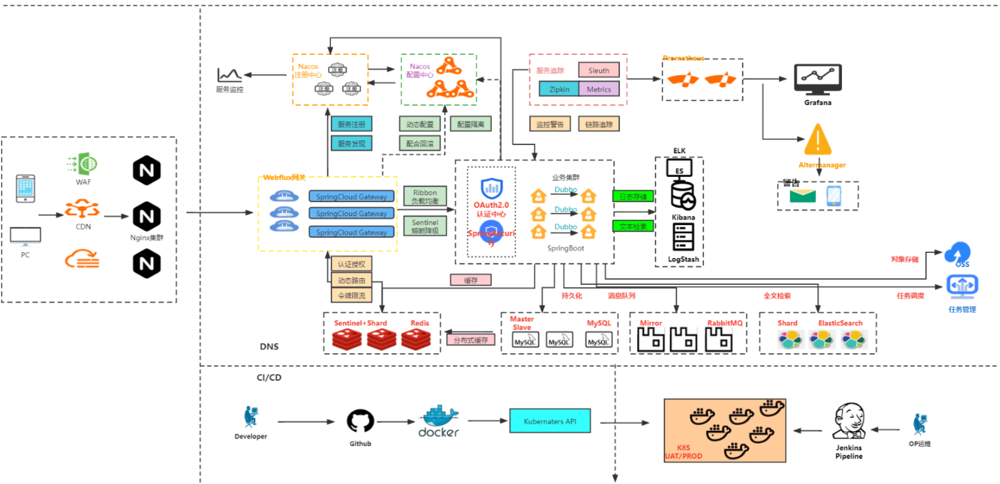
## 01 | 设计秒杀系统注意的4要1不要架构原则

对于一个软件而言而言，你可以很快增删改查做出一个秒杀系统，但是要让它支持高并发访问就没那么容易了。

比如说，如何让系统面对百万级的请求流量不出故障？如何保证高并发情况下数据的一致性写？完全靠堆服务器来解决吗？这显然不是最好的解决方案。

在我看来，秒杀系统本质上就是一个满足大并发、高性能和高可用的分布式系统。今天，我们就来聊聊，如何在满足一个良好架构的分布式系统基础上，针对秒杀这种业务做到极致的性能改进。

### 1. 数据要尽量少

所谓“数据要尽量少”，首先是指用户请求的数据能少就少。请求的数据包括上传给系统的数据和系统返回给用户的数据（通常就是网页）。

为啥“数据要尽量少”呢？因为首先这些数据在网络上传输需要时间，其次不管是请求数据还是返回数据都需要服务器做处理，而服务器在写网络时通常都要做压缩和字符编码，这些都非常消耗 CPU，所以减少传输的数据量可以显著减少 CPU 的使用。

例如，我们可以简化秒杀页面的大小，去掉不必要的页面装修效果，等等。其次，“数据要尽量少”还要求系统依赖的数据能少就少，包括系统完成某些业务逻辑需要读取和保存的数据，这些数据一般是和后台服务以及数据库打交道的。调用其他服务会涉及数据的序列化和反序列化，而这也是 CPU 的一大杀手，同样也会增加延时。而且，数据库本身也容易成为一个瓶颈，所以和数据库打交道越少越好，数据越简单、越小则越好。

### 2. 请求数要尽量少

用户请求的页面返回后，浏览器渲染这个页面还要包含其他的额外请求，比如说，这个页面依赖的 CSS/JavaScript、图片，以及 Ajax 请求等等都定义为“额外请求”，这些额外请求应该尽量少。因为浏览器每发出一个请求都多少会有一些消耗。

例如建立连接要做三次握手，有的时候有页面依赖或者连接数限制，一些请求（例如 JavaScript）还需要串行加载等。另外，如果不同请求的域名不一样的话，还涉及这些域名的 DNS 解析，可能会耗时更久。所以你要记住的是，减少请求数可以显著减少以上这些因素导致的资源消耗。

例如，减少请求数最常用的一个实践就是合并 CSS 和 JavaScript 文件，把多个 JavaScript 文件合并成一个文件，在 URL 中用逗号隔开（https://g.xxx.

### 3. 路径要尽量短

所谓“路径”，就是用户发出请求到返回数据这个过程中，需求经过的中间的节点数。通常，这些节点可以表示为一个系统或者一个新的 Socket 连接（比如代理服务器只是创建一个新的 Socket 连接来转发请求）。每经过一个节点，一般都会产生一个新的 Socket 连接。然而，每增加一个连接都会增加新的不确定性。

从概率统计上来说，假如一次请求经过 5 个节点，每个节点的可用性是 99.9% 的话，那么整个请求的可用性是：99.9% 的 5 次方，约等于 99.5%。所以缩短请求路径不仅可以增加可用性，同样可以有效提升性能（减少中间节点可以减少数据的序列化与反序列化），并减少延时（可以减少网络传输耗时）。

### 4. 依赖要尽量少

所谓依赖，指的是要完成一次用户请求必须依赖的系统或者服务，这里的依赖指的是**强依赖**。

举个例子，比如说你要展示秒杀页面，而这个页面必须强依赖商品信息、用户信息，还有其他如优惠券、成交列表等这些对秒杀不是非要不可的信息（**弱依赖**），这些弱依赖在紧急情况下就可以去掉。

要减少依赖，我们可以给**系统进行分级**，比如 0 级系统、1 级系统、2 级系统、3 级系统，0 级系统如果是最重要的系统，那么 0 级系统强依赖的系统也同样是最重要的系统，以此类推。

注意，0 级系统要尽量减少对 1 级系统的强依赖，防止重要的系统被不重要的系统拖垮。例如支付系统是 0 级系统，而优惠券是 1 级系统的话，在极端情况下可以把优惠券给降级，防止支付系统被优惠券这个 1 级系统给拖垮。

### 5. 不要有单点

系统中的单点可以说是系统架构上的一个大忌，因为单点意味着没有备份，风险不可控，我们设计分布式系统最重要的原则就是“消除单点”。

那如何避免单点呢？我认为关键点是避免将服务的状态和机器绑定，即把服务无状态化，这样服务就可以在机器中随意移动。如何那把服务的状态和机器解耦呢？这里也有很多实现方式。

例如把和机器相关的配置动态化，这些参数可以通过配置中心来动态推送，在服务启动时动态拉取下来，我们在这些配置中心设置一些规则来方便地改变这些映射关系。应用无状态化是有效避免单点的一种方式，但是像存储服务本身很难无状态化，因为数据要存储在磁盘上，本身就要和机器绑定，那么这种场景一般要通过冗余多个备份的方式来解决单点问题。

### 不同场景下的不同架构案例

前面我说了一些架构上的原则，那么针对“秒杀”这个场景，怎样才是一个好的架构呢？下面我以淘宝早期秒杀系统架构的演进为主线，来帮你梳理不同的请求体量下，我认为的最佳秒杀系统架构。

如果你想快速搭建一个简单的秒杀系统，只需要把你的商品购买页面增加一个“定时上架”功能，仅在秒杀开始时才让用户看到购买按钮，当商品的库存卖完了也就结束了。这就是当时第一个版本的秒杀系统实现方式。但随着请求量的加大（比如从 1w/s 到了 10w/s 的量级），这个简单的架构很快就遇到了瓶颈，因此需要做架构改造来提升系统性能。

#### 这些架构改造包括：

把秒杀系统独立出来单独打造一个系统，这样可以有针对性地做优化，例如这个独立出来的系统就减少了店铺装修的功能，减少了页面的复杂度；在系统部署上也独立做一个机器集群，这样秒杀的大流量就不会影响到正常的商品购买集群的机器负载；


然而这个架构仍然支持不了超过 100w/s 的请求量，所以为了进一步提升秒杀系统的性能，我们又对架构做进一步升级，比如：

对页面进行彻底的动静分离，使得用户秒杀时不需要刷新整个页面，而只需要点击抢宝按钮，借此把页面刷新的数据降到最少；在服务端对秒杀商品进行本地缓存，不需要再调用依赖系统的后台服务获取数据，甚至不需要去公共的缓存集群中查询数据，这样不仅可以减少系统调用，而且能够避免压垮公共缓存集群。


从前面的几次升级来看，其实越到后面需要定制的地方越多，也就是越“不通用”。所以要取得极致的性能，就要在其他地方（比如，通用性、易用性、成本等方面）有所牺牲。

## 02 | 做好动静分离？处理缓存命中和失效

### 数据的动静分离

不知道你之前听过这个解决方案吗？

不管你有没有听过，我都建议你先停下来思考动静分离的价值。如果你的系统还没有开始应用动静分离的方案，那你也可以想想为什么没有，是之前没有想到，还是说业务体量根本用不着？

不过我可以确信地说，如果你在一个业务飞速发展的公司里，并且你在深度参与公司内类秒杀类系统的架构或者开发工作，那么你迟早会想到动静分离的方案。为什么？

很简单，秒杀的场景中，**对于系统的要求其实就三个字：快、准、稳。**

那怎么才能“快”起来呢？我觉得抽象起来讲，就只有两点，一点是提高单次请求的效率，一点是减少没必要的请求。今天我们聊到的“动静分离”其实就是瞄着这个大方向去的。不知道你是否还记得，最早的秒杀系统其实是要刷新整体页面的，但后来秒杀的时候，你只要点击“刷新抢宝”按钮就够了，这种变化的本质就是动静分离，分离之后，客户端大幅度减少了请求的数据量。这不自然就“快”了吗？

### 何为动静数据

那到底什么才是动静分离呢？所谓“动静分离”，其实就是把用户请求的数据（如 HTML 页面）划分为“动态数据”和“静态数据”。

简单来说，“动态数据”和“静态数据”的主要区别就是看页面中输出的数据是否和 URL、浏览者、时间、地域相关，以及是否含有 Cookie 等私密数据。比如说：

很多媒体类的网站，某一篇文章的内容不管是你访问还是我访问，它都是一样的。所以它就是一个典型的静态数据，但是它是个动态页面。

我们如果现在访问淘宝的首页，每个人看到的页面可能都是不一样的，淘宝首页中包含了很多根据访问者特征推荐的信息，而这些个性化的数据就可以理解为动态数据了。

这里再强调一下，我们所说的静态数据，不能仅仅理解为传统意义上完全存在磁盘上的 HTML 页面，它也可能是经过 Java 系统产生的页面，但是它输出的页面本身不包含上面所说的那些因素。也就是所谓“动态”还是“静态”，并不是说数据本身是否动静，而是数据中是否含有和访问者相关的个性化数据。

还有一点要注意，就是页面中“不包含”，指的是“页面的 HTML 源码中不含有”，这一点务必要清楚。理解了静态数据和动态数据，我估计你很容易就能想明白“动静分离”这个方案的来龙去脉了。分离了动静数据，我们就可以对分离出来的静态数据做缓存，有了缓存之后，静态数据的“访问效率”自然就提高了。

### 那么，怎样对静态数据做缓存呢？

**我在这里总结了几个重点。**

#### 第一，你应该把静态数据缓存到离用户最近的地方。

静态数据就是那些相对不会变化的数据，因此我们可以把它们缓存起来。缓存到哪里呢？常见的就三种，用户浏览器里、CDN 上或者在服务端的 Cache 中。你应该根据情况，把它们尽量缓存到离用户最近的地方。

#### 第二，静态化改造就是要直接缓存 HTTP 连接。

相较于普通的数据缓存而言，你肯定还听过系统的静态化改造。静态化改造是直接缓存 HTTP 连接而不是仅仅缓存数据，如下图所示，Web 代理服务器根据请求 URL，直接取出对应的 HTTP 响应头和响应体然后直接返回，这个响应过程简单得连 HTTP 协议都不用重新组装，甚至连 HTTP 请求头也不需要解析。


#### 第三，让谁来缓存静态数据也很重要。

不同语言写的 Cache 软件处理缓存数据的效率也各不相同。以 Java 为例，因为 Java 系统本身也有其弱点（比如不擅长处理大量连接请求，每个连接消耗的内存较多，Servlet 容器解析 HTTP 协议较慢），所以你可以不在 Java 层做缓存，而是直接在 Web 服务器层上做，这样你就可以屏蔽 Java 语言层面的一些弱点；

### 如何做动静分离的改造

理解了动静态数据的“why”和“what”，接下来我们就要看“how”了。我们如何把动态页面改造成适合缓存的静态页面呢？其实也很简单，就是去除前面所说的那几个影响因素，把它们单独分离出来，做动静分离。

下面，我以典型的商品详情系统为例来详细介绍。这里，你可以先打开京东或者淘宝的商品详情页，看看这个页面里都有哪些动静数据。

#### 以下 5 个方面来分离出动态内容。

**- URL 唯一化。**商品详情系统天然地就可以做到 URL 唯一化，比如每个商品都由 ID 来标识，那么 http://item.xxx.com/item.htm?id=xxxx就可以作为唯一的 URL 标识。为啥要 URL 唯一呢？前面说了我们是要缓存整个 HTTP 连接，那么以什么作为 Key 呢？就以 URL 作为缓存的 Key，例如以 id=xxx 这个格式进行区分。

**- 分离浏览者相关的因素。**浏览者相关的因素包括是否已登录，以及登录身份等，这些相关因素我们可以单独拆分出来，通过动态请求来获取。

**- 分离时间因素。**服务端输出的时间也通过动态请求获取。

**- 异步化地域因素。**详情页面上与地域相关的因素做成异步方式获取，当然你也可以通过动态请求方式获取，只是这里通过异步获取更合适。

**- 去掉 Cookie。**服务端输出的页面包含的 Cookie 可以通过代码软件来删除，如 Web 服务器 Varnish 可以通过 unset req.http.cookie 命令去掉 Cookie。注意，这里说的去掉 Cookie 并不是用户端收到的页面就不含 Cookie 了，而是说，在缓存的静态数据中不含有 Cookie。

分离出动态内容之后，如何组织这些内容页就变得非常关键了。这里我要提醒你一点，因为这其中很多动态内容都会被页面中的其他模块用到，如判断该用户是否已登录、用户 ID 是否匹配等，所以这个时候我们应该将这些信息 JSON 化（用 JSON 格式组织这些数据），以方便前端获取。

前面我们介绍里用缓存的方式来处理静态数据。而动态内容的处理通常有两种方案：ESI（Edge Side Includes）方案和 CSI（Client Side Include）方案。

**ESI 方案（或者 SSI）：**即在 Web 代理服务器上做动态内容请求，并将请求插入到静态页面中，当用户拿到页面时已经是一个完整的页面了。这种方式对服务端性能有些影响，但是用户体验较好。

**CSI 方案。**即单独发起一个异步 JavaScript 请求，以向服务端获取动态内容。这种方式服务端性能更佳，但是用户端页面可能会延时，体验稍差。

### 动静分离的几种架构方案

前面我们通过改造把静态数据和动态数据做了分离，那么如何在系统架构上进一步对这些动态和静态数据重新组合，再完整地输出给用户呢？这就涉及对用户请求路径进行合理的架构了。根据架构上的复杂度，**有 3 种方案可选：实体机单机部署；统一 Cache 层；上 CDN。**

**方案 1：实体机单机部署**

这种方案是将虚拟机改为实体机，以增大 Cache 的容量，并且采用了一致性 Hash 分组的方式来提升命中率。这里将 Cache 分成若干组，是希望能达到命中率和访问热点的平衡。


**实体机单机部署有以下几个优点：**

没有网络瓶颈，而且能使用大内存；既能提升命中率，又能减少 Gzip 压缩；减少 Cache 失效压力，因为采用定时失效方式，例如只缓存 3 秒钟，过期即自动失效。

这个方案中，虽然把通常只需要虚拟机或者容器运行的 Java 应用换成实体机，优势很明显，它会增加单机的内存容量，但是一定程度上也造成了 CPU 的浪费，因为单个的 Java 进程很难用完整个实体机的 CPU。

另外就是，一个实体机上部署了 Java 应用又作为 Cache 来使用，这造成了运维上的高复杂度，所以这是一个折中的方案。如果你的公司里，没有更多的系统有类似需求，那么这样做也比较合适，如果你们有多个业务系统都有静态化改造的需求，那还是建议把 Cache 层单独抽出来公用比较合理，如下面的方案 2 所示。

**方案 2：统一 Cache 层**

所谓统一 Cache 层，就是将单机的 Cache 统一分离出来，形成一个单独的 Cache 集群。统一 Cache 层是个更理想的可推广方案，该方案的结构图如下：


将 Cache 层单独拿出来统一管理可以减少运维成本，同时也方便接入其他静态化系统。此外，它还有一些优点。

单独一个 Cache 层，可以减少多个应用接入时使用 Cache 的成本。这样接入的应用只要维护自己的 Java 系统就好，不需要单独维护 Cache，而只关心如何使用即可统一 Cache 的方案更易于维护，如后面加强监控、配置的自动化，只需要一套解决方案就行，统一起来维护升级也比较方便。可以共享内存，最大化利用内存，不同系统之间的内存可以动态切换，从而能够有效应对各种攻击。

**这种方案虽然维护上更方便了，但是也带来了其他一些问题，比如缓存更加集中，导致：**

Cache 层内部交换网络成为瓶颈；缓存服务器的网卡也会是瓶颈；机器少风险较大，挂掉一台就会影响很大一部分缓存数据。

要解决上面这些问题，可以再对 Cache 做 Hash 分组，即一组 Cache 缓存的内容相同，这样能够避免热点数据过度集中导致新的瓶颈产生。

**方案 3：上 CDN**

在将整个系统做动静分离后，我们自然会想到更进一步的方案，就是将 Cache 进一步前移到 CDN 上，因为 CDN 离用户最近，效果会更好。

但是要想这么做，**有以下几个问题需要解决。**

**失效问题。**前面我们也有提到过缓存时效的问题，不知道你有没有理解，我再来解释一下。谈到静态数据时，我说过一个关键词叫“相对不变”，它的言外之意是“可能会变化”。比如一篇文章，现在不变，但如果你发现个错别字，是不是就会变化了？如果你的缓存时效很长，那用户端在很长一段时间内看到的都是错的。所以，这个方案中也是，我们需要保证 CDN 可以在秒级时间内，让分布在全国各地的 Cache 同时失效，这对 CDN 的失效系统要求很高。

**命中率问题。**Cache 最重要的一个衡量指标就是“高命中率”，不然 Cache 的存在就失去了意义。同样，如果将数据全部放到全国的 CDN 上，必然导致 Cache 分散，而 Cache 分散又会导致访问请求命中同一个 Cache 的可能性降低，那么命中率就成为一个问题。

**发布更新问题**。如果一个业务系统每周都有日常业务需要发布，那么发布系统必须足够简洁高效，而且你还要考虑有问题时快速回滚和排查问题的简便性。

从前面的分析来看，将商品详情系统放到全国的所有 CDN 节点上是不太现实的，因为存在失效问题、命中率问题以及系统的发布更新问题。那么是否可以选择若干个节点来尝试实施呢？答案是“可以”，但是这样的节点\*需要满足几个条件： \*靠近访问量比较集中的地区；离主站相对较远；节点到主站间的网络比较好，而且稳定；节点容量比较大，不会占用其他 CDN 太多的资源。

最后，还有一点也很重要，那就是：**节点不要太多**。基于上面几个因素，选择 CDN 的二级 Cache 比较合适，因为二级 Cache 数量偏少，容量也更大，让用户的请求先回源的 CDN 的二级 Cache 中，如果没命中再回源站获取数据部署方式如下图所示：

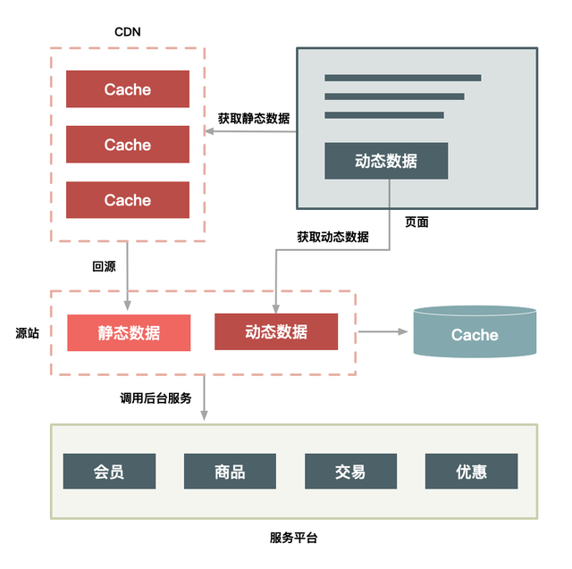

这三种动静分离方案各有优缺点，一般选择哪种取决于具体的应用场景和需求，以下是详细介绍：

#### 实体机单机部署

* **优点**：
  * **无网络瓶颈**：数据传输无需经过复杂的网络环境，能充分利用机器的大内存，提升数据处理速度。
  * **命中率高**：通过一致性Hash分组，可有效提升缓存命中率，减少对后端数据库的访问压力。
  * **减少Gzip压缩**：在本地进行数据处理，无需频繁进行网络传输中的Gzip压缩操作，进一步提高效率。
  * **缓存失效压力小**：采用定时失效方式，如只缓存3秒钟，过期自动失效，减少了缓存失效的复杂操作。
* **缺点**：
  * **CPU资源浪费**：单个Java进程很难用完整个实体机的CPU，造成了一定的CPU资源浪费。
  * **运维复杂**：一台机器上既要部署Java应用，又要作为缓存服务器，增加了运维的复杂度。

#### 统一Cache层

* **优点**：
  * **运维成本低**：将缓存层单独分离出来统一管理，只需一套解决方案，方便对缓存进行监控、配置自动化等维护升级操作。
  * **接入成本低**：其他应用接入时，只需维护自己的Java系统，不关心缓存，降低了接入成本。
  * **内存利用率高**：不同系统之间可以共享内存，实现内存的动态切换，有效应对各种攻击。
* **缺点**：
  * **网络瓶颈**：Cache层内部交换网络及缓存服务器的网卡容易成为瓶颈，影响数据传输效率。
  * **风险集中**：机器数量较少，一旦挂掉一台，就会导致很大一部分缓存数据受到影响。

#### 上CDN层

* **优点**：
  * **地理分布广**：CDN节点在地理上分散，用户可以就近访问内容资源，大大缩短了数据传输距离，使静态内容能够更快地到达用户端，提高访问速度。
  * **命中率高**：使用CDN的二级缓存，由于二级缓存节点数更少、容量更大，能够保持较高的命中率。
  * **缓存更新方便**：在CDN上方便进行主动失效、缓存更新等操作，确保用户获取到最新的静态内容。
* **缺点**：
  * **缓存失效问题**：静态数据可能会发生变化，需要保证CDN在秒级内，让分布在各地的缓存同时失效，否则用户可能会获取到旧的内容。

一般来说，对于访问量大、对静态内容加载速度要求高的网站或应用，如大型电商网站、视频网站等，**上CDN**是较好的选择，因为它能有效利用CDN的分布式节点优势，快速分发静态内容，提升用户体验。而对于一些对数据安全性和隐私性要求较高，且访问量相对较小的内部系统或企业应用，可能会更倾向于选择**实体机单机部署**，以确保数据的可控性和安全性。

使用 CDN 的二级 Cache 作为缓存，可以达到和当前服务端静态化 Cache 类似的命中率，因为节点数不多，Cache 不是很分散，访问量也比较集中，这样也就解决了命中率问题，同时能够给用户最好的访问体验，是当前比较理想的一种 CDN 化方案。

除此之外，CDN 化部署方案还有以下几个特点：

把整个页面缓存在用户浏览器中；如果强制刷新整个页面，也会请求 CDN；

所以“抢宝”这种设计思路，让我们不用刷新页面就能够很好地请求到服务端最新的动态数据。

### 解决CDN缓存失效策略：

#### 1. 配置缓存刷新

配置缓存刷新是最直接的方法，适用于需要立即刷新的场景。CDN服务商通常提供多种刷新方式，包括目录刷新和URL刷新。

* **目录刷新**：适用于更新整个目录下的所有文件。操作步骤如下：
  1. 登录CDN控制台。
  2. 选择需要刷新的域名。
  3. 点击“缓存刷新”，选择“目录刷新”。
  4. 输入需要刷新的目录路径，点击“确认”即可。
* **URL刷新**：适用于更新特定的文件。操作步骤如下：
  1. 登录CDN控制台。
  2. 选择需要刷新的域名。
  3. 点击“缓存刷新”，选择“URL刷新”。
  4. 输入需要刷新的URL，点击“确认”即可。

#### 2. 利用API接口

对于有编程能力的团队，使用API接口自动刷新缓存是一个更灵活高效的方法。CDN服务商通常提供丰富的API接口，支持缓存刷新、预热等操作。

* **获取API凭证**：首先，您需要获取CDN API的访问凭证，包括SecretId和SecretKey。这些凭证可以在CDN控制台的“访问管理”中获取。
* **编写刷新脚本**：根据您的需求，编写一个脚本来调用CDN的缓存刷新API。以下是我之前写过的一份刷新API的代码：

```java
import java.io.UnsupportedEncodingException;
import java.net.URLEncoder;
import java.nio.charset.StandardCharsets;
import java.security.MessageDigest;
import java.security.NoSuchAlgorithmException;
import java.util.ArrayList;
import java.util.Collections;
import java.util.List;
import java.util.Map;
import java.util.TreeMap;
import org.apache.http.NameValuePair;
import org.apache.http.message.BasicNameValuePair;
import org.apache.http.client.utils.URLEncodedUtils;
import javax.crypto.Mac;
import javax.crypto.spec.SecretKeySpec;
/**
 * @Auth:TianMing
 * @Description： 调用CDN缓存刷新API
 */
public class CDNRefresh {
    public static String getSignature(String secretKey, Map params) throws NoSuchAlgorithmException, UnsupportedEncodingException {
        // 对参数进行排序
        TreeMap sortedParams = new TreeMap<>(params);
        StringBuilder encodedParams = new StringBuilder();
        for (Map.Entry entry : sortedParams.entrySet()) {
            encodedParams.append(entry.getKey()).append("=").append(URLEncoder.encode(entry.getValue(), StandardCharsets.UTF_8.name()));
            encodedParams.append("&");
        }
        // 去掉最后一个&
        encodedParams.deleteCharAt(encodedParams.length() - 1);
        // 使用HmacSHA1算法生成签名
        Mac sha1Hmac = Mac.getInstance("HmacSHA1");
        SecretKeySpec secretKeySpec = new SecretKeySpec(secretKey.getBytes(StandardCharsets.UTF_8), "HmacSHA1");
        sha1Hmac.init(secretKeySpec);
        byte[] hash = sha1Hmac.doFinal(encodedParams.toString().getBytes(StandardCharsets.UTF_8));
        StringBuilder signature = new StringBuilder();
        for (byte b : hash) {
            String hex = Integer.toHexString((b & 0xFF) | 0x100).substring(1, 3);
            signature.append(hex);
        }
        return signature.toString();
    }
    //构建请求URL。将参数和签名添加到请求URL中
    public static String refreshCache(String secretId, String secretKey, String urls) throws NoSuchAlgorithmException, UnsupportedEncodingException {
        String base_url = "https://cdn.api.qcloud.com/v2/index.php";
        Map params = new TreeMap<>();
        params.put("Action", "RefreshCdnUrl");
        params.put("SecretId", secretId);
        params.put("Timestamp", String.valueOf(System.currentTimeMillis() / 1000));
        params.put("Nonce", String.valueOf(System.currentTimeMillis()));
        params.put("urls.0", urls);
        // 获取签名
        String signature = getSignature(secretKey, params);
        params.put("Signature", signature);
        // 构建请求URL
        List nameValuePairs = new ArrayList<>();
        for (Map.Entry entry : params.entrySet()) {
            nameValuePairs.add(new BasicNameValuePair(entry.getKey(), entry.getValue()));
        }
        String requestUrl = base_url + "?" + URLEncodedUtils.format(nameValuePairs, StandardCharsets.UTF_8);
        // 发送GET请求
        // 例如使用Apache HttpClient发送请求
        // CloseableHttpClient httpClient = HttpClients.createDefault();
        // HttpGet httpget = new HttpGet(requestUrl);
        // CloseableHttpResponse response = httpClient.execute(httpget);
        // try {
        //     // 处理响应
        // } finally {
        //     response.close();
        // }
        return requestUrl;
    }
    public static void main(String[] args) {
        try {
            String secretId = "TiMi_SecretId";
            String secretKey = "TiMi_SecretKey";
            String urls = "https://tuling.com/path/to/your/file";
            String requestUrl = refreshCache(secretId, secretKey, urls);
            //真实场景记录异步日志
            System.out.println(requestUrl);
            //捕获异常，确保在运行时不会因为这些异常而导致程序崩溃。
        } catch (NoSuchAlgorithmException | UnsupportedEncodingException e) {
            e.printStackTrace();
        }
    }
}
```

#### 3. 定期策略刷新

对于内容更新频繁的网站，可以通过定期策略刷新缓存来保证内容的及时性。这种方法适用于大部分资源都需要定期更新的场景。

* **设置缓存规则**：在CDN控制台，可以为不同类型的文件设置不同的缓存过期时间。例如，图片、CSS、JS文件可以设置较长的缓存时间，而HTML文件可以设置较短的缓存时间。具体操作步骤如下：
  1. 登录CDN控制台。
  2. 选择需要设置缓存规则的域名。
  3. 点击“缓存配置”，选择“缓存规则”。
  4. 根据文件类型设置不同的缓存过期时间，点击“确认”即可。

#### 4. 合理设置HTTP缓存头

通过调整HTTP缓存头，可以更精细地控制缓存行为，确保用户获取到最新内容。

* **合理配置Cache-Control**：根据实际需求设置合适的Cache-Control指令，如`max-age`、`no-cache`、`public`等，以控制CDN和浏览器的缓存行为。
* **利用ETag和Last-Modified**：通过ETag和Last-Modified头部信息，可以进一步优化缓存策略，确保客户端获取到最新内容。

#### 5. 版本控制

当静态资源更新时，更改文件名或版本号，确保用户总是获取最新版本的资源，避免浏览器缓存旧版本资源。

#### 6. 监控和日志分析

利用CDN提供商的监控和日志功能，实时了解CDN性能表现，及时发现并解决潜在问题，优化服务质量。

通过以上方法，可以有效解决CDN缓存失效问题，提高网站性能和用户体验。

## 03 | 二八原则：处理好系统的“热点数据”

### 什么是“热点”

热点分为**热点操作和热点数据**。所谓“热点操作”，例如大量的刷新页面、大量的添加购物车、双十一零点大量的下单等都属于此类操作。对系统来说，这些操作可以抽象为“读请求”和“写请求”，这两种热点请求的处理方式大相径庭，读请求的优化空间要大一些，而写请求的瓶颈一般都在存储层，优化的思路就是根据 CAP 理论做平衡，这个内容我在“减库存”一文再详细介绍。

而“热点数据”比较好理解，那就是用户的热点请求对应的数据。而热点数据又分为“静态热点数据”和“动态热点数据”

所谓“**静态热点数据**”，就是能够提前预测的热点数据。另外，我们还可以通过大数据分析来提前发现热点商品，比如我们分析历史成交记录、用户的购物车记录，来发现哪些商品可能更热门、更好卖，这些都是可以提前分析出来的热点。

所谓“**动态热点数据**”，就是不能被提前预测到的，系统在运行过程中临时产生的热点。由于热点操作是用户的行为，我们不好改变，但能做一些限制和保护，所以本文我主要针对热点数据来介绍如何进行优化。

### 发现热点数据

前面，我介绍了如何对单个秒杀商品的页面数据进行动静分离，以便针对性地对静态数据做优化处理，那么另外一个关键的问题来了：

如何发现这些秒杀商品，或者更准确地说，如何发现热点商品呢？

你可能会说“参加秒杀的商品就是秒杀商品啊”，没错，关键是系统怎么知道哪些商品参加了秒杀活动呢？所以，你要有一个机制提前来区分普通商品和秒杀商品。

我们从发现静态热点和发现动态热点两个方面来看一下。

**发现静态热点数据**

如前面讲的，静态热点数据可以通过商业手段，例如强制让卖家通过报名参加的方式提前把热点商品筛选出来，实现方式是通过一个运营系统，把参加活动的商品数据进行打标，然后通过一个后台系统对这些热点商品进行预处理，如提前进行缓存。但是这种通过报名提前筛选的方式也会带来新的问题，即增加卖家的使用成本，而且实时性较差，也不太灵活。

**发现动态热点数据**

我们可以通过卖家报名或者大数据预测这些手段来提前预测静态热点数据，但这其中有一个痛点，就是实时性较差，如果我们的系统能在秒级内自动发现热点商品那就完美了。能够动态地实时发现热点不仅对秒杀商品，对其他热卖商品也同样有价值，所以我们需要想办法实现热点的动态发现功能。

### 动态热点发现系统的具体实现

1、构建一个异步的系统，它可以收集交易链路上各个环节中的中间件产品的热点 Key，如 Nginx、缓存、RPC 服务框架等这些中间件（一些中间件产品本身已经有热点统计模块）。

2、建立一个热点上报和可以按照需求订阅的热点服务的下发规范，主要目的是通过交易链路上各个系统（包括详情、购物车、交易、优惠、库存、物流等）访问的时间差，把上游已经发现的热点透传给下游系统，提前做好保护。比如，对于大促高峰期，详情系统是最早知道的，在统一接入层上 Nginx 模块统计的热点 URL。

3、将上游系统收集的热点数据发送到热点服务台，然后下游系统（如交易系统）就会知道哪些商品会被频繁调用，然后做热点保护。

这里我给出了一个图，其中用户访问商品时经过的路径有很多，我们主要是依赖前面的导购页面（包括首页、搜索页面、商品详情、购物车等）提前识别哪些商品的访问量高，通过这些系统中的中间件来收集热点数据，并记录到日志中。

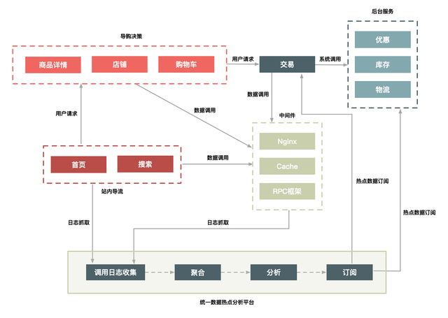

我们通过部署在每台机器上的 Agent 把日志汇总到聚合和分析集群中，然后把符合一定规则的热点数据，通过订阅分发系统再推送到相应的系统中。你可以是把热点数据填充到 Cache 中，或者直接推送到应用服务器的内存中，还可以对这些数据进行拦截，总之下游系统可以订阅这些数据，然后根据自己的需求决定如何处理这些数据。

打造热点发现系统时，我根据以往经验总结了

### 几点注意事项

1、这个热点服务后台抓取热点数据日志最好采用异步方式，因为“异步”一方面便于保证通用性，另一方面又不影响业务系统和中间件产品的主流程。

2、热点服务发现和中间件自身的热点保护模块并存，每个中间件和应用还需要保护自己。热点服务台提供热点数据的收集和订阅服务，便于把各个系统的热点数据透明出来。

3、热点发现要做到接近实时（3s 内完成热点数据的发现），因为只有做到接近实时，动态发现才有意义，才能实时地对下游系统提供保护。

### 处理热点数据

处理热点数据通常有几种思路：**一是优化，二是限制，三是隔离。**先来说说优化。优化热点数据最有效的办法就是缓存热点数据，如果热点数据做了动静分离，那么可以长期缓存静态数据。但是，缓存热点数据更多的是“临时”缓存，即不管是静态数据还是动态数据，都用一个队列短暂地缓存数秒钟，由于队列长度有限，可以采用 LRU 淘汰算法替换。

再来说说限制。限制更多的是一种保护机制，限制的办法也有很多，例如对被访问商品的 ID 做一致性 Hash，然后根据 Hash 做分桶，每个分桶设置一个处理队列，这样可以把热点商品限制在一个请求队列里，防止因某些热点商品占用太多的服务器资源，而使其他请求始终得不到服务器的处理资源。

最后介绍一下隔离。秒杀系统设计的第一个原则就是将这种热点数据隔离出来，不要让 1% 的请求影响到另外的 99%，隔离出来后也更方便对这 1% 的请求做针对性的优化。

具体到“秒杀”业务，我们可以在以下几个层次实现隔离。

**业务隔离**。把秒杀做成一种营销活动，卖家要参加秒杀这种营销活动需要单独报名，从技术上来说，卖家报名后对我们来说就有了已知热点，因此可以提前做好预热。

**系统隔离。**系统隔离更多的是运行时的隔离，可以通过分组部署的方式和另外 99% 分开。秒杀可以申请单独的域名，目的也是让请求落到不同的集群中。

**数据隔离。**秒杀所调用的数据大部分都是热点数据，比如会启用单独的 Cache 集群或者 MySQL 数据库来放热点数据，目的也是不想 0.01% 的数据有机会影响 99.99% 数据。

## 04 | 流量削峰这事应该怎么做？

### 为什么要削峰？

我们知道服务器的处理资源是恒定的，你用或者不用它的处理能力都是一样的，所以出现峰值的话，很容易导致忙到处理不过来，闲的时候却又没有什么要处理。但是由于要保证服务质量，我们的很多处理资源只能按照忙的时候来预估，而这会导致资源的一个浪费。

这就好比因为存在早高峰和晚高峰的问题，所以有了错峰限行的解决方案。削峰的存在，一是可以让服务端处理变得更加平稳，二是可以节省服务器的资源成本。针对秒杀这一场景，削峰从本质上来说就是更多地延缓用户请求的发出，以便减少和过滤掉一些无效请求，它遵从“请求数要尽量少”的原则。

今天，我就来介绍一下流量削峰的一些操作思路：**排队、答题、分层过滤**。这几种方式都是无损（即不会损失用户的发出请求）的实现方案，当然还有些有损的实现方案，包括我们后面要介绍的关于稳定性的一些办法，比如限流和机器负载保护等一些强制措施也能达到削峰保护的目的，当然这都是不得已的一些措施，因此就不归类到这里了

排队要对流量进行削峰，最容易想到的解决方案就是用消息队列来缓冲瞬时流量，把同步的直接调用转换成异步的间接推送，中间通过一个队列在一端承接瞬时的流量洪峰，在另一端平滑地将消息推送出去。在这里，消息队列就像“水库”一样， 拦蓄上游的洪水，削减进入下游河道的洪峰流量，从而达到减免洪水灾害的目的。用消息队列来缓冲瞬时流量的方案，如下图所示：


但是，如果流量峰值持续一段时间达到了消息队列的处理上限，例如本机的消息积压达到了存储空间的上限，消息队列同样也会被压垮，这样虽然保护了下游的系统，但是和直接把请求丢弃也没多大的区别。就像遇到洪水爆发时，即使是有水库恐怕也无济于事

除了消息队列，类似的排队方式还有很多，例如：

1、利用线程池加锁等待也是一种常用的排队方式；

2、先进先出、先进后出等常用的内存排队算法的实现方式；

3、把请求序列化到文件中，然后再顺序地读文件（例如基于 MySQL binlog 的同步机制）来恢复请求等方式。

你是否还记得，最早期的秒杀只是纯粹地刷新页面和点击购买按钮，它是后来才增加了答题，前端还做了js控制等功能。那么，为什么要增加答题功能呢？

这主要是为了增加请求前拦截方式，提高购买的复杂度，从而达到两个目的。

**第一个目的**是防止部分买家使用秒杀器在参加秒杀时作弊。2011 年秒杀非常火的时候，秒杀器也比较猖獗，因而没有达到全民参与和营销的目的，所以系统增加了答题来限制秒杀器。增加答题后，下单的时间基本控制在 2s 后，秒杀器的下单比例也大大下降。答题页面如下图所示。


**第二个目的**其实就是延缓请求，起到对请求流量进行削峰的作用，从而让系统能够更好地支持瞬时的流量高峰。这个重要的功能就是把峰值的下单请求拉长，从以前的 1s 之内延长到 2s~10s。这样一来，请求峰值基于时间分片了。这个时间的分片对服务端处理并发非常重要，会大大减轻压力。而且，由于请求具有先后顺序，靠后的请求到来时自然也就没有库存了，因此根本到不了最后的下单步骤，所以真正的并发写就非常有限了。这种设计思路目前用得非常普遍，如当年支付宝的“咻一咻”、微信的“摇一摇”都是类似的方式。

这里，我重点说一下秒杀答题的设计思路。


如上图所示，整个秒杀答题的逻辑主要分为 3 部分。

**题库生成模块**，这个部分主要就是生成一个个问题和答案，其实题目和答案本身并不需要很复杂，重要的是能够防止由机器来算出结果，即防止秒杀器来答题。**题库的推送模块**，用于在秒杀答题前，把题目提前推送给详情系统和交易系统。题库的推送主要是为了保证每次用户请求的题目是唯一的，目的也是防止答题作弊。**题目的图片生成模块**，用于把题目生成为图片格式，并且在图片里增加一些干扰因素。这也同样是为防止机器直接来答题，它要求只有人才能理解题目本身的含义。这里还要注意一点，由于答题时网络比较拥挤，我们应该把题目的图片提前推送到 CDN 上并且要进行预热，不然的话当用户真正请求题目时，图片可能加载比较慢，从而影响答题的体验。

其实真正答题的逻辑比较简单，很好理解：当用户提交的答案和题目对应的答案做比较，如果通过了就继续进行下一步的下单逻辑，否则就失败。我们可以把问题和答案用下面这样的 key 来进行 MD5 加密：

**问题 key**：userId+itemId+question\_Id+time+PK**答案 key**：userId+itemId+answer+PK

验证的逻辑如下图所示：

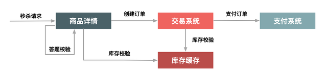

注意，这里面的验证逻辑，除了验证问题的答案以外，还包括用户本身身份的验证，例如是否已经登录、用户的 Cookie 是否完整、用户是否重复频繁提交等。除了做正确性验证，我们还可以对提交答案的时间做些限制，例如从开始答题到接受答案要超过 1s，因为小于 1s 是人为操作的可能性很小，这样也能防止机器答题的情况。

### 分层过滤拦截

前面介绍的排队和答题要么是少发请求，要么对发出来的请求进行缓冲，而针对秒杀场景还有一种方法，就是对请求进行分层过滤拦截，从而过滤掉拦截一些无效的请求。分层过滤其实就是采用“漏斗”式设计来处理请求的，如下图所示。


假如请求分别经过 CDN、前台读系统（如商品详情系统）、后台系统（如交易系统）和数据库这几层，那么：

大部分数据和流量在用户浏览器或者 CDN 上获取，这一层可以拦截大部分数据的读取；经过第二层（即前台系统）时数据（包括强一致性的数据）尽量得走 Cache，过滤一些无效的请求；再到第三层后台系统，主要做数据的二次检验，对系统做好保护和限流，这样数据量和请求就进一步减少；最后在数据层完成数据的强一致性校验。

这样就像漏斗一样，尽量把数据量和请求量一层一层地过滤和减少了。

### 分层过滤拦截的核心思想是：

在不同的层次尽可能地过滤掉无效请求，让“漏斗”最末端的才是有效请求。而要达到这种效果，我们就必须对数据做分层的校验。

分层校验的基本原则是：

将动态请求的读数据缓存（Cache）在 Web 端，过滤掉无效的数据读；对读数据不做强一致性校验，减少因为一致性校验产生瓶颈的问题；对写数据进行基于时间的合理分片，过滤掉过期的失效请求；对写请求做限流保护，将超出系统承载能力的请求过滤掉；对写数据进行强一致性校验，只保留最后有效的数据。

## 05 | 影响性能的因素？如何提高系统的性能？

### 影响性能的因素

那么，哪些因素对性能有影响呢？

在回答这个问题之前，我们先定义一下“性能”，服务设备不同对性能的定义也是不一样的，例如 CPU 主要看主频、磁盘主要看 IOPS（Input/Output Operations Per Second，即每秒进行读写操作的次数）。

而今天我们讨论的主要是系统服务端性能，一般用 QPS（Query Per Second，每秒请求数）来衡量，还有一个影响和 QPS 也息息相关，那就是响应时间（Response Time，RT），它可以理解为服务器处理响应的耗时。

正常情况下响应时间（RT）越短，一秒钟处理的请求数（QPS）自然也就会越多，这在单线程处理的情况下看起来是线性的关系，即我们只要把每个请求的响应时间降到最低，那么性能就会最高。

但是你可能想到响应时间总有一个极限，不可能无限下降，所以又出现了另外一个维度，即通过多线程，来处理请求。这样理论上就变成了“总 QPS =（1000ms / 响应时间）× 线程数量”，这样性能就和两个因素相关了，一个是一次响应的服务端耗时，一个是处理请求的线程数。

首先，我们先来看看响应时间和 QPS 有啥关系。

对于大部分的 Web 系统而言，响应时间一般都是由 CPU 执行时间和线程等待时间（比如 RPC、IO 等待、Sleep、Wait 等）组成，即服务器在处理一个请求时，一部分是 CPU 本身在做运算，还有一部分是在各种等待。

如果代理服务器本身没有 CPU 消耗，我们在每次给代理服务器代理的请求加个延时，即增加响应时间，但是这对代理服务器本身的吞吐量并没有多大的影响，因为代理服务器本身的资源并没有被消耗，可以通过增加代理服务器的处理线程数，来弥补响应时间对代理服务器的 QPS 的影响。

其实，真正对性能有影响的是 CPU 的执行时间。这也很好理解，因为 CPU 的执行真正消耗了服务器的资源。经过实际的测试，如果减少 CPU 一半的执行时间，就可以增加一倍的 QPS。

也就是说，我们应该致力于减少 CPU 的执行时间。

其次，我们再来看看线程数对 QPS 的影响。

单看“总 QPS”的计算公式，你会觉得线程数越多 QPS 也就会越高，但这会一直正确吗？显然不是，线程数不是越多越好，因为线程本身也消耗资源，也受到其他因素的制约。

那么，设置什么样的线程数最合理呢？其实很多多线程的场景都有一个默认配置，即“线程数 = 2 \* CPU 核数 + 1”。除去这个配置，还有一个根据最佳实践得出来的公式：

线程数 = \[(线程等待时间 + 线程 CPU 时间) / 线程 CPU 时间] × CPU 数量

当然，最好的办法是通过性能测试来发现最佳的线程数。现在，你知道了如何来快速提升性能，那接下来你估计会问，我应该怎么发现系统哪里最消耗 CPU 资源呢？

如何发现瓶颈

就服务器而言，会出现瓶颈的地方有很多，例如 CPU、内存、磁盘以及网络等都可能会导致瓶颈。此外，不同的系统对瓶颈的关注度也不一样，例如对缓存系统而言，制约它的是内存，而对存储型系统来说 I/O 更容易是瓶颈。

我们定位的场景是秒杀，它的瓶颈更多地发生在 CPU 上。

怎样简单地判断 CPU 是不是瓶颈呢？一个办法就是看当 QPS 达到极限时，你的服务器的 CPU 使用率是不是超过了 95%，如果没有超过，那么表示 CPU 还有提升的空间，要么是有锁限制，要么是有过多的本地 I/O 等待发生。

### 如何优化系统

对 Java 系统来说，可以优化的地方很多，这里我重点说一下比较有效的几种手段，供你参考，它们是：**减少编码、减少序列化、Java 极致优化、并发读优化、多活架构**。接下来，我们分别来看一下。

#### 1. 减少编码

Java 的编码运行比较慢，这是 Java 的一大硬伤。在很多场景下，只要涉及字符串的操作（如输入输出操作、I/O 操作）都比较耗 CPU 资源，不管它是磁盘 I/O 还是网络 I/O，因为都需要将字符转换成字节，而这个转换必须编码。每个字符的编码都需要查表，而这种查表的操作非常耗资源，所以减少字符到字节或者相反的转换、减少字符编码会非常有成效。减少编码就可以大大提升性能

#### 2. 减少序列化

序列化也是 Java 性能的一大天敌，减少 Java 中的序列化操作也能大大提升性能。又因为序列化往往是和编码同时发生的，所以减少序列化也就减少了编码。

序列化大部分是在 RPC 中发生的，因此避免或者减少 RPC 就可以减少序列化，当然当前的序列化协议也已经做了很多优化来提升性能。有一种新的方案，就是可以将多个关联性比较强的应用进行“合并部署”，而减少不同应用之间的 RPC 也可以减少序列化的消耗。

所谓“合并部署”，就是把两个原本在不同机器上的不同应用合并部署到一台机器上，当然不仅仅是部署在一台机器上，还要在同一个 Tomcat 容器中，且不能走本机的 Socket，这样才能避免序列化的产生。

另外针对秒杀场景，我们还可以做得更极致一些，接下来我们来看第 3 点：Java 极致优化。

#### 3. Java 极致优化

Java 和通用的 Web 服务器（如 Nginx 或 Apache 服务器）相比，在处理大并发的 HTTP 请求时要弱一点，所以一般我们都会对大流量的 Web 系统做静态化改造，让大部分请求和数据直接在 Nginx 服务器或者 Web 代理服务器（如 Varnish、Squid 等）上直接返回（这样可以减少数据的序列化与反序列化），而 Java 层只需处理少量数据的动态请求。针对这些请求，我们可以使用以下手段进行优化：

1、直接使用 Servlet 处理请求。避免使用传统的 MVC 框架，这样可以绕过一大堆复杂且用处不大的处理逻辑，节省 1ms 时间（具体取决于你对 MVC 框架的依赖程度）2、直接输出流数据。

#### 4. 并发读优化

也许有读者会觉得这个问题很容易解决，无非就是放到 Tair 缓存里面。集中式缓存为了保证命中率一般都会采用一致性 Hash，所以同一个 key 会落到同一台机器上。虽然单台缓存机器也能支撑 30w/s 的请求，但还是远不足以应对像“大秒”这种级别的热点商品。那么，该如何彻底解决单点的瓶颈呢？

答案是采用应用层的 LocalCache，即在秒杀系统的单机上缓存商品相关的数据。

那么，又如何缓存（Cache）数据呢？你需要划分成动态数据和静态数据分别进行处理：

1、像商品中的“标题”和“描述”这些本身不变的数据，会在秒杀开始之前全量推送到秒杀机器上，并一直缓存到秒杀结束；

2、像库存这类动态数据，会采用“被动失效”的方式缓存一定时间（一般是数秒），失效后再去缓存拉取最新的数据。

#### 5. 多活架构

可选多活架构：同城双活-双机房和异地多活-两地三中心。这两种架构都是用于提高系统的可用性和容错能力，确保在某个机房或数据中心发生故障时，系统仍能继续提供服务。

同城双活-双机房

* 定义：两个机房部署在同一城市，物理距离较近，通过专线网络连接。
* 特点：
  * 由于物理距离较近，专线连接的延迟相对较小，通常在1ms以内（100公里内）。
  * 比单个机房内的延迟（0.1ms）稍大，但整体延迟是可以接受的。
* 优点：
  * 提高系统的可用性和容错能力，即使一个机房发生故障，另一个机房仍能继续提供服务。
  * 专线连接保证了数据传输的稳定性和安全性。
* 参考延迟：
  * 同机房：0.1ms
  * 同城双机房：1ms（100公里内）
  * 北京到广州：55ms

异地多活-两地三中心

* 定义：两个城市，三个机房，其中两个机房在同一个城市，第三个机房部署在异地，只做数据灾备。
* 特点：
  * 两个机房在同一个城市，可以同时提供服务，提高系统的可用性。
  * 第三个机房部署在异地，主要用于数据灾备，确保在极端情况下数据的安全性。
* 优点：
  * 提高系统的容错能力和数据安全性，即使两个机房同时发生故障，异地的第三个机房仍能保证数据的安全。
  * 通过异地灾备，可以减少数据丢失的风险，提高数据的可靠性。
* 部署策略：
  * 两个机房在同一个城市，可以同时提供服务，提高系统的可用性。
  * 第三个机房部署在异地，主要用于数据灾备，确保在极端情况下数据的安全性。

这两种多活架构都是为了提高系统的可用性和容错能力，但它们的部署方式和侧重点有所不同。同城双活-双机房更侧重于提高系统的可用性，而异地多活-两地三中心则更侧重于数据的安全性和可靠性。

## 06 | 秒杀系统“减库存”设计的核心逻辑

大前提在于业务是否允许超卖，通常电商产品都不做处理，部分是做补偿性处理，但也有部分需要强一致不允许超卖。

### 减库存有哪几种方式

在正常的电商平台购物场景中，用户的实际购买过程一般分为两步：下单和付款。你想买一台 iPhone 手机，在商品页面点了“立即购买”按钮，核对信息之后点击“提交订单”，这一步称为下单操作。下单之后，你只有真正完成付款操作才能算真正购买，也就是俗话说的“落袋为安”。

那如果你是架构师，你会在哪个环节完成减库存的操作呢？总结来说，减库存操作一般有如下几个方式：

**下单减库存，**即当买家下单后，在商品的总库存中减去买家购买数量。下单减库存是最简单的减库存方式，也是控制最精确的一种，下单时直接通过数据库的事务机制控制商品库存，这样一定不会出现超卖的情况。但是你要知道，有些人下完单可能并不会付款。**付款减库存，**即买家下单后，并不立即减库存，而是等到有用户付款后才真正减库存，否则库存一直保留给其他买家。但因为付款时才减库存，如果并发比较高，有可能出现买家下单后付不了款的情况，因为可能商品已经被其他人买走了**预扣库存，**这种方式相对复杂一些，买家下单后，库存为其保留一定的时间（如 10 分钟），超过这个时间，库存将会自动释放，释放后其他买家就可以继续购买。在买家付款前，系统会校验该订单的库存是否还有保留：如果没有保留，则再次尝试预扣；如果库存不足（也就是预扣失败）则不允许继续付款；如果预扣成功，则完成付款并实际地减去库存。

**以上这几种减库存的方式都会存在一些问题，下面我们一起来看下。**

### 减库存可能存在的问题

由于购物过程中存在两步或者多步的操作，因此在不同的操作步骤中减库存，就会存在一些可能被恶意买家利用的漏洞，例如发生恶意下单的情况。

假如我们采用“**下单减库存**”的方式，即用户下单后就减去库存，正常情况下，买家下单后付款的概率会很高，所以不会有太大问题。但是有一种场景例外，就是当卖家参加某个活动时，此时活动的有效时间是商品的黄金售卖时间，如果有竞争对手通过恶意下单的方式将该卖家的商品全部下单，让这款商品的库存减为零，那么这款商品就不能正常售卖了。要知道，这些恶意下单的人是不会真正付款的，这正是“下单减库存”方式的不足之处。

既然“下单减库存”可能导致恶意下单，从而影响卖家的商品销售，那么有没有办法解决呢？

你可能会想，采用“**付款减库存**”的方式是不是就可以了？的确可以。但是，“付款减库存”又会导致另外一个问题：**库存超卖**。

假如有 100 件商品，就可能出现 300 人下单成功的情况，因为下单时不会减库存，所以也就可能出现下单成功数远远超过真正库存数的情况，这尤其会发生在做活动的热门商品上。这样一来，就会导致很多买家下单成功但是付不了款，买家的购物体验自然比较差。

可以看到，不管是“下单减库存”还是“付款减库存”，都会导致商品库存不能完全和实际售卖情况对应起来的情况，看来要把商品准确地卖出去还真是不容易啊！

那么，既然“下单减库存”和“付款减库存”都有缺点，我们能否把两者相结合，将两次操作进行前后关联起来，下单时先预扣，在规定时间内不付款再释放库存，即采用“**预扣库存**”这种方式呢？

这种方案确实可以在一定程度上缓解上面的问题。但是否就彻底解决了呢？其实没有！针对恶意下单这种情况，虽然把有效的付款时间设置为 10 分钟，但是恶意买家完全可以在 10 分钟后再次下单，或者采用一次下单很多件的方式把库存减完。针对这种情况，解决办法还是要结合安全和反作弊的措施来制止。

例如，给经常下单不付款的买家进行识别打标（可以在被打标的买家下单时不减库存）、给某些类目设置最大购买件数（例如，参加活动的商品一人最多只能买 3 件），以及对重复下单不付款的操作进行次数限制等。

针对“库存超卖”这种情况，在 10 分钟时间内下单的数量仍然有可能超过库存数量，遇到这种情况我们只能区别对待：

对普通的商品下单数量超过库存数量的情况，可以通过补货来解决；

但是有些卖家完全不允许库存为负数的情况，那只能在买家付款时提示库存不足。

### 大型秒杀中如何减库存？

目前来看，业务系统中最常见的就是预扣库存方案，像你在买机票、买电影票时，下单后一般都有个“有效付款时间”，超过这个时间订单自动释放，这都是典型的预扣库存方案。而具体到秒杀这个场景，应该采用哪种方案比较好呢？

由于参加秒杀的商品，一般都是“抢到就是赚到”，所以成功下单后却不付款的情况比较少，再加上卖家对秒杀商品的库存有严格限制，所以秒杀商品采用“下单减库存”更加合理。另外，理论上由于“下单减库存”比“预扣库存”以及涉及第三方支付的“付款减库存”在逻辑上更为简单，所以性能上更占优势。

“下单减库存”在数据一致性上，主要就是保证大并发请求时库存数据不能为负数，也就是要保证数据库中的库存字段值不能为负数，一般我们有多种解决方案：一种是在应用程序中通过事务来判断，即保证减后库存不能为负数，否则就回滚；另一种办法是直接设置数据库的字段数据为无符号整数，这样减后库存字段值小于零时会直接执行 SQL 语句来报错；再有一种就是使用 CASE WHEN 判断语句，例如这样的 SQL 语句：

UPDATE item SET inventory = CASE WHEN inventory >= xxx THEN inventory-xxx ELSE inventory END

### 秒杀减库存的极致优化

在交易环节中，“库存”是个关键数据，也是个热点数据，因为交易的各个环节中都可能涉及对库存的查询。但是，我在前面介绍分层过滤时提到过，秒杀中并不需要对库存有精确的一致性读，把库存数据放到缓存（Cache）中，可以大大提升读性能。

**因此，这里我想专门来说一下秒杀场景下减库存的极致优化思路，包括如何在缓存中减库存以及如何在数据库中减库存。**

秒杀商品和普通商品的减库存还是有些差异的，例如商品数量比较少，交易时间段也比较短，因此这里有一个大胆的假设，即能否把秒杀商品减库存直接放到缓存系统中实现，也就是直接在缓存中减库存或者在一个带有持久化功能的缓存系统（如 Redis）中完成呢？

如果你的秒杀商品的减库存逻辑非常单一，比如没有复杂的 SKU 库存和总库存这种联动关系的话，我觉得完全可以。但是如果有比较复杂的减库存逻辑，或者需要使用事务，你还是必须在数据库中完成减库存。

由于 MySQL 存储数据的特点，同一数据在数据库里肯定是一行存储（MySQL），因此会有大量线程来竞争 InnoDB 行锁，而并发度越高时等待线程会越多，TPS（Transaction Per Second，即每秒处理的消息数）会下降，响应时间（RT）会上升，数据库的吞吐量就会严重受影响。

这就可能引发一个问题，就是单个热点商品会影响整个数据库的性能， 导致 0.01% 的商品影响 99.99% 的商品的售卖，这是我们不愿意看到的情况。一个解决思路是遵循前面介绍的原则进行隔离，把热点商品放到单独的热点库中。但是这无疑会带来维护上的麻烦，比如要做热点数据的动态迁移以及单独的数据库等。

而分离热点商品到单独的数据库还是没有解决并发锁的问题，我们应该怎么办呢？

### 要解决并发锁的问题，有三种办法：

#### 应用层做排队。

按照商品维度设置队列顺序执行，这样能减少同一台机器对数据库同一行记录进行操作的并发度，同时也能控制单个商品占用数据库连接的数量，防止热点商品占用太多的数据库连接。

#### 数据库层做排队。

应用层只能做到单机的排队，但是应用机器数本身很多，这种排队方式控制并发的能力仍然有限，所以如果能在数据库层做全局排队是最理想的。阿里的数据库团队开发了针对这种 MySQL 的 InnoDB 层上的补丁程序（patch），可以在数据库层上对单行记录做到并发排队。

你可能有疑问了，排队和锁竞争不都是要等待吗，有啥区别？

如果熟悉 MySQL 的话，你会知道 InnoDB 内部的死锁检测，以及 MySQL Server 和 InnoDB 的切换会比较消耗性能，淘宝的 MySQL 核心团队还做了很多其他方面的优化，如 COMMIT\_ON\_SUCCESS 和 ROLLBACK\_ON\_FAIL 的补丁程序，配合在 SQL 里面加提示（hint），在事务里不需要等待应用层提交（COMMIT），而在数据执行完最后一条 SQL 后，直接根据 TARGET\_AFFECT\_ROW 的结果进行提交或回滚，可以减少网络等待时间（平均约 0.7ms）。据我所知，目前阿里 MySQL 团队已经将包含这些补丁程序的 MySQL 开源。

另外，数据更新问题除了前面介绍的热点隔离和排队处理之外，还有些场景（如对商品的 lastmodifytime 字段的）更新会非常频繁，在某些场景下这些多条 SQL 是可以合并的，一定时间内只要执行最后一条 SQL 就行了，以便减少对数据库的更新操作。

#### 固定机器MQ异步队列。

1. **Nginx 路由策略配置**：
   * 使用 Nginx 的哈希（Hash）策略，根据请求中的唯一值（如 ID）进行哈希计算，将请求路由到固定的服务器。这样可以确保相同 ID 的请求总是被发送到同一个服务器，从而保证数据的一致性和顺序性。
   * 配置示例：

```java
nginx
http {
    upstream backend {
        hash $arg_id;  # 假设请求中的 ID 通过 URL 参数传递，如 /api? id=123
        server backend1.example.com;
        server backend2.example.com;
        server backend3.example.com;
    }
    server {
    listen 80;
    location / {
    proxy_pass http://backend;
    }
}
}
```

```
- 通过上述配置，Nginx 会根据请求中的 `id` 参数进行哈希计算，并将请求路由到固定的后端服务器。
```

2\. **使用 MQ/内存队列进行顺序处理**：
\- **消息队列（MQ）**：使用消息队列（如 Kafka 或 RabbitMQ）来处理请求，确保消息的顺序性。
\* **Kafka**：Kafka 支持按 key 进行分区，确保相同 key 的消息被发送到同一个 partition，从而保证消息的顺序性。消费者可以单线程或多个线程处理同一个 partition 的消息，但需要确保每个 partition 内的消息处理顺序。
\+ 配置示例：

```java
/**
 * @Auth:TianMing
 * @Description： 使用 MQ/内存队列进行顺序处理
 */
public class OrderlyQueue {
    private Queue messages;
    public OrderlyQueue() {
        messages = new LinkedList<>();
    }
    public void addMessage(Message message) {
        messages.add(message);
    }
    public Message getMessage() {
        return messages.poll();
    }
}
```

```
        + 通过上述代码，可以创建一个顺序队列，确保消息按顺序处理。
    * **RabbitMQ**：可以拆分多个 queue，每个 queue 一个 consumer，或者使用一个 queue 但内部用内存队列做排队，确保消息的顺序性。
        + 配置示例：
```

```java
/**
 * @Auth:TianMing
 * @Description： 使用 MQ/内存队列进行顺序处理
 */
public class OrderlyQueue {
    private Queue messages;
    public OrderlyQueue() {
        messages = new LinkedList<>();
    }
    public void addMessage(Message message) {
        messages.add(message);
    }
    public Message getMessage() {
        return messages.poll();
    }
}
```

```
        + 通过上述代码，可以创建一个顺序队列，确保消息按顺序处理。
```

3\. **确保消息的顺序性**：
\- **消息编号**：为每个消息分配一个唯一的编号，并在发送和消费时按照编号的顺序进行。这种方法可以保证消息的顺序性，即使消息在队列中发生了乱序。
\* 示例代码：

```java
/**
 * @Auth:TianMing
 * @Description： 确保消息的顺序性
 */
public class OrderedQueue {
    private Map messages;
    private Long currentId;
    public OrderedQueue() {
        messages = new HashMap<>();
        currentId = 0L;
    }
    public void addMessage(Message message) {
        message.setId(currentId++);
        messages.put(message.getId(), message);
    }
    public Message getMessage(Long id) {
        return messages.get(id);
    }
}
```

```
    * 通过上述代码，可以为每个消息分配一个唯一的编号，并在处理时按编号顺序获取消息。
```

通过上述步骤，可以确保在高并发场景下，针对修改的唯一值（如 ID）的请求能够被正确路由到固定的服务器，并通过消息队列确保消息的顺序处理。这样可以有效避免数据不一致和顺序混乱的问题，提高系统的稳定性和可靠性。

## 07 | 高并发下单请求积压过多的解决方案

最后我们总结一波在高并发场景下，如果业务复杂导致请求积压过多，可以采取以下几种策略来优化系统性能，确保请求能够被及时处理：

#### 1. 增加消费者数量或优化消费者性能

* **水平扩展消费者**：增加消费者的数量，以提高并行处理能力。在一个消费者组里增加更多的消费者，可以提高该组的消息处理能力。
* **优化消费逻辑**：减少每条消息处理所需的时间。例如，通过减少不必要的数据库访问、缓存常用数据、或优化算法等方式。
* **多线程消费**：如果消费者支持多线程处理，并且是非顺序性消息，可通过增加线程数来提升消费速率。

#### 2. 控制消息生产速率

* **限流措施**：对生产者实施限流措施，确保其生产速率不会超过消费者的处理能力。
* **批量发送**：调整生产者的发送策略，使用批量发送减少网络请求次数，提高系统吞吐量。

#### 3. 资源优化和网络增强

* **服务器升级**：提升处理能力，例如增加 CPU、扩大内存，或提高 I/O 性能。
* **网络优化**：确保网络带宽和稳定性，避免网络延迟和故障成为瓶颈。

#### 4. 改进错误和异常处理机制

* **错误处理策略**：合理设置消息的重试次数和重试间隔，避免过多无效重试造成的额外负担。
* **死信队列管理**：对于无法处理的消息，移动到死信队列，并定期分析和处理这些消息。

#### 5. 系统和配置优化

* **增加 Canal 实例数量**：通过增加 Canal 实例的数量，可以提升系统的并发处理能力，从而减少单个实例的负载压力。
* **优化数据存储**：选择合适的数据库来存储 Canal 的数据。可以考虑使用高性能的数据库，或者进行数据分片和分库存储，以提高读写性能。
* **使用异步处理**：将耗时操作异步化，减少阻塞情况的发生。可以利用多线程、异步队列等方式来实现。
* **调整内存参数**：根据实际情况，增加 Canal 实例的内存大小，以提高内存的使用效率。
* **调整网络参数**：增加 Canal 的网络缓冲区大小，以减少网络传输延迟。
* **设置合适的事件队列大小**：根据实际需求和系统负载情况，调整 Canal 事件队列的大小，确保能够及时处理所有事件。

#### 6. 增加消息队列节点提高吞吐

* **并行处理 binlog 事件**：尽管 binlog 接收阶段为了保序采用串行，但在深度解析（阶段3）后，可以探索将数据分发到多个 Canal 实例进行并行处理和存储，从而分散处理压力。
* **引入消息队列**：在步骤3或4阶段介入 MQ 系统，如 RocketMQ 或 Kafka，利用其高吞吐特性和消息持久化能力，实现 CanalEntry 的异步生产和消费，减轻 Canal Server 的压力并提升整体吞吐。

#### 7. 临时紧急扩容

* **修复 consumer 问题**：先修复 consumer 的问题，确保其恢复消费速度，然后将现有 consumer 都停掉。
* **新建临时 topic 和 queue**：新建一个 topic，partition 是原来的 10 倍，临时建立好原先 10 倍的 queue 数量。
* **分发数据**：写一个临时的分发数据的 consumer 程序，这个程序部署上去消费积压的数据，消费之后不做耗时的处理，直接均匀轮询写入临时建立好的 10 倍数量的 queue。
* **临时征用机器**：临时征用 10 倍的机器来部署 consumer，每一批 consumer 消费一个临时 queue 的数据。这种做法相当于是临时将 queue 资源和 consumer 资源扩大 10 倍，以正常的 10 倍速度来消费数据。
* **恢复原架构**：等快速消费完积压数据之后，恢复原先部署的架构，重新用原先的 consumer 机器来消费消息。

通过上述策略，可以有效解决高并发场景下请求积压过多的问题，确保系统的稳定性和可靠性。

#

# 一文分清OA、CRM、ERP、MES、HRM、SCM、WMS、KMS等

### **一、办公协作类**
#### **OA（办公自动化系统）**
+ **定义**：Office Automation System
+ **核心功能**：
✓ 流程审批（请假/报销/采购）
✓ 文档协同（在线编辑/版本管理）
✓ 通知公告/日程会议管理
+ **典型模块**：钉钉、飞书、企业微信的协同功能
+ **场景案例**：10分钟完成跨部门合同审批

#### OA系统是什么？
办公自动化（Office Automation，OA）系统是利用计算机技术、网络技术和通信技术，将传统的办公流程和业务活动进行数字化、自动化改造，实现信息共享、协同工作和流程审批的高效办公平台。它旨在提高企业内部办公效率、降低办公成本、优化资源配置，并加强企业内部的沟通与协作。

#### OA系统的核心功能
1. **公文管理**：对企业的各类公文（如通知、通告、报告、请示等）进行电子化管理和流转，包括公文的起草、审核、签发、分发、阅办、归档等环节，确保公文处理的规范性、及时性和可追溯性。
2. **流程审批**：实现企业内部各种业务流程（如费用报销、采购申请、请假申请、合同审批等）的自动化审批，通过预设的流程模板和审批规则，自动将待审批任务推送给相关审批人，提高审批效率，减少纸质文件传递和人工干预。
3. **日程管理**：为员工提供个人日程安排功能，支持创建、编辑、查询日程事件，设置提醒功能，方便员工合理规划工作时间。同时，支持共享日程，方便团队成员之间了解彼此的工作安排，协调会议时间和工作进度。
4. **知识管理**：构建企业内部的知识共享平台，用于存储、管理和分享企业的各类文档资料、规章制度、技术手册、案例经验等知识资产，促进企业知识的积累和传承，提升团队整体知识水平和工作效率。
5. **即时通讯与协作**：集成即时通讯工具，实现企业内部员工之间的实时在线沟通、文件传输、语音视频通话等功能。此外，支持在线会议、协同编辑文档等协作功能，打破时间和空间限制，提高团队协作效率，尤其适用于远程办公和分布式团队。

#### OA系统设计原则
1. **简洁直观的操作界面**：OA系统面向企业内部全体员工使用，因此界面设计应尽量简洁明了、操作方便，减少用户的学习成本和使用难度，使员工能够快速上手并熟练运用系统进行日常办公。
2. **流程驱动的设计理念**：以企业实际业务流程为核心，通过可视化流程设计器，方便管理员和业务人员根据企业需求灵活定制和调整各类审批流程，确保系统能够紧密贴合企业业务实际，提高流程执行效率和管理水平。
3. **高度的集成性与兼容性**：OA系统需要与其他企业信息系统（如ERP、CRM、HRM等）进行数据交互和集成，实现信息共享和业务协同。因此，在设计时要考虑系统的开放性和兼容性，提供标准化的数据接口和集成方案，方便与其他系统进行对接和整合。
4. **安全可靠的运行保障**：由于OA系统涉及企业内部大量敏感信息和核心业务数据，必须高度重视系统的安全性。采取身份认证、权限控制、数据加密、备份恢复等安全措施，防止数据泄露、篡改和丢失，确保系统稳定可靠运行。

#### 优秀OA界面案例
##### 主页仪表盘界面
+ **布局设计**：采用模块化布局，将常用功能入口（如待办事项、日程安排、公告通知等）、快捷操作按钮（如新建公文、发起流程、搜索文档等）以及关键业务数据统计图表（如本月审批通过率、知识文档访问量等）合理分布在页面上，突出重点信息，方便用户快速获取关键内容和进行常用操作。
+ **个性化设置**：支持用户根据个人工作习惯和需求对主页布局进行个性化定制，如调整模块位置、增减显示内容等，提高用户体验的舒适度和工作效率。

##### 流程审批界面
+ **布局设计**：以清晰的流程图形式展示审批流程走向，每个审批节点明确标注审批人信息、审批状态和审批意见。对于当前待审批任务，提供详细的业务表单信息展示区域和便捷的审批操作按钮（如同意、拒绝、退回等），确保审批人能够全面了解业务详情并快速做出审批决策。
+ **交互设计**：支持在审批过程中添加批注和上传附件功能，方便审批人补充说明审批意见或提供相关参考资料。同时，系统自动记录审批历史和流转轨迹，可随时查看和追溯，增强流程的透明度和可管理性。

##### 知识管理界面
+ **布局设计**：采用树状目录结构或标签分类方式对知识文档进行分类展示，方便用户快速定位所需知识内容。文档列表采用摘要形式展示标题、作者、发布时间、浏览次数等关键信息，并支持关键词搜索和模糊查询功能，提高知识检索效率。对于单个文档详情页面，提供文档内容预览、下载、评论、点赞等功能，促进知识的交流和共享。
+ **协作功能**：支持多人在线协同编辑文档，实时保存修改内容，确保团队成员能够同步更新知识信息。此外，提供文档版本管理功能，记录文档的历史修改版本，方便用户查看和恢复之前的版本内容，保证知识的准确性和完整性。

---

### **二、客户管理类**
#### **CRM（客户关系管理系统）**
+ **定义**：Customer Relationship Management
+ **核心功能**：
✓ 客户信息库（联系人/商机/历史交互）
✓ 销售漏斗管理（线索→商机→成交）
✓ 客户分析（RFM模型/生命周期预测）
+ **典型模块**：Salesforce、纷享销客
+ **场景案例**：自动识别高价值客户并触发专属服务策略

#### CRM是什么？
客户关系管理（Customer Relationship Management，CRM）系统是一种旨在帮助企业更好地管理与客户之间关系的软件解决方案。它通过整合客户信息、销售流程、市场营销活动以及客户服务等多方面的数据和业务流程，为企业提供全面的客户视图，从而提升客户满意度、促进销售增长、提高客户忠诚度，并最终增强企业的竞争力和盈利能力。

#### CRM系统的核心模块
1. **客户信息管理**：集中存储和管理客户的基本信息、联系详情、偏好、购买历史等，以便企业全面了解客户，为精准营销和个性化服务提供数据支持。
2. **销售流程自动化**：涵盖从潜在客户开发、销售机会跟进、报价生成、订单处理到回款管理等销售环节的自动化支持，提升销售效率，缩短销售周期，增加销售成功率。
3. **市场营销管理**：协助企业规划和执行市场营销活动，包括活动策划、目标客户筛选、营销渠道管理、活动效果评估等，实现营销资源的优化配置和营销效果的最大化。
4. **客户服务管理**：提供多种客户服务渠道（如电话、邮件、在线聊天等）的整合平台，实现客户问题的快速响应、跟踪处理和满意度反馈，提升客户服务质量和服务效率。
5. **数据分析与报表**：借助数据分析工具和报表生成功能，对客户数据、销售数据、市场数据等进行深入挖掘和分析，为企业决策提供数据依据，助力企业制定更加科学合理的战略规划和业务决策。

#### CRM系统设计原则
1. **以客户为中心**：所有功能设计和流程优化都应围绕客户需求展开，确保系统能够真正帮助企业深入了解客户、满足客户期望，从而提升客户体验和忠诚度。
2. **简洁易用的界面**：采用直观、简洁的用户界面设计，减少用户操作复杂度，使销售人员、市场人员和客服人员等不同角色能够快速上手并高效使用系统，提高工作效率。
3. **灵活性与可扩展性**：考虑到企业业务的不断发展和变化，CRM系统应具备足够的灵活性和可扩展性，能够方便地进行功能模块的增减、业务流程的调整以及与其他系统（如ERP、OA等）的集成，以适应企业不同阶段的需求。
4. **数据安全与隐私保护**：客户数据是企业的核心资产之一，CRM系统必须高度重视数据安全，采取严格的访问控制、数据加密、备份恢复等措施，确保客户信息安全，同时符合相关法律法规对隐私保护的要求。

#### CRM界面案例
##### 客户信息管理界面
+ **布局设计**：通常采用表格形式展示客户列表，包含客户名称、联系方式、所属行业、客户等级等关键信息，支持多条件筛选和排序功能，方便用户快速定位目标客户。对于单个客户详情页面，采用标签页形式对客户基本信息、联系人信息、业务往来记录、跟进情况等进行分类展示，确保信息呈现清晰、有条理。
+ **配色方案**：整体色调以专业、稳重的蓝白灰为主，搭配适量的强调色（如橙色、绿色）用于突出重要信息（如客户等级为 VIP 的记录），提升界面的可读性和视觉吸引力。

##### 销售流程跟进界面
+ **布局设计**：以销售阶段为线索，将潜在客户开发、意向客户跟进、报价提交、合同签订、回款管理等环节按照流程顺序进行可视化布局展示。每个环节设置相应的操作按钮和信息录入区域，方便销售人员实时记录和更新销售进展。同时，提供销售漏斗、销售趋势图等数据分析图表，直观呈现销售团队的整体业绩和业务发展趋势。
+ **交互设计**：支持拖拽操作，销售人员可以将客户在不同销售阶段之间进行拖动，实现销售流程的灵活推进和调整。此外，系统自动根据销售流程设置提醒功能，如跟进任务到期提醒、回款预期预警等，确保销售人员及时处理关键业务节点。

##### 市场营销活动管理界面
+ **布局设计**：分为活动策划、执行监控和效果评估三个主要区域。在活动策划阶段，提供丰富的活动模板和拖拽式编辑器，方便市场人员快速创建和设计个性化营销活动，包括活动主题、目标受众、营销渠道、活动内容等信息的设置。执行监控区域实时展示活动的发送状态、送达率、点击率等关键指标，以图表形式直观呈现活动进展。效果评估部分则通过对比活动前后的销售数据、客户转化率等指标，全面分析营销活动的投资回报率和对业务的实际影响。
+ **数据可视化**：运用柱状图、折线图、饼图等多种图表形式对市场营销数据进行可视化处理，使市场人员能够轻松理解复杂数据关系，快速洞察市场趋势和活动效果，为后续营销策略调整提供有力支持。

---

### **三、资源管理类**
#### **ERP（企业资源计划系统）**
+ **定义**：Enterprise Resource Planning
+ **核心功能**：
✓ 业财一体化（销售-生产-采购-财务联动）
✓ 库存管理（安全库存预警/MRP运算）
✓ 成本核算（标准成本/实际成本对比）
+ **典型模块**：SAP、金蝶、用友
+ **场景案例**：自动生成采购计划避免停工待料

#### ERP系统是什么？
企业资源计划（Enterprise Resource Planning，ERP）系统是一种集成化的企业管理软件，它通过整合企业内部的各类资源（如人力、物力、财力、信息等），对企业的主要业务流程（如财务、采购、销售、库存、生产、人力资源等）进行系统化、自动化管理，实现企业资源的优化配置和高效利用，提升企业的运营效率、管理水平和市场竞争力。

#### ERP系统的核心模块
##### 1. 财务管理模块
+ **总账管理**：记录和管理企业所有的财务交易，包括收入、支出、转账等，自动生成财务报表（如资产负债表、利润表、现金流量表等），为财务分析和决策提供数据支持。
+ **应收应付管理**：跟踪和管理企业与客户及供应商之间的往来账款，实现发票开具、收款付款、账龄分析等功能，优化资金流动和信用管理。
+ **固定资产管理**：对企业的固定资产（如设备、厂房、车辆等）进行全生命周期管理，包括资产购置、折旧计提、资产转移、资产处置等操作，确保固定资产的准确计价和有效利用。

##### 2. 供应链管理模块
+ **采购管理**：从采购需求预测、供应商选择与评估、采购订单生成与跟踪，到货物验收与入库等环节进行全面管理，优化采购流程，降低采购成本，确保原材料和商品的及时供应。
+ **销售管理**：涵盖销售订单处理、报价管理、发货配送、销售退货等业务流程，提供客户关系管理、销售预测与分析功能，提升销售效率和客户满意度。
+ **库存管理**：实时监控库存水平，支持库存的出入库操作、库存盘点、库存预警等功能，实现库存的精准控制和优化，减少库存积压和缺货风险。

##### 3. 生产制造模块
+ **生产计划与调度**：根据市场需求预测和销售订单，制定生产计划和排产调度，合理安排生产资源（如设备、人员、物料等），确保生产任务的按时完成和生产效率的最大化。
+ **物料需求计划（MRP）**：依据生产计划和产品结构，自动生成物料需求清单，精确计算物料需求量和采购时机，避免物料短缺或过剩，支持生产的顺利进行。
+ **生产过程监控**：对生产现场的实时数据进行采集和分析，包括设备状态、生产进度、质量检测等信息，实现生产过程的可视化管理和实时控制，提高生产质量和灵活性。

##### 4. 人力资源管理模块
+ **员工信息管理**：集中存储和管理企业员工的基本信息、工作经历、教育背景、技能特长等，为人力资源决策提供全面的数据支持。
+ **招聘与入职管理**：优化招聘流程，从职位发布、简历筛选、面试安排到录用通知等环节进行系统化管理，提高招聘效率和质量，同时实现新员工的快速入职和培训安排。
+ **绩效与薪酬管理**：建立科学的绩效考核体系，对员工的工作表现进行定期评估和反馈，根据绩效结果制定合理的薪酬调整和激励措施，激发员工的工作积极性和创造力。

#### ERP系统设计原则
##### 1. 集成性
ERP系统的核心在于实现企业内部各个业务模块的数据集成和流程整合。通过统一的数据模型和接口标准，将财务管理、供应链管理、生产制造、人力资源管理等不同模块紧密连接起来，确保数据的一致性和实时性，打破信息孤岛，使各部门能够共享和协同处理业务数据，形成一个有机的整体，支持企业的全面运营管理。

##### 2. 可配置性
不同的企业具有独特的业务流程、组织架构和管理需求，因此ERP系统需要具备高度的可配置性。允许企业根据自身实际情况，灵活定制系统的功能模块、业务流程、数据字段、报表格式等，以适应企业的个性化要求。同时，系统应支持参数化设置和权限管理，方便企业根据不同的用户角色和业务场景进行个性化配置和调整，确保系统能够紧密贴合企业的运营管理需求。

##### 3. 易用性
ERP系统面向企业内部的各类用户，包括财务人员、采购人员、销售人员、生产工人、管理人员等，他们具有不同的专业背景和计算机操作技能。因此，系统的用户界面设计应遵循简洁、直观、友好的原则，提供统一的操作风格和导航方式，减少用户的学习成本和操作难度。同时，系统应具备良好的响应速度和稳定性，确保用户在日常操作中能够高效、顺畅地完成工作任务，提高工作效率和满意度。

##### 4. 安全性
由于ERP系统涉及企业核心的业务数据和敏感信息，如财务数据、客户资料、生产计划等，因此系统的安全性至关重要。需要采用多层次的安全防护措施，包括网络防火墙、用户身份认证、权限控制、数据加密、备份恢复等，防止数据泄露、篡改和丢失，确保系统的安全可靠运行。同时，系统应具备完善的审计和监控功能，能够记录用户的操作行为和系统运行状态，便于及时发现和处理潜在的安全问题。

#### 优秀ERP界面案例
##### 财务管理界面
+ **布局设计**：采用仪表盘式布局，将关键财务指标（如资产负债率、净利润率、现金流量等）以直观的图表形式（如柱状图、折线图、饼图等）展示在页面上方，便于财务管理人员快速了解企业的财务状况和趋势。下方设置详细的财务报表列表和操作功能区，如总账查询、应收应付账款明细、固定资产卡片等，支持用户进行深入的数据分析和业务处理。
+ **交互设计**：提供一键式报表生成功能，用户可以通过简单的点击操作，按照预设的模板和参数生成所需的财务报表，并可导出为多种格式（如Excel、PDF等）以便于分享和进一步分析。在处理财务交易时，系统提供智能提示和自动补全功能，减少用户输入错误和操作步骤，提高数据录入的准确性和效率。

##### 供应链管理界面
+ **布局设计**：以流程为导向进行布局，将采购管理、销售管理、库存管理等供应链核心流程分别设置为独立的标签页或模块区域。在每个模块内，采用卡片式布局展示关键业务数据和操作入口，如采购订单状态跟踪、销售订单履行进度、库存预警信息等，使用户能够一目了然地了解供应链各环节的运行情况。同时，在页面侧边或顶部设置全局搜索框和快捷导航菜单，方便用户快速定位和访问所需的功能和数据。
+ **交互设计**：支持可视化流程操作，例如在处理采购订单时，用户可以通过拖拽方式将采购申请直接转换为采购订单，并在流程图中实时查看订单的审批进度和状态变化。对于库存管理，系统提供实时库存监控大屏，以图形化方式展示库存分布、库存周转率、安全库存预警等信息，并支持用户通过点击不同区域进行深入钻取和查询，实现对库存的精细化管理和优化。

##### 生产制造界面
+ **布局设计**：围绕生产计划与执行展开布局，将生产计划进度表、生产任务分配看板、设备运行状态监控等关键信息以直观的可视化组件呈现于主界面。生产计划进度表采用甘特图形式展示各生产订单的计划开始时间、结束时间和实际进度，便于生产管理人员进行全局调度和进度控制。生产任务分配看板清晰列出各生产线、各班组的生产任务和负责人信息，支持任务的动态调整和重新分配。设备运行状态监控区域通过与生产现场设备的实时数据连接，以图标或仪表盘形式展示设备的运行参数、故障报警等信息，及时发现和解决生产过程中的设备问题。
+ **交互设计**：引入移动设备支持和扫码操作功能，生产工人可以通过手机或平板电脑等移动终端接收生产任务、上报生产数据、反馈生产问题等，提高生产现场的操作灵活性和数据及时性。在处理生产数据时，系统支持批量导入导出功能，并提供数据验证和错误提示机制，确保数据的完整性和准确性。同时，系统具备生产过程追溯功能，通过记录和关联生产订单、物料批次、设备参数、操作人员等多维度数据，实现产品质量问题的快速定位和根源分析。

##### 人力资源管理界面
+ **布局设计**：采用个人工作台与集中管理相结合的布局方式。对于普通员工，登录系统后进入个人工作台，展示个人基本信息、考勤记录、绩效结果、培训计划等与自身相关的功能和信息，界面简洁明了，突出个人关注重点。对于人力资源管理人员，则提供全面的员工信息管理视图，包括员工列表、组织架构图、招聘进度跟踪、绩效评估统计等模块，各模块之间通过合理的布局和关联设计，方便管理人员进行数据查询、分析和业务操作。同时，在界面设计中注重信息的层次性和可读性，采用折叠面板、标签页等方式对复杂信息进行分层展示，避免界面杂乱无章。
+ **交互设计**：在招聘管理中，系统集成智能简历筛选功能，能够根据预设的招聘要求和关键词对大量简历进行自动筛选和分类，提高招聘效率。对于绩效管理，提供在线绩效评估表单和反馈机制，员工和上级领导可以在系统中进行绩效目标设定、绩效评价、反馈沟通等操作，实现绩效管理的全程电子化和透明化。此外，系统支持自定义报表生成和数据分析功能，人力资源管理人员可以根据不同的业务需求灵活创建报表，如人员流动分析报表、培训效果评估报表等，为人力资源决策提供有力的数据支持。

---

### **四、生产制造类**
#### **MES（制造执行系统）**
+ **定义**：Manufacturing Execution System
+ **核心功能**：
✓ 生产调度（工单排程/设备联机）
✓ 过程监控（良品率/OEE设备效率）
✓ 质量追溯（批次追踪/SPC统计分析）
+ **典型模块**：西门子MES、蓝卓supOS
+ **场景案例**：实时预警生产线异常并自动触发维修工单

#### MES系统是什么？
制造执行系统（Manufacturing Execution System，MES）是一种用于管理和监控制造过程的软件系统。它主要面向车间生产，位于企业计划层（如ERP）和底层工业控制系统（如SCADA）之间，起到桥梁和纽带的作用。MES通过实时收集、处理和分析生产现场的数据，优化生产活动，提高生产效率、产品质量和资源利用率，同时减少无附加值的生产活动。

#### MES系统的核心模块
##### 1. 生产过程管理
+ **功能**：对产品从原材料到成品的整个生产过程进行精细化管理，包括生产任务的分配、执行、监控和报工等操作。通过条码、RFID等技术实现产品的全程追溯，确保生产过程的透明度和可控性。
+ **作用**：提高生产效率，减少生产错误，实现生产过程的标准化和规范化。

##### 2. 生产排程管理
+ **功能**：根据生产订单、设备状态、人员配置等多方面因素，进行智能的生产任务排程和调度。支持拖拽式调整工单计划，实现快速灵活的排产。
+ **作用**：优化生产计划，提高设备和人员的利用率，确保生产任务按时完成。

##### 3. 质量管控
+ **功能**：在生产过程中设置多级品质预警机制，实时监控产品质量数据。自动进行质量数据分析，生成多维度的质量分析报告，如SPC统计分析报告等。
+ **作用**：及时发现和处理质量异常，防止批量性质量问题的发生，提升产品质量稳定性。

##### 4. 设备管理
+ **功能**：基于精益生产TPM的思想，对生产设备进行全面管理。包括设备的运行状态监控、预防性维护计划制定、故障报警与处理等。
+ **作用**：减少设备故障停机时间，提高设备综合效率（OEE），降低设备维护成本。

##### 5. 物料管理
+ **功能**：对生产物料进行全生命周期管理，涵盖物料的采购、入库、领用、退库等环节。通过物料条码化或RFID管理，实现物料的精准追溯。
+ **作用**：优化物料库存水平，减少物料积压和浪费，确保生产物料的及时供应。

##### 6. 数据采集与分析
+ **功能**：实时采集生产现场的各种数据，如设备运行参数、生产产量、质量数据等。通过统一的BI数据中心平台，对采集到的数据进行高效分析，生成多层次多维度的管理报表。
+ **作用**：为生产决策提供数据支持，帮助企业及时发现生产瓶颈和问题点，实现持续改进。

#### MES系统的应用场景
##### 1. 生产调度与排程优化
MES系统能够接收来自ERP系统的生产计划，并根据车间实际生产能力进行智能调度和排程。实时分析生产数据，自动调整生产计划，确保生产任务按时完成。

##### 2. 生产过程控制与监控
实时监控生产设备的运行状态、生产参数以及产品质量等关键信息。一旦发现异常情况，立即发出警报并指导操作人员采取纠正措施。

##### 3. 质量追溯
为每个生产批次或订单构建全面的生产档案库，存储从原材料到成品的所有关键数据。在质量问题发生时，能够迅速定位问题源头，采取有效措施进行整改与预防。

##### 4. 设备维护管理
通过实时监控设备状态，提前预测设备故障，安排预防性维护。减少因设备故障导致的生产中断，提高设备的可靠性和使用寿命。

##### 5. 物料追溯与管理
实现对物料从采购到使用的全程追溯，确保物料的质量和合规性。优化物料库存管理，降低库存成本。

#### 优秀MES界面案例
##### 生产监控大屏
+ **布局设计**：以可视化图表和仪表盘的形式展示关键生产指标，如设备运行状态、生产进度、产量数据等。采用大屏幕布局，信息直观明了，便于车间管理人员实时掌握生产动态。
+ **交互设计**：支持触摸操作和鼠标悬停查看详情，方便管理人员在生产现场快速获取所需信息。同时，系统提供实时数据更新功能，确保显示信息的时效性和准确性。

##### 质量管控界面
+ **布局设计**：将质量检测标准、实时检测数据、质量分析报告等内容分区域展示。采用表格、图表相结合的方式，使质量数据呈现更加清晰、直观。
+ **交互设计**：提供质量异常预警功能，当检测数据超出设定范围时，系统自动发出警报并弹出处理建议窗口。支持质量数据的手动录入和自动采集两种方式，满足不同场景下的使用需求。

##### 设备管理界面
+ **布局设计**：以设备的树状结构或平面布局图展示车间所有设备的分布情况。每个设备图标旁边显示设备名称、运行状态、关键性能指标等信息，方便维护人员快速定位设备位置和了解设备状况。
+ **交互设计**：点击设备图标可进入设备详情页面，查看设备的详细信息、维护记录、故障历史等。支持设备维护任务的在线派发和处理结果反馈，实现设备维护管理的闭环操作。

##### 物料管理界面
+ **布局设计**：采用物料分类导航栏和物料列表展示相结合的方式。物料列表中包含物料编号、名称、规格、库存数量、出入库记录等关键信息，支持多条件筛选和排序功能，方便用户快速查询和管理物料。
+ **交互设计**：提供物料库存预警功能，当物料库存低于安全库存或超过最大库存时，系统自动发出预警提示。支持物料的扫码出入库操作，提高物料管理的效率和准确性。

---

### **五、人力管理类**
#### **HRM（人力资源管理系统）**
+ **定义**：Human Resource Management
+ **核心功能**：
✓ 组织架构管理（岗位/职级/编制）
✓ 全周期员工管理（招聘→入职→离职）
✓ 薪酬绩效（个税计算/KPI自动关联）
+ **典型模块**：北森、SAP SuccessFactors
+ **场景案例**：自动生成人力成本分析报告

#### HRM系统是什么？
HRM（Human Resource Management）即人力资源管理系统，是一种集成化的数字工具，旨在通过协调招聘、员工信息管理、考勤与排班、薪资结算、绩效与分析、员工自助服务等核心环节，提升企业人力资源管理的整体协同性与效率。它能帮助企业把人力资源的各个环节连接起来，实现数据共享、优化资源配置，让整个HR流程更高效、更精准。

#### HRM系统的核心模块
##### 1. 招聘管理
+ **功能**：招聘实现全流程线上管理，涵盖职位发布、简历筛选、面试安排、候选人状态跟踪、录用通知等多方面内容。
+ **作用**：通过线上管理系统，企业可以迅速将职位信息发布到多个招聘平台或公司官网，确保招聘信息能够覆盖更广泛的求职者群体。同时，系统还支持自定义职位详情、任职要求、薪资范围等，让求职者能够更清晰地了解职位情况，提高职位与求职者的匹配度。

##### 2. 员工信息管理
+ **功能**：集中存储、更新并维护员工的全面信息，包括个人资料、工作经历、教育背景、合同信息等。
+ **作用**：作为HRM系统的核心功能之一，员工信息管理模块为企业的日常运营和决策提供准确、及时的员工数据支持，确保信息的准确性和实时性。

##### 3. 考勤与排班
+ **功能**：HRM系统无缝集成了员工的考勤管理和智能排班功能，结合打卡技术、GPS定位等工具，轻松实时掌握员工的出勤状况，也让员工的排班更加便捷、合理。
+ **作用**：通过多种打卡方式（如手机、指纹、网页等）和校验方式（如拍照、wifi等），实时获取打卡地理位置，有效杜绝伪“出差”。同时，系统支持个性化定制考勤、班次、假期时段，自动生成考勤报表，跟踪员工实施考勤状态。

##### 4. 薪资结算
+ **功能**：通过系统将绩效、考勤等数据无缝对接到薪资计算模块，大幅减少人为误差，实现高效、精准的工资计算与发放功能。
+ **作用**：系统支持多种薪资方案的设计，包括基本工资、奖金、津贴、提成等，自动计算员工薪资，包括个人所得税、社保公积金等扣减项，生成薪资明细表，并支持薪资的电子发放，员工可以通过系统查询薪资历史记录。

##### 5. 绩效与分析
+ **功能**：HRM能够为企业提供多维度的绩效管理模块，支持定制化的KPI制定与绩效反馈，同时借助数据分析，帮助企业洞察员工的潜力和发展空间。
+ **作用**：系统支持定量和定性指标的设定，可以根据不同岗位、部门设置个性化的绩效指标，提供自评、上级评估、同事评估等多维度评估方式，确保评估结果的公正性，并记录绩效评估结果，企业可以根据结果进行奖惩、晋升、培训等决策。

##### 6. 员工自助服务
+ **功能**：通过HRM，员工可以直接在系统中完成请假申请、报销提交、查看工资单等操作。
+ **作用**：这不仅提升了员工的体验感，也进一步降低了HR部门的工作量，提高了工作效率。

#### HRM系统的设计原则
##### 1. 易用性
HRM系统的用户界面设计应简洁明了，操作方便，减少用户的学习成本和操作难度。提供直观的导航和搜索功能，使用户能够快速找到所需功能和信息。

##### 2. 协作性
支持多用户同时操作，提供任务分配和进度跟踪功能，促进团队协作。系统应具备实时协作功能，确保团队成员能够协同工作。

##### 3. 安全性
HRM系统应具备完善的安全机制，包括用户认证、权限控制、数据加密等，确保人力资源数据的安全性和保密性。通过设置不同的用户角色和权限，限制对敏感数据的访问，防止数据泄露。

##### 4. 智能化
引入人工智能和机器学习技术，实现招聘的智能匹配和筛选（Java面试的小伙伴知道你的简历为啥未读了吧？80%的小伙伴可能是被机器干掉了！）、绩效的智能评估、员工发展的智能规划等功能。通过分析历史数据和行为模式，系统能够自动推荐合适的候选人、评估员工绩效、规划员工职业发展路径，提高人力资源管理的科学性和精准性。

#### HRM系统的应用场景
##### 1. 大型企业
大型企业需要管理大量的员工和复杂的人力资源流程，HRM可以帮助其实现集中化、标准化的管理，提高管理效率和决策质量。

##### 2. 中小型企业
中小型企业需要高效、灵活的人力资源管理工具，HRM可以提供全面的功能支持，帮助企业优化人力资源配置，提升竞争力。

##### 3. 人力资源服务机构
人力资源服务机构需要为多个客户提供专业的人力资源服务，HRM支持多客户、多项目的人力资源管理需求，可根据企业实际情况进行灵活配置。

#### 优秀HRM界面案例
##### 招聘管理界面
+ **布局设计**：以流程为导向进行布局，将职位发布、简历筛选、面试安排、候选人状态跟踪等环节分别设置为独立的标签页或模块区域。在每个模块内，采用卡片式布局展示关键业务数据和操作入口，如职位发布状态、简历筛选结果、面试进度等，使用户能够一目了然地了解招聘各环节的运行情况。
+ **交互设计**：支持可视化流程操作，例如在处理简历筛选时，用户可以通过拖拽方式将符合条件的简历直接移动到面试安排模块，并在流程图中实时查看候选人的状态变化。对于面试安排，系统提供在线编辑功能，用户可以方便地调整面试时间、地点和面试官信息，并自动发送面试通知给候选人。

##### 员工信息管理界面
+ **布局设计**：采用表格形式展示员工列表，包含员工编号、姓名、部门、职位、入职日期等关键信息，支持多条件筛选和排序功能，方便用户快速定位目标员工。对于单个员工详情页面，采用标签页形式对员工基本信息、工作经历、教育背景、合同信息等进行分类展示，确保信息呈现清晰、有条理。
+ **交互设计**：提供一键式信息编辑和更新功能，用户可以通过简单的点击操作，快速进入员工信息编辑页面，对员工的相关信息进行修改和补充，并可上传相关证明文件和附件。同时，系统自动记录员工信息的变更历史，可随时查看和追溯，增强信息管理的透明度和可管理性。

##### 薪资管理界面
+ **布局设计**：采用模块化布局，将薪资方案管理、薪资核算管理、薪资发放管理、薪酬报表分析等主要功能模块分区展示。在薪资核算管理区域，以表格形式展示员工薪资明细，包括基本工资、奖金、津贴、扣除项等，支持按员工、部门、薪资项目等多维度进行数据筛选和汇总。
+ **交互设计**：提供智能薪资核算功能，系统根据预设的薪资规则和计算公式，自动从员工信息、考勤数据、绩效评估等模块获取相关数据，进行薪资的精准计算和生成。用户可以通过简单的参数设置和调整，快速完成不同情况下的薪资核算任务，提高薪资管理的效率和准确性。同时，系统支持薪资数据的导出和打印功能，方便用户进行外部报表制作和薪资发放通知的生成。

---

### **六、供应链类**
#### **SCM（供应链管理系统）**
+ **定义**：Supply Chain Management
+ **核心功能**：
✓ 供应商管理（准入/评估/分级）
✓ 需求预测（机器学习预测销量）
✓ 物流协同（运输路线优化/在途跟踪）
+ **典型模块**：SAP SCM、京东物流系统
+ **场景案例**：疫情期动态调整全球采购策略

#### SCM系统是什么？
SCM（Supply Chain Management）即供应链管理系统，是一种集成化的数字工具，旨在通过协调商流、物流、信息流和资金流等核心环节，提升供应链的整体协同性与效率。它能帮助企业把供应链的各个环节（采购、生产、库存、物流、销售等）连接起来，实现数据共享、优化资源配置，让整个供应链更高效、更精准。

#### SCM系统的核心模块
##### 1. 需求预测与计划
+ **功能**：基于历史数据和市场趋势，精准预估产品需求量，制定合理的生产与采购计划。
+ **作用**：避免库存积压和资源浪费，帮助企业灵活应对市场变化。

##### 2. 采购管理
+ **功能**：优化采购流程，确保原材料及时到位的同时控制成本。
+ **作用**：通过与供应商建立良好的合作关系，确保原材料的质量和供应的稳定性。

##### 3. 库存管理
+ **功能**：实时监控库存水平，防止过多或过少。
+ **作用**：通过智能库存管理，随时掌握库存情况，防止缺货或积压。

##### 4. 物流与配送管理
+ **功能**：协调运输和仓储，确保产品能够按时交付给客户。
+ **作用**：通过优化运输路径、仓储布局和配送计划，缩短交付时间，降低物流成本。

##### 5. 供应商关系管理（SRM）
+ **功能**：维护良好的供应商关系，保证供应链稳定。
+ **作用**：通过与供应商的紧密合作，实现信息共享、风险共担和利益共享，提高供应链的响应速度和灵活性。

##### 6. 生产与运营管理
+ **功能**：优化生产计划，确保产品质量和生产效率，同时降低生产成本。
+ **作用**：通过高效的生产流程管理，将原材料转化为成品，满足市场需求。

#### SCM系统的设计原则
##### 1. 易用性
SCM系统的用户界面设计应简洁明了，操作方便，减少用户的学习成本和操作难度。提供直观的导航和搜索功能，使用户能够快速找到所需功能和信息。

##### 2. 协作性
支持多用户同时操作，提供任务分配和进度跟踪功能，促进团队协作。系统应具备实时协作功能，确保团队成员能够协同工作。

##### 3. 安全性
SCM系统应具备完善的安全机制，包括用户认证、权限控制、数据加密等，确保供应链数据的安全性和保密性。通过设置不同的用户角色和权限，限制对敏感数据的访问，防止数据泄露。

##### 4. 智能化
引入人工智能和机器学习技术，实现库存的智能预测、自动分类和优化布局等功能。通过分析历史销售数据、天气、市场趋势等外部变量，AI可提前预判库存需求，自动调整货位分布，减少无效搬运。

#### SCM系统的应用场景
##### 1. 制造业
制造业企业需要优化供应链管理，SCM可以提供准确的订单信息和库存报告，帮助企业进行供应链的优化和高效管理。

##### 2. 零售业
零售业需要快速响应市场需求，SCM可以帮助企业实现库存的精准管理和订单的快速履行，提高客户满意度。

##### 3. 物流业
物流企业需要高效地管理运输和仓储，SCM可以优化物流配送路径，提高运输效率，降低物流成本。

#### 优秀SCM界面案例
##### 需求预测界面
+ **布局设计**：采用实时数据仪表盘，以直观的图表形式展示需求预测数据、历史销售趋势、市场分析报告等关键指标。下方设置详细的预测列表和操作功能区，支持用户进行深入的数据分析和预测调整。
+ **交互设计**：提供智能预测功能，系统根据历史数据和市场趋势自动生成预测报告，并可手动调整预测参数，以适应不同场景下的需求变化。同时，支持数据钻取功能，用户可以点击图表中的数据点，深入查看详细的数据信息，实现需求预测的多维度分析。

##### 供应商管理界面
+ **布局设计**：以供应商的树状结构或平面布局图展示所有供应商的分布情况。每个供应商图标旁边显示供应商名称、合作状态、关键绩效指标等信息，方便采购人员快速定位供应商位置和了解合作状况。
+ **交互设计**：点击供应商图标可进入供应商详情页面，查看供应商的详细信息、合作历史、评估报告等。支持在线签订合同、下单采购、跟踪物流等功能，实现供应商管理的全流程电子化和透明化。

##### 物流优化界面
+ **布局设计**：采用地图可视化的方式展示物流网络，包括仓库位置、运输路线、配送区域等信息。在地图上以不同颜色和图标标识不同的物流状态，如运输中、已送达、异常等，使物流管理人员能够直观了解物流动态。
+ **交互设计**：支持实时跟踪货物运输状态，系统自动更新物流信息，并提供异常报警功能，当出现运输延误、货物丢失等问题时，及时通知相关人员进行处理。同时，具备智能路径规划功能，根据实时交通状况和货物交付要求，自动优化运输路线，提高配送效率。

---

### **七、仓储物流类**
#### **WMS（仓储管理系统）**
+ **定义**：Warehouse Management System
+ **核心功能**：
✓ 库位管理（三维建模/智能推荐储位）
✓ 作业优化（波次拣货/AGV调度）
✓ 库存可视化（实时库龄/效期预警）
+ **典型模块**：富勒FLUX、通天晓
+ **场景案例**：双十一期间库内作业效率提升200%

#### WMS系统是什么？
WMS（Warehouse Management System）即仓库管理系统，是一种用于管理和优化仓库运作的软件系统。它通过集成和自动化各个仓库管理流程，提供实时的仓库数据和分析，帮助企业提高仓库的效率、准确性和可视化管理。

#### WMS系统的核心模块
##### 1. 库存管理
+ **功能**：实时跟踪库存水平和位置，帮助企业保持准确的记录并减少丢失或放错物品的机会。
+ **作用**：避免库存积压和过期，减少库存损失，确保库存实时同步，避免客户下单后发现无货可发。

##### 2. 接收和存放
+ **功能**：当货物到达仓库时，WMS可检查数量和质量，指导将这些物品存放在何处，以最佳地利用空间。
+ **作用**：简化收货流程，优化仓库空间利用率。

##### 3. 订单管理
+ **功能**：WMS从头到尾简化了订单履行流程，包括订单接收与处理、领料清单生成、包装说明、运输标签创建、订单状态追踪。
+ **作用**：减少错误、加快订单处理时间并提高履行中心的整体效率。

##### 4. 拣选和包装
+ **功能**：WMS通过智能拣选路线、波次拣选或批量拣选策略、按灯拣选或语音拣选系统、包装站管理、质量控制检查来优化拣选和包装流程。
+ **作用**：最大限度地减少拣货员的出行时间、减少错误并确保订单正确、高效地包装。

##### 5. 数据和分析
+ **功能**：WMS提供详细的报告并分析数据以识别趋势、瓶颈和改进机会。
+ **作用**：帮助企业做出明智的决策以改善仓库运营。

#### WMS系统的设计原则
##### 1. 易用性
WMS系统的用户界面设计应简洁明了，操作方便，减少用户的学习成本和操作难度。提供直观的导航和搜索功能，使用户能够快速找到所需功能和信息。

##### 2. 协作性
支持多用户同时操作，提供任务分配和进度跟踪功能，促进团队协作。系统应具备实时协作功能，如在线编辑、版本控制等，确保团队成员能够协同工作。

##### 3. 安全性
WMS系统应具备完善的安全机制，包括用户认证、权限控制、数据加密等，确保仓库数据的安全性和保密性。通过设置不同的用户角色和权限，限制对敏感数据的访问，防止数据泄露。

##### 4. 智能化
引入人工智能和机器学习技术，实现库存的智能预测、自动分类和优化布局等功能。通过分析历史销售数据、天气、市场趋势等外部变量，AI可提前预判库存需求，自动调整货位分布，减少无效搬运。

#### WMS系统的应用场景
##### 1. 电商行业
电商企业需要快速处理大量订单，WMS可以帮助其实时监控库存，及时处理订单信息，准确配送商品，提高客户满意度。

##### 2. 制造业
制造业企业需要优化供应链管理，WMS可以提供准确的订单信息和库存报告，帮助企业进行供应链的优化和高效管理。

##### 3. 第三方物流
第三方物流公司需要高效地管理多个客户的仓库，WMS支持多仓库、多货主的管理需求，可根据企业实际情况进行灵活配置。

#### 优秀WMS界面案例
##### 库存管理界面
+ **布局设计**：采用实时数据仪表盘，以直观的图表形式展示库存水平、库存周转率、安全库存预警等关键指标。下方设置详细的库存列表和操作功能区，支持用户进行深入的数据分析和库存调整。
+ **交互设计**：提供一键式库存盘点和调整功能，用户可以通过简单的点击操作，快速完成库存盘点和调整任务，并可导出为多种格式以便于分享和进一步分析。

##### 拣货管理界面
+ **布局设计**：以流程为导向进行布局，将拣货任务分配、拣货路径优化、拣货进度跟踪等环节分别设置为独立的标签页或模块区域。在每个模块内，采用卡片式布局展示关键业务数据和操作入口，如拣货任务状态、最优拣货路径、已完成拣货量等，使用户能够一目了然地了解拣货各环节的运行情况。
+ **交互设计**：支持可视化流程操作，例如在处理拣货任务时，用户可以通过拖拽方式将拣货任务直接分配给相应的拣货员，并在流程图中实时查看拣货进度和状态变化。对于拣货路径优化，系统提供多种拣货策略供用户选择，并可根据仓库布局和实时拣货数据自动调整拣货路径，提高拣货效率。

##### 数据分析与报表界面
+ **布局设计**：采用仪表盘式布局，将关键仓库运营指标（如入库效率、出库效率、库存准确率等）以直观的图表形式（如柱状图、折线图、饼图等）展示在页面上方，便于管理者快速了解仓库运营的总体情况。下方设置详细的报表列表和分析功能区，支持用户进行深入的数据分析和报表生成。
+ **交互设计**：提供自定义报表生成功能，用户可以根据不同的业务需求灵活创建报表，如库存周转率分析报表、订单处理时效报表等，为仓库运营的决策提供有力的数据支持。同时，系统支持数据钻取功能，用户可以点击图表中的数据点，深入查看详细的数据信息，实现仓库数据的多维度分析。

---

### **八、知识管理类**
#### **KMS（知识管理系统）**
+ **定义**：Knowledge Management System
+ **核心功能**：
✓ 知识库建设（文档/视频/FAQ管理）
✓ 智能检索（语义搜索/关联推荐）
✓ 知识图谱（构建业务关系网络）
+ **典型模块**：Confluence、语雀
+ **场景案例**：新人通过知识图谱快速掌握项目全貌

#### KMS系统是什么？
KMS（Knowledge Management System）即知识管理系统，是一种用于收集、整理、存储、分享和应用组织内外部知识资源的信息系统。它通过信息技术手段将企业中分散在不同部门、不同员工之间的知识集中起来，形成统一的知识库，方便员工快速查找和获取所需知识，从而提高组织效率、促进知识共享和创新，提升企业的核心竞争力。

#### KMS系统的核心模块
##### 1. 知识库管理
+ **功能**：用于创建、组织和管理知识库，可对知识库进行分类、标签、目录等方式的组织和管理。
+ **作用**：使知识存储有序，便于知识的检索和维护，支持企业不同业务领域的知识分类管理。

##### 2. 知识内容管理
+ **功能**：用于创建、编辑和维护知识内容，支持多种格式（如文档、图片、视频等），并提供版本控制、权限管理等功能。
+ **作用**：确保知识内容的准确性和时效性，支持知识的持续更新和优化，满足不同用户对知识内容的编辑和管理需求。

##### 3. 搜索与检索
+ **功能**：提供关键字搜索、标签搜索、分类搜索等功能，帮助用户快速找到所需知识。
+ **作用**：提高知识获取效率，使用户能够在海量知识中迅速定位到与自己工作相关的知识，节省时间和精力。

##### 4. 知识共享与协作
+ **功能**：支持多用户同时编辑和共享知识内容，可进行评论、讨论和反馈，促进知识交流和共享。
+ **作用**：打破知识孤岛，增强团队协作，激发员工的创新思维，实现知识的价值最大化。

##### 5. 知识分析与挖掘
+ **功能**：对知识内容进行分析和挖掘，提取有价值信息和洞察，发现知识关联和模式。
+ **作用**：为企业的战略决策提供数据支持，帮助企业发现潜在的知识需求和创新点，推动业务发展。

##### 6. 统计与报表
+ **功能**：提供知识库使用情况、知识内容更新情况等统计数据和报表，帮助组织评估知识管理效果。
+ **作用**：为知识管理的持续改进提供依据，使管理者能够了解知识系统的运行状况，及时调整管理策略。

##### 7. 安全与权限管理
+ **功能**：设置用户权限和角色，确保只有授权用户可访问和编辑知识内容，保护知识安全性和机密性。
+ **作用**：防止知识泄露和滥用，保障企业的核心竞争力，符合企业信息安全的要求。

#### KMS系统的设计原则
##### 1. 易用性
KMS系统的用户界面设计应简洁明了，操作方便，减少用户的学习成本和操作难度。提供直观的导航和搜索功能，使用户能够快速找到所需知识。同时，系统应具备良好的响应速度和稳定性，确保用户在日常操作中能够高效、顺畅地完成工作任务。

##### 2. 协作性
支持多用户同时编辑和共享知识内容，提供评论、讨论和反馈功能，促进知识交流和共享。系统应具备实时协作功能，如在线编辑、版本控制等，确保团队成员能够协同工作，共同完善知识内容。

##### 3. 安全性
KMS系统应具备完善的安全机制，包括用户认证、权限控制、数据加密等，确保知识内容的安全性和保密性。通过设置不同的用户角色和权限，限制对敏感知识的访问，防止知识泄露。

##### 4. 智能化
引入人工智能和机器学习技术，实现知识的智能推荐、自动分类和知识图谱构建等功能。通过分析用户的行为和偏好，为用户提供个性化的知识推荐，提高知识获取的精准度和效率。

#### KMS系统的应用场景
##### 1. 企业内部知识管理
帮助大型企业整合内部知识资源，促进团队协作和创新，提高员工工作效率和决策质量。例如，企业可以将技术文档、市场分析报告、客户案例等知识存储在KMS中，方便员工随时查阅和分享。

##### 2. 科研机构成果管理
如上海科技大学KMS，用于保存、传播和利用科研成果，支持学校科研与知识产出流程。科研人员可以将研究成果、学术论文、实验数据等存储在KMS中，方便团队成员共享和交流，推动科研工作的进展。

##### 3. 智能知识管理
结合大语言模型和知识图谱技术，实现更加智能化、人性化的知识管理，如达观智能知识管理系统。通过自然语言处理技术，系统可以自动理解用户的问题，提供精准的知识答案，提高知识服务的质量和效率。

#### 优秀KMS界面案例
##### 知识库管理界面
+ **布局设计**：采用树状目录结构或标签分类方式对知识库进行分类展示，方便用户快速定位所需知识内容。知识库列表采用摘要形式展示标题、创建时间、更新时间、浏览次数等关键信息，并支持关键词搜索和模糊查询功能，提高知识检索效率。
+ **交互设计**：支持拖拽操作，用户可以将知识库在不同分类之间进行拖动，实现知识库的灵活调整和管理。同时，系统自动记录知识库的访问和编辑历史，可随时查看和追溯，增强知识管理的透明度和可管理性。

##### 知识共享社区界面
+ **布局设计**：以社交化的方式展示知识共享社区，包括热门话题、最新讨论、知识专家等模块。用户可以方便地发起讨论、分享知识、点赞评论，促进知识的交流和传播。
+ **交互设计**：支持实时消息通知，当有新的讨论或回复时，用户能够及时收到提醒，保持知识交流的活跃度。同时，系统根据用户的兴趣和行为，智能推荐相关的知识内容和讨论话题，提高知识获取的精准度和效率。

##### 知识分析与报表界面
+ **布局设计**：采用仪表盘式布局，将关键知识指标（如知识访问量、知识贡献者、热门知识类别等）以直观的图表形式（如柱状图、折线图、饼图等）展示在页面上方，便于管理者快速了解知识管理的总体情况。下方设置详细的报表列表和分析功能区，支持用户进行深入的数据分析和报表生成。
+ **交互设计**：提供自定义报表生成功能，用户可以根据不同的业务需求灵活创建报表，如知识使用趋势分析报表、知识贡献统计报表等，为知识管理的决策提供有力的数据支持。同时，系统支持数据钻取功能，用户可以点击图表中的数据点，深入查看详细的数据信息，实现知识数据的多维度分析。

---

### **快速对比表**
| **系统类型** | **核心对象** | **数据特征** | **价值焦点** |
| :---: | :---: | :---: | :---: |
| OA | 企业员工 | 流程/协作数据 | 效率提升 |
| CRM | 客户 | 商机/交互数据 | 收入增长 |
| ERP | 企业资源 | 业财一体化数据 | 成本控制 |
| MES | 生产现场 | 过程质量数据 | 良率提升 |
| SCM | 供应链节点 | 物流/库存数据 | 供需平衡 |
| WMS | 仓库 | 库位/作业数据 | 周转率优化 |
| KMS | 知识资产 | 文档/经验数据 | 组织能力沉淀 |

---

### **系统间协作示例**
1. **销售场景**：
CRM捕获订单 → ERP生成生产计划 → MES调度车间 → WMS安排发货
2. **成本分析**：
MES采集工时 → ERP核算成本 → SCM优化采购 → HRM计算人力投入

---

**选择建议**：

+ 初创企业：优先OA+CRM
+ 制造业：ERP+MES+WMS黄金三角
+ 零售业：CRM+SCM+WMS组合
+ 知识密集企业：OA+KMS双驱动

### 行业解决方案 及 核心应用架构图：


# 美团内部性能优化实践

第一部分是介绍，包括采用模式方式讲解的优点，所采用案例的说明，以及四大设计原则；

第二部分介绍三种典型的“性能恶化模式”，阐述导致系统性能恶化，服务可用性降低的典型场景以及形成恶化循环的过程；

第三部分是重点，阐述典型的七种“性能优化模式”，这些模式或者可以使服务远离“恶化模式”，或者直接对服务性能进行优化；

最后一部分进行总结，并对未来可能出现的新模式进行展望。

## 一. 摘要
性能优化涉及面很广。一般而言，性能优化指降低响应时间和提高系统吞吐量两个方面，但在流量高峰时候，性能问题往往会表现为服务可用性下降，所以性能优化也可以包括提高服务可用性。在某些情况下，降低响应时间、提高系统吞吐量和提高服务可用性三者相互矛盾，不可兼得。

例如：增加缓存可以降低平均响应时间，但是处理线程数量会因为缓存过大而有所限制，从而降低系统吞吐量；为了提高服务可用性，对异常请求重复调用是一个常用的做法，但是这会提高响应时间并降低系统吞吐量。

对于很多像美团这样的公司，它们的系统会面临如下三个挑战：

1. 日益增长的用户数量

2. 日渐复杂的业务

3. 急剧膨胀的数据

这些挑战对于性能优化而言表现为：在保持和降低系统TP95响应时间（指的是将一段时间内的请求响应时间从低到高排序，高于95%请求响应时间的下确界）的前提下，不断提高系统吞吐量，提升流量高峰时期的服务可用性。这种场景下，三者的目标和改进方法取得了比较好的一致。本节课主要目标是为类似的场景提供优化方案，确保系统在流量高峰时期的快速响应和高可用。

## 二. 介绍
### 模式讲解方式
关于性能优化的文章和图书已有很多，但就我所知，还没有采用模式的方式去讲解的。借鉴《设计模式》（*“Design Patterns-Elements of Reusable Object-Oriented Software”*）对设计模式的阐述方式，首先为每一种性能优化模式取一个贴切的名字，便于快速理解和深刻记忆，接着讲解该模式的动机和原理，然后结合在美团的具体工作案例进行深度剖析，最后总结采用该模式的优点以及需要付出的代价。

### 案例说明
所有案例都来自于美团的真实项目。出于两方面的考虑，做了一定的简化和抽象：

一方面，系统可以优化的问题众多，而一个特定的模式只能解决几类问题，所以在案例分析过程中会突出与模式相关的问题；

另一方面，任何一类问题都需要多维度数据去描述，而应用性能优化模式的前提是多维度数据的组合值超过了某个临界点，但是精确定义每个维度数值的临界点是一件很难的事情，更别说多维度数据组合之后临界点。因此有必要对案例做一些简化，确保相关取值范围得到满足。基于以上以及其他原因，所给出的解决方案只是可行性方案，并不保证其是所碰到问题的最佳解决方案。

案例涉及的所有项目都是基于Java语言开发的，严格地讲，所有模式适用的场景是基于Java语言搭建的服务。从另外一方面讲，Java和C++的主要区别在于垃圾回收机制，所以，除去和垃圾回收机制紧密相关的模式之外，所描述的模式也适用于采用C++语言搭建的服务。对于基于其他语言开发的服务，在阅读以及实践的过程中需要考虑语言之间的差别。

### 四大设计原则
必须说明，本文中各种模式所要解决的问题之所以会出现，部分是因为工程师运用了某些深层次的设计原则。有些设计原则看上去和优秀的设计理念相悖，模式所解决的问题似乎完全可以避免，但是它们却被广泛使用。

#### 最小可用原则
最小可用原则（快速接入原则）有两个关注点：

1. 强调快速接入，快速完成

2. 实现核心功能可用

这是一个被普遍运用的原则，其目标是缩短测试周期，增加试错机会，避免过度设计。为了快速接入就必须最大限度地利用已有的解决方案或系统。从另外一个角度讲，一个解决方案或系统只要能够满足基本需求，就满足最小可用原则的应用需求。过度强调快速接入原则会导致重构风险的增加，原则上讲，基于该原则去设计系统需要为重构做好准备。

#### 2.经济原则
经济原则关注的是成本问题，看起来很像最小可用原则，但是它们之间关注点不同。最小可用原则的目标是通过降低开发周期，快速接入而实现风险可控，而快速接入并不意味着成本降低，有时候为了实现快速接入可能需要付出巨大的成本。

#### 3.代码复用原则
代码复用原则分为两个层次：

第一个层次使用已有的解决方案或调用已存在的共享库（Shared Library），也称为方案复用；

第二个层次是直接在现有的代码库中开发，也称之为共用代码库。

方案复用是一个非常实用主义的原则，它的出发点就是最大限度地利用手头已有的解决方案，即使这个方案并不好。方案的形式可以是共享库，也可以是已存在的服务。

共用代码库要求在同一套代码库中完成所有功能开发。采用这个原则，代码库中的所有功能编译时可见，新功能代码可以无边界的调用老代码。另外，原代码库已存在的各种运行、编译、测试、配置环境可复用。主要有两个方面地好处：

1. 充分利用代码库中已有的基础设施，快速接入新业务；

2. 直接调用原代码中的基础功能或原語，避免网络或进程间调用开销，性能更佳。共用代码库的例子参见垂直分割模式的具体案例。

从设计的角度上讲，方案复用类似于微服务架构（Microservice Architecture，有些观点认为这是一种形式的SOA），而共用代码库和Monolithic Architecture很接近。总的来说，微服务倾向于面向接口编程，要求设计出可重用性的组件（Library或Service），通过分层组织各层组件来实现良好的架构。

1. 缺乏美感；

2. 很难重构；

3. 过早优化（参见文献[6]*Optimize judiciously*）;

4. 不可重用；

5. 限制眼界。

微服务架构是很多互联网公司的主流架构，典型的运用公司包括Amazon、美团等。Monolithic Architecture也有其忠实的粉丝，例如：Tripadvisor的全球网站就共用一套代码库；基于性能的考虑，Linux最终选择的也是Monolithic kernel的模式。

#### 4.奥卡姆剃刀原则
系统设计以及代码编写要遵循奥卡姆剃刀原则：Entities should not be multiplied unnecessarily。

一般而言，一个系统的代码量会随着其功能增加而变多。系统的健壮性有时候也需要通过编写异常处理代码来实现。异常考虑越周全，异常处理代码量越大。但是随着代码量的增大，引入Bug的概率也就越大，系统也就越不健壮。从另外一个角度来讲，异常流程处理代码也要考虑健壮性问题，这就形成了无限循环。所以在系统设计和代码编写过程中，奥卡姆剃刀原则要求：一个功能模块如非必要，就不要；一段代码如非必写，就不写。

奥卡姆剃刀原则和最小可用原则有所区别。最小可用原则主要运用于产品MVP阶段，本文所指的奥卡姆剃刀原则主要指系统设计和代码编写两个方面，这是完全不同的两个概念。MVP包含系统设计和代码编写，但同时，系统设计和代码编写也可以发生在成熟系统的迭代阶段。

### 三种性能恶化模式
在讲解性能优化模式之前，有必要先探讨一下性能恶化模式，因为：

1. 很多性能优化模式的目标之一就是避免系统进入性能恶化模式；
2. 不同性能优化模式可能是避免同一种性能恶化模式；
3. 同一种性能优化模式可能在不同阶段避免不同的性能恶化模式。

在此统一阐述性能恶化模式，避免下文重复解释。为了便于读者清晰识别恶化模式和优化模式，恶化模式采用“XXX反模式”的方式进行命名。

#### 1.长请求拥塞反模式（High Latency Invocating AntiPattern）
这是一种单次请求时延变长而导致系统性能恶化甚至崩溃的恶化模式。对于多线程服务，大量请求时间变长会使线程堆积、内存使用增加，最终可能会通过如下三种方式之一恶化系统性能：

1. 线程数目变多导致线程之间CPU资源使用冲突，反过来进一步延长了单次请求时间；

2. 线程数量增多以及线程中缓存变大，内存消耗随之剧增，对于基于Java语言的服务而言，又会更频繁地full GC，反过来单次请求时间会变得更长；

3. 内存使用增多，会使操作系统内存不足，必须使用Swap，可能导致服务彻底崩溃。

典型恶化流程图如下图：

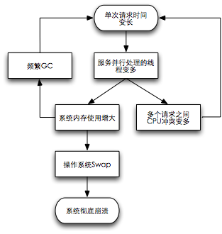

长请求拥塞反模式所导致的性能恶化现象非常普遍，所以识别该模式非常重要。典型的场景如下：某复杂业务系统依赖于多个服务，其中某个服务的响应时间变长，随之系统整体响应时间变长，进而出现CPU、内存、Swap报警。系统进入长请求拥塞反模式的典型标识包括：被依赖服务可用性变低、响应时间变长、服务的某段计算逻辑时间变长等。

#### 2.多次请求杠杆反模式（Levered Multilayer Invocating AntiPattern）
客户端一次用户点击行为往往会触发多次服务端请求，这是一次请求杠杆；每个服务端请求进而触发多个更底层服务的请求，这是第二次请求杠杆。


多次请求杠杆所导致的性能恶化现象非常常见，例如：对于美团推荐系统，一个用户列表请求会有多个算法参与，每个算法会召回多个列表单元（商家或者团购），每个列表单元有多种属性和特征，而这些属性和特征数据服务又分布在不同服务和机器上面，所以客户端的一次用户展现可能导致了成千上万的最底层服务调用。对于存在多次请求杠杆反模式的分布式系统，性能恶化与流量之间往往遵循指数曲线关系。

#### 3.反复缓存反模式（Recurrent Caching AntiPattern）
为了降低响应时间，系统往往在本地内存中缓存很多数据。缓存数据越多，命中率就越高，平均响应时间就越快。

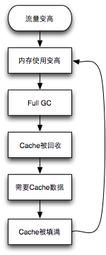

反复缓存所导致性能恶化的原因是无节制地使用缓存。缓存使用的指导原则是：工程师们在使用缓存时必须全局考虑，精细规划，确保数据完全缓存的情况下，系统仍然不会频繁full GC。

## 三. 七种性能优化模式
### 1.水平分割模式（Horizontal partitioning Pattern）
#### 原理和动机
典型的服务端运行流程包含四个环节：接收请求、获取数据、处理数据、返回结果。在一次请求中，获取数据和处理数据往往多次发生。在完全串行运行的系统里，一次请求总响应时间满足如下公式：

**一次请求总耗时=解析请求耗时 + ∑(获取数据耗时+处理数据耗时) + 组装返回结果耗时**

大部分耗时长的服务主要时间都花在中间两个环节，即获取数据和处理数据环节。对于非计算密集性的系统，主要耗时都用在获取数据上面。


水平分割模式首先将整个请求流程切分为必须相互依赖的多个Stage，而每个Stage包含相互独立的多种业务处理（包括计算和数据获取）。完成切分之后，水平分割模式串行处理多个Stage，但是在Stage内部并行处理。如此，一次请求总耗时等于各个Stage耗时总和，每个Stage所耗时间等于该Stage内部最长的业务处理时间。

水平分割模式有两个关键优化点：减少Stage数量和降低每个Stage耗时。为了减少Stage数量，需要对一个请求中不同业务之间的依赖关系进行深入分析并进行解耦，将能够并行处理的业务尽可能地放在同一个Stage中，最终将流程分解成无法独立运行的多个Stage。降低单个Stage耗时一般有两种思路：

1. 在Stage内部再尝试水平分割（即递归水平分割)

2. 对于一些可以放在任意Stage中进行并行处理的流程，将其放在耗时最长的Stage内部进行并行处理，避免耗时较短的Stage被拉长。

水平分割模式不仅可以降低系统平均响应时间，而且可以降低TP95响应时间（这两者有时候相互矛盾，不可兼得）。通过降低平均响应时间和TP95响应时间，水平分割模式往往能够大幅度提高系统吞吐量以及高峰时期系统可用性，并大大降低系统进入长请求拥塞反模式的概率。

#### 具体案例
我们的挑战来自为用户提供高性能的优质个性化列表服务，每一次列表服务请求会有多个算法参与，而每个算法基本上都采用“召回->特征获取->计算”的模式。在进行性能优化之前，算法之间采用顺序执行的方式。

1. 算法之间并行计算；
2. 每个算法内部，多次特征获取进行了并行处理；
3. 在调度线程对工作线程进行调度的时候，耗时最长的线程最先调度，最后处理。

#### 缺点和优点
1. 对成熟系统进行水平切割，意味着对原系统的重大重构，工程师必须对业务和系统非常熟悉，所以要谨慎使用。水平切割主要有两方面的难点：
2. 并行计算将原本单一线程的工作分配给多线程处理，提高了系统的复杂度。而多线程所引入的安全问题让系统变得脆弱。与此同时，多线程程序测试很难，因此重构后系统很难与原系统在业务上保持一致。
3. 对于一开始就基于单线程处理模式编写的系统，有些流程在逻辑上能够并行处理，但是在代码层次上由于相互引用已经难以分解。所以并行重构意味着对共用代码进行重复撰写，增大系统的整体代码量，违背奥卡姆剃刀原则。

对于上面提到的第二点，举例如下：A和B是逻辑可以并行处理的两个流程，基于单线程设计的代码，假定处理完A后再处理B。在编写处理B逻辑代码时候，如果B需要的资源已经在处理A的过程中产生，工程师往往会直接使用A所产生的数据，A和B之间因此出现了紧耦合。并行化需要对它们之间的公共代码进行拆解，这往往需要引入新的抽象，更改原数据结构的可见域。

在如下两种情况，水平切割所带来的好处不明显：

1. 一个请求中每个处理流程需要获取和缓存的数据量很大，而不同流程之间存在大量共享的数据，但是请求之间数据共享却很少。在这种情况下，流程处理完之后，数据和缓存都会清空。采用顺序处理模式，数据可以被缓存在线程局部存储（ThreadLocal）中而减少重复获取数据的成本；如果采用水平切割的模式，在一次请求中，不同流程会多次获取并缓存的同一类型数据，对于内存原本就很紧张的系统，可能会导致频繁full GC，进入反复缓存反模式。
2. 某一个处理流程所需时间远远大于其他所有流程所需时间的总和。这种情况下，水平切割不能实质性地降低请求响应时间。

采用水平切割的模式可以降低系统的平均响应时间和TP95响应时间，以及流量高峰时系统崩溃的概率。虽然进行代码重构比较复杂，但是水平切割模式非常容易理解，只要熟悉系统的业务，识别出可以并行处理的流程，就能够进行水平切割。

### 2.垂直分割模式（Vertical partitioning Pattern）
#### 原理和动机
对于移动互联网节奏的公司，新需求往往是一波接一波。基于代码复用原则，工程师们往往会在一个系统实现大量相似却完全不相干的功能。伴随着功能的增强，系统实际上变得越来越脆弱。这种脆弱可能表现在系统响应时间变长、吞吐量降低或者可用性降低。导致系统脆弱原因主要来自两方面的冲突：资源使用冲突和可用性不一致冲突。

资源使用冲突是导致系统脆弱的一个重要原因。不同业务功能并存于同一个运行系统里面意味着资源共享，同时也意味着资源使用冲突。

不加区别地将不同可用性要求的业务功能放入一个系统里，会导致系统整体可用性变低。当不同业务功能糅合在同一运行系统里面的时候，在运维和机器层面对不同业务的可用性、可靠性进行调配将会变得很困难。但是，在高峰流量导致系统濒临崩溃的时候，最有效的解决手段往往是运维，而最有效手段的失效也就意味着核心业务的可用性降低。

垂直分割思路就是将系统按照不同的业务功能进行分割，主要有两种分割模式：部署垂直分割和代码垂直分割。部署垂直分割主要是按照可用性要求将系统进行等价分类，不同可用性业务部署在不同机器上，高可用业务单独部署；代码垂直分割就是让不同业务系统不共享代码，彻底解决系统资源使用冲突问题。

#### 具体案例
我们的挑战来自于美团推荐系统，美团客户端的多个页面都有推荐列表。虽然不同的推荐产品需求来源不同，但是为了实现快速的接入，基于共用代码库原则，所有的推荐业务共享同一套推荐代码，同一套部署。在一段时间内，我们发现push推荐和首页“猜你喜欢推荐”的资源消耗巨大。特别是在push推荐的高峰时刻，CPU和内存频繁报警，系统不停地full GC，造成美团用户进入客户端时，首页出现大片空白。

在对系统进行分析之后，得出两个结论：

1. 首页“猜你喜欢”对用户体验影响更大，应该给予最高可用性保障，而push推荐给予较低可用性保障；
2. 首页“猜你喜欢”和push推荐都需要很大的本地缓存，有较大的内存使用冲突，并且响应时间都很长，有严重的CPU使用冲突。

因此我们采取了如下措施，一方面，解决了首页“猜你喜欢”的可用性低问题，减少了未来出现可用性问题的概率，最终将其TP95响应时间降低了40%；另一方面也提高了其他推荐产品的服务可用性和高峰吞吐量。

1. 将首页“猜你喜欢”推荐进行单独部署，而将push推荐和其他对系统资源要求不高的推荐部署在另一个集群上面；
2. 对于新承接的推荐业务，新建一套代码，避免影响首页推荐这种最高可用性的业务。

#### 缺点和优点
垂直分割主要的缺点主要有两个：

1. 增加了维护成本。一方面代码库数量增多提高了开发工程师的维护成本，另一方面，部署集群的变多会增加运维工程师的工作量；
2. 代码不共享所导致的重复编码工作。

解决重复编码工作问题的一个思路就是为不同的系统提供共享库（Shared Library），但是这种耦合反过来可能导致部署机器中引入未部署业务的开销。所以在共享库中要减少静态代码的初始化开销，并将类似缓存初始化等工作交给上层系统。

垂直分割是一个非常简单而又有效的性能优化模式，特别适用于系统已经出现问题而又需要快速解决的场景。部署层次的分割既安全又有效。需要说明的是部署分割和简单意义上的加机器不是一回事，在大部分情况下，即使不增加机器，仅通过部署分割，系统整体吞吐量和可用性都有可能提升。所以就短期而言，这几乎是一个零成本方案。对于代码层次的分割，开发工程师需要在业务承接效率和系统可用性上面做一些折衷考虑。

### 3.恒变分离模式（Runtime 3NF Pattern）
#### 原理和动机
基于性能的设计要求变化的数据和不变的数据分开，这一点和基于面向对象的设计原则相悖。在面向对象的设计中，为了便于对一个对象有整体的把握，紧密相关的数据集合往往被组装进一个类，存储在一个数据库表，即使有部分数据冗余（关于面向对象与性能冲突的讨论网上有很多文章，本文不细讲）。

恒变分离模式的原理非常类似与数据库设计中的第三范式（3NF）：第三范式主要解决的是静态存储中重复存储的问题，而恒变分离模式解决的是系统动态运行时候恒定数据重复创建、传输、存储和处理的问题。按照3NF，如果一个数据表的每一记录都依赖于一些非主属性集合，而这些非主属性集合大量重复出现，那么应该考虑对被依赖的非主属性集合定义一个新的实体（构建一个新的数据表），原数据库的记录依赖于新实体的ID。

#### 案例分析
我们的挑战是提供一个高性能、高一致性要求的团购服务（DealService）。系统存在一些多次请求杠杆反模式问题，客户端一次请求会导致几十次DealService读取请求，每次获取上百个团购详情信息，服务端单机需要支持每秒万次级别的吞吐量。基于需求，系统大体框架设计如下：

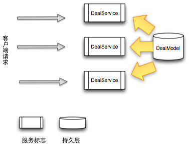

每个DealService定期从持久层同步所有发生变化的deal信息，所有的deal信息保存在内存里面。在最初的设计里面，数据库只有一个数据表DealModelTable，程序里面也只有一个实体类DealModel。由于销量、价格、用户评价等信息的频发变化，为了达到高一致性要求，服务系统每分钟需要从数据库同步几万条记录。随着美团团购数量的增多和用户活跃度的增加，系统出现了三个问题：

1. 团购服务网卡频繁报警，由于这是高性能低延时服务，又导致了大量的客户端超时异常；
2. 频繁的full GC，这是由于每条数据库记录更新都会导致运行系统里面老的DealModel实体被销毁，新的DealModels实体被创建；
3. 数据库从库滞后主库，使得服务数据一致性降低，原因是数据库系统写数据量巨大。

在对系统进行分析之后，我们采用了如下措施，大大降低了网络传输的数据量，缓解了主从数据库同步压力，使得客户端的超时异常从高峰时候的9%降低到了小于0.01%（低于万分之一）：

1. 将DealModelTable中的销量、价格、用户评价等常变的信息单独构建一张数据表VariableDealModel；
2. 同时在代码中为销量、价格、用户评价等常变数据创建一个单独的类VariableDealModel；
3. DealService对两张表进行分别同步；
4. 如果DealModelTable的记录产生了更新，运行系统销毁老的DealModel实体并创建新的DealModel实体；
5. 如果只是VariableDealModel的记录产生了更新，只对VariableDealModel的属性进行更改。

#### 缺点和优点
采用恒变分离模式，主要有三个缺点：

1. 不符合面向对象的设计原则。原本概念上统一的实体被切分成多个实体，会给开发工程师带来一些理解上的困难，因此增加维护成本。进一步而言，这会增加引入额外Bug的概率（实际上面向对象之所以如此受欢迎的一个重要原因就是容易理解）。
2. 增加了类不变量（Class invariant）的维护难度。很多情况下，Class invariant是通过语言所提供的封装（Encapsulation）特性来维护的。当一个类变成多个类，Class invariant可能会被破坏。如果必须维护Class invariant，而这种Class invariant又发生在不同实体之间，那么往往是把不变的属性从不变实体移到易变的实体中去。
3. 一张数据库表变成多张，也会增加维护成本。

在如下两种场景下，恒变分离模式所带来的好处有限：

1. 易变数据导致的操作和传输并不频繁，不是系统主要操作；
2. 易变数据占整体数据的比例很高，杠杆效应不显著，通过恒变分离模式不能根本性地解决系统性能问题。

总的来说，恒变分离模式非常容易理解，其应用往往需要满足两个条件：易变数据占整体数据比例很低（比例越低，杠杆效应越大）和易变数据所导致的操作又是系统的主要操作。在该场景下，如果系统性能已经出现问题，牺牲一些可维护性就显得物有所值。

大部分系统都是由多种类型的数据构成，大多数数据类型的都包含易变、少变和不变的属性。盲目地进行恒变分离会导致系统的复杂度指数级别的增加，系统变得很难维护，所以系统设计者必须在高性能和高维护性之间找到一个平衡点。

### 4.数据局部性模式（Locality Pattern）
#### 原理和动机
数据局部性模式是多次请求杠杆反模式的针对性解决方案。在大数据和强调个性化服务的时代，一个服务消费几十种不同类型数据的现象非常常见，同时每一种类型的数据服务都有可能需要一个大的集群（多台机器）提供服务。这就意味着客户端的一次请求有可能会导致服务端成千上万次调用操作，很容易使系统进入多次请求杠杆反模式。在具体开发过程中，导致数据服务数量暴增的主要原因有两个：

1. 缓存滥用以及缺乏规划

2. 数据量太大以至于无法在一台机器上提供全量数据服务。

数据局部性模的核心思想是合理组织数据服务，减少服务调用次数。具体而言，可以从服务端和客户端两个方面进行优化。

服务端优化方案的手段是对服务进行重新规划。对于数据量太大以至于无法在一台机器上存储全量数据的场景，建议采用Bigtable或类似的解决方案提供数据服务。

1. 数据由尽可能少的服务器来提供，

2. 经常被一起使用的数据尽可能放在同一台服务器上。

客户端优化有如下几个手段：

1. 本地缓存，对于一致性要求不高且缓存命中率较高的数据服务，本地缓存可以减少服务端调用次数；
2. 批处理，对于单机或者由等价的机器集群提供的数据服务，尽可能采用批处理方式，将多个请求合成在一个请求中；
3. 客户端Hash，对于需要通过Hash将请求分配到不同数据服务机器的服务，尽量在客户端进行Hash，对于落入同一等价集群的请求采用批处理方式进行调用。

#### 案例分析
我们的挑战来自于美团的推荐、个性化列表和个性化搜索服务。这些个性化系统需要获取各种用户、商家和团购信息。信息类型包括基本属性和统计属性。最初，不同属性数据由不同的服务提供，有些是RPC服务，有些是Redis服务，有些是HBase或者数据库，参见下图：

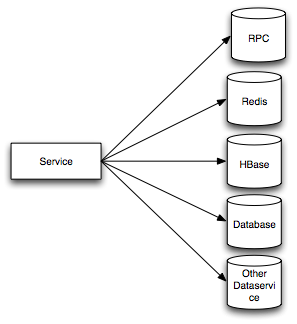

通常而言，客户端每个用户请求都会触发多个算法。一方面，每个算法都会召回几十甚至几百个团购或者商家ID，团购和商家基础属性被均匀地分配到几十台Redis里面（如下图），产生了大量的Redis请求，极端情况下，一次客户端请求所触发的团购基础数据请求就超过了上千次；


在对系统进行分析之后，按照数据局部性模式的原则，我们采用了如下手段，彻底解决了系统多次请求杠杆反模式的问题：

1. 采用大内存服务器存储所有的团购和商家基础信息，每个算法只要一次网络请求就可以获取所有的信息；
2. 服务端采用多线程方式提供服务，避免了Redis单一线程模式下单个请求慢所带来的连锁效应；
3. 借鉴类似Bigtable的数据组织方式，将用户的多种特征采用两个维度（用户维度和特征类型）进行索引，确保同一用户的信息只存放在一台机器上面，减少网络调用数量。

#### 缺点和优点
数据局部性模式并不适用于系统初级阶段。在初级阶段，最小可用原则往往是主要设计原则之一，出于两方面的考虑：

一方面，在初级阶段，很难预测所要提供服务的数据是否有效而且能够长期使用，以及未来的调用量；

另一方面，在初级阶段，工程师可能无法预测最终的调用模式，而不同的调用模式会导致数据局部性方案的设计不同。对于已经大量使用的数据服务，采用数据局部性模式进行重构必然要改变老的调用模式，这一方面会引入新的Bug，另一方面也意味着巨大的工作量。

数据局部性模式能够解决多次请求杠杆反模式所导致的问题，但它并非大数据的产物，CPU、编译器的设计理念里早就融入了该模式，所以很容易被工程师理解。虽然过度设计在系统初级阶段是一个要尽量避免的事情，但是理解和掌握数据局部性模式对于设计出一个可扩展、可重用的系统有很大帮助。

### 5.避免蚊子大炮模式（Avoiding Over-generalized Solution Pattern）
#### 原理和动机
“用大炮打蚊子”本来是大材小用的意思，但是细致想一想，用大炮打蚊子，成功率不高。对于开发工程师而言，一方面为了快速承接业务，按照方案复用原则，总是尽可能地利用现有系统，这使得系统功能越来越强大；

“避免蚊子大炮模式”是经济原则在运行时系统的运用，它要求采用最节省资源（CPU、内存等）的方法来解决所面临的问题，资源浪费会带来未来潜在的风险。工程师接到一个需求的时候，需要思考的不仅仅是如何复用现有的系统，减少开发时间，还需要考虑现有系统为处理每个新需求访问所需运行时成本，以及新需求的预期访问量。

#### 案例分析
我们的挑战是为移动用户寻找其所在位置附近的商家信息。美团有非常完善的搜索系统，也有资深的搜索工程师，所以一个系统需要查找附近的商家的时候，往往第一方案就是调用搜索服务。

在对系统分析之后，我们认为更适合解决最短直线距离的算法应该是k-d tree，在快速实现了基于k-d tree的LBS Search解决方案之后，我们用4台服务器轻松解决了30多台搜索服务器无法解决的问题，平均响应时间从高峰时的100ms降低到300ns，性能取得了几百倍的提高。

#### 缺点和优点
避免蚊子大炮模式的问题和数据局部性模式类似，都与最小可用原则相冲突。在系统设计初级阶段，寻求最优方案往往意味着过度设计，整个项目在时间和成本变得不可控，而为每个问题去找最优秀的解决方案是不现实的奢求。

在设计阶段，避免蚊子大炮模式是一个需要工程师去权衡的选择，需要在开发成本和系统运行成本之间保持一个平衡点。当很多功能融入到一个通用系统里而出现性能问题的时候，要拆分出来每一个功能点所造成的影响也不是件轻易的事情，所以采用分开部署而共用代码库的原则可以快速定位问题，然后有针对性地解决“蚊子大炮”问题。

### 6.实时离线分离模式（Sandbox Pattern）
#### 原理和动机
本模式的极端要求是：离线服务永远不要调用实时服务。该模式比较简单也容易理解，但是，严格地讲它不是一种系统设计模式，而是一种管理规范。

具体而言，实时离线分离模式建议如下几种规范：

1. 如果离线程序需要访问在线服务，应该给离线程序单独部署一套服务；
2. 类似于MapReduce的云端多进程离线程序禁止直接访问在线服务；
3. 分布式系统永远不要直接写传统的DBMS。

#### 案例分析
因为违反实时离线分离模式而导致的事故非常常见。有一次，因为一个离线程序频繁的向Tair集群写数据，每一次写10M数据，使得整个Tair集群宕机。另一次，因为Storm系统直接写MySQL数据库导致数据库连接数耗尽，从而使在线系统无法连接数据库。

#### 缺点和优点
为了实现实时在线分离，可能需要为在线环境和离线环境单独部署，维护多套环境所带来运维成本是工程师需要考虑的问题。另一方面，在线环境的数据在离线环境中可能很难获取，这也是很多离线系统直接访问在线系统的原因。但是，遵从实时离线分离模式是一个非常重要的安全管理准则，任何违背这个准则的行为都意味着系统性安全漏洞，都会增大线上故障概率。

### 7.降级模式（Degradation Pattern）
#### 原理和动机
降级模式是系统性能保障的最后一道防线。理论上讲，不存在绝对没有漏洞的系统，或者说，最好的安全措施就是为处于崩溃状态的系统提供预案。从系统性能优化的角度来讲，不管系统设计地多么完善，总会有一些意料之外的情况会导致系统性能恶化，最终可能导致崩溃，所以对于要求高可用性的服务，在系统设计之初，就必须做好降级设计。根据作者的经验，良好的降级方案应该包含如下措施：

1. 在设计阶段，确定系统的开始恶化数值指标（例如：响应时间，内存使用量）；
2. 当系统开始恶化时，需要第一时间报警；
3. 在收到报警后，或者人工手动控制系统进入降级状态，或者编写一个智能程序让系统自动降级；
4. 区分系统所依赖服务的必要性，一般分为：必要服务和可选服务。必要服务在降级状态下需要提供一个快速返回结果的权宜方案（缓存是常见的一种方案），而对于可选服务，在降级时系统果断不调用；
5. 在系统远离恶化情况时，需要人工恢复，或者智能程序自动升级。

典型的降级策略有三种：流量降级、效果降级和功能性降级。流量降级是指当通过主动拒绝处理部分流量的方式让系统正常服务未降级的流量，这会造成部分用户服务不可用；

#### 案例分析
我们的系统大量使用了智能降级程序。在系统恶化的时候，智能降级程序自动降级部分流量，当系统恢复的时候，智能降级程序自动升级为正常状态。

#### 缺点和优点
为了使系统具备降级功能，需要撰写大量的代码，而降级代码往往比正常业务代码更难写，更容易出错，所以并不符合奥卡姆剃刀原则。在确定使用降级模式的前提下，工程师需要权衡这三种降级策略的利弊。大多数面向C端的系统倾向于采用效果降级和功能性降级策略，但是有些功能性模块（比如下单功能）是不能进行效果和功能性降级的，只能采用流量降级策略。对于不能接受降级后果的系统，必须要通过其他方式来提高系统的可用性。

总的来说，降级模式是一种设计安全准则，任何高可用性要求的服务，必须要按照降级模式的准则去设计。对于违背这条设计原则的系统，或早或晚，系统总会因为某些问题导致崩溃而降低可用性。不过，降级模式并非不需要成本，也不符合最小可用原则，所以对于处于MVP阶段的系统，或者对于可用性要求不高的系统，降级模式并非必须采纳的原则。

### 其他性能优化建议
对于无法采用系统性的模式方式讲解的性能优化手段，给出一些总结性的建议：

1. 删除无用代码有时候可以解决性能问题，例如：有些代码已经不再被调用但是可能被初始化，甚至占有大量内存；有些代码虽然在调用但是对于业务而言已经无用，这种调用占用CPU资源。

 2. 避免跨机房调用，跨机房调用经常成为系统的性能瓶颈，特别是那些伪batch调用（在使用者看起来是一次性调用，但是内部实现采用的是顺序单个调用模式）对系统性能影响往往非常巨大 。

# 千万级实时聊天系统如何设计

## 千万级IM消息系统设计
**整体架构 **

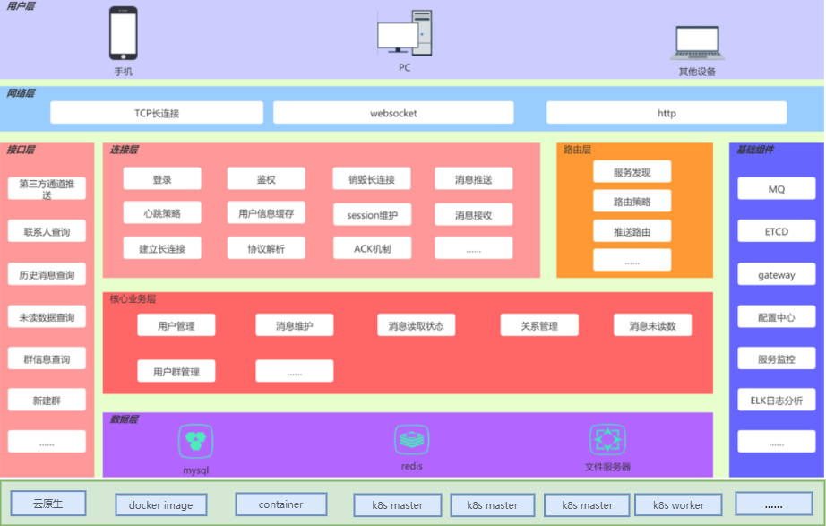

**核心流程：**


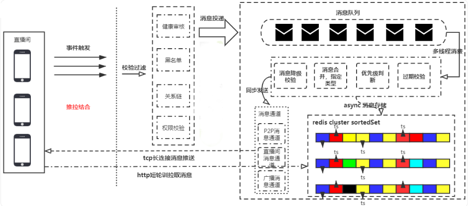

**消息分发流程：**

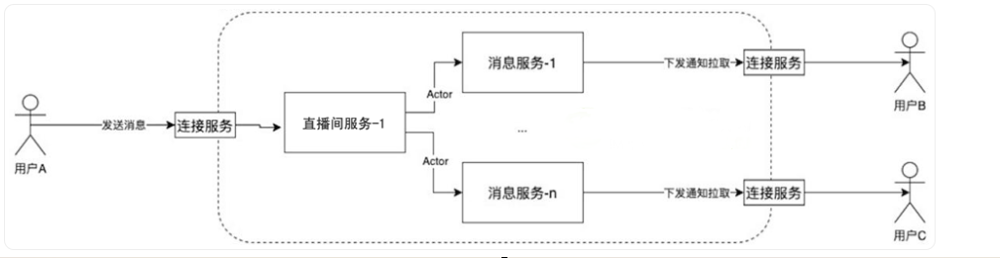

** 消息拉取流程：**

**长连接消息分发整体架构：**

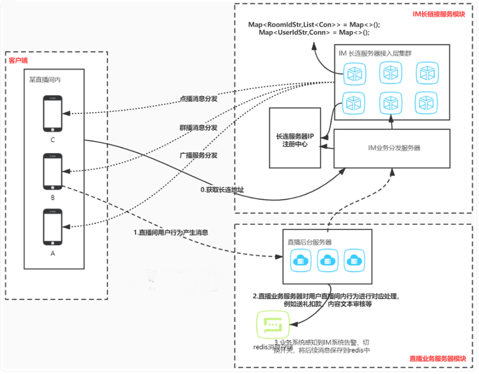

**k8s集群部署**

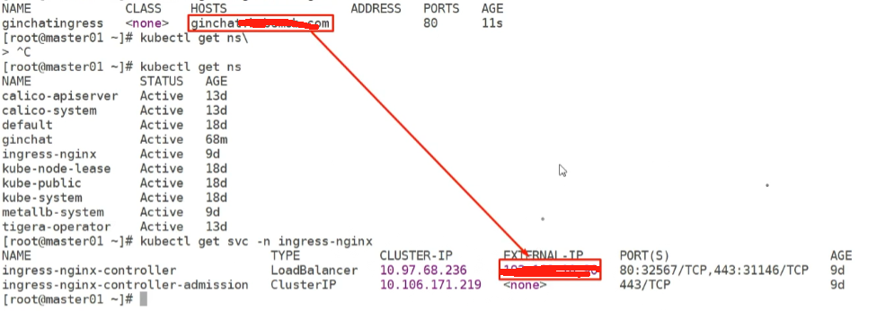

## IM 核心功能

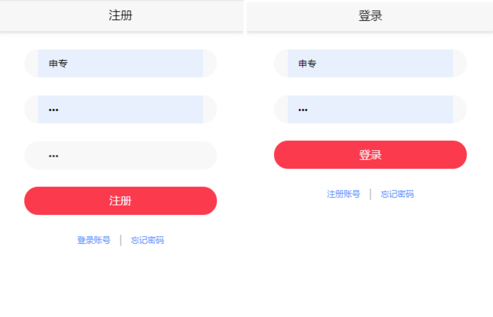


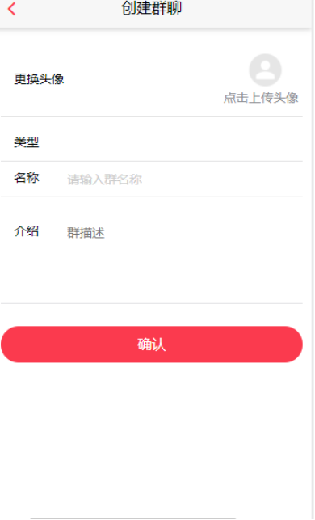

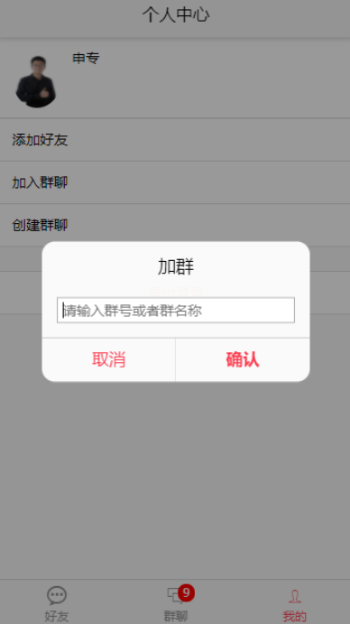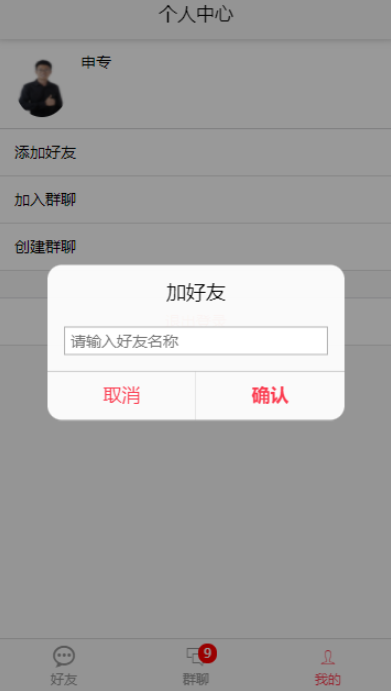


### 竞品方案类比

前面了解了 IM 系统的常见设计问题，接下来我们再看看业界是怎么设计 IM 系统的。研究业界的主流方案有助于我们深入理解 IM 系统的设计。
**微信**
虽然微信很多基础框架都是自研，但这并不妨碍我们理解微信的架构设计。微信采用的主要是：写扩散 + 推拉结合。由于群聊使用的也是写扩散，而写扩散很消耗资源，因此微信群有人数上限（目前是 500）。所以这也是写扩散的一个明显缺点，如果需要万人群就比较难了。可以看出，微信采用了多数据中心架构


微信每个数据中心都是自治的，每个数据中心都有全量的数据，数据中心间通过自研的消息队列来同步数据。为了保证数据的一致性，每个用户都只属于一个数据中心，只能在自己所属的数据中心进行数据读写，如果用户连了其它数据中心则会自动引导用户接入所属的数据中心。而如果需要访问其它用户的数据那只需要访问自己所属的数据中心就可以了。同时，微信使用了三园区容灾的架构，使用 Paxos 来保证数据的一致性。
微信的 ID 设计采用的是：基于申请 DB 步长的生成方式 + 用户级别递增。如下图所示：

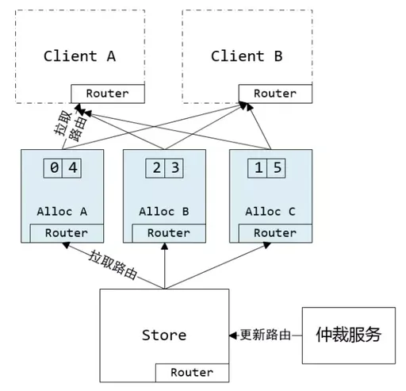

微信的序列号生成器由仲裁服务生成路由表（路由表保存了 uid 号段到 AllocSvr 的全映射），路由表会同步到 AllocSvr 跟 Client。如果 AllocSvr 宕机的话会由仲裁服务重新调度 uid 号段到其它 AllocSvr。
**钉钉**
钉钉最开始使用的是写扩散模型，为了支持万人群，后来貌似优化成了读扩散。
但聊到阿里的 IM 系统，不得不提的是阿里自研的 Tablestore。一般情况下，IM 系统都会有一个自增 ID 生成系统，但 Tablestore 创造性地引入了[主键列自增](https://xie.
**Twitter**
什么？Twitter 不是 Feeds 系统吗？不是讨论 IM 的吗？是的，Twitter 是 Feeds 系统，但 Feeds 系统跟 IM 系统其实有很多设计上的共性，研究下 Feeds 系统有助于我们在设计 IM 系统时进行参考。再说了，研究下 Feeds 系统也没有坏处，扩展下技术视野嘛。
Twitter 的自增 ID 设计估计大家都耳熟能详了，即大名鼎鼎的 [Snowflake](https://xie.infoq.cn/link?target=https%3A%2F%2Fdeveloper.twitter.com%2Fen%2Fdocs%2Fbasics%2Ftwitter-ids)，因此 ID 是全局递增的。


Twitter 一开始使用的是写扩散模型，Fanout Service 负责扩散写到 Timelines Cache（使用了 Redis），Timeline Service 负责读取 Timeline 数据，然后由 API Services 返回给用户。
但由于写扩散对于大 V 来说写的消耗太大，因此后面 Twitter 又使用了写扩散跟读扩散结合的方式。如下图所示：


对于粉丝数不多的用户如果发 Twitter 使用的还是写扩散模型，由 Timeline Mixer 服务将用户的 Timeline、大 V 的写 Timeline 跟系统推荐等内容整合起来，最后再由 API Services 返回给用户。
**抖音**
抖音作为目前流量最大的IM实时消息平台。采用了go语言开发，采用多级流量池分级推荐机制，通过中心化的流量分发逻辑，根据用户标签和行为数据进行内容匹配。这种机制不仅优化了消息的分发效率，还确保了内容的多样性和个性化推荐。

此外，抖音通过容器化和 Kubernetes 等技术实现了弹性扩展，能够根据流量波动自动调整资源分配。这种动态扩容能力确保了系统在高并发场景下的稳定运行

相对上面纯IM通信场景，抖音直播间消息还具备如下特点：

1）消息要求更及时：过时的消息对于用户来说不重要；

2）松散的群聊：用户随时进群，随时退群；

3）历史消息不需要重发：用户进群后，离线期间（接听电话）的消息不需要重发。

并且不同消息类型分别处理：如用户发消息，直播间消息，直播间刷礼物等

## 技术难点：
### 读扩散 vs 写扩散
#### 读扩散
**原理** ：读扩散架构下，发送消息时不立即写入所有收信人信箱，而是先写入消息中心，用户读取消息时再从消息中心拉取。


我们先来看看**读扩散**。如上图所示，A 与每个聊天的人跟群都有一个信箱（有些博文会叫 Timeline），A 在查看聊天信息的时候需要读取所有有新消息的信箱。
读扩散的优点：
●写操作（发消息）很轻量，不管是单聊还是群聊，只需要往相应的信箱写一次就好了
●每一个信箱天然就是两个人的聊天记录，可以方便查看聊天记录跟进行聊天记录的搜索
读扩散的缺点：
●读操作（读消息）很重

#### 写扩散
**原理** ：在写扩散架构下，发送消息时，消息会扩散写入到收信人的信箱。单聊时，消息写入双方信箱；群聊时，消息写入所有群成员信箱，同时可能写入群聊历史记录。

示意图：

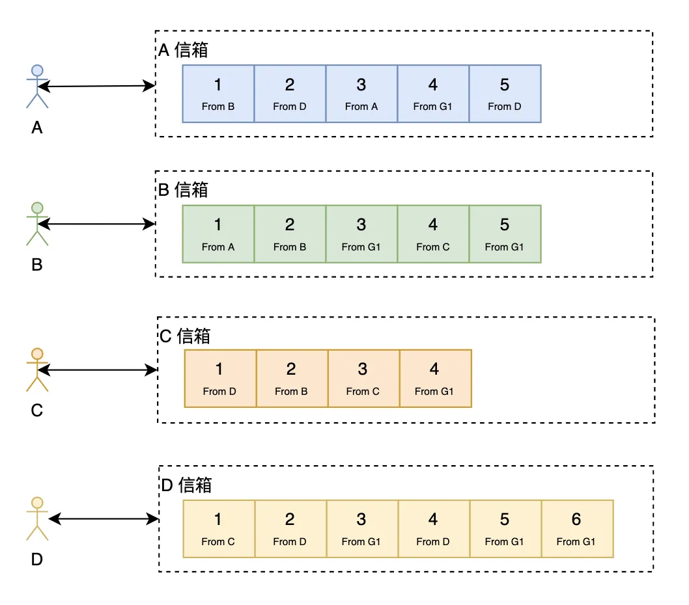

在**写扩散**中，每个人都只从自己的信箱里读取消息，但写（发消息）的时候，对于单聊跟群聊处理如下：
●单聊：往自己的信箱跟对方的信箱都写一份消息，同时，如果需要查看两个人的聊天历史记录的话还需要再写一份（当然，如果从个人信箱也能回溯出两个人的所有聊天记录，但这样效率会很低）。
●群聊：需要往所有的群成员的信箱都写一份消息，同时，如果需要查看群的聊天历史记录的话还需要再写一份。可以看出，写扩散对于群聊来说大大地放大了写操作。
写扩散优点：
●读操作很轻量
●可以很方便地做消息的多终端同步
写扩散缺点：
●写操作很重，尤其是对于群聊来说
注意，在 Feeds 系统中：
●写扩散也叫：Push、Fan-out 或者 Write-fanout
●读扩散也叫：Pull、Fan-in 或者 Read-fanout

基于传统的IM架构技术，尤其在群内聊天或者分享，每条消息按照群内人数进行写扩散，按照主互动500人群规模来计算，平均群大小320+，1:N的写入必然导致写入DB的RT以及存储压力，按照DB库承接120w/s写入速度，导致消息上行3K/s的极限，而实际参与互动分享的用户在峰值的时候远大于这部分互动分享和聊天消息流量。其次集群的写入不可能完全给IM聊天消息，还有其它的营销活动、交易、物流等通知类型的消息。

**对比选型**

写扩散技术：

  优点：

 1）整体架构简洁，方案简单，维护用户同步队列实现数据同步机制；

 2）无论是单聊还是群聊等会话消息，写入用户维度同步队列，集中获取同步数据；

 3）推和拉情况下，存储模型和数据处理简单，且天然支持个性化数据。

 缺点：

 1）群会话消息，天然存在1:N写入扩散比，存储压力N倍压力，在线用户收到消息延迟增大；

 2）多个群内消息队列混合在同步队列，无优先级处理能力，无法针对互动群等做隔离。  读扩散技术：

优点：

 1）降低写扩散N倍的DB存储压力，减少下行在线用户端到端扩散的RT时间；

 2）提升消息上行集群整体的吞吐量，用户体验更流畅；

 3）端到端实现会话级别的同步优先级队列，实现差异化服务。

  缺点：

1）整体架构偏复杂，需要维护每个动态会话消息同步队列，端侧需要实时感知新增的动态同步队列；

 2）客户端冷启动需要分散读取多个会话消息同步队列数据，对于存储会带来读QPS压力。

#### 混合模式
**原理** ：结合写扩散和读扩散的优点，在云端一体化数据同步技术下，对不同类型消息进行综合处理。对于单聊等非高并发强互动场景，可采用写扩散；对于群聊等高并发强互动场景，先写入消息中心，用户在线时按需拉取消息，离线时采用写扩散写入离线消息队列。

项目推进“读写扩散混合模式“落地，结合两者的优点进行云端一体化数据同步技术。

进一步优化消息中心的缓存机制，提高消息拉取效率；同时，对不同优先级会话的消息同步队列进行更精细的管理和调度，以更好地实现差异化服务。

持续探索新技术和架构改进，如采用分布式消息队列、大数据存储等技术，以应对不断增长的用户规模和复杂多样的业务场景。

覆盖几千万互动群用户，保证整体峰值上行消息以及用户在群内端到端延迟体验，做到一条上行消息500ms以内到达群内其他用户端侧，让整体用户体验提升明显，群内强互动成为可能。

### 唯一 ID 设计
通常情况下，ID 的设计主要有以下几大类：
●UUID
●基于 Snowflake 的 ID 生成方式
●基于申请 DB 步长的生成方式
●基于 Redis 或者 DB 的自增 ID 生成方式
●特殊的规则生成唯一 ID
在 IM 系统中需要唯一 Id 的地方主要是：
●会话 ID
●消息 ID

#### 消息 ID
在设计消息 ID 时，需要考虑以下几个关键问题：
**消息 ID 不递增可以吗**
我们先看看不递增的话会怎样：
	●使用字符串，浪费存储空间，而且不能利用存储引擎的特性让相邻的消息存储在一起，降低消息的写入跟读取性能
	●使用数字，但数字随机，也不能利用存储引擎的特性让相邻的消息存储在一起，会加大随机 IO，降低性能；而且随机的 ID 不好保证 ID 的唯一性
**递增的优点：**

+ 便于检测消息丢失，尤其是在会话级别连续递增的情况下，当下一条消息的 ID 不连续时，可及时发现并请求服务器补发。
+ 消息可以看做时序数据，使用递增的 ID 可以方便做消息分页拉取，提高分页性能。

**全局递增 vs 用户级别递增 vs 会话级别递增**
**全局递增**：指消息 ID 在整个 IM 系统随着时间的推移是递增的。全局递增的话一般可以使用 Snowflake（当然，Snowflake 也只是 worker 级别的递增）。

此时，如果你的系统是读扩散的话为了防止消息丢失，那每一条消息就只能带上上一条消息的 ID，前端根据上一条消息判断是否有丢失消息，有消息丢失的话需要重新拉一次。

**适用场景**：适用于读扩散架构。为了防止消息丢失，每条消息可携带上一条消息的 ID，前端根据 ID 判断是否有消息丢失，并在必要时重新拉取。

**用户级别递增**：指消息 ID 只保证在单个用户中是递增的，不同用户之间不影响并且可能重复。

**典型代表**：微信。如果是写扩散系统的话信箱时间线 ID 跟消息 ID 需要分开设计，信箱时间线 ID 用户级别递增，消息 ID 全局递增。如果是读扩散系统的话感觉使用用户级别递增必要性不是很大。

**适用场景**：**写扩散架构**：信箱时间线 ID 可设计为用户级别递增，而消息 ID 采用全局递增。**读扩散架构**：使用用户级别递增的必要性较低，但可结合其他策略优化消息同步。

**会话级别递增**：指消息 ID 只保证在单个会话中是递增的，不同会话之间不影响并且可能重复。

**典型代表**：QQ。**适用场景**：适用于读扩散架构。会话级别连续递增的 ID 可帮助客户端快速检测消息丢失，避免全量拉取。

**连续递增 vs 单调递增**
**连续递增：**是指 ID 按 1,2,3...n的方式严格递增。

**单调递增：**是指只要保证后面生成的 ID 比前面生成的 ID 大就可以了，不需要连续。
据我所知，QQ 的消息 ID 就是在会话级别使用的连续递增，这样的好处是，如果丢失了消息，当下一条消息来的时候发现 ID 不连续就会去请求服务器，避免丢失消息。

此时，可能有人会想，我不能用定时拉的方式看有没有消息丢失吗？当然不能，因为消息 ID 只在会话级别连续递增的话那如果一个人有上千个会话，那得拉多少次啊，服务器肯定是抗不住的。
对于读扩散来说，**消息 ID 使用连续递增**就是一种不错的方式了。

如果**使用单调递增的话**当前消息需要带上前一条消息的 ID（即聊天消息组成一个链表），这样，才能判断消息是否丢失。
**其他优化改进点**：
●写扩散：信箱时间线 ID 使用用户级别递增，消息 ID 全局递增，此时只要保证单调递增就可以了
●读扩散：消息 ID 可以使用会话级别递增并且最好是连续递增

●ID 生成器选择：在分布式系统中，可使用雪花算法（Snowflake）等分布式 ID 生成器，确保高并发下的唯一性和性能。

●消息丢失检测：除了依赖 ID 递增性，可结合心跳机制和定时拉取策略，进一步提高消息同步的可靠性。

●存储优化：根据 ID 的递增特性，优化数据库的索引和分区策略，提高存储和查询效率

#### 会话 ID
我们来看看设计会话 ID 需要注意的问题：
其中，会话 ID 有种比较**简单高效**的生成方式（特殊的规则生成唯一 ID）：拼接 from_user_id 跟 to_user_id：
**1，**如果 from_user_id 跟 to_user_id 都是 32 位整形数据（约 43 亿）的话可以很方便地用位运算拼接成一个 64 位的会话 ID，即： conversation_id = ${from_user_id}  Kafka -> 处理机 -> Redis；

##### 具体优化措施
+ 前端机：在前端机写入消息时，为每条消息打上统一时间戳。
    - 如果延迟小，则只写入一个 Kafka 的partion；
    - 如果延迟大，则这个直播的这种消息类型写入 Kafka 的多个partion；
+ 处理机：处理机根据延迟情况和消息所在 Kafka partition 的数量，采用不同的写入 Redis 方式：
    - 如果延迟小，加锁串行写入 Redis；如果延迟大，则取消锁。因此有四种组合，四个档位，分别是：
- 一个partion, 加锁串行写入 Redis, 最大并发度:1；
- 多个partition,加锁串行写入 Redis, 最大并发度:Kafka partion的个数；
- 一个partion, 不加锁并行写入 Redis, 最大并发度: 处理机的线程池个数；
- 多个partion, 不加锁并行写入 Redis，最大并发度: Kafka partition个数处理机线程池的个数。
+ 延迟程度判断：
    - 处理机拿到消息后，计算延迟时间 = 当前时间 - 消息时间戳。
    - 根据延迟时间的长短，自动选择不同的处理档位，以适应当前系统负载。
+ 档位选择：自动选择档位，粒度:某个直播间的某个消息类型。实时负载动态调整处理机的线程池大小，确保系统资源的高效利用。

### Redis slave瓶颈：
用户频繁轮询最新消息，导致Redis slave执行大量ZrangByScore操作，负载过重，性能瓶颈凸显。

#### 解决办法:
+ 本地缓存：
    - 前端机每隔1秒左右取拉取一次直播间的消息，用户到前端机轮询数据时，从本地缓存读取数据；
    - 设计轻量级本地缓存结构，存储最新消息，支持快速查询和更新，确保数据一致性和及时性。
+ 动态调整消息返回数量：
    - 小直播间返回允许时间跨度大一些的消息
    - 大直播间则对时间跨度以及消息条数做更严格的限制。仅对大直播间开启本地缓存

**tips**: 这里本地缓存与平常使用的本地缓存问题，有一个最大区别：成本问题。如果所有直播间的消息都进行缓存，假设同时有1000个直播间，每个直播间5种消息类型，本地缓存每隔1秒拉取一次数据，40台前端机，那么对 Redis 的访问QPS是   1000 * 5 * 40 = 20万。成本太高，因此我们只有大直播间才自动开启本地缓存，小直播间不开启。

### 视频数据处理：
**视频采集与预处理：**视频采集的流程？预处理的效率和质量？

通常包括从摄像头或屏幕录制等源获取原始视频数据，然后进行格式转换、预处理（如缩放、裁剪、旋转等）以适应后续处理和传输要求。可以从硬件设备的信号读取开始，经过驱动程序和相关 API 的调用，将视频数据传递到应用程序层面，再利用图像处理库等进行预处理操作进行阐述。

可从优化算法、使用高效的图像处理库（如 OpenCV 等）、合理设置线程池以充分利用多核 CPU 资源等方面回答，还可以提及根据实际需求选择合适的预处理参数（如分辨率、帧率等），在保证视觉效果的基础上尽量降低计算复杂度。
**视频编码与解码：**视频编码标准有哪些？

H.264 是目前广泛使用的编码标准，具有较好的压缩效率和兼容性；H.265 在相同的视频质量下，压缩效率比 H.264 更高，可降低带宽占用，但编码复杂度也相应增加；MPEG-4 是一种通用的编码标准，适用于多种视频应用，兼容性较好但压缩效率相对较低。可结合实际应用场景说明不同类型直播对编码标准的选择倾向。

合适的编码参数以提高视频质量并降低带宽消耗？

可以从码率控制、分辨率调整、帧率设置等方面进行回答。根据设备性能和显示需求合理设置分辨率，避免不必要的计算和传输负担；对于画面变化较小的直播内容适当降低帧率以减少数据量等。

### 视频传输与流媒体处理
+ **问题** ：简述抖音直播中视频流的传输流程，以及常用的传输协议有哪些？
+ **回答思路** ：从视频源端开始，经过编码后的视频流通过网络传输协议（如 RTMP、RTSP、WebRTC 等）将数据发送到流媒体服务器，服务器再将视频流分发给各个客户端进行解码播放。RTMP 是一种实时消息传输协议，常用于流媒体直播；RTSP 是实时流协议，主要用于控制流媒体服务器上的多媒体会话；WebRTC 是一种支持网页浏览器进行实时语音对话或视频对话的 API，具有低延迟、高实时性的特点，在直播互动场景中有广泛应用。可分别介绍这些协议的特点和适用场景。
+ **问题** ：如何保证视频在传输过程中的流畅性和低延迟？
+ **回答思路** ：可采用前向纠错（FEC）、自动重传请求（ARQ）等技术来应对网络丢包问题，确保数据的可靠传输；合理设置视频缓冲区大小，平衡播放流畅度和延迟之间的关系；利用 CDN（内容分发网络）技术将视频流缓存到离用户较近的节点，减少数据传输距离，提高传输速度；针对不同网络环境（如 4G、5G、WIFI 等）进行自适应码率调整，以适应实时网络变化等。

### 视频存储与管理
+ **问题** ：抖音存储海量直播视频数据时，常见的存储架构和策略有哪些？
+ **回答思路** ：可介绍分布式存储系统，如 Hadoop 分布式文件系统（HDFS）、Ceph 等，它们通过将数据分散存储在多个节点上，实现数据的高可用性和可靠性；采用对象存储的方式，将视频文件作为对象进行存储和管理，便于进行元数据提取和检索；根据视频的热度和访问频率进行分层存储，如将热门视频存储在性能较高的存储设备上，将冷门视频存储在成本较低的归档存储中等。
+ **问题** ：如何高效地对存储的直播视频进行检索和管理？
+ **回答思路** ：可以建立视频的索引系统，根据视频的元数据（如标题、标签、上传时间、时长等）进行索引，方便用户快速查询和定位；利用视频内容分析技术，如基于人工智能的视频分类、目标检测等技术，提取视频的关键特征信息，辅助进行更精准的检索；采用数据库管理系统对视频的元数据和索引信息进行存储和管理，支持高效的查询和更新操作。

### 视频处理与特效
+ **问题** ：在抖音直播中，如何实现美颜、滤镜等特效处理？
+ **回答思路** ：通常是在视频采集后的预处理阶段或编码前对视频帧进行图像处理。美颜可以通过人脸检测和识别技术，对人脸的肤色、肤质、五官等进行分析和优化，利用图像处理算法（如平滑滤波、锐化等）对人脸区域进行美化；滤镜则通过将预先设计好的颜色映射表或图像处理算法应用到每个视频帧上，改变视频的色彩风格、亮度、对比度等视觉效果，可借助 OpenCV 等图像处理库来实现这些特效处理功能。
+ **问题** ：如何提高视频特效处理的性能？
+ **回答思路** ：可以从算法优化方面入手，如减少不必要的图像处理操作、使用更高效的算法和数据结构；利用硬件加速技术，如 GPU 加速图像处理算法，将计算密集型的图像处理任务转移到 GPU 上执行，充分发挥 GPU 的并行计算能力；合理设置特效处理的线程优先级，确保关键任务的及时响应等。

### 多线程与并发处理
+ **问题** ：在抖音直播视频处理中，如何利用 Java 的多线程技术提高处理效率？
+ **回答思路** ：可以将视频处理的不同阶段（如采集、预处理、编码、传输等）分解为多个任务，分别分配到不同的线程中并行执行，提高整体处理速度；使用线程池来管理线程，合理控制线程的数量和生命周期，避免线程创建和销毁的开销；在处理多个视频流时，可为每个视频流分配一个或多个线程进行独立处理，实现多流并发处理，提高系统的吞吐量。
+ **问题** ：在多线程环境下，如何保证视频数据的一致性和安全性？
+ **回答思路** ：采用适当的线程同步机制，如 synchronized 关键字、Lock 接口等，对共享的视频数据进行保护，确保同一时间只有一个线程可以访问和修改数据；合理使用线程安全的集合类和数据结构来存储和传递视频数据；避免线程之间的数据竞争和死锁问题，通过合理的设计和调度算法，确保线程之间的协作和通信的安全性。

### 性能优化
+ **问题** ：如何优化 Java 程序在抖音直播视频处理中的性能？
+ **回答思路** ：从代码层面进行优化，如减少不必要的对象创建和垃圾回收开销，优化算法的时间和空间复杂度；使用性能分析工具（如 VisualVM、JProfiler 等）对程序进行性能监控和分析，找出性能瓶颈所在；对关键代码段进行热点优化，如使用内联函数、循环展开等技术；根据实际需求对系统架构进行优化，如采用分布式架构、负载均衡等技术提高系统的整体性能和可扩展性。

### 视频回放数据：
直播消息直接存在缓存且过期时间较短，弹幕数据支持回放，直播结束后，这些数据存放于 Redis 中，在回放时，会与直播的数据竞争 Redis 的 cpu 资源。影响系统性能和用户体验。

**解决办法:**

直播结束后，数据备份到 mysql确保持久化（预计15-30分钟生成直播放回）；

增加一组回放的 Redis，与直播数据隔离，避免资源竞争（缓存相同的SortedSet数据结构，保持一致性）。

前端机增加回放的 local cache（存储部分回放数据，减少对回放缓存的访问次数，提升读取速度）。

tips： 回放时，读取数据顺序是: local cache -> Redis -> mysql。

前端机定期从回放缓存拉取回放数据到local cache，更新频率根据直播间热度和数据变化频率动态调整。local cache与回放缓存都只存储部分数据，有效控制容量。

**优化总结**：

回放读取时先从本地缓存获取数据，减少对Redis的依赖，降低CPU资源竞争。增加回放缓存使直播和回放数据存储隔离，提升系统性能和稳定性。数据备份到MySQL确保数据持久化和安全性，支持长期回放需求。

### 动态缩扩容
聊天室人员多少决定性能需根据监听及时发现热门直播间，提前做好扩缩容。

消息服务在进行扩缩容时，大部分成员需要按照一致性哈希的原则路由到新的消息服务节点上。这个过程会打破当前的人员平衡，并做一次整体的人员转移。

在聊天室进行自动销毁时，需先判断当前聊天室是否应该是本节点的。如果不是，跳过销毁逻辑，避免 Redis 中的数据因为销毁逻辑而丢失。

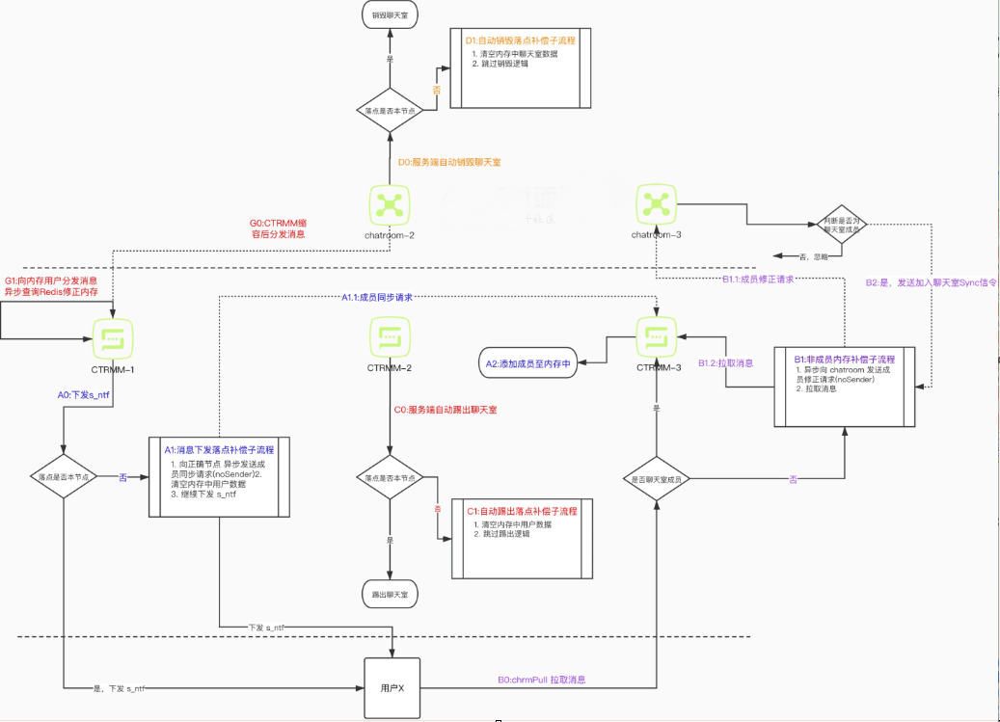

1）在扩容时：我们根据聊天室的活跃程度逐步转移人员。

2）在有消息时：[消息服务会遍历缓存在本节点上的所有用户进行消息的通知拉取，在此过程中判断此用户是否属于这台节点（如果不是，将此用户同步加入到属于他的节点）。

3）在拉消息时：用户在拉取消息时，如果本机缓存列表中没有该用户，消息服务会向聊天室服务发送请求确认此用户是否在聊天室中（如果在则同步加入到消息服务，不在则直接丢掉）。

4）在缩容时：消息服务会从公共 Redis 获得全部成员，并根据落点计算将本节点用户筛选出来并放入用户管理列表中。

### 海量在线用户管理
**聊天室服务**：

管理了所有人员的进出，人员的列表变动也会异步存入 Redis 中。

**消息服务**：则维护属于自己的聊天室人员，用户在主动加入和退出房间时，需要根据一致性哈希算出落点后同步给对应的消息服务。

** 广播聊天室消息并进行心跳检测**：

聊天室服务广播给所有聊天室消息服务，由消息服务进行消息的通知拉取。消息服务会检测用户的消息拉取情况，在聊天室活跃的情况下，30s 内人员没有进行拉取或者累计 30 条消息没有拉取，消息服务会判断当前用户已经离线，然后踢出此人，并且同步给聊天室服务对此成员做下线处理。

利用TCP的keeplive保活探测功能，可以探知客户端崩溃、中间网络端开和中间设备因超时删除连接相关的连接表等意外情况，从而保证在意外发生时，服务端可以释放半打开的TCP连接。
客户端启动智能心跳不仅能在消耗极少的电和网络流量条件下，通知服务器客户端存活状态、定时的刷新NAT内外网IP映射表，还能在网络变更时自动重连长连接。

更多详情转移到**用户在线状态怎么做**

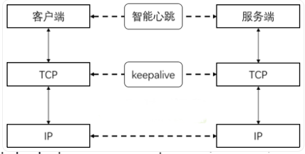

### 消息的实时性
在通信协议的选择上，我们主要有以下几个选择：
1，使用 TCP Socket 通信，自己设计协议：58 到家等等

2，使用 UDP Socket 通信：QQ 等等

3，使用 HTTP 长轮循：微信网页版等等

4，websocket实时通信：抖音 等
不管使用哪种方式，我们都能够做到消息的实时通知。但影响我们消息实时性的可能会在我们处理消息的方式上。例如：假如我们推送的时候使用 MQ 去处理并推送一个万人群的消息，推送一个人需要 2ms，那么推完一万人需要 20s，那么后面的消息就阻塞了 20s。如果我们需要在 10ms 内推完，那么我们推送的并发度应该是：人数：10000 / (推送总时长：10 / 单个人推送时长：2) = 2000
因此，我们在选择具体的实现方案的时候一定要评估好我们系统的吞吐量，系统的每一个环节都要进行评估压测。只有把每一个环节的吞吐量评估好了，才能保证消息推送的实时性。

### 如何保证消息时序
以下情况下消息可能会乱序：
●发送消息如果使用的不是长连接，而是使用 HTTP 的话可能会出现乱序。因为后端一般是集群部署，使用 HTTP 的话请求可能会打到不同的服务器，由于网络延迟或者服务器处理速度的不同，后发的消息可能会先完成，此时就产生了消息乱序。
**解决方案：**
●前端依次对消息进行处理，发送完一个消息再发送下一个消息。这种方式会降低用户体验，一般情况下不建议使用。
●带上一个前端生成的顺序 ID，让接收方根据该 ID 进行排序。这种方式前端处理会比较麻烦一点，而且聊天的过程中接收方的历史消息列表中可能会在中间插入一条消息，这样会很奇怪，而且用户可能会漏读消息。但这种情况可以通过在用户切换窗口的时候再进行重排来解决，接收方每次收到消息都先往最后面追加。
●通常为了优化体验，有的 IM 系统可能会采取异步发送确认机制（例如：QQ）。即消息只要到达服务器，然后服务器发送到 MQ 就算发送成功。如果由于权限等问题发送失败的话后端再推一个通知下去。这种情况下 MQ 就要选择合适的 Sharding 策略了：
●按to_user_id进行 Sharding：使用该策略如果需要做多端同步的话发送方多个端进行同步可能会乱序，因为不同队列的处理速度可能会不一样。例如发送方先发送 m1 然后发送 m2，但服务器可能会先处理完 m2 再处理 m1，这里其它端会先收到 m2 然后是 m1，此时其它端的会话列表就乱了。
●按conversation_id进行 Sharding：使用该策略同样会导致多端同步会乱序。
●按from_user_id进行 Sharding：这种情况下使用该策略是比较好的选择
●通常为了优化性能，推送前可能会先往 MQ 推，这种情况下使用to_user_id才是比较好的选择。

### 用户在线状态如何做
很多 IM 系统都需要展示用户的状态：是否在线，是否忙碌等。主要可以使用 Redis 或者分布式一致性哈希来实现用户在线状态的存储。
1，Redis 存储用户在线状态

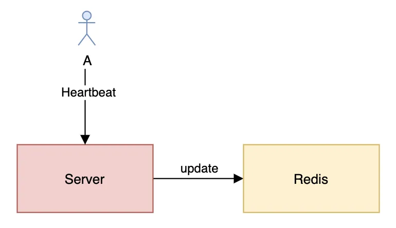

看上面的图可能会有人疑惑，为什么每次心跳都需要更新 Redis？如果我使用的是 TCP 长连接那是不是就不用每次心跳都更新了？
由于 Redis 是单机存储的，因此，为了提高可靠性跟性能，我们可以使用 Redis Cluster 或者 Codis。
2，分布式一致性哈希存储用户在线状态

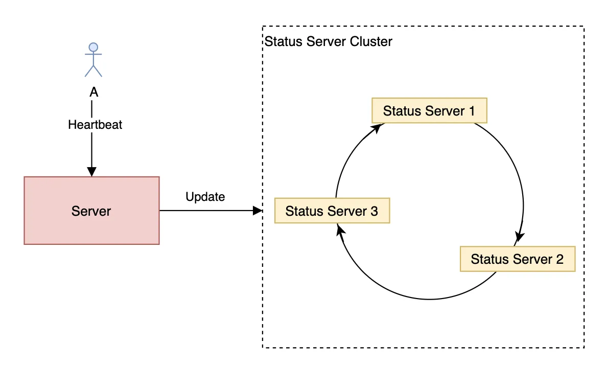

使用分布式一致性哈希需要注意在对 Status Server Cluster 进行扩容或者缩容的时候要先对用户状态进行迁移，不然在刚操作时会出现用户状态不一致的情况。同时还需要使用虚拟节点避免数据倾斜的问题。

#### 具体实现步骤
    - **客户端** ：
        * 在用户登录时，向服务器发送登录请求，服务器在 Redis 中创建该用户的键，并将初始状态设置为在线。
        * 客户端定时（如每 30 秒）向服务器发送心跳消息。可以使用 WebSocket 等实时通信技术来实现心跳消息的发送。
        * 在发送心跳消息时，可以携带一些额外的信息，如设备类型、网络状态等，以便服务器更全面地了解用户的状态。
    - **服务器** ：
        * 接收客户端的心跳消息，并更新 Redis 中对应用户的状态为在线，同时可以更新其他相关信息，如最后心跳时间等。
        * 定期（如每分钟）检查 Redis 中存储的用户状态，对于超过一定时间（如 5 分钟）没有收到心跳消息的用户，将其状态设置为离线。
        * 提供接口供其他客户端查询用户的状态，当接收到查询请求时，直接从 Redis 中获取并返回对应用户的状态。

**问题及优化：**

问题1：成千上万的定时心跳影响性能，是否有必要

问题2：网络抖动或消息可靠性影响心跳被误判“死亡”

优化1：综合策略：服务器在收到用户的互动消息后（点赞，评论，xx），可以更新用户的状态为在线，并且可以根据互动的频率等因素进一步判断用户的活跃程度。避免互动频率低的用户状态可能被误判，根据用户的互动情况动态调整心跳频率 和 定期检查次数（默认超1小时，活跃用户2小时或不踢）。

### 数据冷热分离
对于 IM 来说，历史消息的存储有很强的时间序列特性，时间越久，消息被访问的概率也越低，价值也越低。


如果我们需要存储几年甚至是永久的历史消息的话（电商 IM 中比较常见），那么做历史消息的冷热分离就非常有必要了。数据的冷热分离一般是 HWC（Hot-Warm-Cold）架构。

### 消息优先级
消息控速的核心是对消息的取舍，这就需要对消息做优先级划分。

 划分逻辑大致如下：

首先根据公司具体业务区分 VIP等级，礼品消息，弹窗等消息（万恶的资本你细品）

  1）白名单消息：这类消息最为重要，级别最高，一般系统类通知或者管理类信息会设置为白名单消息；

 2）高优先级消息：仅次于白名单消息，没有特殊设置过的消息都为高优先级；

 3）低优先级消息：最低优先级的消息，这类消息大多是一些文字类消息。

具体如何划分，应该是可以开放出方便的接口进行设置的。

  服务器对三种消息执行不同的限速策略，在高并发时，低优先级消息被丢弃的概率最大。

 服务器将三种消息分别存储在三个消息桶中：

客户端在拉取消息时按照白名单消息 ＞ 高优先级消息 ＞ 低优先级消息的顺序拉取。

（是否能想起 阅读过之前的12306抢票系统设计 中抢票设计）

### 互动消息分离处理
实时收发消息是聊天系统的核心业务，主要分文字语音等基础类型。

其次弹幕和礼物之类：

 1）礼物因涉及付费等因素一般通过客户方业务服务器发送；

2）弹幕消息则可以通过聊天室长链接发送。

 在千万级直播间场景下，因消息量太高，因此需要从消息量、消息体大小、消息比例等多个方面优化，因此我们设计了一套基于优先级队列的弹幕服务。

**首先**：为了节约消息产生的带宽，在大型直播项目开始阶段，就需要对消息格式进行优化，充分精简消息体大小。例如将礼物消息展示相关的资源文件提前预加载到直播App中，礼物消息转化为业务编号，可极大的减少消息大小；

** 其次**：针对上行消息设计流控机制。为了能全局控制上行消息体量，设计了逐级流控方案。上层级根据下层级能够支撑处理能力设计相对较粗粒度的本地流控机制。在弹幕反垃圾业务阶段，因需要全局控制消息量，因此采用分布式全局流控方案；弹幕广播阶段则根据业务广播需求再一次进行消息流控。


**上行消息通过反垃圾监测后被投递到弹幕服务处理。**基于优先级队列的弹幕服务首先按业务划分不同的消息队列，例如：系统广播、高优先级礼物、低优先级、弹幕，然后按队列分配消息比例，最后根据单位时间（1秒）内用户需要接收到的消息量计算各个队列应该投递的消息数量。在实际投递消息的过程中，若前一个队列消息量不足，可将剩余的消息数量叠加到下一个队列，以确保每一个周期都发送足够的消息给用户。

**弹幕可通过长连接或CDN广播给其他用户。**为了给用户提供极致的弹幕体验，充分发挥边缘加速的优势，在千万级在线直播场景下优先选择CDN方案。

### 接入层怎么做
实现接入层的负载均衡主要有以下几个方法：
1，硬件负载均衡：例如 F5、A10 等等。硬件负载均衡性能强大，稳定性高，但价格非常贵，不是土豪公司不建议使用。
2，使用 DNS 实现负载均衡：使用 DNS 实现负载均衡比较简单，但使用 DNS 实现负载均衡如果需要切换或者扩容那生效会很慢，而且使用 DNS 实现负载均衡支持的 IP 个数有限制、支持的负载均衡策略也比较简单。
3，DNS + 4 层负载均衡 + 7 层负载均衡架构：

例如 DNS + DPVS + Nginx 或者 DNS + LVS + Nginx。有人可能会疑惑为什么要加入 4 层负载均衡呢？

这是因为 7 层负载均衡很耗 CPU，并且经常需要扩容或者缩容，对于大型网站来说可能需要很多 7 层负载均衡服务器，但只需要少量的 4 层负载均衡服务器即可。因此，该架构对于 HTTP 等短连接大型应用很有用。
4，DNS + 4 层负载均衡：4 层负载均衡一般比较稳定，很少改动，比较适合于长连接。
对于长连接的接入层，如果我们需要更加灵活的负载均衡策略或者需要做灰度的话，那我们可以引入一个调度服务，如下图所示：

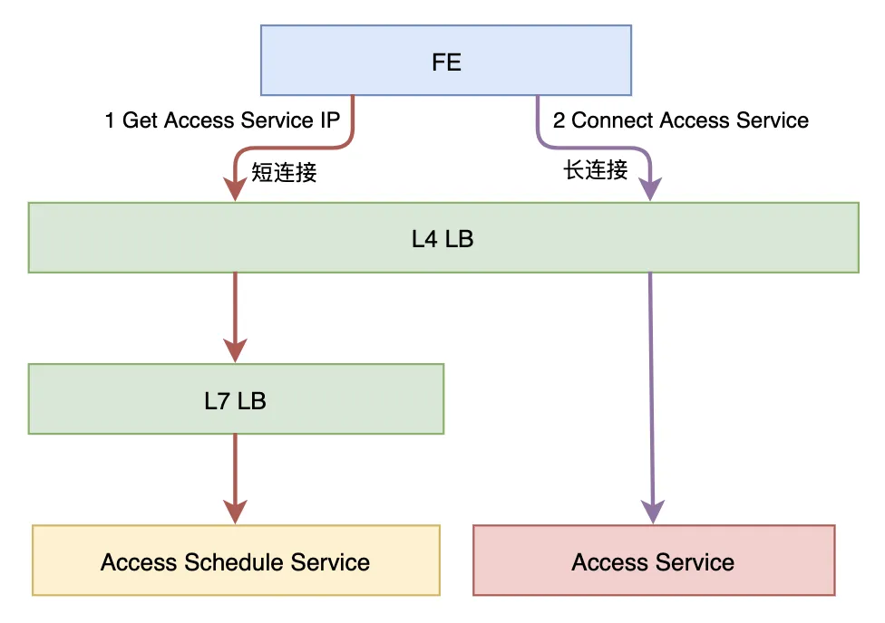

Access Schedule Service 可以实现根据各种策略来分配 Access Service，例如：
●根据灰度策略来分配
●根据就近原则来分配
●根据最少连接数来分配

# 百亿级超大流量红包架构方案

话说每逢双十一节或春节等节假日，对大家来讲是最欢乐的日子，可以在微信群中收发红包，此外今年微信还推出了面对面红包，让大家拜年时可直接收发，对于用户来讲很爽也很方便。但对于技术架构侧的考量，这使得微信红包的收发数据成几何倍数上升，处理的复杂度也增加了很多。

2017年微信红包发送量最大的时间段是除夕夜，达到了142亿个。

如此大规模、高并发、高峰值的业务场景，怕是在美帝互联网的技术团队，包括EBay、Amazon等也无法想象，在这种巨大的流量与并发后面，需要什么样级别的技术架构支撑？

当达百亿级别的资金交易规模时，我们该怎样来保证系统的并发性能和交易安全？

当今中国的互联网平台，有两个场景称得上亿级以上的并发量：

一个是微信的红包，

一个是字节的红包，

都是在一个单位时间达到亿万以以上的请求负载。

### 百亿级微信红包技术架构
与传统意义上的红包相比，近两年火起来的“红包”，似乎才是如今春节的一大重头戏。历经上千年时代传承与变迁，春节发红包早已成为历史沉淀的文化习俗，融入了民族的血脉。按照各家公布的数据，除夕全天微信用户红包总发送量达到80.8亿个，红包峰值收发量为40.9万个/秒。春晚直播期间讨论春晚的微博达到5191万条，网友互动量达到1.15亿，网友抢微博红包的总次数超过8亿次。

微信红包在经过15年春晚摇一摇之后，2015年上半年业务量一度呈指数级增长。尤其是微信红包活跃用户数的大量增长，使得2016除夕跨年红包成为极大挑战。为了应对16年春节可预知的红包海量业务，红包系统在架构上进行了一系列调整和优化。主要包括异地架构、cache系统优化、拆红包并发策略优化、存储优化一系列措施，为迎接2016春节红包挑战做好准备。 下面介绍最主要的一些思路。

#### 架构
微信用户在国内有深圳、上海两个接入点，习惯性称之为南、北（即深圳为南，上海为北）。用户请求接入后，不同业务根据业务特性选择部署方式。微信红包在信息流上可以分为订单纬度与用户纬度。

其中订单是贯穿红包发、抢、拆、详情列表等业务的关键信息，属于交易类信息；而用户纬度指的是红包用户的收红包列表、发红包列表，属于展示类信息。红包系统在架构上，有以下几个方面：

##### **南北分布**
1、订单层南北独立体系，数据不同步

用户就近接入，请求发红包时分配订单南北，并在单号打上南北标识。抢红包、拆红包、查红包详情列表时，接入层根据红包单号上的南北标识将流量分别引到南北系统闭环。根据发红包用户和抢红包用户的所属地不同，有以下四种情况：

1）深圳用户发红包，深圳用户抢

订单落在深圳，深圳用户抢红包时不需要跨城，在深圳完成闭环。

2）深圳用户发红包，上海用户抢

订单落在深圳，上海用户抢红包，在上海接入后通过专线跨城到深圳，最后在深圳闭环完成抢红包。

3）上海用户发红包，上海用户抢

订单落在上海，上海用户抢红包时不需要跨城，在上海完成闭环。

4）上海用户发红包，深圳用户抢

订单落在上海，深圳用户抢红包，从深圳接入后通过专线跨城到上海，最后在上海闭环完成抢红包。

系统这样设计，好处是南北系统分摊流量，降低系统风险。

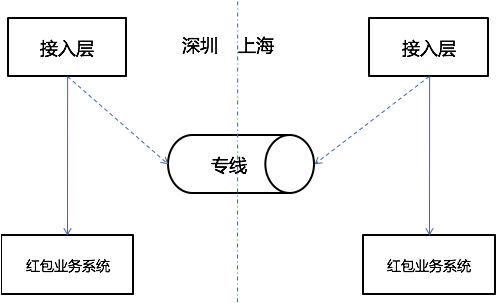

2、用户数据写多读少，全量存深圳，异步队列写入，查时一边跨城

用户数据的查询入口，在微信钱包中，隐藏的很深。这决定了用户数据的访问量不会太大，而且也被视为可旁路的非关键信息，实时性要求不高。因此，只需要在发红包、拆红包时，从订单纬度拆分出用户数据写入请求，由MQ异步写入深圳。后台将订单与用户进行定时对账保证数据完整性即可。

3、支持南北流量灵活调控

红包系统南北分布后，订单落地到深圳还是上海，是可以灵活分配的，只需要在接入层上做逻辑。提升了红包系统的容灾能力。同时，实现了接入层上的后台管理系统，实现了秒级容量调控能力。可根据南北请求量的实时监控，做出对应的调配。

4、DB故障时流量转移能力 基于南北流量的调控能力，当发现DB故障时，可将红包业务流量调到另外一边，实现DB故障的容灾。

预订单

支付前订单落cache，同时利用cache的原子incr操作顺序生成红包订单号。优点是cache的轻量操作，以及减少DB废单。在用户请求发红包与真正支付之间，存在一定的转化率，部分用户请求发红包后，并不会真正去付款。

##### **拆红包入账异步化**
信息流与资金流分离。

拆红包时，DB中记下拆红包凭证，然后异步队列请求入账。

入账失败通过补偿队列补偿，最终通过红包凭证与用户账户入账流水对账，保证最终一致性。如下图所示：


这个架构设计，理论基础是快慢分离。

红包的入账是一个分布事务，属于慢接口。

而拆红包凭证落地则速度快。

实际应用场景中，用户抢完红包，只关心详情列表中谁是“最佳手气”，很少关心抢到的零是否已经到账。

因为只需要展示用户的拆红包凭证即可。

##### **发拆落地，其他操作双层cache**
1、Cache住所有查询，两层cache

除了使用ckv做全量缓存，还在数据访问层dao中增加本机内存cache做二级缓存，cache住所有读请求。

查询失败或者查询不存在时，降级内存cache；内存cache查询失败或记录不存在时降级DB。

**DB本身不做读写分离。**

2、DB写同步cache，容忍少量不一致， DB写操作完成后，dao中同步内存cache，业务服务层同步ckv，失败由异步队列补偿，

定时的ckv与DB备机对账，保证最终数据一致。

#### 高并发
微信红包的并发挑战，主要在于微信大群，多人同时抢同一个红包。

以上这种情况，存在竞争MySQL行锁。为了控制这种并发，团队做了以下一些事情：

**1、请求按红包订单路由，逻辑块垂直sticky，事务隔离**

按红包订单划分逻辑单元，单元内业务闭环。服务rpc调用时，使用红包订单号的hash值为key寻找下一跳地址。对同一个红包的所有拆请求、查询请求，都路由到同一台逻辑机器、同一台DB中处理。


**2、Dao搭建本机Memcache内存cache，控制同一红包并发个数**

在DB的接入机dao中，搭建本机内存cache。以红包订单号为key，对同一个红包的拆请求做原子计数，控制同一时刻能进DB中拆红包的并发请求数。

这个策略的实施，依赖于请求路由按红包订单hash值走，确保同一红包的所有请求路由到同一逻辑层机器。

**3、多层级并发量控制**

1）发红包控制

发红包是业务流程的入口，控制了这里的并发量，代表着控制了红包业务整体的并发量。在发红包的业务链路里，做了多层的流量控制，确保产生的有效红包量级在可控范围。

2）抢红包控制

微信红包领取时分为两个步骤，抢和拆。

抢红包这个动作本身就有控制拆并发的作用。因为抢红包时，只需要查cache中的数据，不需要请求DB。

对于红包已经领完、用户已经领过、红包已经过期等流量可以直接拦截。而对于有资格进入拆红包的请求量，也做流量控制。通过这些处理，最后可进入拆环节的流量大大减少，并且都是有效请求。

3）拆时内存cache控制

针对同一个红包并发拆的控制，上面的文章已介绍。

**4、DB简化和拆分**

DB的并发能力，有很多影响因素。红包系统结合红包使用情境，进行了一些优化。比较有借鉴意义的，主要有以下两点：

1）订单表只存关键字段，其他字段只在cache中存储，可柔性。

红包详情的展示中，除了订单关键信息（用户、单号、金额、时间、状态）外，还有用户头像、昵称、祝福语等字段。这些字段对交易来说不是关键信息，却占据大量的存储空间。

将这些非关键信息拆出来，只存在cache，用户查询展示，而订单中不落地。

这样可以维持订单的轻量高效，同时cache不命中时，又可从实时接口中查询补偿，达到优化订单DB容量的效果。

2）DB双重纬度分库表，冷热分离

使用订单hash、订单日期，两个纬度分库表，也即db_xxx.t_x_dd这样的格式。

其中，x表示订单hash值，dd表示01-31循环日。

订单hash纬度，是为了将订单打散到不同的DB服务器中，均衡压力。

订单日期循环日纬度，是为了避免单表数据无限扩张，使每天都是一张空表。

另外，红包的订单访问热度，是非常典型的冷热型。

热数据集中在一两天内，且随时间急剧消减。

线上热数据库只需要存几天的数据，其他数据可以定时移到成本低的冷数据库中。

循环日表也使得历史数据的迁移变得方便。

##### **红包算法**
首先，如果红包只有一个，本轮直接使用全部金额，确保红包发完。

然后，计算出本轮红包最少要领取多少，才能保证红包领完，即本轮下水位；轮最多领取多少，才能保证每个人都领到，即本轮上水位。主要方式如下：

计算本轮红包金额下水位：假设本轮领到最小值1分，那接下来每次都领到200元红包能领完，那下水位为1分；如果不能领完，那按接下来每次都领200元，剩下的本轮应全部领走，是本轮的下水位。

计算本轮红包上水位：假设本轮领200元，剩下的钱还足够接下来每轮领1分钱，那本轮上水位为200元；如果已经不够领，那按接下来每轮领1分，计算本轮的上水位。

为了使红包金额不要太悬殊，使用红包均值调整上水位。如果上水位金额大于两倍红包均值，那么使用两倍红包均值作为上水位。换句话说，每一轮抢到的红包金额，最高为两倍剩下红包的均值。

最后，获取随机数并用上水位取余，如果结果比下水位还小，则直接使用下水位，否则使用随机金额为本轮拆到金额。

##### **柔性降级方案**
系统到处存在发生异常的可能，需要对所有的环节做好应对的预案。

下面列举微信红包对系统异常的主要降级考虑。

1、 下单cache故障降级DB

下单cache有两个作用，生成红包订单与订单缓存。

缓存故障情况下，降级为直接落地DB，并使用id生成器独立生成订单号。

2、 抢时cache故障降级DB

抢红包时，查询cache，拦截红包已经抢完、用户已经抢过、红包已经过期等无效请求。当cache故障时，降级DB查询，同时打开DB限流保护开关，防止DB压力过大导致服务不可用。

另外，cache故障降级DB时，DB不存储用户头像、用户昵称等（上文提到的优化），此时一并降级为实时接口查询。查询失败，继续降级为展示默认头像与昵称。

3、 拆时资金入账多级柔性

拆红包时，DB记录拆红包单据，然后执行资金转账。单据需要实时落地，而资金转账，这里做了多个层级的柔性降级方案：

大额红包实时转账，小额红包入队列异步转账 所有红包进队列异步转账 实时流程不执行转账，事后凭单据批量入账。

总之，单据落地后，真实入账可实时、可异步，最终保证一致即可。

4、 用户列表降级

用户列表数据在微信红包系统中，属于非关键路径信息，属于可被降级部分。

首先，写入时通过MQ异步写，通过定时对账保证一致性。

其次，cache中只缓存两屏，用户查询超过两屏则查用户列表DB。在系统压力大的情况下，可以限制用户只查两屏。

调整后的系统经过了2016年春节的实践检验，平稳地度过了除夕业务高峰，保障了红包用户的体验。

上文参考来源：架构说公众号，作者：方乐明

方乐明，2011年毕业于华南理工大学通信与信息系统专业，毕业后就职于财付通科技有限公司。微信支付团队组建后，主要负责微信红包、微信转账、AA收款等支付应用产品的后台架构。

### 360w QPS 100亿级 字节红包 体系架构
#### 1. 背景&挑战&目标
##### 1.1 业务背景
（1）**支持八端**：

2022 年字节系产品春节活动需要支持八端 APP 产品（包含抖音/抖音火山/抖音极速版/西瓜/头条/头条极速版/番茄小说/番茄畅听）的奖励互通。用户在上述任意一端都可以参与活动，得到的奖励在其他端都可以提现与使用。

（2）**玩法多变**：

主要有集卡、朋友页红包雨、红包雨、集卡开奖与烟火大会等。

（3）**多种奖励**：

奖励类型包含现金红包、补贴视频红包、商业化广告券、电商券、支付券、消费金融券、保险券、信用卡优惠券、喜茶券、电影票券、dou+券、抖音文创券、头像挂件等。

##### 1.2 核心挑战
（1）超高吞吐，超大并发，最高预估 360w QPS 发奖。

（2）奖励类型多，共 10 余种奖励。多种发奖励的场景，玩法多变；

（3）从奖励系统稳定性、用户体验、资金安全与运营基础能力全方位保障，确保活动顺利进行 。

##### 1.3 最终目标
（1）**奖励入账**：数据高可靠。提供统一的错误处理机制，入账幂等能力和奖励预算控制。

（2）**奖励展示/使用：**支持用户查看、提现（现金），使用卡券/挂件等能力。

（3）**稳定性保障**：在大流量的入账场景下，保证钱包核心路径稳定性与完善，通过常用稳定性保障手段如资源扩容、限流、熔断、降级、兜底、资源隔离等方式保证用户奖励方向的核心体验。

（4）**资金安全**：通过幂等、对账、监控与报警等机制，保证资金安全，保证用户资产应发尽发，不少发。

（5）**活动隔离**：实现内部测试、灰度放量和正式春节活动三个阶段的奖励入账与展示的数据隔离，不互相影响。

#### 2. 产品需求介绍
用户可以在任意一端参与字节的春节活动获取奖励，以抖音红包雨现金红包入账场景为例，具体的业务流程如下：

登录抖音 → 参与活动 → 活动钱包页 → 点击提现按钮 → 进入提现页面 → 进行提现 → 提现结果页，

另外从钱包页也可以进入活动钱包页。


奖励发放核心场景：

1. **集卡**：集卡抽卡时发放各类卡券，集卡锦鲤还会发放大额现金红包，集卡开奖时发放瓜分奖金和优惠券；
2. **红包雨**：发红包、卡券以及视频补贴红包，其中红包和卡券最高分别 180w QPS；


#### 3. 钱包资产中台设计与实现
在 2022 年春节活动中，业务方分为：

UG、激励中台、视频红包、钱包方向、资产中台等

其中，UG 主要负责活动的玩法实现，包含集卡、红包雨以及烟火大会等具体的活动相关业务逻辑和稳定性保障。

而钱包方向定位是大流量场景下实现奖励入账、奖励展示、奖励使用与资金安全保障的相关任务。

其中资产中台负责**奖励发放与奖励展示**部分。

##### 3.1 春节资产资产中台总体架构图如下：
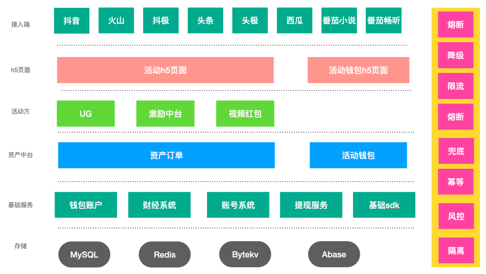

钱包资产中台核心系统划分如下：

1. **资产订单层**：

收敛八端奖励入账链路，

提供统一的接口协议，对接上游活动业务方的奖励发放功能，

同时，支持预算控制、补偿、订单号幂等。

2. **活动钱包 api 层**：

统一奖励展示链路，同时支持大流量场景

##### 3.2 资产订单中心设计
**核心发放模型：**


**说明：**

活动 ID 唯一区分一个活动，

本次春节分配了一个单独的母活动 ID

场景 ID 和具体的一种奖励类型一一对应，

定义该场景下发奖励的唯一配置，

场景 ID 可以配置的能力有：

+ 发奖励账单文案；
+ 是否需要补偿；
+ 限流配置；
+ 是否进行库存控制；
+ 是否要进行对账。
+ 提供可插拔的能力，供业务可选接入。

**订单号设计：**

资产订单层支持订单号维度的发奖幂等，订单号设计逻辑为

${actID}_${scene_id}_${rain_id}_${award_type}_${statge}

从单号设计层面保证不超发，每个场景的奖励用户最多只领一次。

#### 4. 核心难点问题解决
##### 4.1 难点一：支持八端奖励数据互通
有八个产品端，需要统一对接，

其中抖音系和头条系 APP 是不同的账号体系，所以不能通过用户 ID 打通奖励互通。

具体解决方案是：

+ 给每个用户生成唯一的 actID
+ 手机号优先级最高，如果不同端登录的手机号一样，在不同端的 actID 是一致的。

在唯一 actID 基础上，每个用户的奖励数据是绑定在 actID 上的，入账和查询是通过 actID 维度实现的，即可实现八端奖励互通。

示意图如下：


##### 4.2 难点二：高场景下的奖励入账实现
超高并发场景，发现金红包都是最关键的一环。有几个原因如下：

1. 预估发现金红包最大流量有 180w TPS。
2. 现金红包本身价值高，需要保证资金安全。
3. 用户对现金的敏感度很高，在保证用户体验与功能完整性同时也要考虑成本问题。

终上所述，**发现金红包面临比较大的技术挑战。**

发红包其实是一种交易行为，资金流走向是从公司成本出然后进入个人账户。

（1）从技术方案上是要支持订单号维度的幂等，同一订单号多次请求只入账一次。订单号生成逻辑为

${actID}_${scene_id}_${rain_id}_${award_type}_${statge}

从单号设计层面保证不超发。

（2）支持高并发，有以下 2 个传统方案：

| **具体方案类型** | **实现思路** | **优点** | **缺点** |
| :---: | :---: | :---: | :---: |
| 同步入账 | 申请和预估流量相同的计算和存储资源 | 1.开发简单； 2.不容易出错； | **浪费存储成本。** 拿账户数据库举例，经实际压测结果：支持 30w 发红包需要 152 个数据库实例，如果支持 180w 发红包，至少需要 1152 个数据库实例，还没有算上 tce 和 redis 等其他计算和存储资源。 |
| 异步入账 | 申请部分计算和存储资源资源，实际入账能力与预估有一定差值 | 1.开发简单； 2.不容易出错； 3.不浪费资源； | **用户体验受到很大影响。** 入账延迟较大，以今年活动举例会有十几分钟延迟。用户参与玩法得到奖励后在活动钱包页看不到奖励，也无法进行提现，会有大量客诉，影响抖音活动的效果。 |

以上两种传统意义上的技术方案都有明显的缺点，

那么进行思考，既能相对节约资源又能保证用户体验的方案是什么？

最终采用的是红包雨 token 方案，具体方案是：

**使用异步入账加较少量分布式存储和较复杂方案来实现，**

下面具体介绍一下。

###### 4.2.1 红包雨 token 方案：
**根据预估发放红包估算**，红包雨 token 方案, 计算实际入账最低要支持的 TPS 为 30w，所以实际发放中有压单的过程。

**设计目标：**

在活动预估给用户发放（180w）与实际入账（30w）有很大 gap 的情况下，保证用户的核心体验。

用户在前端页面查看与使用过当中不能感知压单的过程，即查看与使用体验不能受到影响，相关展示的数据包含余额，累计收入与红包流水，使用包含提现等。

**具体设计方案：**

我们在大流量场景下每次给用户发红包会生成一个加密 token（**使用非对称加密**，包含发红包的元信息：红包金额，actID，与发放时间等），

分别存储在客户端和服务端（**容灾互备**），每个用户有个 token 列表。

每次发红包的时候会在 Redis 里记录该 token 的入账状态，

然后用户在活动钱包页看到的现金红包流水、余额等数据，是合并已入账红包列表+token 列表-已入账/入账中 token 列表的结果。

同时为保证用户提现体验不感知红包压单流程，

在进入提现页或者点击提现时，将未入账的 token 列表进行强制入账，

保证用户提现时账户的余额为应入账总金额，不 block 用户提现流程。

**示意图如下：**

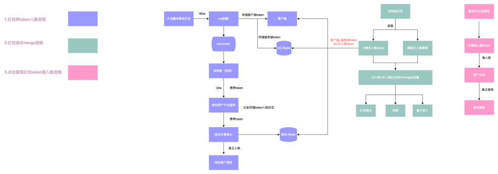

**token 数据结构：**

token 使用的是 protobuf 格式，

经单测验证存储消耗实际比使用 json 少了一倍，节约请求网络的带宽和存储成本；

同时序列化与反序列化消耗 cpu 也有降低。

```plain
// 红包雨token结构
type RedPacketToken struct {
   AppID      int64  `protobuf: varint,1,opt  json: AppID,omitempty ` // 端ID
   ActID     int64  `protobuf: varint,2,opt  json: UserID,omitempty ` // ActID
   ActivityID string `protobuf: bytes,3,opt  json: ActivityID,omitempty ` // 活动ID
   SceneID    string `protobuf: bytes,4,opt  json: SceneID,omitempty ` // 场景ID
   Amount     int64  `protobuf: varint,5,opt  json: Amount,omitempty ` // 红包金额
   OutTradeNo string `protobuf: bytes,6,opt  json: OutTradeNo,omitempty ` // 订单号
   OpenTime   int64  `protobuf: varint,7,opt  json: OpenTime,omitempty ` // 开奖时间
   RainID     int32  `protobuf: varint,8,opt,name=rainID  json: rainID,omitempty ` // 红包雨ID
   Status     int64  `protobuf: varint,9,opt,name=status  json: status,omitempty ` //入账状态
}
```

**token 安全性保障：**

采用非对称加密算法，保障存储在的客户端尽可能不被破解。

如果 token 加密算法被黑产破译，可监控报警发现，可降级。

##### 4.3 难点三：发奖励链路依赖多的稳定性保障
发红包流程降级示意图如下：

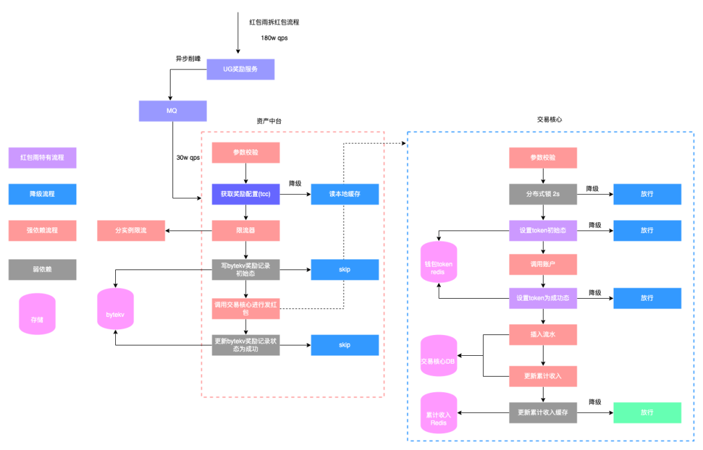

根据历史经验，实现的功能越复杂，依赖会变多，对应的稳定性风险就越高，那么如何保证高依赖的系统稳定性呢？

**解决方案：**

现金红包入账最基础要保障的功能，

是将用户得到的红包进行入账，

核心的功能，需要支持幂等与预算控制（避免超发），

红包账户的幂等设计强依赖数据库保持事务一致性。

但是如果极端情况发生，中间的链路可能会出现问题，如果是弱依赖，需要支持降级掉，不影响发放主流程。

钱包方向发红包**最短路径**为依赖服务实例计算资源和 MySQL 存储资源实现现金红包入账。

发红包强弱依赖梳理图示：

| **psm** | **依赖服务** | **是否强依赖** | **降级方案** | **降级后影响** |
| :---: | :---: | :---: | :---: | :---: |
| 资产中台 | tcc | **是** | 降级读本地缓存 | 无 |
| | bytkekv | 否 | 主动降级开关，跳过 bytekv，依赖下游做幂等 | 无 |
| 资金交易层 | 分布式锁 Redis | 否 | 被动降级，调用失败，直接跳过 | 基本无 |
| | token Redis | 否 | 主动降级开关，不调用 Redis | 用户能感知到入账有延迟，会有很多客诉 |
| | MySQL | **是** | 主有问题，联系 dba 切主 | 故障期间发红包不可用 |

##### 4.4 难点四：大流量发卡券预算控制
大流量集中发券的一个场景，钱包侧与算法策略配合进行卡券发放库存控制，防止超发。

**具体实现：**

（1）钱包资产中台维护每个卡券模板 ID 的消耗发放量。

（2）每次卡券发放前，读取该卡券模板 ID 的消耗量以及总库存数。同时会设置一个阈值，如果卡券剩余量小于 10%后不发这个券（使用兜底券或者祝福语进行兜底）。

（3） 发券流程 累计每个券模板 ID 的消耗量（使用 Redis incr 命令原子累加消耗量），然后与总活动库存进行比对，如果消耗量大于总库存数则拒绝掉，防止超发，也是一个兜底流程。

**具体流程图：**

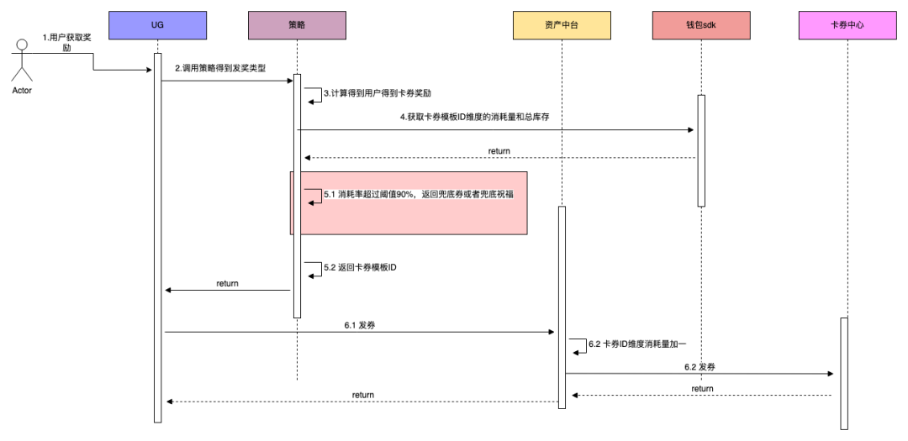

**优化方向：**

（1）大流量下使用 Redis 计数，单 key 会存在热 key 问题，需要拆分 key 来解决。

（2）大流量场景下，**操作 Redis 会存在超时问题**，返回上游处理中，上游继续重试发券，会多消耗库存少发，本次春节活动实际活动库存在预估库存基础上加了 5%的量级来缓解超时带来的少发问题。

##### 4.5 难点五：高 QPS 场景下的热 key 的读取和写入稳定性保障
最大流量预估读取有 180wQPS，写入 30wQPS。

这是典型的超大流量，热点 key、更新延迟不敏感，非数据强一致性场景（数字是一直累加），

同时要做好**容灾降级处理**，最后实际活动展示的金额与产品预计发放数值误差小于 1%。


###### 4.5.1 方案一
高 QPS 下的读取和写入单 key，比较容易想到的是使用 Redis 分布式缓存来进行实现，但是单 key 读取和写入的会打到一个实例上，压测过单实例的瓶颈为 3w QPS。

所以做的一个优化是拆分多个 key，然后用本地缓存兜底。

**具体写入流程：**

设计拆分 100 个 key，每次发红包根据请求的 actID%100 使用 incr 命令累加该数字，因为不能保证幂等性，所以超时不重试。


**读取流程：**

与写入流程类似，优先读取本地缓存，

如果本地缓存值为为 0，那么去读取各个 Redis 的 key 值累加到一起，进行返回。


**问题：**

（1）拆分 100 个 key 会出现读扩散的问题，需要申请较多 Redis 资源，存储成本比较高。

而且可能存在读取超时问题，不能保证一次读取所有 key 都读取成功，故返回的结果可能会较上一次有减少。

（2）容灾方案方面，如果申请备份 Redis，也需要较多的存储资源，需要的额外存储成本。

###### 4.5.2 方案二
**设计思路：**

在方案一实现的基础上进行优化，

在写场景，通过本地缓存进行合并写请求，进行原子性累加，

读场景返回本地缓存的值，减少额外的存储资源占用。

使用 Redis 实现中心化存储，最终大家读到的值都是一样的。

**具体设计方案：**

每个 docker 实例启动时都会执行定时任务，分为读 Redis 任务和写 Redis 任务。

**读取流程：**

1. 本地的定时任务每秒执行一次，

读取 Redis 单 key 的值，如果获取到的值大于本地缓存那么更新本地缓存的值。

2. 对外暴露的 sdk 直接返回本地缓存的值即可。
3. 有个问题需要注意下，每次实例启动第一秒内是没有数据的，所以会阻塞读，等有数据再返回。

**写入流程：**

1. 因为读取都是读取本地缓存（本地缓存不过期），所以处理好并发情况下的写即可。
2. 本地缓存写变量使用 go 的 atomic.AddInt64 支持原子性累加本地写缓存的值。
3. 每次执行更新 Redis 的定时任务，

先将本地写缓存复制到 amount 变量，最后将 amount 的值 incr 到 Redis 单 key 上，实现 Redis 的单 key 的值一直累加。

4. 容灾方案是使用备份 Redis 集群，写入时进行双写，

一旦主机群挂掉，设计了一个配置开关支持读取备份 Redis。两个 Redis 集群的数据一致性，通过定时任务兜底实现。

具体写入流程图如下：


**本方案调用 Redis 的流量是跟实例数成正比**，

经调研读取侧的服务为主会场实例数 2 万个，写入侧服务为资产中台实例数 8 千个，

所以实际 Redis 要支持的 QPS 为 2.8 万/定时任务执行间隔（单位为 s），

经压测验证 Redis 单实例可以支持单 key2 万 get，8k incr 的操作，

所以设置定时任务的**执行时间间隔是 1s**，如果实例数更多可以考虑延长执行时间间隔。

###### 4.5.3 方案对比
| | **优点** | **缺点** |
| --- | :---: | :---: |
| 方案一 | 1. 实现成本简单 | 1. 浪费存储资源； 2. 难以做容灾； 3. 不能做到一直累加； |
| 方案二 | 1. 节约资源； 2. 容灾方案比较简单，同时也节约资源成本； | 1. 实现稍复杂，需要考虑好并发原子性累加问题 |

**结论：**

从实现效果，资源成本和容灾等方面考虑，最终选择了方案二上线。

##### 4.6 难点六：大流量场景下资金安全保障
钱包方向在本次春节活动期间做了三件事情来保障大流量大预算的现金红包发放的资金安全：

1. 现金红包发放整体预算控制的拦截
2. 单笔现金红包发放金额上限的拦截
3. 大流量发红包场景的资金对账
+ 小时级别对账：支持红包雨/集卡/烟火红包发放 h+1 小时级对账，并针对部分场景设置兜底 h+2 核对。
+ 准实时对账：红包雨已入账的红包数据反查钱包资产中台和活动侧做准实时对账

多维度核对示意图：


准实时对账流程图：


**说明：**

准实时对账监控和报警可以及时发现是否异常入账情况，如果报警发现会有紧急预案处理。

#### 5. 通用模式抽象
在经历过春节超大流量活动后的设计与实现后，有一些总结和经验与大家一起分享一下。

##### 5.1 容灾降级层面
大流量场景，为了保证活动最终上线效果，容灾是一定要做好的。

参考业界通用实现方案，如降级、限流、熔断、资源隔离，根据预估活动参与人数和效果进行使用存储预估等。

###### 5.1.1 限流层面
（1）限流方面应用了 api 层 nginx 入流量限流，分布式入流量限流，分布式出流量限流。

这几个限流器都是字节跳动公司层面公共的中间件，经过大流量的验证。

（2）首先进行了实际单实例压测，根据单实例扛住的流量与本次春节活动预估流量打到该服务的流量进行扩容，并结合下游能抗住的情况，

在 tlb 入流量、入流量限流以及出流量限流分别做好了详细完整的配置并同。

**限流目标：**

保证自身服务稳定性，防止外部预期外流量把本身服务打垮，防止造成雪崩效应，保证核心业务和用户核心体验。

简单集群限流是实例维度的限流，

每个实例限流的 QPS=总配置限流 QPS/实例数，

对于多机器低 QPS 可能会有不准的情况，要**经过实际压测并且及时调整配置值。**

对于分布式入流量和出流量限流，两种使用方式如下，每种方式都支持高低 QPS，区别只是 SDK 使用方式和功能不同。

一般低 QPS 精度要求高，采用 redis 计数方式，使用方提供自己的 redis 集群。

高 QPS 精度要求低，退化为总 QPS/tce 实例数的单实例限流。

###### 5.1.2 降级层面
对于高流量场景，每个核心功能都要有对应的**降级方案**来保证突发情况核心链路的稳定性。

（1）本次春节奖励入账与活动活动钱包页方向做好了充分的操作预案，一共有 26 个降级开关，关键时刻弃车保帅，防止有单点问题影响核心链路。

（2）以发现金红包链路举例，钱包方向最后完全降级的方案是只依赖 docker 和 MySQL，其他依赖都是可以降级掉的，MySQL 主有问题可以紧急联系切主，虽说最后一个都没用上，但是前提要设计好保证活动的万无一失。

###### 5.1.3 资源隔离层面
（1）提升开发效率**不重复造轮子**。

因为钱包资产中台也日常支持抖音资产发放的需求，本次春节活动也复用了现有的接口和代码流程支持发奖。

（2）同时针对本次春节活动，服务层面做了**集群隔离**，

创建专用活动集群，底层存储资源隔离，活动流量和常规流量互不影响。

###### 5.1.4 存储预估
（1）不但要考虑和验证了 Redis 或者 MySQL 存储能抗住对应的流量，同时也要按照实际的获取参与和发放数据等预估存储资源是否足够。

（2）对于字节跳动公司的 Redis 组件来讲，

可以进行**垂直扩容**（每个实例增加存储，最大 10G），也可以进行**水平扩容**（单机房上限是 500 个实例），因为 Redis 是三机房同步的，所以计算存储时只考虑一个机房的存储上限即可。

要留足 buffer，因为水平扩容是很慢的一个过程，突发情况遇到存储资源不足只能通过配置开关提前下掉依赖存储，需要提前设计好。

###### 5.1.5 压测层面
本次春节活动，钱包奖励入账和活动钱包页做了充分的全链路压测验证，下面是一些经验总结。

1. 在压测前要建立好压测整条链路的监控大盘，在压测过程当中及时和方便的发现问题。
2. 对于 MySQL 数据库，在红包雨等大流量正式活动开始前，进行小流量压测预热数据库，峰值流量前提前建链，减少正式活动时的大量建链耗时，保证发红包链路数据库层面的稳定性。
3. 压测过程当中一定要传压测标，支持全链路识别压测流量做特殊逻辑处理，与线上正常业务互不干扰。
4. 针对压测流量不做特殊处理，压测流量处理流程保持和线上流量一致。
5. 压测中要验证计算资源与存储资源是否能抗住预估流量
+ **梳理好压测计划**，基于历史经验，设置合理初始流量，渐进提升压测流量，实时观察各项压测指标。
+ **存储资源压测数据要与线上数据隔离**，对于 MySQL 和 Bytekv 这种来讲是建压测表，对于 Redis 和 Abase 这种来讲是压测 key 在线上 key 基础加一下压测前缀标识 。
+ **压测数据要及时清理**，Redis 和 Abase 这种加短时间的过期时间，过期机制处理比较方便，如果忘记设置过期时间，可以根据写脚本识别压测标前缀去删除。
1. 压测后也要关注存储资源各项指标是否符合预期。

##### 5.2 微服务思考
在日常技术设计中，大家都会遵守微服务设计原则和规范，根据系统职责和核心数据模型拆分不同模块，提升开发迭代效率并不互相影响。

但是微服务也有它的弊端，对于超大流量的场景功能也比较复杂，会经过多个链路，这样是极其消耗计算资源的。

本次春节活动**资产中台提供了 sdk 包代替 rpc 进行微服务链路聚合对外提供基础能力**，如查询余额、判断用户是否获取过奖励，强制入账等功能。访问流量最高上千万，与使用微服务架构对比节约了上万核 CPU 的计算资源。

#### 6. 系统的未来演进方向
（1）梳理上下游需求和痛点，优化资产中台设计实现，完善基础能力，优化服务架构，提供一站式服务，让接入活动方可以更专注进行活动业务逻辑的研发工作。

（2）加强实时和离线数据看板能力建设，让奖励发放数据展示的更清晰更准确。

（3）加强配置化和文档建设，对内减少对接活动的对接成本，对外提升活动业务方接入效率。

# 如何实现一个登录功能

没听错，就这么简单的问题，估计你会觉得面试官看不起谁？这不是有脚就行吗？

## 简答：

实现一个登录功能通常涉及以下几个步骤：

1. **前端页面** ：创建一个包含用户名和密码输入框的 HTML 页面。
   * 输入框用于获取用户输入的用户名和密码。
   * 提交按钮用于触发登录请求。
2. **后端逻辑** ：处理前端发送的登录请求。
   * 验证用户名和密码的有效性。
   * 与数据库交互，检查用户是否存在以及密码是否正确。
   * 返回登录结果。

好的可以回家等通知了，因为这是小学生的回答思路。。。

那要如何回答才算OK呢？关键看你面的岗位，具体要业务以及给多长时间开发。

## 作为高级或者架构，你可从如下几个方面聊。

### 整体架构设计

采用分层架构设计，分为表示层、业务逻辑层、数据访问层和持久层。

* **表示层** ：负责与用户交互，接收用户输入的用户名和密码，并将登录结果反馈给用户。
* **业务逻辑层** ：核心部分，包含用户认证、授权、密码加密解密、验证码处理等业务逻辑。
* **数据访问层** ：负责与数据库交互，进行用户信息的查询、更新等操作。
* **层持久** ：用于存储用户数据，一般采用关系型数据库如 MySQL，也可考虑使用 NoSQL 数据库如 Redis 进行缓存。

### 安全设计

* **用户认证** ：采用多因素认证机制，除用户名和密码外，可添加验证码、短信验证码、动态令牌等方式提高安全性。
* **密码加密** ：对用户密码进行加密存储，使用 bcrypt 算法进行密码哈希，确保密码在数据库中以加密形式存储。
* **会话管理** ：登录成功后，为用户创建会话，生成唯一的会话标识符（Session ID），并将其存储在服务器端。客户端通过 Cookie 或请求头携带 Session ID 来标识会话。
* **防止暴力破解** ：对登录失败次数进行限制，超过一定次数后锁定账户或增加验证码验证，防止恶意攻击。
* **CSRF 和 XSS 防护** ：在前端页面中添加 CSRF Token，防止跨站请求伪造攻击。对用户输入进行严格过滤和编码，防止 XSS 攻击。

### 技术选型

* **前端** ：可使用 HTML、CSS、JavaScript 构建登录页面，也可结合前端框架如 Vue.js、React 等提高开发效率。
* **后端** ：采用 Spring Boot 框架，利用其强大的依赖注入、AOP 等特性，简化开发。使用 Spring Security 进行安全控制，包括用户认证、授权、密码加密解密等功能。
* **数据库** ：MySQL 用于存储用户基本信息，Redis 用于缓存用户登录状态、验证码等临时数据。

### 系统流程

1. **用户请求登录页面** ：用户在浏览器中输入登录系统网址，请求登录页面。服务器接收到请求后，返回登录页面给用户。
2. **用户输入登录信息** ：用户在登录页面中输入用户名和密码，点击登录按钮。
3. **前端验证** ：前端对用户输入基本进行验证，如用户名和密码是否为空等。验证通过后，将登录信息通过 AJAX 或表单提交发送到后端。
4. **后端接收登录请求** ：后端接收到登录请求后，首先对请求进行安全检查，如防止 CSRF 攻击等。
5. **用户认证** ：后端根据用户名在数据库中查询用户信息。如果用户名不存在，则返回登录失败结果给前端。如果用户名存在，将用户输入的密码与数据库中存储的密码哈希值进行比对。比对失败则返回登录失败结果。
6. **密码加密验证** ：如用户密码输入正确，使用 bcrypt 算法对输入的密码进行哈希处理，并与数据库中存储的密码哈希值进行比对。
7. **会话创建** ：登录成功后，服务器为用户创建会话，生成 Session ID，并将其存储在服务器端。将 Session ID 返回给客户端，客户端将其存储在 Cookie 或本地存储中。
8. **返回登录结果** ：后端将登录结果返回给前端，包括登录是否成功、用户信息等。前端根据返回结果更新页面显示，如登录成功则跳转到系统主页，登录失败则显示错误信息。

### 性能优化

* **缓存机制** ：使用 Redis 缓存用户登录状态、常用数据等，减少对数据库的访问，提高系统响应速度。
* **连接池** ：配置数据库连接池，如 HikariCP，复用数据库连接，减少连接创建和释放的开销。
* **异步处理** ：对于一些耗时的操作，如发送短信验证码、日志记录等，采用异步处理方式，提高系统吞吐量。

### 扩展性设计

* **支持多种登录方式** ：除传统的用户名密码登录外，可扩展支持手机号登录、邮箱登录、第三方登录（如微信、QQ 等）。 *多因素认证* ：提供可选的多因素认证方式，如短信验证码、动态令牌等，用户可根据自身需求选择开启。
* **微服务架构** ：将登录系统设计为一个独立的微服务，便于与其他系统集成和扩展。通过 API 网关进行统一的请求路由和安全控制。

别急这才是个开篇，如果你能答上来，下一步应该是深入探讨了

## 可能深入提问及回答

### 安全方面

#### 如何防止暴力破解攻击？

除了限制登录失败次数外，还可以采用验证码机制，当连续登录失败一定次数后，要求用户输入验证码。同时，可以对登录请求的 IP 地址进行监控，对频繁登录失败的 IP 行暂时封锁。

细节补充：

```
- **配置登录尝试次数限制：** 在后端代码中，可以使用一个哈希表（如 `ConcurrentHashMap`）来记录每个用户的登录尝试次数。例如，当用户连续登录失败 5 次后，锁定账户 15 分钟。可以使用定时器或后台线程来定期清理超时的记录。也可提示联系管理员等（银行基本如此）
- **示例代码：**
```

```java
import java.util.concurrent.ConcurrentHashMap;
import java.util.concurrent.Executors;
import java.util.concurrent.ScheduledExecutorService;
import java.util.concurrent.TimeUnit;
public class LoginAttemptTracker {
    private final ConcurrentHashMap loginAttempts = new ConcurrentHashMap<>();
    private final ScheduledExecutorService scheduler = Executors.newScheduledThreadPool(1);
    public LoginAttemptTracker() {
        // 每分钟清理一次超时的登录尝试记录
        scheduler.scheduleAtFixedRate(this::cleanUp, 1, 1, TimeUnit.MINUTES);
    }
    public void recordFailedLogin(String username) {
        loginAttempts.compute(username, (k, v) -> (v == null) ? 1 : v + 1);
    }
    public boolean isAccountLocked(String username) {
        return loginAttempts.getOrDefault(username, 0) >= 5;
    }
    private void cleanUp() {
        loginAttempts.entrySet().removeIf(entry -> entry.getValue() >= 5);
    }
}
```

* **验证码机制：**
  * **触发验证码：** 当连续登录失败 3 次后，要求用户输入验证码。可以使用 Google Authenticator 生成的动态验证码或发送短信验证码。
  * **验证码存储：** 将验证码存储在 Redis 中，设置过期时间为 5 分钟，确保验证码只能使用一次。
  * **示例代码：**

```java
import org.springframework.data.redis.core.StringRedisTemplate;
public class CaptchaService {
    private final StringRedisTemplate redisTemplate;
    public CaptchaService(StringRedisTemplate redisTemplate) {
        this.redisTemplate = redisTemplate;
    }
    public void sendCaptcha(String phoneNumber) {
        String captcha = generateCaptcha();
        // 发送验证码到用户手机
        sendSms(phoneNumber, captcha);
        // 将验证码存储到 Redis，过期时间为 5 分钟
        redisTemplate.opsForValue().set("captcha:" + phoneNumber, captcha, 5, TimeUnit.MINUTES);
    }
    private String generateCaptcha() {
        // 生成 6 位随机验证码
        return String.format("%06d", new Random().nextInt(999999));
    }
}
```

* **IP 黑名单：**
  * **监控 IP 请求频率：** 对频繁登录失败的 IP 地址进行监控，如果在短时间内登录失败次数过多，将该 IP 添加到黑名单，暂时禁止其访问。
  * **示例代码：**

```java
import java.util.concurrent.ConcurrentHashMap;
import java.util.concurrent.Executors;
import java.util.concurrent.ScheduledExecutorService;
import java.util.concurrent.TimeUnit;
public class IpBlacklistTracker {
    private final ConcurrentHashMap ipAttempts = new ConcurrentHashMap<>();
    private final ScheduledExecutorService scheduler = Executors.newScheduledThreadPool(1);
    public IpBlacklistTracker() {
        // 每分钟清理一次超时的 IP 记录
        scheduler.scheduleAtFixedRate(this::cleanUp, 1, 1, TimeUnit.MINUTES);
    }
    public void recordFailedLogin(String ip) {
        ipAttempts.compute(ip, (k, v) -> (v == null) ? 1 : v + 1);
    }
    public boolean isIpBlacklisted(String ip) {
        return ipAttempts.getOrDefault(ip, 0) >= 10;
    }
    private void cleanUp() {
        ipAttempts.entrySet().removeIf(entry -> entry.getValue() >= 10);
    }
}
```

#### 如何防止 SQL 注入攻击？

理论上关于此问题，我们应该直接从网关到前端再到后端来回答的，但这里主要在后端代码中考虑了，使用参数化查询代替拼接 SQL 语句，如使用 MyBatis 的参数绑定功能（#{}占位符和${}区别）。同时，对用户输入进行严格的过滤和验证，只允许合法的字符和格式。

**正则表达式验证**

* **严格验证输入格式** ：对用户输入的用户名和密码进行严格格式验证，确保输入符合预定义的格式。
* **示例代码** ：

```java
import javax.validation.constraints.Pattern;
import javax.validation.constraints.Size;
public class UserValidator {
    // 用户名验证：4 到 20 位字母和数字组合
    @Pattern(regexp = "^[a-zA-Z0-9]{4,20}$", message = "用户名必须是 4 到 20 位的字母和数字组合")
    private String username;
    // 密码验证：6 到 20 位字母和数字组合
    @Pattern(regexp = "^[a-zA-Z0-9]{6,20}$", message = "密码必须是 6 到 20 位的字母和数字组合")
    private String password;
    // Getters and setters
}
```

**参数化查询**

* **MyBatis 参数绑定** ：在 MyBatis 中，使用 #{} 占位符进行参数绑定，而不是直接拼接 SQL 语句，这样可以防止 SQL 注入。
* **示例代码** ：

```xml
    SELECT * FROM users WHERE username = #{username}
```

**Hibernate 查询语言（HQL）和 Criteria 查询**

* **HQL 参数绑定** ：在 Hibernate 中，使用 HQL 的参数绑定机制，避免直接拼接 SQL 语句。
* **示例代码** ：

```java
import org.hibernate.Session;
import org.hibernate.query.Query;
public class UserRepository {
    public User findByUsername(String username) {
        Session session = sessionFactory.openSession();
        try {
            Query query = session.createQuery("FROM User WHERE username = :username", User.class);
            query.setParameter("username", username);
            return query.uniqueResult();
        } finally {
            session.close();
        }
    }
}
```

**Criteria API 查询**

* **使用 Criteria API** ：使用 Hibernate 的 Criteria API 构建查询条件，避免直接拼接 SQL 语句。
* **示例代码** ：

```java
import org.hibernate.Criteria;
import org.hibernate.criterion.Restrictions;
public class UserRepository {
    public User findByUsername(String username) {
        Session session = sessionFactory.openSession();
        try {
            Criteria criteria = session.createCriteria(User.class);
            criteria.add(Restrictions.eq("username", username));
            return (User) criteria.uniqueResult();
        } finally {
            session.close();
        }
    }
}
```

**存储过程**

* **使用存储过程** ：在数据库中创建存储过程，通过存储过程进行数据操作，避免直接在代码中拼接 SQL 语句。
* **示例代码（MySQL）** ：

```sql
DELIMITER //
CREATE PROCEDURE GetUserByUsername(IN p_username VARCHAR(255))
BEGIN
    SELECT * FROM users WHERE username = p_username;
END //
DELIMITER ;
```

* **调用存储过程（Java）** ：

```java
import java.sql.CallableStatement;
import java.sql.Connection;
import java.sql.ResultSet;
import java.sql.SQLException;
public class UserRepository {
    public User findByUsername(String username) {
        Connection connection = dataSource.getConnection();
        try {
            CallableStatement callableStatement = connection.prepareCall("{CALL GetUserByUsername(?)}");
            callableStatement.setString(1, username);
            boolean hasResult = callableStatement.execute();
            if (hasResult) {
                ResultSet resultSet = callableStatement.getResultSet();
                if (resultSet.next()) {
                    // 构建 User 对象
                    User user = new User();
                    user.setId(resultSet.getInt("id"));
                    user.setUsername(resultSet.getString("username"));
                    user.setPassword(resultSet.getString("password"));
                    return user;
                }
            }
            return null;
        } catch (SQLException e) {
            throw new RuntimeException(e);
        } finally {
            connection.close();
        }
    }
}
```

**防范动态查询中的 SQL 注入**

* **使用 Spring Data JPA 安全查询** ：Spring Data JPA 提供了一种安全的方式来构建动态查询，避免直接拼接 SQL 语句。
* **示例代码** ：

```java
import org.springframework.data.jpa.domain.Specification;
import org.springframework.data.jpa.repository.JpaSpecificationExecutor;
import org.springframework.data.repository.CrudRepository;
public interface UserRepository extends CrudRepository, JpaSpecificationExecutor {
}
// 动态查询构建
public class UserService {
    public List searchUsers(String username, String email) {
        Specification spec = (root, criteriaQuery, criteriaBuilder) -> {
            criteriaQuery.distinct(true);
            var predicates = new ArrayList();
            if (username != null && !username.isEmpty()) {
                predicates.add(criteriaBuilder.like(root.get("username"), "%" + username + "%"));
            }
            if (email != null && !email.isEmpty()) {
                predicates.add(criteriaBuilder.like(root.get("email"), "%" + email + "%"));
            }
            return criteriaBuilder.and(predicates.toArray(new Predicate[0]));
        };
        return userRepository.findAll(spec);
    }
}
```

**数据库访问控制**

* **限制数据库用户权限** ：为应用程序使用的数据库用户授予最小权限，避免授予不必要的权限，如 ALTER、DROP 等。懂注入的都清楚，入侵第一步就是提权

**安全测试与审计**

* **定期进行安全测试** ：使用工具（如 OWASP ZAP、Burp Suite）定期测试应用程序的 SQL 注入漏洞，确保及时发现和修复潜在的安全问题。
* **代码审查** ：在代码提交和合并过程中，进行严格的代码审查，确保没有直接拼接 SQL 语句的代码通过审查。
* **如何保证密码传输的安全性？**

在客户端与服务器之间传输密码时，采用 HTTPS 协议进行加密传输，确保密码在传输过程中不被窃取。同时，服务器端对接收到的密码进行加密处理后再进行存储和验证。

### 性能方面

#### 系统高并发时如何保证性能？

采用缓存机制，如 Redis 缓存用户登录状态和常用数据，减少对数据库的访问。同时，使用连接池复用数据库连接，提高数据库访问效率。还可采用分布式架构，将登录请求分发到多个服务器节点进行处理，提高系统整体性能。

* **缓存应用较为简单**

此处就略去具体示例了。关键在于应用template加入用户到session给点过期时间即可。redisTemplate.set("session:"+sessionId,userId,30,TimeUnit.Minutes)

* **连接池：**
  * **HikariCP：** 配置数据库连接池，如 HikariCP，复用数据库连接，减少连接创建和释放的开销。
  * **示例配置：**

```yaml
spring:
  datasource:
    url: jdbc:mysql://localhost:3306/mydb
    username: root
    password: password
    driver-class-name: com.mysql.cj.jdbc.Driver
    hikari:
      maximum-pool-size: 20
      minimum-idle: 5
      idle-timeout: 30000
      max-lifetime: 60000
      connection-timeout: 30000
```

* **异步处理：**
  * **异步发送短信验证码：** 使用 Spring Task 或 RabbitMQ 进行异步处理，减少用户等待时间。
  * **示例代码：**

```java
import org.springframework.scheduling.annotation.Async;
import org.springframework.scheduling.annotation.EnableAsync;
@EnableAsync
public class AsyncService {
    @Async
    public void sendSmsAsync(String phoneNumber, String captcha) {
        // 异步发送短信验证码
        sendSms(phoneNumber, captcha);
    }
}
```

#### 如何优化登录流程的响应时间？

 对登录流程中的各个步骤进行性能分析，找出耗时的操作进行优化。例如，优化数据库查询语句，添加索引提高查询速度；减少不必要的网络请求和数据传输；采用异步处理方式，如异步发送登录日志等。

* **数据库查询优化：**
  * **索引优化：** 为用户名字段添加索引，提高查询速度。
  * **示例 SQL：**

```sql
CREATE INDEX idx_username ON users(username);
```

* **减少网络请求：**
  * **合并 API 请求：** 将多个 API 请求合并为一个请求，减少网络往返时间。
  * **示例代码：**

```java
@PostMapping("/login")
public ResponseEntity login(@RequestBody LoginRequest loginRequest) {
    String username = loginRequest.getUsername();
    String password = loginRequest.getPassword();
    User user = userRepository.findByUsername(username);
    if (user == null) {
        return ResponseEntity.badRequest().body("用户名不存在");
    }
    if (!passwordEncoder.matches(password, user.getPassword())) {
        return ResponseEntity.badRequest().body("密码错误");
    }
    String sessionId = UUID.randomUUID().toString();
    userCacheService.cacheUserSession(sessionId, user.getId());
    return ResponseEntity.ok(sessionId);
}
```

* **异步日志记录：**
  * **异步记录日志：** 使用异步日志框架（如 Log4j2 异步日志）记录登录日志，减少主线程的阻塞。
  * **示例配置（Log4j2）：**

### 扩展性方面

#### 如何支持第三方登录？

可采用 OAuth2.0 或 OpenID Connect 等标准化协议，与第三方登录平台进行集成。在系统中添加第三方登录的接口和服务，用户可通过授权第三方平台获取登录信息，并将其与本地用户信息进行关联。

* **OAuth2.0 协议：**
  * **集成 OAuth2.0：** 使用 Spring Security OAuth2 客户端库，集成微信、QQ 等第三方登录。
  * **示例配置：**

```yaml
spring:
  security:
    oauth2:
      client:
        registration:
          weixin:
            client-id: your-client-id
            client-secret: your-client-secret
            scope: openid
            redirect-uri: http://localhost:8080/login/oauth2/code/weixin
        provider:
          weixin:
            authorization-uri: https://open.weixin.qq.com/connect/qrconnect
            token-uri: https://api.weixin.qq.com/sns/oauth2/access_token
            user-info-uri: https://api.weixin.qq.com/sns/userinfo
            user-name-attribute: openid
```

* **OpenID Connect：**
  * **集成 OpenID Connect：** 使用 OpenID Connect 协议，获取用户的唯一标识和基本信息。
  * **示例代码：**

```java
import org.springframework.security.oauth2.client.userinfo.DefaultOAuth2UserService;
import org.springframework.security.oauth2.client.userinfo.OAuth2UserRequest;
import org.springframework.security.oauth2.core.OAuth2AuthenticationException;
import org.springframework.security.oauth2.core.user.OAuth2User;
import org.springframework.stereotype.Service;
@Service
public class CustomOAuth2UserService extends DefaultOAuth2UserService {
    @Override
    public OAuth2User loadUser(OAuth2UserRequest userRequest) throws OAuth2AuthenticationException {
        OAuth2User user = super.loadUser(userRequest);
        // 处理第三方用户信息
        return new CustomOAuth2User(user);
    }
}
```

\*\* 注意\*\*此处可能还会继续深入OAuth2的授权模式，优缺点，敏感信息存储刷新令牌处理等。记得移步SpringCloud模块

#### 如何实现系统的水平扩展？

将登录系统设计为无状态服务，便于在多台服务器上部署和扩展。通过负载均衡器将登录请求分发到不同的服务器节点，实现系统的水平扩展。同时，使用分布式缓存和数据库，确保数据的一致性和可扩展性。

* **微服务架构：**
  * **拆分服务：** 将登录系统拆分为独立的微服务，如认证服务、用户服务、会话服务等。
  * **API 网关：** 使用 Spring Cloud Gateway 作为 API 网关，进行统一的请求路由和安全控制。
  * **示例配置：**

```yaml
spring:
  cloud:
    gateway:
      routes:
        - id: auth-service
          uri: http://localhost:8081
          predicates:
            - Path=/api/auth/**
        - id: user-service
          uri: http://localhost:8082
          predicates:
            - Path=/api/user/**
```

* **负载均衡：**
  * **Nginx 负载均衡：** 使用 Nginx 进行请求的负载均衡，将请求分发到多个服务器节点。
  * **示例配置：**

```nginx
upstream auth-service {
    server auth-service-1:8081;
    server auth-service-2:8081;
}
server {
    listen 80;
    location /api/auth/ {
        proxy_pass http://auth-service;
    }
}
```

* **分布式缓存：**
  * **Redis 集群：** 使用 Redis 集群存储用户会话信息，确保在任意服务器上都可以获取到用户的会话信息。
  * **示例配置：**

```yaml
spring:
  redis:
    cluster:
      nodes:
        - 192.168.1.1:6379
        - 192.168.1.2:6379
        - 192.168.1.3:6379
```

### 数据一致性方面

#### 在分布式环境下如何保证数据一致性？

采用最终一致性模型，在登录过程中，当用户信息更新后，通过消息队列等方式通知其他相关服务进行数据更新。同时，使用分布式锁确保在数据更新过程中不会出现并发问题导致的数据不一致。

* **最终一致性：**
  * **事件驱动架构：** 使用消息队列（如 RabbitMQ）异步通知其他服务进行数据更新。
  * **示例代码：**

```java
import org.springframework.amqp.rabbit.core.RabbitTemplate;
import org.springframework.beans.factory.annotation.Autowired;
import org.springframework.stereotype.Service;
@Service
public class UserEventPublisher {
    @Autowired
    private RabbitTemplate rabbitTemplate;
    public void publishUserUpdateEvent(String userId) {
        UserUpdateEvent event = new UserUpdateEvent(userId);
        rabbitTemplate.convertAndSend("user-exchange", "user.update", event);
    }
}
```

* **分布式锁：**
  * **Redisson 分布式锁：** 使用 Redisson 实现分布式锁，确保在数据更新过程中不会出现并发问题。
  * **示例代码：**

```java
import org.redisson.Redisson;
import org.redisson.api.RLock;
import org.redisson.config.Config;
public class DistributedLockService {
    private final Redisson redisson;
    public DistributedLockService() {
        Config config = new Config();
        config.useSingleServer().setAddress("redis://127.0.0.1:6379");
        redisson = Redisson.create(config);
    }
    public void updateUserWithLock(String userId) {
        RLock lock = redisson.getLock("user:update:lock:" + userId);
        try {
            boolean isLocked = lock.tryLock(10, 30, TimeUnit.SECONDS);
            if (isLocked) {
                // 更新用户信息
            }
        } catch (InterruptedException e) {
            Thread.currentThread().interrupt();
        } finally {
            lock.unlock();
        }
    }
}
```

#### 如何处理会话同步问题？

在分布式环境下，可采用会话粘滞或会话复制的方式保证会话的同步。会话粘滞是将用户的请求始终路由到同一台服务器上，会话复制则是将用户的会话信息同步到多台服务器上，确保在任意服务器上都可以获取到用户的会话信息。

* **会话粘滞：**
  * **Nginx 会话粘滞：** 在 Nginx 中配置会话粘滞，将用户的请求始终路由到同一台服务器。
  * **示例配置：**

```nginx
upstream auth-service {
    ip_hash;
    server auth-service-1:8081;
    server auth-service-2:8081;
}
server {
    listen 80;
    location /api/auth/ {
        proxy_pass http://auth-service;
    }
}
```

* **会话复制：**
  * **Redis 会话存储：** 将用户的会话信息存储在 Redis 中，确保在任意服务器上都可以获取到用户的会话信息。
  * **示例代码：**

```java
import org.springframework.data.redis.core.StringRedisTemplate;
public class SessionService {
    private final StringRedisTemplate redisTemplate;
    public SessionService(StringRedisTemplate redisTemplate) {
        this.redisTemplate = redisTemplate;
    }
    public void createSession(String sessionId, String userId) {
        redisTemplate.opsForValue().set("session:" + sessionId, userId, 30, TimeUnit.MINUTES);
    }
    public String getUserIdBySessionId(String sessionId) {
        return redisTemplate.opsForValue().get("session:" + sessionId);
    }
}
```

## 如果这个登录应用在银行交易系统还需如何加强？

### 身份认证加强

* **多因素认证** ：采用双因素认证或多因素认证，如用户名 + 密码 + 动态口令、指纹识别、面部识别等生物特征识别方式。动态口令可通过硬件令牌、手机短信或 APP 生成。生物特征识别具有唯一性和难以复制性，能有效防止他人冒充用户登录。（腾讯云）
* **数字证书** ：使用数字证书对用户身份进行认证，数字证书可存储在 USB Key 中。中国金融认证中心（CFCA）提供的第三方数字证书是常见选择。数字证书通过公钥和私钥的加密技术，确保交易的安全性和真实性。（五大行）
* **一次性密码** ：企业用户登录时，系统发送一次性密码到预留手机号，用户输入后才能完成登录。一次性密码具有时效性和唯一性，即使被截获也无法重复利用。

### 数据加密强化

* **高强度加密算法** ：采用 SM2、SM3、SM4 等国密算法对数据进行加密，确保数据的保密性和完整性。这些算法是我国自主研发的商用密码算法，具有高安全性和自主可控性。当然优秀的架构可能还会采用混合多种加密以及加入动态因子等手段。（风控 信贷）
* **加密传输** ：使用 SSL/TLS 协议对数据传输进行加密，确保用户与服务器之间的数据传输安全。银行一般采用 128 位或更高强度的 SSL 加密。通过 SSL/TLS 加密，即使数据在传输过程中被截获，攻击者也无法获取明文信息。（平安银行）

### 会话管理增强

* **会话超时** ：设置较短的会话超时时间，如 15 分钟，用户在一定时间内无操作则自动退出登录，防止他人在用户离开电脑时进行恶意操作。（知乎）
* **限制同一账户并发登录** ：不允许同一账户在多个设备或浏览器上同时登录，或限制同一时间内的登录次数。如果检测到同一账户的并发登录行为，系统应立即进行拦截，并通知用户进行确认。（不少应用都已加入此）

### 交易安全控制

* **交易限额控制** ：根据用户风险等级和交易类型设置交易限额，如单笔交易限额、每日累计交易限额等。用户可自行设置或调整交易限额，以适应不同的资金管理需求。
* **交易授权** ：对于大额交易或关键操作，需要多人授权才能完成。如企业网银的大额转账需经过制单、复核、主管等多个角色的审批，确保每一笔交易都经过严格的审核。

### 安全审计与监控

* **实时监控与预警** ：建立实时监控系统，对用户的登录行为、操作行为等进行监控，及时发现异常交易和潜在风险，如异地登录、大额异常转账等，并及时通知用户进行确认或采取相应的安全措施。
* **安全审计** ：对登录系统的访问和操作进行详细记录，包括登录时间、登录 IP、操作内容等，以便事后进行审计和追溯。审计记录应保存一定期限，以满足合规要求和安全事件的调查需求。

### 客户端安全防护

* **安全控件** ：要求用户安装安全控件，增强浏览器的安全性，防止恶意软件的攻击，如切断键盘操作与木马病毒之间的通道。（以前主流）
* **设备指纹识别** ：识别用户的设备指纹，如设备型号、操作系统、浏览器版本等，对于未知设备登录进行额外的身份验证。（现在主流）

### 应用安全加固

* **代码安全审计** ：在开发过程中对代码进行严格的安全审计，确保代码中没有安全漏洞，如 SQL 注入、跨站脚本攻击等。使用专业的代码审计工具和团队进行定期的代码审查和漏洞扫描。（银行项目基本会有专门审计网安，但别说安全这一块交给其他团队，毕竟开发式你干的，出问题你得背锅）
* **定期安全评估** ：定期对登录系统进行安全评估和渗透测试，及时发现和修复潜在的安全问题。安全评估应包括漏洞扫描、渗透测试、安全配置检查等多个方面。

### 安全意识培训

* **用户安全教育** ：对用户进行安全意识培训，提高用户的安全意识，如提醒用户不在非自主可控的终端上登录网上银行，维护良好的客户端环境，及时更新操作系统及浏览器补丁等。当然这个安全意识培训也会包含开发人员，如泄漏代码，常见漏洞及网安知识普及

## 应用在其他领域，你觉的应该加强哪一方面？

### 1. 多租户系统

* **需求**：在多租户系统中，需要确保不同租户的数据隔离和安全性。
* **改进措施**：
  * **租户隔离**：在数据库设计中，为每个租户分配独立的数据库或表空间，确保数据隔离。
  * **访问控制**：在登录系统中，增加租户信息的验证，确保用户只能访问所属租户的数据。
  * **资源配额**：为每个租户设置资源使用配额，防止某个租户过度消耗系统资源。

### 2. 物联网系统

* **需求**：在物联网系统中，设备数量庞大且分布广泛，需要确保设备的身份认证和数据传输安全。
* **改进措施**：
  * **设备认证**：采用设备证书或预共享密钥对设备进行身份认证。
  * **数据加密**：使用轻量级加密算法（如 AES）对设备与服务器之间的数据传输进行加密。
  * **证书管理**：建立证书管理系统，定期更新和吊销设备证书。

### 3. 政务系统

* **需求**：政务系统涉及大量敏感信息，需要严格遵守国家信息安全法规。
* **改进措施**：
  * **国产密码算法**：使用国密算法（如 SM2、SM3、SM4）进行数据加密和身份认证。
  * **访问审计**：建立严格的访问审计机制，记录所有用户操作，确保可追溯性。
  * **分级授权**：根据用户角色和权限进行分级授权，严格限制对敏感数据的访问。

### 4. 金融支付系统

* **需求**：金融支付系统对交易的安全性和实时性要求极高。
* **改进措施**：
  * **实时风控**：建立实时风险控制系统，对交易进行实时监控和风险评估。
  * **交易签名**：对每笔交易进行数字签名，确保交易的完整性和不可否认性。
  * **多因素认证**：采用多因素认证机制，如短信验证码、指纹识别、面部识别等。

### 5. 企业级应用

* **需求**：企业级应用需要支持复杂的组织架构和权限体系。
* **改进措施**：
  * **组织架构集成**：与企业现有的组织架构系统（如 LDAP、AD）集成，实现统一的用户管理和认证。
  * **细粒度权限控制**：基于角色的访问控制（RBAC），为不同角色分配不同的权限。
  * **单点登录**：实现单点登录（SSO），方便用户在多个企业应用之间无缝切换。

### 6. 区块链应用场景

* **需求**：在区块链应用中，需要确保用户身份的去中心化认证和数据的不可篡改。
* **改进措施**：
  * **去中心化身份认证**：使用区块链技术实现去中心化的身份认证，用户可以自主控制身份信息。
  * **智能合约**：利用智能合约自动执行身份验证和授权逻辑。
  * **数据上链**：将关键数据的哈希值存储在区块链上，确保数据的不可篡改性和可追溯性。

### 7. 移动应用

* **需求**：移动应用需要考虑设备的安全性和用户隐私保护。
* **改进措施**：
  * **生物特征认证**：利用设备的生物特征识别功能（如指纹、面部识别）进行快速登录。
  * **应用内加密**：对敏感数据在应用内进行加密存储，防止设备丢失或被盗导致数据泄露。
  * **安全更新机制**：建立安全更新机制，及时推送和安装安全补丁。

### 8. 云计算环境

* **需求**：在云计算环境中，需要确保用户数据的安全性和隐私保护。
* **改进措施**：
  * **数据加密**：对存储在云平台上的数据进行加密，确保数据的保密性。
  * **隔离机制**：采用虚拟私有云（VPC）等技术，确保不同用户之间的网络隔离。
  * **合规性审计**：定期进行合规性审计，确保云环境符合相关法律法规和安全标准。

### 9. 教育平台

* **需求**：教育平台需要保护学生的个人信息和学习数据。
* **改进措施**：
  * **家长监护模式**：中小需考虑家长或监护人设置学生的登录权限和访问限制。
  * **数据分类保护**：对学生的个人信息和学习数据进行分类保护，严格控制访问权限。
  * **安全教育**：向学生和教师提供网络安全教育，提高他们的安全意识。

### 10. 医疗系统

* **需求**：医疗系统需要保护患者的隐私和医疗数据的安全。
* **改进措施**：
  * **患者数据加密**：对患者的医疗数据进行加密存储和传输，确保数据的保密性。
  * **访问控制**：严格限制对患者数据的访问，只有授权的医护人员才能查看和修改数据。
  * **审计追踪**：建立审计追踪机制，记录所有对患者数据的访问和修改操作。

# 微博系统设计：怎么应对热点事件的突发访问压力

微博（microblog）是一种允许用户即时更新简短文本（比如140个字符），并可以公开发布的微型博客形式。今天我们就来开发一个面向全球用户、可以支持10亿级用户体量的微博系统，系统名称为“Weitter”。

我们知道，微博有一个重要特点就是部分明星大V拥有大量的粉丝。如果明星们发布一条比较有话题性的个人花边新闻，比如宣布结婚或者离婚，就会引起粉丝们大量的转发和评论，进而引起更大规模的用户阅读和传播。

这种突发的单一热点事件导致的高并发访问会给系统带来极大的负载压力，处理不当甚至会导致系统崩溃。而这种崩溃又会成为事件热点的一部分，进而引来更多的围观和传播。

因此，Weitter的技术挑战，一方面是微博这样类似的信息流系统架构是如何设计的，另一方面就是如何解决大V们的热点消息产生的突发高并发访问压力，保障系统的可用性。今天我们就来看看这样的系统架构该怎么设计。

### **1 需求分析**
Weitter的核心功能只有三个：发微博，关注好友，刷微博。


1. 发微博：用户可以发表微博，内容包含不超过140个字的文本，可以包含图片和视频。
2. 关注好友：用户可以关注其他用户。
3. 刷微博：用户打开自己的微博主页，主页显示用户关注的好友最近发表的微博；用户向下滑动页面（或者点刷新按钮），主页将更新关注好友的最新微博，且最新的微博显示在最上方；主页一次显示20条微博，当用户滑动到主页底部后，继续向上滑动，会按照时间顺序，显示当前页面后续的20条微博。
4. 此外，用户还可以收藏、转发、评论微博。

#### **1. 性能指标估算**
系统按10亿用户设计，按20%日活估计，大约有2亿日活用户（DAU），其中每个日活用户每天发表一条微博，并且平均有500个关注者。

而对于**发微博所需的存储空间**，我们做如下估算。

+ **文本内容存储空间**

遵循惯例，每条微博140个字，如果以UTF8编码存储汉字计算，则每条微博需要small140times3=420𝑠𝑚𝑎𝑙𝑙140𝑡𝑖𝑚𝑒𝑠3=420个字节的存储空间。除了汉字内容以外，每条微博还需要存储微博ID、用户ID、时间戳、经纬度等数据，按80个字节计算。那么每天新发表微博文本内容需要的存储空间为100GB。

small2亿times(420B+80B)=100GB/天𝑠𝑚𝑎𝑙𝑙2亿𝑡𝑖𝑚𝑒𝑠(420𝐵+80𝐵)=100𝐺𝐵/天

+ **多媒体文件存储空间**

除了140字文本内容，微博还可以包含图片和视频，按每5条微博包含一张图片，每10条微博包含一个视频估算，每张图片500KB，每个视频2MB，每天还需要60TB的多媒体文件存储空间。

small2亿div5times500KB+2亿div10times2MB=60TB/天𝑠𝑚𝑎𝑙𝑙2亿𝑑𝑖𝑣5𝑡𝑖𝑚𝑒𝑠500𝐾𝐵+2亿𝑑𝑖𝑣10𝑡𝑖𝑚𝑒𝑠2𝑀𝐵=60𝑇𝐵/天

对于**刷微博的访问并发量**，我们做如下估算。

+ **QPS**

假设两亿日活用户每天浏览两次微博，每次向上滑动或者进入某个人的主页10次，每次显示20条微博，每天刷新微博次数40亿次，即40亿次微博查询接口调用，平均QPS大约5万。

small40亿div（24times60times60）=46296/秒𝑠𝑚𝑎𝑙𝑙40亿𝑑𝑖𝑣（24𝑡𝑖𝑚𝑒𝑠60𝑡𝑖𝑚𝑒𝑠60）=46296/秒

高峰期QPS按平均值2倍计算，所以系统需要满足10万QPS。

+ **网络带宽**

10万QPS刷新请求，每次返回微博20条，那么每秒需访问200万条微博。按此前估计，每5条微博包含一张图片，每10条微博包含一个视频，需要的**网络总带宽**为4.8Tb/s。

small（200万div5times500KB+200万div10times2MB）times8bit=4.8Tb/s𝑠𝑚𝑎𝑙𝑙（200万𝑑𝑖𝑣5𝑡𝑖𝑚𝑒𝑠500𝐾𝐵+200万𝑑𝑖𝑣10𝑡𝑖𝑚𝑒𝑠2𝑀𝐵）𝑡𝑖𝑚𝑒𝑠8𝑏𝑖𝑡=4.8𝑇𝑏/𝑠

### **2 概要设计**
在需求分析中我们可以看到，Weitter的业务逻辑比较简单，但是**并发量**和**数据量**都比较大，所以，**系统架构的核心就是解决高并发的问题**，系统整体部署模型如下。

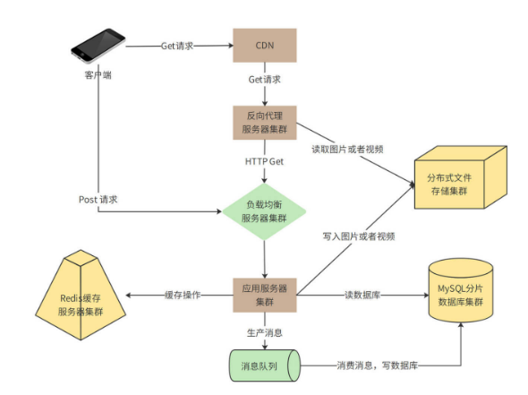

这里包含了“Get请求”和“Post请求”两条链路，Get请求主要处理刷微博的操作，Post请求主要处理发微博的请求，这两种请求处理也有重合的部分，我们拆分着来看。

我们先来看看**Get请求**的部分。


用户通过CDN访问Weitter的数据中心、图片以及视频等极耗带宽的请求，绝大部分可以被CDN缓存命中，也就是说，4.8Tb/s的带宽压力，90%以上可以通过CDN消化掉。

没有被CDN命中的请求，一部分是图片和视频请求，其余主要是用户刷新微博请求、查看用户信息请求等，这些请求到达数据中心的反向代理服务器。反向代理服务器检查本地缓存是否有请求需要的内容。如果有，就直接返回；如果没有，对于图片和视频文件，会通过分布式文件存储集群获取相关内容并返回。分布式文件存储集群中的图片和视频是用户发表微博的时候，上传上来的。

对于用户微博内容等请求，如果反向代理服务器没有缓存，就会通过负载均衡服务器到达应用服务器处理。应用服务器首先会从Redis缓存服务器中，检索当前用户关注的好友发表的最新微博，并构建一个结果页面返回。如果Redis中缓存的微博数据量不足，构造不出一个结果页面需要的20条微博，应用服务器会继续从MySQL分片数据库中查找数据。

以上处理流程主要是针对读（http get）请求，那如果是发表微博这样的写（http post）请求呢？我们再来看一下**写请求**部分的图。

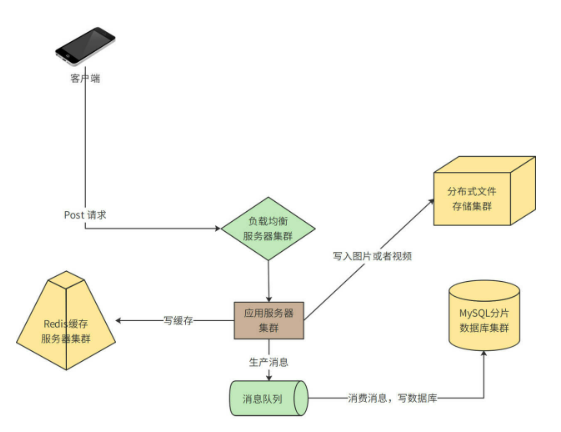

你会看到，客户端不需要通过CDN和反向代理，而是直接通过负载均衡服务器到达应用服务器。应用服务器一方面会将发表的微博写入Redis缓存集群，一方面写入分片数据库中。

在写入数据库的时候，如果直接写数据库，当有高并发的写请求突然到来，可能会导致数据库过载，进而引发系统崩溃。所以，数据库写操作，包括发表微博、关注好友、评论微博等，都写入到消息队列服务器，由消息队列的消费者程序从消息队列中按照一定的速度消费消息，并写入数据库中，保证数据库的负载压力不会突然增加。

### **3 详细设计**
用户刷新微博的时候，如何能快速得到自己关注的好友的最新微博列表？10万QPS的并发量如何应对？如何避免数据库负载压力太大以及如何快速响应用户请求？详细设计将基于功能需求和概要设计，主要讨论这些问题。

#### **3.1 微博的发表/订阅问题**
Weitter用户关注好友后，如何快速得到所有好友的最新发表的微博内容，即发表/订阅问题，是微博的核心业务问题。

一种简单的办法就是“推模式”，即建一张用户订阅表，用户关注的好友发表微博后，立即在用户订阅中为该用户插入一条记录，记录用户id和好友发表的微博id。这样当用户刷新微博的时候，只需要从用户订阅表中按用户id查询所有订阅的微博，然后按时间顺序构建一个列表即可。

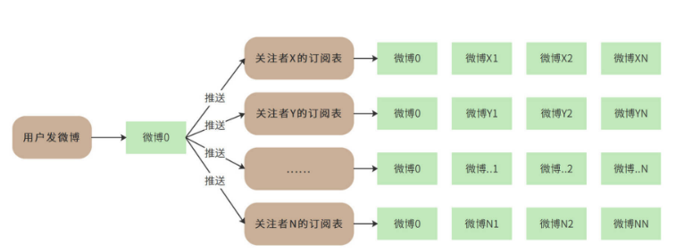

推模式实现起来比较简单，但是推模式意味着，如果一个用户有大量的关注者，那么该用户每发表一条微博，就需要在订阅表中为每个关注者插入一条记录。而对于明星用户而言，可能会有几千万的关注者，明星用户发表一条微博，就会导致上千万次的数据库插入操作，直接导致系统崩溃。

所以，对于10亿级用户的微博系统而言，我们需要使用“拉模式”解决发表/订阅问题。

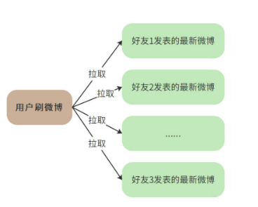

拉模式极大降低了发表微博时写入数据的负载压力，但是却又急剧增加了刷微博时候读数据库的压力。因为对于用户关注的每个好友，都需要进行一次数据库查询。如果一个用户关注了大量好友，查询压力也是非常巨大的。

所以，首先需要限制用户关注的好友数，在Weitter中，普通用户关注上限是2000人，VIP用户关注上限是5000人。其次，需要尽量减少刷新时查询数据库的次数，也就是说，微博要尽量通过缓存读取。

但即使如此，你会发现每次刷新的查询压力还是太大，所以Weitter最终采用“推拉结合”的模式。

如果用户当前不在线，那么系统就会将该列表删除。当用户登录刷新的时候，用拉模式为其重新构建列表。

那么如何确定一个用户是否在线？一方面可以通过用户操作时间间隔来判断，另一方面也可以通过机器学习，预测用户的上线时间，利用系统空闲时间，提前为其构建最新微博列表。

#### **3.2 缓存使用策略**
通过前面的分析我们已经看到，Weitter是一个典型的高并发读操作的场景。10万QPS刷新请求，每个请求需要返回20条微博，如果全部到数据库中查询的话，数据库的QPS将达到200万，即使是使用分片的分布式数据库，这种压力也依然是无法承受的。所以，我们需要大量使用缓存以改善性能，提高吞吐能力。

但是缓存的空间是有限的，我们必定不能将所有数据都缓存起来。一般缓存使用的是LRU淘汰算法，即当缓存空间不足时，将最近最少使用的缓存数据删除，空出缓存空间存储新数据。

但是LRU算法并不适合微博的场景，因为在拉模式的情况下，当用户刷新微博的时候，我们需要确保其关注的好友最新发表的微博都能展示出来，如果其关注的某个好友较少有其他关注者，那么这个好友发表的微博就很可能会被LRU算法淘汰删除出缓存。对于这种情况，系统就不得不去数据库中进行查询。

而最关键的是，系统并不能知道哪些好友的数据通过读缓存就可以得到全部最新的微博，而哪些好友需要到数据库中查找。因此不得不全部到数据库中查找，这就失去了使用缓存的意义。

基于此，我们在Weitter中使用**时间淘汰算法**，**也就是将最近一定天数内发布的微博全部缓存起来，用户刷新微博的时候，只需要在缓存中进行查找。如果查找到的微博数满足一次返回的条数（20条），就直接返回给用户；如果缓存中的微博数不足，就再到数据库中查找。

最终，Weitter决定缓存7天内发表的全部微博，需要的缓存空间约700G。缓存的key为用户ID，value为用户最近7天发表的微博ID列表。而微博ID和微博内容分别作为key和value也缓存起来。

此外，对于特别热门的微博内容，比如某个明星的离婚微博，这种针对单个微博内容的高并发访问，由于访问压力都集中一个缓存key上，会给单台Redis服务器造成极大的负载压力。因此，微博还会启用**本地缓存模式**，即应用服务器在内存中缓存特别热门的微博内容，应用构建微博刷新页的时候，会优先检查微博ID对应的微博内容是否在本地缓存中。

Weitter最后确定的本地缓存策略是：针对拥有100万以上关注者的大V用户，缓存其48小时内发表的全部微博。

现在，我们来看一下Weitter整体的缓存架构。

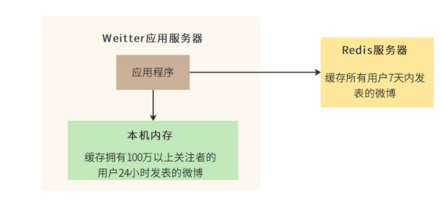

#### **3.3 数据库分片策略**
前面我们分析过，Weitter每天新增2亿条微博。这样的写入压力，对于单机数据库而言是无法承受的。而且，每年新增700亿条微博记录，这也超出了单机数据库的存储能力。因此，Weitter的数据库需要采用分片部署的分布式数据库。分片的规则可以采用用户ID分片或者微博 ID分片。

如果按用户ID（的hash值）分片，那么一个用户发表的全部微博都会保存到一台数据库服务器上。这样做的好处是，当系统需要按用户查找其发表的微博的时候，只需要访问一台服务器就可以完成。

但是这样做也有缺点，对于一个明星大V用户，其数据访问会成热点，进而导致这台服务器负载压力太大。同样地，如果某个用户频繁发表微博，也会导致这台服务器数据增长过快。

要是按微博 ID（的hash值）分片，虽然可以避免上述按用户ID分片的热点聚集问题，但是当查找一个用户的所有微博时，需要访问所有的分片数据库服务器才能得到所需的数据，对数据库服务器集群的整体压力太大。

综合考虑，用户ID分片带来的热点问题，可以通过优化缓存来改善；而某个用户频繁发表微博的问题，可以通过设置每天发表微博数上限（每个用户每天最多发表50条微博）来解决。最终，Weitter采用按用户ID分片的策略。

## 如何避免超预期的高并发压力压垮系统？
在互联网高可用架构设计中，限流是一种经典的高可用架构模式。因为某些原因，大量用户突然访问我们的系统时，或者有黑客恶意用DoS（Denial of Service，拒绝服务）方式攻击我们的系统时，这种未曾预期的高并发访问对系统产生的负载压力可能会导致系统崩溃。

解决这种问题的一个主要手段就是限流，即拒绝部分访问请求，使访问负载压力降低到一个系统可以承受的程度。这样虽然有部分用户访问失败，但是整个系统依然是可用的，依然能对外提供服务，而不是因为负载压力太大而崩溃，导致所有用户都不能访问。

为此，我们准备开发一个限流器，产品名称为“Diana”。

### **14.1 需求分析**
我们将Diana定位为一个限流器组件，即Diana的主要应用场景是部署在微服务网关或者其他HTTP服务器入口，以过滤器的方式对请求进行过滤，对超过限流规则的请求返回“服务不可用”HTTP响应。

Diana的限流规则可通过配置文件获取，并需要支持本地配置和远程配置两种方式，远程配置优先于本地配置。限流方式包括：

+ 全局限流：针对所有请求进行限流，即保证整个系统处理的请求总数满足限流配置。
+ 账号限流：针对账号进行限流，即对单个账号发送的请求进行限流。
+ 设备限流：针对设备进行限流，即对单个客户端设备发送的请求进行限流。
+ 资源限流：针对某个资源（即某个URL）进行限流，即保证访问该资源的请求总数满足限流配置。

并且Diana设计应遵循开闭原则，能够支持灵活的限流规则功能扩展，即未来在不修改现有代码和兼容现有配置文件的情况下，支持新的配置规则。

### **14.2 概要设计**
Diana的设计目标是一个限流器组件，即Diana并不是一个独立的系统，不可以独立部署进行限流，而是部署在系统网关（或者其他HTTP服务器上），作为网关的一个组件进行限流，部署模型如下：

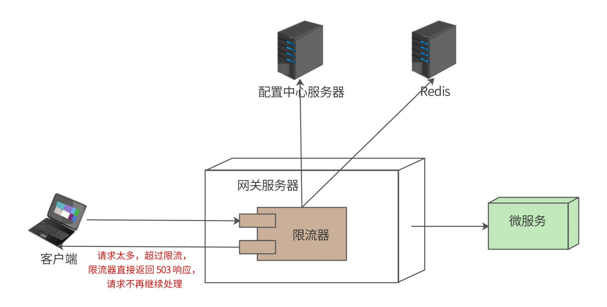

用户请求（通过负载均衡服务器）到达网关服务器。网关服务器本质也是一个HTTP服务器，限流器是部署在网关中的一个过滤器（filter）组件，和网关中的签名校验过滤器、用户权限过滤器等配置在同一个过滤器责任链（Chain of Responsibility）上。

用户请求进入限流器后，根据限流策略，判断该请求是否已经超过限流，如果超过，限流器直接返回状态码为503（Too Many Requests）的响应；如果没有超过限流，请求继续向下处理（经过其他网关过滤器），并最终调用微服务完成处理。

限流器的策略可以在本地配置，也可以通过远程的配置中心服务器加载，即远程配置。远程配置优先于本地配置。

#### **14.2.1 限流模式设计**
请求是否超过限流，主要就是判断单位时间请求数量是否超过配置的请求限流数量。单位时间请求数量，可以本地记录，也可以远程记录。方便起见，本地记录称作本地限流，远程记录称作远程限流（也叫分布式限流）。

本地限流意味着，每个网关服务器需要根据本地记录的单位时间请求数量进行限流。假设限流配置为每秒限流50请求，如果该网关服务器本地记录的当前一秒内接受请求数量达到50，那么这一秒内的后续请求都返回503响应。如果整个系统部署了100台网关服务器，每个网关配置本地限流为每秒50，那么，整个系统每秒最多可以处理5000个请求。

远程限流意味着，所有网关共享同一个限流数量，每个网关服务器收到请求后，从远程服务器中获取单位时间内已处理请求数，如果超过限流，就返回503响应。我们使用Redis作为记录单位时间请求数量的远程服务器。

#### **14.2.2 高可用设计**
为了保证配置中心服务器和Redis服务器宕机时，限流器组件的高可用。限流器应具有自动降级功能，即配置中心不可用，则使用本地配置；Redis服务器不可用，则降级为本地限流。

### **14.3 详细设计**
常用的限流算法有4种，固定窗口（Window）限流算法，滑动窗口（Sliding Window）限流算法，漏桶（Leaky Bucket）限流算法，令牌桶（Token Bucket）限流算法。我们将详细讨论这四种算法的实现。

此外，限流器运行期需要通过配置文件获取对哪些URL路径进行限流；本地限流还是分布式限流；对用户限流还是对设备限流，还是对所有请求限流；限流的阈值是多少；阈值的时间单位是什么；具体使用哪种限流算法。因此，我们需要先看下配置文件的设计。

#### **14.3.1 配置文件设计**
Diana限流器使用YAML进行配置，配置文件举例如下：

```plain
Url:/
rules:
 - actor:device
   unit:second
   rpu:10
   algo:TB
   scope:global- actor:all
   unit:second
   rpu:50
   algo:W
   scope:local
```

配置文件的配置项有7种，分别说明如下：

1. Url记录限流的资源地址，”/“表示所有请求，配置文件中的路径可以互相包含，比如“/”包含“/sample”，限流器要先匹配“/”的限流规则，如果“/”的限流规则还没有触发（即访问”/“的流量，也就是单位时间所有的请求总和没有达到限流规则），则再匹配“/sample”。
2. 每个Url可以配置多个规则rules，每个规则包括actor，unit，rpu，algo，scope
3. actor为限流对象，可以是账号（actor），设备（device），全部（all）
4. unit为限流时间单位，可以是秒（second），分（minute），时（hour），天（day）
5. rpu为单位时间限流请求数（request per unit），即上面unit定义的单位时间内允许通过的请求数目，如unit为second，rpu为100，表示每秒允许通过100个请求，每秒超过100个请求就进行限流，返回503响应
6. scope为rpu生效范围，可以是本地（local），也可以是全局（global），scope也决定了单位时间请求数量是记录在本地还是远程，local记录在本地，global记录在远程。
7. algo限流算法，可以是window，sliding window，leaky bucket，token bucket 。

Diana支持配置4种限流算法，使用者可以根据自己的需求场景，为不同资源地址配置不同的限流算法，下面详细描述这四种算法实现。

#### **14.3.2 固定窗口（Window）限流算法**
固定窗口限流算法就是将配置文件中的时间单位unit作为一个时间窗口，每个窗口仅允许限制流量内的请求通过，如图。

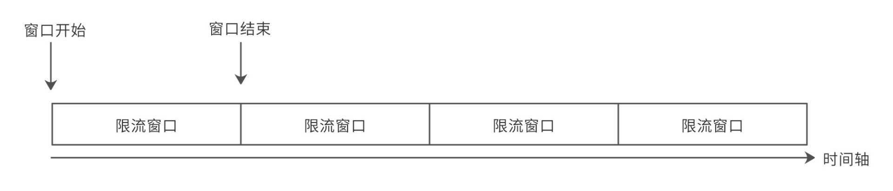

我们将时间轴切分成一个一个的限流窗口，每个限流窗口有一个窗口开始时间和一个窗口结束时间，窗口开始时，计数器清零，每进入一个请求，计数器就记录+1。如果请求数目超过rpu配置的限流请求数，就拒绝服务，返回503响应。当前限流窗口结束后，就进入下个限流窗口，计数器再次清零，重新开始。处理流程活动图如下。

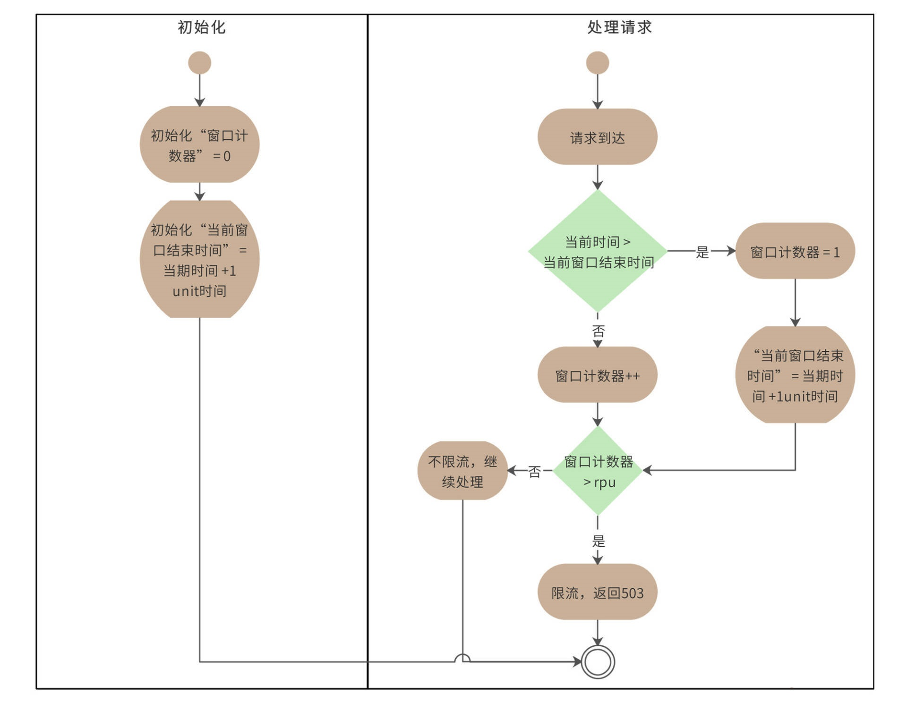

上图包括“初始化”和“处理流程”两个泳道。初始化的时候，设置“窗口计数器”和“当前窗口结束时间”两个变量。处理请求的时候，判断当前时间是否大于“当前窗口结束时间”，如果大于，那么重置“窗口计数器”和“当前窗口结束时间”两个变量；如果没有，窗口计数器+1，并判断计数器是否大于配置的限流请求数rpu，根据结果决定是否进行限流。

这里的“窗口计数器”可以本地记录，也可以远程记录，也就是配置中的local和global。固定窗口算法在配置文件中algo项可配置“window”或者缩写“W”。

固定窗口实现比较容易，但是如果使用这种限流算法，在一个限流时间单位内，通过的请求数可能是rpu的两倍，无法达到限流的目的，如下图。


假设单位时间请求限流数rpu为100，在第一个限流窗口快要到结束时间的时候，突然进来100个请求，因为这个请求量在限流范围内，所以没有触发限流，请求全部通过。然后进入第二个限流窗口，限流计数器清零。这时又忽然进入100个请求，因为已经进入第二个限流窗口，所以也没触发限流。在短时间内，通过了200个请求，这样可能会给系统造成巨大的负载压力。

#### **14.3.3 滑动窗口（Sliding Window）限流算法**
改进固定窗口缺陷的方法是采用滑动窗口限流算法，如下图。


滑动窗口就是将限流窗口内部切分成一些更小的时间片，然后在时间轴上滑动，每次滑动，滑过一个小时间片，就形成一个新的限流窗口，即滑动窗口。然后在这个滑动窗口内执行固定窗口算法即可。

滑动窗口可以避免固定窗口出现的放过两倍请求的问题，因为一个短时间内出现的所有请求必然在一个滑动窗口内，所以一定会被滑动窗口限流。

滑动窗口的算法实现基本和固定窗口一致，只要改动重置“窗口计数器”和“当前窗口结束时间”的逻辑就可以。固定窗口算法重置为窗口结束时间+1 unit 时间，滑动窗口算法重置为窗口结束时间+1个时间片。但是固定窗口算法重置后，窗口计数器为0，而滑动窗口需要将窗口计数器设置为当前窗口已经经过的时间片的请求总数，比如上图里，一个滑动窗口被分为5个时间片，滑动窗口2的浅蓝色部分就是已经经过了4个时间片。

滑动窗口算法在配置文件中algo项可配置“sliding window”或者缩写“SW”。

#### **14.3.4 漏桶（Leaky Bucket）限流算法**
漏桶限流算法是模拟水流过一个有漏洞的桶进而限流的思路，如图。


水龙头的水先流入漏桶，再通过漏桶底部的孔流出。如果流入的水量太大，底部的孔来不及流出，就会导致水桶太满溢出去。

限流器利用漏桶的这个原理设计漏桶限流算法，用户请求先流入到一个特定大小的漏桶中，系统以特定的速率从漏桶中获取请求并处理。如果用户请求超过限流，就会导致漏桶被请求数据填满，请求溢出，返回503响应。

所以漏桶算法不仅可以限流，当流量超过限制的时候会拒绝处理，直接返回503响应，还能控制请求的处理速度。

实践中，可以采用队列当做漏桶。如图。

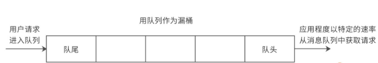

构建一个特定长度的队列queue作为漏桶，开始的时候，队列为空，用户请求到达后从队列尾部写入队列，而应用程序从队列头部以特定速率读取请求。当读取速度低于写入速度的时候，一段时间后，队列会被写满，这时候写入队列操作失败。写入失败的请求直接构造503响应返回。

但是使用队列这种方式，实际上是把请求处理异步化了（写入请求的线程和获取请求的线程不是同一个线程），并不适合我们目前同步网关的场景（如果使用前面设计过的Flower框架开发的异步网关就可以用这种队列方式）。

因此Diana实现漏桶限流算法并不使用消息队列，而是阻塞等待。根据限流配置文件计算每个请求之间的间隔时间，例如：限流每秒10个请求，那么每两个请求的间隔时间就必须>=100ms。用户请求到达限流器后，根据当前最近一个请求处理的时间和阻塞的请求线程数目，计算当前请求线程的sleep时间。每个请求线程的sleep时间不同，最后就可以实现每隔100ms唤醒一个请求线程去处理，从而达到漏桶限流的效果。

计算请求线程sleep时间的伪代码如下：

```plain
初始化 :
间隔时间 = 100ms;
阻塞线程数 = 0;
最近请求处理时间戳  = 0；
long sleep时间(){
    return MAX_TIME;//MAX_TIME表示阻塞时间无穷大，当前请求被限流
  }
  //请求在排队，阻塞等待
    阻塞线程数++;
    return 间隔时间 * 阻塞线程数 - (now - 最近请求处理时间戳) ;
}
```

请求线程sleep时间结束，继续执行的时候，修改阻塞线程数：

```sql
最近请求处理时间戳 = now;
阻塞线程数--;
```

注意，以上代码多线程并发执行，需要进行加锁操作。

使用漏桶限流算法，即使系统资源很空闲，多个请求同时到达时，漏桶也是慢慢地一个接一个地去处理请求，这其实并不符合人们的期望，因为这样就是在浪费计算资源。因此除非有特别的场景需求，否则不推荐使用该算法。

漏桶算法的algo配置项名称为“leaky bucket”或者“LB”。

##### **令牌桶（Token Bucket）限流算法**
令牌桶是另一种桶限流算法，模拟一个特定大小的桶，然后向桶中以特定的速度放入令牌（token），请求到达后，必须从桶中取出一个令牌才能继续处理。如果桶中已经没有令牌了，那么当前请求就被限流，返回503响应。如果桶中的令牌放满了，令牌桶也会溢出。


上面的算法描述似乎需要有一个专门线程生成令牌，还需要一个数据结构模拟桶。实际上，令牌桶的实现，只需要在请求获取令牌的时候，通过时间计算，就可以算出令牌桶中的总令牌数。伪代码如下：

```plain
初始化 :
最近生成令牌时间戳 = 0；
总令牌数 = 0；
令牌生成时间间隔 = 100ms;
boolean 获取令牌(){
    总令牌数--；
    return true;
  }
  总令牌数 = min(令牌数上限值，总令牌数 +
  (now - 最近生成令牌时间戳) / 令牌生成时间间隔)；
  if(总令牌数 >= 1){
    总令牌数--；
    最近生成令牌时间戳 = now；//有令牌了，才能重设时间returntrue；
  }
  return false；
}
```

令牌桶限流算法综合效果比较好，能在最大程度利用系统资源处理请求的基础上，实现限流的目标，建议通常场景中优先使用该算法，Diana的缺省配置算法也是令牌桶。令牌桶算法的algo配置项名称为“token bucket”或“TB”。

# 12306抢票系统设计

# 12306 系统挑战

* 创下全球最大实时票务交易系统世界记录，春运一个月抵欧洲一年。
* 最高可达百万并发，承受了这个世界最高 QPS。
* 网站浏览量一天最高超 1500 亿次，峰值是双 11 的三倍。

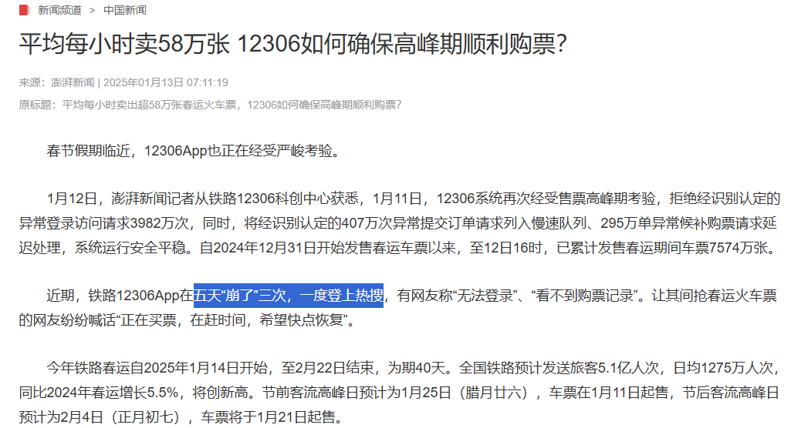

# 12306 系统难点

### 海量请求集中爆发

平时QPS较低，基本都集中在临近春节这段时间集中爆发。

（自动扩容不行）

**总的思路**可以从 **拦**截（80-90%） 和 分**摊**来考虑。

**APP端**：开始将请求拦在系统上游 ，可通过JS限时提交次数(误杀) CDN动静分离等

**站点**：用户(uid)标识 Token校验 鉴权防刷 拦截恶意发包. 限流降级，监控预警

**服务**：先到多级缓存(CDN，Nginx，Ehcache，Redis，BufferPool)读写分离，再根据数据库 进行异步分批，削峰填谷( 请求队列批次) 负载均衡等

**数据**：数据库缓存，读写分离，集群，SQL优化，分析型数据库，数据湖

每层都可以考虑分摊，加入负载均衡多网关多中心多数据库实例分流处理

 纵向多级缓存策略 层层过滤分摊压力

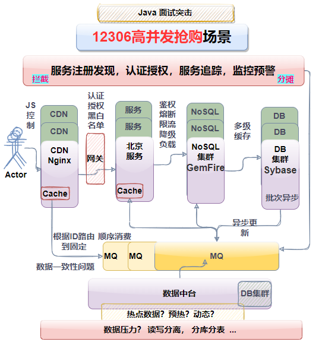

### 库存扣减

它跟传统的电商网站，可能最大的不同在于它的库存， 它的库存是**动态变化**的，**库存之间会互相影响**。

比如现在有一个组合品的需求，A 品是由 B 品和 C 品通过不同的比例混合而成，用户下单的时候传过来的是 A 品这个 SKU，但是库存扣减的时候是把它的组合品的单品（B 和 C），都去扣一遍的。

我们平时各种商品 sku 库存的话，它是表里面的一行行记录。


但**车票行程**是：杭州 -> 武汉 -> 长沙-> 成都。

杭州 -> 成都 ，武汉 -> 成都。

这两个是一个车次。那么每卖出一张** 武汉 -> 成都** 的票，杭州 -> 成都 的票也会少一张。


举个极端的例子，火车上就一个座位，车次是从 A -> B -> C。

如果卖出 B -> C 的车票，不去扣减 A-> C 库存的话，那么假设有两个用户分别买了 A-> C 和 B -> C 。那么当车行至站点 B 的时候，车上会有两个人，但是座位就一个。

所以不同车次之间的库存是会互相影响的。

比如：

A -> B -> C -> D 共 4 个车站，假如乘客买了 B -> C 的车票，那么同时会影响到 A->C，A->D，B->C，B->D。

这里不会影响 A -> B 的行程，因为乘客买的是 B -> C 的车票，站点 B 才上车，不占用 A -> B 行程的座位，我下车你上车，不冲突。

如果设及到 一等票  卧铺  硬座 更复杂

### 锁膨胀大事务耗费性能

一些长途，中间会经过十几个站点，而且有些城市是没有直达的车次的，中间只能换乘。涉及了多个车站的排列组合，这里计算是比较耗费性能的。

**行锁竞争会非常激烈**

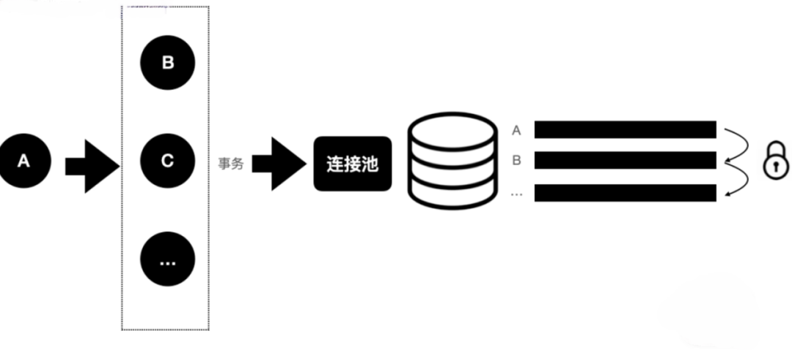

购买一个行程会涉及多个站点的扣减库存，这些多个站点的库存扣减是放在一个事务中的，那么一次下单行为，可能要涉及到几十次库存扣减。

**锁范围膨胀，事务就会被拉大**，线程数可能迅速被占满，导致数据库可能成为性能瓶颈，并且接口性能也会有所下降。

比如买一张G335 北京西到高牌店东的票，需要扩大范围到北京西到所有站点的库存-1。


而且中间站点还需要判断站点间是否互斥。

所以说像 12306 这种库存，其实涉及到非常多的一个行锁竞争，而且事务是非常大的。一列火车之间的库存其实是互相影响的，动态变化的。

另外还会涉及到其他维度，比如 硬座、硬卧、软卧、无座 这种业务逻辑在里面。

业务逻辑加上库存之间相互影响，就导致库存扣减逻辑异常复杂。

### 热点问题

火车站不同的站之间都是一个具体库存，中间的库存扣了之后，那么远的这个站的库存也要扣减。

极端情况下，一些热门城市（东京很热），中间一些站点可能比较火爆，那两端的人是不是永远买不到票。从业务角度出发 很简单预留票 。放票的时候就放一部分，可以限定只能买长途。短途超过范围不卖了。

会出现其他问题？多付钱 多买几站既可以。

### 核心功能：

GemFire 将很多机器内存汇总成一个大的节点，作为整体去管理，尽量保证业务运算和业务数据是在同一个节点，尽量避免多节点的网络通信。

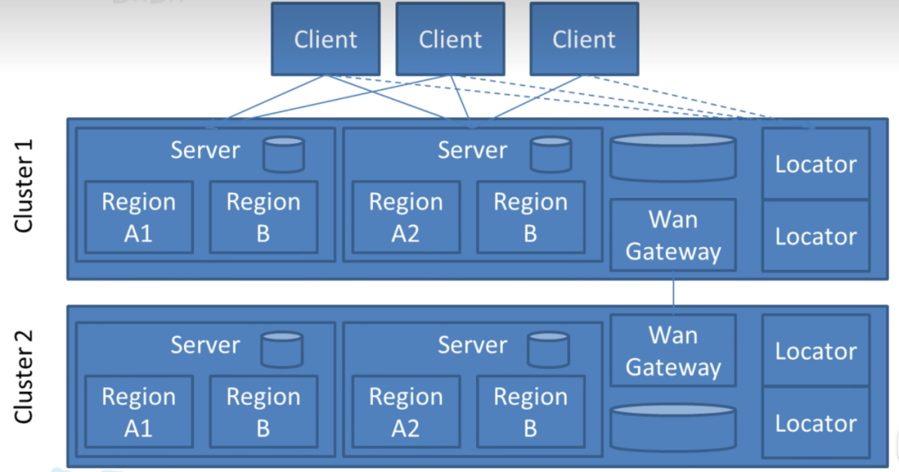

但是 GemFire 也存在不足的地方，对于扩容如果数据量大，加入节点后自动重分配可能耗时较久。在 12306 中，也有过测试（往年经验），需要几十个 T 的内存就可以将业务数据全部放到内存中来，根据过往经验大致能预测可以提前直接将**内存给加够**，也就不需要很频繁的扩容。当然运维人员肯定还是得关注监控工具（GemFire Pulse ,Prometheus等）实时数据做好把控。

**表设计：**


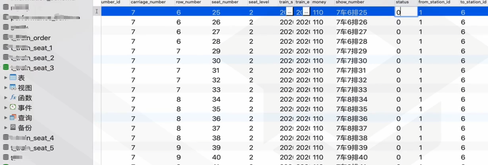

相比查询的流量，扣减库存的流量是完全可以承载的。后台管理**系统发放票**


由Cannal监听DB变更日志**同步数据**到GemFire即可。

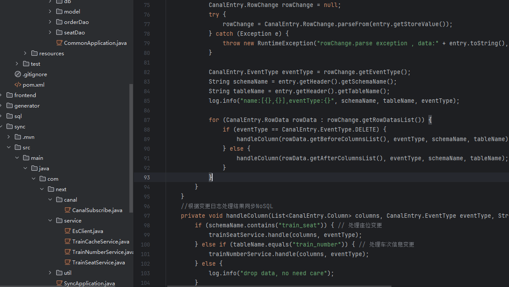


扣减库存之后再同步至 GemFire，然后在 GemFire 里进行动态计算，整个 GemFire 承载的是查询的流量。引入 GemFire 之后，整个系统的查询扩散瓶颈基本上就解决了。

# 解决思路

## 业务角度

### 预售 和 候补车票

* 早期的 12306 是通过整点去抢票，整点就会产生非常高的流量峰值，对系统造成非常大的压力，后面采取了分时段售票，比如**提前15 天预售**，将抢票的压力按照时间区间分散开，大大减低了峰值。
* 避免黄牛刷光票池的改签和退票，增加**候补车票，**优先异步队列卖给候补登记的人，不会回到票池公开出售。**购票的队列**很多种，同一个票30分钟，10分钟，秒出票

在 2019 年 5 月份，12306 新增了 “候补购票” 功能，在 “候补购票” 功能没出来之前，放票时间一到，千万人同时刷新抢票，这便是春运火车票秒光的原因。

候补车票堪称抢了一票第三方软件的 “饭碗”。

**“黄牛” 的秘密武器是外挂，用最快的服务器不断地刷新和监控 12306，刷票速度往往是正常购票的几十倍。**

实际上，市面上通行的 “抢票软件”，原理与“黄牛” 并无本质区别。

以前，合肥到上海的车票卖光了，有人退票或改签，车票会回到票池可供购买。抢票软件实时刷新监控，第一时间购买，这便是抢票软件比人快的原因。

现在，有了候补车票，合肥到上海的车票卖光了，**乘客可以候补登记，有人退票或改签，车票按顺序优先卖给候补登记的人，而不是回到票池公开出售。这便是抢票软件无效的原因。**

现在很多抢票软件反而没有 “候补购票” 功能抢票来得快。

候补车票在整个系统上相当于是一个异步过程。先排队，后面抢没抢到票再通知你。只要异步了，就可以通过消息，或者定时任务慢慢去消费，大大降低系统的压力。

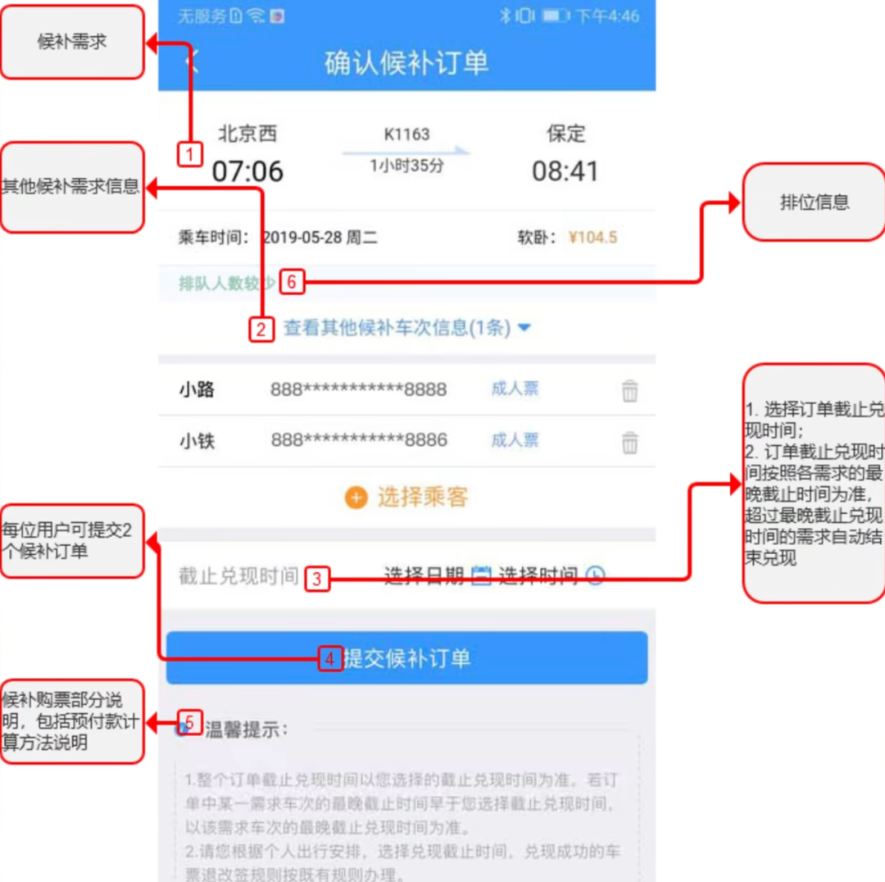

12306 是有非常多的灰色流量的，像是一些抢票软件或者脚本。因为这里面涉及到的利益非常巨大，滋生了很多灰色流量，给 12306 本身带来了很多额外的压力。

“候补购票” 功能可以降低黄牛刷票行为，拦截部分灰色流量。

### BT的验证码机制

* 验证码机制。**BT 的验证码机制**，可以过滤非常大的灰色流量。

12306 的验证码，是所有验证码中的一股绝对的 “清流”。


2013 年起，铁道部为了应对**黄牛抢票**，以及各类抢票软件和插件，升级了购票验证码系统。

在 12306 官方网站上，从购票到付款，都需要输入验证码。从最开始的字母数字验证码，再到后来升级后的图形验证码，成为了一道 “难过” 的关卡。


各类**奇葩验证码**出现在了 12306 上。

到了 2015 年底，根据有关网站统计，12306 上的图形验证码多达接近 600 种。再经过排列组合，总共有多达 **300000** 种。

上面的候补抢票和验证码机制，主要是为了对抗黄牛。

道高一尺，**魔高一丈。黄牛也在不断进步**。


比如你是一个搞黑灰产的人，你可以雇佣一批大学生，去做图形验证码识别。简单验证码还是机器去执行。

那这样的话其实还是没办法防止，但是这样增加了灰产的成本，毕竟人工比机器成本高，从一定程度上还是能够降低灰产的流量占比。

12306 之所以能够使用如此变态的验证码机制的大前提是：**没有把用户体验放在首位**。**必然存在误杀。实则防御****黄牛屯票****的效果微乎其微。**

好比楼下的一家餐厅，正常情况满足小区进食，排排队还是有机会吃上一口热乎的。但是有人预定了整个市区的饭票，然后坐等你们来排队到我这来买，你说能不饿死人吗？


12306 比较特殊，市面上几乎不存在竞争对手，而且火车票对于逢年过节，旅行返乡的人来说，几乎可以等同于必需品。

在这种情况下，12306 不必将用户体验放在首位，对于 12306 来说是可以牺牲部分用户体验来换取系统稳定性。实则要防黄牛，直接封禁第三方购票，购票必须人脸识别即可。

### 动态云服务和查余票/购票分离

* 春运峰值和平时查询流量相差悬殊，查询余票和购买下单分离，采用动态云服务弹性节点插拔。思考为什么要提前将内存几十T打满

天量的火车票查询是影响 12306 性能的重要原因之一，大概占了 90% 以上的访问流量。更棘手的是：峰谷的查询有天壤之别，平时工作日跟这种节假日，春运。流量相差是巨大的，时间区间是非常明显的。

如果说完全用机器去堆，可能就会造成一个资源浪费。

还有至关重要一点是，假如完全用机器去堆，在实际业务峰值超出了初始评估量时，服务将面临无法完全承载而瘫痪，**因为大规模服务器的采购、交付、部署到应用上线所耗费时间以月计，根本无法在业务量激增时 "即插即用"**。

几乎没有办法在成本和并发能力之间做一个好的平衡。以往的一个做法是从几个关键入口流量控制，保障系统可用性，但是会影响用户体验。

淘宝 / 天猫大促的时候，也会增加服务器，但阿里的业务盘子大，这些新增的机器很快会被其他业务 (包括阿里云) 消化掉，可能还不够。但是对于 12306 来说，就比较难做到这一点。

在 2015 年的时候，12306 跟阿里云达成合作，通过云的弹性和 “按量付费” 的计量方式，来支持巨量的查询业务，把架构中比较 “重”(高消耗、低周转) 的部分放在云上，将 75% 的余票查询业务切换到了阿里云上。

**将余票查询模块和 12306 现有系统做分离，在云上独立部署一套余票查询系统。**

通过动态的云计算，在高峰时段动态去扩容，可以达到分钟级的扩容，这样就避免在平时浪费大量的机器。

合作后，提高了网站的负载能力。2019 年的春运，12306 挺过了流量的高峰 297 亿次的日访问量。

由于第三方平台查询可能误报，就可能出现奇葩的现象，就是部分小伙伴可能在查询票的时候会发现还有1张某个站点的票，但你永远 抢不到，哪怕抢几次了，几个小时后还是依旧无法抢到此票。离谱他妈给离谱开门的是，你返回是这依旧显示有票可以点击预定。

铁路X 辟谣说是抢票软件误导，但实际就是12306APP购票如此。

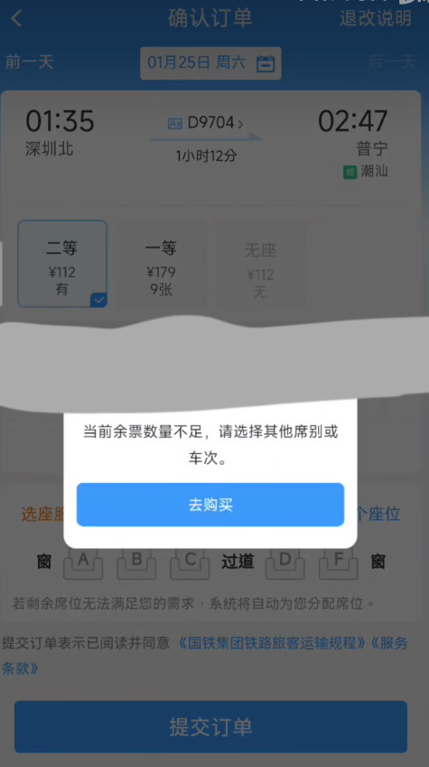

### 预留票和队列区分

相信很多小伙伴再买票的时候会发现线上没票，其他软件或者线下有票，这个其实就是**候补**和**预留票功能**，不会将票全部打入一个池子供人抢购。很多限制终到站和预留票都会在开车前固定时间流出来。还有重点车次都有预留票，只能在代售点取票的。

而且中国国情决定排队也分等级，比如老年人，残障人士，军人等都有特殊通道。线上购票也一样能识别**抢购队列也可做优先区分**。而且有小伙伴自己购票的时候估计也会发现，有时排队一张票需要30分钟左右，有时可能是几小时。这可能不仅仅是因为此票抢购人太多，需要排队时间过久，也可能识别你的请求频率等给你做了降级。这跟黄牛抢票软件低速，快速，高速，极速，光速一个道理。不同等级出票效率肯定不同，加钱才是硬道理。

由于预留长途，就可能出现奇葩的现象，就是部分小伙伴可能在查询票的时候会发现短途无票但长途确有票的情况：[链接](https://www.bilibili.

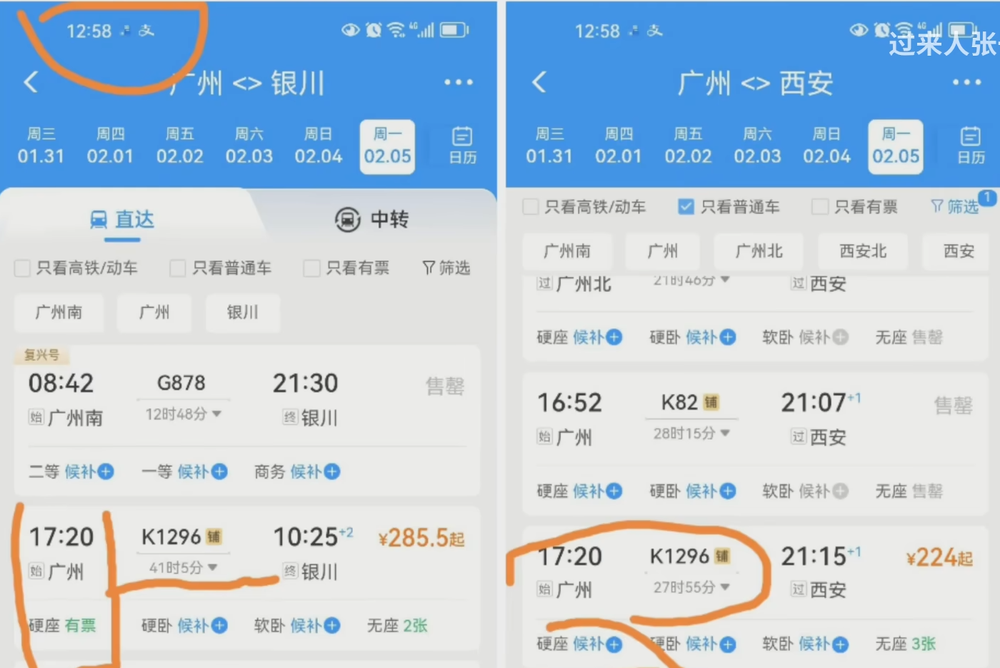

## 技术角度

### NoSQL跟DB数据同步

**历史背景：**

面对 12306 这种读多写少的场景，可能我们平时会采用 Redis 这种缓存机制，12306 具体选择的解决方案，可能跟我们常见的解决方案有一些不一样。

12306 通过充分调研，并没有选择 Redis，而是选择了名叫 **Pivotal GemFire** 的产品。

很多银行、投行，实时交易方面的系统都采用 Pivotal GemFire 作为解决方案。

**为什么选择 Pivotal GemFire 而不是 Redis？**

官网VS ：[https://redis.io/comparisons/redis-vs-gemfire/](https://redis.io/comparisons/redis-vs-gemfire/)

Redis 是开源的缓存解决方案，而 GemFire 是商用的，我们在互联网项目中为什么使用 Redis 比较多呢，很大原因就是因为 Redis 是开源的，不要钱。

GemFire，不仅性能强、高可用，而且 GemFire 还会提供一系列的解决方案。

Redis 主要用作缓存存储，而当时 （12 年左右） 12306 最大的瓶颈主要是在 IO 上面。

为什么 12306 最大的瓶颈会在 IO 上面呢？这跟 12306 使用读扩散有关。

扣减库存**数据库选用的是 Sybase**（收费，关系型数据库）

**数据同步：**

首先通过后台管理系统根据时间车次座位**放票，**更新数据库增加余票，Canal监听bin-log变更，再**异步更新数据到NoSQL缓存** 和 本地Cache多级缓存。前面讲过12306会根据往年压测，提前扩容缓存尽量打满。同步余票到缓存之后，查询余票和扣减直接操作缓存数据。

查询余票服务 和 下单扣减**服务分流**处理。下单抢购完成直接扣减缓存，为确保顺序性可采用分布式锁或者**排队消费**。

由于数据量较大，最终汇总DB的数据除了sharding分片读写分离之外，还需要做好ES迁移和大数据相关分析性数据库等备份。这样方便快速查询统计

**附部分核心代码：**

sharding部分

```java
    @Bean(name = "trainSeatShardingDataSource")
    public DataSource trainSeatShardingDataSource(@Qualifier(DataSources.TRAIN_SEAT_DB_1) DataSource trainSeatDB1,
                                                  @Qualifier(DataSources.TRAIN_SEAT_DB_2) DataSource trainSeatDB2,
                                                  @Qualifier(DataSources.TRAIN_SEAT_DB_3) DataSource trainSeatDB3,
                                                  @Qualifier(DataSources.TRAIN_SEAT_DB_4) DataSource trainSeatDB4,
                                                  @Qualifier(DataSources.TRAIN_SEAT_DB_5) DataSource trainSeatDB5
    ) throws SQLException {
        ShardingRuleConfiguration shardingRuleConfiguration = new ShardingRuleConfiguration();
        // 设置分库的映射
        Map dataSourceMap = Maps.newHashMap();
        dataSourceMap.put(DataSources.TRAIN_SEAT_DB_1, trainSeatDB1);
        dataSourceMap.put(DataSources.TRAIN_SEAT_DB_2, trainSeatDB2);
        dataSourceMap.put(DataSources.TRAIN_SEAT_DB_3, trainSeatDB3);
        dataSourceMap.put(DataSources.TRAIN_SEAT_DB_4, trainSeatDB4);
        dataSourceMap.put(DataSources.TRAIN_SEAT_DB_5, trainSeatDB5);
        // 设置表策略
        TableRuleConfiguration tableRuleConfiguration = new TableRuleConfiguration();
        // 1\6 DB1
        // 2\7 DB2
        // 3\8 DB3
        // 4\9 DB4
        // 5\10 DB5
        tableRuleConfiguration.setLogicTable("train_seat");
        tableRuleConfiguration.setActualDataNodes(
                DataSources.TRAIN_SEAT_DB_1 + ".train_seat_1," +
                        DataSources.TRAIN_SEAT_DB_2 + ".train_seat_2," +
                        DataSources.TRAIN_SEAT_DB_3 + ".train_seat_3," +
                        DataSources.TRAIN_SEAT_DB_4 + ".train_seat_4," +
                        DataSources.TRAIN_SEAT_DB_5 + ".train_seat_5," +
                        DataSources.TRAIN_SEAT_DB_1 + ".train_seat_6," +
                        DataSources.TRAIN_SEAT_DB_2 + ".train_seat_7," +
                        DataSources.TRAIN_SEAT_DB_3 + ".train_seat_8," +
                        DataSources.TRAIN_SEAT_DB_4 + ".train_seat_9," +
                        DataSources.TRAIN_SEAT_DB_5 + ".train_seat_10"
        );
        // 设置分库策略
        tableRuleConfiguration.setDatabaseShardingStrategyConfig(new StandardShardingStrategyConfiguration(
                "train_number_id", new TrainSeatDatabaseShardingAlgorithm()));
        // 设置分表策略
        tableRuleConfiguration.setTableShardingStrategyConfig(new StandardShardingStrategyConfiguration(
                "train_number_id", new TrainSeatTableShardingAlgorithm()));
        shardingRuleConfiguration.getTableRuleConfigs().add(tableRuleConfiguration);
        return ShardingDataSourceFactory.createDataSource(dataSourceMap, shardingRuleConfiguration, new ConcurrentHashMap(), new Properties());
    }
```

CannelSubscribe

```java
  private void canalSubscribe() {
        // 创建链接
        CanalConnector connector = CanalConnectors.newSingleConnector(new InetSocketAddress(AddressUtils.getHostIp(),
                11111), "train", "", "");
        int batchSize = 1000;
        new Thread(() -> {
            try {
                log.info("canal subscribe");
                connector.connect();
                connector.subscribe(".*\\..*");
                connector.rollback();
                while (true) {
                    Message message = connector.getWithoutAck(batchSize); // 获取指定数量的数据
                    long batchId = message.getId();
                    int size = message.getEntries().size();
                    if (batchId == -1 || size == 0) {
                        safeSleep(100);
                        continue;
                    }
                    try {
                        log.info("new message, batchId:{}, size:{}", batchId, size);
                        handleEntry(message.getEntries());
                        connector.ack(batchId); // 提交确认
                    } catch (Exception e1) {
                        log.error("canal data handle exception, batchId:{}", batchId, e1);
                        connector.rollback(batchId); // 处理失败, 回滚数据
                    }
                }
            } catch (Exception e3){
                log.error("canal subscribe exception", e3);
                safeSleep(1000);
                canalSubscribe();
            }
        }).start();
    }
    private void handleEntry(List entrys) throws Exception {
        for (CanalEntry.Entry entry : entrys) {
            if (entry.getEntryType() == CanalEntry.EntryType.TRANSACTIONBEGIN || entry.getEntryType() == CanalEntry.EntryType.TRANSACTIONEND) {
                continue;
            }
            CanalEntry.RowChange rowChange = null;
            try {
                rowChange = CanalEntry.RowChange.parseFrom(entry.getStoreValue());
            } catch (Exception e) {
                throw new RuntimeException("rowChange.parse exception , data:" + entry.toString(), e);
            }
            CanalEntry.EventType eventType = rowChange.getEventType();
            String schemaName = entry.getHeader().getSchemaName();
            String tableName = entry.getHeader().getTableName();
            log.info("name:[{},{}],eventType:{}", schemaName, tableName, eventType);
            for (CanalEntry.RowData rowData : rowChange.getRowDatasList()) {
                if (eventType == CanalEntry.EventType.DELETE) {
                    handleColumn(rowData.getBeforeColumnsList(), eventType, schemaName, tableName);
                } else {
                    handleColumn(rowData.getAfterColumnsList(), eventType, schemaName, tableName);
                }
            }
        }
    }
    //根据变更日志处理结果同步NoSQL
    private void handleColumn(List columns, CanalEntry.EventType eventType, String schemaName, String tableName) throws Exception {
        if (schemaName.contains("train_seat")) { // 处理座位变更
            trainSeatService.handle(columns, eventType);
        } else if (tableName.equals("train_number")) { // 处理车次信息变更
            trainNumberService.handle(columns, eventType);
        } else {
            log.info("drop data, no need care");
        }
    }
    private void safeSleep(int mills) {
        try {
            Thread.sleep(mills);
        } catch (Exception e2) {
        }
    }
```

EsService

```java
   private void saveES(List detailList, TrainNumber trainNumber) throws Exception {
        /**
         * A->B fromStationId->toStationId
         *
         * trainNumber: A->B->C  D386:北京->锦州->大连  D387:北京->鞍山->大连
         * 北京-大连？
         * D386: 北京-锦州、锦州-大连、北京-大连
         * D387: 北京-鞍山、鞍山-大连、北京-大连
         *
         * fromStationId->toStationId : trainNumberId1,trainNumberId2，...
         */
        List list = Lists.newArrayListWithExpectedSize(detailList.size() * detailList.size());
        if (detailList.size() == 1) {
            int fromStationId = trainNumber.getFromStationId();
            int toStationId = trainNumber.getToStationId();
            list.add(fromStationId + "_" + toStationId);
        } else {
            // 多段, 保证detailList是有序的
            for (int i = 0; i  dataMap = Maps.newHashMap();
            Map map = getResponse.getSourceAsMap();
            if (!getResponse.isExists() || map == null) {
                // add index
                dataMap.put(TrainEsConstant.COLUMN_TRAIN_NUMBER, trainNumber.getName());
                IndexRequest indexRequest = new IndexRequest(TrainEsConstant.INDEX, TrainEsConstant.TYPE, getResponse.getId()).source(dataMap);
                bulkRequest.add(indexRequest);
                continue;
            }
            String origin = (String) map.get(TrainEsConstant.COLUMN_TRAIN_NUMBER);
            Set set = Sets.newHashSet(Splitter.on(",").trimResults().omitEmptyStrings().split(origin));
            if(!set.contains(trainNumber.getName())) {
                // update index
                dataMap.put(TrainEsConstant.COLUMN_TRAIN_NUMBER, origin + "," + trainNumber.getName());
                UpdateRequest updateRequest = new UpdateRequest(TrainEsConstant.INDEX, TrainEsConstant.TYPE, getResponse.getId()).doc(dataMap);
                bulkRequest.add(updateRequest);
            }
        }
        // 批量更新es里的数据
        BulkResponse bulkResponse = esClient.bulk(bulkRequest);
        log.info("es bulk, response:{}", JsonMapper.obj2String(bulkResponse));
        if (bulkResponse.hasFailures()) {
            throw new RuntimeException("es bulk failure");
        }
    }
```

### 余票库存的表二进制设计

这里的设计思路都是猜测的，并不一定是 12306 真实的设计方案。

**12306 余票库存的表的设计是非常特色并且重要的**

首先说一下需要哪几个表来表示余票的库存信息：

1、基础的车次表：表示车次的编号以及发车时间等具体的车次信息，属于比较稳定的数据。

2、车的座位表：表示每个座位的具体信息，包括在几车厢、几行、几列，以及该座位的售卖情况。

3、车的余票表：通过座位表可以计算出每个车位在各个车站区间还有多少余票，但是动态计算比较浪费性能，因此再添加余票表，通过定时计算余票信息放入到余票表中，提高查询的性能。

（其实还应该有站点表和车厢表，不过不太重要，这里直接就省略了）

**这里说一下这 3 个表的对应关系：**

比如车次为 K123，该车上有很多的座位，每个座位对应座位表中的一条数据。

而余票表指的是 K123 车次上，硬座、硬卧、软卧、无座各有多少张余票，余票表的信息可以由座位表来计算得到。

**接下来说一下如何通过座位表来表示用户购买的车票：**

12306 中的车票信息其实是比较复杂的，因为各个车站之间是有依赖关系的，比如 4 个车站 A->B->C->D

如果乘客购买 B->C 的车票的话，不仅 B->C 的库存要减一，B->D 的库存也要减一，这是排列组合的情况，**可以考虑通过二进制去简化车票的表示。**

在座位表中，我们设置一个字段 sell varchar(50) 表示该座位的售卖情况，如果该车次有 4 个站 A->B->C->D，那么 sell 字段的长度就为 3，sell 字段的第一位表示该座位 A->B 的票是否已经被买了，第二位表示 B->C 的票是否已经被买了...

如果乘客购买 B->C 的车票，则 sell 字段的值为：010。

如果乘客购买 B->D 的车票，此时发现该座位在 B->C 已经被卖出去了，因此不能将该座位出售给这位乘客。

如果乘客购买 C->D 的车票，则 sell 字段的值为：011 ，表示 B->C，C->D 都已经有人了。

通过座位表来计算出余票，得到余票表。

**通过余票表提升查询性能**

这里余票表就相当于是数据库中的视图。

如果要去查询一个车次中某一个类型的余票还有多少，还需要去对座位表进行计算，这个消耗是比较大的 ，因此通过余票表来加快对于余票的查询。

可以定时去计算座位表中的数据，将每种类型的座位的余票给统计出来，比如：

硬卧：xx 张

硬座：xx 张

软卧：xx 张

...

再将余票表的信息给放入到缓存中，大大提高查询的性能。

### 示例：G1车次从北京南发往上海虹桥

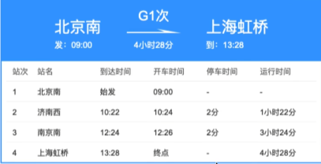

这意味着可购买组合有：（票  库存）

1.北京南-济南西

2.北京南-南京南

3.北京南-上海虹桥

4.济南西-南京南

5.-济南西-上海虹桥

6.南京南-上海虹桥

理论上来说bitmaps实际通过string类型来存储最大长度可512MB\*8位/字节，但实际上我们为了避免大Key影响性能应该将车次按车厢划分（软卧-软座-硬座座位数是36-60-118）。这里为了演示，假定一个站点先发售10张，直接一个k-v搞定

Key 设计: 车次\_城市\_车厢等（几等座车厢已区分）* *

  比如： G1\_110000\_08

value设计： bitmaps标识可买状态0，已售状态1.


当乘客想买 北京南-南京南 时，只需判断 北京南，济南西，南京南三个数组中进行或（||）的操作 即可得到库存余票情况。


接下来即可选择某个座位下单购买，

代码层需要将这三个站点的某个坐次位都set key offset value 为1


接下来 更多乘客组合 短中全程票购买之后，可能会是如下结果：


我们在买票的时候会发现，想一站到底会比中途转乘难很多。

**中间的站点如果太过火爆，导致两边的站点买不到票怎么办？**

比如 A->B->C->D，对于一个车次中的座位来说，如果 B->C 的乘客非常多，那么是不是就会导致 A->D 买不到票了？

而且运营部来进行设计，首先考虑的肯定是要**盈利**，远途票价比较贵，因此比较倾向于远途的旅客，营业部根据具体的实际情况以及盈利情况来定一下各个区间预留多少票，给每个车站区间都留有一些余票，那么就不会因为某一个区间非常火爆，而导致其他乘客买不到长途的票了。

# 查离当前外卖员5公里的订单

## 问题分析：

这个问题是最近直播间突击学员面某大厂被背问到，虽然直播间能给到大致回答思路，但更多的细节短短的时间没法讲清楚，而且讲完估计也就忘记了，故在此更新下详细笔记。

**首先**：其重点在于如何高效地处理大规模数据（1000 万订单）的查询，同时满足“5公里范围内”的空间查询需求。这意味着需要一个能够快速过滤和查找地理信息的解决方案。面试可能希望听到的技术点包括数据存储的选择、索引设计、缓存的使用以及分布式架构的设计。也提示了求职者重点不是在SQL 或者ES。

**其次**:这中实际问题的场景题，不仅仅是要一个简单的解决方案，更是在考察候选人对高并发、大数据处理以及空间查询技术（高性能低延迟）的理解。回答需要体现出对技术选型的逻辑性，以及对性能优化和系统架构设计的深入思考。

## 解答关键点：

数据存储、空间索引、实时定位由近至远排序、缓存优化和分布式架构越快越好。这些点基本涵盖了从数据存储到查询优化的整个流程。切记场景题回答思路不要局限与某个技术栈，而是整个处理流程。

**注意：**此场景题在很多地方可通用，如：附近小姐姐匹配，打车软件接单，迅雷附近资源，地图导航附近车辆 等等

## 解决方案和技术思路：

### 一、数据库设计与索引优化

#### 数据模型设计

```
- 设计订单表，包含订单基本信息，如订单编号、下单时间、用户信息等。另外，关键是要有订单的地理位置信息。可以使用纬度和经度两个字段来存储订单的位置。例如，订单表结构可能如下：
```

| **订单编号** | **下单时间** | **用户编号** | **状态** | **纬度** | **经度** |
| :--- | :--- | :--- | :--- | :--- | :--- |
| 001 | 2024 - 01 - 01 12:00:00 | 1001 | 未配送 | 30.23 | 110.34 |

1. **空间索引**
   * 针对订单的地理位置信息，可以使用空间索引（具有二维或三维的特性）。在 MySQL 中，可以使用 Spatial Index。例如，将订单的经纬度组合成一个几何数据类型（如 Point），然后为该几何字段创建空间索引。这样在查询离当前外卖员 5 公里范围内的订单时，可以利用空间索引来快速筛选符合条件的订单区域。
   * 空间索引的原理是基于空间数据的网格划分等方法，能够将空间数据按照一定的规则组织起来，使得在进行空间范围查询时，可以快速定位到可能包含所需数据的索引区域，从而提高查询效率。

#### 2，具体定位检索：

如以外卖员位置为中心、检索网格 5 公里为半径的圆形区域的相关记录。它避免了对整个订单表进行全表扫描，大大减少了 I/O 操作和查询时间。

例如，在没有空间索引的情况下，查询 1000 万订单中符合条件的可能需要逐条比较每个订单的地理位置与外卖员位置的距离，而使用空间索引可以快速缩小搜索范围。

#### 3，空间索引实现（以MySQL为例）

1. **数据类型选择**
   * 在 MySQL 中，可以使用 POINT 数据类型来存储订单的位置信息。POINT 用于表示二维空间中的一个点，它包含经度和纬度两个坐标值。例如：
     * CREATE TABLE orders (order_id INT PRIMARY KEY, order_location POINT);
2. **创建空间索引**
   * 可以为 POINT 类型的字段创建空间索引。在 MySQL 中，使用 SPATIAL INDEX 关键字来创建空间索引。例如：
     * ALTER TABLE orders ADD SPATIAL INDEX (order_location);
     * 这个空间索引会基于订单的位置信息，按照 R - Tree 或其他合适的空间索引结构来组织数据，以便能够快速进行空间范围查询。
3. **空间查询语法**

* 当需要查询离外卖员 5 公里范围内的订单时，可以使用 MySQL 的空间关系函数。例如，使用 MBRContains()（用于判断一个几何对象是否包含另一个几何对象）或 DistanceSphere()（用于计算球面上两点之间的距离）等函数。
* 假设外卖员的位置存储在一个变量 @deliveryman_location 中，并且是一个 POINT 类型，查询语句可能如下：

```sql
SELECT * FROM orders WHERE MBRContains(GeomFromText(CONCAT('POLYGON((', @deliveryman_location_x - 5 / 111.32 , ' ', @deliveryman_location_y - 5 / (111.32 * COS(RADIANS(@deliveryman_location_y))), ',', @deliveryman_location_x + 5 / 111.32 , ' ', @deliveryman_location_y - 5 / (111.32 * COS(RADIANS(@deliveryman_location_y))), ',', @deliveryman_location_x + 5 / 111.32 , ' ', @deliveryman_location_y + 5 / (111.32 * COS(RADIANS(@deliveryman_location_y))), ',', @deliveryman_location_x - 5 / 111.32 , ' ', @deliveryman_location_y + 5 / (111.32 * COS(RADIANS(@deliveryman_location_y))), ',', @deliveryman_location_x - 5 / 111.32 , ' ', @deliveryman_location_y - 5 / (111.32 * COS(RADIANS(@deliveryman_location_y))), '))))')), order_location);
```

* 这里为了计算 5 公里范围，将经纬度的差值进行了转换（因为 1 度经纬度的距离在赤道附近大约是 111.32 公里），使用一个近似的多边形来表示 5 公里范围。实际使用时可能需要更精确的地理距离计算方法。

### 二、缓存策略(核心考察)

#### Redis Geo地理缓存

```
- 可以使用 Redis 的 Geo 功能。每个订单的编号作为成员（member），其对应的地理位置（经纬度）作为坐标（point）存储在 Redis 的 GeoSet 中。每个订单可以看作一个地理元素，具有经纬度和订单编号等信息。
- 当需要查询离外卖员 5 公里范围内的订单时，可以使用 Redis 的 Geo 命令，如 GEOSEARCH。它可以根据给定的中心点（外卖员的位置）和半径（5 公里）来快速查找附近的订单。Redis 的Geo 功能是基于内存操作，具有非常高的查询性能，可以应对高并发的查询场景。
```

例如，使用GEOADD命令，格式为GEOADD orders_location order_id DaJieJie xiaoJieJie。假设订单编号为“order\_001”，经度为110.34，纬度为30.23，那么执行的命令是GEOADD orders_location order_001 110.34 30.23。

这样，所有的订单位置信息就被组织在一个有序的地理空间集合中，方便后续基于位置的查询操作。

#### 缓存更新策略

```
- (美团，京东外卖员送单过程位置实时更新)可以设置一个定时任务，每隔一段时间（如 1 分钟，具体可根据机器预算调整）将数据库中状态发生变化的订单更新到 Redis 缓存中。
- 还有一种情况会触发更新，由于外卖订单的状态可能会动态变化（如被接单、完成等），需要定期从数据库同步更新缓存中的订单信息。在数据库层面，当订单状态或者位置更新时，可以利用数据库的触发器功能，触发一个操作将更新信息发送给后端服务。后端服务接收到更新消息后，立即更新 Redis 缓存。
```

例如，在 MySQL 中创建一个触发器，当订单表的特定字段（如状态字段、经度字段、纬度字段）发生更新时，触发器执行存储过程，通过某种通信方式（如消息队列）通知后端服务更新缓存。

#### 3，缓存查询实现

**获取配送员位置并查询附近订单**

* 当配送员客户端请求获取附近订单时，首先从配送员服务中获取该配送员的当前位置（经纬度）。假设配送员编号为“TianMing\_001”，其经度为110.35，纬度为30.22。
* 然后，利用 Redis 的GEOSEARCH命令查询 Redis GeoSet 中距离配送员位置5公里范围内的订单。命令格式可以是GEOSEARCH orders_location NEARBY xiaoJieJie DaJieJie 5000 m WITHDIST。其中，“orders\_location”是 GeoSet 的名称，“NEARBY”指定要查询附近的成员，“XiaoJieJie”和“DaJieJie”是配送员的经纬度，“5000 m”表示5公里范围，“WITHDIST”选项用于返回每个订单与配送员之间的距离。
* Redis 会返回符合条件的订单编号以及它们与配送员的距离。例如，返回结果可能包含订单“order\_001”距离配送员1.2公里，“order\_002”距离配送员3.5公里等信息。
* 接下来，将这些订单编号作为条件，到订单服务的缓存（如 Redis 的哈希结构存储订单详情）或者数据库中获取订单的详细信息（如订单金额、预计送达时间等），然后将完整的订单信息返回给配送员客户端。

示意图：通过GeoHash将经纬度转换成bit位的字符串，如果经纬度越接近，他们的前缀匹配位数也就越长，如此即可快速检索到附近多少的


**注意**：（细节追问）此方案可能追问 **数据一致性问题**，这里就过多解答，可参看保险项目中的解答（旁路缓存+MQ+最终一致 + 版本号等）

还有一个问题需要思考和处理。得到的**最近可能不是最近**。比如这样：

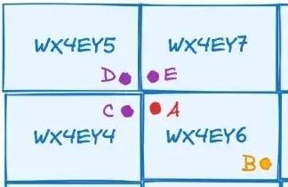

用geohash那结果显然是AB更近，但是实际上A与B的距离比AE、AC、AD都远。这其实是一个边缘性的问题。实际上此问题很简单，但为了让你的脑袋跟着来，我这等你看评论吧。（tips：格>扩，码>点）

### 三、分布式系统架构考虑

#### 微服务架构拆分

* **服务拆分原则**
  * 根据业务功能模块进行拆分，比如将系统拆分为订单服务、配送员服务、用户服务、支付服务等。这种拆分方式使得每个服务能够独立开发、测试和部署，同时也有利于团队的协作。
  * 按业务流程拆分，例如将订单流程分为下单、接单、配送、完成等多个阶段，每个阶段由不同的子服务负责处理。这样可以更好地应对不同阶段的负载差异，例如在接单阶段可能会有大量配送员同时请求获取订单，而配送阶段则主要涉及订单位置的实时更新。
* **订单服务**
  * 负责订单的创建、修改、查询等操作。它需要处理大量的订单数据写入和读取请求，因此需要高性能的数据库和缓存支持。在创建订单时，除了记录基本的订单信息外，还需要存储订单的位置信息用于后续的配送员查询。同时，它还需要与支付服务进行交互，处理订单的支付状态变化。
  * 为了应对高并发的订单查询请求，订单服务可以采用读写分离的数据库架构。主数据库负责处理订单的写入操作，而从数据库则用于读取查询操作。此外，还可以使用缓存策略，将热点订单数据（如未接单的订单）缓存到Redis等内存数据库中，以提高查询性能。
* **配送员服务**
  * 管理配送员的基本信息、状态（如在线、离线、忙碌等）以及位置信息。配送员服务需要实时接收配送员的位置更新，并将这些位置信息存储到数据库和缓存中。
  * 当配送员请求获取附近的订单时，配送员服务需要调用订单服务提供的接口，根据配送员的位置和指定的范围（如5公里）来查询附近的订单。这个过程需要高效的空间查询能力，因此可以利用订单服务中的空间索引和缓存策略来快速获取结果。

#### 负载均衡和集群部署

* **负载均衡策略**
  * **基于硬件的负载均衡器**：如 F5 BIG-IP，它能够根据预设的负载均衡算法（如轮询、最小连接数、加权轮询等）将请求分发到后端的服务器集群上。例如，当多个配送员客户端同时请求获取附近订单时，负载均衡器可以将这些请求均匀地分配给不同的订单服务实例，避免某个实例过载。
  * **基于软件的负载均衡**：如 Nginx、HAProxy。这些软件可以部署在服务器上，根据不同的策略将请求转发给后端服务。例如，在订单服务的前端部署 Nginx，将来自不同客户端的订单创建、查询等请求分发到后端的多个订单服务实例上。通过动态调整负载均衡策略，可以根据服务器的负载情况实时优化流量分配。
  * **应用层负载均衡**：在服务内部实现负载均衡逻辑，例如通过在订单服务的客户端使用负载均衡库（如 Netflix Ribbon），根据服务实例的健康状况和负载情况，将请求智能地分发到合适的后端服务实例。
* **集群部署方案**
  * 对于订单服务和配送员服务等关键服务，可以采用多实例集群部署的方式。每个服务实例可以部署在不同的物理服务器或者虚拟机上，以提高系统的可用性和并发处理能力。
  * 为了保证数据的一致性，服务实例之间需要共享数据库和缓存系统。可以采用分布式数据库（如 TiDB）来存储订单数据，它能够提供高可用性和水平扩展能力。同时，使用 Redis 集群来存储缓存数据，通过 Redis 的主从复制和分片技术来实现高可用和大数据量的存储。

#### 服务间通信与数据同步

* **服务间通信方式**
  * **RESTful API**：这是最常用的服务间通信方式。例如，配送员服务通过调用订单服务提供的 RESTful API 来查询附近的订单。订单服务返回 JSON 格式的订单数据，配送员服务解析这些数据并将其展示给配送员客户端。这种方式具有良好的跨语言支持和易集成性，但可能存在性能开销，因为需要进行 HTTP 协议的封装和解析。
  * **RPC（远程过程调用）**：如 gRPC，它是一种高效的远程过程调用框架。在订单服务和配送员服务之间，可以使用 gRPC 进行通信。通过定义服务接口和数据模型，配送员服务可以像调用本地函数一样调用订单服务中的方法，而底层的通信细节由 gRPC 框架处理。这种方式具有高性能和低延迟的特点，特别适合在分布式系统内部的服务间通信。
  * **消息队列**：如 Kafka、RabbitMQ。在订单系统中，消息队列可以用于异步通信。例如，当订单状态发生变更（如从“未接单”变为“已接单”）时，订单服务可以将这个事件发布到消息队列中。配送员服务可以订阅这个消息队列，当收到订单状态变更消息后，及时更新本地缓存中的订单状态，以便为配送员提供准确的订单信息。
* **数据同步机制**
  * **实时同步**：对于关键的订单数据更新（如订单位置、状态等），需要实时同步到其他相关服务。例如，当配送员更新其位置后，配送员服务立即将新的位置信息通过消息队列发送给订单服务。订单服务接收到消息后，更新缓存中的配送员位置信息，并根据新的位置重新计算附近的订单分配策略。
  * **定时同步**：对于一些非实时性要求很高的数据，可以采用定时同步的方式。例如，每隔一段时间（如每小时），订单服务可以从数据库中提取订单的统计数据（如各区域的订单量、平均配送时间等），并通过 API 或者数据文件的方式同步给数据分析服务。这种方式可以减少实时通信的压力，同时保证数据的定期更新。

#### 分布式缓存与存储

* **分布式缓存架构**
  * 在分布式系统中，缓存系统需要支持高并发读写和大数据量存储。可以采用 Redis 集群或者 Memcached 集群来实现分布式缓存。例如，将订单的位置信息和状态信息存储在 Redis 集群中，通过一致性哈希算法将数据分布到多个 Redis 节点上。这样可以提高缓存的存储容量和访问性能。
  * 为了保证缓存数据的可靠性，可以采用 Redis 的主从复制模式。主节点负责处理写入请求，并将数据同步到从节点。当主节点出现故障时，可以从节点可以进行故障转移，接替主节点的工作，从而保证缓存服务的可用性。
* **分布式存储系统**
  * 对于订单数据的存储，可以采用分布式数据库。例如，TiDB 是一个兼容 MySQL 协议的分布式数据库，它能够提供水平扩展、高可用性和强一致性。在 TiDB 中，数据会被自动分片存储到多个 TiKV 节点上，同时通过 Raft 算法保证数据的强一致性。这样可以满足大规模订单数据的存储需求，并且能够应对高并发的读写请求。
  * 对于非结构化数据（如订单的图片、配送员的头像等），可以使用分布式文件系统（如 HDFS）或者对象存储（如 AWS S3、阿里云 OSS）。这些存储系统能够提供大容量的存储空间和高可用性，同时支持高并发的文件读写操作。

#### 监控与日志系统

* **分布式监控体系**
  * 在分布式系统中，需要对各个服务的性能指标（如 CPU 使用率、内存使用率、响应时间等）进行实时监控。可以使用 Prometheus 等监控工具，它能够通过 pull 模式从各个服务的监控端点获取监控数据，并将其存储到时序数据库（如VictoriaMetrics）中。
  * 通过 Grafana 等可视化工具，可以将监控数据以图表的形式展示出来，方便运维人员实时了解系统的运行状态。例如，可以设置告警规则，当订单服务的响应时间超过阈值（如 200 毫秒）时，通过邮件、短信等方式通知运维人员，及时进行排查和处理。
* **日志收集与分析**
  * 分布式系统的日志收集是一个关键问题。可以使用 ELK（Elasticsearch、Logstash、Kibana）栈来实现日志的收集、解析和可视化。Logstash 可以从各个服务的日志文件中收集日志数据，并将其发送到 Elasticsearch 中进行存储和索引。
  * Kibana 可以对日志数据进行可视化分析，例如，可以通过 Kibana 的图表查看订单服务中不同接口的调用频率、错误率等信息。通过对日志的分析，可以快速定位系统中的问题，如某个服务频繁出现超时错误，或者某个接口的参数解析出现问题等。

### 四、实时定位和更新技术

1. **配送员位置实时更新**

* **定位技术**
  * **GPS（全球定位系统）技术**：这是最常用的定位技术，通过接收卫星信号来确定配送员的位置。大多数智能手机和配送员使用的导航设备都内置了GPS模块。GPS能够提供较高的定位精度，在开阔的环境下，定位精度可以达到几米范围内。配送员的设备通过与多颗卫星通信，计算出自己所在的经纬度位置。然后，这些位置信息可以通过移动网络发送到外卖系统的服务器。
  * **北斗卫星导航系统（BDS）**：作为中国的卫星导航系统，北斗系统在定位精度和稳定性方面与GPS相当，并且在一些地区（特别是亚太地区）可能具有更好的信号覆盖。配送员设备可以同时接收GPS和北斗系统的信号，通过多系统融合定位，提高定位的准确性和可靠性。
  * **辅助定位技术（AGPS）**：为了克服在城市峡谷（高楼林立的区域）、室内等环境下卫星信号弱的问题，可以采用辅助定位技术。AGPS通过利用移动网络基站的辅助信息来加速GPS定位过程。当配送员进入卫星信号较弱的区域时，设备可以结合基站的位置信息和有限的卫星信号，快速估算出大致的位置，然后随着卫星信号的恢复，逐渐提高定位精度。
* **位置 数据传输协议**
  * **MQTT（Message Queuing Telemetry Transport）协议**：这是一种轻量级的消息传输协议，特别适合用于物联网和实时数据传输场景。在配送员位置更新中，配送员的设备可以作为MQTT客户端，将位置信息以消息的形式发布到MQTT服务器（如Mosquitto）。然后，外卖系统的服务端可以订阅相应的主题，实时接收配送员的位置更新消息。MQTT协议具有多种服务质量（QoS）级别，可以根据实际需求选择合适的QoS级别。例如，对于一般的配送员位置更新，可以选择QoS 1级别，确保消息至少被接收一次，避免位置信息的丢失。
  * **WebSocket协议**：与传统的HTTP协议不同，WebSocket协议可以实现服务器和客户端之间的双向通信。配送员设备通过建立WebSocket连接，与外卖系统的服务器保持实时通信通道。一旦配送员的位置发生变化，设备可以立即通过WebSocket连接将新的位置信息发送给服务器，服务器也可以实时将其他相关信息（如新的订单分配）推送给配送员设备。这种方式可以大大减少通信延迟，提高位置更新的实时性。
* **位置 接收与解析位置数据**
  * 服务器端需要设置专门的服务来接收配送员设备发送的位置数据。这些位置数据通常包含配送员的编号、经纬度、时间戳等信息。在接收到数据后，需要对其进行解析，提取出有用的信息。例如，使用JSON格式来传输位置数据，服务器端可以使用相应的解析库将JSON字符串转换为对象，方便后续处理。
  * 对于接收到的位置数据，还需要进行数据校验。检查数据的完整性（如是否包含必要的字段）、准确性和合理性（如经纬度是否在合法范围内、时间戳是否符合逻辑等）。如果发现数据有问题，可以记录日志并进行相应的处理，如丢弃错误数据、通知配送员设备重新发送等。
* **实时位置更新与缓存**
  * 当服务器接收到配送员的位置更新后，需要及时将新的位置信息存储到数据库和缓存中。在数据库中，更新配送员的位置记录，以便在需要时可以查询历史位置信息。同时，为了快速响应订单查询请求，将配送员的最新位置信息更新到Redis等缓存系统中。
  * 在缓存中，可以为每个配送员的位置信息设置一个合适的过期时间（如5分钟），以防止位置信息过时而未更新导致的错误分配。

**例如**，如果配送员设备在一段时间内没有发送位置更新消息，可能是由于网络问题或者其他异常情况，那么缓存中的位置信息会自动过期，避免系统使用不准确的位置信息进行订单分配。

* **基于实时位置的订单分配调整**
  * 外卖系统可以根据配送员的实时位置和订单的位置信息，动态调整订单分配策略。**例如**，当一个新订单产生时，系统可以根据配送员的当前位置和订单的距离、配送员的当前负载（如已经接单的数量）、预计配送时间等多因素，使用智能算法（如最近邻算法、遗传算法等）来选择最合适的配送员进行订单分配。
  * 如果配送员的位置发生变化（如在前往订单取餐地点的途中交通拥堵，导致位置偏离了预期路线），系统可以根据新的位置信息重新评估订单分配情况。如果发现当前配送员可能无法在规定时间内完成配送，可以及时将订单转交给其他更合适的配送员，从而提高订单的配送效率和用户体验。

为了方便大伙理解记忆我找了下之前做过的类似功能项目的代码和流程草图。

先看下Websocket更新位置部分。

```javascript
// 配送员位置更新代码：
function updateDeliverymanLocation(deliverymanId, DaJieJie, xiaoJieJie) {
  let timestamp = getCurrentTime();
  let locationData = {
    deliverymanId: deliverymanId,
    DaJieJie: DaJieJie,
    xiaoJieJie: xiaoJieJie,
    timestamp: timestamp
  };
  sendLocationDataToServer(locationData);
}
function sendLocationDataToServer(locationData) {
  // 使用WebSocket或MQTT发送数据
  if (websocket.isConnected()) {
    websocket.send(JSON.stringify(locationData));
  } else {
    logError("WebSocket连接失败");
  }
}
服务器端处理位置更新伪代码：
function handleLocationUpdate(locationData) {
  validateLocationData(locationData);
  if (isValid) {
    updateDatabaseLocation(locationData);
    updateCacheLocation(locationData);
    setCacheExpiration(locationData.deliverymanId, 5 * 60); // 5分钟后过期
  } else {
    logError("位置数据无效");
  }
}
function validateLocationData(locationData) {
  // 检查数据完整性、经纬度范围、时间戳等
  return locationData.deliverymanId != null &&
    locationData.DaJieJie >= -90 && locationData.DaJieJie = -180 && locationData.xiaoJieJie 二分的思路拿到一个二进制数组的字符串，然后再通过base32编码去进行压缩存储。
举一个例子，比如经纬度为（116.3111126，40.085003），对其进行二分步骤如下：
经度步骤：
| **bit** | **left** | **mid** | **right** |
| :--- | :--- | :--- | :--- |
| 1 | -180 | 0 | 180 |
| 1 | 0 | 90 | 180 |
| 0 | 90 | 135 | 180 |
| 1 | 90 | 112.5 | 135 |
| 0 | 112.5 | 123.75 | 135 |
| 0 | 112.5 | 118.125 | 123.75 |
| 1 | 112.5 | 115.3125 | 118.125 |
| 0 | 115.3125 | 116.71875 | 118.125 |
| 1 | 115.3125 | 116.015625 | 116.71875 |
| 0 | 116.015625 | 116.3671875 | 116.71875 |
| 1 | 116.015625 | 116.19140625 | 116.3671875 |
| 1 | 116.19140625 | 116.279296875 | 116.3671875 |
| 0 | 116.279296875 | 116.323242188 | 116.3671875 |
| 1 | 116.279296875 | 116.301269532 | 116.323242188 |
| 0 | 116.301269532 | 116.31225586 | 116.323242188 |
纬度步骤：
| **bit** | **left** | **mid** | **right** |
| :--- | :--- | :--- | :--- |
| 1 | -90 | 0 | 90 |
| 0 | 0 | 45 | 90 |
| 1 | 0 | 22.5 | 45 |
| 1 | 22.5 | 33.75 | 45 |
| 1 | 33.75 | 39.375 | 45 |
| 0 | 39.375 | 42.1876 | 45 |
| 0 | 39.375 | 40.78125 | 42.1876 |
| 1 | 39.375 | 40.078125 | 40.78125 |
| 0 | 40.078125 | 40.4296875 | 40.78125 |
| 0 | 40.078125 | 40.25390625 | 40.4296875 |
| 0 | 40.078125 | 40.166015625 | 40.25390625 |
| 0 | 40.078125 | 40.1220703125 | 40.166015625 |
| 0 | 40.078125 | 40.1000976563 | 40.1220703125 |
| 0 | 40.078125 | 40.0891113282 | 40.1000976563 |
| 1 | 40.078125 | 40.0836181641 | 40.0891113282 |
**「其思路就是不断二分，如果原本值大于mid那本bit位就是1，以此往下递归，最终，我们递归二分得到纬度方向上的二进制字符串为 101110010000001，长度为 15 位」**
那此时就拿到了30bit位的字符串，然后就开始进行拼接
结合经度字符串 110100101011010 和纬度字符串 101110010000001，我们遵循先经度后纬度的顺序，逐一交错排列，最终得到的一维字符串为 11100 11101 00100 11000 10100 01001.
然后再进行Base32编码，主要步骤就是首先会维护一个**「0-9A-Za-z」** 中32个字符的数组，如：\['a','b','1','2','3','4','5','6','7','A'...]，然后再将这30位的字符串每五个一组（正好覆盖0-31的索引)去索引到指定字符以此拿到30/5=6位的base32编码去进行存储。
**「ps:注意并不一定是必要将经纬度都二分得到15位长度，多少位都可以，只是精度越高结果也就越精确，但是算力就越大，只需在此做出权衡即可」**
****
**GeoHash 算法的具体步骤如下：**
1. 将经纬度变成二进制：
   * 以一个点（39.923201, 116.390705）为例，对于纬度 39.923201，**大于**中间值0，在区间（0，90）中，得到一个 **1**；（0，90）区间的中间值为 45 度，纬度 39.923201 **小于** 45，得到一个 **0**，依次计算下去，可得到纬度的二进制表示为 10111000110001111001。
   * 同理可得经度 116.390705 的二进制表示为 11010010110001000100。
2. 将经纬度合并：
   * 经度占偶数位，纬度占奇数位，得到 1110011101001000111100000011010101100001。
3. 按照 Base32 进行编码：
   * 先将合并后的二进制转换为十进制数据，然后对应生成 Base32 码。以 0 - 9、b - z（去掉 a, i, l, o）这 32 个字母进行编码，每 5 个二进制位转换成一个 base32 码。上例最终得到的值为 wx4g0ec1。
尝试自己算一算看  这个位置 最终Base32码是什么？ (39.91°N, 116.39°E) 转换为  GeoHash 编码 z3czrbvzbv
# 搜索引擎设计：信息搜索怎么避免大海捞针
我们准备开发一个针对全网内容的搜索引擎，产品名称为“Bingoo”。
Bingoo的主要技术挑战包括：
1. 针对爬虫获取的海量数据，如何高效地进行数据管理；
2. 当用户输入搜索词的时候，如何快速查找包含搜索词的网页内容；
3. 如何对搜索结果的网页内容进行排序，使排在搜索结果列表前面的网页，正好是用户期望看到的内容。
### **12.1 概要设计**
一个完整的搜索引擎包括分布式爬虫、索引构造器、网页排名算法、搜索器等组成部分，Bingoo的系统架构如下。
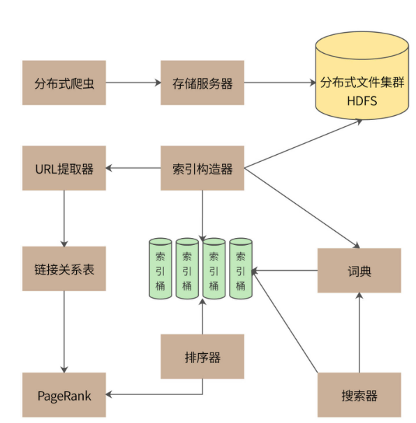
分布式爬虫通过存储服务器将爬取的网页存储到分布式文件集群HDFS，为了提高存储效率，网页将被压缩后存储。存储的时候，网页一个文件挨着一个文件地连续存储，存储格式如下。

每个网页被分配得到一个8字节长整型docID，docID之后用2个字节记录网页的URL的长度，之后4个字节记录压缩后网页内容数据的长度，所有存储的网页的头14个字节都是同样的格式。之后存储URL字符串和压缩后的网页内容数据。读取文件的时候，先读14个字节的头信息，根据头信息中记录的URL长度和数据长度，再读取对应长度的URL和网页内容数据。
搜索引擎能够快速查找的核心就是利用索引，根据用户的查询内容查找匹配的索引，根据索引列表构建结果页面。索引的构造主要通过索引构造器完成，索引构造器读取HDFS中的网页内容，解压缩后提取网页中的单词，构建一个“docID->单词列表”的正排索引。然后，索引构造器再根据这个正排索引构建一个“单词->docID列表”的倒排索引，“docID列表”就是包含了这个单词的所有网页列表。利用这个倒排索引，搜索器可以快速获得用户搜索词对应的所有网页。
网页中所有的单词构成了一个词典，实际上，词典就是一个Hash表，key就是单词，value就是倒排索引的网页列表。虽然互联网页的内容非常庞大，但是使用到的单词其实是非常有限的。根据Google的报告，256M内存可以存放1400万个单词，这差不多就是英文单词的全部了。
在构建索引的过程中，因为要不断修改索引列表，还要进行排序，所以，有很多操作是需要进行加锁同步完成的。对于海量的互联网页的计算，这样的索引构建速度太慢了。因此我们设计了64个索引桶，根据docID取模，将不同网页分配到不同的桶中，在每个桶中分别进行索引构建，通过并行计算来加快索引处理速度。
索引构造器在读取网页内容、构造索引的时候，还会调用URL提取器，将网页中包含的URL提取出来，构建一个链接关系表。链接关系表的格式是“docID->docID”，前一个docID是当前网页的docID，后一个docID是当前网页中包含的URL对应的docID。一个网页中会包含很多个URL，也就是会构建出很多个这样的链接关系。后面会利用这个链接关系表，使用PageRank排名算法对所有网页进行打分排名，当索引器得到查找的网页列表时，利用PageRank值进行排名，最终呈现给用户，保证用户最先看到的网页是最接近用户期望的结果页面。
### **12.2 详细设计**
一个运行良好的搜索引擎的核心技术就是索引和排名，所以我们将分别说明这两种技术要点。
#### **12.2.1 索引**
索引构造器从HDFS读取网页内容后，解析每个页面，提取网页里的每个单词。如果是英文，那么每个单词都用空格分隔，比较容易；如果是中文，需要使用中文分词器才能提取到每个单词，比如“高并发架构”，使用中文分词器得到的就是“高并发”、“架构”两个词。
首先，索引构造器将所有的网页都读取完，构建出所有的“docID->单词列表”正排索引。

然后遍历所有的正排索引，再按照“单词→docID列表”的方式组织起来，就是倒排索引了。

我们这个例子中只有两个单词、7个网页。事实上，Bingoo数以千亿的网页就是这样通过倒排索引组织起来的，网页数量虽然庞大，但是单词数却是比较有限的。所以，整个倒排索引的大小相比于网页数量要小得多。Bingoo将每个单词对应的网页列表存储在硬盘中，而单词则存储在内存的Hash表，也就是词典中，词典示例：

对于部分热门的单词，整个网页列表也可以存储在内存中，相当于缓存。在词典中，每个单词记录下硬盘或者内存中的网页列表地址，这样只要搜索单词，就可以快速得到对应的网页地址列表。Bingoo根据列表中的网页编号docID，展示对应的网页信息摘要，就完成了海量数据的快速检索。
如果用户的搜索词正好是一个单词，比如“高并发”，那么直接查找词典，得到网页列表就完成查找了。但是如果用户输入的是一个句话，那么搜索器就需要将这句话拆分成几个单词，然后分别查找倒排索引。这样的话，得到的就是几个网页列表，还需要对这几个网页列表求交集，才能得到最终的结果列表。
比如，用户输入“高并发架构”进行搜索，那么搜索器就会拆分成两个词：“高并发”、“架构”，得到两个倒排索引：
高并发->2,3,5,7
架构->1,2,4
需要对这两个倒排索引求交集，也就是同时包含“高并发”和“架构”的网页才是符合搜索要求的结果，最终的交集结果应该是只有一篇网页，即docID为2的满足要求。
列表求交集最简单的实现就是双层for循环，但是这种算法的时间复杂度是O(n^2)，我们的网页列表长度（n）可能有千万级甚至更高，这样的计算效率太低。
一个改进的算法是**拉链法**，我们将网页列表先按照docID的编号进行排序，得到的就是这样两个有序链表：

同时遍历两个链表，如果其中一个链表当前指向的元素小于另一个链表当前指向的元素，那么这个链表就继续向前遍历；如果两个链表当前指向的元素相同，该元素就是交集元素，记录在结果列表中；依此继续向前遍历，直到其中一个链表指向自己的尾部nil。
拉链法的时间复杂度是O(2n)，远优于双层循环。但是对于千万级的数据而言，还是太慢。我们还可以采用**数据分片**的方式进行并行计算，以实现性能优化。
比如，我们的docID分布在[0, 1万亿)区间，而每个倒排索引链表平均包含1千万个docID。我们把所有的docID按照1千亿进行数据分片，就会得到10个区间[0, 1千亿)[1千亿，2千亿)……[9千亿，1万亿)。每个倒排索引链表大致均匀分布在这10个区间，我们就可以依照这10个区间范围，将每个要遍历的链表切分为10片，每片大约包含1百万个docID。两个链表只在自己对应的分片内求交集即可，因此我们可以启动10个线程对10个分片进行并行计算，速度可提高10倍。
事实上，两个1千万长度的链表求交集，最终的结果可能不过几万，也就是说，大部分的比较都是不相等的。比如下面的例子。

第一个链表遍历到自己的最后一个元素，才和第二个链表的第一个元素相同。那么第一个链表能不能跳过前面那些元素呢？很自然，我们想到可以用**跳表**来实现，如下图。

**跳表实际上是在链表上构建多级索引**，在索引上遍历可以跳过底层的部分数据，我们可以利用这个特性实现链表的跳跃式比较，加快计算速度。使用跳表的交集计算时间复杂度大约是O(log(n))。
此外，虽然搜索引擎利用倒排索引已经能很快得到搜索结果了，但搜索引擎应用还会使用缓存对搜索进行加速，将整个搜索词对应的搜索结果直接放入缓存，以减少倒排索引的访问压力，以及不必要的集合计算。
#### **12.2.2 PageRank排名算法**
Bingoo使用PageRank算法进行网页结果排名，以保证搜索结果更符合用户期待。
PageRank算法会根据网页的链接关系给网页打分。如果一个网页A包含另一个网页B的超链接，那么就认为A网页给B网页投了一票。一个网页得到的投票越多，说明自己越重要；越重要的网页给自己投票，自己也越重要。
PageRank算法就是计算每个网页的PageRank值，最终的搜索结果也是以网页的PageRank值排序，展示给用户。事实证明，这种排名方法非常有效，PageRank值更高的网页，确实更满足用户的搜索期望。
以下面四个网页A、B、C、D举例，带箭头的线条表示链接。

B网页包含了A、D两个页面的超链接，相当于B网页给A、D每个页面投了一票，如果初始的时候，所有页面都是1分，那么经过这次投票后，B给了A和D每个页面1/2分（B包含了A、D两个超链接，所以每个投票值1/2分），自己从C页面得到1/3分（C包含了A、B、D三个页面的超链接，每个投票值1/3分）。
而A页面则从B、C、D分别得到1/2，1/3，1分。用公式表示就是
smallPR（A）=fracPR（B）2+fracPR（C）3+fracPR（D）1𝑠𝑚𝑎𝑙𝑙𝑃𝑅（𝐴）=𝑓𝑟𝑎𝑐𝑃𝑅（𝐵）2+𝑓𝑟𝑎𝑐𝑃𝑅（𝐶）3+𝑓𝑟𝑎𝑐𝑃𝑅（𝐷）1
等号左边是经过一次投票后，A页面的PageRank分值；等号右边每一项的分子是包含A页面超链接的页面的PageRank分值，分母是该页面包含的超链接数目。
这样经过一次计算后，每个页面的PageRank分值就会重新分配，重复同样的算法过程，经过几次计算后，根据每个页面PageRank分值进行排序，就得到一个页面重要程度的排名表。根据这个排名表，将用户搜索出来的网页结果排序，排在前面的通常也正是用户期待的结果。
但是这个算法还有个问题，如果某个页面只包含指向自己的超链接，其他页面不断给它送分，而自己一分不出，随着计算执行次数越多，它的分值也就越高，这显然是不合理的。这种情况就像下图所示的，A页面只包含指向自己的超链接。

解决方案是，设想浏览一个页面的时候，有一定概率不是点击超链接，而是在地址栏输入一个URL访问其他页面，表示在公式上，就是
smallPR（A）=alpha(fracPR（B）2+fracPR（C）3+fracPR（D）1)+frac（1−alpha）4𝑠𝑚𝑎𝑙𝑙𝑃𝑅（𝐴）=𝑎𝑙𝑝ℎ𝑎(𝑓𝑟𝑎𝑐𝑃𝑅（𝐵）2+𝑓𝑟𝑎𝑐𝑃𝑅（𝐶）3+𝑓𝑟𝑎𝑐𝑃𝑅（𝐷）1)+𝑓𝑟𝑎𝑐（1−𝑎𝑙𝑝ℎ𝑎）4
上面small（1−alpha）𝑠𝑚𝑎𝑙𝑙（1−𝑎𝑙𝑝ℎ𝑎）就是跳转到其他任何页面的概率，通常取经验值0.15(即smallalpha𝑠𝑚𝑎𝑙𝑙𝑎𝑙𝑝ℎ𝑎 为0.85)，因为有一定概率输入的URL是自己的，所以加上上面公式最后一项，其中分母4表示所有网页的总数。
那么对于N个网页，任何一个页面smallPi𝑠𝑚𝑎𝑙𝑙𝑃𝑖的PageRank计算公式如下：
smallPageRank（Pi）=alphasumPjinM(Pi)fracPageRank(Pj)L(Pj)+frac1−alphaN𝑠𝑚𝑎𝑙𝑙𝑃𝑎𝑔𝑒𝑅𝑎𝑛𝑘（𝑃𝑖）=𝑎𝑙𝑝ℎ𝑎𝑠𝑢𝑚𝑃𝑗𝑖𝑛𝑀(𝑃𝑖)𝑓𝑟𝑎𝑐𝑃𝑎𝑔𝑒𝑅𝑎𝑛𝑘(𝑃𝑗)𝐿(𝑃𝑗)+𝑓𝑟𝑎𝑐1−𝑎𝑙𝑝ℎ𝑎𝑁
公式中，smallPjinM(Pi)𝑠𝑚𝑎𝑙𝑙𝑃𝑗𝑖𝑛𝑀(𝑃𝑖) 表示所有包含有smallPi𝑠𝑚𝑎𝑙𝑙𝑃𝑖超链接的smallPj𝑠𝑚𝑎𝑙𝑙𝑃𝑗，smallL(Pj)𝑠𝑚𝑎𝑙𝑙𝐿(𝑃𝑗)表示smallPj𝑠𝑚𝑎𝑙𝑙𝑃𝑗页面包含的超链接数，N表示所有的网页总和。由于Bingoo要对全世界的网页进行排名，所以这里的N是一个万亿级的数字。
计算开始的时候，将所有页面的PageRank值设为1，带入上面公式计算，每个页面都得到一个新的PageRank值。再把这些新的PageRank值带入上面的公式，继续得到更新的PageRank值，如此迭代计算，直到所有页面的PageRank值几乎不再有大的变化才停止。
# 短URL生成器设计：百亿短URL怎样做到无冲突
:::info
在社交媒体上，人们经常需要分享一些URL，但是有些URL可能会很长，比如：https://example.com/a/very/long/path/to/some/resource
这样长的URL显然体验并不友好。我们期望分享的是一些更短、更易于阅读的短URL，比如像 [http://1.cn/ScW4dt](http://1.cn/ScW4dt) 这样的。当用户点击这个短URL的时候，可以重定向访问到原始的链接地址。为此我们将设计开发一个短URL生成器，产品名称是“Fuxi（伏羲）”。
我们预计Fuxi需要管理的短URL规模在百亿级别，并发吞吐量达到数万级别。这个量级的数据对应的存储方案是什么样的？用传统的关系数据库存储，还是有其他更简单的办法？此外，如何提升系统的并发处理能力呢？这些是我们今天要重点考虑的问题。
:::
### **1 需求分析**
短URL生成器，也称作短链接生成器，就是将一个比较长的URL生成一个比较短的URL，当浏览器通过短URL生成器访问这个短URL的时候，重定向访问到原始的长URL目标服务器，访问时序图如下。

对于需要展示短URL的应用程序，由该应用调用短URL生成器生成短URL，并将该短URL展示给用户，用户在浏览器中点击该短URL的时候，请求发送到短URL生成器（短URL生成器以HTTP服务器的方式对外提供服务，短URL域名指向短URL生成器），短URL生成器返回HTTP重定向响应，将用户请求重定向到最初的原始长URL，浏览器访问长URL服务器，完成请求服务。
#### **1.1 短URL生成器的用例图**

1. 用户client程序可以使用短URL生成器Fuxi为每个长URL生成唯一的短URL，并存储起来。
2. 用户可以访问这个短URL，Fuxi将请求重定向到原始长URL。
3. 生成的短URL可以是Fuxi自动生成的，也可以是用户自定义的。用户可以指定一个长URL对应的短URL内容，只要这个短URL还没有被使用。
4. 管理员可以通过web后台检索、查看Fuxi的使用情况。
5. 短URL有有效期（2年），后台定时任务会清理超过有效期的URL，以节省存储资源，同时回收短URL地址链接资源。
#### **1.2 性能指标估算**
Fuxi的**存储容量**和**并发量**估算如下。
预计每月新生成短URL 5亿条，短URL有效期2年，那么总URL数量120亿。
small5亿times12月times2年=120亿𝑠𝑚𝑎𝑙𝑙5亿𝑡𝑖𝑚𝑒𝑠12月𝑡𝑖𝑚𝑒𝑠2年=120亿
+ **存储空间**- 每条短URL数据库记录大约1KB，那么需要总存储空间12TB（不含数据冗余备份）。
small120亿times1KB=12TB𝑠𝑚𝑎𝑙𝑙120亿𝑡𝑖𝑚𝑒𝑠1𝐾𝐵=12𝑇𝐵
+ **吞吐量**- 每条短URL平均读取次数100次，那么平均访问吞吐量（每秒访问次数）2万。
small（5亿times100）div（30times24times60times60）approx20000𝑠𝑚𝑎𝑙𝑙（5亿𝑡𝑖𝑚𝑒𝑠100）𝑑𝑖𝑣（30𝑡𝑖𝑚𝑒𝑠24𝑡𝑖𝑚𝑒𝑠60𝑡𝑖𝑚𝑒𝑠60）𝑎𝑝𝑝𝑟𝑜𝑥20000
一般系统高峰期访问量是平均访问量的2倍，因此系统架构需要支持的吞吐能力应为4万。
+ **网络带宽**- 短URL的重定向响应包含长URL地址内容，长URL地址大约500B，HTTP响应头其他内容大约500B，所以每个响应1KB，高峰期需要的响应网络带宽320Mb。
small4万（每秒）次请求times1KB=40MBtimes8bit=320Mb𝑠𝑚𝑎𝑙𝑙4万（每秒）次请求𝑡𝑖𝑚𝑒𝑠1𝐾𝐵=40𝑀𝐵𝑡𝑖𝑚𝑒𝑠8𝑏𝑖𝑡=320𝑀𝑏
Fuxi的**短URL长度估算**如下。
短URL采用Base64编码，如果短URL长度是7个字符的话，大约可以编码4万亿个短URL。
small647approx4万亿𝑠𝑚𝑎𝑙𝑙647𝑎𝑝𝑝𝑟𝑜𝑥4万亿
如果短URL长度是6个字符的话，大约可以编码680亿个短URL。
small646approx680亿𝑠𝑚𝑎𝑙𝑙646𝑎𝑝𝑝𝑟𝑜𝑥680亿
按我们前面评估，总URL数120亿，6个字符的编码就可以满足需求。因此Fuxi的短URL编码长度6个字符，形如[http://l.cn/ScW4dt](http://l.cn/ScW4dt) 。
#### **1.3 非功能需求**
1. 系统需要保持高可用，不因为服务器、数据库宕机而引起服务失效。
2. 系统需要保持高性能，服务端80%请求响应时间应小于5ms，99%请求响应时间小于20ms，平均响应时间小于10ms。
3. 短URL应该是不可猜测的，即不能猜测某个短URL是否存在，也不能猜测短URL可能对应的长URL地址内容。
### **2 概要设计**
短URL生成器的设计核心就是短URL的生成，即长URL通过某种函数，计算得到一个6个字符的短URL。短URL有几种不同的生成算法。
#### **2.1 单项散列函数生成短URL**
通常的设计方案是，将长URL利用MD5或者SHA256等单项散列算法，进行Hash计算，得到128bit或者256bit的Hash值。然后对该Hash值进行Base64编码，得到22个或者43个Base64字符，再截取前面的6个字符，就得到短URL了，如图。

但是这样得到的短URL，可能会发生Hash冲突，即不同的长URL，计算得到的短URL是相同的（MD5或者SHA256计算得到的Hash值几乎不会冲突，但是Base64编码后再截断的6个字符有可能会冲突）。所以在生成的时候，需要先校验该短URL是否已经映射为其他的长URL，如果是，那么需要重新计算（换单向散列算法，或者换Base64编码截断位置）。重新计算得到的短URL依然可能冲突，需要再重新计算。
但是这样的冲突处理需要多次到存储中查找URL，无法保证Fuxi的性能要求。
#### **2.2 自增长短URL**
一种免冲突的算法是用自增长自然数来实现，即维持一个自增长的二进制自然数，然后将该自然数进行Base64编码即可得到一系列的短URL。这样生成的的短URL必然唯一，而且还可以生成小于6个字符的短URL，比如自然数0的Base64编码是字符“A”，就可以用http://1.cn/A作为短URL。
但是这种算法将导致短URL是可猜测的，如果某个应用在某个时间段内生成了一批短URL，那么这批短URL就会集中在一个自然数区间内。只要知道了其中一个短URL，就可以通过自增（以及自减）的方式请求访问其他URL。Fuxi的需求是不允许短URL可预测。
#### **2.3 预生成短URL**
因此，Fuxi采用预生成短URL的方案。即预先生成一批没有冲突的短URL字符串，当外部请求输入长URL需要生成短URL的时候，直接从预先生成好的短URL字符串池中获取一个即可。
预生成短URL的算法可以采用随机数来实现，6个字符，每个字符都用随机数产生（用0~63的随机数产生一个Base64编码字符）。为了避免随机数产生的短URL冲突，需要在预生成的时候检查该URL是否已经存在（用布隆过滤器检查）。因为预生成短URL是离线的，所以这时不会有性能方面的问题。事实上，Fuxi在上线之前就已经生成全部需要的144亿条短URL并存储在文件系统中（预估需要短URL120亿，Fuxi预生成的时候进行了20%的冗余，即144亿。）
#### **2.4 Fuxi的整体部署模型**
Fuxi的业务逻辑比较简单，相对比较有挑战的就是**高并发的读请求如何处理、预生成的短URL如何存储以及访问**。高并发访问主要通过负载均衡与分布式缓存解决，而海量数据存储则通过HDFS以及HBase来完成。具体架构图如下。

系统调用可以分成两种情况，一种是用户请求生成短URL的过程；另一种是用户访问短URL，通过Fuxi跳转到长URL的过程。
对于用户请求生成短URL的过程，在短URL系统Fuxi上线前，已经通过随机数算法预生成144亿条短URL并将其存储在HDFS文件系统中。系统上线运行后，应用程序请求生成短URL的时候（即输入长URL，请求返回短URL），请求通过负载均衡服务器被发送到短URL服务器集群，短URL服务器再通过负载均衡服务器调用短URL预加载服务器集群。
短URL预加载服务器此前已经从短URL预生成文件服务器（HDFS）中加载了一批短URL存放在自己的内存中，这时，只需要从内存中返回一个短URL即可，同时将短URL与长URL的映射关系存储在HBase数据库中，时序图如下。

对于用户通过客户端请求访问短URL的过程（即输入短URL，请求返回长URL），请求通过负载均衡服务器发送到短URL服务器集群，短URL服务器首先到缓存服务器中查找是否有该短URL，如果有，立即返回对应的长URL，短URL生成服务器构造重定向响应返回给客户端应用。
如果缓存没有用户请求访问的短URL，短URL服务器将访问HBase短URL数据库服务器集群。如果数据库中存在该短URL，短URL服务器会将该短URL写入缓存服务器集群，并构造重定向响应返回给客户端应用。如果HBase中没有该短URL，短URL服务器将构造404响应返回给客户端应用，时序图如下。

过期短URL清理服务器会每个月启动一次，将已经超过有效期（2年）的URL数据删除，并将这些短URL追加写入到短URL预生成文件中。
为了保证系统**高可用**，Fuxi的应用服务器、文件服务器、数据库服务器都采用集群部署方案，单个服务器故障不会影响Fuxi短URL的可用性。
对于Fuxi的**高性能**要求，80%以上的访问请求将被设计为通过缓存返回。Redis的缓存响应时间1ms左右，服务器端请求响应时间小于3ms，满足80%请求小于5ms的性能目标。对于缓存没有命中的数据，通过HBase获取，HBase平均响应时间10ms，也可以满足设计目标中的性能指标。
对于Redis缓存**内存空间**估算，业界一般认为，超过80%请求集中在最近6天生成的短URL上，Fuxi主要缓存最近六天生成的短URL即可。根据需求容量估计，最近6天生成的短URL数量约1亿条，因此需要Redis缓存服务器内存空间：small1亿times1KB=100GB𝑠𝑚𝑎𝑙𝑙1亿𝑡𝑖𝑚𝑒𝑠1𝐾𝐵=100𝐺𝐵。
### **3 详细设计**
详细设计关注重定向响应码、短URL预生成文件及加载、用户自定义短URL等几个关键设计点。
#### **3.1 重定向响应码**
满足短URL重定向要求的HTTP重定向响应码有301和302两种，其中301表示永久重定向，即浏览器一旦访问过该短URL，就将重定向的原始长URL缓存在本地，此后不再请求短URL生成器，直接根据缓存在浏览器（HTTP客户端）的长URL路径进行访问。
302表示临时重定向，每次访问短URL都需要访问短URL生成器。
一般说来，使用301状态码可以降低Fuxi服务器的负载压力，但无法统计短URL的使用情况，而Fuxi的架构设计完全可以承受这些负载压力，因此Fuxi使用302状态码构造重定向响应。
#### **3.2 短URL预生成文件及预加载**
Fuxi的短URL是在系统上线前全部预生成的，并存储在HDFS文件中。共144亿个短URL，每个短URL 6个字符，文件大小small144亿times6B=86.4GB𝑠𝑚𝑎𝑙𝑙144亿𝑡𝑖𝑚𝑒𝑠6𝐵=86.4𝐺𝐵。
文件格式就是直接将144亿个短URL的ASC码无分割地存储在文件中，如下是存储了3个短URL的文件示例：
```plain
Wdj4FbOxTw9CHtvPM1
```
所以如果短URL预加载服务器第一次启动的时候加载1万个短URL，那么就从文件头读取60K数据，并标记当前文件偏移量60K。下次再加载1万个短URL的时候，再从文件60K偏移位置继续读取60K数据即可。
因此，Fuxi除了需要一个在HDFS记录预生成短URL的文件外，还需要一个记录偏移量的文件，记录偏移量的文件也存储在HDFS中。同时，由于预加载短URL服务器集群部署多台服务器，会出现多台服务器同时加载相同短URL的情况，所以还需要利用偏移量文件对多个服务器进行互斥操作，即**利用文件系统写操作锁的互斥性实现多服务器访问互斥**。
应用程序的文件访问流程应该是：写打开偏移量文件 -> 读偏移量 -> 读打开短URL文件 -> 从偏移量开始读取60K数据 -> 关闭短URL文件 -> 修改偏移量文件 -> 关闭偏移量文件。
由于写打开偏移量文件是一个互斥操作，所以第一个预加载短URL服务器写打开偏移量文件以后，其他预加载短URL服务器无法再写打开该文件，也就无法完成读60K短URL数据及修改偏移量的操作，这样就能保证这两个操作是并发安全的。
加载到预加载短URL服务器的1万个短URL会以链表的方式存储，每使用一个短URL，链表头指针就向后移动一位，并设置前一个链表元素的next对象为null。这样用过的短URL对象可以被垃圾回收。
当剩余链表长度不足2000的时候，触发一个异步线程，从文件中加载1万个新的短URL，并链接到链表的尾部。
与之对应的URL链表类图如下。

**URLNode**：URL链表元素类，成员变量uRL即短URL字符串，next指向下一个链表元素。
**LinkedURL**：URL链表主类，成员变量head指向链表头指针元素，uRLAmount表示当前链表剩余元素个数。acquireURL()方法从链表头指针指向的元素中取出短URL字符串，并执行urlAmount– 操作。当urlAmount  int64(expireTime) {
                clients = append(clients, client)
            } else {
                dispatcher.clearRedisMapping(client.Id, client.Uid, lastTs, clearTimeout)
            }
            return true
        })
        for _, cli := range clients {
            cli.WsClose()
        }
    }
}
```

在已有的两级缓存刷新机制上，进一步通过动态心跳上报频率的方式降低心跳上报产生的服务端性能压力，默认场景中客户端对服务端进行间隔 1s 的心跳上报，假设目前单机承载了 50w 的连接数，当前的 QPS 为：QPS1 = 500000/1

从服务端性能优化的角度考虑，实现心跳正常情况下的动态间隔，每 x 次正常心跳上报，心跳间隔增加 a，增加上限为 y，动态 QPS 最小值为：QPS2=500000/y

极限情况下，心跳产生的 QPS 降低 y 倍。在单次心跳超时后服务端立刻将 a 值变为 1s 进行重试。采用以上策略，在保证连接质量的同时，降低心跳对服务端产生的性能损耗。

## 3.7 自定义 Headers
使用 Kafka 自定义 Headers 的目的是避免网关层出现对消息体解码而带来的性能损耗，客户端 WebSocket 连接建立成功后，会进行一系列的业务操作，我们选择将 WS-Gateway 和 WS-API 之间的操作指令和必要的参数放到 Kafka 的 Headers 中，例如通过 X-XX-Operator 为广播，再读取 X-XX-Guid 文件编号，对该文件内的所有用户进行消息推送。

| **字段** | **说明** | **描述** |
| :--- | :--- | :--- |
| X-ID | WebSocket ID | 连接 ID |
| X-Uid | 用户 ID | 用户 ID |
| X-Guid | 文件 ID | 文件 ID |
| X-Inner | 网关内部操作指令 | 用户加入、用户退出 |
| X-Event | 网关事件 | Connect/Message/Disconnect |
| X-Locale | 语言类型设置 | 语言类型设置 |
| X-Operator | api 层操作指令 | 单播、广播、网关内部操作 |
| X-Auth-Type | 用户鉴权类型 | SDKV2、主站、微信、移动端、桌面 |
| X-Client-Version | 客户端版本 | 客户端版本 |
| X-Server-Version | 网关版本 | 服务端版本 |
| X-Push-Client-ID | 客户端 ID | 客户端 ID |
| X-Trace-ID | 链路 ID | 链路 ID |

在 Kafka Headers 中写入了 trace id 和 时间戳，可以追中某条消息的完整消费链路以及各阶段的时间消耗。

## 3.8 消息接收与发送
```go
type Packet struct {
    ...
}
type Connect struct {
    *websocket.Con
    send chan Packet
}
func NewConnect(conn net.Conn) *Connect {
    c := &Connect{
        send: make(chan Packet, N),
    }
    go c.reader()
    go c.writer()
    return c
}
```

客户端与服务端的消息交互第一版的写法类似以上写法，对 Demo 进行压测，发现每个 WebSocket 连接都会占用 3 个 goroutine，每个 goroutine 都需要内存栈，单机承载连十分有限，主要受制于大量的内存占用，而且大部分时间 c.writer() 是闲置状态，于是考虑，是否只启用 2 个 goroutine 来完成交互。

> _Goroutine是Go语⾔中并发的执⾏单位。 Goroutine底层是使⽤协程(coroutine)实现， coroutine 是⼀种运⾏在⽤户态的⽤户线程（参考操作系统原理：内核态，⽤户态）它可以由语⾔和框架层调度。 Go在语⾔层⾯实现了调度器，同时对⽹络， IO库进⾏了封装处理，屏蔽了操作系统层⾯的复杂的细节，在语⾔层⾯提供统⼀的关键字⽀持。_
>

```go
type Packet struct {
    ...
}
type Connect struct {
    *websocket.Conn
    mux sync.RWMutex
}
func NewConnect(conn net.Conn) *Connect {
    c := &Connect{
        send: make(chan Packet, N),
    }
    go c.reader()
    return c
}
func (c *Connect) Write(data []byte) (err error) {
    c.mux.Lock()
    defer c.mux.Unlock()
    ...
    return nil
}
```

保留 c.reader() 的 goroutine，如果使用轮询方式从缓冲区读取数据，可能会产生读取延迟或者锁的问题，c.writer() 操作调整为主动调用，不采用启动 goroutine 持续监听，降低内存消耗。

调研了 gev 和 gnet 等基于事件驱动的轻量级高性能网络库，实测发现在大量连接场景下可能产生的消息延迟的问题，所以没有在生产环境下使用。

## 3.9 核心对象缓存
确定数据接收与发送逻辑后，网关部分的核心对象为 Connection 对象，围绕 Connection 进行了 run、read、write、close 等函数的开发。使用 sync.

```go
var ConnectionPool = sync.Pool{
    New: func() interface{} {
        return &Connection{}
    },
}
func GetConn() *Connection {
    cli := ConnectionPool.Get().(*Connection)
    return cli
}
func PutConn(cli *Connection) {
    cli.Reset()
    ConnectionPool.Put(cli) // 放回连接池
}
```

## 3.10 数据传输过程优化
消息流转过程中，需要考虑消息体的传输效率优化，采用 MessagePack 对消息体进行序列化，压缩消息体大小。调整 MTU 值避免出现分包情况，定义 a 为探测包大小，通过如下指令，对目标服务 ip 进行 MTU 极限值探测。

> _MTU（Maximum Transmission Unit），最大传输单元，是指网络能够传输的最大数据包大小，以字节为单位。MTU的大小决定了发送端一次能够发送报文的最大字节数。如果MTU超过了接收端所能够承受的最大值，或者是超过了发送路径上途经的某台设备所能够承受的最大值，就会造成报文分片甚至丢弃，加重网络传输的负担。如果太小，那实际传送的数据量就会过小，影响传输效率。_
>

```plain
ping -s {a} {ip}
```

a = 1400 时，实际传输包大小为：1428。其中 28 由 8（ICMP 回显请求和回显应答报文格式）和 20（IP 首部）构成。


如果 a 设置过大会导致应答超时，在实际环境包大小超过该值时会出现分包的情况。

在调试合适的 MTU 值的同时通过 MessagePack 对消息体进行序列号，进一步压缩数据包的大小，并减小 CPU 的消耗。

## 3.11 基础设施支持
使用 EGO 框架（ [https://github.com/gotomicro/ego](https://github.com/gotomicro/ego) ）进行服务开发：业务日志打印，异步日志输出，动态日志级别调整等功能，方便线上问题排查提升日志打印效率；微服务监控体系，CPU、P99、内存、goroutine 等监控。


客户端 Redis 监控：

客户端 Kafka 监控：

自定义监控大盘：


# 4 性能压测
## 4.1 压测准备
+ 选择一台配置为 16 核 32G 的虚拟机，作为服务机，目标承载 48w 连接;
+ 选择八台配置为 4 核 8G 的虚拟机，作为客户机，每台客户机开放 6w 个端口。

## 4.2 场景一
用户上线，50w 在线用户。

| **服务** | **CPU** | **Memory** | **数量** | **CPU%** | **Mem%** |
| :--- | :--- | :--- | :--- | :--- | :--- |
| WS-Gateway | 16 核 | 32G | 1 台 | 22.38% | 70.59% |

单个 WS-Gateway 每秒建立连接数峰值为：1.6w 个 / s，每个用户占用内存：47K。

## 4.3 场景二
测试时间 15 分钟，在线用户 50w，每 5s 推送一条所有用户，用户有回执。推送内容为：

> 42["message",{"type":"xx","data":{"type":"xx","clients":[{"id":xx,"name":"xx","email":"xx@xx.xx","avatar":"ZgG5kEjCkT6mZla6.png","created_at":1623811084000,"name_pinyin":"","team_id":13,"team_role":"member","merged_into":0,"team_time":1623811084000,"mobile":"+xxxx","mobile_account":"","status":1,"has_password":true,"team":null,"membership":null,"is_seat":true,"team_role_enum":3,"register_time":1623811084000,"alias":"","type":"anoymous"}],"userCount":1,"from":"ws"}}]
>

测试经过 5 分钟后，服务异常重启，重启原因是内存使用量到超过限制。


分析内存超过限制的原因：

新增的广播代码用掉了 9.32% 的内存。

接收用户回执消息的部分消耗了 10.38% 的内存。

进行测试规则调整，测试时间 15 分钟，在线用户 48w，每 5s 推送一条所有用户，用户有回执。

推送内容为：

> 42["message",{"type":"xx","data":{"type":"xx","clients":[{"id":xx,"name":"xx","email":"xx@xx.xx","avatar":"ZgG5kEjCkT6mZla6.png","created_at":1623811084000,"name_pinyin":"","team_id":13,"team_role":"member","merged_into":0,"team_time":1623811084000,"mobile":"+xxxx","mobile_account":"","status":1,"has_password":true,"team":null,"membership":null,"is_seat":true,"team_role_enum":3,"register_time":1623811084000,"alias":"","type":"anoymous"}],"userCount":1,"from":"ws"}}]
>

| **服务** | **CPU** | **Memory** | **数量** | **CPU%** | **Mem%** |
| :--- | :--- | :--- | :--- | :--- | :--- |
| WS-Gateway | 16 核 | 32G | 1 台 | 44% | 91.75% |

连接数建立峰值：1w 个 / s，接收数据峰值：9.6w 条 / s，发送数据峰值 9.6w 条 / s。

## 4.4 场景三
测试时间 15 分钟，在线用户 50w，每 5s 推送一条所有用户，用户无需回执。

推送内容为：

> 42["message",{"type":"xx","data":{"type":"xx","clients":[{"id":xx,"name":"xx","email":"xx@xx.xx","avatar":"ZgG5kEjCkT6mZla6.png","created_at":1623811084000,"name_pinyin":"","team_id":13,"team_role":"member","merged_into":0,"team_time":1623811084000,"mobile":"+xxxx","mobile_account":"","status":1,"has_password":true,"team":null,"membership":null,"is_seat":true,"team_role_enum":3,"register_time":1623811084000,"alias":"","type":"anoymous"}],"userCount":1,"from":"ws"}}]
>

| **服务** | **CPU** | **Memory** | **数量** | **CPU%** | **Mem%** |
| :--- | :--- | :--- | :--- | :--- | :--- |
| WS-Gateway | 16 核 | 32G | 1 台 | 30% | 93% |

连接数建立峰值：1.1w 个 / s，发送数据峰值 10w 条 / s，出内存占用过高之外，其他没有异常情况。

内存消耗极高，分析火焰图，大部分消耗在定时 5s 进行广播的操作上。

## 4.5 场景四
测试时间 15 分钟，在线用户 50w，每 5s 推送一条所有用户，用户有回执。每秒 4w 用户上下线。

推送内容为：

> 42["message",{"type":"xx","data":{"type":"xx","clients":[{"id":xx,"name":"xx","email":"xx@xx.xx","avatar":"ZgG5kEjCkT6mZla6.png","created_at":1623811084000,"name_pinyin":"","team_id":13,"team_role":"member","merged_into":0,"team_time":1623811084000,"mobile":"+xxxx","mobile_account":"","status":1,"has_password":true,"team":null,"membership":null,"is_seat":true,"team_role_enum":3,"register_time":1623811084000,"alias":"","type":"anoymous"}],"userCount":1,"from":"ws"}}]
>

| **服务** | **CPU** | **Memory** | **数量** | **CPU%** | **Mem%** |
| :--- | :--- | :--- | :--- | :--- | :--- |
| WS-Gateway | 16 核 | 32G | 1 台 | 46.96% | 65.6% |

连接数建立峰值：18570 个 / s，接收数据峰值：329949 条 / s，发送数据峰值 393542 条 / s，未出现异常情况。


# 京东电商大促高可用保障实践

### 一、【知历史】电商大促的简介
#### 1.1、什么是电商大促
电商大促是电商平台组织的一种大型销售推广活动，目的是通过提供各种优惠、折扣等方法，提高商品销售额和网站流量，增加消费者的购物欲望，以实现销售目标。电商大促活动通常会在一些特定的节点或者节日举行，比如 “11.11”、“618”、“黑色星期五” 等，这些时期的电商大促极具吸引力，既有大量的商品打折优惠，又有丰富多样的活动供消费者参与，是电商平台提升销售业绩的重要手段。

#### 1.2、典型的电商大促活动简介
**618 大促：** 每年 6 月是京东的店庆月，也是京东的电商促销主战场，在店庆月京东都会推出一系列的大型促销活动，从 6 月 1 日延续至 6 月 18 日（近几年开始从 5.20 日左右开启预售模式，但是整体时间依然是以 6 月 1 日开门红为准）。从 2010 年开始，以满减、优惠券等活动的方式，通过单品类、跨店铺等方式逐步蔓延到 23 年的百亿补贴，历时已经 13 年之久为整个京东零售平台的 GMV 营收带来不小的贡献。

**11.11:** 11.11 是指各网络购物平台在每年 11 月 11 日的大型促销活动，最早起源于中国阿里巴巴旗下购物网站在 2009 年 11 月 11 日举办的 “淘宝商城促销日”，现已演变成全行业一年一度的购物活动，及影响全球零售业的消费现象。2012 年 11 月 11 日网络购物全日销售额超过美国网路星期一，成为全球最大的互联网的购物节日。（备注：淘宝商城项目刚独立，后更名为天猫，该营销活动主打品牌商的商品，是想要模仿美国感恩节大促销这种活动，通过一个活动或一个事件，让消费者记住淘宝商城）。（参考维基百科）

**黑色星期五：** Black Friday 最早于 2005 年美国网络 shop.org 创造的购物节日，与 11.11 被电商炒成购物节原因相似。与之相对应的还有兴起于法国、葡萄牙与德国的 Cyber Monday。关于黑色星期五这一叫法的起源，较普遍的一种认为看法是，由于这一天是感恩节（11 月第四个星期四）后开业的第一天。再加上人们通常由此开始圣诞节大采购，很多商店都会顾客盈门从而有大额进帐。传统上商家会用不同颜色的墨水来记账：红色表示亏损即赤字；反之黑色则为有盈利。商家把这个星期五叫做黑色星期五，用以期待这一天过后，年度营收由负转正，由红字转为黑字。而商店的员工则使用黑色星期五这一名字来自嘲，表示这一天会非常忙碌。黑色星期五这一天一般都会是一个大的采购狂潮，销售额是一年中第二或第三高的一天，而通常一年中销售额最高潮是圣诞节前夜或之前的一个星期六。（参考维基百科）

除上述比较大型的电商促销活动外，其他零售电商平台比如苏宁 818、国美 418，以及其他电商平台也在自己造节日，而近几年的拼多多、抖音、快手等电商平台更多的是借势 11.11 或者 618 来提升整个电商平台的 GMV 交易额。

### 二、【清家底】电商平台的商业模式与系统
#### 2.1、电商平台的商业模式
经过上面电商大促简介，大家心里已经有一个简单的电商大促活动认识，对于电商行业从业者，电商大促活动是基本的知识，近几年随着 “新零售”、“无界零售”、“全渠道” 等新词的频出，给原本电商大促活动增加了更多的业务复杂性。这也是为什么会在这里提下系统分类的原因。


通过上面的讲述其实是想要说一件事，如果单纯字面上说电商大促备战是没有意义的，针对不同环节的 "甘蔗", 整个电商大促中重要性不同，**所以电商大促备战中，需要明确自己的系统在整个业务链路中的位置，同时系统提供的核心功能，是否涉及资损、用户体验、阻碍交易行为或者影响公司名誉、品牌、集团战略、营销计划等内容。**

#### 2.2、电商平台下的系统链路划分
基于上述内容，我们可以基于营销、交易、仓储、配送、售后来划分京东零售整个系统的业务链路环节初步划分，从大促活动来看营销是吸引流量、聚集流量、进行流量转化的手段，属于整个大促活动的核心环节；从我们的电商平台大促目的来说，大促活动更多的是希望带来交易订单的达成，促进交易额的提升，所以整个交易链路是真正目标核心链路，属于整个大促活动的最重要环节；

营销链路：营销策略方案制定 -> 营销方案采销 / 商家宣讲 -> 营销方案外部市场公关 -> 营销活动创建 -> 营销活动审核 -> 营销活动投放 -> 促销招商 -> 商家报名 -> 商家选品、发品 -> 营销活动商品审核 -> 营销活动、优惠券、商品的投放 & 推荐

交易链路：登陆（网站 / APP / 小程序 / H5）->京东首页（搜索 & 推荐）->商详 ->购物车 ->结算页 ->收银台（支付）->订单 (订单列表 / 订单详情页)-> 资金对账

履约链路：订单拆分、转移、下传、出管 ->POP 商家 (采销 / 供应商) 接单 ->发货、拣货、打包、出库、打印面单 ->分拣、配送、自提 ->确认收货

售后链路：拒收 / 订单取消 / 售后退货、换货、退款 -> 商家审核 / 快速退款 / 纠风判责 -> 暂停修改订单、拦截物流返仓、原路（部分）退款、上门维修、换新单等 -> 财务对账 -> 客户满意度评价

上面提到的链路因为分叉分支很多，比如时效保证、开寄发票、预售先款 / 先货、商品评价、直播空间、店铺评价、客服处理等等内容未涉及，也从侧面想说明如果想要保障整个电商平台的大促稳定，如果不区分重点的话，那么眉毛胡子一把抓是肯定完不成好的效果，所以这一个环节主要想要阐述说明在特定场景下，电商大促更多的是保障重点在哪里。

### 三、【明目标】大促备战目标
**大促备战目标的核心一个点：稳**。在我们工作中，很多有经验的同学会发现，如何去设计一个良好的系统，大概会从如下几个要素考虑：功能性、可用性、性能效率、安全和扩展性，有些场景可能比如秒杀系统更多考虑的是高并发因素。那么在整个大促备战过程中，基于场景不同，所以我们的大促备战目标也不可同述。但是整体的总目标来说，依然维持在可用性，如何保障交易核心链路更稳、更好的支撑用户购买下单，促成交易。

但是事与愿违，往往我们会发现管理者、项目、产品、研发、测试总是会面临同样的一个问题，资源不足，无论是人力、物力或者财力，永远资源不足的问题是我们要解决的一大核心问题。从古至今，上到将军打仗、皇帝恩济百姓，下到企业家创业，资源不足就决定了我们在做决策的时候，需要集中优势力量兵力结合正确的战略方针，攻击目标最薄弱的环节，保障方案正确落地，正所谓蛇打七寸。

### 四、【定战略】大促整体备战思路
大促备战是一个完整的事件，具备着详细的故事线，这里面延展开说明下，在领域驱动设计的建模过程中有个事件建模其实就非常好的应证了这一个点，如果我们将人类文明的活动想要梳理清楚，其实很多时候会发现越理越乱，所谓的点 - 线 - 面 - 体，其中线是我们更好的中间表述环节。**基于故事线来看的话，那么整体备战思路，我们拆解为事前 - 事中 - 事后来考虑，** 相对而言会比较全面的将大促备战体系针对特定场景下的备战尽可能全面。

#### 4.1、事前：基于现状进行整体提前工作安排
（1）参与部门 / 集团大促启动会，及时获取最新集团备战导向和最新的战略内容，比如京东的三道防线战略。

（2）进行资源盘点梳理，包含人员、应用、上下游依赖、中间件、数据库，本次大促的 SLA 约定，值班上下游群，问题反馈群，大促备战手册等。

（3）针对可以降低发生概率的事项进行改造，比如梳理核心链路，针对链路上的薄弱点进行改造，并对于日志进行改造可以基于不同场景进行日志输出，规范整个大促备战的指南方案。

（4）宣讲仪式增强备战感知，比如基于大促封版需求开始，进行大促意识宣讲，同时完善监控大盘，补充关键日志，报警邮件短信治理，历届大促相关指标同环比数据对照分析数据表等。

（5）宣讲会后日检工作内容，比如成立应急故障虚拟小组，基于历史故障和常见问题形成故障手册，同时制定限流和降级预案等指南手册。


#### 4.2、事中：基于备战情况保持警惕备战状态
(1) 每日邮件指标报表通晒

（2）每日错误日志收集并反馈和解决

（3）每日监控报警根因分析

（4）每日站会同步当天系统应用和人员情况

（5）跟进部门 / 集团大促备战日例会

#### 4.3、事后：基于整个备战结果进行效果复盘
（1）业务目标的达成情况，比如某个营销活动的达成情况，做的好的，待改善的，可以萃取经验的内容。

（2）产研测团队的系统需求保障情况，比如大促前期和中间上线的需求，上线情况和需求收益达成情况。

（3）系统应用的指标、资源成本、人力成本投入情况，比如每年大促备战基于成熟化的工作流程、工具等内容，在业务变化不大的情况下，成本投入应该逐年下降等。

（4）备战沉淀的经验形成文档资产，每次大促都是系统历炼的一次非常好的机会，期间形成的文档资产都可以归档方便下次使用。

（5）大促备战中的待办工作内容和事项持续跟踪，很多时候团队部门缺少跟踪事项表，只是记录了时间和人但是持续跟踪的事情没有持续性。

### 五、【做战术】大促整体备战工作
#### 5.1、流量沙漏防护原理介绍
因为上述战略中我们提到的内容比较多，我们这里以系统应用为切入点，开始进行系统评估是否属于良好的应用，如果特征因素中有不满足的我们进行薄弱挖掘，比如大促备战中，其实整个防护工作是以流量沙漏防护原理为核心的，从流量请求开始，CDN、Nginx、业务网关 / 前端应用直到后端应用（包含中后台系统）以及依赖的相关组件和其他应用，其实是在一个整个流量沙漏下，最复杂最核心的也是我们最常讲的就是后端应用故障稳定保障。


#### 5.2、流量沙漏防护原理后端应用考虑因素评估表
基于上述的流量沙漏防护原理我们可以进行如下的考虑因素进行后端应用评估，挖掘薄弱点。

| **考虑因素** | **特征** | **措施** |
| :--- | :--- | :--- |
| 功能 / 适用性 | 合适原则 | 系统需求的可理解 |
| 性能效率 | 全面性 | 页面、接口、功能加载时间 |
| | 时间性 | RT 响应时间、吞吐量 |
| | 资源利用率 | 内存、磁盘空间、CPU 使用率 |
| | 可扩展性 | 代码、架构设计 |
| 可用性 | 全面性 | 平均无故障时间、平均修复时间、平均故障间隔时间 |
| | 稳定性 | 平均停机时间 |
| | 容错性 | 错误崩溃、代码覆盖率、多机房容灾、冗余备份等 |
| 可维护性 | 全面性 | 应用维护人力投入情况 |
| | 模块化 | 结构清晰、边界清晰 |
| | 可重复使用性 | 代码、功能复用情况 |
| | 可测试性 | 代码覆盖率 |
| | 可分析性 | 复杂性、代码圈复杂度、服务之间交互耦合等 |
| | 可变更性 | 代码大小、变更、代码耦合、服务单一职责等 |
| 成本 | 全面性 | 开发、测试、部署维护 |
| | 基础设施 | 云 / 本地基础设施成本 |

#### 5.3、流量沙漏防护原理的备战重点 & 应用健康度
CDN 动静分离：主要集中在我们的前后端分离场景下，但是据笔者了解因为历史、组织结构调整交接等各种原因依然有很多应用没完整彻底的前后端分离，界面还是以后端维护和编写；但是如果是核心应用的话基本上都完成了前后端分离，所以这块优化相对简单。

网关安全保障：通常我们的网关分为技术网关和业务网关，技术网关更多关注的是安全、鉴权、防刷、防攻击、限流和降级等功能，业务网关更多的是偏 BFF 层的业务接口适配、裁剪等能力。这块我们应该更多面对的是热点流量峰值的不确定性、用户行为的不确定性以及安全攻击等风控行为，需要结合风控团队对于黑产异常流量、异常 IP、Cookie 自动加入黑名单进行限流操作；

后端应用：后端应用类型、功能、服务面向用户不同决定了高可用的保障手段不同，比如后端应用分类可以基于任务类、工具类、支撑业务类、核心业务类等划分；根据其应用分级的定义程度我们进行应用健康纬度的评估，评估基础硬件资源、容器资源、应用资源、监控报警、链路维度等明细情况，进行薄弱环节治理，比如公司平台的应用健康度能够合理的给应用进行画像，便于问题的诊断和定位。

| **类型** | **检测指标** |
| :--- | :--- |
| 基础资源 | 应用跨集群 |
| 应用跨机房 | |
| 应用跨 POD | |
| 应用 POD 分布 | |
| JIMDB POD 分布 | |
| 网络 TCP 重传 | |
| 应用容器 CPU | |
| JIMDB CPU | |
| JMQ CPU | |
| 数据库 CPU | |
| JIMDB 分片拓扑 | |
| JIMDB 分片 POD | |
| 数据库主从 | |
| 数据库机房 | |
| 数据库规格 | |
| JMQ POD | |
| VIP 机房数量 | |
| 后端机房数量 | |
| 错误后端 (ip) | |
| 集群环境一致 | |
| 容器 | 容器存活 |
| 应用模块化 | |
| GIT 分支 | |
| 灰度更新超时 | |
| CPU 利用率 | |
| 内存使用率 | |
| 磁盘繁忙 | |
| 网络流入 | |
| TCP 连接数 | |
| CPU 利用率 | |
| 内存使用率 | |
| Swap 使用率 | |
| 磁盘繁忙 | |
| 磁盘使用率 (根目录) | |
| 磁盘使用率 (export) | |
| 网络连通性 | |
| 网络流入 | |
| 网络流出 | |
| 系统时间偏差 | |
| 应用 | JSF 版本 |
| JMDB 版本 | |
| JMQ2 版本 | |
| JMQ4 版本 | |
| UMP 版本 | |
| DUCC 版本 | |
| LOG4J 版本 | |
| JVM 版本 | |
| Full GC/Young GC | |
| JVM_XMX 最大堆内存 | |
| JVM_XMS 最小堆内存 | |
| JVM_堆外内存 | |
| JVM_ParallelGCThreads | |
| JVM_GCConcGCThreads | |
| JVM_CICompilerCount | |
| JVM_Metaspace | |
| JVM_CMS 回收阈值 | |
| JVM_新生代大小 | |
| JVM_HeapDump | |
| JVM_Server 模式 | |
| JDOS_日志清理 | |
| JSF_Timeout 超时时间 | |
| JSF_跨单元调用 | |
| JSF_跨环境调用 | |
| JSF_跨机房调用 | |
| JSF_重试次数 | |
| 负载均衡 | |
| JSF_限流 | |
| JSF_动态别名 | |
| JSF_设置黑名单 | |
| JSF_同机房部署 | |
| JSF_别名命名规范 | |
| JSF_混合环境部署 | |
| color 网关 timeout | |
| 最大连接数 | |
| 初始连接数 | |
| connectTimeout | |
| SocketTimeout | |
| maxWait | |
| 时区 | |
| JIMDB FAILOVER 状态 | |
| JIMDB 热 KEY | |
| JIMDB 大 KEY | |
| JIMDB 慢日志 | |
| JIMDB 扫描过期频率 | |
| JIMDB 服务端版本一致 | |
| JIMDB 服务端风险版本 | |
| 淘汰策略 | |
| JIMDB_Swap 交换区 | |
| JIMDB_绑核 | |
| JIMDB_CPU 模式 | |
| JIMDB_网卡软中断 | |
| 慢 SQL | |
| 优先治理慢 SQL | |
| 含外键表 | |
| 索引过多表 | |
| 自增溢出表 | |
| 大表 | |
| 接入方式 | |
| 最大线程数 | |
| JIMDB 读超时 | |
| JIMDB 跨单元调用 | |
| JIMDB 连接超时 | |
| JIMDB 等待超时 | |
| JIMKV 连接超时 | |
| JIMKV 读超时 | |
| JMQ_sendTimeout | |
| 空应用 | |
| 纯预发应用 | |
| 单实例应用 | |
| 预发流量过大 | |
| 预发资源过多 | |
| 不活跃预发分组 | |
| 应用_实例存活 | |
| 应用_Port 存活 | |
| 应用_URL 存活 | |
| JSF_Provider 接口存活 | |
| JSF_Consumer 接口存活 | |
| 依赖 JIMDB 集群异常 Server_OPS 次数 | |
| Server_CPU 利用率 | |
| Server_内存使用率 | |
| Server_内存 RSS | |
| Server_网络流入 | |
| Server_网络流出 | |
| Server_连接数 | |
| tp99 异常次数 | |
| 积压 | |
| broker 主机 - 负载 | |
| broker 主机 - 磁盘繁忙 | |
| JED Qps | |
| JED 连接数 | |
| JED 主从延迟 | |
| 监控报警 | CPU 利用率 |
| 负载 | |
| 内存使用率 | |
| Swap 使用率 | |
| 磁盘繁忙 | |
| 磁盘使用率 | |
| 网络连通性 | |
| TCP 连接数 | |
| TCP 重传 | |
| 网络流入 | |
| 网络流出 | |
| 系统时间偏差 | |
| JsfProvider 组件报警 | |
| JimDB 组件报警 | |
| JmqProducer 组件报警 | |
| Mysql 组件报警 | |
| SpringMVC 组件报警 | |
| UMP JVM 监控 | |
| UMP 方法监控 | |
| JVM_CPU 利用率 | |
| JVM_内存使用率 | |
| JVM_线程数 | |
| FULLGC 次数 | |
| YONGGC 次数 | |
| 方法 TP99 | |
| 方法 TP999 | |
| 方法可用率 | |
| 方法 TP99 配置合理性 | |
| 方法 TP999 配置合理性 | |
| 方法可用率配置合理性 | |
| 方法调用次数 | |
| Port 存活 | |
| URL 存活 | |
| OPS 次数 | |
| 连接数 | |
| 内存使用率 | |
| 主从断开 | |
| 主从复制延迟 | |
| 积压 | |
| 重试 | |
| 主从延迟 | |
| Logbook 关键字报警配置 | |
| 链路超时 | 链路超时 |
| 链路超时 JIMDB 组件 | |

其他应用 / 中间件 / 数据库：我们会发现很多时间我们的问题引入集中在三方因素较多，也是在备战中需要关注的重点：

•- 接口定义不合理，业务周知不到位，新上的业务需求直接在某个时刻脉冲流量到达薄弱依赖将服务打挂；

•- 还有部分是因为上下游依赖不稳定，比如遇到性能瓶颈，业务系统强依赖无法作出降级操作，只能静静等待恢复故障；

•- 在机房方面没有容灾，可能因为通信机房网络问题，电缆被挖断或者信号中断等问题导致网络瘫痪故障不可用；

•- 中间件使用策略异常，比如没有做业务幂等性操作、重试策略未控制次数和时间导致依赖的业务系统无法承接脉冲流量从而服务不可用；

•- 还有依赖的中间件和数据库容量水位已到阈值，没有及时扩容，从而引发业务系统的不可用。

•- 应用操作数据库线程阻塞、死锁、慢 SQL 等造成数据库拖垮服务应用

•- 应用操作缓存 / ES 出现热点的商品造成的数据流量不均引发的服务不可用。

•- 应用内存泄漏、JVM 配置不合理等等

通过上述的流量沙漏防护原理是希望帮助大家能够对于大促备战有个整体框架，从而更好的结合三道防线战略，以及考虑因素评估表和应用画像来决策如何治理整改应用不合理的内容，最终形成相对合理的应用架构。


### 六、【促成长】其他
电商大促相对每个人来说都是很好的成长机会，通过大促备战能够让你更好的补齐自身知识的不足，也能更深入的了解所在团队的核心业务，所以建议无论是业务运营、产品、研发、测试人员都可以简单了解下。

如果作为一个大促备战师需要做到胸有成竹，在大促备战前应该充分了解核心链路业务，做好事前工作梳理，能够有着大促指南手册宣导给团队每一个人，做到精兵强将，人人互为备份，将监控报警可视化面板进行大屏展示，及时捕捉和观察业务变动情况。

如果作为一个事业部架构师或者集团架构师，需要有严格*-清晰的备战路线和里程碑，关注的重点事项以及日例会进行事项跟进和同步，因为当人数超过几十人以后，大促备战更多的是管人、管流程，而不是管应用，所以需要责任到部门、到个人，紧抓流程，同时日例会及时信息沟通减少信息变更差。

# 微服务架构常用十种设计模式

# 微服务架构
什么是微服务架构？

微服务架构指的是将大型复杂系统按功能或者业务需求垂直切分成更小的子系统，这些子系统以独立部署的子进程存在，它们之间通过轻量级的、跨语言的同步（比如 REST，gRPC）或者异步（消息）网络调用进行通信。

下面是基于微服务架构的商业 Web 应用的组件视图：


**微服务架构的重要特征：**

+ 整个应用程序被拆分成相互独立但包含多个内部模块的子进程。
+ 与模块化的单体应用（Modular Monoliths）或 SOA 相反，微服务应用程序根据业务范围或领域垂直拆分。
+ 微服务边界是外部的，微服务之间通过网络调用（RPC 或消息）相互通信。
+ 微服务是独立的进程，它们可以独立部署。
+ 它们以轻量级的方式进行通信，不需要任何智能通信通道。

# 微服务架构的优点
+ 更好的开发规模。
+ 更快的开发速度。
+ 支持迭代开发或现代化增量开发。
+ 充分利用现代软件开发生态系统的优势（云、容器、 DevOps、Serverless）。
+ 支持水平缩放和细粒度缩放。
+ 小体量，较低了开发人员的认知复杂性。

# 微服务架构的缺点
+ 更高数量级的活动组件（服务、数据库、进程、容器、框架）。
+ 复杂性从代码转移到基础设施。
+ RPC 调用和网络通信的大量增加。
+ 整个系统的安全性管理更具有挑战性。
+ 整个系统的设计变得更加困难。
+ 引入了分布式系统的复杂性。

# 何时使用微服务架构
+ 大规模 Web 应用开发。
+ 跨团队企业级应用协作开发。
+ 长期收益优先于短期收益。
+ 团队拥有能够设计微服务架构的软件架构师或高级工程师。

# 微服务架构常用十种设计模式
## 独享数据库（Database per Microservice）
当一家公司将大型单体系统替换成一组微服务，首先要面临的最重要决策是关于数据库。单体架构会使用大型中央数据库。即使转移到微服务架构许多架构师仍倾向于保持数据库不变。虽然有一些短期收益，但它却是反模式的，特别是在大规模系统中，微服务将在数据库层严重耦合，整个迁移到微服务的目标都将面临失败（例如，团队授权、独立开发等问题）。

更好的方法是为每个微服务提供自己的数据存储，这样服务之间在数据库层就不存在强耦合。这里我使用数据库这一术语来表示逻辑上的数据隔离，也就是说微服务可以共享物理数据库，但应该使用分开的数据结构、集合或者表，这还将有助于确保微服务是按照领域驱动设计的方法正确拆分的。


**优点**

+ 数据由服务完全所有。
+ 服务的开发团队之间耦合度降低。

**缺点**

+ 服务间的数据共享变得更有挑战性。
+ 在应用范围的保证 ACID 事务变得困难许多。
+ 细心设计如何拆分单体数据库是一项极具挑战的任务。

**何时使用独享数据库**

+ 在大型企业应用程序中。
+ 当团队需要完全把控微服务以实现开发规模扩展和速度提升。

**何时不宜使用独享数据库**

+ 在小规模应用中。
+ 如果是单个团队开发所有微服务。

**可用技术示例**

所有 SQL、 NoSQL 数据库都提供数据的逻辑分离（例如，单独的表、集合、结构、数据库）。

## 事件源（Event Sourcing）
在微服务架构中，特别使用独享数据库时，微服务之间需要进行数据交换。对于弹性高可伸缩的和可容错的系统，它们应该通过交换事件进行异步通信。在这种情况，您可能希望进行类似更新数据库并发送消息这样的原子操作，如果在大数据量的分布式场景使用关系数据库，您将无法使用两阶段锁协议（2PL），因为它无法伸缩。而 NoSQL 数据库因为大多不支持两阶段锁协议甚至无法实现分布式事务。

在这些场景，可以基于事件的架构使用事件源模式。在传统数据库中，直接存储的是业务实体的当前 “状态”，而在事件源中任何“状态” 更新事件或其他重要事件都会被存储起来，而不是直接存储实体本身。这意味着业务实体的所有更改将被保存为一系列不可变的事件。因为数据是作为一系列事件存储的，而非直接更新存储，所以各项服务可以通过重放事件存储中的事件来计算出所需的数据状态。


**优点**

+ 为高可伸缩系统提供原子性操作。
+ 自动记录实体变更历史，包括时序回溯功能。
+ 松耦合和事件驱动的微服务。

**缺点**

+ 从事件存储中读取实体成为新的挑战，通常需要额外的数据存储（CQRS 模式）。
+ 系统整体复杂性增加了，通常需要领域驱动设计。
+ 系统需要处理事件重复（幂等）或丢失。
+ 变更事件结构成为新的挑战。

**何时使用事件源**

+ 使用关系数据库的、高可伸缩的事务型系统。
+ 使用 NoSQL 数据库的事务型系统。
+ 弹性高可伸缩微服务架构。
+ 典型的消息驱动或事件驱动系统（电子商务、预订和预约系统）。

**何时不宜使用事件源**

+ 使用 SQL 数据库的低可伸缩性事务型系统
+ 在服务可以同步交换数据（例如，通过 API）的简单微服务架构中。

**可用技术示例**

事件存储：EventStoreDB， Apache Kafka， Confluent Cloud， AWS Kinesis， Azure Event Hub， GCP Pub/Sub， Azure Cosmos DB， MongoDB， Cassandra. Amazon DynamoDB

框架：Lagom， Akka， Spring， akkatecture， Axon，Eventuate

## 命令和查询职责分离（CQRS）
如果我们使用事件源，那么从事件存储中读取数据就变得困难了。要从数据存储中获取实体，我们需要处理所有的实体事件。有时我们对读写操作还会有不同的一致性和吞吐量要求。

这种情况，我们可以使用 CQRS 模式。在该模式中，系统的数据修改部分（命令）与数据读取部分（查询）是分离的。而 CQRS 模式有两种容易令人混淆的模式，分别是简单的和高级的。

在其简单形式中，不同实体或 ORM 模型被用于读写操作，如下所示：


CQRS （简单）

它有助于强化单一职责原则和分离关注点，从而实现更简洁的设计。

在其高级形式中，会有不同的数据存储用于读写操作。高级的 CQRS 通常结合事件源模式。根据不同情况，会使用不同类型的写数据存储和读数据存储。写数据存储是 “记录的系统”，也就是整个系统的核心源头。


CQRS（高级）

对于读频繁的应用程序或微服务架构，OLTP 数据库（任何提供 ACID 事务保证的关系或非关系数据库）或分布式消息系统都可以被用作写存储。对于写频繁的应用程序（写操作高可伸缩性和大吞吐量），需要使用写可水平伸缩的数据库（如全球托管的公共云数据库）。标准化的数据则保存在写数据存储中。

对搜索（例如 Apache Solr、Elasticsearch）或读操作（KV 数据库、文档数据库）进行优化的非关系数据库常被用作读存储。许多情况会在需要 SQL 查询的地方使用读可伸缩的关系数据库。非标准化和特殊优化过的数据则保存在读存储中。

数据是从写存储异步复制到读存储中的，所以读存储和写存储之间会有延迟，但最终是一致的。

**优点**

+ 在事件驱动的微服务中数据读取速度更快。
+ 数据的高可用性。
+ 读写系统可独立扩展。

**缺点**

+ 读数据存储是弱一致性的（最终一致性）。
+ 整个系统的复杂性增加了，混乱的 CQRS 会显着危害整个项目。

**何时使用 CQRS**

+ 在高可扩展的微服务架构中使用事件源。
+ 在复杂领域模型中，读操作需要同时查询多个数据存储。
+ 在读写操作负载差异明显的系统中。

**何时不宜使用 CQRS**

+ 在没有必要存储大量事件的微服务架构中，用事件存储快照来计算实体状态是一个更好的选择。
+ 在读写操作负载相近的系统中。

**可用技术示例**

写存储：EventStoreDB， Apache Kafka， Confluent Cloud， AWS Kinesis， Azure Event Hub， GCP Pub/Sub， Azure Cosmos DB， MongoDB， Cassandra. Amazon DynamoDB

读存储：Elastic Search， Solr， Cloud Spanner， Amazon Aurora， Azure Cosmos DB， Neo4j

框架：Lagom， Akka， Spring， akkatecture， Axon， Eventuate

## Saga
如果微服务使用独享数据库，那么通过分布式事务管理一致性是一个巨大的挑战。你无法使用传统的两阶段提交协议，因为它要么不可伸缩（关系数据库），要么不被支持（多数非关系数据库）。

但您还是可以在微服务架构中使用 Saga 模式实现分布式事务。Saga 是 1987 年开发的一种古老模式，是关系数据库中关于大事务的一个替代概念。


如果本地事务失败，Saga 将执行一系列补偿事务来回滚前面本地事务的更改。

Saga 事务协调管理主要有两种形式：

+ 事件编排 Choreography：分散协调，每个微服务生产并监听其他微服务的事件或消息然后决定是否执行某个动作。
+ 命令编排 Orchestration：集中协调，由一个协调器告诉参与的微服务哪个本地事务需要执行。

**优点**

+ 为高可伸缩或松耦合的、事件驱动的微服务架构提供一致性事务。
+ 为使用了不支持 2PC 的非关系数据库的微服务架构提供一致性事务。

**缺点**

+ 需要处理瞬时故障，并且提供等幂性。
+ 难以调试，而且复杂性随着微服务数量增加而增加。

**何时使用 Saga**

+ 在使用了事件源的高可伸缩、松耦合的微服务中。
+ 在使用了分布式非关系数据库的系统中。

**何时不宜使用 Saga**

+ 使用关系数据库的低可伸缩性事务型系统。
+ 在服务间存在循环依赖的系统中。

**可用技术示例**

Axon， Eventuate， Narayana

## 面向前端的后端 （BFF）
在现代商业应用开发，特别是微服务架构中，前后端应用是分离和独立的服务，它们通过 API 或 GraphQL 连接。如果应用程序还有移动 App 客户端，那么 Web 端和移动客户端使用相同的后端微服务就会出现问题。因为移动客户端和 Web 客户端有不同的屏幕尺寸、显示屏、性能、能耗和网络带宽，它们的 API 需求不同。

面向前端的后端模式适用于需要为特殊 UI 定制单独后端的场景。它还提供了其他优势，比如作为下游微服务的封装，从而减少 UI 和下游微服务之间的频繁通信。此外，在高安全要求的场景中，BFF 为部署在 DMZ 网络中的下游微服务提供了更高的安全性。


**优点**

+ 分离 BFF 之间的关注点，使得我们可以为具体的 UI 优化他们。
+ 提供更高的安全性。
+ 减少 UI 和下游微服务之间频繁的通信。

**缺点**

+ BFF 之间代码重复。
+ 大量的 BFF 用于其他用户界面（例如，智能电视，Web，移动端，PC 桌面版）。
+ 需要仔细的设计和实现，BFF 不应该包含任何业务逻辑，而应只包含特定客户端逻辑和行为。

**何时使用 BFF**

+ 如果应用程序有多个含不同 API 需求的 UI。
+ 出于安全需要，UI 和下游微服务之间需要额外的层。
+ 如果在 UI 开发中使用微前端。

**何时不宜使用 BFF**

+ 如果应用程序虽有多个 UI，但使用的 API 相同。
+ 如果核心微服务不是部署在 DMZ 网络中。

**可用技术示例**

任何后端框架（Node.js，Spring，Django，Laravel，Flask，Play，…）都能支持。

## API 网关
在微服务架构中，UI 通常连接多个微服务。如果微服务是细粒度的（FaaS） ，那么客户端可能需要连接非常多的微服务，这将变得繁杂和具有挑战性。此外，这些服务包括它们的 API 还将不断进化。大型企业还希望能有其他横切关注点（SSL 终止、身份验证、授权、节流、日志记录等）。

一个解决这些问题的可行方法是使用 API 网关。API 网关位于客户端 APP 和后端微服务之间充当 facade，它可以是反向代理，将客户端请求路由到适当的后端微服务。它还支持将客户端请求扇出到多个微服务，然后将响应聚合后返回给客户端。它还支持必要的横切关注点。


**优点**

+ 在前端和后端服务之间提供松耦合。
+ 减少客户端和微服务之间的调用次数。
+ 通过 SSL 终端、身份验证和授权实现高安全性。
+ 集中管理的横切关注点，例如，日志记录和监视、节流、负载平衡。

**缺点**

+ 可能导致微服务架构中的单点故障。
+ 额外的网络调用带来的延迟增加。
+ 如果不进行扩展，它们很容易成为整个企业应用的瓶颈。
+ 额外的维护和开发费用。

**何时使用 API 网关**

+ 在复杂的微服务架构中，它几乎是必须的。
+ 在大型企业中，API 网关是中心化安全性和横切关注点的必要工具。

**何时不宜使用 API 网关**

+ 在安全和集中管理不是最优先要素的私人项目或小公司中。
+ 如果微服务的数量相当少。

**可用技术示例**

Amazon API 网关， Azure API 管理， Apigee， Kong， WSO2 API 管理器

## Strangler(扼杀者)
如果想在运行中的项目中使用微服务架构，我们需要将遗留的或现有的单体应用迁移到微服务。将现有的大型在线单体应用程序迁移到微服务是相当有挑战性的，因为这可能破坏应用程序的可用性。

一个解决方案是使用 Strangler 模式。Strangler 模式意味着通过使用新的微服务逐步替换特定功能，将单体应用程序增量地迁移到微服务架构。


**优点**

+ 安全的迁移单体应用程序到微服务。
+ 可以并行地迁移已有功能和开发新功能。
+ 迁移过程可以更好把控节奏。

**缺点**

+ 在现有的单体应用服务和新的微服务之间共享数据存储变得具有挑战性。
+ 添加 Facade （API 网关）将增加系统延迟。
+ 端到端测试变得困难。

**何时使用 Strangler**

将大型后端单体应用程序的增量迁移到微服务。

**何时不宜使用 Strangler**

+ 如果后端单体应用很小，那么全量替换会更好。
+ 如果无法拦截客户端对遗留的单体应用程序的请求。

**可用技术示例**

API 网关后端应用框架。

## 断路器
在微服务架构中，微服务通过同步调用其他服务来满足业务需求。服务调用会由于瞬时故障（网络连接缓慢、超时或暂时不可用） 导致失败，这种情况重试可以解决问题。然而，如果出现了严重问题（微服务完全失败），那么微服务将长时间不可用，这时重试没有意义且浪费宝贵的资源（线程被阻塞，CPU 周期被浪费）。此外，一个服务的故障还会引发整个应用系统的级联故障。这时快速失败是一种更好的方法。

在这种情况，可以使用断路器模式挽救。一个微服务通过代理请求另一个微服务，其工作原理类似于电气断路器，代理通过统计最近发生的故障数量，并使用它来决定是继续请求还是简单的直接返回异常。


断路器可以有以下三种状态：

+ 关闭：断路器将请求路由到微服务，并统计给定时段内的故障数量，如果超过阈值，它就会触发并进入打开状态。
+ 打开：来自微服务的请求会快速失败并返回异常。在超时后，断路器进入半开启状态。
+ 半开：只有有限数量的微服务请求被允许通过并进行调用。如果这些请求成功，断路器将进入闭合状态。如果任何请求失败，断路器则会进入开启状态。

**优点**

+ 提高微服务架构的容错性和弹性。
+ 阻止引发其他微服务的级联故障。

**缺点**

+ 需要复杂的异常处理。
+ 日志和监控。
+ 应该支持人工复位。

**何时使用断路器**

+ 在微服务间使用同步通信的紧耦合的微服务架构中。
+ 如果微服务依赖多个其他微服务。

**何时不宜使用断路器**

+ 松耦合、事件驱动的微服务架构。
+ 如果微服务不依赖于其他微服务。

**可用技术示例**

API 网关，服务网格，各种断路器库（Hystrix， Reselience4J， Polly）

## 外部化配置
每个业务应用都有许多用于各种基础设施的配置参数（例如，数据库、网络、连接的服务地址、凭据、证书路径）。此外在企业应用程序通常部署在各种运行环境（Local、 Dev、 Prod）中，实现这些的一个方法是通过内部配置。这是一个致命糟糕实践，它会导致严重的安全风险，因为生产凭证很容易遭到破坏。此外，配置参数的任何更改都需要重新构建应用程序，这在在微服务架构中会更加严峻，因为我们可能拥有数百个服务。

更好的方法是将所有配置外部化，使得构建过程与运行环境分离，生产的配置文件只在运行时或通过环境变量使用，从而最小化了安全风险。

**优点**

+ 生产配置不属于代码库，因而最小化了安全漏洞。
+ 修改配置参数不需要重新构建应用程序。

**缺点**

+ 我们需要选择一个支持外部化配置的框架。
+ 何时使用外部化配置
+ 任何重要的生产应用程序都必须使用外部化配置。
+ 何时不宜使用外部化配置
+ 在验证概念的开发中。

**可用技术示例**

几乎所有企业级的现代框架都支持外部化配置。

## 消费端驱动的契约测试
在微服务架构中，通常有许多有不同团队开发的微服务。这些微型服务协同工作来满足业务需求（例如，客户请求），并相互进行同步或异步通信。

在这方面消费端驱动的契约测试可以帮助我们。在这里，负责消费端微服务的团队针对特定的服务端微服务，编写一套包含了其请求和预期响应（同步）或消息（异步）的测试套件，这些测试套件称为显式的约定。

**优点**

+ 如果提供程序意外更改 API 或消息，可以被快速的自动发现。
+ 更少意外、更健壮，特别是包含大量微服务的企业应用程序。
+ 改善团队自主性。

**缺点**

+ 需要额外的工作来开发和集成微服务服务端的契约测试，因为他们可能使用完全不同的测试工具。
+ 如果契约测试与真实服务情况不匹配，将可能导致生产故障。

**何时使用需求驱动的契约测试**

在大型企业业务应用程序中，通常由不同的团队开发不同服务。

**何时不宜使用消费端驱动的契约测试**

+ 所有微服务由同一团队负责开发的小型简单的应用程序。
+ 如果服务端微服务是相对稳定的，并且不处在活跃的开发状态。

**可用技术示例**

Pact， Postman， Spring Cloud Contract

# 字节二面：100WQPS短链系统怎么设计

* 高并发、高性能分布式 ID
* Redis Bloom Filter 高并发、低内存损耗的 过滤组件知识
* 分库、分表海量数据存储
* 多级缓存的知识
* HTTP传输知识
* 二进制、十六进制、六十二进制知识

总体来说，高并发、高性能系统的核心领域，都覆盖了。所以，分析下来，得到一个结论：是一个超级好的问题。

## 1、短URL系统的背景

短网址替代长URL，在互联网网上传播和引用。

例如QQ微博的url.cn，新郎的sinaurl.cn等。

在QQ、微博上发布网址的时候，会自动判别网址，并将其转换，例如：[url.cn/2hytQx](http://xn--url-4m0aa.cn/2hytQx%E2%80%8B%E2%80%8B)

为什么要这样做的，无外乎几点：

1. 缩短地址长度，留足更多空间的给 有意义的内容\ URL是没有意义的，有的原始URL很长，占用有效的屏幕空间。\ 微博限制字数为140字一条，那么如果这个连接非常的长，以至于将近要占用我们内容的一半篇幅，这肯定是不能被允许的，链接变短，对于有长度限制的平台发文，可编辑的文字就变多了， 所以短网址应运而生了。
2. 可以很好的对原始URL内容管控。\ 有一部分网址可以会涵盖XX，暴力，广告等信息，这样我们可以通过用户的举报，完全管理这个连接将不出现在我们的应用中，应为同样的URL通过加密算法之后，得到的地址是一样的。
3. 可以很好的对原始URL进行行为分析\ 我们可以对一系列的网址进行流量，点击等统计，挖掘出大多数用户的关注点，这样有利于我们对项目的后续工作更好的作出决策。
4. 短网址和短ID相当于间接提高了带宽的利用率、节约成本
5. 链接太长在有些平台上无法自动识别为超链接
6. 短链接更加简洁好看且安全，不暴露访问参数。而且，能规避关键词、域名屏蔽等手段

## 2、短URL系统的原理

短URL系统的核心：**将长的 URL 转化成短的 URL**。

客户端在访问系统时，短URL的工作流程如下：

* 先使用短地址A访问 短链Java 服务
* 短链Java 服务 进行 地址转换和映射，将 短URL系统映射到对应的长地址URL
* 短链Java 服务 返回302 重定向 给客户端
* 然后客户端再重定向到原始服务

如下图所示：


那么，原始URL如何变短呢？简单来说， 可以将原始的地址，使用编号进行替代

编号如何进一步变短呢？ 可以使用更大的进制来表示

### 六十二进制表示法

顾名思义短网址就是非常短的网址，比如xxx.cn/EYyCO9T，其中核… EYyCO9T 只有7位长度。

其实这里的7位长度是使用62进制来表示的，就是常用的0-9、a-z、A-Z，也就是10个数字+26个小写+26个大写=62位。

那么7位长度62进制可以表示多大范围呢?

```plain
62^7 = 3,521,614,606,208 (合计3.5万亿)，
说明：
10进制 最大只能生成 10 ^ 6 - 1 =999999个
16进制 最大只能生成 16 ^ 6 - 1 =16777215个
16进制里面已经包含了 A B C D E F 这几个字母
62进制 最大竟能生成 62 ^ 6 - 1 =56800235583个 基本上够了。
A-Z a-z 0-9 刚好等于62位
注意：
int(4个字节) ，存储的范围是-21亿到21亿
long(8个字节)，存储的范围是-900万万亿 到 900万万亿
```

至于短网址的长度，可以根据自己需要来调整，如果需要更多，可以增加位数，

即使6位长度62^6也能达到568亿的范围，

这样的话只要算法得当，可以覆盖很大的数据范围。

在编码的过程中，可以按照自己的需求来调整62进制各位代表的含义。

一个典型的场景是， 在编码的过程中，如果不想让人明确知道转换前是什么，可以进行弱加密，

比如A站点将字母c表示32、B站点将字母c表示60，就相当于密码本了。

### 128进制表示法

标准ASCII 码也叫基础ASCII码，使用7 位二进制数（剩下的1位二进制为0）,包含128个字符，

看到这里你或许会说，使用128进制(如果有的话)岂不是网址更短，

是的，

7 位二进制数（剩下的1位二进制为0）表示所有的大写和小写字母，数字0 到9、标点符号，以及在美式英语中使用的特殊控制字符 \[1] 。

```plain
注意：
128个进制就可能会出现大量的不常用字符
比如 # % & * 这些，
这样的话，对于短链接而言，通用性和记忆性就变差了，
所以，62进制是个权衡折中。
```

## 3、短 URL 系统的功能分析

假设短地址长度为8位，62的8次方足够一般系统使用了

### 系统核心实现，包含三个大的功能

* 发号
* 存储
* 映射

可以分为两个模块：发号与存储模块、映射模块

### 发号与存储模块

* 发号：使用发号器发号 ， 为每个长地址分配一个号码ID，并且需要防止地址二义，也就是防止同一个长址多次请求得到的短址不一样
* 存储：将号码与长地址存放在DB中，将号码转化成62进制，用于表示最终的短地址，并返回给用户

### 映射模块

用户使用62进制的短地址请求服务 ，

* 转换：将62进制的数转化成10进制，因为咱们系统内部是long 类型的10进制的数字ID
* 映射：在DB中寻找对应的长地址
* 通过302重定向，将用户请求重定向到对应的地址上

## 4、发号器的高并发架构

回顾一下发号器的功能：

* 为每个长地址分配一个号码ID
* 并且需要防止地址歧义

以下对目前流行的分布式ID方案做简单介绍

### 方案1：使用地址的hash 编码作为ID

可以通过 原始Url的 hash编码，得到一个 整数，作为 短链的ID

哈希算法简单来说就是将一个元素映射成另一个元素，

哈希算法可以简单分类两类，

* 加密哈希，如MD5，SHA256等，
* 非加密哈希，如MurMurHash，CRC32，DJB等。

**MD5算法**

MD5消息摘要算法（MD5 Message-Digest Algorithm），一种被广泛使用的密码散列函数，

可以产生出一个128位（16字节）的散列值（hash value），

MD5算法将数据（如一段文字）运算变为另一固定长度值，是散列算法的基础原理。

由美国密码学家 Ronald Linn Rivest设计，于1992年公开并在 RFC 1321 中被加以规范。

**CRC算法**

循环冗余校验（Cyclic Redundancy Check）是一种根据网络数据包或电脑文件等数据，

产生简短固定位数校验码的一种散列函数，由 W. Wesley Peterson 于1961年发表。

生成的数字在传输或者存储之前计算出来并且附加到数据后面，然后接收方进行检验确定数据是否发生变化。

由于本函数易于用二进制的电脑硬件使用、容易进行数学分析并且尤其善于检测传输通道干扰引起的错误，因此获得广泛应用。

**MurmurHash**

MurmurHash 是一种非加密型哈希函数，适用于一般的哈希检索操作。

由 Austin Appleby 在2008年发明，并出现了多个变种，与其它流行的哈希函数相比，对于规律性较强的键，MurmurHash的随机分布特征表现更良好。

这个算法已经被很多开源项目使用，比如libstdc++ (4.6版)、Perl、nginx (不早于1.0.1版)、Rubinius、 libmemcached、maatkit、Hadoop、Redis，Memcached，Cassandra，HBase，Lucene等。

MurmurHash 计算可以是 128位、64位、32位，位数越多，碰撞概率越少。

所以，可以把长链做 MurmurHash 计算，可以得到的一个整数哈希值 ，

所得到的短链，类似于下面的形式

```plain
固定短链域名+哈希值 = www.weibo.com/888888888
1.
```

如何缩短域名？传输的时候，可以把 MurmurHash之后的数字为10进制，可以把数字转成62进制

```plain
www.weibo.com/abcdef
1.
```

**那么，使用地址的hash 编码作为ID的问题是啥呢？**

会出现碰撞，所以这种方案不适合。

### 方案2：数据库自增长ID

属于完全依赖数据源的方式，所有的ID存储在数据库里，是最常用的ID生成办法，在单体应用时期得到了最广泛的使用，建立数据表时利用数据库自带的auto\_increment作主键，或是使用序列完成其他场景的一些自增长ID的需求。

但是这种方式存在在高并发情况下性能问题，要解决该问题，可以通过批量发号来解决，

提前为每台机器发放一个ID区间 \[low,high]，然后由机器在自己内存中使用 AtomicLong 原子类去保证自增，减少对DB的依赖，

每台机器，等到自己的区间即将满了，再向 DB 请求下一个区段的号码，

为了实现写入的高并发，可以引入 队列缓冲+批量写入架构，

等区间满了，再一次性将记录保存到DB中，并且异步进行获取和写入操作, 保证服务的持续高并发。

比如可以每次从数据库获取10000个号码，然后在内存中进行发放，当剩余的号码不足1000时，重新向MySQL请求下10000个号码，在上一批号码发放完了之后，批量进行写入数据库。

但是这种方案，更适合于单体的 DB 场景，在分布式DB场景下， 使用 MySQL的自增主键， 会存在不同DB库之间的ID冲突，又要使用各种办法去解决，

总结一下， MySQL的自增主键生成ID的优缺点和使用场景：

* 优点：\ 非常简单，有序递增，方便分页和排序。
* 缺点：\ 分库分表后，同一数据表的自增ID容易重复，无法直接使用（可以设置步长，但局限性很明显）；\ 性能吞吐量整个较低，如果设计一个单独的数据库来实现 分布式应用的数据唯一性，\ 即使使用预生成方案，也会因为事务锁的问题，高并发场景容易出现单点瓶颈。
* 适用场景：\ 单数据库实例的表ID（包含主从同步场景），部分按天计数的流水号等；\ 分库分表场景、全系统唯一性ID场景不适用。

所以，高并发场景， MySQL的自增主键，很少用。

### 方案3：分布式、高性能的中间件生成ID

Mysql 不行，可以考虑分布式、高性能的中间件完成。

比如 Redis、MongoDB 的自增主键，或者其他 分布式存储的自增主键，但是这就会引入额外的中间组件。

假如使用Redis，则通过Redis的INCR/INCRBY自增原子操作命令，能保证生成的ID肯定是唯一有序的，本质上实现方式与数据库一致。

但是，超高并发场景，分布式自增主键的生产性能，没有本地生产ID的性能高。

总结一下，分布式、高性能的中间件生成ID的优缺点和使用场景：

* 优点：\ 整体吞吐量比数据库要高。
* 缺点：\ Redis实例或集群宕机后，找回最新的ID值有点困难。
* 适用场景：\ 比较适合计数场景，如用户访问量，订单流水号（日期+流水号）等。

### 方案4：UUID、GUID生成ID

**UUID：**

按照OSF制定的标准计算，用到了以太网卡地址、纳秒级时间、芯片ID码和许多可能的数字。由以下几部分的组合：当前日期和时间(UUID的第一个部分与时间有关，如果你在生成一个UUID之后，过几秒又生成一个UUID，则第一个部分不同，其余相同)，时钟序列，全局唯一的IEEE机器识别号（如果有网卡，从网卡获得，没有网卡以其他方式获得）

**GUID：**

微软对UUID这个标准的实现。UUID还有其它各种实现，不止GUID一种，不一一列举了。

这两种属于不依赖数据源方式，真正的全球唯一性ID

总结一下，UUID、GUID生成ID的优缺点和使用场景：

* 优点：\ 不依赖任何数据源，自行计算，没有网络ID，速度超快，并且全球唯一。
* 缺点：\ 没有顺序性，并且比较长（128bit），作为数据库主键、索引会导致索引效率下降，空间占用较多。
* 适用场景：\ 只要对存储空间没有苛刻要求的都能够适用，比如各种链路追踪、日志存储等。

### 方式5：snowflake算法（雪花算法）生成ID

snowflake ID 严格来说，属于 本地生产 ID，这点和 Redis ID、MongoDB ID不同， 后者属于远程生产的ID。

本地生产ID性能高，远程生产的ID性能低。

snowflake ID原理是使用Long类型（64位），按照一定的规则进行分段填充：时间（毫秒级）+集群ID+机器ID+序列号，每段占用的位数可以根据实际需要分配，其中集群ID和机器ID这两部分，在实际应用场景中要依赖外部参数配置或数据库记录。

总结一下，snowflake ID 的优缺点和使用场景：

* 优点：\ 高性能、低延迟、去中心化、按时间总体有序
* 缺点：\ 要求机器时钟同步（到秒级即可），需要解决 时钟回拨问题\ 如果某台机器的系统时钟回拨，有可能造成 ID 冲突，或者 ID 乱序。
* 适用场景：\ 分布式应用环境的数据主键

### 高并发ID的技术选型

这里，不用地址的hash 编码作为ID

这里，不用数据库的自增长ID

这里，不用redis、mongdb的分布式ID

最终，

这里，从发号性能、整体有序（B+树索引结构更加友好）的角度出发，最终选择的snowflake算法

snowflake算法的吞吐量在 100W ops +

但是 snowflake算法 问题是啥呢？需要解决时钟回拨的问题。

如何解决时钟回拨的问题，可以参考 推特官方的 代码、 百度ID的代码、Shardingjdbc ID的源码，综合存储方案设计解决。

## 5、数据存储的高并发架构

这个数据，非常的结构化，可以使用结构化数据库MYSQL存储。

```plain
结构非常简单，我们会有二列：
1. ID，int,   // 分布式雪花id；
2. SURL，varchar,  // 原始URL；
```

接下来，开始高并发、海量数据场景，需要进行 MYSQL存储 的分库分表架构。

提示一下，这里可以说说自己的分库分表 操作经验，操作案例。

然后进行 互动式作答。

也就是，首先是进行 输入条件 询问，并且进行确认。

然后按照分治模式，进行两大维度的分析架构：

* 数据容量（存储规模） 的 分治架构、
* 访问流量 （吞吐量规模）的 分治架构。


这块内容涉的方案，不同的项目，基本是相通的。

## 6、二义性检查的高并发架构

所谓的地址二义性，就行同一个长址多次请求得到的短址不一样。

在生产地址的时候，需要进行二义性检查，防止每次都会重新为该长址生成一个短址，一个个长址多次请求得到的短址是不一样。

通过二义性检查，实现长短链接真正意义上的一对一。

怎么进行 二义性检查？

最简单，最为粗暴的方案是：**直接去数据库中检查**。

但是，这就需要付出很大的性能代价。

要知道：

*数据库主键不是 原始url，而是 短链url 。*

*如果根据 原始url 去进行存在性检查，还需要额外建立索引。*

*问题的关键是，数据库性能特低，没有办法支撑超高并发 二义性检查*

所以，这里肯定不能每次用数据库去检查。

这里很多同学可能会想到另一种方案，就是 redis 的布隆过滤， 把已经生成过了的 原始url，

大致的方案是，可以把已经生成过的 原始url ，在 redis 布隆过滤器中进行记录。

### 每次进行二义性检查，走redis 布隆过滤器。

布隆过滤器就是bitset+多次hash的架构，宏观上是空间换时间，不对所有的 surl （原始url）进行内容存储，只对surl进行存在性存储，这样就节省大家大量的内存空间。

在数据量比较大的情况下，既满足时间要求，又满足空间的要求。


布隆过滤器的巨大用处就是，能够迅速判断一个元素是否在一个集合中。\

布隆过滤器的常用使用场景如下：

1. 黑名单 : 反垃圾邮件，从数十亿个垃圾邮件列表中判断某邮箱是否垃圾邮箱（同理，垃圾短信）
2. URL去重 : 网页爬虫对 URL 的去重，避免爬取相同的 URL 地址
3. 单词拼写检查
4. Key-Value 缓存系统的 Key 校验 (缓存穿透) : 缓存穿透，将所有可能存在的数据缓存放到布隆过滤器中，当黑客访问不存在的缓存时迅速返回避免缓存及 DB 挂掉。
5. ID 校验，比如订单系统查询某个订单 ID 是否存在，如果不存在就直接返回。

Bloom Filter 专门用来解决我们上面所说的去重问题的，使用 Bloom Filter 不会像使用缓存那么浪费空间。

当然，他也存在一个小小问题，就是不太精确。

### 规则是：存在不一定存在，说不存在一定不存在

Bloom Filter 相当于是一个不太精确的 set 集合，我们可以利用它里边的 contains 方法去判断某一个对象是否存在，但是需要注意，这个判断不是特别精确。

一般来说，通过 contains 判断某个值不存在，那就一定不存在，但是判断某个值存在的话，则他可能不存在。

### 那么对于 surl，处理的方案是：

* 如果 redis bloom filter 不存在，直接生成
* 否则，如果 redis bloom filter 判断为存在，可能是误判，还需要进行db的检查。

但是， redis bloom filter误判的概率很低，合理优化之后，也就在1%以下。

可能有小伙伴说，如果100Wqps，1%也是10W1ps，DB还是扛不住，怎么办？

### 可以使用缓存架构，甚至多级缓存架构

具体来说，可以使用 Redis 缓存进行 热门url的缓存，实现部分地址的一对一缓存

比如将最近/最热门的对应关系存储在K-V数据库中，比如在本地缓存 Caffeine中存储**最近生成**的长对短的对应关系，并采用过期机制实现 LRU 淘汰，从而保证频繁使用的 URL 的总是对应同一个短址的，但是不保证不频繁使用的URL的对应关系，从而大大减少了空间上的消耗。

## 7、映射模块(/转换模块)高并发架构

这里，主要是介绍自己对 多级缓存的 掌握和了解。

可以使用了缓存，二级缓存、三级缓存，加快id 到 surl的转换。

### 简单的缓存方案

将热门的长链接（需要对长链接进来的次数进行计数）、最近的长链接（可以使用 Redis 保存最近一个小时的数据）等等进行一个缓存，如果请求的长URL命中了缓存，那么直接获取对应的短URL进行返回，不需要再进行生成操作

### 补充服务间的重定向301 和 302 的不同

301永久重定向和 302 临时重定向。

* 301永久重定向：第一次请求拿到长链接后，下次浏览器再去请求短链的话，不会向短网址服务器请求了，而是直接从浏览器的缓存里拿，减少对服务器的压力。
* 302临时重定向：每次去请求短链都会去请求短网址服务器（除非响应中用 Cache-Control 或 Expired 暗示浏览器进行缓存）

使用 301 虽然可以减少服务器的压力，但是无法在 server 层获取到短网址的访问次数了，如果链接刚好是某个活动的链接，就无法分析此活动的效果以及用于大数据分析了。

而 302 虽然会增加服务器压力，但便于在 server 层统计访问数，所以如果对这些数据有需求，可以采用 302，因为这点代价是值得的，但是具体采用哪种跳转方式，还是要结合实际情况进行选型。

### **1. 校验长链接的合法性**

在生成短链之前，需要对输入的长链接进行合法性校验，确保其不是恶意链接或无效链接。

### **2. 计算哈希值**

使用非加密型哈希算法（如 MurmurHash3）对长链接进行哈希计算，得到一个固定长度的哈希值。哈希算法的选择需要考虑性能和分布均匀性。

### **3. 转换为短链标识**

将哈希值转换为62进制字符串（字符集通常是 `[0-9][A-Z][a-z]`），作为短链的标识。这种转换可以有效缩短短链的长度。

### **4. 处理哈希冲突**

由于哈希算法可能存在冲突，需要处理这种情况。常见的方法包括：

* 检查数据库中是否已存在相同的短链标识，如果存在且对应的长链接不同，则拼接随机字符串或使用分布式ID重新生成。
* 使用雪花算法（Snowflake）生成唯一ID，避免冲突。

### **5. 存储映射关系**

将短链与长链的映射关系存储在数据库中，同时可以使用缓存（如 Redis）来提升查询性能。

### **6. 重定向访问**

当用户访问短链时，服务端根据短链标识查询对应的长链接，并使用HTTP 302临时重定向到长链接。同时，可以记录访问信息（如IP、时间、来源等）用于监控和统计。

### **7. 监控与统计**

在重定向过程中，可以收集短链的访问信息，如PV/UV、来源、浏览器类型等，并进行数据可视化分析。

# 京东内部Redis性能优化最佳实践

一、Redis性能问题定位

二、Redis如何优化(基准测试、Bigkey、集中过期、fork优化、内存大页、AOF优化)

三、总结

# 一、Redis性能问题定位
## Redis 真的变慢了吗？
对 Redis 进行基准性能测试

例如，我的机器配置比较低，当延迟为 2ms 时，我就认为 Redis 变慢了，但是如果你的硬件配置比较高，那么在你的运行环境下，可能延迟是 0.5ms 时就可以认为 Redis 变慢了。

所以，你只有了解了你的 Redis 在生产环境服务器上的基准性能，才能进一步评估，当其延迟达到什么程度时，才认为 Redis 确实变慢了。

为了避免业务服务器到 Redis 服务器之间的网络延迟，你需要直接在 Redis 服务器上测试实例的响应延迟情况。执行以下命令，就可以测试出这个实例 60 秒内的最大响应延迟：

```shell
redis-cli --intrinsic-latency 120
Max latency so far: 17 microseconds.
Max latency so far: 44 microseconds.
Max latency so far: 94 microseconds.
Max latency so far: 110 microseconds.
Max latency so far: 119 microseconds.
36481658 total runs (avg latency: 3.2893 microseconds / 3289.32 nanoseconds per run).
Worst run took 36x longer than the average latency.
```

从输出结果可以看到，这 60 秒内的最大响应延迟为 119 微秒（0.119 毫秒）。你还可以使用以下命令，查看一段时间内 Redis 的最小、最大、平均访问延迟

```powershell
redis-cli -h 127.0.0.1 -p 6379 --latency-history -i 1
min: 0, max: 1, avg: 0.13 (100 samples) -- 1.01 seconds range
min: 0, max: 1, avg: 0.12 (99 samples) -- 1.01 seconds range
min: 0, max: 1, avg: 0.13 (99 samples) -- 1.01 seconds range
min: 0, max: 1, avg: 0.10 (99 samples) -- 1.01 seconds range
min: 0, max: 1, avg: 0.13 (98 samples) -- 1.00 seconds range
min: 0, max: 1, avg: 0.08 (99 samples) -- 1.01 seconds range
```

如果你观察到的 Redis 运行时延迟是其基线性能的 2 倍及以上，就可以认定 Redis 变慢了。

网络对 Redis 性能的影响，一个简单的方法是用 iPerf 这样的工具测试网络极限带宽。

```shell
服务器端
iperf -s -p 12345 -i 1 -M
#iperf: option requires an argument -- M
------------------------------------------------------------
Server listening on TCP port 12345
TCP window size: 4.00 MByte (default)
------------------------------------------------------------
[  4] local 172.20.0.113 port 12345 connected with 172.20.0.114 port 56796
[ ID] Interval       Transfer     Bandwidth
[  4]  0.0- 1.0 sec   614 MBytes  5.15 Gbits/sec
[  4]  1.0- 2.0 sec   622 MBytes  5.21 Gbits/sec
[  4]  2.0- 3.0 sec   647 MBytes  5.42 Gbits/sec
[  4]  3.0- 4.0 sec   644 MBytes  5.40 Gbits/sec
[  4]  4.0- 5.0 sec   651 MBytes  5.46 Gbits/sec
[  4]  5.0- 6.0 sec   652 MBytes  5.47 Gbits/sec
[  4]  6.0- 7.0 sec   669 MBytes  5.61 Gbits/sec
[  4]  7.0- 8.0 sec   670 MBytes  5.62 Gbits/sec
[  4]  8.0- 9.0 sec   667 MBytes  5.59 Gbits/sec
[  4]  9.0-10.0 sec   667 MBytes  5.60 Gbits/sec
[  4]  0.0-10.0 sec  6.35 GBytes  5.45 Gbits/sec
客户端
iperf -c 127.0.0.1 -p 12345 -i 1 -t 10 -w 20K
------------------------------------------------------------
Client connecting to 172.20.0.113, TCP port 12345
TCP window size: 40.0 KByte (WARNING: requested 20.0 KByte)
------------------------------------------------------------
[  3] local 172.20.0.114 port 56796 connected with 172.20.0.113 port 12345
[ ID] Interval       Transfer     Bandwidth
[  3]  0.0- 1.0 sec   614 MBytes  5.15 Gbits/sec
[  3]  1.0- 2.0 sec   622 MBytes  5.21 Gbits/sec
[  3]  2.0- 3.0 sec   646 MBytes  5.42 Gbits/sec
[  3]  3.0- 4.0 sec   644 MBytes  5.40 Gbits/sec
[  3]  4.0- 5.0 sec   651 MBytes  5.46 Gbits/sec
[  3]  5.0- 6.0 sec   652 MBytes  5.47 Gbits/sec
[  3]  6.0- 7.0 sec   669 MBytes  5.61 Gbits/sec
[  3]  7.0- 8.0 sec   670 MBytes  5.62 Gbits/sec
[  3]  8.0- 9.0 sec   667 MBytes  5.59 Gbits/sec
[  3]  9.0-10.0 sec   668 MBytes  5.60 Gbits/sec
[  3]  0.0-10.0 sec  6.35 GBytes  5.45 Gbits/sec
```

## 2. 使用复杂度过高的命令
首先，第一步，你需要去查看一下 Redis 的慢日志（slowlog）。

Redis 提供了慢日志命令的统计功能，它记录了有哪些命令在执行时耗时比较久。

查看 Redis 慢日志之前，你需要设置慢日志的阈值。例如，设置慢日志的阈值为 5 毫秒，并且保留最近 500 条慢日志记录：

```shell
redis-cli -h 127.0.0.1 -p 6379
# 命令执行耗时超过 5 微秒，记录慢日志
CONFIG SET slowlog-log-slower-than 5
# 只保留最近 500 条慢日志
CONFIG SET slowlog-max-len 500
#获取最近的 10 条慢查询命令
redis-cli SLOWLOG GET 10
```

1. 经常使用 O(N) 以上复杂度的命令，例如 SORT、SUNION、ZUNIONSTORE 聚合类命令
2. 使用 O(N) 复杂度的命令，但 N 的值非常大

第一种情况导致变慢的原因在于，Redis 在操作内存数据时，时间复杂度过高，要花费更多的 CPU 资源。

第二种情况导致变慢的原因在于，Redis 一次需要返回给客户端的数据过多，更多时间花费在数据协议的组装和网络传输过程中。

另外，我们还可以从资源使用率层面来分析，如果你的应用程序操作 Redis 的 OPS 不是很大，但 Redis 实例的 **CPU 使用率却很高**，那么很有可能是使用了复杂度过高的命令导致的。

## 3. 操作 bigkey
如果你查询慢日志发现，并不是复杂度过高的命令导致的，而都是 SET / DEL 这种简单命令出现在慢日志中，那么你就要怀疑你的实例是否写入了 bigkey。

```shell
redis-cli -h 127.0.0.1 -p 6379 --bigkeys -i 1
-------- summary -------
Sampled 829675 keys in the keyspace!
Total key length in bytes is 10059825 (avg len 12.13)
Biggest string found 'key:291880' has 10 bytes
Biggest   list found 'mylist:004' has 40 items
Biggest    set found 'myset:2386' has 38 members
Biggest   hash found 'myhash:3574' has 37 fields
Biggest   zset found 'myzset:2704' has 42 members
36313 strings with 363130 bytes (04.38% of keys, avg size 10.00)
787393 lists with 896540 items (94.90% of keys, avg size 1.14)
1994 sets with 40052 members (00.24% of keys, avg size 20.09)
1990 hashs with 39632 fields (00.24% of keys, avg size 19.92)
1985 zsets with 39750 members (00.24% of keys, avg size 20.03)
```

这里我需要提醒你的是，当执行这个命令时，要注意 2 个问题：

1. 对线上实例进行 bigkey 扫描时，Redis 的 OPS 会突增，为了降低扫描过程中对 Redis 的影响，最好控制一下扫描的频率，指定 -i 参数即可，它表示扫描过程中每次扫描后休息的时间间隔，单位是秒
2. 扫描结果中，对于容器类型（List、Hash、Set、ZSet）的 key，只能扫描出元素最多的 key。但一个 key 的元素多，不一定表示占用内存也多，你还需要根据业务情况，进一步评估内存占用情况。

## 4. 集中过期
如果你发现，平时在操作 Redis 时，并没有延迟很大的情况发生，但在某个时间点突然出现一波延时，其现象表现为：**变慢的时间点很有规律，例如某个整点，或者每间隔多久就会发生一波延迟。**

如果是出现这种情况，那么你需要排查一下，业务代码中是否存在设置大量 key 集中过期的情况。

如果有大量的 key 在某个固定时间点集中过期，在这个时间点访问 Redis 时，就有可能导致延时变大。

Redis 的过期数据采用被动过期 + 主动过期两种策略：

1. 被动过期：只有当访问某个 key 时，才判断这个 key 是否已过期，如果已过期，则从实例中删除
2. 主动过期：Redis 内部维护了一个定时任务，默认每隔 100 毫秒（1 秒 10 次）就会从全局的过期哈希表中随机取出 20 个 key，然后删除其中过期的 key，如果过期 key 的比例超过了 25%，则继续重复此过程，直到过期 key 的比例下降到 25% 以下，或者这次任务的执行耗时超过了 25 毫秒，才会退出循环

注意，**这个主动过期 key 的定时任务，是在 Redis 主线程中执行的。**

也就是说如果在执行主动过期的过程中，出现了需要大量删除过期 key 的情况，那么此时应用程序在访问 Redis 时，必须要等待这个过期任务执行结束，Redis 才可以服务这个客户端请求。

如果此时需要过期删除的是一个 bigkey，那么这个耗时会更久。而且，**这个操作延迟的命令并不会记录在慢日志中。**

因为慢日志中**只记录一个命令真正操作内存数据的耗时**，而 Redis 主动删除过期 key 的逻辑，是在命令真正执行之前执行的。

## 5. 实例内存达到上限
当我们把 Redis 当做纯缓存使用时，通常会给这个实例设置一个内存上限 maxmemory，然后设置一个数据淘汰策略。

当 Redis 内存达到 maxmemory 后，每次写入新的数据之前，**Redis 必须先从实例中踢出一部分数据，让整个实例的内存维持在 maxmemory 之下**，然后才能把新数据写进来。

这个踢出旧数据的逻辑也是需要消耗时间的，而具体耗时的长短，要取决于你配置的淘汰策略：

+ allkeys-lru：不管 key 是否设置了过期，淘汰最近最少访问的 key
+ **volatile-lru：只淘汰最近最少访问、并设置了过期时间的 key**
+ allkeys-random：不管 key 是否设置了过期，随机淘汰 key
+ volatile-random：只随机淘汰设置了过期时间的 key
+ **allkeys-ttl：不管 key 是否设置了过期，淘汰即将过期的 key**
+ noeviction：不淘汰任何 key，实例内存达到 maxmeory 后，再写入新数据直接返回错误
+ allkeys-lfu：不管 key 是否设置了过期，淘汰访问频率最低的 key（4.0 + 版本支持）
+ volatile-lfu：只淘汰访问频率最低、并设置了过期时间 key（4.0 + 版本支持）

**一般最常使用的是 allkeys-lru / volatile-lru 淘汰策略，它们的处理逻辑是，每次从实例中随机取出一批 key（这个数量可配置），然后淘汰一个最少访问的 key，之后把剩下的 key 暂存到一个池子中，继续随机取一批 key，并与之前池子中的 key 比较，再淘汰一个最少访问的 key。以此往复，直到实例内存降到 maxmemory 之下。**

需要注意的是，Redis 的淘汰数据的逻辑与删除过期 key 的一样，也是在命令真正执行之前执行的，也就是说它也会增加我们操作 Redis 的延迟，而且，写 OPS 越高，延迟也会越明显。


如果此时你的 Redis 实例中还存储了 bigkey，那么**在淘汰删除 bigkey 释放内存时，也会耗时比较久。**

## 6.fork 耗时严重
当 Redis 开启了后台 RDB 和 AOF rewrite 后，在执行时，它们都需要主进程创建出一个子进程进行数据的持久化。

主进程创建子进程，会调用操作系统提供的 fork 函数。

而 fork 在执行过程中，**主进程需要拷贝自己的内存页表给子进程**，如果这个实例很大，那么这个拷贝的过程也会比较耗时。

而且这个 fork 过程会消耗大量的 CPU 资源，在完成 fork 之前，整个 Redis 实例会被阻塞住，无法处理任何客户端请求。

如果此时你的 CPU 资源本来就很紧张，那么 fork 的耗时会更长，甚至达到秒级，这会严重影响 Redis 的性能。

那如何确认确实是因为 fork 耗时导致的 Redis 延迟变大呢？

你可以在 Redis 上执行 INFO 命令，查看 latest_fork_usec 项，单位微秒。

```shell
##上一次 fork 耗时，单位微秒
latest_fork_usec:59477
```

这个时间就是主进程在 fork 子进程期间，整个实例阻塞无法处理客户端请求的时间。

如果你发现这个耗时很久，就要警惕起来了，这意味在这期间，你的整个 Redis 实例都处于不可用的状态。

除了数据持久化会生成 RDB 之外，当主从节点第一次建立数据同步时，主节点也创建子进程生成 RDB，然后发给从节点进行一次全量同步，所以，这个过程也会对 Redis 产生性能影响。


## 7. 开启内存大页
除了上面讲到的子进程 RDB 和 AOF rewrite 期间，fork 耗时导致的延时变大之外，这里还有一个方面也会导致性能问题，这就是操作系统是否开启了**内存大页机制**。

什么是内存大页？

我们都知道，应用程序向操作系统申请内存时，是按**内存页**进行申请的，而常规的内存页大小是 4KB。

Linux 内核从 2.6.38 开始，支持了**内存大页机制**，该机制允许应用程序以 2MB 大小为单位，向操作系统申请内存。

应用程序每次向操作系统申请的内存单位变大了，但这也意味着申请内存的耗时变长。

**这对 Redis 会有什么影响呢？**

当 Redis 在执行后台 RDB，采用 fork 子进程的方式来处理。但主进程 fork 子进程后，此时的**主进程依旧是可以接收写请求的**，而进来的写请求，会采用 Copy On Write（写时复制）的方式操作内存数据。

也就是说，主进程一旦有数据需要修改，Redis 并不会直接修改现有内存中的数据，而是**先将这块内存数据拷贝出来，再修改这块新内存的数据**，这就是所谓的「写时复制」。

写时复制你也可以理解成，谁需要发生写操作，谁就需要先拷贝，再修改。

这样做的好处是，父进程有任何写操作，并不会影响子进程的数据持久化（子进程只持久化 fork 这一瞬间整个实例中的所有数据即可，不关心新的数据变更，因为子进程只需要一份内存快照，然后持久化到磁盘上）。

但是请注意，主进程在拷贝内存数据时，这个阶段就涉及到新内存的申请，如果此时操作系统开启了内存大页，那么在此期间，客户端即便只修改 10B 的数据，**Redis 在申请内存时也会以 2MB 为单位向操作系统申请，申请内存的耗时变长，进而导致每个写请求的延迟增加，影响到 Redis 性能。**

同样地，如果这个写请求操作的是一个 bigkey，那主进程在拷贝这个 bigkey 内存块时，一次申请的内存会更大，时间也会更久。可见，bigkey 在这里又一次影响到了性能。

## 8. 开启 AOF
前面我们分析了 RDB 和 AOF rewrite 对 Redis 性能的影响，主要关注点在 fork 上。

其实，关于数据持久化方面，还有影响 Redis 性能的因素，这次我们重点来看 AOF 数据持久化。

如果你的 AOF 配置不合理，还是有可能会导致性能问题。

当 Redis 开启 AOF 后，其工作原理如下：

**1.Redis 执行写命令后，把这个命令写入到 AOF 文件内存中（write 系统调用）**

**2.Redis 根据配置的 AOF 刷盘策略，把 AOF 内存数据刷到磁盘上（fsync 系统调用）**

为了保证 AOF 文件数据的安全性，Redis 提供了 3 种刷盘机制：

1.appendfsync always：主线程每次执行写操作后立即刷盘，此方案会占用比较大的磁盘 IO 资源，但数据安全性最高

2.appendfsync no：主线程每次写操作只写内存就返回，内存数据什么时候刷到磁盘，交由操作系统决定，此方案对性能影响最小，但数据安全性也最低，Redis 宕机时丢失的数据取决于操作系统刷盘时机

3.appendfsync everysec：主线程每次写操作只写内存就返回，然后由后台线程每隔 1 秒执行一次刷盘操作（触发 fsync 系统调用），此方案对性能影响相对较小，但当 Redis 宕机时会丢失 1 秒的数据

看到这里，我猜你肯定和大多数人的想法一样，选比较折中的方案 appendfsync everysec 就没问题了吧？

这个方案优势在于，Redis 主线程写完内存后就返回，具体的刷盘操作是放到后台线程中执行的，后台线程每隔 1 秒把内存中的数据刷到磁盘中。

这种方案既兼顾了性能，又尽可能地保证了数据安全，是不是觉得很完美？

**但是，这里我要给你泼一盆冷水了，采用这种方案你也要警惕一下，因为这种方案还是存在导致 Redis 延迟变大的情况发生，甚至会阻塞整个 Redis。**

你试想这样一种情况：当 Redis 后台线程在执行 AOF 文件刷盘时，如果此时磁盘的 IO 负载很高，那这个后台线程在执行刷盘操作（fsync 系统调用）时就会被阻塞住。

此时的主线程依旧会接收写请求，紧接着，主线程又需要把数据写到文件内存中（write 系统调用），当主线程使用后台子线程执行了一次 fsync，需要再次把新接收的操作记录写回磁盘时，如果主线程发现上一次的 fsync 还没有执行完，那么它就会阻塞。所以，如果后台子线程执行的 fsync 频繁阻塞的话（比如 AOF 重写占用了大量的磁盘 IO 带宽），主线程也会阻塞，导致 Redis 性能变慢。


看到了么？在这个过程中，主线程依旧有阻塞的风险。

所以，尽管你的 AOF 配置为 appendfsync everysec，也不能掉以轻心，要警惕磁盘压力过大导致的 Redis 有性能问题。

那什么情况下会导致磁盘 IO 负载过大？以及如何解决这个问题呢？

我总结了以下几种情况，你可以参考进行问题排查：

**1. 子进程正在执行 AOF rewrite，这个过程会占用大量的磁盘 IO 资源**

**2. 有其他应用程序在执行大量的写文件操作，也会占用磁盘 IO 资源**

**对于情况 1，说白了就是，Redis 的 AOF 后台子线程刷盘操作，撞上了子进程 AOF rewrite！**

# 二、Redis 如何优化
## 1. 慢查询优化
1. 尽量不使用 O(N) 以上复杂度过高的命令，对于数据的聚合操作，放在客户端做
2. 执行 O(N) 命令，保证 N 尽量的小（推荐 N  0) {
  int count = mapper.updateStock(123);
  if(count > 0) {
    addOrder(123);
  }
}
```
大家有没有发现这段代码的问题？
没错，查询操作和更新操作不是原子性的，会导致在并发的场景下，出现库存超卖的情况。
有人可能会说，这样好办，加把锁，不就搞定了，比如使用synchronized关键字。
确实，可以，但是性能不够好。
还有更优雅的处理方案，即基于数据库的乐观锁，这样会少一次数据库查询，而且能够天然的保证数据操作的原子性。
只需将上面的sql稍微调整一下：
```plain
update product set stock=stock-1 where id=product and stock > 0;
```
在sql最后加上：stock > 0，就能保证不会出现超卖的情况。
但需要频繁访问数据库，我们都知道数据库连接是非常昂贵的资源。在高并发的场景下，可能会造成系统雪崩。而且，容易出现多个请求，同时竞争行锁的情况，造成相互等待，从而出现死锁的问题。
### 6.2 redis扣减库存
redis的incr方法是原子性的，可以用该方法扣减库存。伪代码如下：
```plain
boolean exist = redisClient.query(productId,userId);
  if(exist) {
    return -1;
  }
  int stock = redisClient.queryStock(productId);
  if(stock  0) then");
  lua.append("        redis.call('incrby', KEYS[1], -1);");
  lua.append("        return stock;");
  lua.append("    end;");
  lua.append("    return 0;");
  lua.append("end;");
  lua.append("return -1;");
```
该代码的主要流程如下：
1. 先判断商品id是否存在，如果不存在则直接返回。
2. 获取该商品id的库存，判断库存如果是-1，则直接返回，表示不限制库存。
3. 如果库存大于0，则扣减库存。
4. 如果库存等于0，是直接返回，表示库存不足。
## 7 分布式锁
之前我提到过，在秒杀的时候，需要先从缓存中查商品是否存在，如果不存在，则会从数据库中查商品。如果数据库中，则将该商品放入缓存中，然后返回。如果数据库中没有，则直接返回失败。
大家试想一下，如果在高并发下，有大量的请求都去查一个缓存中不存在的商品，这些请求都会直接打到数据库。数据库由于承受不住压力，而直接挂掉。
那么如何解决这个问题呢？
这就需要用redis分布式锁了。
### 7.1 setNx加锁
使用redis的分布式锁，首先想到的是setNx命令。
```plain
if (jedis.setnx(lockKey, val) == 1) {
   jedis.expire(lockKey, timeout);
}
```
用该命令其实可以加锁，但和后面的设置超时时间是分开的，并非原子操作。
假如加锁成功了，但是设置超时时间失败了，该lockKey就变成永不失效的了。在高并发场景中，该问题会导致非常严重的后果。
那么，有没有保证原子性的加锁命令呢？
### 7.2 set加锁
使用redis的set命令，它可以指定多个参数。
```plain
String result = jedis.set(lockKey, requestId, "NX", "PX", expireTime);
if ("OK".equals(result)) {
    return true;
}
return false;
```
其中：
+ lockKey：锁的标识
+ requestId：请求id
+ NX：只在键不存在时，才对键进行设置操作。
+ PX：设置键的过期时间为 millisecond 毫秒。
+ expireTime：过期时间
由于该命令只有一步，所以它是原子操作。
### 7.3 释放锁
接下来，有些朋友可能会问：在加锁时，既然已经有了lockKey锁标识，为什么要需要记录requestId呢？
答：requestId是在释放锁的时候用的。
```plain
if (jedis.get(lockKey).equals(requestId)) {
    jedis.del(lockKey);
    return true;
}
return false;
```
在释放锁的时候，只能释放自己加的锁，不允许释放别人加的锁。
这里为什么要用requestId，用userId不行吗？
答：如果用userId的话，假设本次请求流程走完了，准备删除锁。此时，巧合锁到了过期时间失效了。而另外一个请求，巧合使用的相同userId加锁，会成功。而本次请求删除锁的时候，删除的其实是别人的锁了。
当然使用lua脚本也能避免该问题：
```plain
if redis.call('get', KEYS[1]) == ARGV[1] then
 return redis.call('del', KEYS[1])
else
  return 0
end
```
它能保证查询锁是否存在和删除锁是原子操作。
### 7.4 自旋锁
上面的加锁方法看起来好像没有问题，但如果你仔细想想，如果有1万的请求同时去竞争那把锁，可能只有一个请求是成功的，其余的9999个请求都会失败。
在秒杀场景下，会有什么问题？
答：每1万个请求，有1个成功。再1万个请求，有1个成功。如此下去，直到库存不足。这就变成均匀分布的秒杀了，跟我们想象中的不一样。
如何解决这个问题呢？
答：使用自旋锁。
```plain
try {
  Long start = System.currentTimeMillis();
  while(true) {
      String result = jedis.set(lockKey, requestId, "NX", "PX", expireTime);
     if ("OK".equals(result)) {
        return true;
     }

     long time = System.currentTimeMillis() - start;
      if (time>=timeout) {
          return false;
      }
      try {
          Thread.sleep(50);
      } catch (InterruptedException e) {
          e.printStackTrace();
      }
  }

} finally{
    unlock(lockKey,requestId);
}
return false;
```
在规定的时间，比如500毫秒内，自旋不断尝试加锁，如果成功则直接返回。如果失败，则休眠50毫秒，再发起新一轮的尝试。如果到了超时时间，还未加锁成功，则直接返回失败。
### 7.5 redisson
除了上面的问题之外，使用redis分布式锁，还有锁竞争问题、续期问题、锁重入问题、多个redis实例加锁问题等。
这些问题使用redisson可以解决，由于篇幅的原因，在这里先保留一点悬念，有疑问的私聊给我。后面会出一个专题介绍分布式锁，敬请期待。
## 8 mq异步处理
我们都知道在真实的秒杀场景中，有三个核心流程：

而这三个核心流程中，真正并发量大的是秒杀功能，下单和支付功能实际并发量很小。所以，我们在设计秒杀系统时，有必要把下单和支付功能从秒杀的主流程中拆分出来，特别是下单功能要做成mq异步处理的。而支付功能，比如支付宝支付，是业务场景本身保证的异步。
于是，秒杀后下单的流程变成如下：

如果使用mq，需要关注以下几个问题：
### 8.1 消息丢失问题
秒杀成功了，往mq发送下单消息的时候，有可能会失败。原因有很多，比如：网络问题、broker挂了、mq服务端磁盘问题等。这些情况，都可能会造成消息丢失。
那么，如何防止消息丢失呢？
答：加一张消息发送表。

在生产者发送mq消息之前，先把该条消息写入消息发送表，初始状态是待处理，然后再发送mq消息。消费者消费消息时，处理完业务逻辑之后，再回调生产者的一个接口，修改消息状态为已处理。
如果生产者把消息写入消息发送表之后，再发送mq消息到mq服务端的过程中失败了，造成了消息丢失。
这时候，要如何处理呢？
答：使用job，增加重试机制。

用job每隔一段时间去查询消息发送表中状态为待处理的数据，然后重新发送mq消息。
### 8.2 重复消费问题
本来消费者消费消息时，在ack应答的时候，如果网络超时，本身就可能会消费重复的消息。但由于消息发送者增加了重试机制，会导致消费者重复消息的概率增大。
那么，如何解决重复消息问题呢？
答：加一张消息处理表。

消费者读到消息之后，先判断一下消息处理表，是否存在该消息，如果存在，表示是重复消费，则直接返回。如果不存在，则进行下单操作，接着将该消息写入消息处理表中，再返回。
有个比较关键的点是：下单和写消息处理表，要放在同一个事务中，保证原子操作。
### 8.3 垃圾消息问题
这套方案表面上看起来没有问题，但如果出现了消息消费失败的情况。比如：由于某些原因，消息消费者下单一直失败，一直不能回调状态变更接口，这样job会不停的重试发消息。最后，会产生大量的垃圾消息。
那么，如何解决这个问题呢？

每次在job重试时，需要先判断一下消息发送表中该消息的发送次数是否达到最大限制，如果达到了，则直接返回。如果没有达到，则将次数加1，然后发送消息。
这样如果出现异常，只会产生少量的垃圾消息，不会影响到正常的业务。
### 8.4 延迟消费问题
通常情况下，如果用户秒杀成功了，下单之后，在15分钟之内还未完成支付的话，该订单会被自动取消，回退库存。
那么，在15分钟内未完成支付，订单被自动取消的功能，要如何实现呢？
我们首先想到的可能是job，因为它比较简单。
但job有个问题，需要每隔一段时间处理一次，实时性不太好。
还有更好的方案？
答：使用延迟队列。
我们都知道rocketmq，自带了延迟队列的功能。

下单时消息生产者会先生成订单，此时状态为待支付，然后会向延迟队列中发一条消息。达到了延迟时间，消息消费者读取消息之后，会查询该订单的状态是否为待支付。如果是待支付状态，则会更新订单状态为取消状态。如果不是待支付状态，说明该订单已经支付过了，则直接返回。
还有个关键点，用户完成支付之后，会修改订单状态为已支付。

## 9 如何限流？
通过秒杀活动，如果我们运气爆棚，可能会用非常低的价格买到不错的商品（这种概率堪比买福利彩票中大奖）。
但有些高手，并不会像我们一样老老实实，通过秒杀页面点击秒杀按钮，抢购商品。他们可能在自己的服务器上，模拟正常用户登录系统，跳过秒杀页面，直接调用秒杀接口。
如果是我们手动操作，一般情况下，一秒钟只能点击一次秒杀按钮。

但是如果是服务器，一秒钟可以请求成上千接口。

这种差距实在太明显了，如果不做任何限制，绝大部分商品可能是被机器抢到，而非正常的用户，有点不太公平。
所以，我们有必要识别这些非法请求，做一些限制。那么，我们该如何现在这些非法请求呢？
目前有两种常用的限流方式：
1. 基于nginx限流
2. 基于redis限流
### 9.1 对同一用户限流
为了防止某个用户，请求接口次数过于频繁，可以只针对该用户做限制。

限制同一个用户id，比如每分钟只能请求5次接口。
### 9.2 对同一ip限流
有时候只对某个用户限流是不够的，有些高手可以模拟多个用户请求，这种nginx就没法识别了。
这时需要加同一ip限流功能。

限制同一个ip，比如每分钟只能请求5次接口。
但这种限流方式可能会有误杀的情况，比如同一个公司或网吧的出口ip是相同的，如果里面有多个正常用户同时发起请求，有些用户可能会被限制住。
### 9.3 对接口限流
别以为限制了用户和ip就万事大吉，有些高手甚至可以使用代理，每次都请求都换一个ip。
这时可以限制请求的接口总次数。

在高并发场景下，这种限制对于系统的稳定性是非常有必要的。但可能由于有些非法请求次数太多，达到了该接口的请求上限，而影响其他的正常用户访问该接口。看起来有点得不偿失。
### 9.4 加验证码
相对于上面三种方式，加验证码的方式可能更精准一些，同样能限制用户的访问频次，但好处是不会存在误杀的情况。

通常情况下，用户在请求之前，需要先输入验证码。用户发起请求之后，服务端会去校验该验证码是否正确。只有正确才允许进行下一步操作，否则直接返回，并且提示验证码错误。
此外，验证码一般是一次性的，同一个验证码只允许使用一次，不允许重复使用。
普通验证码，由于生成的数字或者图案比较简单，可能会被破解。优点是生成速度比较快，缺点是有安全隐患。
还有一个验证码叫做：移动滑块，它生成速度比较慢，但比较安全，是目前各大互联网公司的首选。
上面说的加验证码虽然可以限制非法用户请求，但是有些影响用户体验。用户点击秒杀按钮前，还要先输入验证码，流程显得有点繁琐，秒杀功能的流程不是应该越简单越好吗？
其实，有时候达到某个目的，不一定非要通过技术手段，通过业务手段也一样。
12306刚开始的时候，全国人民都在同一时刻抢火车票，由于并发量太大，系统经常挂。后来，重构优化之后，将购买周期放长了，可以提前20天购买火车票，并且可以在9点、10、11点、12点等整点购买火车票。调整业务之后（当然技术也有很多调整），将之前集中的请求，分散开了，一下子降低了用户并发量。
回到这里，我们通过提高业务门槛，比如只有会员才能参与秒杀活动，普通注册用户没有权限。或者，只有等级到达3级以上的普通用户，才有资格参加该活动。
这样简单的提高一点门槛，即使是黄牛党也束手无策，他们总不可能为了参加一次秒杀活动，还另外花钱充值会员吧？
# 10WQPS的会员系统，如何设计
:::info
会员系统是一种基础系统，跟公司所有业务线的下单主流程密切相关。如果会员系统出故障，会导致用户无法下单，影响范围是全公司所有业务线。所以，会员系统必须保证高性能、高可用，提供稳定、高效的基础服务。
随着同程和艺龙两家公司的合并，越来越多的系统需要打通同程 APP、艺龙 APP、同程微信小程序、艺龙微信小程序等多平台会员体系。
例如微信小程序的交叉营销，用户买了一张火车票，此时想给他发酒店红包，这就需要查询该用户的统一会员关系。
因为火车票用的是同程会员体系，酒店用的是艺龙会员体系，只有查到对应的艺龙会员卡号后，才能将红包挂载到该会员账号。
除了上述讲的交叉营销，还有许多场景需要查询统一会员关系，例如订单中心、会员等级、里程、红包、常旅、实名，以及各类营销活动等等。
所以，会员系统的请求量越来越大，并发量越来越高，今年清明小长假的秒并发 tps 甚至超过 2 万多。
在如此大流量的冲击下，会员系统是如何做到高性能和高可用的呢？这就是本文着重要讲述的内容。
:::
### ES 高可用方案
#### ES 双中心主备集群架构
同程和艺龙两家公司融合后，全平台所有体系的会员总量是十多亿。在这么大的数据体量下，业务线的查询维度也比较复杂。
有的业务线基于手机号，有的基于微信 unionid，也有的基于艺龙卡号等查询会员信息。
这么大的数据量，又有这么多的查询维度，基于此，我们选择 ES 用来存储统一会员关系。ES 集群在整个会员系统架构中非常重要，那么如何保证 ES 的高可用呢？
首先我们知道，ES 集群本身就是保证高可用的，如下图所示：

当 ES 集群有一个节点宕机了，会将其他节点对应的 Replica Shard 升级为 Primary Shard，继续提供服务。
但即使是这样，还远远不够。例如 ES 集群都部署在机房 A，现在机房 A 突然断电了，怎么办？
例如服务器硬件故障，ES 集群大部分机器宕机了，怎么办？或者突然有个非常热门的抢购秒杀活动，带来了一波非常大的流量，直接把 ES 集群打死了，怎么办？面对这些情况，让运维兄弟冲到机房去解决？
这个非常不现实，因为会员系统直接影响全公司所有业务线的下单主流程，故障恢复的时间必须非常短，如果需要运维兄弟人工介入，那这个时间就太长了，是绝对不能容忍的。
那 ES 的高可用如何做呢？我们的方案是 ES 双中心主备集群架构。

我们有两个机房，分别是机房 A 和机房 B。我们把 ES 主集群部署在机房 A，把 ES 备集群部署在机房 B。会员系统的读写都在 ES 主集群，通过 MQ 将数据同步到 ES 备集群。
此时，如果 ES 主集群崩了，通过统一配置，将会员系统的读写切到机房 B 的 ES 备集群上，这样即使 ES 主集群挂了，也能在很短的时间内实现故障转移，确保会员系统的稳定运行。
最后，等 ES 主集群故障恢复后，打开开关，将故障期间的数据同步到 ES 主集群，等数据同步一致后，再将会员系统的读写切到 ES 主集群。
#### ES 流量隔离三集群架构
双中心 ES 主备集群做到这一步，感觉应该没啥大问题了，但去年的一次恐怖流量冲击让我们改变了想法。
那是一个节假日，某个业务上线了一个营销活动，在用户的一次请求中，循环 10 多次调用了会员系统，导致会员系统的 tps 暴涨，差点把 ES 集群打爆。
这件事让我们后怕不已，它让我们意识到，一定要对调用方进行优先级分类，实施更精细的隔离、熔断、降级、限流策略。
首先，我们梳理了所有调用方，分出两大类请求类型：
+ 第一类是跟用户的下单主流程密切相关的请求，这类请求非常重要，应该高优先级保障。
+ 第二类是营销活动相关的，这类请求有个特点，他们的请求量很大，tps 很高，但不影响下单主流程。
基于此，我们又构建了一个 ES 集群，专门用来应对高 tps 的营销秒杀类请求，这样就跟 ES 主集群隔离开来，不会因为某个营销活动的流量冲击而影响用户的下单主流程。
如下图所示：

#### ES 集群深度优化提升
讲完了 ES 的双中心主备集群高可用架构，接下来我们深入讲解一下 ES 主集群的优化工作。
有一段时间，我们特别痛苦，就是每到饭点，ES 集群就开始报警，搞得每次吃饭都心慌慌的，生怕 ES 集群一个扛不住，就全公司炸锅了。
那为什么一到饭点就报警呢？因为流量比较大， 导致 ES 线程数飙高，cpu 直往上窜，查询耗时增加，并传导给所有调用方，导致更大范围的延时。那么如何解决这个问题呢？
通过深入 ES 集群，我们发现了以下几个问题：
+ **ES 负载不合理，热点问题严重。**ES 主集群一共有几十个节点，有的节点上部署的 shard 数偏多，有的节点部署的 shard 数很少，导致某些服务器的负载很高，每到流量高峰期，就经常预警。
+ **ES 线程池的大小设置得太高，导致 cpu 飙高。**我们知道，设置 ES 的 threadpool，一般将线程数设置为服务器的 cpu 核数，即使 ES 的查询压力很大，需要增加线程数，那最好也不要超过“cpu core * 3 / 2 + 1”。如果设置的线程数过多，会导致 cpu 在多个线程上下文之间频繁来回切换，浪费大量 cpu 资源。
+ **shard 分配的内存太大，100g，导致查询变慢。**我们知道，ES 的索引要合理分配 shard 数，要控制一个 shard 的内存大小在 50g 以内。如果一个 shard 分配的内存过大，会导致查询变慢，耗时增加，严重拖累性能。
+ **string 类型的字段设置了双字段，既是 text，又是 keyword，导致存储容量增大了一倍。**会员信息的查询不需要关联度打分，直接根据 keyword 查询就行，所以完全可以将 text 字段去掉，这样就能节省很大一部分存储空间，提升性能。
+ **ES 查询，使用 filter，不使用 query。**因为 query 会对搜索结果进行相关度算分，比较耗 cpu，而会员信息的查询是不需要算分的，这部分的性能损耗完全可以避免。
+ **节约 ES 算力，**将 ES 的搜索结果排序放在会员系统的 jvm 内存中进行。
+ **增加 routing key。**我们知道，一次 ES 查询，会将请求分发给所有 shard，等所有shard返回结果后再聚合数据，最后将结果返回给调用方。如果我们事先已经知道数据分布在哪些 shard 上，那么就可以减少大量不必要的请求，提升查询性能。
经过以上优化，成果非常显著，ES 集群的 cpu 大幅下降，查询性能大幅提升。ES 集群的 cpu 使用率：

会员系统的接口耗时：

### 会员 Redis 缓存方案
一直以来，会员系统是不做缓存的，原因主要有两个：
+ 第一个，前面讲的 ES 集群性能很好，秒并发 3 万多，99 线耗时 5 毫秒左右，已经足够应付各种棘手的场景。
+ 第二个，有的业务对会员的绑定关系要求实时一致，而会员是一个发展了 10 多年的老系统，是一个由好多接口、好多系统组成的分布式系统。
所以，只要有一个接口没有考虑到位，没有及时去更新缓存，就会导致脏数据，进而引发一系列的问题。
例如：用户在 APP 上看不到微信订单、APP 和微信的会员等级、里程等没合并、微信和 APP 无法交叉营销等等。
那后来为什么又要做缓存呢？是因为今年机票的盲盒活动，它带来的瞬时并发太高了。虽然会员系统安然无恙，但还是有点心有余悸，稳妥起见，最终还是决定实施缓存方案。
在做会员缓存方案的过程中，遇到一个 ES 引发的问题，该问题会导致缓存数据的不一致。
我们知道，ES 操作数据是近实时的，往 ES 新增一个 Document，此时立即去查，是查不到的，需要等待 1 秒后才能查询到。
如下图所示：

ES 的近实时机制为什么会导致 Redis 缓存数据不一致呢？具体来讲，假设一个用户注销了自己的 APP 账号，此时需要更新 ES，删除 APP 账号和微信账号的绑定关系。而 ES 的数据更新是近实时的，也就是说，1 秒后你才能查询到更新后的数据。
而就在这 1 秒内，有个请求来查询该用户的会员绑定关系，它先到 Redis 缓存中查，发现没有，然后到 ES 查，查到了，但查到的是更新前的旧数据。
最后，该请求把查询到的旧数据更新到 Redis 缓存并返回。就这样，1 秒后，ES 中该用户的会员数据更新了，但 Redis 缓存的数据还是旧数据，导致了 Redis 缓存跟 ES 的数据不一致。
如下图所示：

面对该问题，如何解决呢？我们的思路是，在更新 ES 数据时，加一个 2 秒的 Redis 分布式并发锁，为了保证缓存数据的一致性，接着再删除 Redis 中该会员的缓存数据。
如果此时有请求来查询数据，先获取分布式锁，发现该会员 ID 已经上锁了，说明 ES 刚刚更新的数据尚未生效，那么此时查询完数据后就不更新 Redis 缓存了，直接返回，这样就避免了缓存数据的不一致问题。
如下图所示：

上述方案，乍一看似乎没什么问题了，但仔细分析，还是有可能导致缓存数据的不一致。
例如，在更新请求加分布式锁之前，恰好有一个查询请求获取分布式锁，而此时是没有锁的，所以它可以继续更新缓存。
但就在他更新缓存之前，线程 block 了，此时更新请求来了，加了分布式锁，并删除了缓存。当更新请求完成操作后，查询请求的线程活过来了，此时它再执行更新缓存，就把脏数据写到缓存中了。
发现没有？主要的问题症结就在于“删除缓存”和“更新缓存”发生了并发冲突，只要将它们互斥，就能解决问题。
如下图所示：

实施了缓存方案后，经统计，缓存命中率 90%+，极大缓解了 ES 的压力，会员系统整体性能得到了很大提升。
#### Redis 双中心多集群架构
接下来，我们看一下如何保障 Redis 集群的高可用。
如下图所示：

关于 Redis 集群的高可用，我们采用了双中心多集群的模式。在机房 A 和机房 B 各部署一套 Redis 集群。
更新缓存数据时，双写，只有两个机房的 Redis 集群都写成功了，才返回成功。查询缓存数据时，机房内就近查询，降低延时。这样，即使机房 A 整体故障，机房 B 还能提供完整的会员服务。
### 高可用会员主库方案
上述讲到，全平台会员的绑定关系数据存在 ES，而会员的注册明细数据存在关系型数据库。
最早，会员使用的数据库是 SqlServer，直到有一天，DBA 找到我们说，单台 SqlServer 数据库已经存储了十多亿的会员数据，服务器已达到物理极限，不能再扩展了。按照现在的增长趋势，过不了多久，整个 SqlServer 数据库就崩了。
你想想，那是一种什么样的灾难场景：会员数据库崩了，会员系统就崩了；会员系统崩了，全公司所有业务线就崩了。想想就不寒而栗，酸爽无比，为此我们立刻开启了迁移 DB 的工作。
#### MySQL 双中心 Partition 集群方案
经过调研，我们选择了双中心分库分表的 MySQL 集群方案，如下图所示：

会员一共有十多亿的数据，我们把会员主库分了 1000 多个分片，平分到每个分片大概百万的量级，足够使用了。
MySQL 集群采用 1 主 3 从的架构，主库放在机房 A，从库放在机房 B，两个机房之间通过专线同步数据，延迟在 1 毫秒内。
会员系统通过 DBRoute 读写数据，写数据都路由到 master 节点所在的机房 A，读数据都路由到本地机房，就近访问，减少网络延迟
这样，采用双中心的 MySQL 集群架构，极大提高了可用性，即使机房 A 整体都崩了，还可以将机房 B 的 Slave 升级为 Master，继续提供服务。
双中心 MySQL 集群搭建好后，我们进行了压测，测试下来，秒并发能达到 2 万多，平均耗时在 10 毫秒内，性能达标。
#### 会员主库平滑迁移方案
接下来的工作，就是把会员系统的底层存储从 SqlServer 切到 MySQL 上，这是个风险极高的工作。
主要有以下几个难点：
+ 会员系统是一刻都不能停机的，要在不停机的情况下完成 SqlServer 到 MySQL 的切换，就像是在给高速行驶的汽车换轮子。
+ 会员系统是由很多个系统和接口组成的，毕竟发展了 10 多年，由于历史原因，遗留了大量老接口，逻辑错综复杂。这么多系统，必须一个不落的全部梳理清楚，DAL 层代码必须重写，而且不能出任何问题，否则将是灾难性的。
+ 数据的迁移要做到无缝迁移，不仅是存量 10 多亿数据的迁移，实时产生的数据也要无缝同步到 MySQL。另外，除了要保障数据同步的实时性，还要保证数据的正确性，以及 SqlServer 和 MySQL 数据的一致性。
基于以上痛点，我们设计了“全量同步、增量同步、实时流量灰度切换”的技术方案。
首先，为了保证数据的无缝切换，采用实时双写的方案。因为业务逻辑的复杂，以及 SqlServer 和 MySQL 的技术差异性，在双写 MySQL 的过程中，不一定会写成功，而一旦写失败，就会导致 SqlServer 和 MySQL 的数据不一致，这是绝不允许的。
所以，我们采取的策略是，在试运行期间，主写 SqlServer，然后通过线程池异步写 MySQL，如果写失败了，重试三次，如果依然失败，则记日志，然后人工排查原因，解决后，继续双写，直到运行一段时间，没有双写失败的情况。
通过上述策略，可以确保在绝大部分情况下，双写操作的正确性和稳定性，即使在试运行期间出现了 SqlServer 和 MySQL 的数据不一致的情况，也可以基于 SqlServer 再次全量构建出 MySQL 的数据。
因为我们在设计双写策略时，会确保 SqlServer 一定能写成功，也就是说，SqlServer 中的数据是全量最完整、最正确的。
如下图所示：

讲完了双写，接下来我们看一下“读数据”如何灰度。整体思路是，通过 A/B 平台逐步灰度流量，刚开始 100% 的流量读取 SqlServer 数据库，然后逐步切流量读取 MySQL 数据库，先 1%，如果没有问题，再逐步放流量，最终 100% 的流量都走 MySQL数据库。
在逐步灰度流量的过程中，需要有验证机制，只有验证没问题了，才能进一步放大流量。
那么这个验证机制如何实施呢？方案是，在一次查询请求里，通过异步线程，比较 SqlServer 和 MySQL 的查询结果是否一致，如果不一致，记日志，再人工检查不一致的原因，直到彻底解决不一致的问题后，再逐步灰度流量。
如下图所示：

所以，整体的实施流程如下：

首先，在一个夜黑风高的深夜，流量最小的时候，完成 SqlServer 到 MySQL 数据库的全量数据同步。
接着，开启双写，此时，如果有用户注册，就会实时双写到两个数据库。那么，在全量同步和实时双写开启之间，两个数据库还相差这段时间的数据，所以需要再次增量同步，把数据补充完整，以防数据的不一致。
剩下的时间，就是各种日志监控，看双写是否有问题，看数据比对是否一致等等。
这段时间是耗时最长的，也是最容易发生问题的，如果有的问题比较严重，导致数据不一致了，就需要从头再来，再次基于 SqlServer 全量构建 MySQL 数据库，然后重新灰度流量。
直到最后，100% 的流量全部灰度到 MySQL，此时就大功告成了，下线灰度逻辑，所有读写都切到 MySQL 集群。
#### MySQL 和 ES 主备集群方案
做到这一步，感觉会员主库应该没问题了，可 dal 组件的一次严重故障改变了我们的想法。
那次故障很恐怖，公司很多应用连接不上数据库了，创单量直线往下掉，这让我们意识到，即使数据库是好的，但 dal 组件异常，依然能让会员系统挂掉。
所以，我们再次异构了会员主库的数据源，双写数据到 ES，如下所示：

如果 dal 组件故障或 MySQL 数据库挂了，可以把读写切到 ES，等 MySQL 恢复了，再把数据同步到 MySQL，最后把读写再切回到 MySQL 数据库。
如下图所示：

### 异常会员关系治理
会员系统不仅仅要保证系统的稳定和高可用，数据的精准和正确也同样重要。
举个例子，一个分布式并发故障，导致一名用户的 APP 账户绑定了别人的微信小程序账户，这将会带来非常恶劣的影响。
首先，一旦这两个账号绑定了，那么这两个用户下的酒店、机票、火车票订单是互相可以看到的。
你想想，别人能看到你订的酒店订单，你火不火，会不会投诉？除了能看到别人的订单，你还能操作订单。
例如，一个用户在 APP 的订单中心，看到了别人订的机票订单，他觉得不是自己的订单，就把订单取消了。
这将会带来非常严重的客诉，大家知道，机票退订费用是挺高的，这不仅影响了该用户的正常出行，还导致了比较大的经济损失，非常糟糕。
针对这些异常会员账号，我们进行了详细的梳理，通过非常复杂烧脑的逻辑识别出这些账号，并对会员接口进行了深度优化治理，在代码逻辑层堵住了相关漏洞，完成了异常会员的治理工作。
如下图所示：

**展望：更精细化的流控和降级策略**
任何一个系统，都不能保证百分之一百不出问题，所以我们要有面向失败的设计，那就是更精细化的流控和降级策略。
#### 更精细化的流控策略
热点控制。针对黑产刷单的场景，同一个会员 id 会有大量重复的请求，形成热点账号，当这些账号的访问超过设定阈值时，实施限流策略。
基于调用账号的流控规则。这个策略主要是防止调用方的代码 bug 导致的大流量。例如，调用方在一次用户请求中，循环很多次来调用会员接口，导致会员系统流量暴增很多倍。所以，要针对每个调用账号设置流控规则，当超过阈值时，实施限流策略。
**全局流控规则。**我们会员系统能抗下 tps 3 万多的秒并发请求量，如果此时，有个很恐怖的流量打过来，tps 高达 10 万，与其让这波流量把会员数据库、ES 全部打死，还不如把超过会员系统承受范围之外的流量快速失败，至少 tps 3 万内的会员请求能正常响应，不会让整个会员系统全部崩溃。

#### 更精细化的降级策略
**基于平均响应时间的降级。**会员接口也有依赖其他接口，当调用其他接口的平均响应时间超过阈值，进入准降级状态。
如果接下来 1s 内进入的请求，它们的平均响应时间都持续超过阈值，那么在接下的时间窗口内，自动地熔断。
基于异常数和异常比例的降级。当会员接口依赖的其他接口发生异常，如果 1 分钟内的异常数超过阈值，或者每秒异常总数占通过量的比值超过阈值，进入降级状态，在接下的时间窗口之内，自动熔断。
目前，我们最大的痛点是会员调用账号的治理。公司内，想要调用会员接口，必须申请一个调用账号，我们会记录该账号的使用场景，并设置流控、降级策略的规则。
但在实际使用的过程中，申请了该账号的同事，可能异动到其他部门了，此时他可能也会调用会员系统，为了省事，他不会再次申请会员账号，而是直接沿用以前的账号过来调用，这导致我们无法判断一个会员账号的具体使用场景是什么，也就无法实施更精细的流控和降级策略。
# 给你一亿个Rediskeys，如何高效统计
:::info
不知你大规模的用过Redis吗？还是仅仅作为缓存的工具了？在Redis中使用最多的就是集合了，举个例子，如下场景：
1. 签到系统中，一天对应一系列的用户签到记录。
2. 电商系统中，一个商品对应一系列的评论。
3. 交友系统中，某个用户的一系列的好友。
Redis中集合的特点无非是一个Key对应一系列的数据， 但是数据的作用往往是为了统计的，比如：
1. 交友系统中，需要统计每天的新增好友，以及双方的共同好友。
2. 电商系统中，需要统计评论列表中的最新评论。
3. 签到系统中，需要统计连续一个月的签到的用户数量。
大型互联网应用中，数据量是巨大的，少说百万，千万，甚至是一个亿，比如电商巨头淘宝，交友巨头微信、微博；办公巨头钉钉等，哪一个的用户不是上亿？
**只有针对不同场景，选择合适的集合，统计才能更方便。**
:::
## 聚合统计
聚合统计指的是多个元素聚合的结果，比如统计多个集合的**交集**、**并集**、**差集**
**在你需要对多个集合做聚合统计的时候，Set集合是个不错的选择，除了其中无重复的数据外，Redis还提供了对应的API**
### 交集
在上述的例子中交友系统中统计双方的共同好友正是聚合统计中的交集。
在Redis中可以userid作为key，好友的userid作为value，如下图：

统计两个用户的共同好友只需要两个Set集合的交集，命令如下；
```plain
SINTERSTORE userid:new userid:20002 userid:20003
```
上述命令运行完成后，userid:new这个key中存储的将是userid:20002、userid:20003两个集合的交集。
### 差集
举个例子：假设交友系统中需要统计每日新增的好友，此时就需要对临近两天的好友集合取差集了，比如2020/11/1日的好友是set1，2020/11/2日的好友是set2，此时只需要对set1和set2做差集。
此时的结构应该如何设计呢？如下图：

userid:20201101这个key记录了userid用户的2020/11/1日的好友集合。
差集很简单，只需要执行SDIFFSTORE命令，如下：
```plain
SDIFFSTORE  user:new  userid:20201102 userid:20201101
```
执行完毕，此时的user:new这集合将是2020/11/2日新增的好友。
**这里还有一个更贴切的例子，微博上有个可能认识的人功能，可以使用差集，即是你朋友的好友减去你们共同的好友即是可能认识的人。**
### 并集
还是差集的那个例子，假设需要统计2020/11/01和2020/11/2总共新增的好友，此时只需要对这两日新增好友的集合做一个并集。命令如下：
```plain
SUNIONSTORE  userid:new userid:20201102 userid:20201101
```
此时新的集合userid:new则是两日新增的好友。
### 总结
Set集合的交差并的计算复杂度很高，如果数据量很大的情况下，可能会造成Redis的阻塞。
那么如何规避阻塞呢？建议如下：
1. 在Redis集群中选一个从库专门负责聚合统计，这样就不会阻塞主库和其他的从库了
2. 将数据交给客户端，由客户端进行聚合统计。
## 排序统计
在一些电商网站中可以看到商品的评论总是最新的在上面，这个是怎么做的呢？
最新评论列表包含了所有的评论，这就要**集合对元素进行保序存储**了。也就是说集合中的元素必须按序存储，称之为有序集合。
Redis中的四种集合中List和Sorted Set属于有序集合。
但是List和Sorted Set有何区别呢？到底使用哪一种呢？
**List是按照元素进入顺序进行排序，而Sorted Set可以根据元素权重来排序。** 比如可以根据元素插入集合的时间确定权值，先插入的元素权重小，后插入的元素权重大。
针对这一例子中，显然这两种都是能够满足要求的，List中分页查询命令LRANGE 和Sorted Set分页查询命令ZRANGEBYSCORE。
但是就灵活性来说，List肯定不适合，List只能根据先后插入的顺序排序，但是大多数的场景中可能并不只是按照时间先后排序，可能还会按照一些特定的条件，此时Sorted Set就很合适了，只需要根据独有的算法生成相应的权重即可。
## 二值状态统计
**二值状态指的是取值0或者1两种**；在签到打卡的场景中，只需要记录签到（1）和未签到（0）两种状态，这就是典型的二值状态统计。
二值状态的统计可以使用Redis的扩展数据类型Bitmap，底层使用String类型实现，可以把它看成是一个bit数组。关于详细内容后续介绍.........
在签到统计中，0和1只占了一个bit，即使一年的签到数据才365个bit位。大大减少了存储空间。
Bitmap 提供了GETBIT/SETBIT 操作，使用一个偏移值 offset 对 bit 数组的某一个 bit 位进行读和写。不过，需要注意的是，Bitmap 的偏移量是从 0 开始算的，也就是说 offset 的最小值是 0。当使用 SETBIT 对一个 bit 位进行写操作时，这个 bit 位会被设置为 1。Bitmap 还提供了 BITCOUNT 操作，用来统计这个 bit 数组中所有1的个数。
键值如何设计呢？key可以是userid:yyyyMM，即是唯一id加上月份。假设员工id为10001，需要统计2020/11月份的签到打卡记录。
第一步，执行命令设置值，假设11月2号打卡了，命令如下：
```plain
SETBIT userid:10001:202011 1 1
```
BitMap是从下标0开始，因此2号则是下标为1，值设置为1则表示成功打卡了。
第二步，检查该用户11月2号是否打卡了，命令如下：
```plain
GETBIT userid:10001:202011 1
```
第三步，统计11月的打卡次数，命令如下：
```plain
BITCOUNT userid:10001:202011
```
**那么问题来了，需要统计你这个签到系统中连续20天的签到打卡的用户的总数，如何处理呢？假设用户一个亿。**
比如需要统计2020/11/01到2020/11/20天中连续打卡的人数，如何统计呢？
Bitmap中还支持同时对多个BitMap按位做与、或、异或操作，命令如下图：

思路来了，我们可以将每天的日期作为一个key，对应的BitMap存储一亿个用户当天的打卡情况。如下图：

此时我们只需要对2020/11/1到2020/11/20号的Bitmap做按位与操作，最终得到的一个Bitmap中每个bit位置对应的值则代表连续20天打卡的情况，只有连续20天全部打卡，所在的bit位的值才为1。如下图：

最终可以使用BITCOUNT命令进行统计。
可以尝试计算下内存开销，每天使用 1 个 1 亿位的 Bitmap，大约占 12MB 的内存（10^8/8/1024/1024），20 天的 Bitmap 的内存开销约为 240MB，内存压力不算太大。不过，在实际应用时，最好对 Bitmap 设置过期时间，让 Redis 自动删除不再需要的签到记录，以节省内存开销。
**如果涉及到二值状态，比如用户是否存在，签到打卡，商品是否存在等情况可以使用Bitmap，可以有效的节省内存空间。**
****
### 测试用例代码
```java

@SpringJUnitConfig(classes ={RedissonAutoConfiguration.class, RedisConfig.class} )
public class TestRedisBitMap {

    public static final String USER_SIGN_KEY = "sign:";

    @Autowired
    RedisTemplate redisTemplate;

    // 打卡、登录  计入
    @Test
    public void sign() {
        // 1.获取当前登录用户
        //Long userId = UserHolder.getUser().getId();
        Long userId =999L;  //暂时写死
        // 2.获取日期 使用hutool的日期时间工具-DateUtil
        Date date = DateUtil.date();
        // 3.拼接key
        String keySuffix = DateUtil.format(date, ":yyyyMM");
        // sign:999:202408
        String key = USER_SIGN_KEY + userId + keySuffix;
        // 记录本月当日前10天打卡
        for (int i=0;i result = redisTemplate.opsForValue().bitField(
                key,
                BitFieldSubCommands.create()
                        .get(BitFieldSubCommands.BitFieldType.unsigned(dayOfMonth)).valueAt(0)
        );
        // 15号
        // 000001111111111    1023
        System.out.println(result);
        if (result == null || result.isEmpty()) {
            // 没有任何签到结果
            System.out.println("未签到");
        }
        //num为0，直接返回0
        Long num = result.get(0);
        if (num == null || num == 0) {
            System.out.println("未签到");
        }
        // 6.循环遍历
        int count = 0;
        /*
         * 7 = 0111  & 0001  = 0001 ==1
         * 7 >>> 1 = 3  =0011 & 0001  = 0001 ==1
         * 3 >>> 1 = 1  =0001 & 0001  = 0001 ==1
         * 1 >>> 1 = 0  =0 & 0001  = 0 !=1
         * */
        while (true) {
            // 6.1.让这个数字与1做与运算，得到数字的最后一个bit位  // 判断这个bit位是否为0
            if ((num & 1) == 0) {
                // 如果为0，说明未签到，结束
                break;
            }else {
                // 如果不为0，说明已签到，计数器+1
                count++;
            }
            // 把数字右移一位，抛弃最后一个bit位，继续下一个bit位
            num >>>= 1;
        }
        System.out.println("连续签到天数："+count);
    }
}
```
## 基数统计
基数统计指统计一个集合中不重复元素的个数。
举个栗子：电商网站中通常需要统计每个网页的**UV**（基于访问者的唯一标识（如 IP 地址、Cookie 或设备 ID）来统计的用户访问量 对应  PV页面浏览量，指用户在统计周期内浏览的页面总数）来确定权重，网页的UV肯定是需要去重的，在Redis类型中Set支持去重，第一时间肯定想到的是Set。
但是这里有一个问题，Set底层使用的是哈希表和整数数组，如果一个网页的UV达到千万级别的话（一个电商网站中何止一个页面），那么对于内存的消耗极大。
**Redis提供了一个扩展类型HyperLogLog用于基数统计，计算2^64个元素大概只需要12KB的内存空间**
是不是很心动？但是HyperLogLog是**存在误差**的，大概是在0.81%，如果需要精准的统计，还是需要使用Set。对于这种网页的UV来说，足够了。
在统计网页UV的时候，只需要将用户的唯一id存入HyperLogLog中，如下：
```plain
PFADD p1_uv:2024-08-28  10001 10002 10003 10004
```
如果存在重复的元素，将会自动去重。
统计也很简单，使用PFCOUNT命令，如下：
```plain
PFCOUNT p1_uv:2024-08-28
```
## 总结
本文介绍了统计的几种类型以及应该用什么集合存储，为了方便理解，作者将支持情况和优缺点汇总了一张表格，如下图：

Set和Sorted Set支持交集、并集的聚合运算，但是Sorted Set不支差集运算。
Bitmap也能对多个Bitmap做与、异或、或的聚合运算。
List和SortedSet都支持排序统计，但是List是根据元素先后插入顺序排序，Sorted Set支持权重，相对于List排序来说更加灵活。
对于二值状态统计，判断某个元素是否存在等场景，建议使用Bitmap，节省的内存空间。
对于基数统计，在大数据量、不要求精准的情况建议使用HyperLogLog，节省内存空间；对于精准的基数统计，最好还是使用Set集合。
计地理空间邻近算法
:::info
交友与婚恋是人们最基本的需求之一。随着互联网时代的不断发展，移动社交软件已经成为了人们生活中必不可少的一部分。然而，熟人社交并不能完全满足年轻人的社交与情感需求，于是陌生人交友平台悄然兴起。
我们决定开发一款基于地理位置服务（LBS）的应用，为用户匹配邻近的、互相感兴趣的好友，应用名称为“Liao”。
Liao面临的技术挑战包括：面对海量的用户，如何为其快速找到邻近的人，可以选择的地理空间邻近算法有哪些？Liao如何在这些算法中选择出最合适的那个？
:::
### **1 需求分析**
Liao的客户端是一个移动App，用户打开App后，上传、编辑自己的基本信息，然后系统（推荐算法）根据其地理位置和个人信息，为其推荐位置邻近的用户。用户在手机上查看对方的照片和资料，如果感兴趣，希望进一步联系，就向右滑动照片；如果不感兴趣，就向左滑动照片。
如果两个人都向右滑动了对方，就表示他们互相感兴趣。系统就通知他们配对成功，并为他们开启聊天功能，可以更进一步了解对方，决定是否建立更深入的关系。
Liao的功能用例图如下。

**用户规模分析**
Liao的目标用户是全球范围内的中青年单身男女，预估目标用户超过10亿，系统按10亿用户进行设计。
### **2 概要设计**
Liao的系统架构采用典型的**微服务架构**设计方案，用户通过网关服务器访问具体的微服务，如下图。

由上图可知，首先，用户所有请求都通过统一的**网关服务器**处理。网关服务器负责限流、防攻击、用户身份识别及权限验证、微服务调用及数据聚合封装等，而真正的业务逻辑则通过访问微服务来完成。Liao的关键微服务有：用户微服务、图片微服务、配对微服务、聊天微服务、推荐微服务、邻近算法微服务等。Liao的网关预计将承担每天百亿次规模的访问压力。
**用户微服务**管理用户的个人信息、兴趣爱好以及交友偏好等，此外也负责用户登录服务，只有登录用户才能访问系统。因为需要存储十亿条用户数据，所以用户数据库采用分片的MySQL数据库。
**图片微服务**用于管理用户照片，提供用户照片存储及展示的功能。Liao需要存储的图片数大约几百亿张。我们使用Nginx作为图片服务器，图片服务器可以线性扩容，每写满一台服务器（及其Slave服务器），就继续写入下一台服务器。服务器IP、图片路径则记录在用户数据库中。同时，购买CDN服务，缓存热门的用户照片。
**配对**微**服务**负责将互相喜欢的用户配对，通知用户，并加入彼此的通讯录中。用户每次右划操作都调用该微服务。系统设置一个用户每天可以喜欢（右划）的人是有上限的，但是，对于活跃用户而言，长期积累下来，喜欢的人的数量还是非常大的，因此配对微服务会将数据发送给一个流式大数据引擎进行计算。
**推荐微服务**负责向用户展示其可能感兴趣的、邻近的用户。因此，一方面，推荐微服务需要根据用户操作、个人兴趣、交友偏好调用协同过滤等推荐算法进行推荐，另一方面必须保证推荐的用户在当前用户的附近。
### **3 详细设计**
详细设计主要关注邻近位置算法，也就是，如何根据用户的地理位置寻找距其一定范围内的其他用户。
我们可以通过Liao App获取用户当前经、纬度坐标，然后根据经、纬度，计算两个用户之间的距离，距离计算公式采用半正矢公式：

其中 r 代表地球半径，smallvarphi𝑠𝑚𝑎𝑙𝑙𝑣𝑎𝑟𝑝ℎ𝑖表示纬度，smalllambda𝑠𝑚𝑎𝑙𝑙𝑙𝑎𝑚𝑏𝑑𝑎表示经度。
但是，当我们有10亿用户的时候，如果每次进行当前用户匹配都要和其他所有用户做一次距离计算，然后再进行排序，那么需要的计算量至少也是千亿级别，这样的计算量是我们不能承受的。通常的空间邻近算法有以下4种，我们一一进行分析，最终选择出最合适的方案。
#### **3.1 SQL邻近算法**
我们可以将用户经、纬度直接记录到数据库中，纬度记录在latitude字段，经度记录在longitude字段，用户当前的纬度和经度为X，Y，如果我们想要查找和当前用户经、纬度距离D之内的其他用户，可以通过如下SQL实现。
```sql
select*from users where latitude between X-D and X+D and longitude between Y-D and Y+D;
```
这样的SQL实现起来比较简单，但是如果有十亿用户，数据分片在几百台服务器上，SQL执行效率就会很低。而且我们用经、纬度距离进行近似计算，在高纬度地区，这种近似计算的偏差还是非常大的。
同时“between X-D and X+D”以及“between Y-D and Y+D”也会产生大量中间计算数据，这两个betwen会先返回经度和纬度各自区间内的所有用户，再进行交集and处理，如下图。

我们的用户量非常大，而计算邻近好友又是一个非常高频的访问，同时，分片数据库进行集合计算需要在中间代理服务器或应用程序服务器完成计算，因此，这样的交集计算带来计算负载压力是我们的系统完全不能承受的。所以这个方案可以被放弃。
#### **3.2 地理网格邻近算法**
为了减少上述交集计算使用的中间数据量，我们将整个地球用网格进行划分，如下图。

事实上，我们划分的网格远比图中示意的要密集得多，赤道附近，经、纬度方向每10公里一个网格。
这样每个用户必然会落入到一个网格中，我们在用户表中记录用户所在的网格ID（gridID），然后借助这个字段进行辅助查找，将查找范围限制在用户所在的网格（gridIDx0）及其周围8个网格（gridIDx1 ~ gridIDx8）中，可以极大降低中间数据量，SQL如下。
```sql
select*from users where latitude between X-D and X+D and longitude between Y-D and Y+D and gridID in (gridIDx0,gridIDx1,gridIDx2,gridIDx3,gridIDx4,gridIDx5,gridIDx6,gridIDx7,gridIDx8);
```
这条SQL要比上面SQL的计算负载压力小得多，但是对于高频访问的分片数据库而言，用这样的SQL进行邻近好友查询依然是不能承受的，同样距离精度也不满足要求。
但是基于这种网格设计思想，我们发现，我们可以不通过数据库就能实现邻近好友查询：我们可以**将所有的网格及其包含的用户都记录在内存中**。当我们进行邻近查询时，只需要在内存中计算用户及其邻近的8个网格内的所有用户的距离即可。
我们可以估算下所有用户经、纬度都加载到内存中需要的内存量：small1Gtimes3times4B=12GB𝑠𝑚𝑎𝑙𝑙1𝐺𝑡𝑖𝑚𝑒𝑠3𝑡𝑖𝑚𝑒𝑠4𝐵=12𝐺𝐵（用户ID、经度、纬度，都采用4个字节编码，总用户数1G）。这个内存量是完全可以接受的。
实际上，通过恰当地选择网格的大小，我们不停访问当前用户位置周边的网格就可以由近及远不断得到邻近的其他用户，而不需要再通过SQL来得到。那么如何选择网格大小？如何根据用户位置得到其所在的网格？又如何得到当前用户位置周边的其他网格呢？我们看下实践中更常用的动态网格和GeoHash算法。
#### **3.3 动态网格算法**
事实上，不管如何选择网格大小，可能都不合适。因为在陆家嘴即使很小的网格可能就包含近百万的用户，而在可可西里，非常大的网格也包含不了几个用户。
因此，我们希望能够动态设定网格的大小，如果一个网格内用户太多，就把它分裂成几个小网格，小网格内如果用户还是太多，继续分裂更小的网格，如下图。

这是一个四叉树网格结构，开始的时候整个地球只有一个网格，当用户增加，超过阈值（500个用户）的时候，就分裂出4个子树，4个子树对应父节点网格的4个地理子网格。同时，将用户根据位置信息重新分配到4个子树中。同样，如图中所示，如果某个子树中的用户增加，超过了阈值，该子树继续分裂成4个子树。
因此，我们可以将全球用户分配在这样一个4叉树网格结构中，所有的用户都必然在这个4叉树的叶子节点中，而且每个节点内包含的用户数不超过500个。那么，陆家嘴的网格可能就会很小，而可可西里的网格就会很大，太平洋对应的网格可能有几千公里。
当给定当前用户的经、纬度，查询邻近用户的时候，首先从根节点开始查找，如果根节点就是叶子节点，那么直接遍历根节点中的所有用户，计算距离即可。如果根节点不是叶子节点，那么根据给定的经、纬度判断其在网格中的位置，左上、右上、右下、左下，4个位置，顺序对应4个子树，根据网格位置访问对应的子树。如果子树是叶子节点，那么在叶子节点中查找，如果不是叶子节点，继续上面的过程，直到叶子节点。
上面的过程只能找到当前用户所在网格的好友，如何查找邻近网格的其他用户呢？事实上，我们只需要将4叉树所有的叶子节点顺序组成一个双向链表，每个节点在链表上的若干个前驱和后继节点正好就是其地理位置邻近的节点。
动态网格也叫4叉树网格，在空间邻近算法中较为常用，也能满足Liao的需求。但是编程实现稍稍有点麻烦，而且如果网格大小设计不合适，导致树的高度太高，每次查找需要遍历的路径太长，性能结果也比较差。我们再看下性能和灵活性更好的GeoHash算法。
#### **3.4 GeoHash算法**
除了动态网格算法，GeoHash事实上是另外一种变形了的网格算法，同时也是Redis中Geo函数使用的算法。GeoHash是将网格进行编码，然后根据编码进行Hash存储的一种算法。
经、纬度数字的不同精度，意味着经、纬度的误差范围，比如保留经、纬度到小数点后第1位，那么误差范围最大可能会达到11公里（在赤道附近）。也就是说，小数点后1位精度的经、纬度，其覆盖范围是一个11km * 11km的网格。
那么，我们用小数点后1位精度的经、纬度做key，网格内的用户集合做value，就可以构建一个Hash表的对。通过查找这个KV对及其周围8个网格的KV对，计算这些value内所有用户和当前用户的距离，就可以找到邻近11公里内的所有用户。
实践中，redis的GeoHash并不会直接用经、纬度做key，而是采用一种基于Z阶曲线的编码方式，将二维的经、纬度，转化为一维的二进制数字，再进行base32编码，具体过程如下。
首先，分别针对经度和纬度，求取当前区间（对于纬度而言，开始的区间就是[-90, 90], 对于经度而言，开始区间就是[-180, 180]）的平均值，将当前区间分为两个区间。然后用用户的经、纬度和区间平均值进行比较，用户经、纬度必然落在两个区间中的一个，如果大于平均值，那么取1，如果小于平均值，那么取0。继续求取当前区间的平均值，进一步将当前区间分为两个区间。如此不断重复，可以在经度和纬度方向上，得到两个二进制数。这个二进制数越长，其所在的区间越小，精度越高。
下图表示经、纬度的二进制编码过程，最终得到纬度12位编码，经度13位编码。


得到两个二进制数后，再将它们合并成一个二进制数。合并规则是，从第一位开始，奇数位为经度，偶数位为纬度，上面例子合并后的结果为 01101 11111 11000 00100 00010 ，共25位二进制数。
将25位二进制数划分成5组，每组5个二进制数，对应的10进制数是0-31，采用Base32编码，可以得到一个5位字符串，Base32编码表如下。

编码计算过程如下。

最后得到一个字符串“ezs42”，作为Hash表的key。25位二进制的GeoHash编码，其误差范围大概2.4公里，即对应一个small2.4kmtimes2.4km𝑠𝑚𝑎𝑙𝑙2.4𝑘𝑚𝑡𝑖𝑚𝑒𝑠2.4𝑘𝑚的网格。网格内的用户都作为value放入到Hash表中。
一般说来，通过选择GeoHash的编码长度，实现不同大小的网格，就可以满足我们邻近交友的应用场景了。但是在Redis中，需要面对更通用的地理位置计算场景，所以Redis中的GeoHash并没有用Hash表存储，而是用跳表存储。
Redis使用52位二进制的GeoHash编码，误差范围0.6米。Redis将编码后的二进制数按照Z阶曲线的布局，进行一维化展开。即将二维的经、纬度上的点，用一条Z型曲线连接起来，Z阶曲线布局示例如下图。

事实上，所谓的Z阶曲线布局，本质其实就是基于GeoHash的二进制排序。将这些经过编码的2进制数据用跳表存储。查找用户的时候，可以快速找到该用户，沿着跳表前后检索，得到的就是邻近的用户。
#### **3.5 Liao的最终算法选择**
Liao的邻近算法最终选择使用Hash表存储的GeoHash算法，经度采用13bit编码，纬度采用12bit编码，即最后的GeoHash编码5个字符，每个网格small4.9kmtimes4.9kmapprox25km2𝑠𝑚𝑎𝑙𝑙4.9𝑘𝑚𝑡𝑖𝑚𝑒𝑠4.9𝑘𝑚𝑎𝑝𝑝𝑟𝑜𝑥25𝑘𝑚2，将整个地球分为small225approx3300万𝑠𝑚𝑎𝑙𝑙225𝑎𝑝𝑝𝑟𝑜𝑥3300万个网格，去掉海洋和几乎无人生存的荒漠极地，需要存储的Hash键不到500万个，采用Hash表存储。Hash表的key是GeoHash编码，value是一个List，其中包含了所有相同GeoHash编码的用户ID。
查找邻近好友的时候，Liao将先计算用户当前位置的GeoHash值（5个字符），然后从Hash表中读取该Hash值对应的所有用户，即在同一个网格内的用户，进行匹配，将满足匹配条件的对象返回给用户。如果一个网格内匹配的对象数量不足，计算周围8个网格的GeoHash值，读取这些Hash值对应的用户列表，继续匹配。
# 如何实现一个文件上传功能
这么简单的问题又来了，估计你会觉得面试官看不起谁？这不就是个送分题吗？其实他可能是个送命题！
## 简答：
实现一个文件上传功能通常涉及以下几个步骤：
1. **前端页面** ：创建一个File输入+一个按钮提交的 HTML 页面。
2. **后端逻辑** ：处理前端发送的请求。
   * 将这个文件存到某个角落
   * 然后告诉前端 你成功了！
好的可以回家等通知了，因为这是小学生的回答思路。。。
那要如何回答才算OK呢？关键看你面的岗位，具体要业务以及给多长时间开发。
## 作为高级或者架构，你可从如下几个方面聊。
### 整体架构
采用分层架构设计，分为表示层、业务逻辑层、数据访问层和持久层：
* **表示层** ：提供文件上传的界面，允许用户选择文件并提交上传请求。
* **业务逻辑层** ：处理文件上传的相关业务逻辑，包括文件类型验证、文件大小限制、文件存储路径生成等。
* **数据访问层** ：负责将文件信息（如文件名、文件路径、上传时间等）存储到数据库中。
* **持久层** ：用于存储上传的文件，一般将文件存储在服务器的文件系统中，也可考虑使用分布式文件系统或对象存储服务。
### 安全设计
* **文件类型验证** ：严格验证上传文件的类型，只允许特定类型的文件上传，防止恶意文件上传。
* **文件内容扫描** ：对上传的文件内容进行扫描，检查是否包含恶意代码或病毒。
* **文件名处理** ：对上传文件的文件名进行处理，避免文件名中包含特殊字符或路径信息，防止路径遍历攻击。
* **权限控制** ：设置文件存储目录的权限，确保只有授权用户才能访问和修改上传的文件。
### 技术选型
* **前端** ：可使用 HTML、CSS、JavaScript 构建文件上传页面，也可结合前端框架如 Vue.js、React 等提高开发效率。
* **后端** ：采用 Spring Boot 框架，利用其强大的依赖注入、AOP 等特性，简化开发。
* **存储** ：将文件存储在服务器的文件系统中，也可使用分布式文件系统如 FastDFS 或对象存储服务如阿里云 OSS。
### 系统流程
1. **用户请求上传页面** ：用户在浏览器中输入文件上传系统的网址，请求上传页面。服务器接收到请求后，返回上传页面给用户。
2. **用户选择文件** ：用户在上传页面中选择要上传的文件。
3. **前端验证** ：前端对用户选择的文件进行基本验证，如文件类型、文件大小等。验证通过后，用户点击上传按钮，将文件提交到后端。
4. **后端接收文件** ：后端接收到文件上传请求后，对文件进行进一步的安全检查，如文件类型验证、文件内容扫描等。
5. **文件存储** ：将文件存储到服务器的文件系统或分布式文件系统中，并生成唯一的文件存储路径。
6. **信息存储** ：将文件的相关信息（如文件名、文件路径、上传时间等）存储到数据库中。
7. **返回上传结果** ：后端将上传结果返回给前端，前端根据返回结果更新页面显示，如显示上传成功消息或失败原因。
### 性能优化
* **分块上传** ：对于大文件上传，可采用分块上传的方式，将文件分成多个小块依次上传，提高上传效率和可靠性。
* **并发控制** ：限制同时上传的文件数量，防止服务器资源被过度占用。
* **缓存机制** ：使用缓存存储频繁访问的文件信息，减少对数据库的访问。
### 扩展性设计
* **支持多种存储方式** ：除了本地文件系统存储外，支持分布式文件系统或对象存储服务，方便根据实际需求进行扩展。
* **微服务架构** ：将文件上传系统设计为一个独立的微服务，便于与其他系统集成和扩展。
## 实现代码
### 前端代码（HTML）
**HTML**
```html

    File Upload

    File Upload

        Upload

        document.getElementById('uploadForm').addEventListener('submit', function(event) {
            event.preventDefault();
            const file = document.getElementById('file').files[0];
            const formData = new FormData();
            formData.append('file', file);

            fetch('/api/upload', {
                method: 'POST',
                body: formData,
            })
            .then(response => response.json())
            .then(data => {
                document.getElementById('message').innerText = data.message;
            })
            .catch(error => console.error('Error:', error));
        });

```
### 后端代码（Java Spring Boot）
1. **添加依赖** ：在 pom.xml 文件中添加 Spring Boot 相关的文件上传依赖。
```xml

        org.springframework.boot
        spring-boot-starter-web

```
1. **文件上传控制器（FileUploadController）**
```java
import org.springframework.web.bind.annotation.*;
import org.springframework.web.multipart.MultipartFile;

import java.io.File;
import java.io.IOException;
import java.util.UUID;
/**
 * @Auth:TianMing
 * @Description： 文件上传控制器
 */
@RestController
@RequestMapping("/api")
public class FileUploadController {

    private final String uploadDir = "/uploads/";

    @PostMapping("/upload")
    public ResponseEntity uploadFile(@RequestParam("file") MultipartFile file) {
        // Validate file type
        String fileType = file.getContentType();
        if (!isValidFileType(fileType)) {
            return ResponseEntity.badRequest().body("Invalid file type");
        }

        // Validate file size
        long fileSize = file.getSize();
        if (fileSize > 10 * 1024 * 1024) { // 10MB limit
            return ResponseEntity.badRequest().body("File size exceeds limit");
        }

        // Generate unique file name
        String fileName = UUID.randomUUID().toString() + "." + getFileExtension(file.getOriginalFilename());

        // Save file to server
        File uploadFile = new File(uploadDir + fileName);
        try {
            file.transferTo(uploadFile);
        } catch (IOException e) {
            return ResponseEntity.internalServerError().body("File upload failed");
        }

        // Save file information to database
        FileEntity fileEntity = new FileEntity();
        fileEntity.setFileName(file.getOriginalFilename());
        fileEntity.setFilePath(uploadDir + fileName);
        fileEntity.setFileSize(fileSize);
        fileEntity.setFileType(fileType);
        fileEntity.setUploadTime(System.currentTimeMillis());
        fileRepository.save(fileEntity);

        return ResponseEntity.ok().body("File uploaded successfully");
    }

    private boolean isValidFileType(String fileType) {
        // Define allowed file types
        String[] allowedTypes = {"image/jpeg", "image/png", "application/pdf"};
        for (String type : allowedTypes) {
            if (type.equals(fileType)) {
                return true;
            }
        }
        return false;
    }

    private String getFileExtension(String fileName) {
        int dotIndex = fileName.lastIndexOf(".");
        if (dotIndex == -1) {
            return "";
        }
        return fileName.substring(dotIndex + 1);
    }
}
```
1. **文件实体类（FileEntity）**
```java
import javax.persistence.*;
/**
 * @Auth:TianMing
 * @Description： 文件实体类
 */
@Entity
public class FileEntity {
    @Id
    @GeneratedValue(strategy = GenerationType.IDENTITY)
    private Long id;

    private String fileName;
    private String filePath;
    private long fileSize;
    private String fileType;
    private long uploadTime;

    // Getters and setters
    public Long getId() {
        return id;
    }

    public void setId(Long id) {
        this.id = id;
    }

    public String getFileName() {
        return fileName;
    }

    public void setFileName(String fileName) {
        this.fileName = fileName;
    }

    public String getFilePath() {
        return filePath;
    }

    public void setFilePath(String filePath) {
        this.filePath = filePath;
    }

    public long getFileSize() {
        return fileSize;
    }

    public void setFileSize(long fileSize) {
        this.fileSize = fileSize;
    }

    public String getFileType() {
        return fileType;
    }

    public void setFileType(String fileType) {
        this.fileType = fileType;
    }

    public long getUploadTime() {
        return uploadTime;
    }

    public void setUploadTime(long uploadTime) {
        this.uploadTime = uploadTime;
    }
}
```
1. **文件仓库接口（FileRepository）**
```java
import org.springframework.data.jpa.repository.JpaRepository;

public interface FileRepository extends JpaRepository {
}
```
## 安全增强
* **文件类型验证** ：
理论上又来了，前端文件类型，文件大小，文件数量等校验，但实际上只能防小白，对于安全当它不存在。
在后端代码中，通过 isValidFileType 方法严格验证上传文件的类型，只允许特定类型的文件上传，防止恶意文件上传。
还可加强类型校验，直接查看文件字节码的起始和结尾是否与所需格式匹配。对于某些特定类型的文件（如Office文档、PDF等），
可以使用相应的库来解析文件结构，检查是否存在异常的结构特征或嵌入的恶意代码。
* **文件内容扫描** ：
集成病毒扫描工具，对上传的文件内容进行扫描（例如，使用 Java 运行时执行 ClamAV 的命令行工具），检查是否包含恶意代码或病毒。
对文件名进行处理，去除路径信息，防止攻击者通过构造特殊的文件名来访问或覆盖服务器上的敏感文件。
当然常见操作还有就是将上传的文件单独丢到一台服务（隔离查杀），有毒跟你项目关系不大。OSS也是一个不错的选择。
* **文件名处理** ：
对上传文件的文件名进行处理，避免文件名中包含特殊字符或路径信息（如 ../、..、/、\ 等），防止路径遍历攻击。
对文件名长度进行限制，防止过长的文件名导致存储问题或性能问题。
使用唯一标识符（如 UUID）作为文件名，避免文件名冲突，并防止通过文件名猜测文件内容。
* **权限控制** ：设置文件存储目录的权限，确保只有授权用户才能访问和修改上传的文件。在服务器上，将文件存储目录的权限设置为仅允许应用程序用户读写。
关于文件名和路径附
### 几种具体方案：
* **方案一：使用唯一标识符作为文件名**
  * **步骤**：
    * 去除文件名中的特殊字符。
    * 生成一个唯一的标识符（如 UUID）作为文件名。
    * 将文件保存到固定的上传目录。
    * 将文件的原始名称和生成的唯一文件名存储到数据库中。
  * **优点**：避免文件名冲突，防止通过文件名猜测文件内容。
  * **缺点**：需要存储文件的原始名称和生成的唯一文件名，增加数据库存储量。
* **方案二：使用哈希值作为文件名**
  * **步骤**：
    * 去除文件名中的特殊字符。
    * 计算文件内容的哈希值（如 MD5、SHA-1）。
    * 将哈希值作为文件名保存文件。
    * 将文件的原始名称和哈希值存储到数据库中。
  * **优点**：避免文件名冲突，防止通过文件名猜测文件内容，同时可以通过哈希值验证文件的完整性。
  * **缺点**：需要计算文件的哈希值，增加一定的计算开销。
* **方案三：使用时间戳和随机数生成文件名**
  * **步骤**：
    * 去除文件名中的特殊字符。
    * 生成一个包含时间戳和随机数的唯一文件名。
    * 将文件保存到固定的上传目录。
    * 将文件的原始名称和生成的文件名存储到数据库中。
  * **优点**：避免文件名冲突，具有一定的随机性。
  * **缺点**：生成的文件名可能不够唯一，需要考虑冲突处理机制。
* **方案四：保留原始文件名但进行编码**
  * **步骤**：
    * 去除文件名中的特殊字符。
    * 对文件名进行编码（如 URL 编码、Base64 编码）。
    * 将编码后的文件名作为存储的文件名。
    * 将文件保存到固定的上传目录。
  * **优点**：保留了原始文件名的信息，方便用户识别。
  * **缺点**：编码后的文件名可能较长，且需要进行解码才能获取原始文件名。
以下是一个示例代码，用于处理文件名及路径：
```java
import java.io.File;
import java.io.IOException;
import java.nio.file.Files;
import java.nio.file.Path;
import java.nio.file.Paths;
import java.util.UUID;
/**
 * @Auth:TianMing
 * @Description： 工具类
 */
public class FileUploadUtil {

    public static String generateUniqueFileName(String originalFileName) {
        // 去除文件名中的特殊字符
        String fileName = originalFileName.replaceAll("[\\\\/:*?\"<>|]", "");
        // 生成唯一标识符作为文件名
        String uniqueFileName = UUID.randomUUID().toString() + "-" + fileName;
        return uniqueFileName;
    }

    public static String calculateFileHash(File file) throws IOException {
        // 计算文件内容的哈希值
        byte[] fileContent = Files.readAllBytes(file.toPath());
        // 这里使用 SHA-256 哈希算法
        return java.security.MessageDigest.getInstance("SHA-256").digest(fileContent).toString();
    }

    public static String generateFileNameWithTimestamp(String originalFileName) {
        // 生成包含时间戳和随机数的唯一文件名
        long timestamp = System.currentTimeMillis();
        int randomNum = (int) (Math.random() * 1000);
        String fileName = originalFileName.replaceAll("[\\\\/:*?\"<>|]", "");
        return timestamp + "-" + randomNum + "-" + fileName;
    }

    public static String encodeFileName(String originalFileName) {
        // 对文件名进行 URL 编码
        return java.net.URLEncoder.encode(originalFileName, java.nio.charset.StandardCharsets.UTF_8);
    }

    public static void main(String[] args) throws IOException {
        // 示例用法
        String originalFileName = "example_file.txt";
        String uploadDir = "/uploads/";

        // 方案一：使用唯一标识符作为文件名
        String uniqueFileName = generateUniqueFileName(originalFileName);
        System.out.println("唯一文件名：" + uniqueFileName);

        // 方案二：使用哈希值作为文件名
        File tempFile = File.createTempFile("temp", ".txt");
        String fileHash = calculateFileHash(tempFile);
        System.out.println("文件哈希值：" + fileHash);

        // 方案三：使用时间戳和随机数生成文件名
        String fileNameWithTimestamp = generateFileNameWithTimestamp(originalFileName);
        System.out.println("带时间戳的文件名：" + fileNameWithTimestamp);

        // 方案四：保留原始文件名但进行编码
        String encodedFileName = encodeFileName(originalFileName);
        System.out.println("编码后的文件名：" + encodedFileName);

        // 创建上传目录
        File uploadDirectory = new File(uploadDir);
        if (!uploadDirectory.exists()) {
            uploadDirectory.mkdirs();
        }

        // 保存文件到服务器（示例）
        Path filePath = Paths.get(uploadDir + uniqueFileName);
        Files.write(filePath, "文件内容".getBytes());
    }
}
```
## 性能优化
* **分块上传** ：对于大文件上传，可采用分块上传的方式，将文件分成多个小块依次上传，提高上传效率和可靠性。在后端，可以使用 Spring Boot 的 @RequestPart 注解来处理分块上传的文件。
* **并发控制** ：在后端代码中，限制同时上传的文件数量，防止服务器资源被过度占用。可以通过配置线程池或使用半导体等机制来实现并发控制。
* **缓存机制** ：使用缓存存储频繁访问的文件信息，减少对数据库的访问。例如，可以使用 Redis 缓存文件的元数据，如文件名、文件路径、文件大小等。
## 扩展性设计
* **支持多种存储方式** ：除了本地文件系统存储外，支持分布式文件系统或对象存储服务，方便根据实际需求进行扩展。例如，可以集成阿里云 OSS 或腾讯云 COS 等对象存储服务。
* **微服务架构** ：将文件上传系统设计为一个独立的微服务，便于与其他系统集成和扩展。通过 API 网关进行统一的请求路由和安全控制。
## 面试官可能深入提问及回答
### 安全方面
* **如何防止恶意文件上传？** 除了严格验证文件类型外，还应集成病毒扫描工具，对上传的文件内容进行扫描，检查是否包含恶意代码或病毒。同时，设置文件存储目录的权限，确保只有授权用户才能访问和修改上传的文件。
* **如何防止路径遍历攻击？** 对上传文件的文件名进行处理，避免文件名中包含特殊字符或路径信息。在生成文件存储路径时，使用 UUID 生成唯一的文件名，并结合文件的原始扩展名。
### 性能方面
* **如何处理大文件上传？** 采用分块上传的方式，将文件分成多个小块依次上传，提高上传效率和可靠性。在后端，可以使用 Spring Boot 的 @RequestPart 注解来处理分块上传的文件。
### 扩展性方面
* **如何支持多种存储方式？** 可以将文件上传系统设计为一个独立的微服务，通过配置文件或环境变量来指定存储方式。例如，可以集成阿里云 OSS 或腾讯云 COS 等对象存储服务，方便根据实际需求进行扩展。
### 数据一致性方面
* **如何保证文件信息的存储与文件的实际存储一致？** 在后端代码中，先将文件存储到服务器的文件系统或分布式文件系统中，然后将文件信息存储到数据库中。如果文件存储失败，则直接返回错误信息，不进行数据库操作。如果文件信息存储失败，则删除已存储的文件，确保文件信息的存储与文件的实际存储一致。
# 如果系统QPS突然提升100倍你会怎么设计
:::info
围绕支撑高并发的业务场景怎么设计系统才合理？
面对超高的并发，首先硬件层面机器要能扛得住，其次架构设计做好微服务的拆分，代码层面各种缓存、削峰、解耦等等问题要处理好，数据库层面做好读写分离、分库分表，稳定性方面要保证有监控，熔断限流降级该有的必须要有，发生问题能及时发现处理。这样从整个系统设计方面就会有一个初步的概念。
:::
### 微服务架构演化
在互联网早期的时候，单体架构就足以支撑起日常的业务需求，大家的所有业务服务都在一个项目里，部署在一台物理机器上。所有的业务包括你的交易系统、会员信息、库存、商品等等都夹杂在一起，当流量一旦起来之后，单体架构的问题就暴露出来了，机器挂了所有的业务全部无法使用了。

于是，集群架构的架构开始出现，单机无法抗住的压力，最简单的办法就是水平拓展横向扩容了，这样，通过负载均衡把压力流量分摊到不同的机器上，暂时是解决了单点导致服务不可用的问题。

但是随着业务的发展，在一个项目里维护所有的业务场景使开发和代码维护变得越来越困难，一个简单的需求改动都需要发布整个服务，代码的合并冲突也会变得越来越频繁，同时线上故障出现的可能性越大。微服务的架构模式就诞生了。

把每个独立的业务拆分开独立部署，开发和维护的成本降低，集群能承受的压力也提高了，再也不会出现一个小小的改动点需要牵一发而动全身了。
以上的点从高并发的角度而言，似乎都可以归类为通过服务拆分和集群物理机器的扩展提高了整体的系统抗压能力，那么，随之拆分而带来的问题也就是高并发系统需要解决的问题。
### RPC
微服务化的拆分带来的好处和便利性是显而易见的，但是与此同时各个微服务之间的通信就需要考虑了。传统HTTP的通信方式对性能是极大的浪费，这时候就需要引入诸如Dubbo类的RPC框架，基于TCP长连接的方式提高整个集群通信的效率。

我们假设原来来自客户端的QPS是9000的话，那么通过负载均衡策略分散到每台机器就是3000，而HTTP改为RPC之后接口的耗时缩短了，单机和整体的QPS就提升了。而RPC框架本身一般都自带负载均衡、熔断降级的机制，可以更好的维护整个系统的高可用性。
那么说完RPC，作为基本上国内普遍的选择Dubbo的一些基本原理就是接下来的问题。
#### Dubbo工作原理
1. 服务启动的时候，provider和consumer根据配置信息，连接到注册中心register，分别向注册中心注册和订阅服务
2. register根据服务订阅关系，返回provider信息到consumer，同时consumer会把provider信息缓存到本地。如果信息有变更，consumer会收到来自register的推送
3. consumer生成代理对象，同时根据负载均衡策略，选择一台provider，同时定时向monitor记录接口的调用次数和时间信息
4. 拿到代理对象之后，consumer通过代理对象发起接口调用
5. provider收到请求后对数据进行反序列化，然后通过代理调用具体的接口实现

#### Dubbo负载均衡策略
1. 加权随机：假设我们有一组服务器 servers = [A, B, C]，他们对应的权重为 weights = [5, 3, 2]，权重总和为10。现在把这些权重值平铺在一维坐标值上，[0, 5) 区间属于服务器 A，[5, 8) 区间属于服务器 B，[8, 10) 区间属于服务器 C。接下来通过随机数生成器生成一个范围在 [0, 10) 之间的随机数，然后计算这个随机数会落到哪个区间上就可以了。
2. 最小活跃数：每个服务提供者对应一个活跃数 active，初始情况下，所有服务提供者活跃数均为0。每收到一个请求，活跃数加1，完成请求后则将活跃数减1。在服务运行一段时间后，性能好的服务提供者处理请求的速度更快，因此活跃数下降的也越快，此时这样的服务提供者能够优先获取到新的服务请求。
3. 一致性hash：通过hash算法，把provider的invoke和随机节点生成hash，并将这个 hash 投射到 [0, 2^32 - 1] 的圆环上，查询的时候根据key进行md5然后进行hash，得到第一个节点的值大于等于当前hash的invoker。

图片来自dubbo官方
1. 加权轮询：比如服务器 A、B、C 权重比为 5:2:1，那么在8次请求中，服务器 A 将收到其中的5次请求，服务器 B 会收到其中的2次请求，服务器 C 则收到其中的1次请求。
#### 集群容错
1. Failover Cluster失败自动切换：dubbo的默认容错方案，当调用失败时自动切换到其他可用的节点，具体的重试次数和间隔时间可用通过引用服务的时候配置，默认重试次数为1也就是只调用一次。
2. Failback Cluster快速失败：在调用失败，记录日志和调用信息，然后返回空结果给consumer，并且通过定时任务每隔5秒对失败的调用进行重试
3. Failfast Cluster失败自动恢复：只会调用一次，失败后立刻抛出异常
4. Failsafe Cluster失败安全：调用出现异常，记录日志不抛出，返回空结果
5. Forking Cluster并行调用多个服务提供者：通过线程池创建多个线程，并发调用多个provider，结果保存到阻塞队列，只要有一个provider成功返回了结果，就会立刻返回结果
6. Broadcast Cluster广播模式：逐个调用每个provider，如果其中一台报错，在循环调用结束后，抛出异常。
### 消息队列
对于MQ的作用大家都应该很了解了，削峰填谷、解耦。依赖消息队列，同步转异步的方式，可以降低微服务之间的耦合。
对于一些不需要同步执行的接口，可以通过引入消息队列的方式异步执行以提高接口响应时间。在交易完成之后需要扣库存，然后可能需要给会员发放积分，本质上，发积分的动作应该属于履约服务，对实时性的要求也不高，我们只要保证最终一致性也就是能履约成功就行了。对于这种同类性质的请求就可以走MQ异步，也就提高了系统抗压能力了。

对于消息队列而言，怎么在使用的时候保证消息的可靠性、不丢失？
#### 消息可靠性
消息丢失可能发生在生产者发送消息、MQ本身丢失消息、消费者丢失消息3个方面。
**生产者丢失**
生产者丢失消息的可能点在于程序发送失败抛异常了没有重试处理，或者发送的过程成功但是过程中网络闪断MQ没收到，消息就丢失了。
由于同步发送的一般不会出现这样使用方式，所以我们就不考虑同步发送的问题，我们基于异步发送的场景来说。
异步发送分为两个方式：**异步有回调和异步无回调**，无回调的方式，生产者发送完后不管结果可能就会造成消息丢失，而通过异步发送+回调通知+本地消息表的形式我们就可以做出一个解决方案。以下单的场景举例。
1. 下单后先保存本地数据和MQ消息表，这时候消息的状态是发送中，如果本地事务失败，那么下单失败，事务回滚。
2. 下单成功，直接返回客户端成功，异步发送MQ消息
3. MQ回调通知消息发送结果，对应更新数据库MQ发送状态
4. JOB轮询超过一定时间（时间根据业务配置）还未发送成功的消息去重试
5. 在监控平台配置或者JOB程序处理超过一定次数一直发送不成功的消息，告警，人工介入。

一般而言，对于大部分场景来说异步回调的形式就可以了，只有那种需要完全保证不能丢失消息的场景我们做一套完整的解决方案。
**MQ丢失**
如果生产者保证消息发送到MQ，而MQ收到消息后还在内存中，这时候宕机了又没来得及同步给从节点，就有可能导致消息丢失。
比如RocketMQ：
RocketMQ分为同步刷盘和异步刷盘两种方式，默认的是异步刷盘，就有可能导致消息还未刷到硬盘上就丢失了，可以通过设置为同步刷盘的方式来保证消息可靠性，这样即使MQ挂了，恢复的时候也可以从磁盘中去恢复消息。
比如Kafka也可以通过配置做到：
```plain
`acks=all 只有参与复制的所有节点全部收到消息，才返回生产者成功。这样的话除非所有的节点都挂了，消息才会丢失。
replication.factor=N,设置大于1的数，这会要求每个partion至少有2个副本
min.insync.replicas=N，设置大于1的数，这会要求leader至少感知到一个follower还保持着连接
retries=N，设置一个非常大的值，让生产者发送失败一直重试`
```
虽然我们可以通过配置的方式来达到MQ本身高可用的目的，但是都对性能有损耗，怎样配置需要根据业务做出权衡。
**消费者丢失**
消费者丢失消息的场景：消费者刚收到消息，此时服务器宕机，MQ认为消费者已经消费，不会重复发送消息，消息丢失。
RocketMQ默认是需要消费者回复ack确认，而kafka需要手动开启配置关闭自动offset。
消费方不返回ack确认，重发的机制根据MQ类型的不同发送时间间隔、次数都不尽相同，如果重试超过次数之后会进入死信队列，需要手工来处理了。（Kafka没有这些）

#### 消息的最终一致性
事务消息可以达到分布式事务的最终一致性，事务消息就是MQ提供的类似XA的分布式事务能力。
半事务消息就是MQ收到了生产者的消息，但是没有收到二次确认，不能投递的消息。
实现原理如下：
1. 生产者先发送一条半事务消息到MQ
2. MQ收到消息后返回ack确认
3. 生产者开始执行本地事务
4. 如果事务执行成功发送commit到MQ，失败发送rollback
5. 如果MQ长时间未收到生产者的二次确认commit或者rollback，MQ对生产者发起消息回查
6. 生产者查询事务执行最终状态
7. 根据查询事务状态再次提交二次确认
最终，如果MQ收到二次确认commit，就可以把消息投递给消费者，反之如果是rollback，消息会保存下来并且在3天后被删除。

### 数据库
对于整个系统而言，最终所有的流量的查询和写入都落在数据库上，数据库是支撑系统高并发能力的核心。怎么降低数据库的压力，提升数据库的性能是支撑高并发的基石。主要的方式就是通过读写分离和分库分表来解决这个问题。
对于整个系统而言，流量应该是一个漏斗的形式。比如我们的日活用户DAU有20万，实际可能每天来到提单页的用户只有3万QPS，最终转化到下单支付成功的QPS只有1万。那么对于系统来说读是大于写的，这时候可以通过读写分离的方式来降低数据库的压力。

读写分离也就相当于数据库集群的方式降低了单节点的压力。而面对数据的急剧增长，原来的单库单表的存储方式已经无法支撑整个业务的发展，这时候就需要对数据库进行分库分表了。针对微服务而言垂直的分库本身已经是做过的，剩下大部分都是分表的方案了。
#### 水平分表
首先根据业务场景来决定使用什么字段作为分表字段(sharding_key)，比如我们现在日订单1000万，我们大部分的场景来源于C端，我们可以用user_id作为sharding_key，数据查询支持到最近3个月的订单，超过3个月的做归档处理，那么3个月的数据量就是9亿，可以分1024张表，那么每张表的数据大概就在100万左右。
比如用户id为100，那我们都经过hash(100)，然后对1024取模，就可以落到对应的表上了。
#### 分表后的ID唯一性
因为我们主键默认都是自增的，那么分表之后的主键在不同表就肯定会有冲突了。有几个办法考虑：
1. 设定步长，比如1-1024张表我们分别设定1-1024的基础步长，这样主键落到不同的表就不会冲突了。
2. 分布式ID，自己实现一套分布式ID生成算法或者使用开源的比如雪花算法这种
3. 分表后不使用主键作为查询依据，而是每张表单独新增一个字段作为唯一主键使用，比如订单表订单号是唯一的，不管最终落在哪张表都基于订单号作为查询依据，更新也一样。
#### 主从同步原理
1. master提交完事务后，写入binlog
2. slave连接到master，获取binlog
3. master创建dump线程，推送binglog到slave
4. slave启动一个IO线程读取同步过来的master的binlog，记录到relay log中继日志中
5. slave再开启一个sql线程读取relay log事件并在slave执行，完成同步
6. slave记录自己的binglog

由于mysql默认的复制方式是异步的，主库把日志发送给从库后不关心从库是否已经处理，这样会产生一个问题就是假设主库挂了，从库处理失败了，这时候从库升为主库后，日志就丢失了。由此产生两个概念。
**全同步复制**
主库写入binlog后强制同步日志到从库，所有的从库都执行完成后才返回给客户端，但是很显然这个方式的话性能会受到严重影响。
**半同步复制**
和全同步不同的是，半同步复制的逻辑是这样，从库写入日志成功后返回ACK确认给主库，主库收到至少一个从库的确认就认为写操作完成。
### 缓存
缓存作为高性能的代表，在某些特殊业务可能承担90%以上的热点流量。对于一些活动比如秒杀这种并发QPS可能几十万的场景，引入缓存事先预热可以大幅降低对数据库的压力，10万的QPS对于单机的数据库来说可能就挂了，但是对于如redis这样的缓存来说就完全不是问题。

以秒杀系统举例，活动预热商品信息可以提前缓存提供查询服务，活动库存数据可以提前缓存，下单流程可以完全走缓存扣减，秒杀结束后再异步写入数据库，数据库承担的压力就小的太多了。当然，引入缓存之后就还要考虑缓存击穿、雪崩、热点一系列的问题了。
#### 热key问题
所谓热key问题就是，突然有几十万的请求去访问redis上的某个特定key，那么这样会造成流量过于集中，达到物理网卡上限，从而导致这台redis的服务器宕机引发雪崩。

针对热key的解决方案：
1. 提前把热key打散到不同的服务器，降低压力
2. 加入二级缓存，提前加载热key数据到内存中，如果redis宕机，走内存查询
#### 缓存击穿
缓存击穿的概念就是单个key并发访问过高，过期时导致所有请求直接打到db上，这个和热key的问题比较类似，只是说的点在于过期导致请求全部打到DB上而已。
解决方案：
1. 加锁更新，比如请求查询A，发现缓存中没有，对A这个key加锁，同时去数据库查询数据，写入缓存，再返回给用户，这样后面的请求就可以从缓存中拿到数据了。
2. 将过期时间组合写在value中，通过异步的方式不断的刷新过期时间，防止此类现象。

#### 缓存穿透
缓存穿透是指查询不存在缓存中的数据，每次请求都会打到DB，就像缓存不存在一样。

针对这个问题，加一层布隆过滤器。布隆过滤器的原理是在你存入数据的时候，会通过散列函数将它映射为一个位数组中的K个点，同时把他们置为1。
这样当用户再次来查询A，而A在布隆过滤器值为0，直接返回，就不会产生击穿请求打到DB了。
显然，使用布隆过滤器之后会有一个问题就是误判，因为它本身是一个数组，可能会有多个值落到同一个位置，那么理论上来说只要我们的数组长度够长，误判的概率就会越低，这种问题就根据实际情况来就好了。

#### 缓存雪崩
当某一时刻发生大规模的缓存失效的情况，比如你的缓存服务宕机了，会有大量的请求进来直接打到DB上，这样可能导致整个系统的崩溃，称为雪崩。雪崩和击穿、热key的问题不太一样的是，他是指大规模的缓存都过期失效了。

针对雪崩几个解决方案：
1. 针对不同key设置不同的过期时间，避免同时过期
2. 限流，如果redis宕机，可以限流，避免同时刻大量请求打崩DB
3. 二级缓存，同热key的方案。
### 稳定性

**熔断**
比如营销服务挂了或者接口大量超时的异常情况，不能影响下单的主链路，涉及到积分的扣减一些操作可以在事后做补救。
**限流**
对突发如大促秒杀类的高并发，如果一些接口不做限流处理，可能直接就把服务打挂了，针对每个接口的压测性能的评估做出合适的限流尤为重要。
**降级**
熔断之后实际上可以说就是降级的一种，以熔断的举例来说营销接口熔断之后降级方案就是短时间内不再调用营销的服务，等到营销恢复之后再调用。
**预案**
一般来说，就算是有统一配置中心，在业务的高峰期也是不允许做出任何的变更的，但是通过配置合理的预案可以在紧急的时候做一些修改。
**核对**
针对各种分布式系统产生的分布式事务一致性或者受到攻击导致的数据异常，非常需要核对平台来做最后的兜底的数据验证。比如下游支付系统和订单系统的金额做核对是否正确，如果收到中间人攻击落库的数据是否保证正确性。
### 总结
其实可以看到，怎么设计高并发系统这个问题本身他是不难的，无非是基于你知道的知识点，从物理硬件层面到软件的架构、代码层面的优化，使用什么中间件来不断提高系统的抗压能力。但是这个问题本身会带来更多的问题，微服务本身的拆分带来了分布式事务的问题，http、RPC框架的使用带来了通信效率、路由、容错的问题，MQ的引入带来了消息丢失、积压、事务消息、顺序消息的问题，缓存的引入又会带来一致性、雪崩、击穿的问题，数据库的读写分离、分库分表又会带来主从同步延迟、分布式ID、事务一致性的问题，而为了解决这些问题我们又要不断的加入各种措施熔断、限流、降级、离线核对、预案处理等等来防止和追溯这些问题。
# 阿里内部设计模式最佳实践
**示例代码**
[附件: pattern-demo.ppt](./attachments/XbFQ-851NVf2Ofq0/pattern-demo.ppt)
_注：将ppt后缀名改为zip后解压_
jdk版本：1.8.0_181
**本次分享内容**
1. 业务场景描述
2. 设计模式(模板方法模式、策略模式、工厂模式、代理模式)
3. 总结
本节课重点在于说明工作中所使用的设计模式，为了能够更好的理解设计模式，首先简单介绍一下业务场景。使用设计模式，可以简化代码、提高扩展性、可维护性和复用性。有哪些设计模式，这里就不再介绍了，网上很多， 本次只介绍所用到设计模式。
### 一  业务场景描述
#### 1  意义
本次业务场景为线路检查工具，为什么需要线路检查工具呢，有以下几个方面的原因：
+ 每逢大促都需要进行各网络和各行业的线路调整，调整完成之后，是否得到期望状态，需要检查确认。
+ 上下游应用之间数据的一致性检查，如果存在不一致，可能会在订单履行时造成卡单。
+ 有些问题发生后，业务同学需要全面检查一遍线路数据，判断是否符合预期。
+ 各领域之间的数据变更缺乏联动性，导致资源和线路出现不一致。
为什么要把线路检查工具产品化呢，考虑如下：
+ 以前每次大促，都是技术同学现场编写代码捞数据给到业务同学，而且因为人员流动性较大，代码可复用性较低，导致重复劳动。产品化后，可以方便地传承下去，避免不必要的重复劳动。
+ 每次因为时间紧急，现场写的代码都比较简单，经常是直接将数据打印到标准输出，然后复制出来，人工拆分转成 Excel 格式；这样的过程要进行多次，占用太多技术同学的时间。产品化后，解放了技术同学，业务同学可以自己在页面操作。
+ 很多数据检查，是每次大促都会进行的，业务同学与技术同学之间来回沟通的成本较高。产品化后，可以避免这些耗时耗力的沟通，大家可以把更多的时间放在其他的大促保障工作上。
#### 2  检查项
根据 2020 年 D11 进行的数据检查，本次共实现 8 项，下面列举了 4 项，如下：
+ 时效对齐检查：确保履行分单正常。
+ 弱控线路与表达网络一致性：确保履行和路由不会因为线路缺失而卡单。
+ 资源映射和编码映射一致：前者是表达线路时所用，后者是订单履约时所用，确保表达和履约能够一致。
+ 检查线路数量：统计现存线路的情况。
好了，了解了背景知识，下面开始介绍所用到的设计模式，以及为什么要用、怎么用。
### 二  设计模式
#### 1  模板方法模式 + 泛型
上述 8 项数据检查工具，大致的处理流程是类似的，如下：

针对不同的检查工具，只有 “线路数据检查” 这一步是不一样的逻辑，其他步骤都是相同的，如果每个检查工具都实现这么一套逻辑，必定造成大量的重复代码，维护性较差。
模板方法模式能够很好地解决这个问题。模板方法设计模式包含模板方法和基本方法，模板方法包含了主要流程；基本方法是流程中共用的逻辑，如创建检查任务，结果输出等等。
下图是所实现的模板方法模式的类继承关系：

分析如下：
1）DataCheckProductService 接口为对外提供的服务，dataCheck 方法为统一的数据检查接口。
2）AbstractDataCheckProductService 是一个抽象类，设定模板，即在 dataCheck 方法中设定好流程，包括如下：
+ commonParamCheck 方法：进行参数合法性检查，不合法的情况下，直接返回。
+ createFileName 方法：创建文件名称。
+ createTaskRecord 方法：创建检查任务。
+ runDataCheck 方法：进行数据检查，这是一个抽象方法，所有检查工具都要实现此方法，以实现自己的逻辑。
+ uploadToOSS 方法：将检查结果上传到 OSS，便于下载。
+ updateRouteTask 方法：结束时更新任务为完成。
dataCheck 方法为模板方法，runDataCheck 方法由各个子类去实现，其他方法是基本方法。还有一些其他方法，是各个检查工具都需要使用的，所以就放在了父类中。
3）CheckSupplierAndCodeMappingService 类、CheckLandingCoverAreaService 类和 CheckAncPathNoServiceService 类为具体的检查工具子类，必须实现 runDataCheck 方法。
因为不同检查项检的查结果的格式是不一样的，所以使用了泛型，使得可以兼容不同的检查结果。
简化的代码如下：
```java
/**
 * 数据检查工具产品化对外服务接口
 * @author xxx
 * @since xxx
 * */
public interface DataCheckProductService {
    /**
     * 数据检查
     * @param requestDTO 请求参数
     * */
     BaseResult dataCheck(DataCheckRequestDTO requestDTO);
}
/**
 * 数据检查工具产品化服务
 *
 * @author xxx
 * @since xxx
 * */
public abstract class AbstractDataCheckProductService implements DataCheckProductService {
    /**
     * 数据检查
     * @param requestDTO 请求参数
     * @return
     * */
    @Override
    public  BaseResult dataCheck(DataCheckRequestDTO requestDTO){
        try{
            //1. 参数合法性检查
            Pair paramCheckResult = commonParamCheck(requestDTO);
            if(!paramCheckResult.getLeft()){
                return BaseResult.ofFail(paramCheckResult.getRight());
            }
            //2. 创建导出任务
            String fileName = createFileName(requestDTO);
            RouteTaskRecordDO taskRecordDO = createTaskRecord(fileName, requestDTO.getUserName());
            //3. 进行数据检查
            List resultList = Collections.synchronizedList(new ArrayList<>());
            runDataCheck(resultList, requestDTO);
            //4. 写入文件
            String ossUrl = uploadToOSS(fileName,resultList);
            //5. 更新任务为完成状态
            updateRouteTask(taskRecordDO.getId(),DDportTaskStatus.FINISHED.intValue(), resultList.size()-1,"",ossUrl);
            return BaseResult.ofSuccess(taskRecordDO.getId());
        }catch (Exception e){
            LogPrinter.errorLog("dataCheck-error, beanName="+getBeanName(),e);
            return BaseResult.ofFail(e.getMessage());
        }
    }
    /**
     * 进行数据检查
     * @param resultList 存放检查结果
     * @param requestDTO 请求参数
     * @return
     * */
    public abstract  void runDataCheck(List resultList, DataCheckRequestDTO requestDTO);
}
/**
 * 检查资源映射和编码映射一致
 * @author xxx
 * @since xxx
 * */
public class CheckSupplierAndCodeMappingService extends AbstractDataCheckProductService{
    @Override
    public  void runDataCheck(List resultList, DataCheckRequestDTO requestDTO){
        //自己的检查逻辑
    }
}
/**
 * 检查区域内落地配必须三级全覆盖
 * @author xxx
 * @since xxx
 * */
public class CheckLandingCoverAreaService extends AbstractDataCheckProductService{
    @Override
    public  void runDataCheck(List resultList, DataCheckRequestDTO requestDTO){
        //自己的检查逻辑
    }
}
/**
 * 检查资源映射和编码映射一致
 * @author xxx
 * @since xxx
 * */
public class CheckAncPathNoServiceService extends AbstractDataCheckProductService{
    @Override
    public  void runDataCheck(List resultList, DataCheckRequestDTO requestDTO){
        //自己的检查逻辑
    }
}
```
使用模板方法模式的好处是：
+ 简化了代码，每个工具只需要关心自己的核心检查逻辑，不需要关注前置和后置操作。
+ 提高了扩展性，可以方便地增加新的检查工具。
+ 统一的异常捕获和处理逻辑，子类有异常，尽管往外抛出。
#### 2  策略模式
之所以会用到策略模式，是因为一些检查工具写完之后，发现跑出来的结果数据太多，有几万、几十万等等，一方面，检查比较耗时，结果文件会很大，下载耗时；另一方面，这么多数据给到业务同学，他们也很难处理和分析，也许他们只是想看一下总体情况，并不想看具体的到哪个地方的线路。为此，在原先方案设计的基础上，增加了 “统计信息” 的选项，让用户可以自行选择 “详细信息” 还是“统计信息”，对应到页面上就是一个单选框，如下：

现在增加了一种检查方式，今后是否还会有其他的检查方式？完全有可能的。所以得考虑到扩展性，便于后面同学增加新的检查方式。
此外，还有一种场景也可以使用策略模式，那就是业务系统中有很多业务网络，不同网络之间有一些差异；本次所实现的检查工具，有几个涉及到多个网络，今后可能会涉及到所有网络。
综合以上两种场景，最合适的就是策略模式了。“详细信息”和 “统计信息” 各采用一种策略，不同网络使用不同的策略，既便于代码理解，又便于后续扩展。
“详细信息”和 “统计信息” 两种检查结果的策略类图如下：

解析：
+ CompareModeStrategy 对外提供统一的结果处理接口 doHandle，策略子类必须实现此接口。
+ SupplierAndCodeMappingStatisticsStrategy 和 SupplierAndCodeMappingDetailStrategy 是检查配送资源和编码映射一致性的两种结果信息方式，前者为统计方式，后者为详细方式。
+ LandingCoverAreaStatisticsStrategy 和 LandingCoverAreaDetailStrategy 是检查落地配覆盖范围的两种结果信息方式，前者为统计方式，后者为详细方式。
+ 那 AbstractCompareModeStrategy 是干什么用的？它是一个抽象类，负责承接所有策略子类共用的一些方法。
简化的代码如下：
```java
/**
 * 检查结果策略对外接口
 * @author xxx
 * @since xxx
 * */
public interface CompareModeStrategy {
    /**
     * 具体操作
     *
     * @param list
     * @param requestDTO
     * @return 结果集
     * */
     List doHandle(List list, DataCheckRequestDTO requestDTO);
}
/**
 * 策略公共父类
 *
 * @author xxx
 * @since xxx
 * @apiNote 主要是将子类共用方法和成员抽离出来
 * */
public abstract class AbstractCompareModeStrategy implements CompareModeStrategy {
    //子类的共用方法，可以放在此类中
}
/**
 * 检查落地配覆盖范围 详细信息 策略类
 * @author xxx
 * @since xxx
 * */
public class LandingCoverAreaDetailStrategy extends AbstractCompareModeStrategy{
    @Override
    public  List doHandle(List list, DataCheckRequestDTO requestDTO){
        List resultList = new ArrayList<>();
        //检查结果处理逻辑
        return resultList;
    }
}
/**
 * 检查落地配覆盖范围 统计信息 策略类
 * @author xxx
 * @since xxx
 * */
public class LandingCoverAreaStatisticsStrategy extends AbstractCompareModeStrategy{
    @Override
    public  List doHandle(List list, DataCheckRequestDTO requestDTO){
        List resultList = new ArrayList<>();
        //检查结果处理逻辑
        return resultList;
    }
}
/**
 * 检查配送资源和编码映射一致 详细信息 策略类
 * @author xxx
 * @since xxx
 * */
public class SupplierAndCodeMappingDetailStrategy extends AbstractCompareModeStrategy{
    @Override
    public  List doHandle(List list, DataCheckRequestDTO requestDTO){
        List resultList = new ArrayList<>();
        //检查结果处理逻辑
        return resultList;
    }
}
/**
 * 检查配送资源和编码映射一致 统计信息 策略类
 * @author xxx
 * @since xxx
 * */
public class SupplierAndCodeMappingStatisticsStrategy extends AbstractCompareModeStrategy{
    @Override
    public  List doHandle(List list, DataCheckRequestDTO requestDTO){
        List resultList = new ArrayList<>();
        //检查结果处理逻辑
        return resultList;
    }
}
```
同样，不同网络的处理策略类图如下：

代码与上面类似，就不展示了。
使用策略模式的好处是：
+ 提高代码扩展性，后续增加别的结果格式或别的网络处理逻辑，可以在不修改其他策略的情况下直接新增。
+ 提高代码可读性，取代了 if...else，条理清晰。
+ 不同系列采用不同的策略，策略与策略之间可以嵌套使用，形成策略的叠加效用。
#### 3  工厂模式
工厂模式解决的是 bean 的生产问题，简单工厂模式根据入参生产不同的 bean，普通工厂模式针对每个 bean 都构建一个工厂，此两者各有优劣，看需要。本方案采用的是简单工厂模式。
之所以使用工厂模式，是因为有太多的 bean 需要构造，如果在业务逻辑中构造各种 bean，则会显得凌乱和分散，所以需要一个统一生成 bean 的地方，更好地管理和扩展。
本方案中主要有三类 bean 需要工厂来生成：
+ 模板方法模式中所用到的子类。
+ 检查结果格式策略中所用到的子类。
+ 不同网络处理策略中所用到的子类。
所以，使用三个工厂分别构造这三种类型的 bean。另外，因为每个 bean 主要的功能都在方法中，不涉及类变量的使用，所以可以利用 spring 容器生成的 bean，而不是我们自己 new 出来，这样就使得 bean 可以重复使用。因此，这里的工厂只是 bean 的决策（根据参数决定使用哪个 bean），不用自己 new 了。
三个工厂分别如下：
+ DataCheckProductFactory：由 getDataCheckProductService 方法根据输入参数决策使用哪个数据检查工具。
+ CompareModeStrategyFactory：用于决策使用哪种格式输出，因为将输出策略分为了 2 类（详细信息和统计信息），所以需要传入两个参数才能决定使用哪种策略。
+ DataCheckNetworkStrategyFactory：用于决策使用哪种网络处理策略，因为将策略分为了 2 类（4PL 网络和其他网络），所以需要传入两个参数才能决定使用哪种策略。


这三个工厂的代码类似，这里就以 CompareModeStrategyFactory 为例，简化的代码如下：
```java
/**
 * 比对结果集方式
 * @author xxx
 * @since xxx
 * */
@Service
public class CompareModeStrategyFactory {
    /************************ 详细结果的bean  **************************/
    @Resource
    private LandingCoverAreaDetailStrategy landingCoverAreaDetailStrategy;
    @Resource
    private SupplierAndCodeMappingDetailStrategy supplierAndCodeMappingDetailStrategy;
    /************************ 统计结果的bean  **************************/
    @Resource
    private LandingCoverAreaStatisticsStrategy landingCoverAreaStatisticsStrategy;
    @Resource
    private SupplierAndCodeMappingStatisticsStrategy supplierAndCodeMappingStatisticsStrategy;
    /**
     * 获取比对结果的策略
     * */
    public CompareModeStrategy getCompareModeStrategy(DataCheckProductEnum productEnum, DataCompareModeEnum modeEnum){
        CompareModeStrategy compareModeStrategy = null;
        switch (modeEnum){
            case DETAIL_INFO:
                compareModeStrategy = getDetailCompareModeStrategy(productEnum);
                break;
            case STATISTICS_INFO :
                compareModeStrategy = getStatisticsCompareModeStrategy(productEnum);
                break;
            default:;
        }
        return compareModeStrategy;
    }
    /**
     * 获取 详细信息 策略对象
     * */
    private CompareModeStrategy getDetailCompareModeStrategy(DataCheckProductEnum productEnum){
        CompareModeStrategy compareModeStrategy = null;
        switch (productEnum){
            case CHECK_LANDING_COVER_AREA:
                compareModeStrategy = landingCoverAreaDetailStrategy;
                break;
            case CHECK_SUPPLIER_AND_CODE_MAPPING:
                compareModeStrategy = supplierAndCodeMappingDetailStrategy;
                break;
            default:;
        }
        return compareModeStrategy;
    }
    /**
     * 获取 统计信息 策略对象
     * */
    private CompareModeStrategy getStatisticsCompareModeStrategy(DataCheckProductEnum productEnum){
        CompareModeStrategy compareModeStrategy = null;
        switch (productEnum){
            case CHECK_LANDING_COVER_AREA:
                compareModeStrategy = landingCoverAreaStatisticsStrategy;
                break;
            case CHECK_SUPPLIER_AND_CODE_MAPPING:
                compareModeStrategy = supplierAndCodeMappingStatisticsStrategy;
                break;
            default:;
        }
        return compareModeStrategy;
    }
}
```
使用工厂模式的好处是：
+ 便于 bean 的管理，所有的 bean 都在一处创建（或决策）。
+ 条理清晰，便于阅读和维护。
#### 4“代理模式”
这个代理模式是打着双引号的，因为不是真正的代理模式，只是从实现方式上来说，具有代理模式的意思。为什么需要用到代理模式？是因为类太多了，业务逻辑分散在各个类中，有的在模板子类中，有的在网络策略中，有的在结果输出格式策略中，而这些业务逻辑都需要多线程执行和异常捕获。如果有个代理类，能够收口这些处理逻辑，只需增加前置多线程处理和后置异常处理即可。
Java 语言中的函数式编程，具备这种能力。所谓函数式编程，是指能够将方法当做参数传递给方法，前面 “方法” 是业务逻辑，后面 “方法” 是代理，将业务逻辑传递给代理，就实现了统一收口的目的。
能够实现此功能的接口有四个，分别是：Consumer、Supplier、Predicate 与 Function，怎么使用可以网上查询。本方案使用的是 Consumer，因为它是用来消费的，即需要传入一个参数，没有返回值，符合本方案的设计。
简化后的代码如下：
```java
@Service
public class CheckLandingCoverAreaService extends AbstractDataCheckProductService {
    @Override
    public  void runDataCheck(List resultList, DataCheckRequestDTO requestDTO){
        dataCheckUtils.parallelCheckByFromResCodes(requestDTO,requestDTO.getFromResCodeList(),fromResCode->{
            ExpressNetworkQuery query = new ExpressNetworkQuery();
            query.setNs(NssEnum.PUB.getId());
            query.setStatus(StatusEnum.ENABLE.getId());
            query.setGroupNameList(requestDTO.getGroupNameList());
            query.setBrandCodeList(requestDTO.getBrandCodeList());
            query.setFromResCode(fromResCode);
            List masterExpressNetworkDOS = tmsMasterExpressNetworkService.queryExpressNetworkTimeList(query);
            startCompareWithAnc(resultList,requestDTO,masterExpressNetworkDOS,fromResCode,solutionCodeMap);
        });
    }
}
@Service
public class DataCheckUtils {
    /**
     * 并行处理每个仓
     * @param requestDTO 请求参数
     * @param fromResCodeList 需要检查的仓列表
     * @param checkOperation 具体的业务处理逻辑
     * */
    public  void parallelCheckByFromResCodes(DataCheckRequestDTO requestDTO, List fromResCodeList, Consumer checkOperation){
        List futureList = Collections.synchronizedList(new ArrayList<>());
        fromResCodeList.forEach(fromResCode->{
            CompletableFuture future = CompletableFuture.runAsync(() -> {
                try{
                    checkOperation.accept(fromResCode);
                }catch (Exception e){
                    LogPrinter.errorLog("parallelCheckByFromResCodes-error, taskId="+requestDTO.getTaskId(),e);
                    recordErrorInfo(requestDTO.getTaskId(),e);
                }
            }, DATA_CHECK_THREAD_POOL);
            futureList.add(future);
        });
        //等待所有线程结束
        futureList.forEach(future->{
            try{
                future.get();
            }catch (Exception e){
                LogPrinter.errorLog("parallelCheckByFromResCodes-future-get-error",e);
            }
        });
    }
}
```
可以看出，Consumer 所代表的就是一个方法，将此方法作为 parallelCheckByFromResCodes 方法的一个参数，在 parallelCheckByFromResCodes 中进行多线程和异常处理，既能统一收口，又大大减少了重复代码。
代理模式的好处是：
+ 统一收口多种不同的业务逻辑，统一做日志和异常处理。
+ 减少重复代码，提高了代码质量。
+ 可维护性较强。
#### 5  其他
像结果输出格式策略模式那样，虽然 AbstractCompareModeStrategy 没有实际的业务逻辑，但仍然把它作为一个基类，目的是所有子类共用的逻辑或方法，能够放在此类中，减少代码量，提升维护性。
但是有的时候，不是继承自同一个基类的子类们，仍然要共用一些逻辑或方法（如 parallelCheckByFromResCodes 方法），但 Java 语言限制一个类只能继承一个基类，怎么办呢？简单的办法就是把这些共用逻辑或方法放到一个工具类（如 DataCheckUtils）中。
### 三  总结
1. 将提升代码可读性、可扩展性和可维护性的意识注入到平时的项目中，便于自己，利于他人。如果项目紧急没时间考虑很多，希望之后有时间时能够改善和优化。
2. 工作不仅是为了完成任务，更是提升自己的过程。能力要用将来进行时。
# 互联网大厂高并发限流解决方案
**示例代码**
[附件: flow-demo.ppt](./attachments/uWCIreFiqAPYQKEW/flow-demo.ppt)
_注：将ppt后缀名改为zip后解压_
jdk版本：1.8.0_181
****
**本次分享内容**
1. 高并发下如何保证高可用
2. 限流的核心思想
3. 限流的场景
4. 常见的限流策略
## 1. 高并发下如何保证高可用
### 1.1 什么是高并发？
高并发（High Concurrency）是一种系统运行过程中遇到的一种“短时间内遇到大量操作请求”的情况，主要发生在web系统集中大量访问收到大量请
求（例如：秒杀、12306的抢票、天猫双十一、微博热点）。该情况的发生会导致系统在这段时间内执行大量操作，例如对资源的请求，数据库的操作等。
总的来说，高并发需要一定的用户基数、一定的业务量，才会碰到
### 1.2 高并发的处理指标
高并发相关常用的一些指标有:
**1.响应时间（Response Time）**
响应时间：系统对请求做出响应的时间。例如系统处理一个HTTP请求需要200ms，这个200ms就是系统的响应时间
**2.吞吐量（Throughput）**
吞吐量：单位时间内处理的请求数量。
**3.每秒查询率QPS（Query Per Second）**
QPS：每秒响应请求数。在互联网领域，这个指标和吞吐量区分的没有这么明显。
**4.并发用户数**
并发用户数：同时承载正常使用系统功能的用户数量。例如一个即时通讯系统，同时在线量一定程度上代表了系统的并发用户数。
### 1.3 什么是高可用?
**高可用HA**（High Availability）是分布式系统架构设计中必须考虑的因素之一，它通常是指，通过设计减少系统不能提供服务的时间。
假设系统一直能够提供服务，我们说系统的可用性是100%。
如果系统每运行100个时间单位，会有1个时间单位无法提供服务，我们说系统的可用性是99%。
我们平常经常看到互联网公司喊口号，我们今年一定要做到3个9、4个9，即99.9%、99.99%，甚至还有5个9，即99.999%。
年 = 365天 = 8760小时
99.9 = 8760 * 0.1% = 8760 * 0.001 = 8.76小时 （3个9）
99.99 = 8760 * 0.0001 = 0.876小时 = 0.876 * 60 = 52.6分钟 （4个9）
99.999 = 8760 * 0.00001 = 0.0876小时 = 0.0876 * 60 = 5.26分钟 （5个9）
| **系统可用性%** | **宕机时间/年** | **宕机时间/月** | **宕机时间/周** | **宕机时间/天** |
| :--- | :--- | :--- | :--- | :--- |
| 90% (1个9) | 36.5 天 | 72 小时 | 16.8 小时 | 2.4 小时 |
| 99% (2个9) | 3.65 天 | 7.20 小时 | 1.68 小时 | 14.4 分 |
| 99.9% (3个9) | 8.76 小时 | 43.8 分 | 10.1 分钟 | 1.44 分 |
| 99.99% (4个9) | 52.56 分 | 4.38 分 | 1.01 分钟 | 8.66 秒 |
| 99.999% (5个9) | 5.26 分 | 25.9 秒 | 6.05 秒 | 0.87 秒 |
全年停机52.6分钟才能做到99.999%，即4个9
全年停机5.26分钟才能做到99.999%，即5个9
**这么多9代表什么意思呢？**
实际上这就是一个SLA的概念，是对服务可用性的一个保证。9越多，代表全年服务可用时间越长，服务越稳定，停机时间越短，反之亦然。
**SLA 是什么?**
SLA：服务等级协议（简称：SLA，全称：service level agreement）。是在一定开销下为保障服务的性能和可用性，服务提供商与用户间定义的一种双方认可的协定。通常这个开销是驱动提供服务质量的主要因素。
百度的搜索首页，是业内公认高可用保障非常出色的系统，甚至人们会通过[www.baidu.com](https://www.baidu.com) 能不能访问来判断“网络的连通性”，百度高可用的服务让人留下啦“网络通畅，百度就能访问”，“百度打不开，应该是网络连不上”的印象，这其实是对百度HA最高的褒奖。
### 1.4 高并发下如何确保高可用
高并发下的高可用与普通高可用存在很大差异
普通高可用只是多节点部署，防止服务进程死亡、机器故障、网络故障。
高并发意味着流量大、并发高，系统很容易因为流量大而被冲垮，宕机
解决的思路、方法各不相同。
**高可用必备手段**
**集群化、多节点部署：**冗余、最基础高可用设计
**失败重试：**要区分调用失败的类型。有些失败是短暂偶然的（比如网络抖动），进行重试即可。而有些失败是确定，那么重试反而会造成调用请求量的放大，加重对调用系统的负担。经验值：**重试的次数一般设为3次**，再多次的重试没有好处。

**快速回滚：**出现问题后，能有有效的回滚机制。涉及到数据修改的，发布后会引起脏数据的写入，需要有可靠的回滚流程，保证脏数据的清除。
除了发布流程外，还应该在其他开发流程上做规范，比如代码控制，集成编译、自动化测试、静态代码扫描等。
**兜底方案：**在系统真的出现了不可用的时候，需要有兜底方案。比如一些提示安抚用户，或者设置跳转链接以转移用户的请求。
**限流：**流量控制。当请求量超过系统的最大容量后，访问延迟就会增加，超过峰值的流量会拖累整个系统，出现宕机。因此，需要提前流量控制，**对于超过峰值的流量，可以直接拒绝掉或者选择随机拒绝**。限流**结合业务自定义配置**，**优先保证核心服务的正常响应**，非核心服务可直接关闭。
**降级：**这类手段不是为了防止故障的发生，而是**当故障发生后，怎么减小故障所造成的损失**。比如，系统正常时提供的服务能力是100%，出现系统故障后，我们有措施能让系统服务能力不直接降到了0，而是还能提供部分（比如50%）的服务能力。场景：依赖的服务耗时增加、边缘业务降级
## 2. 限流的核心思想
### 2.1 什么是限流?
限流是通过对并发访问/请求进行限速，或者对一个时间窗口内的请求进行限速来保护系统，一旦达到限制速率则可以拒绝服务、排队或等待、降级等处理，程序中的限流就是限制请求，请求包括客户端发起的请求，应用内服务间的请求，很多平台都有限流，例如我们调用第三方的api的时候，对方都会限制每天最多只能调用几次之类的。
### 2.2 限流的场景
天猫双11
12306
**前端限流：**浏览器、app、小程序
1、JS多次点击1次提交，提 交后置灰
2、验证码、小游戏、问题回答
**接入层电流：**LVS
对地区限流
对IP限流
接入层指的是请求流量的入口，我们可以在这里做很多控制，比如：负载均衡，缓存，限流等。
**代理层限流：**
IP限流、用户限流、硬件设备限流(Android设备号)、连接数限流、其他限流策略
nginx中针对限流有两个模块可以处理：
1）ngx_http_limit_req_module；连接数限流模块
2）ngx_http_limit_conn_module；请求限流模块
连接数限流模块是基于计数器方式实现的，请求限流模块是基于漏桶算法实现的；
Nginx 常用于服务器反向代理，达到[实现](https://www.colabug.com/tag/shi-xian/)[负载均衡](https://www.colabug.com/tag/fu-zai-jun-heng/)和保护后端的应用服务器的目的。Nginx 主要通过限制访问频率和并发连接数两种方式达到限制目的，Nginx 配置文件支持丰富的配置命令，比如下面一种配置示例：
比如 limit_req_zone 的命令含义是对限制的对象（如 URL 地址、服务器地址和客户端 IP 地址等）设置最大访问速率，zone 部分定义了共享内存区的名称和大小。
limit_conn 可以对指定的 IP 甚至是所在服务主机限制并发连接数量。
**服务层限流：**Tomcat、springboot
线程数限流
Http连接数限流
Server.xml、maxConnect、maxThreads
**接口层限流（API）、业务方法限流：**
线程数限流、计数器、Sentinel、Hystrix
## 3. 常见的限流策略
### 3.1 计数器
计数器算法是限流算法里最简单也是最容易实现的一种算法，简单来说就是规定单位时间处理的请求数量规定单位时间处理的请求数量。比如我们规定我们的一个接口一分钟只能访问100次的话。在一开始，我们设置一个计数器counter，每当一个请求过来，counter就加1，如果counter的值大于100并且该请求与第一个请求的间隔时间还在1分钟之内，那么说明请求数过多，触发限流。如果该请求与第一个请求的间隔时间大于1分钟，且counter的值还在限流范围内，那么就重置 counter，具体算法的示意图如下

问题：这个算法虽然简单，但是有一个十分致命的问题，那就是临界问题：假设有一个恶意用户，他在0:59时，瞬间发送了100个请求，并且1:00又瞬间发送了100个请求，那么其实这个用户在 1秒里面，瞬间发送了200个请求。我们刚才规定的是1分钟最多100个请求， 瞬间超过我们我们阈值的两倍。用户有可能通过算法的这个漏洞，压垮我们的应用。
### 3.2 漏桶算法
+ 我们可以把发请求的动作比作成注水到桶中，我们处理请求的过程可以比喻为漏桶漏水。我们往桶中以任意速率流入水，以一定速率流出水。当水超过桶流量则丢弃，因为桶容量是不变的，保证了整体的速率。
+ 实现这个算法的话也很简单，准备一个队列用来保存请求，然后我们定期从队列中拿请求来执行就好了。
+ 漏桶算法概念如下：
    - 将每个请求视作"水滴"放入"漏桶"进行存储；
    - "漏桶"以固定速率向外"漏"出请求来执行如果"漏桶"空了则停止"漏水"；
    - 如果"漏桶"满了则多余的"水滴"会被直接丢弃。
漏桶算法多使用队列实现，服务的请求会存到队列中，服务的提供方则按照固定的速率从队列中取出请求并执行，过多的请求则放在队列中排队或直接拒绝。
漏桶算法的缺陷也很明显，当短时间内有大量的突发请求时，即便此时服务器没有任何负载，每个请求也都得在队列中等待一段时间才能被响应。

**代码实现**
```java
package com.example.flow;

import java.time.LocalDateTime;

public class LeakyBucket {

    //流水速率  固定
    private double rate;
    //桶的大小
    private double burst;
    //最后更新时间
    private int refreshTime;
    //private Long refreshTime;
    //桶里面的水量
    private int water;

    public LeakyBucket(double rate, double burst) {
        this.rate = rate;
        this.burst = burst;
    }

    /**
     * 刷新桶的水量
     */
    private void refreshWater() {
        //long now = System.currentTimeMillis(); //毫秒生成
        LocalDateTime time = LocalDateTime.now();//每秒生成
        int now = time.getSecond();
        //现在时间-上次更新的时间   中间花费的时间(秒)*流水速率=流水量(处理的请求的数量)  通过上次水总量减去流水量等于现在的水量
        //如果流水量太多导致桶里都没那么多水就应该置0, 所以通过math.max函数实现
        water = (int) Math.max(0, water - (now - refreshTime) * rate);
        //更新上次时间
        refreshTime = now;
    }

    /**
     * 获取令牌
     */
    public synchronized boolean tryAcquire() {
        //刷新桶的水量
        refreshWater();
        //如果桶的水量小于桶的容量就可以添加进来
        if (water > MAP = new ConcurrentHashMap<>();

    private SlideWindow() {
    }

    /**
     * 滑动时间窗口限流算法
     * 在指定时间窗口，指定限制次数内，是否允许通过
     *
     * @param listId     队列id
     * @param count      限制次数
     * @param timeWindow 时间窗口大小
     * @return 是否允许通过
     */
    public static synchronized boolean isGo(String listId, int count, long timeWindow) {
        // 获取当前时间
        long nowTime = System.currentTimeMillis();
        // 根据队列id，取出对应的限流队列，若没有则创建
        List list = MAP.computeIfAbsent(listId, k -> new LinkedList<>());
        // 如果队列还没满，则允许通过，并添加当前时间戳到队列开始位置
        if (list.size()  set sequence_id_biz_type 1
OK
127.0.0.1:6379> incr sequence_id_biz_type
(integer) 2
127.0.0.1:6379> get sequence_id_biz_type
"2"
```
为了提高可用性和并发，我们可以使用 Redis Cluster。Redis Cluster 是 Redis 官方提供的 Redis 集群解决方案（3.0+版本）。
**Redis 方案的优缺点：**
+ **优点**：性能不错并且生成的 ID 是有序递增的
+ **缺点**：和数据库主键自增方案的缺点类似
除了 Redis 之外，MongoDB ObjectId 经常也会被拿来当做分布式 ID 的解决方案。

MongoDB ObjectId 一共需要 12 个字节存储：
+ 0~3：时间戳
+ 3~6：代表机器 ID
+ 7~8：机器进程 ID
+ 9~11：自增值
**MongoDB 方案的优缺点：**
+ **优点**：性能不错并且生成的 ID 是有序递增的
+ **缺点**：需要解决重复 ID 问题（当机器时间不对的情况下，可能导致会产生重复 ID）、有安全性问题（ID 生成有规律性）
### 算法
#### UUID
UUID 是 Universally Unique Identifier（通用唯一标识符） 的缩写。UUID 包含 32 个 16 进制数字（8-4-4-4-12）。
JDK 就提供了现成的生成 UUID 的方法，一行代码就行了。
```java
//输出示例：cb4a9edefa5e4585b9bbd60bce986eaa
UUID.randomUUID().tostring().replaceA11("-","");
```
[RFC 4122](https://tools.ietf.org/html/rfc4122) 中关于 UUID 的示例是这样的：

我们这里重点关注一下这个 Version(版本)，不同的版本对应的 UUID 的生成规则是不同的。
5 种不同的 Version(版本)值分别对应的含义（参考[维基百科对于 UUID 的介绍](https://zh.wikipedia.org/wiki/%E9%80%9A%E7%94%A8%E5%94%AF%E4%B8%80%E8%AF%86%E5%88%AB%E7%A0%81)）：
+ **版本 1** : UUID 是根据时间和节点 ID（通常是 MAC 地址）生成；
+ **版本 2** : UUID 是根据标识符（通常是组或用户 ID）、时间和节点 ID 生成；
+ **版本 3、版本 5** : 版本 5 - 确定性 UUID 通过散列（hashing）名字空间（namespace）标识符和名称生成；
+ **版本 4** : UUID 使用[随机性](https://zh.wikipedia.org/wiki/%E9%9A%8F%E6%9C%BA%E6%80%A7)或[伪随机性](https://zh.wikipedia.org/wiki/%E4%BC%AA%E9%9A%8F%E6%9C%BA%E6%80%A7)生成。
下面是 Version 1 版本下生成的 UUID 的示例：

JDK 中通过 UUID 的 randomUUID() 方法生成的 UUID 的版本默认为 4。
```java
UUID uuid = UUID.randomUUID();
int version = uuid.version();// 4
```
从上面的介绍中可以看出，UUID 可以保证唯一性，因为其生成规则包括 MAC 地址、时间戳、名字空间（Namespace）、随机或伪随机数、时序等元素，计算机基于这些规则生成的 UUID 是肯定不会重复的。
虽然，UUID 可以做到全局唯一性，但是，我们一般很少会使用它。
比如使用 UUID 作为 MySQL 数据库主键的时候就非常不合适：
+ 数据库主键要尽量越短越好，而 UUID 的消耗的存储空间比较大（32 个字符串，128 位）。
+ UUID 是无顺序的，InnoDB 引擎下，数据库主键的无序性会严重影响数据库性能。
最后，我们再简单分析一下 **UUID 的优缺点**
+ **优点**：生成速度比较快、简单易用
+ **缺点**：存储消耗空间大（32 个字符串，128 位）、 不安全（基于 MAC 地址生成 UUID 的算法会造成 MAC 地址泄露)、无序（非自增）、没有具体业务含义、需要解决重复 ID 问题（当机器时间不对的情况下，可能导致会产生重复 ID）
#### Snowflake(雪花算法)
Snowflake 是 Twitter 开源的分布式 ID 生成算法。Snowflake 由 64 bit 的二进制数字组成，这 64bit 的二进制被分成了几部分，每一部分存储的数据都有特定的含义：

+ **sign(1bit)**:符号位（标识正负），始终为 0，代表生成的 ID 为正数。
+ **timestamp (41 bits)**:一共 41 位，用来表示时间戳，单位是毫秒，可以支撑 2 ^41 毫秒（约 69 年）
+ **datacenter id + worker id (10 bits)**:一般来说，前 5 位表示机房 ID，后 5 位表示机器 ID（实际项目中可以根据实际情况调整）。这样就可以区分不同集群/机房的节点。
+ **sequence (12 bits)**:一共 12 位，用来表示序列号。 序列号为自增值，代表单台机器每毫秒能够产生的最大 ID 数(2^12 = 4096),也就是说单台机器每毫秒最多可以生成 4096 个 唯一 ID。
在实际项目中，我们一般也会对 Snowflake 算法进行改造，最常见的就是在 Snowflake 算法生成的 ID 中加入业务类型信息。
我们再来看看 Snowflake 算法的优缺点：
+ **优点**：生成速度比较快、生成的 ID 有序递增、比较灵活（可以对 Snowflake 算法进行简单的改造比如加入业务 ID）
+ **缺点**：需要解决重复 ID 问题（ID 生成依赖时间，在获取时间的时候，可能会出现时间回拨的问题，也就是服务器上的时间突然倒退到之前的时间，进而导致会产生重复 ID）、依赖机器 ID 对分布式环境不友好（当需要自动启停或增减机器时，固定的机器 ID 可能不够灵活）。
### 开源框架
#### UidGenerator(百度)
[UidGenerator](https://github.com/baidu/uid-generator) 是百度开源的一款基于 Snowflake(雪花算法)的唯一 ID 生成器。
不过，UidGenerator 对 Snowflake(雪花算法)进行了改进，生成的唯一 ID 组成如下：

+ **sign(1bit)**:符号位（标识正负），始终为 0，代表生成的 ID 为正数。
+ **delta seconds (28 bits)**:当前时间，相对于时间基点"2016-05-20"的增量值，单位：秒，最多可支持约 8.7 年
+ **worker id (22 bits)**:机器 id，最多可支持约 420w 次机器启动。内置实现为在启动时由数据库分配，默认分配策略为用后即弃，后续可提供复用策略。
+ **sequence (13 bits)**:每秒下的并发序列，13 bits 可支持每秒 8192 个并发。
可以看出，和原始 Snowflake(雪花算法)生成的唯一 ID 的组成不太一样。并且，上面这些参数我们都可以自定义。
UidGenerator 官方文档中的介绍如下：

自 18 年后，UidGenerator 就基本没有再维护了
#### Leaf(美团)
[Leaf](https://github.com/Meituan-Dianping/Leaf) 是美团开源的一个分布式 ID 解决方案 。这个项目的名字 Leaf（树叶） 起源于德国哲学家、数学家莱布尼茨的一句话：“There are no two identical leaves in the world”（世界上没有两片相同的树叶） 。这名字起得真心挺不错的，有点文艺青年那味了！
Leaf 提供了 **号段模式** 和 **Snowflake(雪花算法)** 这两种模式来生成分布式 ID。并且，它支持双号段，还解决了雪花 ID 系统时钟回拨问题。不过，时钟问题的解决需要弱依赖于 Zookeeper（使用 Zookeeper 作为注册中心，通过在特定路径下读取和创建子节点来管理 workId） 。
Leaf 的诞生主要是为了解决美团各个业务线生成分布式 ID 的方法多种多样以及不可靠的问题。
Leaf 对原有的号段模式进行改进，比如它这里增加了双号段避免获取 DB 在获取号段的时候阻塞请求获取 ID 的线程。简单来说，就是我一个号段还没用完之前，我自己就主动提前去获取下一个号段

根据项目 README 介绍，在 4C8G VM 基础上，通过公司 RPC 方式调用，QPS 压测结果近 5w/s，TP999 1ms。
#### Tinyid(滴滴)
[Tinyid](https://github.com/didi/tinyid) 是滴滴开源的一款基于数据库号段模式的唯一 ID 生成器。
数据库号段模式的原理我们在上面已经介绍过了。**Tinyid 有哪些亮点呢？**
为了搞清楚这个问题，我们先来看看基于数据库号段模式的简单架构方案。（图片来自于 Tinyid 的官方 wiki:[《Tinyid 原理介绍》](https://github.com/didi/tinyid/wiki/tinyid%E5%8E%9F%E7%90%86%E4%BB%8B%E7%BB%8D)）

在这种架构模式下，我们通过 HTTP 请求向发号器服务申请唯一 ID。负载均衡 router 会把我们的请求送往其中的一台 tinyid-server。
这种方案有什么问题呢？在我看来（Tinyid 官方 wiki 也有介绍到），主要由下面这 2 个问题：
+ 获取新号段的情况下，程序获取唯一 ID 的速度比较慢。
+ 需要保证 DB 高可用，这个是比较麻烦且耗费资源的。
除此之外，HTTP 调用也存在网络开销。
Tinyid 的原理比较简单，其架构如下图所示：

相比于基于数据库号段模式的简单架构方案，Tinyid 方案主要做了下面这些优化：
+ **双号段缓存**：为了避免在获取新号段的情况下，程序获取唯一 ID 的速度比较慢。 Tinyid 中的号段在用到一定程度的时候，就会去异步加载下一个号段，保证内存中始终有可用号段。
+ **增加多 db 支持**：支持多个 DB，并且，每个 DB 都能生成唯一 ID，提高了可用性。
+ **增加 tinyid-client**：纯本地操作，无 HTTP 请求消耗，性能和可用性都有很大提升。
Tinyid 的优缺点这里就不分析了，结合数据库号段模式的优缺点和 Tinyid 的原理就能知道。
####
#### IdGenerator(个人)
和 UidGenerator、Leaf 一样，[IdGenerator](https://github.com/yitter/IdGenerator) 也是一款基于 Snowflake(雪花算法)的唯一 ID 生成器。IdGenerator 有如下特点：
+ 生成的唯一 ID 更短；
+ 兼容所有雪花算法（号段模式或经典模式，大厂或小厂）；
+ 原生支持 C#/Java/Go/C/Rust/Python/Node.js/PHP(C 扩展)/SQL/ 等语言，并提供多线程安全调用动态库（FFI）；
+ 解决了时间回拨问题，支持手工插入新 ID（当业务需要在历史时间生成新 ID 时，用本算法的预留位能生成 5000 个每秒）；
+ 不依赖外部存储系统;
+ 默认配置下，ID 可用 71000 年不重复。
IdGenerator 生成的唯一 ID 组成如下：
+ **timestamp (位数不固定)**:时间差，是生成 ID 时的系统时间减去 BaseTime(基础时间，也称基点时间、原点时间、纪元时间，默认值为 2020 年) 的总时间差（毫秒单位）。初始为 5bits，随着运行时间而增加。如果觉得默认值太老，你可以重新设置，不过要注意，这个值以后最好不变。
+ **worker id (默认 6 bits)**:机器 id，机器码，最重要参数，是区分不同机器或不同应用的唯一 ID，最大值由 WorkerIdBitLength（默认 6）限定。如果一台服务器部署多个独立服务，需要为每个服务指定不同的 WorkerId。
+ **sequence (默认 6 bits)**:序列数，是每毫秒下的序列数，由参数中的 SeqBitLength（默认 6）限定。增加 SeqBitLength 会让性能更高，但生成的 ID 也会更长。
Java 语言使用示例：[https://github.com/yitter/idgenerator/tree/master/Java](https://github.com/yitter/idgenerator/tree/master/Java)。
## 总结
1. **数据库**
    1. 主键自增
        * 优点：实现起来比较简单、ID 有序递增、存储消耗空间小。
        * 缺点：支持的并发量不大、存在数据库单点问题（可以使用数据库集群解决，不过增加了复杂度）、ID 没有具体业务含义、安全问题（比如根据订单 ID 的递增规律就能推算出每天的订单量，商业机密啊！ ）、每次获取 ID 都要访问一次数据库（增加了对数据库的压力，获取速度也慢）
    2. 号段模式
        * 优点：ID 有序递增、存储消耗空间小
        * 缺点：存在数据库单点问题(可以使用数据库集群解决，不过增加了复杂度)、ID 没有具体业务含义、安全问题(比如根据订单 ID 的递增规律就能推算出每天的订单量，商业机密啊！)
    3. NoSQL，比如Redis
        * 优点：性能不错并且生成的 ID 是有序递增的
        * 缺点：和数据库主键自增方案的缺点类似
2. **算法**
    1. UUID
        * 优点：生成速度比较快、简单易用
        * 缺点：存储消耗空间大（32 个字符串，128 位）、 不安全（基于 MAC 地址生成 UUID 的算法会造成 MAC 地址泄露)、无序（非自增）、没有具体业务含义、需要解决重复 ID 问题（当机器时间不对的情况下，可能导致会产生重复 ID）
    2. Snowflake(雪花算法)
        * 优点：生成速度比较快、生成的 ID 有序递增、比较灵活（可以对 Snowflake 算法进行简单的改造比如加入业务 ID）
        * 缺点：需要解决重复 ID 问题（ID 生成依赖时间，在获取时间的时候，可能会出现时间回拨的问题，也就是服务器上的时间突然倒退到之前的时间，进而导致会产生重复 ID）、依赖机器 ID 对分布式环境不友好（当需要自动启停或增减机器时，固定的机器 ID 可能不够灵活）。
3. **开源框架**
    1. UidGenerator(百度)：基于Snowflake(雪花算法)做了改进
    2. Leaf(美团)： 支持号段模式 和 Snowflake(雪花算法) 来生成分布式 ID，增加了双号段避免获取 DB 在获取号段的时候阻塞请求获取 ID 的线程
    3. Tinyid(滴滴)
        * 双号段缓存：为了避免在获取新号段的情况下，程序获取唯一 ID 的速度比较慢。 Tinyid 中的号段在用到一定程度的时候，就会去异步加载下一个号段，保证内存中始终有可用号段。
        * 增加多 db 支持：支持多个 DB，并且，每个 DB 都能生成唯一 ID，提高了可用性。
        * 增加 tinyid-client：纯本地操作，无 HTTP 请求消耗，性能和可用性都有很大提升。
    4. IdGenerator(个人)
        * 生成的唯一 ID 更短；
        * 兼容所有雪花算法（号段模式或经典模式，大厂或小厂）；
        * 原生支持 C#/Java/Go/C/Rust/Python/Node.js/PHP(C 扩展)/SQL/ 等语言，并提供多线程安全调用动态库（FFI）；
        * 解决了时间回拨问题，支持手工插入新 ID（当业务需要在历史时间生成新 ID 时，用本算法的预留位能生成 5000 个每秒）；
        * 不依赖外部存储系统;
        * 默认配置下，ID 可用 71000 年不重复。
# 携程门票秒杀系统优化实践
**分享内容**
1. 业务场景
2. 业务激增对系统架构的考验
3. 系统架构的优化路径，读热点、写入性能瓶颈、流量精细化控制等问题解决方案
4. 确保系统高可用性与持续性的治理措施
5. 总结
### 一、业务背景
后疫情时代旅游行业快速复苏，各类营销秒杀活动变得越发频繁，面对亿级流量的冲击，系统架构面临挑战。研发团队需要保障大流量下的功能稳定性，为国内外用户提供流畅的预订体验，因此需要对核心的预订交易系统进行应用架构升级，从而确保系统在高并发情况下仍能稳定高效运行。
本次分享将介绍在应对流量高峰、突破系统瓶颈、强化系统稳定性等方面的应对策略与优化效果。
### 二、秒杀活动案例分析
回顾大家曾经参与过的秒杀或大促活动，如双十一、618、12306 节假日抢票、演唱会抢票时，会有相似的感受：
1. **紧张刺激**：活动通常定时开售，期待与紧张并存。
2. **系统压力**：在高峰期，系统容易出现卡顿、宕机或提示 “太火爆” 或需要排队等待，让人倍感焦虑。
3. **结果未知**：尽管全力以赴，但结果往往不尽如人意，有时抢到了票无法支付或者可能被退单。
这些活动在预订交易系统中也会呈现相似的特征：
1. **大流量、高并发**：大流量、高并发、强事务性，对系统性能提出严峻挑战。
2. **时间敏感性**：准时开售，用户争抢热点资源，系统需要确保实时、准确地响应。
3. **履约保障**：从订前到订后，系统需要确保履约的顺利进行，避免用户因系统问题而遭受损失。
与传统电商相比，携程门票交易系统具有两大特点：
1. **强一致性**：用户预订后保证出票且尽可能快速确认，确保每一笔交易都能履约。
2. **多维度和跨商品组合限购**：限购规则复杂多变，例如多维度和跨商品组合限购，保障每位用户有公平购票的机会，避免囤票行为。
接下来回顾历史上有过的携程门票大型秒杀 / 活动案例。
1. 2020 年 8 月 8 日~ 9 月 1 日：“惠游湖北” 活动，携程独家承办，首次面对日常流量 45 倍 (数十万 QPS) 峰值的流量挑战，虽然刚开始系统出现不稳定的情况，但最终还是成功应对。
2. 2021 年 9 月 14 日：北京环球影城开业开售活动，携程门票在与其他友商的同期竞争中，成为唯一稳定出票且销量最高的交易平台。
3. 2023 年 9 月 15 日：武汉动物园开园，在供应商系统出现异常、友商页面卡顿有大量退单的情况下，携程门票预订依然能保持顺畅下单。
4. 2024 年 4 月 10 日：IU（李知恩）全球演唱会门票在 Ctrip.com 和 Trip.com 国际站同时秒杀，携程门票再次表现稳定，预订过程丝滑流畅，10 秒内售罄。
以下是部分历史秒杀活动峰值流量与日常峰值流量的对比数据：

数据显示出活动的流量激增通常远超系统日常处理的极限，如果没有针对预订交易系统进行优化，用户可能会遇到各种问题，例如：
1. **页面打开慢、卡顿、宕机**：直接影响用户购物体验，系统会出现 Redis 或 DB 超负载，供应商接口不稳定等情况。
2. **付款后不能确认 / 退款**：付款后，无法及时确认订单状态或进行退款操作，系统出现库存超卖 / 少卖等情况。
要避免出现上述情况，就要求系统具备高度的可扩展性和灵活性，同时在架构、缓存、数据库、流量控制等多方面进行全面优化。接下来我们通过具体场景来分析系统遇到的问题和应对策略，了解系统架构设计与演进过程。
### 三、系统架构设计与演进
整体而言，预订交易系统的目标是：稳、准、快。
+ 稳：确保系统稳定可靠，保障售卖流程无间断。
+ 准：实现数据一致性，确保履约准确无误。
+ 快：提供流畅的预订体验，实现快速确认。
在大流量高并发场景下，要达到这些目标就可以进行有针对性的改造升级，接下来展开阐述。
#### 3.1 系统稳定性挑战与应对策略
当系统遇到洪峰流量时，容易出现页面打开慢、卡顿等问题，主要原因有以下几点：
1. Redis 超负载与缓存热点。
2. 数据库超负载。
3. 供应商系统不稳定。
接下来针对这 3 个常见问题，阐述相应的应对策略。
**问题一：Redis 超负载与缓存热点**
当 Redis 面临负载问题时，可以使用水平扩容这种常规手段让流量分摊到更多实例。然而扩容虽能降低大多数实例的 CPU 使用率，但在处理特定热点数据时，各实例的 CPU 使用率仍然可能出现不均衡的情况，即缓存热点问题；此外还会存在缓存大 Key 问题。

**1) 缓存热点问题**
如下图所示，node-1 节点存在 2 个热点访问，请求量远高于其他节点。缓存热点会导致实例负载不均衡，从而严重影响响应速度。

**缓存热点应对方案：热点识别自动构建多级缓存**
将单位时间内高频访问的 Key，识别出来。例如：同一个 Key，1 秒内单机访问 10 次。

如上图所示，自动发现 Hot keys 或将指定的 Key 加入到本地缓存。
秒杀时：短暂的本地缓存可以减少 Redis 单实例热点，对数据的一致性不会有较大影响。
**优化效果**：开启多级缓存后，同一个缓存 key 访问性能明显提升，对应 Redis 访问量也明显降低（如下图所示）。


**2) 缓存大 Key 问题**
缓存大 key 的危害主要包括：阻塞请求、内存占用大、阻塞网络等。不仅会降低 Redis 的性能，还可能影响整个系统的稳定性（如下图所示）。

通过 memtier-benchmark 工具在生产环境下压测：200KB 以上比 10KB 以内的性能慢 3 倍，吞吐能力也下降 76%（如下图所示）。

**缓存大 Key 应对方案：**
a）**精简缓存对象**：去除缓存中的冗余字段。
b）**压缩缓存对象**：采用压缩比更高的压缩方式，缩小缓存对象。
c）**拆分大 Key**：若精简和压缩后还是过大，根据业务逻辑，将大 Key 拆分成多个小 Key。(注意拆分后 IO 次数会增加，高负载下性能不一定会变好，需要根据压测结果来评估最终性能)
d）**长期治理**：建立长期治理机制，定期扫描 Redis 中的大 Key，每周跟进，将隐患在日常治理中消除。
**优化效果**：在大 Key 优化后，Redis 查询性能有较为明显的提升（如下图所示，缓存查询耗时从 300μs 优化至 100μs）。

**问题二：数据库超负载**
系统中商品信息的变更往往伴随着缓存失效的问题，尤其在高并发和秒杀场景下，大量请求可能直接穿透缓存层，对数据库造成巨大压力，甚至引发性能故障。
**缓存更新策略优化：应对商品变更导致的数据库压力**
**1) 常见的缓存架构设计问题**
监听器收到消息后删除相应的缓存 Key。这种方式在一般情况下是有效的，但在高并发和大流量场景下，它存在几个突出的问题：
a) **缓存击穿**：由于缓存的 Key 被立即删除，大量请求在缓存未更新之前会直接访问数据库，导致数据库压力骤增。
b) **消息处理延迟**：在高并发场景下，消息处理可能产生延迟，导致缓存更新不及时，进一步加剧数据库压力。
**2) 缓存更新策略的优化**
为了应对这些挑战，采取了一系列优化措施，主要包括：
a) **缓存覆盖更新策略**：替代直接删除缓存 Key 的做法，采用了缓存覆盖更新策略。当商品信息发生变更时，系统不再删除缓存 Key，而是直接更新该 Key 对应的缓存值。避免了流量穿透到底层数据库。
b) **消息聚合**：针对商品变化消息量过大的问题，引入了消息聚合机制。将商品多次变化消息在一段时间窗口内合并成一个，减少消息处理的频率。
c) **异步更新缓存**：为了进一步降低对数据库的实时压力，采用了异步更新缓存的策略。当商品信息发生变更时，系统不会立即更新缓存，而是将更新任务放入一个异步队列中，由后台线程异步处理。
**缓存更新策略变化如下图所示：**

**问题三：供应商系统不稳定**
供应商系统因大流量导致响应缓慢或被限流，影响整体系统的稳定性。

**应对供应商系统不稳定性的技术策略优化**
当供应商系统面临大流量冲击时，往往会出现响应缓慢甚至被限流的情况，这直接影响了我们自身系统的稳定性和用户体验。
**供应商订单对接问题**
当与供应商进行订单对接时，可能会遇到以下问题：
a）**被供应商限流**：在高并发场景下，供应商系统可能会对我们限流。这会导致我们的订单提交受阻，影响业务流转。
b）**供应商系统不稳定**：由于各种原因，供应商系统可能会出现不稳定的情况，导致订单处理延迟或失败。
**为了缓解上述问题，我们采取以下技术策略：**
1）**削峰填谷 / 缓冲池**：利用消息队列作为订单提交的缓冲池，将订单信息先写入队列，再由后台服务异步处理。这样可以将订单提交的高峰流量削平，减少对供应商系统的瞬时压力。
2）**禁售策略**
• **自动禁售**：建立对供应商系统的健康度监控机制，实时监测其响应速度、错误率等指标。一旦发现供应商系统出现不稳定或限流的情况，及时触发禁售策略。
• **定期重试**：对于因供应商系统问题而失败的订单，设定了一个重试机制，定期尝试重新提交。同时，根据供应商系统的恢复情况，动态调整重试的频率和次数。

**优化效果**：通过实施上述技术和策略优化，可以有效确保供应商系统能力不影响下单吞吐量 (如下图所示)。

上述的优化措施落地后能够提升系统的稳定性，然而鉴于流量的不确定性，**即使流量超过系统负载能力，系统也要正常运行**，因此仍然需要有相应的流量控制策略。
**流量控制策略优化：确保秒杀活动稳定运行**
如下图所示，不同页面对应的流量和系统 (承载能力) 是不同的，需要控制好每个过程的流量，确保整体系统的稳定性。

以 70 万人购买 5000 张票的秒杀活动为例，可采取以下限流策略：
**1) SOA 限流：接口与应用级限流**

通过服务治理框架对服务接口进行限流（SOA 限流），在秒杀 / 活动等场景会影响到其他商品的正常售卖。对此可针对秒杀活动的特殊需求，设计自定义的限流策略，如按秒杀商品限流、页面级限流等，细化商品维度的流量控制。
**2) 自定义限流：商品级限流**
a）针对单个秒杀商品设置独立的限流阈值，即使某个商品超负载，也不会影响整体系统的可用性。
b）同时，对于未知的秒杀突增流量，也可以支持热点商品自动限流，与 Redis 热 Key 发现类似，自动识别热点访问的商品，并添加到商品级限流中，从而确保整体系统的稳定运行。
如下图所示，我们采用了商品维度的自定义限流策略，该策略将 1 秒内的请求流量划分为 10 个独立的 100 毫秒 (可配置) 滑动窗口。每个窗口都会平分一部分流量，以确保下游服务的并发量得到有效控制。这种方法不仅降低了下游服务的压力，也为用户提供更加均衡的流量分配。

结合商品级限流能力，控制进入每一个页面的流量，形成多层次的限流防护体系，根据秒杀库存预估售卖时长，控制进入到每一个页面的流量比例，这样也能够大幅减少服务器资源投入。
**优化效果**：自定义限流可控制进入每一个页面的流量，超负载也不影响整体的可用性，服务器资源的投入也可控。

本部分阐述了系统稳定性的挑战及优化，包括 Redis 超负载与缓存热点、数据库超负载、供应商系统不稳定等。通过热点识别自动构建多级缓存、缓存覆盖更新策略、削峰填谷 / 缓冲池、自定义限流等多种技术策略，使得系统稳定性问题得到有效解决。
#### 3.2 写数据一致性挑战与应对策略
下单过程中的库存扣减的精确执行，这种数据一致性的实现效果会直接影响订单是否能够成功履约，而传统关系型数据库的并发更新存在显著瓶颈，因此需要专项优化。
**扣减库存问题**：性能瓶颈 – MySQL 热点行扣减库存（行级锁）。
**技术策略**：扣减库存异步化，异步扣库存主要分 3 步（见下图）：

1）初始化：秒杀商品设置好活动场次，将秒杀库存同步至 Redis。
2）扣库存：活动开始时，先从 Redis 扣减库存，在通过消息通知异步扣减 DB 库存，削除 DB 更新同一行的峰值。
3）还库存：如果有退订，先判断 DB 中是否有扣减记录，如果有，则先退 DB 再退 Redis；如果没有，重试多次。
扣还库存过程中也会存在超时等未知情况，此处细节过多不再展开。按照业务 “可少买不超卖” 的原则，即使在这个过程中数据可能存在短暂的延时，但能够确保最终一致性。
**优化效果**：库存扣减异步化，消除行级锁瓶颈。现在系统能够轻松支撑数十万单 / 分钟交易流量。
#### 3.3 实现高可用的可持续性
系统是不断演进的，如何保持并持续优化系统能力就成为新的课题。因此日常架构健康度持续治理、以及大型活动和节假日保障体系是实现高可用 “可持续性” 的关键。
**3.3.1 架构健康度治理**
基于架构健康度实现系统质量的量化管理，实现研发生命周期各个环节的跟踪和优化，如下图所示可细分为三部分：

a) 系统运行健康度：通过系统各个维度运行时的健康状态和问题来反映系统质量。
b) 架构设计健康度：服务数量、调用关系的复杂度、循环依赖、调用层级过深等因素都会影响系统的稳定性和性能。
c) 工程化健康度：基于应用的工程质量和效率状态，反应出开发的工程化水平。
**3.3.2 大型活动和节假日保障体系**
无论大型活动还是节假日，都需要提前准备好应急预案，做好压测，提前保证系统的高可用。

### 四、总结
携程门票的预订交易系统在承接秒杀活动中面临的挑战与应对策略。重点解决了读热点、写瓶颈、强事务、流量控制等诸多细节问题，同时通过日常的架构健康度治理和制定专项的保障计划，持续对系统进行优化，确保系统在高负载下依然能够稳定运行，实现系统的持续高可用。
# RestfulAPI设计最佳实践
**本次分享内容**
1. REST API介绍
2. REST API设计建议：资源命名、参数传递、错误状态、版本划分等
3. 一个文章API的设计案例
4. REST API常见问题
## 1.什么是 REST API？
REST API 是当今最常见的 Web 接口形式之一 ，在确保客户端和服务器之间的顺利通信方面发挥了重要作用。
你可以把客户端看作前端，把服务器看作后端。
客户端（前端）和服务器（后端）之间的通信通常不是直接的。因此，我们使用 API（应用编程接口），作为客户端和服务器之间的中介。
因为 API 在这种 client–server 通信中起着至关重要的作用，所以我们在设计 API 时应该遵循最佳实践。这有助于开发人员更好地维护和使用它们。
本次讲解创建 REST API 时可以遵循的一些最佳实践。这将帮助大家创建高效，安全，易于使用和维护的 API。
1. 什么是 REST API？
REST 是 Representational State Transfer 的缩写。它是由 [Roy Fielding](https://en.wikipedia.org/wiki/Roy_Fielding) 博士在 2000 年他的博士[论文](https://www.ics.uci.edu/~fielding/pubs/dissertation/top.htm)中提出一种软件架构风格，用于指导网络应用的设计和开发，使得 Web API（网络应用编程接口）更加简单、灵活、可扩展和易于理解。
任何遵循 REST 设计原则的 API 都被称为 RESTful API。
简单地说，REST API 是两台计算机通过 HTTP（超文本传输协议）进行通信的媒介，与客户端和服务器的通信方式相同。
REST API 使用 URL 唯一标识和定位 RESTful 服务中的资源，一个完整的 URL 结构如下：

## 2.REST API 设计建议
### 1. 用名词表示资源
当你设计一个 REST API 时，端点应该使用名词而非动词。
这是因为 HTTP 方法已经以动词形式执行基本的 CRUD（创建、读取、更新、删除）操作。
GET、POST、PUT、PATCH 和 DELETE 是最常见的 HTTP 动词。还有其他非 HTTP 标准动词，如 COPY、PURGE、LINK、UNLINK 等等。
因此，举例来说，一个端点不应该是这样的：
```plain
https://mysite.com/getPosts
https://mysite.com/createPost
```
它应该是这样的：
```plain
https://mysite.com/posts
```
### 2. 用复数名词表示集合
如果 URL 表示的资源是一个集合应该使用复数名词。
如果你有一个像 `https://mysite.com/post/123` 这样的端点，用 DELETE 请求删除一个帖子，或用 PUT 或 PATCH 更新一个帖子，可能是可以的，但它没有告诉用户在这个集合中可能还有一些其他帖子。这就是为什么你的集合应该使用复数的名词。
所以，不应该是 `https://mysite.com/post/123`，而是 `https://mysite.com/posts/123`。
### 3. 端点使用嵌套显示关系
很多时候，不同的端点相互联系，所以你应该对它们进行嵌套，这样更容易理解它们。
例如，对于一个多用户博客平台，不同的帖子可能是由不同的作者写的，所以在这种情况下，像 `https://mysite.com/posts/author` 这样的端点会成为一个有效的嵌套。
同样地，帖子可能有各自的评论，所以要检索评论，可以使用 `https://mysite.com/posts/{postId}/comments` 这样的端点。
你应该避免超过 3 层的嵌套，因为这可能使 API 不那么优雅，降低可读性。
### 4. 用 HTTP 方法操作资源
使用 URL 指定你要用的资源。使用 HTTP 方法来指定怎么处理这个资源。使用五种 HTTP 方法 POST，GET，PUT/PATCH，DELETE 可以提供 CRUD 功能（创建，获取，更新，删除）。
除了 POST 其他请求都具备幂等性（多次请求的效果相同）。需要注意的是 POST 和 PUT 最大的区别就是幂等性，所以 PUT 也可以用于创建操作，只要在创建前就可以确定资源的 ID。
* 获取：使用 GET 方法获取资源。GET 请求从不改变资源的状态。无副作用。GET 是幂等的。GET 具有只读的含义。因此，你可以完美的使用缓存。
* 创建：使用 POST 创建新的资源（非幂等）。
* 更新：使用 PUT 更新整个资源，PATCH 更新资源部分信息。PUT 和 PATCH 都是幂等的。
* 删除：使用 DELETE 删除现有资源（幂等）。
简而言之，你应该让 HTTP 动词来处理端点的工作。因此，GET 将检索资源，POST 将创建资源，PUT 将更新整个资源，DELETE 将删除资源，PATCH 更新资源的局部数据。
### 5. 使用 JSON 作为发送和接收数据的格式
在过去，接受和响应 API 请求主要是通过 XML 甚至 HTML 完成的。但如今，JSON（JavaScript Object Notation）已经在很大程度上成为发送和接收 API 数据的事实格式。
以 XML 为例，对数据进行解码和编码往往有点麻烦，所以 XML 不再受到框架的广泛支持。
例如，JavaScript 有一个内置的方法来通过 fetch API 解析 JSON 数据，因为 JSON 主要是为它而生成的。但是如果你使用任何其他编程语言，如 Python 或 PHP，它们现在也都有解析和操作 JSON 数据的方法。
例如，Python 提供`json.load()` 和 `json.dumps()`来处理 JSON 数据。
为了确保客户端正确地解释 JSON 数据，你应该在发出请求时将响应头中的 `Content-Type` 类型设置为 `application/json`。
另一方面，对于服务器端的框架，许多框架会自动设置 `Content-Type`。例如，Express 现在有 `express.json()` 中间件来实现这一目的。body-parser NPM 包也仍然适用于同一目的。
### 6.JSON 键命名使用 camelCase 风格
JSON 键命名风格没有统一的标准。
但是最常见有两种，下划线风格的 snake\_case 和小驼峰 camelCase。
不同的语言，不同的公司，不同的开源项目均不相同，团队统一即可。
鉴于 REST API 常被 Java 和 JS 实现的客户端调用，且 Java 和 JS 常用 camelCase 来命名 JSON。此外 [Google JSON Style Guide](https://google.github.io/styleguide/jsoncstyleguide.xml?showone=Property_Name_Format#Property_Name_Format) 也使用 camelCase，所以推荐使用 camelCase 格式命名 JSON 键。
接口回包时我们应该使用统一的回包格式，将实际数据包装在 data 字段中。
```json
{
  "code": 0,
  "msg": "ok",
  "data":{}
}
```
比如查询某个帖子详情 `GET https://mysite.com/posts/{id}`回包内容可以是：
```json
{
  "code": 0,
  "msg": "ok",
  "data": {
    "post": {"id":1, "content":"xxx"}
  }
}
```
其中 code 为 0 表示成功，非 0 表示失败，并在 msg 中记录详细的错误信息。
分页接口回包 data 结构包含 total 总记录数。
比如分页拉取帖子详情。
```json
{
  "code": 0,
  "msg": "ok",
  "data": {
    "total": 100,
    "posts": [
      {"id":1, "content":"xxx"},
      {"id":2, "content":"xxx"},
      {"id":3, "content":"xxx"}
    ]
  }
}
```
### 8. 非资源请求用动词
有时 API 调用并不涉及资源，比如计算、翻译或转换等。
```javascript
GET /translate?from=de&to=en&text=Hallo
GET /calculate?param1=23¶m2=432
```
在这种情况下，API 响应不会返回任何资源，而是执行一个操作并将结果返回给客户端。因此，我们应该在 URL 中使用动词而不是名词，来清楚地区分资源请求和非资源请求。
### 9. 分页返回数据
有时 API 获取的数据可能非常大，一次性返回所有数据是一个糟糕的做法，因为这会带来严重的性能问题和不必要的带宽浪费。
所以，我们应该分页返回数据。
分页返回，常见的实现方式是在 API 参数中提供 page 和 size（offset 和 limit）或 after\_id 和 limit。
page 与 size 适合数据总量小的浅分页查询，after\_id 和 limit 适合数据总量大的深分页查询。
```plain
// 浅分页
GET https://mysite.com/posts?page=PAGE&size=SIZE

// 深分页
GET https://mysite.com/posts?after_id=AFTER_ID&limit=LIMIT
```
### 10. 考虑特定资源搜索和跨资源搜索
提供对特定资源的搜索很容易。只需使用相应的资源集合 URL，并将搜索字符串附加到查询参数中即可。
```plain
GET /employees?query=Paul
```
如果要对所有资源提供全局搜索，则需要用其他方法。前文提到，对于非资源请求 URL，使用动词而非名词。因此，您的搜索网址可能如下所示：
```plain
GET /search?query=Paul   // 返回 employees, customers, suppliers 等等。
```
### 11.URL Path 使用连字符分隔单词
一个合法的 HTTP URL 组成格式如下：
```plain
http(s)://:/?#
```
Path 如何分隔单词？REST API 的最佳实践是使用连字符（hyphen），而不是下划线（underscore）或驼峰（camelcase）。这是来自 Mark Masse 的《REST API Design Rulebook》的建议。
此外，搜索引擎也更喜欢使用连字符来分隔单词，使用连字符分隔单词，它们让搜索引擎更准确地理解 URL 中的单词和短语，这样搜索引擎就可以索引单个单词，有助于 SEO，很容易检索到这个 URL，排名靠前。
许多著名公司都遵循该实践方式，如 Stack Overflow。
如一个使用连字符的 REST API URL 可能如下所示：
```plain
https://api.example.com/users/john-doe
```
而使用下划线的 URL 则可能如下所示：
```plain
https://api.example.com/users/john_doe
```
虽然两者在技术上都是有效的 URL，但前者更符合 REST API 的最佳实践。
### 12.URL Query 使用下划线分隔单词
查询字符串是 URL 的组成部分。URL 规范规定查询字符串的不同参数使用与号（&）分隔，参数名与值使用等号（=）分隔。
当我们在 URL Query 中命名参数名称与值时，建议使用下划线。
如一个使用下划线的查询参数可能如下所示：
```plain
first_name=john&last_name=doe
```
而使用连字符的查询参数则可能如下所示：
```plain
first-name=john&last-name=doe
```
虽然在技术上两者都是有效的，但使用下划线表示被连接的不同单词是一个整体，更符合 REST API 的最佳实践，并且更容易读写和阅读。
当然这不是绝对的，对于一些复杂的情况，下划线和连字符可以混用。
```plain
name_birthdate=john_doe-2023_06_09
```
其中 john\_doe 表示一个整体，2023\_06\_09 表示一个整体，二者通过连字符分隔。
### 13. 使用 HTTP 状态码
你应该在对你的 API 请求的响应中始终使用常规的 HTTP 状态代码。这将帮助你的用户知道发生了什么——请求是否成功，或者是否失败，或者其他情况。
下面的表格显示了不同的 HTTP 状态代码范围和它们的含义：
| 状态码 | 含义 |
| --- | --- |
| 1XX | 信息性回应，如 102 表示该资源正在处理中 |
| 2XX | 成功，如 200 表示请求被正确处理 |
| 3XX | 重定向，如 301 表示永久移动 |
| 4XX | 客户端错误，如 400 表示错误的请求，404 表示未找到资源 |
| 5XX | 服务器端错误，如 500 表示内部服务器错误 |
### 14. 提供有用的错误消息
除了提供恰当的 HTTP 状态代码外，还应该在 HTTP 响应正文中提供有用且详细的错误描述。
比如`GET /mysite.com/posts?category=unknow&page=1&size=10` 请求，如果入参有误，应该准确告知调用方。
```json
// 400 Bad Request
{
  "code": 10000,
  "msg":"Invalid category. Valid values are 'biz' or 'tech'"
}
```
### 15. 明确版本划分
REST API 应该有不同的版本，因为如果有不兼容和破坏性的更改，版本号将让你能更容易发布 API，且不会破坏用户的应用程序。
划分 API 版本，常见的做法是在 URL Path 中加入版本标识。
```plain
/v1/employees
/v2/employees
```
许多科技巨头和个人的 REST API 通常是这样做的，例如 Facebook 与 Spotify
当您以这种方式提供 REST API 时，您不需要强迫客户端迁移到新版本，如果他们不想迁移的话。
### 16. 使用 HATEOAS
API 的使用者未必知道，URL 是怎么设计的。一个解决方法就是，在响应中给出相关链接，便于下一步操作。这样的话，用户只要记住一个 URL，就可以发现其他的 URL。这种方法叫做 HATEOAS。
HATEOAS 是 Hypermedia As The Engine Of Application State 的缩写，从字面上理解是 “超媒体即是应用状态引擎” 。其原则就是客户端与服务器的交互完全由超媒体动态提供，客户端无需事先了解如何与数据或服务器交互。相反的，在一些 RPC 服务或 Redis、MySQL 等软件，需要事先了解接口定义或特定的交互语法。
举例来说，GitHub 的 API 都在 [api.github.com](https://api.github.com/) 这个域名。访问它，就可以得到其他 URL。
```json
{
  ...
  "feeds_url": "https://api.github.com/feeds",
  "followers_url": "https://api.github.com/user/followers",
  "following_url": "https://api.github.com/user/following{/target}",
  "gists_url": "https://api.github.com/gists{/gist_id}",
  "hub_url": "https://api.github.com/hub",
  ...
}
```
上面的回应中，挑一个 URL 访问，又可以得到别的 URL。对于用户来说，不需要记住 URL 设计，只要从 api.github.com 一步步查找就可以了。
### 17. 提供准确的 API 文档
当你创建 REST API 时，你需要帮助用户（消费者）正确学习并了解如何使用它。最好的方法是为 API 提供良好的文档。
文档应包含：
* API 的相关端点
* 端点的示例请求
* 在几种编程语言中的实现
* 不同错误的消息列表及其状态代码
你可以用于 API 文档的最常用工具是 Swagger。你也可以使用 Postman 来记录你的 API，这是软件开发中最常见的 API 测试工具。
### 18. 使用 TLS 保障安全
TLS（Transport Layer Security）指的是传输层安全协议。这对 REST API 的安全性至关重要。使用 SSL 可以保护你的 API，使其更不容易受到恶意攻击。
TLS 证书不难加载到服务器上，而且大多数情况下在第一年是免费的。即使需要购买，它们也并不昂贵。
运行在 TLS 上的 REST API 的 URL 与不运行在 TLS 上的 URL 的明显区别是协议 HTTP 中是否包含 s，`https://mysite.com/posts` 运行在 TLS 上，`http://mysite.com/posts` 不运行在 TLS 上。
你还应考虑其他安全措施，比如对请求做身份校验。
### 19. 使用统一的错误码
同一个服务的不同 API 或不同系统模块的不同服务的 API 应该使用统一的错误码。
统一的错误码有很多优势。
* 易于维护： 统一的错误码可以使 API 的维护更加简单。当需要调整错误信息或添加新的错误时，只需修改一处错误码定义即可，而无需在整个 API 中查找和修改多处。
* 对调用方友好： 使用统一的错误码可以降低客户端开发的难度。客户端只需关注预定义的错误码，而无需解析和处理不同形式的错误响应。
* 错误诊断和日志记录： 统一的错误码可以帮助开发人员更轻松地诊断 API 中的问题。错误日志中使用统一的错误码可以提供更准确的错误信息，帮助定位和解决问题。
在实际应用中，需要根据具体业务场景来选择合适的错误码策略。错误码的设计应该符合 API 的业务逻辑和语义，同时也需要与客户端开发人员进行充分的沟通和协商。
下面是一些常见的错误。
| code | 说明 |
| --- | --- |
| 10000 | 入参有误 |
| 10001 | Token 非法 |
| 10002 | 请求处理超时 |
| 10003 | 记录未找到 |
| 10004 | DB 写入失败 |
| 10005 | DB 更新失败 |
| 10006 | DB 查询失败 |
| 10007 | DB 删除失败 |
| 10008 | JSON 序列化失败 |
| 10009 | JSON 反序列化失败 |
关于错误码的定义，一般没有固定的规定，不同的系统和应用可能会采用不同的错误码起始值。错误码的起始值通常是根据具体需求和规模来确定的。
比如在大规模的系统中，可能会选择更大的错误码起始值，从 10000、100000 开始，以便在未来可以灵活地添加更多的错误码。
## 3.一个文章API设计
一般来说 API 的外在形式无非就是增删改查（当然具体的业务逻辑肯定要复杂得多），而查询又分为详情和列表两种，在 REST 中这就相当于通用的模板。
例如针对文章（Article）设计 API，那么最基础的 URL 就是这几种：
```plain
GET 	/articles： 文章列表
GET 	/articles/{id}：文章详情
POST 	/articles： 创建文章
PUT 	/articles/{id}：修改文章
PATCH 	/articles/{id}：修改文章的部分信息
DELETE 	/articles/{id}：删除文章
```
将文章 ID 放在 Path 而不是 Query 中的一个好处是可以表示资源之间的层级关系。
例如文章下面会有评论（Comment）和点赞（Like），这两项资源必然会属于某一篇文章，所以它们的 URL 应该是下面这样的。
```plain
GET 	/comments/{id}： 获取单个评论
GET 	/articles/{id}/comments： 某篇文章的评论列表
POST 	/articles/{id}/comments： 为篇文章创建评论
PUT 	/comments/{id}： 修改评论
PATCH 	/comments/{id}： 修改评论的部分信息
DELETE 	/comments/{id}： 删除评论
```
这里有一点比较特殊，永远使用可以指向资源最短的 URL，也就是说既然 /comments/{id} 可以指向一条评论了，就不要用 /articles/{id}/comments/{id} 特意指出所属文章了。
```plain
GET		/articles/{id}/like：查看文章是否被点赞
PUT		/articles/{id}/like：点赞文章
DELETE 	/articles/{id}/like：取消点赞
```
注意，点赞文章我选择了 PUT 而不是 POST，因为我觉得点赞这种行为应该是幂等的，多次操作的结果应该相同。另外，是否点赞可以直接在获取文章详情时返回，而不用单独写一个接口。
## 4.REST API常见问题
### 1. 批量新增接口如何设计？
使用复数形式的资源名称来表示批量新增多个资源的操作，这与新增单个的接口存在冲突，不建议使用。在资源路径后添加一个表示批量操作的子路径，含义简洁明了，建议使用。
```plain
// 不推荐
POST /resources

// 推荐
POST /resources/batch
```
### 2. 批量查询接口如何设计？
根据 ID 获取单个资源可以使用如下 URL。
```plain
GET /resources/{id}
```
如果需要根据 ID 同时删除多个资源，URL 该如何设计呢？
常见的方式有如下几种。
**第一种：Path 传参。**
使用 GET 方法，多个资源 ID 放进 URL Path 中。
```plain
GET /resources/ids/1,2,3...
```
使用 GET 方法时，将多个资源 ID 放到 Path 中传递，并且在路径中加入 ids 标识和单个 ID 接口区分开来。路径中的资源 ID 更具语义化且更具可读性，**建议使用**。
**第二种：Query 传参。**
使用 GET 方法，用多个资源 ID 放进 URL Query 中。
```plain
GET /resources?ids=1,2,3...
```
查询参数可以方便地与其他查询参数一起使用，进行过滤、排序和分页等操作。不过将多个 ID 放到 Query 传递，查询参数不够直观，需要在文档中明确指出如何传递多个 ID。
**注意**，由于浏览器和服务器一般对 URL 的长度存在限制（没有统一标准上限，一般为 8192 字节），上面两种方式如果操作的资源过多无法实现。从实际来看，一般批量操作时需要为 ID 数设置一个上限，这样便不会触及 URL 的上限。
**第三种：Body 传参。**
使用 GET 方法，用多个资源 ID 放进请求体中。
```javascript
GET /resources
Content-Type: application/json

{
  "ids":[1,2,3]
}
```
虽然 HTTP 规范允许 GET 请求发送请求体，但大多数 Web 服务器和客户端库在处理 GET 请求时会忽略请求体。也就是说，大多数 Web 服务器和客户端库并不期望在 GET 请求中包含请求体，并且可能会忽略或拒绝处理请求体中的数据。
HTTP/1.1 规范（RFC 7231）中指出：
> A payload within a GET request message has no defined semantics; sending a payload body on a GET request might cause some existing implementations to reject the request.
也就是说 HTTP/1.1 规范虽然允许 GET 请求发送请求体，但是不建议这么做，因为 GET 请求被定义为获取资源的操作，而不是在请求体中发送数据。
根据 RESTful 设计准则，对于 GET 请求，也不应将请求参数放在请求体中。GET 请求的查询参数应该直接放在 URL 中，而不是放在请求体中。
**第四种：POST + Body 传参。**
使用 POST 方法，将多个 ID 封装在请求体中。请求体可以是 JSON 或其他格式的数据，用于传递多个 ID。
```javascript
POST /resources
Content-Type: application/json

{
  "ids": [1, 2, 3]
}
```
由于 POST 语义上不符合实际的查询动作，所以建议使用 GET 方法。
### 3. 批量删除接口如何设计？
删除单个资源可以在 URL Path 中指定资源 ID。
```plain
DELETE /resources/{id}
```
如果需要根据 ID 同时删除多个资源，URL 该如何设计呢？
常见的方式有如下几种。
**第一种：Path 传参。**
使用 DELETE 方法，用逗号分隔将多个资源 ID 放进 URL Path 中。
```json
DELETE /resources/ids/1,2,3...
```
将多个 ID 放到 Path 传递，并且在路径中加入 ids 标识和单个 ID 接口区分开来，清晰明了，**建议使用**。
**第二种：Query 传参。**
使用 DELETE 方法，用多个资源 ID 放进 URL Query 中。
```json
DELETE /resources?ids=1,2,3...
```
将多个 ID 放到 Query 传递，查询参数不够直观，需要在文档中明确指出如何传递多个 ID。
**注意**，由于浏览器和服务器一般对 URL 的长度存在限制（没有统一标准上限，一般为 8192 字节），上面两种方式如果操作的资源过多无法实现。
实际上批量删除操作本身是一个非常敏感的操作，一般会对批量删除资源的数量做严格限制，所以不会出现太长的 URL。
**第三种：Body 传参。**
使用 DELETE 方法，将需要删除的资源的 ID 放到请求体里面。
```json
DELETE /resources
{
  "ids":[1,2,3...]
}
```
HTTP 协议标准并没有规定 DELETE 请求不能带 Body，但是 DELETE 请求体在语义上没有意义，一些网关、代理、防火墙在收到 DELETE 请求后，会把请求的 Body 直接剥离掉，所以不建议 DELETE 携带 Body。
**第四种：POST + Body 传参。**
改用 POST 方法，将需要删除资源的 ID 放到请求体。
```json
POST /resources
Content-Type: application/json

{
  "method": "delete",
  "ids": [1, 2, 3]
}
```
使用 POST 语义上与删除动作不符。
## 5.小结
我们讲解了创建 REST API 时需要记住的一些最佳实践。
将这些最佳实践付诸实践是很重要的，这样您不仅可以创建功能强大的应用程序，而且使其简单可靠，易于使用。
当然，本次讲解的最佳实践也并非您的必然选择。无论您选择哪种方式去实现自己的 REST API，重要的是与团队风格保持一致性，以确保 API 的易用性、可读性和可维护性。
# 携程亿级高并发架构改造实践
**本次分享内容**
1. 业务背景描述
2. 存储重构(SQLServer 转到 MySQL、核心和非核心隔离、消息替代轮询)
3. 架构升级(系统合并、前后端分离)
4. 总结
# **一、前言**
本次分享将介绍在业务持续发展环境中，复杂系统的改造过程以及实施的一些经验，希望能给面对同样问题的同学提供一些借鉴思路。
## **1.1 背景**
度假产品系统，作为携程度假部门自营业务人员与供应商的上货平台，为旅游产品的预订以及订单处理流程提供产品信息的数据支持。作为业务系统的底层数据，有如下特点：
1）业务复杂度高
到 2020 年，系统经历了 8 年的业务逻辑积累，支持多种产品形态，包括：跟团游，自由行，周边游，签证，以及当地向导等，30 多种产品和资源类型，包括：保险，火车票，一日游，接送机等等。还与交通和住宿部门对接，支持多种大交通资源的匹配规则，包括机票，酒店，火车票等。
2）系统架构陈旧
改造前，系统架构基于. NET 平台开发，使用 SQLServser 数据库。随着时间和业务逻辑的积累，系统中存在大量陈旧的代码逻辑，数据库中也有很多废弃的表和字段，使用 SQLServer 的复制分发功能实现读写分离，不同系统之间依赖数据同步，这些陈旧的架构导致系统扩展性差，数据实时性低。
## **1.2 问题**
业务复杂度高和系统架构的落后，带来的问题是系统问题多，开发效率低。
1）复制分发延迟，影响产品售卖
数据库 800 多张表，包括核心表和非核心表，划分不清晰相互影响。非核心业务往往存在大量的数据更新和读取，影响数据库性能，从而影响核心业务。表的结构设计不合理，不同领域的数据结构划分不清晰混在相同的数据表中，产品主表有 200 多个字段，其中包括很多废弃的字段。SQLServser 的复制分发在写库大量数据更新时，分发库存在延迟影响正常业务。
2）开发效率低，问题频发
自营与供应商使用两套独立的产品系统，而预订和订单处理流程只使用一套数据，数据通过臃肿的 WCF 架构同步，存在数据不同步的风险。系统重复开发，浪费研发资源。后台站点直接读写 DB，多模块写入点分散。这些架构的复杂度带来涉及人员多，排障流程长等问题，效率低下。
## **1.3 措施**
针对系统现状，通过对系统重构，解决复制分发延迟问题，降低系统整体复杂度，避免重复开发，提高开发效率。
系统的改造是伴随着业务需求压力并持续优化改造的过程，重点有两方面：
1）存储重构
数据库从 SQLServser 迁移到 MySQL，包括消除数据库的复制分发，重新按领域模型拆分表，将核心数据与非核心数据隔离，通过消息系统替代轮询数据等。
2）架构升级
减少重复建设，去掉臃肿的数据同步过程，将分离的两套系统合并。从. NET 站点转变为前后端分离的系统架构。
# **二、存储重构**
## **2.1 SQLServer 转到 MySQL**
数据库从 SQLServer 向 MYSQL 迁移，主要有三个难点：
1）数据源切换，写入点分散，改造成本高，周期长。
首先是成本高，写入点分散的问题。产品系统的应用有多个，同一个模块的数据在不同的功能中都有修改的场景，漏改会引发数据不一致问题。
由于产品系统作为度假整体系统的一部分并且作为基础数据的支持，改造过程有上下游的依赖，大量的应用直接读取 DB，数据读取点多。如果逐个表逐个字段迁移再与相关依赖系统协调切换数据源，整个改造周期会非常长。
2）下游切换，依赖多，逻辑复杂。在大量下游系统直接依赖数据的情况下，每个下游系统都有各自的业务逻辑，使用的数据字段和方法各有不同，逻辑分散在各处。
3）数据一致性。基础数据的数据源切换，一旦发生问题，对业务影响大。
为了解决这些难点，我们把数据的迁移分成三个阶段，如下图所示：

数据库迁移的三个步骤
1）建立数据同步机制，提供 API 规范数据访问，下游快速切换到 MySQL 数据源。
这一步的目的是避免按表分步切换拉长改造周期。首先是需要提供产品数据查询统一的 API 给下游系统，API 中直接读取 MySQL 的数据，在数据切换时保证数据的完整性，在 MySQL 中建立数据，通过数据同步机制保证的一致性。这样下游系统不需要逐个字段或逐个表进行迁移，可以基于功能模块对接 API。
2）数据源双写，逐步断开数据同步。
这个步骤是逐步对原来功能模块写数据的场景进行改造，在新老 DB 共存上下游逐步切换的场景中，保证业务的稳定性。在写原 SQLServser 数据的同时，将数据再对 MySQL 数据库写一份，以便于下一个阶段彻底解除对 SQLServser 数据的依赖。
数据表有三类：
第一类是业务需求功能改动相关表，这类表随着业务需求中涉及到的改动点，把依赖的数据表整理出来重新开发功能。
第二类是没有新需求功能的相关表，这类表需要研发人员主动梳理并作为技术改造的日常任务进行切换，经常伴随着业务需求的压力以及需要协调各方资源推进完成改造。
第三类是其他系统表，这类表由于历史原因保存到产品系统中，需要梳理出来并且由各系统安排迁移。
这个阶段有两个经验：
第一是通过监控把控风险。由于系统的历史债，写入点分散，开发人员也并不能完全知道所有的写入点，如果漏掉某一个写入点对业务的影响都非常大。解决这个问题是建立数据的监控机制，数据双写的同时对源数据进行监控，如果发现 SQLServer 与 MySQL 相同主键数据不一致时进行报警。
第二是数据补偿机制，我们开发了数据补偿工具，当发生数据不一致时，以 SQLServer 数据为准向 MySQL 进行数据补偿。监控到数据不一致问题，立即补偿数据，恢复同步，再把漏改的点梳理清楚。
3）断开双写，完成切换
在双写过程中，下游系统消除了对 SQLServer 数据库的直接访问，产品系统作为数据的源头，通过 DBTrace 工具排查对原有表的读写是否都已经解除，在都解除的情况下断开 SQLServser 的数据写入，完成切换。
存储重构的过程以转 MySQL 作为改造的主线推进，改造过程中也进行了其他多方面的改造，后面逐个介绍。
## **2.2 消除复制分发**
改进前通过 SQLServser 的复制分发技术实现读写分离，SQLServser 的两个源头数据库通过复制分发中间库，分发到 14 个目标库中，800 多个源头表，3800 多条复制分发链路，部门内外 247 个应用直接访问数据库。

复制分发改造前
初期，梳理出所有依赖的系统以及相关 SQL 语句，涉及到几乎所有度假子系统，针对各个系统对于原始数据的需求与转 MySQL 的过程同步进行，迁移数据并提供替代直接访问 DB 的 API，下游系统接入 API 切换数据源。改造后的依赖如下图。

复制分发改造后
去除复制分发的过程对转 MySQL 整体进度提供了很大的推进作用，以依赖应用数和分发链路数作为跟进目标，每周跟进解耦进度，对于分发表中没有读取的表逐步下线。分发表下线的进度同时也是转 MySQL 过程中下游依赖解耦的进度。这个改造持续了一年半的时间改造完成。
改进后的数据链路，DB 内聚成应用的存储层，不再允许跨业务的直接访问 DB，保障了数据安全性，提供全新的 API 从 MySQL 获取数据以及 Redis 缓存机制提高了性能和可用性。
## **2.3 产品 & 资源结构拆分**
产品与资源是不同的数据模型，而在数据库的早期设计中是混合在一起的，存储在相同的一套表中，带来的问题是：
1）冗余字段多，逻辑交错重叠，下游数据使用方在使用数据的时候需要处理不同的字段和多个逻辑分支，逻辑复杂，容易出错。
2）由于主表的字段多，一次查询 220 个字段，存在数据库的 IO 问题。
在转 MySQL 的过程中，将两类模型拆分，各自保存独立的字段。两套表根据数据量做了不同的分表策略，API 也分别提供不同的接口给下游系统。

产品和资源数据结构拆分
## **2.4 核心 & 非核心隔离**
改造前核心数据与非核心数据混在相同的 DB 中相互影响，而两类数据的特点不同，根据读写量，是否影响预订流程，是否需要部署 DR 等方面区分核心数据与非核心数据进行隔离。
核心数据库：
+ 读多写少
+ 影响主流程
+ 读写分离
+ 部署 DR
非核心数据库：
+ QPS 小，历史数据量大
+ 不影响主流程
+ 一主一从
+ 无 DR
> _DR （Disaster Recovery ）灾备，是一种关键的业务连续性计划（BCP）策略，用于确保在发生意外情况（如硬件故障、网络攻击、自然灾害等）时，关键业务数据和系统能够迅速恢复。通过对核心数据和非核心数据进行隔离，企业可以更有效地管理资源，优先保护最关键的资产，并根据不同数据的价值和重要性，制定差异化的备份和灾难恢复策略。这种方法不仅提高恢复效率，还能在成本控制方面实现优化。_
>
## **2.5 消息替代轮询**
SQLServser 作为数据存储时，下游系统很多业务场景需要监听数据的变化，旧的做法大部分都是轮询关注的表，通过时间戳获取增量数据同步到本业务的数据库或者进行业务处理，由于之前介绍的数据库本身的复制分发延迟问题以及受轮询周期的影响等因素，这个方案在数据实时性上表现较差。
解决这个问题的方案是在系统改造过程中建立消息机制。下游系统通过消费消息完成业务逻辑，这样的方式降低了系统间的耦合度，也提高了数据实时性。

产品消息系统
消息分为两类：
第一类是 Canal 消息，在数据发生变化时发送变更内容。

原理相对比较简单：
1）canal 模拟 mysql slave 的交互协议，伪装自己为 mysql slave，向 mysql master 发送 dump 协议；
2）mysql master 收到 dump 请求，开始推送 binary log 给 slave（也就是 canal）；
3）canal 解析 binary log 对象（原始为 byte 流），Canal 的原理可以参考文章：[https://www.jianshu.com/p/87944efe1005](https://www.jianshu.com/p/87944efe1005)。
第二类是系统消息。这类消息是在产品信息发生变化的时候，由功能触发推送对应内容的消息。
这两类消息结合，Canal 消息的使用已经满足了大部分的功能场景，但是缺点是消息的数量是基于数据变化的，产品信息的一次变化可能更新几十张表，成百上千条数据。而系统消息也不是每个功能都需要发送，在特定关键信息发生变化的时候发送对应的信息给下游系统消费来弥补 Canal 消息量太大产生的问题。
# **三、架构升级**
除了存储重构系统，最大的问题还是历史架构的技术债，自营产品系统面对携程业务人员基于内网使用，功能和权限更大，而代理业务通过外网访问，功能更少而交互更加方便快捷，通过 WCF 同步数据，在提供给后续预订以及订单处理流程时底层数据结构相同。
架构臃肿复杂，数据实时性差，问题频发，功能重复开发。以上的弊端需要对系统重新规划，在系统重构中有两个思路：
1）将分离的系统合并，避免重复开发，减少数据同步带来的实时性问题。
2）新的架构前后端分离，前端交互分别设计，存储层 API 结构统一。

系统合并前后对比
## **3.1 系统合并**

系统合并
这两套系统操作方式和功能上都有差异，系统功能复杂改造过程影响面广，合并过程是将系统按照独立可拆解的功能和数据模型分解，拆分为可独立切换的模块，每个月发布一个版本，分成六个版本分别切换。
新老系统进行灰度切换，每周逐步开放新系统流量收集问题迭代改进。
功能上 “取长补短 “，两个系统在功能设计上有各自的优点，比如自营系统强在功能的灵活性，而代理系统的交互简单操作效率更高，功能的设计重新审视各功能以及权限划分对于用户统一考虑，通过权限隔离不同用户的可操作范围。
底层架构 “求同存异”，“同“是指系统的底层数据结构和领域模型相同，对下游的 API 相同。“异” 则是对于前端系统对于不同的交互和展现方式可以不同。

模块划分
## **3.2 前后端分离**
改进前，系统是 ASP.NET 后台站点直接访问数据库，相同的功能重复开发，系统限制规则不统一，两类用户相互投诉。
前端使用 ReactJS 技术，内外网分别部署，通过权限隔离用户。后端使用基于 Java 开发的 API。底层存储包括 MySQL 关系型数据库。系统数据变化时通过 ElasticSearch 建立索引，Hbase 保存日志内容。通过统一的 Service 与外部 API 对接。

系统逻辑架构
# **四、总结**
业务系统的技术改造是一个持续的过程，需要作为开发人员的日常工作主动推进，开发人员需要具备发现技术债的敏锐性以及改进系统的决心，同时还要能控制好业务需求与技术改造工作的安排。这里总结三点：
1）控制风险
在系统改进的过程中，对于复杂和影响范围广的业务场景，风险的控制十分重要。发布前需要制定好灰度切换方案以及问题的处理预案，按照什么步骤切换，每次多少流量，出现问题后如何回退，开关按照什么粒度制定等等。
2）尊重用户
新系统的上线，重构功能时要充分考虑原系统功能，考虑重新设计的功能是否符合用户的使用习惯，是否给用户使用效率带来正向影响。删减功能的时候需要充分了解原功能解决的问题以及新的功能是否能满足，尽量提供 “回到旧版” 功能。并在旧版中埋点以关注是否旧的系统功能仍有用户在使用，思考 “为什么” 和如何解决。
3）新的问题
重构系统中使用新方案和技术的同时，也会遇到新的问题。比如数据库的分表带来的是范围查询变得复杂，之前用一个 SQL 语句就能完成现在需要按照分表逐个遍历，性能上是无法接受的。这就要使用其他的方案来解决问题，比如使用 ElasitcSearch 将过滤的字段建立索引。
最后介绍一下这些改进后的效果，两类用户都获得了之前无法使用的部分新功能，系统可用性和稳定性得到提升，避免了重复开发，沟通成本更低效率也更高，系统数据实时性更高，以前频发的数据不同步等问题得到了彻底的解决。
# 喜马拉雅自研网关技术实践
**分享内容**
1. 业务背景
2. 架构1.0 之 Tomcat nio + AsyncServlet
3. 架构2.0 之 Netty + 全异步
4. 架构3.0 之 Netty + Http2
5. 总结
### 业务背景
网关是一个比较成熟了的产品，基本上各大互联网公司都会有网关这个中间件，来解决一些公有业务的上浮，而且能快速的更新迭代，如果没有网关，要更新一个公有特性，就要推动所有业务方都更新和发布，那是效率极低的事，有网关后，这一切都变得不是问题，喜马拉雅也是一样，用户数增长达到 6 亿多的级别，Web 服务个数达到 600+，基本都接入网关接入，日处理 200 亿加次调用，单机 QPS 高峰达到 4w+。
网关除了要实现最基本的功能反向代理外，还有公有特性，比如黑白名单，流控，鉴权，熔断，API 发布，监控和报警等，我们还根据业务方的需求实现了流量调度，流量 Copy，预发布，智能化升降级，流量预热等相关功能，下面就我们网关在这些方便的一些实践经验以及发展历程，下面是喜马拉雅网关的演化过程：

> 网关在架构设计时最为关键点，就是网关在接收到请求，调用后端服务时不能阻塞 Block，否则网关的吞吐量很难上去，因为最耗时的就是调用后端服务这个远程调用过程，如果这里是阻塞的，那你的 tomcat 的工作线程都 block 主了，在等待后端服务响应的过程中，不能去处理其他的请求, 这个地方一定要异步
>
架构图如下：

这版我们实现单独的 Push 层，作为网关收到响应后，响应客户端时，通过这层实现，和后端服务的通信是 HttpNioClient，对业务的支持黑白名单，流控，鉴权，API 发布等功能，这版只是功能上达到网关的要求，但是处理能力很快就成了瓶颈，单机 qps 到 5k 的时候，就会不停的 full gc，后面通过 dump 线上的堆分析，发现全是 tomcat 缓存了很多 http 的请求，因为 tomcat 默认会缓存 200 个 requestProcessor，每个 prcessor 都关联了一个 request，还有就是 servlet3.0 tomcat 的异步实现会出现内存泄漏，后面通过减少这个配置，效果明显。但性能肯定就下降了，总结了下，基于 tomcat 做为接入端，有如下几个问题：
#### Tomcat 自身的问题
+ 缓存太多，tomcat 用了很多对象池技术，特别是一个 processorCache 默认 200，在并发回收时会存在没有把 jmx 里的对象删除，导致内存泄露，流量一高很容易触发 gc。
+ 内存 copy，tomcat 的默认是用堆内存 processorCache 默认 200，以数据需要读到堆内，而我们后端服务是 netty，有堆外内存，需要通过数次 copy。
+ tomcat 还有个问题是读 body 是阻塞的, tomcat 的 nio 模型和 reactor 模型不一样，读 body 是 block 的。
#### HttpNioClient 的问题
+ 获取和释放连接都需要加锁，对应网关这样的代理服务场景，会频繁的建连和关闭连接，势必会影响性能。
基于 tomcat 的存在的这些问题，我们后面对接入端做改造，用 Netty 做接入层和服务调用层，也就是我们的第二版，能彻底解决上面的问题，达到理想的性能。
### 架构2.0 Netty + 全异步
基于 Netty 的优势，我们实现了全异步，无锁，分层的架构
先看下我们基于 Netty 做接入端的架构图

#### 接入层
Netty 的 io 线程，负责 http 协议的编解码工作，同时对协议层面的异常做监控报警
对 http 协议的编解码做了优化，对异常，攻击性请求监控可视化，比如我们对 http 的请求行和请求头大小是有限制的，tomcat 是请求行和请求加在一起，不超过 8k，netty 是分别有大小限制，假如客户端发送了超过阀值的请求，带 cookie 的请求很容易超过，正常情况下，netty 就直接响应 400 给客户端，经过改造后，我们只取正常大小的部分，同时标记协议解析失败，到业务层后，就可以判断出是那个服务出现这类问题，其他的一些攻击性的请求，比如只发请求头，不发 body / 或者发部分这些都需要监控和报警。
#### 业务逻辑层
负责对 API 路由，流量调度等一序列的支持业务的公有逻辑，都在这层实现，采样责任连模式，这层不会有 io 操作。
在业界和一些大厂的网关设计中，业务逻辑层基本都是设计成责任连模式，公有的业务逻辑也在这层实现，我们在这层也是相同的套路，支持了：
+ 用户鉴权和登陆校验，支持接口级别配置
+ 黑白名单，分全局和应用，以及 ip 维度，参数级别
+ 流量控制，支持自动和手动，自动是对超大流量自动拦截，通过令牌桶算法实现
+ 智能熔断，在 Hystrix 的基础上做了改进，支持自动升降级，我们是全部自动的，也支持手动配置立即熔断，就是发现服务异常比例达到阀值，就自动触发熔断
+ 灰度发布，我对新启动的机器的流量支持类似 tcp 的慢启动机制，给机器一个预热的时间窗口
+ 统一降级，我们对所有转发失败的请求都会找统一降级的逻辑，只要业务方配了降级规则，都会降级，我们对降级规则是支持到参数级别的，包含请求头里的值，是非常细粒度的，另外我们还会和 varnish 打通，支持 varnish 的优雅降级
> Varnish是高性能开源的反向代理服务器和HTTP缓存服务器，Varnish的功能与Squid服务器相似，都可以用来做HTTP缓存。Squid是从硬盘读取缓存的数据，而Varnish把数据存放在内存中，直接从读取内存，避免了频繁在内存、磁盘中交换文件，所以Varnish要相对更高效，但也有缺点，内存中的缓存在服务器重启后会丢失
>
+ 流量调度，支持业务根据筛选规则，对流量筛选到对应的机器，也支持只让筛选的流量访问这台机器，这在查问题 / 新功能发布验证时非常用，可以先通过小部分流量验证再大面积发布上线。
+ 流量 copy，我们支持对线上的原始请求根据规则 copy 一份，写入到 mq 或者其他的 upstream，来做线上跨机房验证和压力测试。
+ 请求日志采样，我们对所有的失败的请求都会采样落盘，提供业务方排查问题支持，也支持业务方根据规则进行个性化采样，我们采样了整个生命周期的数据，包含请求和响应相关的所有数据。
上面提到的这么多都是对流量的治理，我们每个功能都是一个 filter，处理失败都不影响转发流程，而且所有的这些规则的元数据在网关启动时就会全部初始化好，在执行的过程中，不会有 IO 操作，目前有些设计会对多个 filter 做并发执行，由于我们的都是内存操作，开销并不大，所以我们目前并没有支持并发执行，还有个就是规则会修改，我们修改规则时，会通知网关服务，做实时刷新，我们对内部自己的这种元数据更新的请求，通过独立的线程处理，防止 io 在操作时影响业务线程。
#### 服务调用层
服务调用对于代理网关服务是关键的地方，一定需要异步，我们通过 netty 实现, 同时也很好的利用了 netty 提供的连接池，做到了获取和释放都是无锁操作
##### 异步 Push
网关在发起服务调用后，让工作线程继续处理其他的请求，而不需要等待服务端返回，这里的设计是我们为每个请求都会创建一个上下文，我们在发完请求后，把该请求的 context 绑定到对应的连接上，等 netty 收到服务端响应时，就会在给连接上执行 read 操作，解码完后，再从给连接上获取对应的 context，通过 context 可以获取到接入端的 session，这样 push 就通过 session 把响应写回客户端了，这样设计也是基于 http 的连接是独占的，即连接可以和请求上下文绑定。
##### 连接池
连接池的原理如下图：

服务调用层除了异步发起远程调用外，还需要对后端服务的连接进行管理，http 不同于 rpc，http 的连接是独占的，所以在释放的时候要特别小心，一定要等服务端响应完了才能释放，还有就是连接关闭的处理也要小心，总结如下几点：
+ Connection:close
+ 空闲超时，关闭连接
+ 读超时关闭连接
+ 写超时，关闭连接
+ reset、fin
上面几种需要关闭连接的场景，下面主要说下 Connection:close 和空闲写超时两种，其他的应该是比较常见的比如读超时，连接空闲超时，收到 fin，reset 码这几个。
> reset跟fin的区别：正常关闭连接的时候发的包是fin，但是如果是异常关闭连接，则发送reset包
>
##### Connection:close
后端服务是 tomcat，tomcat 对连接重用的次数是有限制的，默认是 100 次，当达到 100 次后，tomcat 会通过在响应头里添加 Connection:close，让客户端关闭该连接，否则如果再用该连接发送的话，会出现 400。
##### 写超时
首先网关什么时候开始计算服务的超时时间，如果从调用 writeAndFlush 开始就计算，这其实是包含了 netty 对 http 的 encode 时间和从队列里把请求发出去即 flush 的时间，这样是对后端服务不公平的，所以需要在真正 flush 成功后开始计时，这样是和服务端最接近的，当然还包含了网络往返时间和内核协议栈处理的时间，这个不可避免，但基本不变。
所以我们是 flush 成功回调后开始启动超时任务，这里就有个注意的地方，如果 flush 不能快速回调，比如来了一个大的 post 请求，body 部分比较大，而 netty 发送的时候第一次默认是发 1k 的大小，如果还没有发完，则增大发送的大小继续发，如果netty 在 16 次后还没有发送完成，则不会再继续发送，而是提交一个 flushTask 到任务队列，待下次执行到后再发送，这时 flush 回调的时间就比较大，导致这样的请求不能及时关闭，而且后端服务 tomcat 会一直阻塞在读 body 的地方，基于上面的分析，所以我们需要一个写超时，对大的 body 请求，通过写超时来及时关闭。
### 全链路超时机制
下面是我们在整个链路中一个超时处理的机制。

+ 协议解析超时
+ 等待队列超时
+ 建连超时
+ 等待连接超时
+ 写前检查是否超时
+ 写超时
+ 响应超时
### 监控报警
网关业务方能看到的是监控和报警，我们是实现秒级别报警和秒级别的监控，监控数据定时上报给我们的管理系统，由管理系统负责聚合统计，落盘到 influxdb
我们对 http 协议做了全面的监控和报警，无论是协议层的还是服务层的
#### 协议层
+ 攻击性请求，只发头，不发 / 发部分 body，采样落盘，还原现场，并报警
+ Line or Head or Body 过大的请求，采样落盘，还原现场，并报警
#### 应用层
+ 耗时监控，有慢请求，超时请求，以及 tp99，tp999 等
+ qps 监控和报警
+ 带宽监控和报警，支持对请求和响应的行，头，body 单独监控。
+ 响应码监控，特别是 400，和 404
+ 连接监控, 我们对接入端的连接，以及和后端服务的连接，后端服务连接上待发送字节大小也都做了监控
+ 失败请求监控
+ 流量抖动报警，这是非常有必要的，流量抖动要么是出了问题，要么就是出问题的前兆。
### 总体架构

### 性能优化实践
#### 对象池技术
对于高并发系统，频繁的创建对象不仅有分配内存的开销外，还有对 gc 会造成压力，我们在实现时会对频繁使用的比如线程池的任务 task，StringBuffer 等会做写重用，减少频繁的申请内存的开销。
#### 上下文切换
高并发系统，通常都采用异步设计，异步化后，不得不考虑线程上下文切换的问题，我们的线程模型如下：

我们整个网关没有涉及到 io 操作，但我们在业务逻辑这块还是和 netty 的 io 编解码线程异步，是有两个原因，1 是防止开发写的代码有阻塞，2 是业务逻辑打日志可能会比较多，在突发的情况下，但是我们在 push 线程时，支持用 netty 的 io 线程替代，这里做的工作比较少，这里有异步修改为同步后 (通过修改配置调整)，cpu 的上下文切换减少 20%，进而提高了整体的吞吐量，就是不能为了异步而异步，zuul2 的设计和我们的类似，但是要注意打大量日志的风险，在出现异常时，高并发下日志多是系统杀手，会 block 住线程，特别要注意，最好用 log4j2。
#### GC 优化
在高并发系统，gc 的优化不可避免，我们在用了对象池技术和堆外内存时，对象很少进入老年代，另外我们年轻代会设置的比较大，而且 SurvivorRatio=2，晋升年龄设置最大 15，尽量对象在年轻代就回收掉， 但监控发现老年代的内存还是会缓慢增长，通过 dump 分析，我们每个后端服务创建一个连接，都时有一个 socket，socket 的 AbstractPlainSocketImpl，而 AbstractPlainSocketImpl 就重写了 Object 类的 finalize 方法，实现如下：
```plain
/**
 * Cleans up if the user forgets to close it.
 */
protected void finalize() throws IOException {
    close();
}
```
是为了我们没有主动关闭连接，做的一个兜底，在 gc 回收的时候，先把对应的连接资源给释放了, 由于 finalize 的机制是通过 jvm 的 Finalizer 线程来处理的，而且 Finalizer 线程的优先级不高，默认是 8，需要等到 Finalizer 线程把 ReferenceQueue 的对象对于的 finalize 方法执行完，还要等到下次 gc 时，才能把该对象回收，导致创建连接的这些对象在年轻代不能立即回收，从而进入了老年代，这也是为啥老年代会一直缓慢增长的问题。
#### 后端连接优化
###### 连接复用
网关和后端服务大部分是 http 的情况下，必然存在大量短连接，而后端服务绝大部分是 tomcat，tomcat 默认对一个连接复用的次数是有限制的，默认是 100 次，通过 maxKeepAliveRequests 修改，改大后，流量高的情况下能尽量复用连接，不用频繁关闭和新建。
###### Backlog
tomcat 默认的 backlog 是 100，通过 acceptCount 参数指定，这个是控制 tcp 连接队列大小的，太小容易导致客户端建连超时，比如 full gc 一次，会导致 accept 不能执行，完成握手的连接都在连接队列里，如果满了，os 会忽略建连的 syn 包，导致客户端建连超时，一般会加大这个参数
### 架构3.0 Netty + Http2(未来规划)
现在我们都是基于 http1，现在 http2 相对于 http1 关键实现了在连接层面的服务，即一个连接上可以发送多个 http 请求，即 http 的连接也能和 rpc 的连接一样，建几个连接就可以了，彻底解决了 http1 连接不能复用导致每次都建连和慢启动的开销，我们也在基于 netty 升级到 http2, 除了技术升级外，我们对监控报警也一直在持续优化，怎么提供给业务方准确无误的报警，也是一直在努力，还有一个就是降级，作为统一接入网关，和业务方做好全方位的降级措施，也是一直在完善的点，保证全站任何故障都能通过网关第一时间降级，也是我们的重点。
### 总结
网关已经是一个互联网公司的标配，这里总结实践过程中的一些心得和体会，希望给大家一些参考以及一些问题的解决思路，我们也还在不断完善中，同时平台架构也在做多活，稳定性等富有挑战性的项目
# 网盘系统设计：万亿GB网盘如何实现秒传与限速
:::info
网盘，又称云盘，是提供文件托管和文件上传、下载服务的网站（File hostingservice）。人们通过网盘保管自己拍摄的照片、视频，通过网盘和他人共享文件，已经成为了一种习惯。我们准备开发一个自己的网盘应用系统，应用名称为“DBox”。
十几年前曾经有个段子，技术人员对老板说：您不能在公司电脑打开您家里电脑的文件，再贵的电脑也不能。事实上，随着网盘技术的成熟，段子中老板的需求已经成为现实：网盘可以自动将家里电脑的文件同步到公司电脑，老板可以在公司的电脑打开家里电脑的文件了。
网盘的主要技术挑战是**海量数据的高并发读写访问。**用户上传的海量数据如何存储？如何避免部分用户频繁读写文件，消耗太多资源，而导致其他的用户体验不佳？我们看下DBox 的技术架构以及如何解决这些问题。
:::
### **1、需求分析**
DBox 的核心功能是提供文件上传和下载服务。基于核心功能，DBox 需要在服务器端保存这些文件，并在下载和上传过程中实现断点续传。也就是说，如果上传或下载过程被中断了，恢复之后，还能从中断的地方重新上传或者下载，而不是从头再来。
DBox 还需要实现文件共享的需求。使用 DBox 的不同用户之间可以共享文件，一个用户上传的文件共享给其他用户后，其他用户也可以下载这个文件。
此外，网盘是一个存储和网络密集型的应用，用户文件占据大量**硬盘资源**，上传、下载需要占用大量网络带宽，并因此产生较高的运营成本。所以用户体验需要向付费用户倾斜，DBox 需要对上传和下载进行**流速控制**，保证付费用户得到更多的网络资源。DBox 用例图如下。

image-20231201105140483
#### **1、负载指标估算**
DBox 的设计目标是支持 10 亿用户注册使用，免费用户最大可拥有 1TB 存储空间。预计日活用户占总用户的 20%，即 2 亿用户。每个活跃用户平均每天上传、下载 4 个文件。
DBox 的**存储量**、**吞吐量**、**带宽负载**估算如下：
**总存储量**
理论上，总存储空间估算为 10 亿 TB，即 1 万亿 GB。10亿 × 1_TB_ = 10亿_TB_
但考虑到大多数用户并不会完全用掉这个空间，还有很多用户存储的文件其实是和别人重复的（电影、电子书、软件安装包等），真正需要的存储空间大约是这个估算值的 10%，即 1 亿 TB。
**QPS**
系统需要满足的平均 QPS 约为 10000。2亿 × 4 ÷ （24 × 60 × 60） ≈ 1万
高峰期 QPS 约为平均 QPS 的两倍，即 2 万。
**带宽负载**
每次上传下载文件平均大小 1MB，所以需要网络带宽负载 10GB/s，即 80Gb/s。1万 × 1_MB_ = 10_GB_/_s_ = 80_Gb_/_s_，同样，高峰期带宽负载为 160Gb/s。
#### **2、非功能需求**
1. 大数据量存储：10 亿注册用户，1000 亿个文件，约 1 亿 TB 的存储空间。
2. 高并发访问：平均 1 万 QPS，高峰期 2 万 QPS。
3. 大流量负载：平均网络带宽负载 80Gb/S，高峰期带宽负载 160Gb/s。
4. 高可靠存储：文件不丢失，持久存储可靠性达到 99.9999% ，即 100 万个文件最多丢失（或损坏）1 个文件。
5. 高可用服务：用户正常上传、下载服务可用性在 99.99% 以上，即一年最多 53 分钟不可用。
6. [数据安全](https://cloud.tencent.com/solution/data_protection?from_column=20065&from=20065)性：文件需要加密存储，用户本人及共享文件外，其他人不能查看文件内容。
7. 不重复上传：相同文件内容不重复上传，也就是说，如果用户上传的文件内容已经被其他用户上传过了，该用户不需要再上传一次文件内容，进而实现“秒传”功能。从用户视角来看，不到一秒就可以完成一个大文件的上传。
### **2、概要设计**
网盘设计的关键是**元数据与文件内容的分离存储与管理**。所谓文件元数据就是文件所有者、文件属性、访问控制这些文件的基础信息，事实上，传统文件系统也是元数据与文件内容分离管理的，比如 Linux 的文件元数据记录在文件控制块 FCB 中，Windows 的文件元数据记录在文件分配表 FAB 中，Hadoop[分布式文件系统](https://cloud.tencent.com/product/chdfs?from_column=20065&from=20065)HDFS 的元数据记录在NameNode 中。
而 DBox 是将元信息存储在数据库中，文件内容则使用另外专门的存储体系。但是由于DBox 是一个互联网应用，出于安全和访问管理的目的，并不适合由客户端直接访问存储元数据的数据库和存储文件内容的存储集群，而是通过 API 服务器集群和数据块服务器集群分别进行访问管理。整体架构如下图。

对于大文件，DBox 不会上传、存储一整个的文件，而是将这个文件进行切分，变成一个个单独的 Block，再将它们分别上传并存储起来。
这样做的核心原因是，DBox 采用对象存储作为最终的文件存储方案，而对象存储不适合存储大文件，需要进行切分。而大文件进行切分还带来其他的好处：可以**以 Block 为单位进行上传和下载，提高文件传输速度**；客户端或者网络故障导致文件传输失败，也只需要重新传输失败的 Block 就可以，进而实现**断点续传**功能。
Block 服务器就是负责 Block 上传和管理的。客户端应用程序根据 API 服务器的返回指令，将文件切分成一些 Block，然后将这些 Block 分别发送给 Block 服务器，Block 服务器再调用对象存储服务器集群，将 Block 存储在对象存储服务器中（DBox 选择 Ceph 作为对象存储）。
用户上传文件的时序图如下：

image-20231203173232695
用户上传文件时，客户端应用程序收集文件元数据，包括文件名、文件内容 MD5、文件大小等等，并根据文件大小计算 Block 的数量（DBox 设定每个 block 大小 4MB），以及每个 Block 的 MD5 值。
然后客户端应用程序将全部元数据（包括所有 Block 的 MD5 值列表）发送给 API 服务器。API 服务器收到文件元数据后，为每个 Block 分配全局唯一的 BlockID（BlockID 为严格递增的 64 位正整数，总可记录数据大小 ，足以满足 DBox的应用场景）。
下一步，API 服务器将文件元数据与 BlockID 记录在数据库中，并将 BlockID 列表和应用程序可以连接的 Block 服务器列表返回客户端。客户端连接 Block 服务器请求上传Block，Block 服务器连接 API 服务器进行权限和文件元数据验证。验证通过后，客户端上传 Block 数据，Block 服务器再次验证 Block 数据的 MD5 值，确认数据完整后，将BlockID 和 Block 数据保存到对象存储集群 Ceph 中。
类似的，用户下载文件的时序图如下：

image-20231203173348916
客户端程序访问 API 服务器，请求下载文件。然后 API 服务器会查找数据库，获得文件的元数据信息，再将元数据信息中的文件 BlockID 列表及可以访问的 Block 服务器列表返回给客户端。
下一步，客户端访问 Block 服务器，请求下载 Block。Block 服务器验证用户权限后，从Ceph 中读取 Block 数据，返回给客户端，客户端再将返回的 Block 组装为文件。
### **3、详细设计**
为解决网盘的三个重要问题：元数据如何管理？网络资源如何向付费用户倾斜？如何做到不重复上传？DBox 详细设计将关注元数据库、上传下载限速、秒传的设计实现。
#### **1、元数据设计**
元数据库表结构设计如下：

image-20231203173453687
从图中可以看出，元数据库表结构中主要包括三个表，分别是 User 用户表、File 文件表和Block 数据块表，表的用途和包含的主要字段如下：
1. User 用户表记录用户基本信息：用户名、创建时间、用户类型（免费、VIP）、用户已用空间、电话号码、头像等等。
2. File 文件表记录文件元信息：文件名、是否为文件夹、上级文件夹、文件 MD5、创建时间、文件大小、文件所属用户、是否为共享文件等。
3. Block 数据块表记录 Block 数据，包括 BlockID、Block MD5、对应文件等。
其中，User 表和 File 表为一对多的关系，File 表和 Block 表也是一对多的关系。
这 3 种表的记录数都是百亿级以上，所以元数据表采用**分片的关系**[数据库存储](https://cloud.tencent.com/product/crs?from_column=20065&from=20065)。
因为查询的主要场景是根据用户 ID 查找用户信息和文件信息，以及根据文件 ID 查询block 信息，所以 User 和 File 表都采用 user_id 作为分片键，Block 表采用 file_id 作为分片键。
#### **2、限速**
DBox 根据用户付费类型决定用户的上传、下载速度。而要控制上传、下载速度，可以通过限制并发 Block 服务器数目，以及限制 Block 服务器内的线程数来实现。
具体过程是，客户端程序访问 API 服务器，请求上传、下载文件的时候，API 服务器可以根据用户类型，决定分配的 Block 服务器数目和 Block 服务器内的服务线程数，以及每个线程的上传、下载速率。
Block 服务器会根据 API 服务器的返回值，来控制客户端能够同时上传、下载的 Block 数量以及传输速率，以此对不同用户进行限速。
#### **3、秒传**
秒传是用户快速上传文件的一种功能。
事实上，网盘保存的很多文件，内容其实是重复的，比如电影、电子书等等。一方面，重复上传这些文件会加大网盘的存储负载压力；另一方面，每次都要重新上传重复的内容，会导致用户网络带宽的浪费和用户等待时间过长的问题。
所以，在设计中，物理上相同的文件，DBox 只会保存一份。用户每次上传文件时，DBox都会先在客户端计算文件的 MD5 值，再根据 MD5 值判断该文件是否已经存在。对于已经存在的文件，只需要建立用户文件和该物理文件的关联即可，并不需要用户真正上传该
文件，这样就可以实现秒传的功能。
但是，计算 MD5 可能会发生 Hash 冲突，也就是不同文件算出来的 MD5 值是相同的，这样会导致 DBox 误判，将本不相同的文件关联到一个物理文件上。不但会使上传者丢失自己的文件，还会被黑客利用：上传一个和目标文件 MD5 相同的文件，然后就可以下载
目标文件了。
所以，DBox 需要通过更多信息判断文件是否相同：**只有文件长度、文件开头 256KB 的MD5 值、文件的 MD5 值，三个值都相同，才会认为文件相同**。当文件长度小于256KB，则直接上传文件，不启用秒传功能。
为此，我们需要将上面的元数据库表结构进行一些改动，将原来的 File 表拆分成物理文件表 Physics_File 和逻辑文件表 Logic_File。其中，Logic_File 记录用户文件的元数据，并和物理文件表 Physics_File 建立多对 1 关联关系，而 Block 表关联的则是 Physics_File
表，如下：

image-20231203173716367
Logic_File 中字段 double_md5 记录了文件头 256KB 的 MD5、文件 MD5 两个数据拼接后的数据，而 size 记录了文件长度，只有这两个字段都相同才会启用秒传。
### **4、总结**
我们在需求分析中讨论过，DBox 需要支持大数据量存储、高并发访问、高可用服务、高可靠存储等非功能需求。事实上，对于网盘应用而言，元数据 API 服务其实和一般的高并发互联网系统网关没有太大差别。真正有挑战的是海量文件的高可用存储，而这一挑战，
在 DBox 中，被委托给了分布式对象存储 Ceph 来完成。而 Ceph 本身设计就是支持大数据量存储、高并发访问、高可用服务、高可靠存储的。
架构师按照职责，可以分成两种，一种是**应用系统架构师**，负责设计、开发类似网盘、爬虫这样的应用系统；另一种是**基础设施架构师**，负责设计、开发类似 Ceph、HDFS 这样的基础设施系统。
应用架构师需要掌握的技术栈更加**广泛**，要能够掌握各种基础设施技术的特性，并能根据业务特点选择最合适的方案；而基础设施架构师需要的技术栈更加**深入**，需要掌握计算机软硬件更深入的知识，才能开发出一个稳定的基础技术产品。
当然，最好的架构师应该是技术栈既广泛又深入，既能灵活应用各种基础设施来开发应用系统，也能在需要的时候自己动手开发新的基础设施系统。
# 如何从零搭建10WQPS高并发优惠券系统
:::info
春节活动中，多个业务方都有发放优惠券的需求，且对发券的 QPS 量级有明确的需求。所有的优惠券发放、核销、查询都需要一个新系统来承载。因此，我们需要设计、开发一个能够支持十万级 QPS 的券系统，并且对优惠券完整的生命周期进行维护。
:::
## 需求拆解及技术选型
### 需求拆解
+ 要配置券，会涉及到券批次（券模板）创建，券模板的有效期以及券的库存信息
+ 要发券，会涉及到券记录的创建和管理（过期时间，状态）
因此，我们可以将需求先简单拆解为两部分：

同时，无论是券模板还是券记录，都需要开放查询接口，支持券模板/券记录的查询。
### 系统选型及中间件
确定了基本的需求，我们根据需求，进一步分析可能会用到的中间件，以及系统整体的组织方式。
存储
由于券模板、券记录这些都是需要持久化的数据，同时还需要支持条件查询，所以我们选用通用的结构化存储 MySQL 作为存储中间件。
缓存
+ 由于发券时需要券模板信息，大流量情况下，不可能每次都从 MySQL 获取券模板信息，因此考虑引入缓存
+ 同理，券的库存管理，或者叫库存扣减，也是一个高频、实时的操作，因此也考虑放入缓存中
主流的缓存 Redis 可以满足我们的需求，因此我们选用 Redis 作为缓存中间件。
消息队列
由于券模板/券记录都需要展示过期状态，并且根据不同的状态进行业务逻辑处理，因此有必要引入延迟消息队列来对券模板/券状态进行处理。RocketMQ 支持延时消息，因此我们选用 RocketMQ 作为消息队列。
系统框架
发券系统作为下游服务，是需要被上游服务所调用的。公司内部服务之间，采用的都是 RPC 服务调用，系统开发语言使用的是 golang，因此我们使用 golang 服务的 RPC 框架 kitex 进行代码编写。
我们采用 kitex+MySQL+Redis+RocketMQ 来实现发券系统，RPC 服务部署在公司的 docker 容器中。
## 系统开发与实践
### 系统设计实现
系统整体架构
从需求拆解部分我们对大致要开发的系统有了一个了解，下面给出整体的一个系统架构，包含了一些具体的功能。

数据结构 ER 图
与系统架构对应的，我们需要建立对应的 MySQL 数据存储表。

核心逻辑实现
**发券：**
+ 发券流程分为三部分：参数校验、幂等校验、库存扣减。

幂等操作用于保证发券请求不正确的情况下，业务方通过重试、补偿的方式再次请求，可以最终只发出一张券，防止资金损失。
**券过期：**
券过期是一个状态推进的过程，这里我们使用 RocketMQ 来实现。

+ 由于 RocketMQ 支持的延时消息有最大限制，而卡券的有效期不固定，有可能会超过限制，所以我们将卡券过期消息循环处理，直到卡券过期。
### 大流量、高并发场景下的问题及解决方案
实现了系统的基本功能后，我们来讨论一下，如果在大流量、高并发的场景下，系统可能会遇到的一些问题及解决方案。
存储瓶颈及解决方案
**瓶颈：**
在系统架构中，我们使用了 MySQL、Redis 作为存储组件。我们知道，单个服务器的 I/O 能力终是有限的，在实际测试过程中，能够得到如下的数据：
+ 单个 MySQL 的每秒写入在 4000 QPS 左右，超过这个数字，MySQL 的 I/O 时延会剧量增长。
+ MySQL 单表记录到达了千万级别，查询效率会大大降低，如果过亿的话，数据查询会成为一个问题。
+ Redis 单分片的写入瓶颈在 2w 左右，读瓶颈在 10w 左右
**解决方案：**
1. 读写分离。在查询券模板、查询券记录等场景下，我们可以将 MySQL 进行读写分离，让这部分查询流量走 MySQL 的读库，从而减轻 MySQL 写库的查询压力。
2. 分治。在软件设计中，有一种分治的思想，对于存储瓶颈的问题，业界常用的方案就是分而治之：流量分散、存储分散，即：分库分表。
+ 发券，归根结底是要对用户的领券记录做持久化存储。对于 MySQL 本身 I/O 瓶颈来说，我们可以在不同服务器上部署 MySQL 的不同分片，对 MySQL 做水平扩容，这样一来，写请求就会分布在不同的 MySQL 主机上，这样就能够大幅提升 MySQL 整体的吞吐量。
+ 给用户发了券，那么用户肯定需要查询自己获得的券。基于这个逻辑，我们以 user_id 后四位为分片键，对用户领取的记录表做水平拆分，以支持用户维度的领券记录的查询。
+ 每种券都有对应的数量，在给用户发券的过程中，我们是将发券数记录在 Redis 中的，大流量的情况下，我们也需要对 Redis 做水平扩容，减轻 Redis 单机的压力。
**容量预估：**
基于上述思路，在要满足发券 12w QPS 的需求下，我们预估一下存储资源。
a. MySQL 资源
在实际测试中，单次发券对 MySQL 有一次非事务性写入，MySQL 的单机的写入瓶颈为 4000，据此可以计算我们需要的 MySQL 主库资源为：
```plain
120000/4000 = 30

1.
```
b. Redis 资源
假设 12w 的发券 QPS，均为同一券模板，单分片的写入瓶颈为 2w，则需要的最少 Redis 分片为：
```plain
120000/20000 = 6

1.
```
热点库存问题及解决方案
**问题**
大流量发券场景下，如果我们使用的券模板为一个，那么每次扣减库存时，访问到的 Redis 必然是特定的一个分片，因此，一定会达到这个分片的写入瓶颈，更严重的，可能会导致整个 Redis 集群不可用。
**解决方案**
热点库存的问题，业界有通用的方案：即，扣减的库存 key 不要集中在某一个分片上。如何保证这一个券模板的 key 不集中在某一个分片上呢，我们拆 key（拆库存）即可。如图：

在业务逻辑中，我们在建券模板的时候，就将这种热点券模板做库存拆分，后续扣减库存时，也扣减相应的子库存即可。
**建券**

**库存扣减**

这里还剩下一个问题，即：扣减子库存，每次都是从 1 开始进行的话，那对 Redis 对应分片的压力其实并没有减轻，因此，我们需要做到：每次请求，**随机不重复的轮询子库存**。以下是本项目采取的一个具体思路：
Redis 子库存的 key 的最后一位是分片的编号，如：xxx_stock_key1、xxx_stock_key2……，在扣减子库存时，我们先生成对应分片总数的随机不重复数组，如第一次是[1,2,3]，第二次可能是[3,1,2]，这样，每次扣减子库存的请求，就会分布到不同的 Redis 分片上，缓轻 Redis 单分片压力的同时，也能支持更高 QPS 的扣减请求。
这种思路的一个问题是，当我们库存接近耗尽的情况下，很多分片子库存的轮询将变得毫无意义，因此我们可以在每次请求的时候，将子库存的剩余量记录下来，当某一个券模板的子库存耗尽后，随机不重复的轮询操作直接跳过这个子库存分片，这样能够优化系统在库存即将耗尽情况下的响应速度。
业界针对 Redis 热点 key 的处理，除了分 key 以外，还有一种 key 备份的思路：即，将相同的 key，用某种策略备份到不同的 Redis 分片上去，这样就能将热点打散。这种思路适用于那种读多写少的场景，不适合应对发券这种大流量写的场景。在面对具体的业务场景时，我们需要根据业务需求，选用恰当的方案来解决问题。
券模板获取失败问题及解决方案
**问题**
高 QPS，高并发的场景下，即使我们能将接口的成功率提升 0.01%，实际表现也是可观的。现在回过头来看下整个发券的流程：查券模板（Redis）-->校验-->幂等（MySQL）--> 发券（MySQL）。在查券模板信息时，我们会请求 Redis，这是强依赖，在实际的观测中，我们会发现，Redis 超时的概率大概在万分之 2、3。因此，这部分发券请求是必然失败的。
**解决方案**
为了提高这部分请求的成功率，我们有两种方案。
一是从 Redis 获取券模板失败时，内部进行重试；二是将券模板信息缓存到实例的本地内存中，即引入**二级缓存**。
内部重试可以提高一部分请求的成功率，但无法从根本上解决 Redis 存在超时的问题，同时重试的次数也和接口响应的时长成正比。二级缓存的引入，可以从根本上避免 Redis 超时造成的发券请求失败。因此我们选用二级缓存方案：

当然，引入了本地缓存，我们还需要在每个服务实例中启动一个定时任务来将最新的券模板信息刷入到本地缓存和 Redis 中，将模板信息刷入 Redis 中时，要加分布式锁，防止多个实例同时写 Redis 给 Redis 造成不必要的压力。
### 服务治理
系统开发完成后，还需要通过一系列操作保障系统的可靠运行。
1. 超时设置。优惠券系统是一个 RPC 服务，因此我们需要设置合理的 RPC 超时时间，保证系统不会因为上游系统的故障而被拖垮。例如发券的接口，我们内部执行时间不超过 100ms，因此接口超时我们可以设置为 500ms，如果有异常请求，在 500ms 后，就会被拒绝，从而保障我们服务稳定的运行。
2. 监控与报警。对于一些核心接口的监控、稳定性、重要数据，以及系统 CPU、内存等的监控，我们会在 Grafana 上建立对应的可视化图表，在春节活动期间，实时观测 Grafana 仪表盘，以保证能够最快观测到系统异常。同时，对于一些异常情况，我们还有完善的报警机制，从而能够第一时间感知到系统的异常。
3. 限流。优惠券系统是一个底层服务，实际业务场景下会被多个上游服务所调用，因此，合理的对这些上游服务进行限流，也是保证优惠券系统本身稳定性必不可少的一环。
4. 资源隔离。因为我们服务都是部署在 docker 集群中的，因此为了保证服务的高可用，服务部署的集群资源尽量分布在不同的物理区域上，以避免由集群导致的服务不可用。
## 系统压测及实际表现
做完了上述一系列的工作后，是时候检验我们服务在生产环境中的表现了。当然，新服务上线前，首先需要对服务进行压测。这里总结一下压测可能需要注意的一些问题及压测结论。
### 注意事项
1. 首先是压测思路，由于我们一开始无法确定 docker 的瓶颈、存储组件的瓶颈等。所以我们的压测思路一般是：
+ 找到单实例瓶颈
+ 找到 MySQL 一主的写瓶颈、读瓶颈
+ 找到 Redis 单分片写瓶颈、读瓶颈
得到了上述数据后，我们就可以粗略估算所需要的资源数，进行服务整体的压测了。
1. 压测资源也很重要，提前申请到足量的压测资源，才能合理制定压测计划。
2. 压测过程中，要注意服务和资源的监控，对不符合预期的部分要深入思考，优化代码。
3. 适时记录压测数据，才能更好的复盘。
4. 实际的使用资源，一般是压测数据的 1.5 倍，我们需要保证线上有部分资源冗余以应对突发的流量增长。
### 结论
系统在 13w QPS 的发券请求下，请求成功率达到 99.9%以上，系统监控正常。春节红包雨期间，该优惠券系统承载了两次红包雨的全部流量，期间未出现异常，圆满完成了发放优惠券的任务。
## 系统的业务思考
+ 目前的系统，只是单纯支持了高并发的发券功能，对于券的业务探索并不足够。后续需要结合业务，尝试批量发券（券包）、批量核销等功能
+ 发券系统只是一个最底层的业务中台，可以适配各种场景，后续可以探索支持更多业务。
## 总结
从零搭建一个大流量、高并发的优惠券系统，首先应该充分理解业务需求，然后对需求进行拆解，根据拆解后的需求，合理选用各种中间件；本文主要是要建设一套优惠券系统，因此会使用各类存储组件和消息队列，来完成优惠券的存储、查询、过期操作；
在系统开发实现过程中，对核心的发券、券过期实现流程进行了阐述，并针对大流量、高并发场景下可能遇到的存储瓶颈、热点库存、券模板缓存获取超时的问题提出了对应的解决方案。其中，我们使用了分治的思想，对存储中间件进行水平扩容以解决存储瓶颈；采取库存拆分子库存思路解决热点库存问题；引入本地缓存解决券模板从 Redis 获取超时的问题。最终保证了优惠券系统在大流量高并发的情景下稳定可用；
除开服务本身，我们还从服务超时设置、监控报警、限流、资源隔离等方面对服务进行了治理，保障服务的高可用；
压测是一个新服务不可避免的一个环节，通过压测我们能够对服务的整体情况有个明确的了解，并且压测期间暴露的问题也会是线上可能遇到的，通过压测，我们能够对新服务的整体情况做到心里有数，对服务上线正式投产就更有信心了。
# 短视频系统设计：如何支持三千万用户同时在线看视频
:::info
短视频（short video）通常时长在 15 分钟以内，主要是在移动智能终端上进行拍摄、美化编辑或加特效，并可以在网络社交平台上进行实时分享的一种新型视频形式。短视频具有时间短、信息承载量高等特点，更符合当下网民手机使用行为习惯，短视频的用户流量创造了巨大的商机。
我们准备开发一个面向全球用户的短视频应用，用户总量预计 20 亿，应用名称：**QuickTok**。
视频文件和其他媒体文件相比，会更大一点，这就意味着存储短视频文件需要更大的存储空间，播放短视频也需要更多的网络带宽。因此，QuickTok 的主要技术挑战是：如何应对高并发用户访问时的网络带宽压力，以及如何存储海量的短视频文件。接下来我们就来看看 QuickTok 的需求与技术架构。
:::
### 1、需求分析
QuickTok 的核心功能需求非常简单：用户上传视频、搜索视频、观看视频。我们将主要分析非功能需求。
QuickTok 预计用户总量为 20 亿，日活用户约 10 亿，每个用户平均每天浏览 10 个短视频，由此可以预估，短视频日播放量为 100 亿：
10亿 × 10 = 100亿
平均播放 QPS 为 11 万 / 秒：
100亿 ÷ （24 × 60 × 60） ≈ 11万/秒
每秒 11 万用户点击视频，假设用户平均观看 5 分钟，那么同时在观看的视频数就是：
11万/秒 × 5 × 60秒 = 3千万
假设每个短视频的平均播放次数 200 次，那么为了支撑这样体量的播放量，平均需要每秒上传视频数：
11万/秒 ÷ 200 = 550/秒
每个短视频平均大小 100MB，每秒上传至服务器的文件大小为：
100_MB_ × 550 = 55_GB_
视频虽然不是一秒内上传至服务器的，但是这样计算依然没有问题。
每年新增视频需要的存储空间：
55_GB_ × 60 × 60 × 24 × 365 = 1700_PB_
事实上，为了保证视频数据的高可用，不会因为硬盘损坏导致数据丢失，视频文件需要备份存储，QuickTok 采用双副本的备份存储策略，也就是每个视频文件存储三份，需要的总存储空间：
1700_PB_ × 3 = 5200_PB_
而播放视频需要的总带宽：
11万 × 100_MB_ × 8_bit_ = 88_Tb_
因此，我们需要设计的短视频应用是一个每秒上传 550 个视频文件、11 万次播放、新增165GB 存储以及 88Tb 总带宽的**高并发**应用系统。这个系统呢需要是**高性能的**，能迅速响应用户的上传和播放操作，也需要是**高可用**的，能面向全球用户提供 7 * 24 小时稳定的服务。
### 2、概要设计
QuickTok 的核心部署模型如下图：

用户上传视频时，上传请求会通过负载均衡服务器和网关服务器，到达视频上传微服务。
视频上传微服务需要做两件事：一是把上传文件数据流写入视频文件暂存服务器；二是把用户名、上传时间、视频时长、视频标题等视频元数据写入分布式 MySQL 数据库。
视频文件上传完成后，视频上传微服务会生成一个视频上传完成消息，并将其写入到消息队列服务器。视频内容处理器将消费这个上传完成消息，并根据消息内容，从视频文件暂存服务器获取视频文件数据，进行处理。
**视频内容处理器**是一个由责任链模式构建起来的管道。在这个管道中，视频将会被顺序进行内容合规性审查、内容重复性及质量审查、内容标签生成、视频缩略图生成、统一视频转码处理等操作，如下图：

合规且非重复的视频会经过统一转码，最终被写入分布式文件存储和 CDN。这样视频上传处理就完成了，具体时序图如下：

以上就是对视频上传环节的设计，接下来我们将讨论对视频搜索及播放部分的设计，即核心部署模型图中标红的部分，如下：

**视频搜索引擎**会根据用户提交的视频标题、上传用户等元数据，以及视频内容处理器生成的内容标签构建**倒排索引**。当用户搜索视频时，系统会根据倒排索引来检索符合条件的视频，并返回结果列表。结果列表在 App 端向用户呈现时，会将此前视频内容处理器生成的
缩略图展现给用户，使用户对视频内容有个初步而直观的感受。
当用户点击缩略图时，App 开始播放视频。App 并不需要下载完整个视频文件才开始播放，而是**以流的方式一边下载视频数据，一边播放**，使用户尽量减少等待，获得良好的观看体验。QuickTok 使用 MPEG–DASH 流媒体传输协议进行视频流传输，因为这个协议具有自适应能力，而且支持 HTTP，可以应对 QuickTok 的视频播放需求。
### 3、详细设计
为解决 QuickTok 的两个重要问题：如何存储海量视频文件？如何解决高并发视频播放导致的带宽压力？详细设计将关注视频存储系统、性能优化与 CDN。
此外，“如何生成更吸引用户的缩略图”是短视频应用用户体验的一个关键问题，详细设计也会关注缩略图生成与推荐的设计实现
#### 1、视频存储系统设计
由需求分析可知，QuickTok 每年新增 5200PB 的存储。因此，“如何存储海量视频文件”就是 QuickTok 设计的重要挑战之一。对此，我们可以尝试与前一篇提到的[网盘](https://blog.csdn.net/Y_hanxiong/article/details/134836203)相同的存储技术方案，将视频文件拆分成若干 block，使用对象存储服务进行存储。
但 QuickTok 最终采用了另一种存储方案，即使用 **Hadoop 分布式文件系统 HDFS** 进行存储。HDFS 适合大文件存储的一次写入多次读取的场景，满足视频一次上传多次播放的需求；同时，它还可以自动进行数据备份（缺省配置下，每个文件存储三份），也满足我们关于数据存储高可用的需求。
HDFS 适合存储大文件，大文件减少磁盘碎片，更有利于存储空间的利用，同时 HDFNameNode 的访问压力也更小，所以我们需要把若干个视频文件合并成一个 HDFS 文件进行存储，并将存储相关的细节记录到 HBase 中。

举个例子，当用户上传一个视频文件，系统会自动生成一个视频 ID，这里假设这个 ID 是123。视频内容处理器先对视频进行一系列处理，再调用视频文件存储服务来进行存储。
存储服务首先通过 HDFS 创建一个文件，比如 /data/videos/clust0/p0/000000001，然后将视频文件数据顺序写入到 HDFS 中。写完后，存储服务就可以得到这个 HDFS 文件的全路径名 (/data/videos/clust0/p0/000000001)、视频文件在 HDFS 中的偏移量 0、文件大小 99,000,000B
然后，视频文件存储服务再将这些信息记录到 HBase 中，主键就是视频 ID，value就是 。
假设另一个用户上传的视频 ID 为 456，文件大小 100,000,000B，紧随着上一个视频文件，也保存到同一个 HDFS 文件中。那么 HBase 中就可以记录主键 ，value。
当其他用户播放视频 456 时，播放微服务根据主键 ID 在 HBase 中查找 value 值，得到HDFS 文件路径 /data/videos/clust0/p0/000000001，从该文件 99,000,000 偏移位置开始读取 100,000,000Byte 数据，就是视频 ID 456 完整的文件数据了。
#### 2、性能优化与 CDN 设计
我们前面分析过，QuickTok 需要的总带宽是 88Tb，这是一个非常巨大的数字。如果单纯靠 QuickTok 自己的数据中心来承担这个带宽压力，技术挑战和成本都非常巨大。只有通过 CDN 将用户的网络通信请求就近返回，才能缓解数据中心的带宽压力。
App 请求获取视频数据流的时候，会优先检查离自己比较近的 CDN 中是否有视频数据。如果有，直接从 CDN 加载数据，如果没有，才会从 QuickTok 数据中心获取视频数据流。
如果用户的大部分请求都可以通过 CDN 返回，那么一方面可以极大**加快用户请求的响应速度**，另一方面又可以较大**缓解数据中心的网络和硬盘负载压力**，进一步提升应用整体的性能。
通常的 CDN 设计，是在 CDN 中没有用户请求的数据时，进行回源，即由 CDN 请求数据中心返回需要的数据，然后缓存在 CDN 本地。
但 QuickTok 考虑到了短视频的特点：大 V、网红们发布的短视频会被更快速、更广泛地播放。因此针对粉丝量超过 10 万的用户，系统将采用主动推送 CDN 的方法，以提高CDN 的命中率，优化用户体验，如图：

从图中可以看出，视频内容处理器进行完视频处理后，一方面会将视频存储到前面说过的视频存储系统中，另一方面又会调用 CDN 推送服务。然后，CDN 推送服务将调用大数据平台，获取视频上传者的活跃粉丝数、粉丝分布区域等数据。如果是 10 万粉丝以上的用户发布了短视频，CDN 推送服务会根据其粉丝活跃的区域，将视频推送到对应区域的 CDN服务器上。
短视频的完播率通常不足 30%，所以 QuickTok 也不需要将完整视频推送到 CDN，只需要根据视频发布者的历史播放记录，计算其完播率和播放期望进度，然后将短视频切分成若干 chunk，将部分 chunk 推送到 CDN 即可。
业界一般共识，**视频应用 CDN 处理的带宽大约占总带宽的 95% 以上**，也就是说，通过合理使用 CDN，QuickTok 数据中心需要处理的带宽压力不到 4Tb。
#### 3、缩略图生成与推荐设计
用户可以通过 App 主页、搜索结果页、视频推荐页等页面看到视频列表，其中每个视频都需要有个缩略图。用户点击缩略图，就开始播放视频。
缩略图通常是由视频的某一帧画面缩略而生成的。事实上，缩略图的选择会极大地影响用户点击、播放视频的意愿。一个 10 分钟的视频大约包含 3 万帧画面，选择哪一帧画面，才能使用户点击视频的可能性最大？以及，针对不同的用户分类，是否选择不同的缩略图会产生更高的点击率？
我们需要通过**大数据平台的机器学习引擎**来完成缩略图的生成和推荐，如下图：

缩略图的生成和推荐可以分为两个具体过程：
1. 实时在线的缩略图推荐过程 a；
2. 利用离线机器学习生成优质缩略图的过程 b。
a 过程中，用户通过搜索引擎搜索视频，搜索引擎产生搜索结果视频列表后，根据视频 ID从缩略图存储中获取对应的缩略图。
但是，一个视频可能对应很多个缩略图，如果想要显示最吸引当前用户的那个，搜索引擎就需要调用 QuickTok 大数据平台的缩略图推荐引擎进行推荐。
推荐引擎可以获取当前用户的偏好特征标签以及视频对应的多个缩略图特征，使用XGboost 算法训练好的模型，将用户特征标签和缩略图特征进行匹配，然后返回最有可能被当前用户点击的缩略图 ID。搜索引擎再按照 ID，将对应的缩略图构建到搜索结果页面，返回给用户。
用户浏览搜索结果列表，点击某些缩略图进行播放。App 应用会将用户的浏览与点击数据发送给 QuickTok 大数据平台，这样就进入了利用机器学习来生成优质缩略图的过程 b。
机器学习系统获取到了海量用户的浏览和点击数据，同时获取每个缩略图的特征。一方面，机器可以学习到，哪些特征的缩略图更容易获得用户点击，从而生成优质缩略图特征标签库；另一方面，机器还可以学习到每个用户自身更偏好的图像特征标签，供前面提到的推荐引擎使用。
有了机器学习系统的加持，视频内容处理器就可以使用优质特征标签库来处理上传的视频内容，抽取符合优质特征的帧，进而生成缩略图。
以上的 a、b 两个过程不断循环迭代，系统就可以不断优化优质特征标签库，不断使缩略图更符合用户喜好。
那最开始没有特征库的时候怎么办呢？视频内容处理器可以使用随机的办法，抽取一些帧作为缩略图，进行冷启动。机器学习再从这些随机抽取的缩略图上开始学习，从而进入循环优化过程。
### 4、总结
我们在缩略图生成部分，使用了大数据和机器学习的一些技术，如果你不熟悉，可能会觉得有点困难。但是现在人工智能和机器学习几乎是稍具规模的互联网系统的标配，架构师作为整个系统的设计者、技术负责人，可能对算法的细节无法做出具体的优化，但是对于算法在整个架构中的作用、相关数据的处理和流转必须非常熟悉，才能设计出满足业务需要的架构方案。
# 如何设计一个微博系统
:::info
**本次分享内容**
1. 系统设计在考察什么？
2. 系统设计常见误区
3. 如何搞定系统设计(4步法)
4. 实战4步法解决微博设计(确定场景、整体设计、核心模块、拓展设计)
:::
## 系统设计在考察什么？
系统设计面试中，经常会被问到如何设计微信、如何设计微博、微信朋友圈、百度、12306系统…… 如果是没有准备过，一般都会不知所措，难以找到切入点，我们怎么能在如此短的时间内设计出来一个由成千上万的码农、PM，经年累月地迭代出来的如此优秀的产品？如果面试者这么优秀，那还面试啥？百度、谷歌也不可能只是一个搜索框而已，底下的东西复杂去了。本次分享会介绍一个解决系统设计类问题的通用框架，无论什么问题，朝这几步走，一定能找到解决办法。
所以首先要明确，系统问题的答案一定不可能是全面的，面试官也不会期望我们给出一个满分答案。所谓的系统设计面试实际上是在模拟一个场景：两名同事在一起就一个模糊的问题，讨论一番，得出一个还不错的解决方案。
**因此在这个过程中，我们需要与面试官进行充分的沟通，了解清楚需求，回应面试官的各种问题，阐述我们设计的方案。最终设计的结果是开放性的，没有标准答案；而面试官会在这个过程中，会充分挖掘我们的沟通、分析、解决问题的能力，最后给出通过与否的结论。**
## 常见误区
### 没有方向，只提出各种关键词
在面试中，常见的错误是面试官给出问题后，候选人就开始怼各种关键词，什么 Load Balancer，Memcache，NodeJS，MongoDB，MySQL.
不是说我们不能说这些技术词汇，但是系统设计首先我们需要搞清楚具体的需求，然后在大概确定系统架构，最后才根据场景进行技术选型，因为并不存在一个完全完美的系统设计，往往都是各方面之间的均衡，至于如何均衡，需要结合面试官的要求和具体实际来选择。
### 一开始直奔最优解
系统设计考察我们如何去解决一个具体的问题，在实际工作中，我们也是先实现功能之后，再在此基础上去进行针对性的优化；在面试中同样也十分重要，一方面，面试官希望看到你从一开始设计系统，到慢慢完善的过程，另外，系统设计其实没有最优解，往往都是各种因素之间权衡后的结果，就像 CAP 理论一样，无法同时满足，我们的系统只要能满足面试官提出来的要求，刚好够用就行。
### 闷头设计不沟通
很多人在听到问题之后，就开始闷头设计，丝毫不会和面试官进行沟通交流。这样不仅不利于自己理解题目意图，而且让面试官无法了解你是如何一步步去解决问题的过程。
这个时候可以把面试官当做一位同事，比如你对题目不理解，可以提出问题搞清楚题目意图；又比如你在哪个环节卡住了，也不要一直闷在那，可以大胆向面试官求助寻求提示，也能节省不少时间。
就像开始说的，系统设计没有最优解，你的思路和解决问题的过程很重要，而这些就是通过不断的沟通来传递给面试官的。
## 如何搞定系统设计 - 4 步法
针对系统设计，这里给大家提供一个 4 步法解决方案，无论是任何系统设计的题目，都可以按照这几步去思考解决。
### 1. 确定问题需求
这一步主要是确定问题的需求和系统使用场景，为了搞清楚这个问题，需要和面试官你来我往地问问题。
在做设计的同时，问面试官的要求是什么，做出合理的假设、取舍，让面试官看出你的思考过程，最终综合所有的信息完成一个还不错的设计。不要害怕问问题。那并不会说明我们不懂，而是让面试官理解我们的思考过程。当我们问出问题后，面试官要么给出明确的回答；要么让我们自己做出假设。当需要做出假设时，我们需要把假设写下来备用。
这个举个例子，比如面试官让你设计 weibo，因为 weibo 的功能较为庞大，例如发微博、微博时间线、关注、取消关注、微博热搜榜等等，我们无法在短短的面试时间内完成这么多功能设计，所以这时候可以询问面试官我们需要实现哪些功能。
比如需要实现微博时间线的功能，我们得进一步确认，整体用户量多大，系统的 QPS 多大，因为这涉及到我们后续的系统设计，而且如果对于 QPS 特别高的情况，在后续的设计中需要针对此进行专门的扩展性优化。
**QPS 有什么用？**
+ QPS = 100，那么用你的笔记本作 Web 服务器就好了；
+ QPS = 1K，一台好点的 Web 服务器也能应付，需要考虑 Single Point Failure；
+ QPS = 1m，则需要建设一个 1000 台 Web 服务器的集群，并且要考虑如何 Maintainance（某一台挂了怎么办）。
QPS 和 服务器 / 数据库之间的关系：
+ 一台 Web Server 承受量约为 1K 的 QPS（考虑到逻辑处理时间以及数据库查询的瓶颈）；
+ 一台 SQL Database 承受量约为 1K 的 QPS（如果 JOIN 和 INDEX query 比较多的话，这个值会更小）；
+ 一台 NoSQL Database (Cassandra) 约承受量是 10k 的 QPS；
+ 一台 NoSQL Database (Memcached) 约承受量是 1M 的 QPS。
以下是一些通用的问题，可以通过询问系统相关的问题，搞清楚面试官的意图和系统的使用场景。
+ 系统的功能是什么
+ 系统的目标群体是什么
+ 系统的用户量有多大
+ 希望每秒钟处理多少请求？
+ 希望处理多少数据？
+ 希望的读写比率？
+ 系统的扩张规模怎么样，这涉及到后续的扩展
**总结，在这一步，不要设计具体的系统，把问题搞清楚就行。不要害怕问问题，那并不会说明我们不懂，而是让面试官理解我们的思考过程。**
### 2. 完成整体设计
这一步根据系统的具体要求，我们将其划分为几个功能独立的模块，然后做出一张整体的架构图，并依据此架构图，看是否能实现上一步所提出来的需求。
如果可能的话，设想几个具体的例子，对着图演练一遍。这让我们能更坚定当前的设计，有时候还能发现一些未考虑到的边界 case。
这里说的比较抽象，具体可以参考下面的实战环节，来理解如何完成整体设计。
### 3. 深入模块设计
至此，我们已经完成了系统的整体设计，接下来需要根据面试官的要求对模块进行具体设计。
比如需要设计一个短网址的系统，上一步中可能已经把系统分为了如下三个模块：
+ 生成完整网址的 hash 值，并进行存储。
+ 短网址转换为完整 url。
+ 短网址转换的 API。
这一步中我们需要对上面三个模块进行具体设计，这里面就涉及到实际的技术选型了。下面举个简单的例子。
1. 比如说生成网址的 hash 值，假设别名是 tinyurl.com/，alias_hash 是固定长度的字符串。
2. 如果长度为 7，包含 [A-Z, a-z, 0-9]，则可以提供 62 ^ 7 ~= 3500 亿个 URL。至于 3500 亿的网址数目是否能满足要求，目前世界上总共有 2 亿多个网站，平均每个网站 1000 个网址来计算，也是够用的。而且后续可以引入网址过期的策略。
3. 首先，我们将所有的映射存储在一个数据库中。 一个简单的方法是使用 alias_hash 作为每个映射的 ID，可以生成一个长度为 7 的随机字符串。 所以我们可以先存储 。 当用户输入一个长 URL www.lfeng.tech 时，系统创建一个随机的 7 个字符的字符串，如 abcd123 作为 ID，插入条目进入数据库。
4. 在运行期间，当有人访问 [tinyurl.com/abcd123](https://tinyurl.com/abcd123) 时，我们… ID abcd123 查找并重定向到相应的 URL www.lfeng.tech。
当然，上面的例子中只解决了生成网址的问题，还有网址的存储、网址生成 hash 值之后产生碰撞如何解决等等，都需要在这个阶段解决。这里面涉及到各种存储方案的选择、数据库的设计等等，不在这里细讲
### 4. 可扩展性设计
这是最后一步，面试官可能会针对系统中的某个模块，给出扩展性相关的问题，这块的问题可以分为两类：
1. **当前系统的优化**。因为没有完美的系统，我们的设计的也不例外，因此这类问题需要我们认真反思系统的设计，找出其中可能的缺陷，提出具体的解决方案。
2. **扩展当前系统**。例如我们当前的设计能够支撑 100w 用户，那么当用户数达到 1000w 时，需要如何应对等等。
这里面可能涉及到水平扩展、垂直扩展、缓存、负载均衡、数据库的拆分的同步等
## 实战4步法解决Weibo设计
这部分我以 Weibo 的设计为例，带大家过一遍如何用 4 步法解决实际的系统设计。
### 确定 weibo 的使用场景
因为 weibo 功能较多，这里没有面试官的提示，我们假定需要实现**微博的时间线以及搜索**的功能。
基于这个设定，我们需要解决如下几个问题：
+ 用户发微博：服务能够将微博推送给对应的关注者，同时可能需要相应的提醒。
+ 用户浏览自己的微博时间线。
+ 用户浏览主页微博，也就是需要将用户关注对象的微博呈现出来。
+ 用户能够搜索微博。
+ 整个系统具有高可用性。
#### 初步估算
基于上面的需求，我们进一步做出一些假设，然后计算出大概的储存需求和 QPS，因为后续的技术选型依赖于当前系统的规模。这里我做出如下假定：
+ 假设有 1 亿活跃用户，每人平均每天 5 条微博，也就是每天 5 亿条微博，每月 150 亿条。
+ 每条微博的平均阅读量是 20，也就是每月 3000 亿阅读量。
+ 对于搜索，假定每人每天搜索 5 次，一个月也就是 150 亿次搜索请求。
下面进一步对存储和 QPS 进行估算，
首先是储存，每条微博至少包含如下几个内容：
+ 微博id：8 bytes
+ 用户id：32 bytes
+ 微博正文：140 bytes
+ 媒体文件：10 KB (这里只考虑媒体文件对应的链接)
总共 10KB 左右。
每月 150 亿条微博，也就是 0.14PB，每年 1.68PB。
其次是 QPS，这里涉及到 3 个接口：
+ 发微博接口：每天 5 亿条微博，也就是大约 6000QPS
+ 阅读微博接口：每天 100 亿阅读，也就是大约 12 万 QPS
+ 搜索微博接口：每天每人搜索 5 次，那也大约 6000QPS。
这里估算出来的数据为后续技术选型做参考。
### 完成 weibo 整体设计
根据上面的分析，这一步将主要服务拆分出来，可以分为读微博服务、发微博服务、搜索服务；同时还有相关的时间线服务、微博信息服务，用户信息服务、用户关系图服务、消息推送服务等等。考虑到服务高可用，这里也引入了缓存。
拆分好了之后，根据用户使用场景，可以设计出如下图所示的系统架构图，注意到目前为止，都是粗略设计，我们只需要将服务抽象出来，完成具体的功能即可。后续步骤会对主要服务进行详细设计。
下图的架构中，主要实现了用户发微博、浏览微博时间线和搜索的场景。

### 设计核心模块
上一步我们完成了微博的架构设计，这一步从用户场景入手，详细设计核心模块。
#### 用户发微博
用户发微博的时候，发微博服务需要完成如下几项工作：
+ 将微博写入到 MySQL 等关系型数据库，考虑到流量较大，这里可以引入 Kafka 等 MQ 来进行削峰。
+ 查询用户关系图服务，找到该用户的所有 follower，然后把微博插入到所有 follower 的时间线上，注意到这里时间线的信息都是存放在缓存中的。
+ 将微博数据导入到搜索集群中，提供给后续搜索使用。
+ 将微博的媒体文件存放到对象储存中。
+ 调用消息推送服务，将消息推送到所有的 followers。这里同样可以采用一个 MQ 来进行异步消息推送。
对于每个用户，我们可以用一个 Redis 的 list，来存放所有该用户关注对象的微博信息，类似如下：
| 第 N 条微博 | 第 N+1 条微博 | 第 N+2 条微博 |
|-|-|-|
| 8 bytes 8 bytes 1 byte | 8 bytes 8 bytes 1 byte | 8 bytes 8 bytes 1 byte |
| weibo_id user_id meta | weibo_id user_id meta | weibo_id user_id meta|
后续的时间线服务，可以根据这个列表生成用户的时间线微博。
#### 用户浏览微博时间线
当用户浏览主页时间线时，微博时间线服务会完成如下的工作：
+ 从上面设计的 Redis list 中拿到时间线上所有的微博 id 和用户 id，可以在 O(1) 时间内完成。
+ 查询微博信息服务，来获取这些微博的详细信息，这些信息可以存放在缓存中，O(N) 时间内可以完成。
+ 查询用户信息服务，来获取每条微博对应用户的详细信息，同样也是 O(N) 时间完成。
注意到这里有一个特殊的情形，就是用户浏览自己的微博列表，对于这种情况，如果频率不是很高的情况，可以直接从 MySQL 中取出用户所有的微博即可。
#### 用户搜索微博
当用户搜索微博时，会发生下面的事情：
+ 搜索服务首先会进行预处理，包括对输入文本的分词、正则化、词语纠错等等处理。
+ 接着将处理好的结果组装成查询语句，在集群中完成对应的查询，获取搜索结果。
+ 最后根据用户的设置，可能需要对结果进行排序、聚合等等，最后将处理好的结果返回给用户。
### 系统扩展设计
在做系统扩展设计之前，我们可以依据下面几个步骤，找出系统中可能存在的瓶颈，然后进行针对性优化。
（1）对各个模块进行 benckmark 测试，并记录对应的响应时间等重要数据；
（2）综合各种数据，找到系统的瓶颈所在；
（3）解决瓶颈问题，并在各种可选方案之间的做权衡，就像开头所说，没有完美的系统。
下面针对我们刚才设计的微博系统，可能的瓶颈存在于下面几个地方：
+ 微博服务器的入口。这里承受了最大的流量，因此可以引入负载均衡进缓解。
+ 发微博服务。可以看到这里需要和大量的服务进行交互，在流量很大的情况下，很容易成为整个系统的瓶颈，因此可以考虑将其进行水平扩展，或者将发微博服务进行进一步拆分，拆成各个小组件之后，再进行单独优化。
+ MySQL 服务器。这里存储着用户信息、微博信息等，也承载了很大的流量，可以考虑将读写进行分离，同时引入主从服务器来保证高可用。
+ 读微博服务。在某些热点事件时，读微博服务会接收巨大的流量，可以引入相应的手段对读服务进行自动扩展，比如 K8s 的水平扩展等，方便应对各种突发情况。

下面是进一步优化之后的系统架构图：

针对这个系统，我们还可以进一步优化，以下是几个思路，也可以自己思考看看
+ 对于有大量粉丝的用户，比如很多明星；在现有架构上明星每次都会将微博利用数据传输服务，发到每个粉丝的时间线上去，这样其实会造成大量的流量，针对这种情况，可以将这些明星用户单独处理，每当粉丝在刷新主页的时候，会根据这些粉丝的时间线以及明星的微博信息，合并来生成粉丝的主页时间线，避免了不必要的流量浪费。
+ 只保存最近一段时间的微博数据在缓存中， 这主要是为了节省集群空间，并且一般热点微博都是最近的微博。
+ 只保存活跃用户的主页时间线在缓存中，对于过去一段时间内，比如 30 天内未活跃的用户，我们只有在该用户首次浏览的时候，从 DB 中将数据 load 出来组成时间线。
扩展的方向不止上面说的这几点，大家可以从缓存（CDN，用户缓存、服务器缓存）、异步（MQ、微服务等等）、数据库调优等方向去思考，看如何提升整体性能。
# 美团即时物流架构落地实践
**本次分享内容**
1. 项目背景
2. 分布式系统实践(单IDC、多IDC、SET化)
3. 智能物流核心技术沉淀
4. 未来的挑战
### 背景
美团外卖已经发展了多年，即时物流探索也经历了3年多的时间，业务从零孵化到初具规模，在整个过程中积累了一些分布式高并发系统的建设经验。最主要的收获包括两点：
1. 即时物流业务**对故障和高延迟的容忍度极低**，在业务复杂度提升的同时也要求系统具备分布式、可扩展、可容灾的能力。即时物流系统阶段性的逐步实施分布式系统的架构升级，最终解决了系统宕机的风险。
2. 围绕**成本、效率、体验**核心三要素，即时物流体系大量结合AI技术，从定价、ETA、调度、运力规划、运力干预、补贴、核算、语音交互、LBS挖掘、业务运维、指标监控等方面，业务突破结合架构升级，达到促规模、保体验、降成本的效果。
_注：ETA（Estimated Time of Arrival，表示预计送达时间）_

主要介绍在美团即时物流分布式系统架构逐层演变的进展中，遇到的技术障碍和挑战：
+ 本次订单、骑手规模大，供需匹配过程的**超大规模计算**问题。
+ 遇到节假日或者恶劣天气，订单聚集效应，**流量高峰是平常的十几倍**。
+ 物流履约是线上连接线下的关键环节，故障容忍度极低，不能宕机，不能丢单，**可用性要求极高**。
+ 数据**实时性、准确性要求高**，对延迟、异常非常敏感。
### 美团即时物流架构
美团即时物流配送平台主要围绕三件事展开：
一是面向用户提供履约的SLA，包括计算送达时间ETA、配送费定价等；
二是在多目标（成本、效率、体验）优化的背景下，匹配最合适的骑手；
三是提供骑手完整履约过程中的辅助决策，包括智能语音、路径推荐、到店提醒等。

在一系列服务背后，是美团强大的技术体系的支持，并由此沉淀出的配送业务架构体系，基于架构构建的平台、算法、系统和服务。庞大的物流系统背后离不开分布式系统架构的支撑，而且这个架构更要保证高可用和高并发。
分布式架构，是相对于集中式架构而言的一种架构体系。分布式架构适用CAP理论（Consistency 一致性，Availability 可用性，Partition Tolerance 分区容忍性）。在分布式架构中，一个服务部署在多个对等节点中，节点之间通过网络进行通信，多个节点共同组成服务集群来提供高可用、一致性的服务。
早期，美团按照业务领域划分成多个**垂直服务架构**；随着业务的发展，从可用性的角度考虑做了**分层服务架构**。后来，业务发展越发复杂，从运维、质量等多个角度考量后，逐步演进到**微服务架构**。这里主要遵循了两个原则：不宜过早的进入到微服务架构的设计中，**好的架构是演进出来的不是提前设计出来的**。
### 分布式系统实践

上图是比较典型的美团技术体系下的分布式系统结构：依托了美团公共组件和服务，完成了分区扩容、容灾和监控的能力。前端流量会通过HLB来分发和负载均衡；在分区内，服务与服务会通过OCTO进行通信，提供服务注册、自动发现、负载均衡、容错、灰度发布等等服务。当然也可以通过消息队列进行通信，例如Kafka、RabbitMQ。在存储层使用Zebra来访问分布式数据库进行读写操作。利用CAT（美团开源的分布式监控系统）进行分布式业务及系统日志的采集、上报和监控。分布式缓存使用Squirrel+Cellar的组合。分布式任务调度则是通过Crane。
_**名词解释：**_
_**OCTO**__ 是 octopus(章鱼) 的缩写。是美团公司级基础设施，为公司所有业务提供统一的高性能服务通信框架，使业务具备良好的服务运营能力，轻松实现服务注册、服务自动发现、负载均衡、容错、灰度发布、数据可视化、监控告警等功能，提升服务开放效率、可用性及服务运维效率。_
_**HLB**__ 是 Hardware Load Balance 的缩写。 所有HTTP请求/应答流量都会穿过这个系统，类似amazon elb。_
_**Zebra**__（斑马）是美团基础架构团队开发的一个Java数据库访问中间件，是在c3p0基础上包装的美团内部使用的动态数据源，包括读写分离、分库分表、SQL流控等非常强的功能。它和MHA配合，成为了MySQL数据库高可用的重要一环。_
_**Squirrel+Celler**__:美团在Redis Cluster和阿里的开源项目Tair基础上，分别自研开发了Squirrel和Celler两款KV存储系统。Squirrel全内存、高吞吐和低延迟，适合业务的数据量小，对延迟敏感，建议用 Squirrel ；Celler持久化、大容量、数据高可靠，适合数据量大，对延迟不是特别敏感，成本更低的Cellar 。_
__
在实践过程还要解决几个问题，比较典型的是集群的扩展性，**有状态的集群可扩展性相对较差**，无法快速扩容机器，无法缓解流量压力。同时，也会出现节点热点的问题，包括资源不均匀、CPU使用不均匀等等。

首先，配送后台技术团队通过架构升级，将有状态节点变成无状态节点，通过并行计算的能力，让小的业务节点去分担计算压力，以此实现快速扩容。
第二是要解决一致性的问题，对于**既要写DB也要写缓存**的场景，业务写缓存无法保障数据一致性，美团内部主要通过Databus来解决，Databus是一个高可用、低延时、高并发、保证数据一致性的数据库变更实时传输系统。通过Databus上游可以监控业务Binlog变更，通过管道将变更信息传递给ES和其他DB，或者是其他KV系统，利用Databus的高可用特性来保证数据最终是可以同步到其他系统中。

第三是我们一直在花精力解决的事情，就是**保障集群高可用**
主要从三个方面来入手
1. 事前较多的是做全链路压测评，估峰值容量；周期性的集群健康性检查；随机故障演练（服务、机器、组件）。
2. 事中做异常报警（性能、业务指标、可用性）；快速的故障定位（单机故障、集群故障、IDC故障、组件异常、服务异常）；故障前后的系统变更收集。
3. 事后重点做系统回滚；扩容、限流、熔断、降级；核武器兜底。


#### 单IDC的快速部署&容灾
单IDC故障之后，入口服务做到**故障识别，自动流量切换**；单IDC的快速扩容，数据提前同步，服务提前部署，Ready之后打开入口流量；要求所有做数据同步、流量分发的服务，都具备自动故障检测、故障服务自动摘除；按照IDC为单位扩缩容的能力。

#### 多中心尝试
美团IDC以分区为单位，存在资源满排，分区无法扩容。美团的方案是**多个IDC组成虚拟中心**，以中心为分区的单位；服务无差别的部署在中心内；中心容量不够，直接增加新的IDC来扩容容量。

#### 单元化尝试
相比多中心来说，单元化是进行分区容灾和扩容的更优方案。关于流量路由，美团主要是根据业务特点，**采用区域或城市进行路由**。数据同步上，异地会出现延迟状况。SET容灾上要保证同本地或异地SET出现问题时，可以快速把SET切换到其他SET上来承担流量。

### 智能物流的核心技术能力和平台沉淀
机器学习平台，是一站式线下到线上的模型训练和算法应用平台。之所以构建这个平台，目的是要**解决算法应用场景多，重复造轮子的矛盾问题**，以及线上、线下数据质量不一致。如果流程不明确不连贯，会出现迭代效率低，特征、模型的应用上线部署出现数据质量等障碍问题。

JARVIS是一个以稳定性保障为目标的智能化业务运维AIOps平台。主要用于**处理系统故障时报警源很多，会有大量的重复报警，有效信息很容易被淹没**等各种问题。此外，过往小规模分布式集群的运维故障主要靠人和经验来分析和定位，效率低下，处理速度慢，每次故障处理得到的预期不稳定，在有效性和及时性方面无法保证。所以需要AIOps平台来解决这些问题。

### 未来的挑战
经过复盘和Review之后，我们发现未来的挑战很大，微服务不再“微”了，业务复杂度提升之后，服务就会变得膨胀。其次，网状结构的服务集群，任何轻微的延迟，都可能导致的网络放大效应。另外复杂的服务拓扑，如何做到故障的快速定位和处理，这也是AIOps需要重点解决的难题。最后，就是单元化之后，从集群为单位的运维到以单元为单位的运维，业给美团业务部署能力带来很大的挑战。
# 喜马拉雅亿级推送系统实践
**本次分享内容**
1. 业务背景和推送系统架构设计
2. 业务过滤机制设计
3. 分库分表下的多维查询问题
4. 特殊业务的时效性问题
5. 过滤机制的存储和性能问题
6. 总结
## 背景介绍

首先介绍下推送系统的作用，如上图是一个新闻业务的推送 / 通知，推送主要就是在用户不打开 APP 的时候有一个手段触达用户，保持 APP 的存在感，提高 APP 的日活。公司目前主要用推送的业务包括
1. 主播开播，公司有直播业务，主播在开直播的时候会给这个主播的所有粉丝发一个推送开播提醒
2. 专辑更新，平台上有非常多的专辑，专辑下面是一系列具体的声音，比如一本儿小说是一个专辑，小说有很多章节，那么当小说更新章节的时候给所有订阅这个专辑的用户发一个更新的提醒。
3. 个性化、新闻业务等。
既然想给一个用户发推送，系统要跟这个用户设备之间有一个联系的通道。自建通道需要 App 常驻后台，而手机厂商因为省电等原因普遍采取 “激进” 的后台进程管理策略，导致自建通道质量较差。目前通道一般是由 “推送服务商” 去维护，也就是说公司内的推送系统并不直接给用户发推送，推送流转流程如下：

国内的几大厂商 hmov 有自己官方的推送通道，但是每一家接口都不一样，所以一些厂商比如小米、个推提供集成接口。发送时推送系统发给集成商，然后集成商根据具体的设备，发给 hmov 这些具体的厂商，最终发给用户。
给设备发推送的时候，必须说清楚你要发的是什么内容，即 title、message/body，还要指定给哪个设备发推送。我们以 token 来标识一个设备， 在不同的场景下 token 的含义是不一样的，公司内部一般用 uid 或者 deviceId 标识一个设备，对于集成商、hmov 也有自己对设备的唯一 “编号”，所以公司内部的推送服务，要负责进行 uid、deviceId 到集成商 token 的转换。
## 整体设计
### 技术架构设计

推送整体上是一个基于队列的流式处理系统，上图右侧是主链路，各个业务方通过推送接口给推送系统发推送，推送接口会把数据发到一个队列，由转换和过滤服务消费。转换就是上文说的 uid/deviceId 到 token 的转换，过滤下文专门讲，转换过滤处理后发给发送模块，最终给到集成商接口。
App 启动时会向服务端发送绑定请求，上报 uid/deviceId 与 token 的绑定关系。当卸载 / 重装 App 等导致 token 失效时，集成商通过 http 回调告知推送系统。各个组件都会通过 kafka 发送流水到公司的 xstream 实时流处理集群，聚合数据并落盘到 mysql，最终由 grafana 提供各种报表展示。
### 业务过滤机制设计
各个业务方可以无脑给用户发推送，但推送系统要有节制，因此要对业务消息有选择的过滤，包括以下几点（按支持的先后顺序）：
1. 用户开关，App 支持配置用户开关，若用户关闭了推送，则不向用户设备发推送。
2. 文案排重，一个用户不能收到重复的文案，用于防止上游业务方发送逻辑出错。
3. 频率控制，每一个业务对应一个 msg_type，设定 xx 时间内最多发 xx 条推送。
4. 静默时间，每天 xx 点到 xx 点不给用户发推送，以免打扰用户休息。
5. 用户 / 消息分级
6. 每一个 msg/msg_type 有一个 level，给重要 / 高 level 业务更多发送机会。
7. 当用户一天收到 xx 条推送时，不是重要的消息就不再发给这些用户。
## 一些具体的技术问题
喜马拉雅现在已经有 6 亿 + 用户，对应的推送系统的设备表（记录 uid/deviceId 到 token 的映射）也有类似的量级，所以对设备表进行了分库分表，以 deviceId 为分表列。

但实际上经常有根据 uid/token 的查询需求，因此还需要建立以 uid/token 到 deviceId 的映射关系。因为 uid 查询的场景也很频繁，因此 uid 副表也拥有和主表同样的字段。

因为每天会进行一两次全局推，且针对沉默用户（不常使用 app）也有专门的推送，存储方面实际上不存在 “热点”，虽然使用了缓存，但作用很有限，且占用空间巨大。多分表以及缓存导致数据存在三四个副本，不同逻辑使用不同副本，经常出现不一致问题（追求一致则影响性能）， 查询代码非常复杂且性能较低。最终选择了将设备数据存储在 tidb 上，在性能够用的前提下，大大简化了代码。

### 特殊业务的时效性问题
推送系统是基于队列的，“先到先推”。大部分业务不要求很高的实时性，但直播业务要求半个小时送达，新闻业务更是 “欲求不满”，越快越好。若进行新闻推送时，队列中有巨量的“专辑更新” 推送等待处理，则专辑更新业务会严重干扰新闻业务的送达。

一开始我们认为这是一个隔离问题，比如 10 个消费节点，3 个专门负责高时效性业务，7 个节点负责一般业务。当时队列用的是 rabbitmq，为此改造了 spring-rabbit 支持根据 msyType 将消息路由到特定节点。该方案有以下缺点：
1. 总有一些机器很忙的时候，另一些机器在 “袖手旁观”。
2. 新增业务时，需要额外配置 msgType 到消费节点的映射关系，维护成本较高。
3. rabbitmq 基于内存实现，推送瞬时高峰时占用内存较大，进而引发 rabbitmq 不稳定。
后来我们觉察到这是一个优先级问题，高优先级业务 / 消息可以插队，于是封装 kafka 支持优先级，比较好的解决了隔离性方案带来的问题。具体实现是建立多个 topic，一个 topic 代表一个优先级，封装 kafka 主要是封装消费端的逻辑（即构造一个 PriorityConsumer）。

备注：为描述简单，本文使用consumer.poll(num)来描述使用 consumer 拉取 num 个消息，与真实 kafka api 不一致，请知悉。
PriorityConsumer 实现有三种方案
1. poll 到内存后重新排序。java 有现成的基于内存的优先级队列 PriorityQueue 或 PriorityBlockingQueue，kafka consumer 正常消费，并将 poll 到的数据重新 push 到优先级队列。
2. 如果使用有界队列，队列打满后，后面的消息优先级再高也 put 不进去，失去 “插队” 效果
3. 如果使用无界队列，本来应堆在 kafka 上的消息都会堆到内存里，OOM 的风险很大。
4. 先拉取高优先级 topic 的数据，只要有就一直消费，直到没有数据再消费低一级 topic。消费低一级 topic 的过程中，如果发现有高一级 topic 消息到来，则转向消费高优先级消息。
该方案实现较为复杂，且在晚高峰等推送密集的时间段，可能会导致低优先级业务完全失去推送机会。
5. 优先级从高到低，循环拉取数据，一次循环的逻辑为
```plain
consumer-1.poll(topic1-num);
cosumer-i.poll(topic-i-num);
consumer-max.priority.poll(topic-max.priority-num)
```
如果topic1-num=topic-i-num=topic-max.priority-num，则该方案是没有优先级效果的。topic1-num 可以视为权重，我们约定topic-高-num=2 * topic-低-num，同一时刻所有 topic 都会被消费，通过一次消费数量的多少来变相实现 “插队效果”。具体细节上还借鉴了“滑动窗口” 策略来优化某个优先级的 topic 长期没有消息时总的消费性能。
从中我们可以看到，时效问题先是被理解为一个隔离问题，后被视为优先级问题，最终转化为了一个权重问题。
### 过滤机制的存储和性能问题
影响发送速度的主要就是 tidb 查询和过滤逻辑，过滤机制又分为存储和性能两个问题。
以 xx 业务频控限制 “一个小时最多发送一条” 为例，第一版实现时，redis kv 结构为 , 频控实现逻辑为
1. 发送时，incr key，发送次数加 1
2. 如果超限（incr 命令返回值 > 发送次数上限），则不推送。
3. 若未超限且返回值为 1，说明在 msgtype 频控周期内第一次向该 deviceId 发消息，需expire key设置过期时间 (等于频控周期)。
上述方案有以下缺点
1. 目前公司有 60 + 推送业务， 6 亿 + deviceId，一共 6 亿 * 60 个 key ，占用空间巨大。
2. 很多时候，处理一个 deviceId 需要 2 条指令：incr+expire
为此
1. 使用 pika（基于磁盘的 redis）替换 redis，磁盘空间可以满足存储需求。
2. 委托系统架构组扩充了 redis 协议，支持新结构 ehash
ehash 基于 redis hash 修改，是一个两级 map ，除了 key 可以设置有效期外，field 也可以支持有效期，且支持有条件的设置有效期。
1. 频控数据的存储结构由变为 ，这样对于多个 msgtype，deviceId 只存一次，节省了占用空间。
2. incr 和 expire 合并为 1 条指令：incr(key,filed,expire)，减少了一次网络通信。
3. 当 field 未设置有效期时，则为其设置有效期
4. 当 field 还未过期时，则忽略有效期参数
因为推送系统重度使用 incr 指令，可以视为一条写指令，大部分场景还用了 pipeline 来实现批量写的效果，我们委托系统架构组小伙伴专门优化了 pika 的写入性能，支持 “写模式”（优化了写场景下的相关参数），qps 达到 10w 以上。
ehash 结构在流水记录时也发挥了重要作用，比如，其中 100001002 是我们约定的一个数据格式示例值，前中后三个部分（每个部分占 3 位）分别表示了某个消息（msgId）针对 deviceId 的发送、接收和点击详情，比如头 3 位 “100” 表示因发送时处于静默时间段所以发送失败。
## 总结
推送在业务设计上也做了很多工作，比如如何将送达、点击数据反馈到拦截逻辑中，因为技术问题较少，此处不再赘述。在推送系统的实践中，最深的体会就是要能够将业务需求转化为基础组件的技术需求，比如使用 tidb 替换 mysql 分库分表、kafka 支持优先级、pika 支持 ehash 结构等，推动公司优秀组件的引入和创新。同时，要对底层技术有一定的熟悉，比如因为有看过 redis 的源码，了解 hash 的大致实现，进而想到通过改造 pika/redis 解决业务及性能问题，否则很容易一直在业务层打转。
# 接口被刷百万QPS，怎么防_
**分享内容**
1. 接口被狂刷的严重后果
2. 接口狂刷的主要防护措施(参数校验、资源授权、限流、IP封禁、日志监控等)
## 接口被狂刷的严重后果
恶意攻击者通常会通过自动化工具进行攻击，尤其是会针对一些高频接口、核心接口进行恶意的访问，恶意的攻击，比如：
* 注册登录接口
* 秒杀抢购接口
* 等等
接口被狂刷会带来很高的瞬时吞吐量，很容易超过 1Wqps，甚至 10WQPS。这样的超高并发，会导致系统的瞬时雪崩，严重的可能会导致线上系统 瘫痪。
## 接口狂刷的主要防护措施：
* 交互式验证
* 安全参数校验
* 使用 HTTPS
* 用户访问认证
* 资源访问授权
* 访问限流
* IP 封禁
* 日志监控和异步分析
* 升级硬件设备
* 基于时序的统计预警
### 交互式验证
主要包括：
* **验证码验证**：在发送验证码之前，可以要求用户输入一个验证码，以验证用户的身份。这种方式可以有效地防止自动化攻击。
* **人机验证**：人机验证是一种更高级的验证方式，可以检测用户行为是否类似于自动化攻击。例如，可以要求用户在发送验证码之前完成一个简单的任务，如拖动滑块或识别图片中的文字。
### 安全参数校验
当接口被恶意狂刷时，可以通过安全参数校验来防止这种攻击。安全参数校验是指在接口请求中添加一些校验参数，例如时间戳、随机字符串、签名等，来验证请求的合法性。这样可以防止攻击者通过恶意程序进行大量的请求攻击。
具体来说，可以通过以下步骤来实现安全参数校验：
1. 在接口请求中添加时间戳参数，例如：`timestamp=1622945123`。
2. 在接口请求中添加随机字符串参数，例如：`nonce=abc123`。
3. 将所有请求参数按照参数名的字母顺序排序，例如：`nonce=abc123&timestamp=1622945123`。
4. 将排序后的参数按照 “参数名 = 参数值” 的格式拼接成一个字符串，例如：`nonce=abc123&timestamp=1622945123`。
5. 将拼接后的字符串加上一个密钥（可以是预先约定好的密钥），例如：`nonce=abc123&timestamp=1622945123&key=secret`。
6. 对加密后的字符串进行哈希计算，例如使用 MD5 算法，得到一个签名值，例如：`c0c3f9a2a4c4c4dcd6d5b7b2a2e4d7b1`。将签名值添加到接口请求中，例如：`nonce=abc123&timestamp=1622945123&signature=c0c3f9a2a4c4c4dcd6d5b7b2a2e4d7b1`。
7. 在接口服务端对接口请求进行校验时，按照相同的算法计算签名值，并与请求中的签名值进行比对，如果一致，则说明请求合法，否则说明请求不合法。
通过以上步骤，可以有效地防止接口被恶意狂刷的攻击。
理论上，哈希计算很难破解，但是如果攻击者知道了 hash 算法和盐，攻击者就有可能伪造出带有正确校验位的签名值，从而绕过 Java 接口的限流和安全机制。
因此，该方案主要适用于需要简单防范一些低强度攻击的场景，例如防范垃圾请求或非法爬虫等。
对于高强度攻击，建议采取更为复杂的验证策略，例如使用使用用户访问认证，资源访问授权、IP 白名单、签名算法等。
### 使用 HTTPS
使用 HTTPS 可以保护数据传输的安全性，可以防止恶意攻击者窃取数据。HTTPS 使用 SSL/TLS 协议对数据进行加密，可以确保数据在传输过程中不被篡改或窃取。
因此，在一些恶意狂刷的高频接口，比如短信验证码接口、登录注册入口等敏感区域使用 HTTPS 是必要的。
当然，尽量在客户端和服务端在全部通讯，都使用 HTTPS 协议进行加密，防止数据被窃听或篡改。
### 用户访问认证
用户访问认证是指在系统中验证用户身份以授权其访问系统资源的过程。
用户访问认证是信息安全中非常重要的一环，可以保护系统免受未经授权的访问和攻击。
常见的用户访问认证方式包括用户名密码认证、双因素认证、证书认证等
这里来看最为简单的 用户访问认证： 用户名密码认证
用户名密码认证 的方式，要求用户提供 用户名和密码，换取 访问的令牌。
参考的代码如下：
```java
@RequestMapping("/api/login")
public String login(@RequestParam("username") String username, @RequestParam("password") String password){
    if(!checkUser(username, password)){
        return "用户名或密码错误";
    }
    String token = getToken();
    saveToken(token);
    return token;
}

private boolean checkUser(String username, String password){
    //校验用户是否合法
}

private String getToken(){
    //生成token
}

private void saveToken(String token){
//保存token
}

```
在上述代码中，当用户调用 login 接口时，需要提供用户名和密码。
此时会进行用户校验，若校验失败则返回错误信息，否则生成 token 并保存，最终返回给用户。
生成 Token 的作用是为了在接口请求时验证用户身份。
具体来说，当用户第一次登录系统后，该接口可以根据用户信息生成一个 Token 字符串，并将其保存至服务端或客户端。
* 当此用户访问其他需要鉴权的接口时，需要在请求头中带上这个 Token 字符串，以便服务器进行身份验证。
* 由于 Token 是由服务端生成的，攻击方无法自己生成有效的 Token，因此只有拥有合法 Token 的用户才能成功调用相关接口。
对于 Java 接口被恶意狂刷问题，Token 的作用是防止非法请求。
如果 Token 验证失败，则返回错误信息并拦截该请求。
* 关于 Token 的验证，可以通过拦截器实现。
* 拦截器可以在接口调用前检查请求头中是否包含合法的 Token，并验证 Token 是否过期、是否被篡改等。
下面是使用拦截器进行令牌校验的示例代码：
```java
// 鉴权拦截器
public class AuthInterceptor extends HandlerInterceptorAdapter {

    @Override
    public boolean preHandle(HttpServletRequest request, HttpServletResponse response,
                             Object handler) throws Exception {
        String token = request.getHeader("Authorization");
        if (token == null || !checkToken(token)) {
            response.setStatus(HttpStatus.UNAUTHORIZED.value());
            return false;
        }
        return true;
    }

    private boolean checkToken(String token) {
        // 验证Token是否合法，是否过期等
    }
}

```
AuthInterceptor 类是拦截器类，用于检查请求头中的 Token 是否合法。
如果 Token 验证失败，则返回 401 错误码并拦截该请求。
### 资源访问授权
如果接口的安全性要求非常高，只有特定的用户才能访问。
或者说，如果遇到要对资源进行更细粒度的 防刷处理，可以对资源进行访问权限的管理和授权。 主要的策略有 RBAC 的机制。
主要的思路为：使用 访问控制策略 对资源权限进行 精准控制。场景的访问控制策略 为 RBAC 策略。
RBAC（Role-Based Access Control，基于角色的访问控制）是一种常见的访问控制策略，它将用户分配到不同的角色中，每个角色具有一组权限，从而控制用户对系统资源的访问。
在 RBAC 中，管理员可以根据用户的职责和职位，将用户分配到适当的角色中，从而控制用户对系统资源的访问权限。RBAC 还可以提高系统的安全性和可管理性，减少权限管理的复杂性。
Shiro 是一个强大且易于使用的 RBAC 访问的安全框架，提供了身份验证、授权、加密、会话管理等安全功能。其中授权是 Shiro 的核心功能之一，它可以帮助我们实现资源访问授权。
在 Shiro 中，授权是通过授权信息和角色信息来实现的。授权信息是指哪些用户可以访问哪些资源，角色信息是指用户可以拥有哪些权限。
Shiro 中的授权流程如下：
1. 用户登录系统，进行身份认证。
2. 身份验证成功后，Shiro 将用户信息存储在 Subject 中。
3. 用户请求访问某个资源。
4. Shiro 从 Subject 中获取用户信息，并根据用户信息和授权信息判断用户是否有权限访问该资源。
5. 如果用户有权限访问该资源，则允许访问；否则拒绝访问。
在 Shiro 中，授权信息和角色信息可以通过配置文件或数据库来管理。我们可以在配置文件或数据库中定义哪些用户可以访问哪些资源，以及哪些角色可以拥有哪些权限。在程序运行时，Shiro 会从配置文件或数据库中读取授权信息和角色信息，并根据这些信息进行授权判断。
除了配置文件和数据库，Shiro 还提供了编程式授权方式，即通过编写代码来实现授权。这种方式可以实现更加灵活的授权，但需要开发人员自己编写授权逻辑。
> 和 Shiro 类似，SpringSecurity 也是一个 资源访问授权的 框架。原理都是类似的，大家精通一个，另一个也触类旁通了。
### 访问限流
访问限流是一种常见的保护机制，用于控制对某个资源的访问速率，以防止过多的请求导致系统负载过高或崩溃。
访问限流包括两个维度：
* 访问限流策略
* 访问限流算法
维度一：访问限流策略
* 面向接口限流
* 面向用户限流
维度二：访问限流算法
* 令牌桶算法
* 漏桶算法
在令牌桶算法中，系统会按照一定速率往令牌桶中添加令牌，每个令牌代表一个请求的访问权限。当请求到来时，系统会从令牌桶中取出一个令牌，如果令牌桶中没有令牌，则拒绝该请求。
在漏桶算法中，系统会按照一定速率从漏桶中释放请求，当请求到来时，如果漏桶中还有空余容量，则将该请求放入漏桶中，否则拒绝该请求。
接口被恶意狂，可以使用 基于 漏桶算法 + 基于用户限流的 综合性限流策略。
可以结合黑名单策略，对恶意用户进行有效人工管理。 如果用户被限流，甚至可以加入黑名单，封掉这个用户。
### IP 封禁
IP 封禁是常见的网络安全措施，用于保护服务器免受恶意攻击。
IP 封禁是指将某个 IP 地址列入黑名单，禁止其访问服务器。
在实际应用中，可以通过配置防火墙规则、使用反向代理服务器、使用专业的防火墙软件等方式来实现 IP 封禁和防刷。
也可以在应用层代码中，通过过滤器的方式，进行 IP 封禁
参考代码如下：
```java
public class IpFilter extends OncePerRequestFilter {
    private static final Set IP_SET = new HashSet<>();

    static {
        IP_SET.add("192.168.1.100");
        IP_SET.add("127.0.0.1");
        //添加其他需要封禁的IP
    }

    @Override
    protected void doFilterInternal(HttpServletRequest request, HttpServletResponse response,
                                    FilterChain filterChain) throws ServletException, IOException {
        String ipAddress = request.getRemoteAddr();
        if(IP_SET.contains(ipAddress)){
            response.setStatus(HttpStatus.FORBIDDEN.value());
            return;
        }

        filterChain.doFilter(request, response);
    }
}

```
在上述代码中，通过 IpFilter 过滤器来阻止特定的 IP 地址访问接口。其中，IP\_SET 为需要封禁的 IP 地址集合。
### 日志监控和异步分析
访问日志监控是一种常见的监控方式，用于监控网站、应用程序等的访问情况，可以帮助我们了解用户的行为和需求，以便做出相应的优化和改进。
常见的访问日志监控工具有 Apache 的 AccessLog、Nginx 的 AccessLog、ELK Stack 、Java 请求日志监控等。
这些工具、框架帮助我们收集、分析和可视化访问日志数据，从而更好地了解用户的需求和行为。
同时，我们也可以通过访问日志监控来检测和排查一些常见的安全问题，如 SQL 注入、XSS 攻击等。
监控访问日志可以帮助发现未经授权的访问请求。可以使用日志记录工具来记录每个请求的 IP 地址、时间戳和请求参数。
如果发现异常请求，可以及时采取措施，以防止攻击。
下面是一个参考的，进行响应记录的 过滤器。
```java
public void doFilter(ServletRequest request, ServletResponse response, FilterChain chain)
throws IOException, ServletException {
    HttpServletRequest httpRequest = (HttpServletRequest) request;
    HttpServletResponse httpResponse = (HttpServletResponse) response;
    String requestURI = httpRequest.getRequestURI();

    try {
        log.info("Request Received. URI: {}", requestURI);
        chain.doFilter(request, response);
    } catch(Exception e) {
        log.error("Exception occurred while processing request. URI: {}", requestURI, e);
        throw e;
    } finally {
        log.info("Request Completed. URI: {} Response Status: {}", requestURI, httpResponse.getStatus());
    }
}

```
在上述代码中，通过 Filter 过滤器来实现日志监控。
当请求进入时记录请求 URI，当请求结束时记录响应状态码，如此可及时发现异常情况。
有了日志仅仅是第一步，还需要结合定时任务或者 流式计算工具，进行异步分析，甚至是离线分析。
异步分析或者离线分析的，最终得到恶意请求的用户或者 ip，然后进行拉黑或者 IP 封禁。
### 升级硬件设备
如果服务器无法承受恶意攻击，可以通过升级硬件设备来增加服务器的承载能力。
例如，可以增加 CPU 或内存等硬件资源，降低服务器的响应时间。
### 基于时序的统计预警
当 Java 接口被恶意狂刷时，及时通知相关管理人员或安全团队是非常重要的。他们可以采取更加有效的措施，如封禁 IP 地址、加强认证机制等，从而保障接口的安全。
系统监控和预警通知是保持系统稳定和可靠性的重要手段。通常，我们需要对系统的各种指标进行监控和预警，如 CPU 使用率、内存使用率、磁盘空间、网络流量等等。当这些指标超过预设的阈值时，系统就会触发警报，并通知相关人员进行处理。
对于系统的 恶意狂刷，也可以基于 **时序进行** 统计和预警。
为了实现系统监控和预警通知，可以使用一些开源的工具，如 Prometheus、Grafana、Alertmanager 等等。
其中，Prometheus 是一个广泛使用的监控系统，它支持多种数据源，如本地文件、HTTP、JMX、SNMP 等等。
Grafana 则是一个可视化监控工具，它可以将 Prometheus 收集的数据进行可视化展示。
Alertmanager 则是一个通知管理器，它可以根据不同的警报级别和通知方式，将警报发送给不同的人员或团队。
结合 Prometheus +Grafana +Alertmanager ， 可以对 Java 接口被恶意狂刷 **进行时序统计**，一旦超过一定的阈值，比如 **1 分钟被狂刷 10W 次**，进行预警， 方便开发和运维进行防范。
# OA、ERP这些CRUD的项目如何提炼亮点
要让 OA/ERP 这类 “CRUD 表象” 的项目体现亮点，核心不是 “造假”，而是**挖掘隐藏的技术深度、业务价值和个人解决问题的能力**—— 把 “简单执行” 转化为 “主动优化、解决痛点、创造价值” 的故事。下面从「简历包装维度」和「面试聊细节的切入点」两方面，给你具体可落地的方案。
OA/ERP 的本质是 “解决企业内部效率 / 成本问题”，但多数人只写 “做了 XX 模块”，却没说 “解决了什么痛点、用了什么技术、带来了什么结果”。简历要做的就是把 “CRUD 动作” 转化为 “价值输出”，用「STAR 法则（场景 - 任务 - 行动 - 结果）」+「数据化」呈现。
企业招人的核心是 “解决业务问题”，先把项目和 “效率提升、成本降低、风险规避” 绑定，瞬间脱离 “纯 CRUD” 标签。
**反面案例**：“开发 OA 系统的请假审批模块，实现请假申请、审批功能。”**正面案例**：“针对公司 3000 + 员工‘手动请假审批（邮件 + Excel 统计）耗时 2 天 / 次、HR 月均花 120 小时核对考勤’的痛点，负责 OA 请假审批模块的设计与开发；通过对接 HR 考勤系统自动同步数据、集成流程引擎实现审批节点动态配置，最终审批时长缩短至 1 小时内，HR 月均统计时间减少 90 小时，考勤数据误差率从 8% 降至 0.5%。”
**挖掘方向**：
+ 你的模块覆盖多少用户？（如 “支撑全国 5 个分公司、1000 + 销售使用的 ERP 客户管理模块”）
+ 替代了什么低效的旧模式？（手动 Excel、线下签字、多系统重复录入）
+ 带来了多少可量化的提升？（时间缩短 XX%、成本减少 XX 元、误差率降低 XX%）
CRUD 背后藏着大量技术细节，比如 “数据量大了怎么处理？并发冲突怎么解决？跨系统数据怎么同步？”，把这些 “隐性技术决策” 挖出来，就是亮点。
**反面案例**：“用 Spring Boot+MyBatis 开发 ERP 库存模块。”**正面案例**：“负责 ERP 库存模块的核心开发，面对‘日均 10 万 + 库存变动记录、采购 / 销售 / 仓库三端并发更新导致数据不一致’的问题：1）采用 MyBatis-Plus 实现基础 CRUD，同时自定义 SQL 优化库存查询（添加联合索引、避免全表扫描），将‘库存余量查询’接口响应时间从 800ms 压减至 150ms；2）引入 Redisson 分布式锁解决并发更新冲突，结合 Seata TCC 模式保证‘库存扣减 + 订单创建’的事务一致性，上线后库存数据不一致率为 0，支持单日 3 万 + 订单峰值。”
**挖掘方向（OA/ERP 高频技术点）**：
| **业务场景** | **可挖掘的技术点** | **解决的问题** |
| :--- | :--- | :--- |
| 高频查询（如组织架构、考勤） | Redis 缓存（缓存穿透 / 击穿处理）、本地缓存（Caffeine） | 减少 DB 压力，提升接口响应速度 |
| 大数据量（如年度报表、订单） | 分表分库（Sharding-JDBC）、预计算（定时任务生成报表） | 避免单表数据量过大导致查询超时 |
| 跨系统同步（如 OA→HR） | 消息队列（RabbitMQ/Kafka）、定时任务（XXL-Job） | 解耦系统，保证数据最终一致性 |
| 并发操作（如审批、库存） | 分布式锁（Redis/Redisson）、乐观锁（版本号） | 避免数据脏写、不一致 |
| Excel 导入导出（大量数据） | 分批读取（SXSSFWorkbook）、异步导出（异步线程池） | 避免内存溢出，提升用户体验 |
性能优化是面试官最爱的话题之一，OA/ERP 最容易出现 “页面卡、接口慢、报表加载久” 的问题，把你做过的优化细节写清楚，立刻体现技术能力。
**案例参考**：“接手 OA 系统‘月度考勤报表加载需 15 秒’的优化需求：1）前端：采用懒加载 + 数据分页，优先加载核心字段，非核心字段点击后加载；2）后端：分析 SQL 发现未走索引，添加‘用户 ID + 月份’联合索引，同时将‘实时计算考勤数据’改为‘每日凌晨定时任务预计算并存储到报表表’；3）最终报表加载时间从 15 秒降至 1.2 秒，用户投诉量减少 100%。”
**常见优化切入点**：
+ 前端：资源压缩（Webpack）、懒加载（路由 / 图片）、接口合并（减少请求数）
+ 后端：SQL 优化（索引、避免子查询 / 联表过多）、接口缓存（Redis）、线程池优化（异步处理非核心逻辑）
+ 数据库：索引优化、分表分库、读写分离（主从复制）
OA/ERP 多是团队协作项目，体现 “工程化思维” 能证明你不是 “独行侠”，而是懂规范、能融入团队的开发者，这是中高级岗位的隐形要求。
**案例参考**：“在 ERP 项目中推动工程化落地：1）版本管理：引入 GitFlow 规范，区分 feature/dev/release 分支，避免代码冲突；2）自动化部署：搭建 Jenkins CI/CD 流水线，实现‘代码提交→单元测试→代码扫描（SonarQube）→自动部署测试环境’全流程自动化，部署时间从 2 小时 / 次缩短至 10 分钟 / 次；3）代码质量：制定接口文档规范（Swagger），编写单元测试（JUnit），核心模块测试覆盖率达 80%，线上 bug 率降低 40%。”
**可挖掘的工程化点**：
+ 代码规范：SonarQube 代码扫描、CheckStyle 插件
+ 测试：单元测试（JUnit）、集成测试（TestContainers）、接口测试（Postman/JMeter）
+ 部署：Docker 容器化、K8s 编排、CI/CD 流水线（Jenkins/GitLab CI）
+ 监控：日志收集（ELK）、系统监控（Prometheus+Grafana）、链路追踪（SkyWalking）
简历里加 1-2 个 “具体故障的解决案例”，能让你在众多候选人中脱颖而出 —— 面试官更愿意招 “能解决问题” 的人，而不是 “只会按需求写代码” 的人。
**案例参考**：“OA 系统上线后出现‘并发审批时流程状态错乱’的问题：1）定位：通过 SkyWalking 链路追踪 + ELK 日志分析，发现是‘多用户同时审批同一流程时，未加锁导致状态覆盖’；2）解决：引入 Redisson 分布式锁，在‘更新流程状态’前加锁，确保同一时间只有一个请求修改；3）验证：压测模拟 500 并发审批，状态错乱率从 15% 降至 0，线上稳定运行 3 个月无复发。”
**常见问题场景**：
+ 并发问题：库存超卖、流程状态错乱、数据重复插入
+ 性能问题：接口超时、内存溢出（OOM）、数据库死锁
+ 数据问题：跨系统数据同步失败、Excel 导入乱码、报表数据不一致
### 二、面试聊细节：3 个核心方向，引导面试官深入
拿到面试机会后，面试官会针对项目问 “你具体做了什么？怎么想的？遇到什么问题？”，提前准备以下 3 类细节，避免 “聊不深”。
#### 1. 技术选型的 “决策逻辑”（体现思考深度）
不要只说 “用了 Redis”，要说明 “为什么用 Redis？有没有考虑过其他方案？”—— 体现你不是 “别人让用什么就用什么”，而是有自己的判断。
**示例话术**：“在 OA 的组织架构查询模块，我选择用 Redis 做缓存：1）原因：组织架构数据变动频率低（每月 1-2 次），但查询频率高（日均 10 万 + 次），用缓存能大幅减少 DB 压力；2）备选方案：也考虑过本地缓存（Caffeine），但系统是微服务架构，多实例部署时本地缓存无法同步，所以最终选 Redis；3）细节：为了避免缓存穿透，我给不存在的组织 ID 设置了‘空值缓存’，过期时间 5 分钟；缓存击穿则用了 Redis 的 setNx 锁，保证只有一个请求去 DB 加载数据。”
#### 2. 业务场景的 “技术落地”（体现业务理解）
OA/ERP 的核心是 “业务驱动技术”，聊 “技术如何适配业务需求”，能证明你不是 “纯技术工具人”，而是懂业务的开发者。
**示例话术**：“ERP 的‘采购订单审批’模块，业务上要求‘不同金额的订单走不同审批流程（如 10 万 CEO 批）’：1）我没有写死流程，而是基于 Flowable 流程引擎设计了‘动态流程配置’功能 —— 用户在后台可以拖拽节点、配置审批人规则（如‘角色 = 总监’‘部门 = 采购部’）；2）好处：后续业务调整审批流程时，不用改代码，运营自己就能配置，上线后已经支持 3 次流程调整，节省了 20 人天的开发时间。”
#### 3. 团队协作的 “个人贡献”（体现团队价值）
避免说 “我们团队做了 XX”，要突出 “你在团队中扮演的角色、做了什么关键贡献”。
**示例话术**：“在 ERP 库存模块开发中，我是核心开发者：1）负责设计‘库存变动记录表’的表结构，考虑到后续要支持‘库存溯源’，我加了‘变动类型、操作人、关联订单 ID’等字段，后续排查‘库存异常’时直接查这个表就能定位问题；2）主动承担了‘库存预警’功能的开发（原本不在需求里），通过定时任务监控库存低于安全阈值的商品，自动发送邮件给采购部，上线后采购部备货响应时间缩短了 1 天，得到业务方表扬。”
### 三、避坑提醒：包装≠造假
1. **不写 “没接触过的技术”**：比如没做过微服务，就不要写 “用 Spring Cloud 拆分服务”—— 面试官一追问 “服务间调用用的什么？怎么解决熔断降级？”，立刻露馅。
2. **数据要 “合理估算”**：比如 “提升效率 30%” 比 “提升效率很多” 好，但不要吹得太离谱（如 “提升效率 200%”），最好能基于实际场景推导（如 “原本 10 秒，优化后 3 秒，提升 70%”）。
3. **聚焦 “个人做的”**：团队做的功能，只写你负责的部分，比如 “我负责 OA 请假模块的开发，团队其他成员负责考勤和报销模块”—— 避免被问 “报销模块的技术细节” 时答不上来。
### 总结
OA/ERP 不是 “没亮点”，而是你没挖到 “亮点”。记住：**亮点 = 业务痛点 + 技术方案 + 可量化结果**。按上面的维度梳理项目，简历会从 “平平无奇的 CRUD” 变成 “有业务价值、有技术深度、能解决问题” 的优质经历，既能拿到面试机会，也能和面试官聊得深入 —— 毕竟，企业需要的不是 “会写 CRUD 的人”，而是 “能用技术解决业务问题的人”。
# B站亿级API网关重构之路
**本次分享内容**
1. 项目背景
2. 垂直BFF时代
3. 在电商和直播业务下重构API网关
4. 未来展望
### 背景
如果你在 2015 年就使用 B 站，那么你一定不会忘记那一年 B 站工作日选择性崩溃，周末必然性崩溃的一段时间。也是那一年 B 站投稿量激增，访问量随之成倍上升，而过去的 PHP 全家桶也开始逐渐展露出颓势，运维难、监控难、排查故障难、调用路径深不见底，而也就是在这一年，B 站开始正式用 Go 重构 B 站。
**B 站第一个 Go 项目：bilizone**
bilizone 其实还是一个大而全的应用，bilizone 在当时重构的主要意义是将谁也理不清的 PHP 逻辑梳理成了一个比较标准的 Go 应用。
bilizone 在当时最大的意义就是为用户终端提供了基本稳定的数据结构、相对可靠的接口和比较有效的监控。但因 bilizone 依旧是一个单体应用，所以它依旧继承了单体应用所具有的缺点：
+ 代码复杂度高
方法被滥用、超时设置混乱、牵一发而动全身
+ 一挂全挂
最常见的：超时设置不合理，Goroutine 大量堆积，雪崩
_Goroutine是Go语⾔中并发的执⾏单位。 Goroutine底层是使⽤协程(coroutine)实现， coroutine 是⼀种运⾏在⽤户态的⽤户线程（参考操作系统原理：内核态，⽤户态）它可以由语⾔和框架层调度。 Go在语⾔层⾯实现了调度器，同时对⽹络， IO库进⾏了封装处理，屏蔽了操作系统层⾯的复杂的细节，在语⾔层⾯提供统⼀的关键字⽀持。_
+ 测试及维护成本高
小改动都需要测试所有 case，运维发布胆战心惊
所以此时 B 站的崩溃频率虽然已经有所降低，但一炸全炸的问题依旧是一个心腹大患。
**而再接下来的一次重构，B 站微服务的全局面貌就将初具雏形。**
为了实现微服务模式下的 bilibili，我们将一个 bilizone 应用拆分成多个独立业务应用，如账号、稿件、广告等等，这些业务通过 SLB 直接对外提供 API。
当时的调用模式如下图所示：

但是随着功能拆分后，我们对外暴露了一批微服务，但是因为缺乏统一的出口而面临了不少困难：
+ 客户端与微服务直接通信，强耦合
+ 需要多次请求，客户端聚合数据，工作量巨大，延迟高。
+ 协议不利于统一，各个部门间有差异，反而需要通过客户端来兼容。
+ 面向 “端” 的 API 适配，耦合到了内部服务。
+ 多终端兼容逻辑复杂，每个服务都需要处理。
+ 统一逻辑无法收敛，比如安全认证、限流。
基于上述问题和我们想要将对端的处理进行内聚的想法，我们自然的而然的就想到在客户端与后端服务之间加一个 app-interface 的组件，这就是接下来的 BFF（Backend for Frontend）模式。
app-interface 的工作模式如下图所示：

有了这个 BFF 之后，我们可以在该服务内进行大量的数据聚合，按照业务场景来设计粗粒度的 API，给后续服务的演进带来的很多优势：
+ 轻量交互：协议精简、聚合。
+ 差异服务：数据裁剪以及聚合、针对终端定制化 API。
+ 动态升级：原有系统兼容升级，更新服务而非协议。
+ 沟通效率提升，协作模式演进为移动业务和网关小组。
BFF 可以认为是一种适配服务，将后端的微服务为客户端的需要进行适配（主要包括聚合裁剪和格式适配等逻辑），向终端设备暴露友好和统一的 API，方便无线设备接入访问后端服务，在其中可能还伴随有埋点、日志、统计等需求。
这个时期的 BFF 还有一个致命的一个问题是整个 app-interface 属于 single point of failure，严重代码缺陷或者流量洪峰可能引发集群宕机所有接口不可用。于是我们在上述基础上进一步迭代，将 app-interface 进行业务拆分，进而多套 BFF 的模式横空出世：

由此模式开始，基本确定了 B 站微服务接口的对接模式，这套模式也随之在全公司内推广开来。
### 垂直 BFF 时代 2016-2019
当 B 站网关的架构发展为多套垂直 BFF 之后，开发团队围绕该模式平稳迭代了相当长的一段时间。而后随着 B 站业务的发展，团队人员的扩充和几次组织架构调整，此时开始出现直播、电商等独立业务，这些业务的发展我们之后再细说。而在这些调整之后，有一个团队的职责越来越清晰：主站网关组。
主站网关组的主要职责就是维护上述各类功能的 BFF 网关，此时 bilibili 的主要流量入口为粉板 App，这里可以简单细说一下粉板 App 上的所有业务组成：
**主站业务**
+ 网关组维护的 BFF，如推荐、稿件播放页等
+ 业务层自行维护的 BFF，如评论、弹幕、账号等
**独立业务**
+ 电商服务
+ 直播服务
+ 动态服务
主站业务的 BFF 其实被分为两类，一类是由网关组负责的 BFF，另一类是业务自行维护的 BFF。
而这两类 BFF 的技术栈其实基本一致，基本功能职责也相差不多，如此划分的原因是让网关组可以更专注于迭代客户端特性功能，免去理解部分独立业务场景的接口，如登陆页应该让对安全更专业账号的同学自行维护。在这里我们也可以简述一下一个新需求应该如何决定参与的 BFF ：
+ 如果这个功能能由业务层的业务 BFF 独立完成，则网关组不需介入。
+ 如果该功能是一个客户端特性需求，如推荐流等复合型业务，需要对接公司大量部门时，则由网关同学参与开发 BFF。
当时主站技术部的后端同学遵循以上两个规则，基本能够满足业务的快速开发和迭代。
我把这段时间称为垂直 BFF 时代，因为基本主站每个业务或多或少都有各种形式的网关存在，大家通过这个网关向外提供接口，该网关和 SLB 进行直接交互。
### 在电商和直播业务下重构API网关
电商和直播其实并不是同一时期衍生的，直播在主站 PHP 时期就诞生了，而电商相对更晚一些。
当时直播的技术栈组成有 C++、PHP、Go，其中早期大部分业务逻辑由 PHP 和 C++ 实现，稍晚一些也开始逐步试用主站的 Go 实现部分业务逻辑。其中 PHP 负责对终端提供接口，C++ 主要实现核心业务功能。因此我们可以简单理解为直播使用由 PHP 编写的 BFF 网关。
动态团队其实派生自直播团队，因此技术栈和直播当时基本一致，这里可以简单省略。
而众所周知，大部分电商团队的技术栈都是 Java 和 Spring 或 Dubbo。
因这几个业务实现上几乎没有相似的地方，且大家对 gRPC 协议逐渐地认同，因此技术栈上大家基本没有大一统的想法，互相能调通即可。
而随着 B 站团队进一步的壮大、流量持续的增长，进而经历了诸多线上故障、事故分析之后，大家慢慢发现了这套架构下的问题：
+ 单个复杂模块也会导致后续业务集成的高难度，根据康威法则，复杂聚合型 BFF 和多团队之间就出现不匹配问题，团队之间沟通协调成本高，交付效率低下。
+ 很多跨横切面逻辑，比如安全认证，日志监控，限流熔断等。随着时间的推移，功能的迭代，代码变得越来越复杂，技术债越堆越多。
此时我们可能还需要一个能协调横跨切面的组件，将路由、认证、限流、安全等组件全部上提，能够统一更新发布，把业务集成度高的 BFF 层和通用功能服务层进行分层，进而大家开始引入**「统一 API 网关」**。

在新的架构中，统一网关承担了重要的角色，它是解耦拆分和后续升级迁移的利器。在统一网关的配合下，单块 BFF 实现了解耦拆分，各业务线团队可以独立开发和交付各自的微服务，研发效率大大提升。另外，把跨横切面逻辑从 BFF 剥离到网关上去以后，BFF 的开发人员可以更加专注业务逻辑交付，实现了架构上的关注分离（Separation of Concerns）。
### 从多个网关到最后一个统一网关 2022 - 至今

在这两三年的时间里，各个业务团队或多或少都有自己业务网关组建独立的维护团队，也为网关的功能作出过相当多的投入。但随着 B 站业务的发展，公司级中间件功能的不断更替演进，如果将对接各个中间件的工作在每个网关上都实现一次的话带来的人力投入和沟通成本会相当巨大，且实现标准不统一、运营方式不统一无法起到 API 网关所带来的最佳收益。
因此微服务团队开发了一款 B 站内部意义上的标准 API 网关，该 API 网关汇集以往各型网关中流量治理的优秀经验，对相关功能做出完善设计改进。该 API 网关的目前的主要功能除了常规的限流、熔断、降级、染色外，还会基于这些基础功能和公司各类中间件的基础上，提供了：
+ 全链路灰度
+ 流量采样分析、回放
+ 流量安全控制
+ ...
等等进阶型 API 质量治理的相关功能，这些功能业务团队在接入 API 网关后都可以一并获得，为业务的迅速迭代做出力所能及的保障。
### 未来展望
在开发 API 网关的同时，我们也会更进一步关注业务团队开发、对接 API 时的体验，我们将以网关作为统一标准 API 规范的起点，为业务团队提供更有效的 API 开发生态，如：
+ 规划 API 业务域，简化 SRE 运维
+ 标准 API 元信息平台
+ 精确的 API 文档和调试工具
+ 类型安全的 API 集成 SDK
+ API 兼容性保障服务
API 网关是我们 API 治理生态中的一个标志性里程碑，本次 API 网关也以开源形式进行开发：[https://github.com/go-kratos/gateway](https://github.com/go-kratos/gateway)
# 咸鱼交易业务状态机方案实践
:::info
**分享内容**
1. 业务背景介绍
2. 主流状态机方案优缺点
3. 咸鱼业务对于状态机方案的要求
4. 咸鱼状态机实现流程
5. 咸鱼状态机整体框架结构
6. 总结
:::
## **业务背景**
### **闲鱼行业产品订单履约**
目前闲鱼行业产品有回收、寄卖、暗拍、验货宝等，**由于行业产品在买家、卖家的基础上引入了服务商角色以及各种玩法、规则，其状态机定义相比于普通的担保交易模型会更加灵活、复杂**。基础的交易模型订单状态只包含： 创建订单 -> 付款 -> 发货 -> 确认收货 。而对于闲鱼行业业务，在中台提供的交易模型之上，附加了诸多行业业务状态，如服务商收货、服务商质检、用户确认质检结果等。 这些业务状态，是通过用户履约操作、服务商履约操作来推进的，而业务状态的维护也需要闲鱼自己来负责。
### **存在问题**
目前，在状态履约的代码逻辑实现上，状态履约方法内使用 IF-ELSE 的结构来判断不同履约动作。在不同的分支里，根据推进节点的不同，存在不同的参数校验、业务执行等等操作。这种原始的实现方式，随着业务的不断发展，逐步暴露出以下问题：
1. 代码接口复杂：目前回收业务推进状态 3 的代码就已经达到上百行，如果把整个状态拓扑的所有履约逻辑都写到一起的话，则整个履约方法将达到上千行，代码内聚高、可读性差。
2. 模板式代码冗余、无复用： 如前置校验、后置消息等。
3. 无整体拓扑视图：回收场景的这一套代码完成后，之后的开发、服务商、测试都不能感知整体的一个拓扑逻辑。现在我们只能使用另外准备的拓扑图去作为解释文档，但代码上是没有能力直接把整个拓扑提取出来的。
4. 可扩展性差：如果要增加状态或者删除状态，或者是增加一条履约的边。那么开发人员都需要去改 if-else。并且开发改起来的时候必须非常的小心谨慎。比如说要加一个状态，那首先需要整体增加一个 else 代码块。另外，在每一个之前 IF-ELSE 分支里面又需要加上判断逻辑，单独处理新加的状态是否可以做迁移等等，所以扩展性是极差的。
此外，横向来看，在行业交易的不同产品下，还存在许多共性需求：
1. 状态拓扑查询：在服务商接入、测试回归等场景，都需要查询当前业务的状态拓扑，以知道当前订单允许推进到那些状态。目前只能依靠另外编写对接文档的方式进行沟通。代码没有直接提取状态的能力，有可能导致了对接文档的滞后性。
2. 状态履约执行：在实际线上履约、对接联调、代码开发、测试回归场景中，都需要执行状态的履约。另外，在不同的场景中，又希望有单独的定制功能，比如：在开发、测试过程中，只能推进测试订单，不能推进实际订单。
3. 履约记录复现：对于一笔订单的状态推进记录可以复现，以帮助技术、运营、客服定位问题。
4. 履约日常监控：对不同的业务，可以统一提供履约结果的监控，业务也可能根据自身需要单独配置监控和报警。

## **解决方案**
### **业界状态机方案调研**
业界几款流行的开源状态机框架 (如 spring-statemachine、 squirrel、smart-engine)，均适用于典型的通过状态机管理系统状态的场景，他们的共性特点是：
1. 通过状态机的定义，表达整个系统状态、控制系统的复杂流转。
2. 提供 xml、或链式调用等方式定义状态机，解决复杂状态机定义可读性差的问题；
3. 每个状态机需要维护一个实例 (对象)；
4. 状态机对象一般是一个单例的、共享的变量，供整个系统访问。状态变换时需要加锁控制并发。
这几款状态机框架通常受管理的对象需要连续的、较长时间的进行跟踪管理，并伴随其完整的生命周期。不适用于订单履约处理，原因是：订单履约方法一般是无状态的，内存不需要对每个处理的订单生成状态机实例。多笔订单对应多个履约请求、多个线程并发调用履约方法。**我们的需求是做一个轻量级的、仅仅用来支持行业交易履约的场景， 开发同学通过简单的 api 就可以定义好拓扑、实现最基础的一两个接口就可以直接运行，监控、日志能力甚至开箱可用。**
### **问题抽象**
针对上节最后提出的问题，我们用抽象的思维，思考在状态流程履约中，哪些是不变的点、哪些是变化的点。

可以看到，不变的操作有：
+ 状态校验
+ 参数校验
+ 履约执行
+ 后置逻辑
这几个操作，都是每个状态的履约中，可以抽象的操作步骤，是不变的点。每个步骤中的实现细节，是根据不同业务变化的点。那么，我们将不变的流程模板化、将变化的逻辑接口化。
### **状态流程处理**
通过一个 Executor 模板化的执行每个状态履约动作的步骤，如前置判断 (validate)、执行状态动作 (action)、后置动作 (postAction)。对于不同的履约执行动作，抽象出 PerformProcessor 接口，交给业务具体实现。在某个履约流程执行时，Executor 会执行对应的 PerformProcessor。

### **拓扑抽象**
对于拓扑定义以及状态流处理定义，进行以下抽象：

### **状态流程处理器**
下面我们来看下状态流程处理器 PerformProcessor。它是一个接口，PerformProcessor 中定义了一下几个方法
+ • init: 初始化流程处理上下文
+ • validate：校验入参
+ • action：执行流程转换动作
+ • postAction：执行后置逻辑
+ • finalize：执行收尾工作 (本方法一定会被执行，无论其他方法是否抛异常)

如上图，Executor 执行器中，会模板化的调用这些方法。
### **拓扑定义**
我们期望定义一个简明易用的 API，来将状态拓扑以及履约处理器串联在一起，完成整个状态机的定义，示意如下：

### **整体框架结构**
框架包含三层：核心层、胶水层、业务层。核心层提供纯粹的状态机定义、拓扑构造、执行引擎等能力，设计的薄一些，控制架构防腐化；胶水层引入中台订单查询、更新等能力，相对厚一些，简化业务适配成本、优化业务流程。业务层则基于通用的框架接口，面向业务应用，提供表达能力。

**框架核心层：**聚焦于三个能力：状态拓扑定义、拓扑查询、状态推进。状态拓扑定义对应 FlowBuilder。拓扑查询和状态推进对应核心层的 FlowManager，他会查询 FlowDefination(拓扑定义封装类) 和 调用 FlowExecutor 执行 PerformProcessor。**胶水层**在状态机核心层和业务交互层之间，我们抽取了一层胶水层。目的有两个
1. 抽取胶水层，可以让状态机核心层更纯粹，只关心状态履约的定义、流转逻辑，不耦合业务依赖。核心层将相关的信息定义为泛型，也是这个道理。因为入参、出参、履约上下文不影响状态机的流转逻辑，所以核心使用泛型定义。具体类型由上层实现。另外，胶水层中也可以做一些业务相关的通用动作，如记录状态转换日志等。
2. 可扩展：该层目前使用 TC 的 BizOrder 信息，供闲鱼订单业务使用。但如果需要扩展，可以另行封装其他胶水层，不影响核心层我们看到胶水层声明了上下文泛型为 BizOrderContext， 该对象中包含 TC 的 BizOrderDO、PayOrder 等信息。由于目前闲鱼订单都是依赖中台订单，所以目前回收履约、验货宝履约等都直接使用 BizOrder 胶水层即可。 但如果某个业务实现需要其他领域的 DO，则可以水平扩展胶水层。
**业务层**最上层是业务交互层，在不同的业务域内，提供不同的履约功能，比如回收、验货宝都会单独封装对应的履约服务。主要能力：
    1. 对外提供业务履约、测试工具、机器人联调等能力，可分别做权限校验等逻辑
    2. 对内基于胶水层，进行拓扑查询、状态推进等动作
### **配套设施**
+ 订单推单工具：面向日常开发和测试，业务层基于状态机框架，封装了推单工具。针对一笔订单，可自动获取当前业务状态、可履约动作、自定义入参。
+ 统一日志 & 监控：基于框架收口的履约入口，可以提供跨业务统一的日志格式，进而搭建统一的、开箱可用的履约日志查询和监控。
## **总结**
通过抽象订单状态履约的通用问题，提出一套轻量状态机解决方案。解决了业务灵活多变带来的诸多技术痛点：
1. 通过状态机履约处理器的封装，隔离了每个履约动作的业务逻辑， 解决了接口代码复杂、可读性差的问题；
2. 业务可将通用的业务处理逻辑、校验逻辑等封装在通用的处理器中，使得相同逻辑可复用，解决了代码冗余、难复用的问题；
3. 通过拓扑的抽象，天然的可以获取到业务的整体状态拓扑，对于联调、业务对接等都提供了便利；
4. 如遇需求需要调整状态拓扑，只需修改拓扑定义，即可灵活删除或者新增状态拓扑关系。
展望：闲鱼行业交易团队，在闲鱼回收、寄卖、验货宝的交易履约底层，已全量采用本状态机引擎，实现了订单状态的统一履约控制、履约日志回溯、监控能力。而后续基于本框架，履约逻辑自动回归、履约异常定位可视化等应用场景都将持续构建。
# 海量数据的计数器要如何设计
:::info
刷微博、点赞热搜，如果有抽奖活动，再转发一波，其实就是微博场景下的计数数据，细说起来，它主要有几类：
+ 微博的评论数、点赞数、转发数、浏览数、表态数等等；
+ 用户的粉丝数、关注数、发布微博数、私信数等等。
:::
微博维度的计数代表了这条微博受欢迎的程度，用户维度的数据（尤其是粉丝数），代表了这个用户的影响力，因此大家会普遍看重这些计数信息。并且在很多场景下都需要查询计数数据（比如首页信息流页面、个人主页面），计数数据访问量巨大，所以需要设计计数系统维护它。
但在设计计数系统时，不少人会出现性能不高、存储成本很大的问题，比如，把计数与微博数据存储在一起，这样每次更新计数的时候都需要锁住这一行记录，降低了写入的并发。
## 计数在业务上的特点
+ 数据量巨大。微博系统中微博条目的数量早已经超过了千亿级别，仅仅计算微博的转发、评论、点赞、浏览等核心计数，其数据量级就已经在几千亿的级别。更何况微博条目的数量还在不断高速地增长，并且随着微博业务越来越复杂，微博维度的计数种类也可能会持续扩展（比如说增加了表态数），因此，仅仅是微博维度上的计数量级就已经过了万亿级别。除此之外，微博的用户量级已经超过了10亿，用户维度的计数量级相比微博维度来说虽然相差很大，但是也达到了百亿级别。那么如何存储这些过万亿级别的数字，对我们来说就是一大挑战。
+ 访问量大，对于性能的要求高。微博的日活用户超过2亿，月活用户接近5亿，核心服务（比如首页信息流）访问量级到达每秒几十万次，计数系统的访问量级也超过了每秒百万级别，而且在性能方面，它要求要毫秒级别返回结果。
+ 最后，对于可用性、数字的准确性要求高。一般来讲，用户对于计数数字是非常敏感的，比如你直播了好几个月，才涨了1000个粉，突然有一天粉丝数少了几百个，那么你是不是会琢磨哪里出现问题，或者打电话投诉直播平台？
## 支撑高并发的计数系统要如何设计
刚开始设计计数系统的时候，假如要存储微博维度（微博的计数，转发数、赞数等等）的数据，可以这么设计表结构：以微博ID为主键，转发数、评论数、点赞数和浏览数分别为单独一列，这样在获取计数时用一个SQL语句就搞定了。
select repost_count, comment_count, praise_count, view_count from t_weibo_count where weibo_id = ?
后来，随着微博的不断壮大，之前的计数系统面临了很多的问题和挑战。
比如微博用户量和发布的微博量增加迅猛，计数存储数据量级也飞速增长，而MySQL数据库单表的存储量级达到几千万的时候，性能上就会有损耗。所以考虑使用分库分表的方式分散数据量，提升读取计数的性能。
用“weibo_id”作为分区键，在选择分库分表的方式时，考虑了下面两种：
+ 一种方式是选择一种哈希算法对weibo_id计算哈希值，然后依据这个哈希值计算出需要存储到哪一个库哪一张表中，具体的方式你可以回顾一下第9讲数据库分库分表的内容；
+ 另一种方式是按照weibo_id生成的时间来做分库分表，ID的生成最好带有业务意义的字段，比如生成ID的时间戳。所以在分库分表的时候，可以先依据发号器的算法反解出时间戳，然后按照时间戳来做分库分表，比如，一天一张表或者一个月一张表等等。

与此同时，计数的访问量级也有质的飞越。在微博最初的版本中，首页信息流里面是不展示计数数据的，那么使用MySQL也可以承受当时读取计数的访问量。但是后来在首页信息流中也要展示转发、评论和点赞等计数数据了。而信息流的访问量巨大，仅仅靠数据库已经完全不能承担如此高的并发量了。于是考虑使用Redis来加速读请求，通过部署多个从节点来提升可用性和性能，并且通过Hash的方式对数据做分片，也基本上可以保证计数的读取性能。然而，这种数据库+缓存的方式有一个弊端：无法保证数据的一致性，比如，如果数据库写入成功而缓存更新失败，就会导致数据的不一致，影响计数的准确性。所以完全抛弃了MySQL，全面使用Redis来作为计数的存储组件。

除了考虑计数的读取性能之外，由于热门微博的计数变化频率相当高，也需要考虑如何提升计数的写入性能。比如，每次在转发一条微博的时候，都需要增加这条微博的转发数，那么如果明星发布结婚、离婚的微博，瞬时就可能会产生几万甚至几十万的转发。如果是你的话，要如何降低写压力呢？
可能已经想到用消息队列来削峰填谷了，也就是说，我们在转发微博的时候向消息队列写入一条消息，然后在消息处理程序中给这条微博的转发计数加1。这里需要注意的一点， 可以通过批量处理消息的方式进一步减小Redis的写压力，比如像下面这样连续更改三次转发数（用SQL来表示来方便你理解）：
```java
UPDATE t_weibo_count SET repost_count = repost_count + 1 WHERE weibo_id = 1;
UPDATE t_weibo_count SET repost_count = repost_count + 1 WHERE weibo_id = 1;
UPDATE  t_weibo_count SET repost_count = repost_count +1 WHERE weibo_id = 1;
```
这个时候，可以把它们合并成一次更新：
UPDATE t_weibo_count SET repost_count = repost_count + 3 WHERE weibo_id = 1;
## 如何降低计数系统的存储成本
Redis是使用内存来存储信息，相比于使用磁盘存储数据的MySQL来说，存储的成本不可同日而语，比如一台服务器磁盘可以挂载到2个T，但是内存可能只有128G，这样磁盘的存储空间就是内存的16倍。而Redis基于通用性的考虑，对于内存的使用比较粗放，存在大量的指针以及额外数据结构的开销，如果要存储一个KV类型的计数信息，Key是8字节Long类型的weibo_id，Value是4字节int类型的转发数，存储在Redis中之后会占用超过70个字节的空间，空间的浪费是巨大的。
对原生Redis做一些改造，采用新的数据结构和数据类型来存储计数数据。
1. 一是原生的Redis在存储Key时是按照字符串类型来存储的，比如一个8字节的Long类型的数据，需要8（sdshdr数据结构长度）+ 19（8字节数字的长度）+1（’\0’）=28个字节，如果我们使用Long类型来存储就只需要8个字节，会节省20个字节的空间；
2. 二是去除了原生Redis中多余的指针，如果要存储一个KV信息就只需要8（weibo_id）+4（转发数）=12个字节，相比之前有很大的改进。
同时使用一个大的数组来存储计数信息，存储的位置是基于weibo_id的哈希值来计算出来的，具体的算法像下面展示的这样：

```java
插入时:
h1 = hash1(weibo_id) //根据微博ID计算Hash
h2 = hash2(weibo_id) //根据微博ID计算另一个Hash，用以解决前一个Hash算法带来的冲突
for s in 0,1000
   pos = (h1 + h2*s) % tsize //如果发生冲突，就多算几次Hash2
     if(isempty(pos) || isdelete(pos))
         t[ pos ] = item  //写入数组

查询时:
for s in 0,1000
   pos = (h1 + h2*s) % tsize  //依照插入数据时候的逻辑，计算出存储在数组中的位置
      if(!isempty(pos) && t[pos]==weibo_id)
         return t[pos]
return 0

删除时:
insert(FFFF) //插入一个特殊的标
```

微博的计数有转发数、评论数、浏览数、点赞数等等，如果每一个计数都需要存储weibo_id，那么总共就需要8（weibo_id）*4（4个微博ID）+4（转发数） + 4（评论数） + 4（点赞数） + 4（浏览数）= 48字节。可以把相同微博ID的计数存储在一起，这样就只需要记录一个微博ID，省掉了多余的三个微博ID的存储开销，存储空间就进一步减少了。
微博计数的数据具有明显的热点属性：越是最近的微博越是会被访问到，时间上久远的微博被访问的几率很小。所以为了尽量减少服务器的使用，我们考虑给计数服务增加SSD磁盘，然后将时间上比较久远的数据dump到磁盘上，内存中只保留最近的数据。当我们要读取冷数据的时候，使用单独的I/O线程异步地将冷数据从SSD磁盘中加载到一块儿单独的Cold Cache中。

总结：
1、一开始用mysql进行计数，后来加入了主从架构，分库分表架构。
2、因为计数访问量太大了，加入了缓存，但是这个会造成相应的那个缓存和数据库数据不一致，如果要保证一性的话，就需要采用内存队列，对于同一个id的数量只能用单线程进行处理，这个会造成性能问题。
3、后来直接抛弃了mysql，直接用redis cluster来支持计数服务,因为redis通过rdb和aof来支持持久化，可以通过设置保证至少有一台从redis机器同步了数据，从redis来做相应的那个持久化操作达到数据不丢失，因为原生的redis数据结构会占用比较多的字节，这里直接进行改造，让redis的数据结构占用内存加少。
4、但是redis是全内存的，随着量越来越大肯定没法支持了，这里进行改造，引入ssd，支持把冷数据放到ssd中，热数据在内存中，当要访问冷数据时利用一个线程异步把冷数据加载到一个cold cache里面去。这个有很多开源的实现，如Pika，SSDB用ssd来替代内存存储冷数据。
# EffectiveJava最佳应用实践
**示例代码**
[附件: effective-demo.ppt](./attachments/Ys-wdZxx2SXW_IGJ/effective-demo.ppt)
_注：将ppt后缀名改为zip后解压_
jdk版本：1.8.0_181
**本次分享内容**
《Effective Java》是一本经典的 Java 学习宝典，值得每位 Java 开发者阅读。本节课将分享书中与平日工作里较密切的知识点
1、创建和销毁对象篇
2、类和接口篇
3、泛型篇
4、方法篇
5、通用程序设计篇
6、异常
### 一  创建和销毁对象篇
#### 1  若有多个构造器参数时，优先考虑构造器
当类构造包含多个参数时，同学们会选择 JavaBeans 模式。在这种模式下，可以调用一个无参构造器来创建对象，然后调用  setter 方法来设置必要和可选的参数。目前较受欢迎的方法之一如在类上加入 Lombok 提供的 @Data 注解，来自动生成 getter/setter、equals 等方法。但是 JavaBeans 模式无法将类做成不可变（immutable，详见 “使可变形最小化” 章节）。这就需要开发者自己掌控值的更新情况，确保线程安全等。
推荐：Builder 模式
Builder 模式通过 builder 对象上，调用类似 setter 的方法，设置相关的参数（类似 Proto Buffers）。最后，通过调用 build 方法来生成不可变的对象（immutable object）。使用 Builder 模式的方法之一包括在类上加入 Lombok 提供的 @Builder 注解。
应用：API Request & Response
在微服务架构中，服务的请求（request）和响应（response）往往包含较多参数。在处理请求的过程中，常常会担心误操作修改了请求的内容。所以，建议使用 Builder 模式。
我们可使用 Builder 模式来构建该类型对象。在构建过程中，若需要引入额外逻辑（e.g. if-else），可先返回 Builder 对象，最后再调用 build 方法。
```java
import lombok.Builder;
/** 请求类 */
@Builder
public class SampleRequest {
    private String paramOne;
    private int paramTwo;
    private boolean paramThree;
}
/** 响应类 */
@Builder
public class SampleResponse {
    private boolean success;
}
/** 服务接口 */
public interface SampleFacade {
    Result rpcOne(RequestParam);
}
/** 调用 */
public void testRpcOne() {
    SampleRequest request =
    SampleRequest.builder().paramOne("one").paramTwo(2).paramThree(true).build();
    Result response = sampleFacade.rpcOne(request);
}
```
#### 2  通过私有构造器强化不可实例化的能力
有些类，例如工具类（utility class），只包含静态字段和静态方法。这些类应尽量确保不被实例化，防止用户误用。
推荐：私有化类构造器
为了防止误导用户，认为该类是专门为了继承而设计的，我们可以将构造器私有化。
```java
public class SampleUtility {
    public static String getXXX() {
        return "test";
    }
    /** 私有化构造器 */
    private SampleUtility() {}
}
/** 直接调用方法 */
public static void main(String[] args) {
    System.out.println(SampleUtility.getXXX());
}
```
### **二  类和接口篇**
#### 1  最小化类和成员的可访问性
尽可能地使每个类或者成员不被外界访问。
推荐：有的时候，为了测试，我们不得不将某些私有的（private）类、接口或者成员变成包级私有的（package-private）。这里推荐 PowerMock 单元测试框架。PowerMock 是 Mockito 的加强版，可以实现完成对 private/static/final 方法的 Mock（模拟）。通过加入 @PrepareForTest 注解来实现。
```java
public class UserEntity {
    private String callMethod() {
        return "Method";
    }

    private static String callStaticMethod() {
        return "Static Method";
    }
}

@RunWith(PowerMockRunner.class)
@PrepareForTest({UserEntity.class})
public class PrivateDataTest {
    @Test
    public void testPrivate() throws Exception {
        UserEntity user = new UserEntity();
        /** 测试私有的 callMethod 方法 */
        //user.callMethod();
        System.out.println(Whitebox.invokeMethod(user, "callMethod").toString());
        //UserEntity.callStaticMethod();
        System.out.println(Whitebox.invokeMethod(UserEntity.class, "callStaticMethod").toString());
    }
}

```
#### 2  使可变形最小化
不可变类（immutable class）是指类对应的实例被创建后，就无法改变其成员变量值。即实例中包含的所有信息都必须在创建该实例的时候提供，并在对象的生命周期内固定不变。
不可变类一般采用函数（functional）模式，即对应的方法返回一个函数的结果，函数对操作数进行运算但并不修改它。与之相对应的更常见的是过程的（procedure）或者命令式的（imperative）做法。使用这些方法时，将一个过程作用在它们的操作数上，会导致它的状态发生改变。
如在 “若有多个构造器参数时，优先考虑构造器” 一节中提到，不可变对象比较简单，线程安全，只有一种状态。使用该类的开发者无需再做额外的工作来维护约束关系。另外，可变的对象可以有任意复杂的状态。若 mutator 方法（e.g. update）无详细的描述，开发者需要自行阅读方法内容。经常会花费较多时间弄清楚在某方法内，可变对象的哪些字段被更改，方法结束后会不会影响后续的对象操作。推荐传入不可变对象，基于此用更新的参数创建新的不可变对象返回。虽然会创建更多的对象，但是保证了不可变形，以及更可读性。
推荐：Guava Collection 之 Immutable 类
在日常开发中倾向将 Immutable 类（ImmutableList，ImmutableSet，ImmuableMap）和上文提到的函数模式集合，实现 mutator 类方法。
```java
import com.google.common.collect.ImmutableList;
import java.util.ArrayList;
import java.util.List;
public class ImmutableTest {

    /**推荐*/
    private static final ImmutableList SAMPLE_LIST = ImmutableList.of("One", "Two");

    /**不推荐：改变input的信息*/
    public void filterXXX(List input) {
        input.forEach(obj -> obj.setXXX(true));
    }
}
```
### **三  泛型篇**
#### 1  列表优先于数组
数组是协变的（covariant），即 Sub 为 Super 的子类型，那么数组类型 Sub[] 就是 Super[] 的子类型；数组是具体化的，在运行时才知道并检查它们的元素类型约束。而泛型是不可变的和可擦除的（即编译时强化它们的类型信息，并在运行时丢弃）。
需要警惕 public static final 数组的出现。很有可能是个安全漏洞！
```java
public static void main(String[] args) {
    // 使用数组
    String[] strArray = new String[5];
    Object[] objArray = strArray; // 数组是协变的
    objArray[0] = 5; // 运行时发生数组存储异常，但编译时不会有问题

    // 使用列表
    List strList = new ArrayList<>();
    // List 不是 List 的子类型，下面这行是会在编译时报错的
    // List objList = strList;

    strList.add("Hello");
    // 编译时会报错，类型不匹配
    //strList.add(5);
}
```
### **四  方法篇**
#### 1  校验参数的有效性
若传递无效的参数值给方法，这个方法在执行复杂、耗时逻辑之前先对参数进行了校验（validation），便很快就会失败，并且可清楚地抛出适当的异常。若没有校验它的参数，就可能会在后续发生各种奇怪的异常，有时难以排查定位原因。
微服务提供的 API request 也应沿用这一思想。即在 API 请求被服务处理之前，先进行参数校验。每个 request 应与对应的 request validator 绑定。若参数值无效，则抛出特定的 ClientException（e.g. IllegalArgumentException）。
#### 2  谨慎设计方法签名
+ 谨慎地选择方法的名称：
+ 执行某个动作的方法通常用动词或者动词短语命名：createXXX，updateXXX，removeXXX，convertXXX，generateXXX
+ 对于返回 boolean 值的方法，一般以 is 开头：isValid，isLive，isEnabled
+ 避免过长的参数列表：目标是四个参数，或者更少。
+ 当参数过多时，建议使用 Pair，Triple 或辅助类（e.g. 静态成员类）
```java
public class SampleListener {
    public ConsumeConcurrentlyStatus consumeMessage(String input) {
        SampleResult result = generateResult(input);
        ...
    }
    private static SampleResult generateResult(String input) {
        ...
    }
    /** 辅助类 */
    private static class SampleResult {
        private boolean success;
        private List xxxList;
        private int count;
    }
}
```
#### 3  返回零长度的数组或者集合，而不是 null
若一个方法返回 null 而不是零长度的数组或者集合，开发者需要加入 != null 的检查，有时容易忘记出错，报 NullpointerException。
说到此，想额外提一下 Optional。网络上有很多关于 Optional 和 null 的使用讨论。Optional 允许调用者继续一系列流畅的方法调用（e.g. stream.getFirst().orElseThrow(() -> new MyFancyException())）
```java
/** 推荐：提示返回值可能为空。*/
public Optional findFoo(String id);
/**
  * 中立：稍显笨重
  * 可考虑 doSomething("bar", null);
  * 或者重载 doSomething("bar"); 和 doSomething("bar", "baz");
  **/
public Foo doSomething(String id, Optional barOptional);
/**
  * 不推荐：违背 Optional 设计的目的。
  * 当 Optional 值缺省时，一般有3种处理方法：1）提供代替的值；2）调用方法提供代替的值；3）抛出异常
  * 这些处理方法可以在字段初始或赋值的时候处理。
   **/
public class Book {
    private List pages;
    private Optional index;
}
/**
  * 不推荐：违背 Optional 设计的目的。
  * 若为缺省值，可直接不放入列表中。
   **/
List>
```
### **五  通用程序设计篇**
float 和 double 类型主要用于科学工程计算。它们执行二进制浮点运算，为了在数值范围上提供较为精准的快速近似计算。但是，它们并不能提供完全精确的结果，尤其不适合用于货币计算。float 或者 double 精确地表示 0.1 是不可行的。
若需系统来记录十进制小数点，可使用 BigDecimal。
#### 2  基本类型优先于装箱基本类型
基本类型（primitive）例如 int、double、long 和 boolean。每个基本类型都有一个对应的引用类型，称作装箱基本类型（boxed primitive），对应为 Integer、Double、Long 和 Boolean。如书中提到，它们的区别如下：

```java
/** 推荐 */
public int sum(int a, int b) {
    return a + b;
}
/** 不推荐：不必要的装箱 */
public Integer sum(Integer a, Integer b) {
    return a + b;
}
```
若无特殊的使用场景，推荐总是使用基本类型。若不得不使用装箱基本类型，注意 == 操作和 NullPointerException 异常。装箱基本类型的使用场景：
+ 作为集合中的元素（e.g. Set）
+ 参数化类型（e.g. ThreadLocal）
+ 反射的方法调用
### **六  异常**
#### 1  每个方法抛出的异常都要有文档
始终要单独地声明受检的异常，并且利用 Javadoc 的 @throws 标记，准确地记录下抛出每个异常的条件。
在日常工作中，调用其他组的 API 时，有时会发现一些意料之外的异常。良好的文档记录，可以帮助 API 调用者更好得处理相关的异常。文档记录可包括：异常的类型，异常的 error code，和描述。
#### 2  其他
一些公司将 API 产生的异常分成 ClientException 和 ServerException。一般 ClientException (e.g. 无效的服务 request) 是由调用方非常规调用 API 导致的异常处理，可不在服务端主要的异常监测范围中。而 ServerException（e.g. 数据库查询超时）是由服务端自身原因导致的问题，平时需要着重监测。
# 50万QPS下如何设计未读数系统
:::info
未读数也是系统中一个常见的模块，以微博系统为例，可看到有多个未读计数的场景，比如：
1. 当有人@你、评论你、给你的博文点赞或者给你发送私信的时候，你会收到相应的未读提醒；
2. 在早期的微博版本中有系统通知的功能，也就是系统会给全部用户发送消息，通知用户有新的版本或者有一些好玩的运营活动，如果用户没有看，系统就会给他展示有多少条未读的提醒。
3. 在浏览信息流的时候，如果长时间没有刷新页面，那么信息流上方就会提示你在这段时间有多少条信息没有看。
:::
**第一个需求，要如何记录未读数呢？**
可以在计数系统中增加一块儿内存区域，以用户ID为Key存储多个未读数，当有人@ 你时，增加你的未读@的计数；当有人评论你时，增加你的未读评论的计数，以此类推。当你点击了未读数字进入通知页面，查看@ 你或者评论你的消息时，重置这些未读计数为零。
那么系统通知的未读数是如何实现的呢？能用通用计数系统实现吗？答案是不能的，因为会出现一些问题。
## **系统通知的未读数要如何设计**
假如你的系统中只有A、B、C三个用户，那么你可以在通用计数系统中增加一块儿内存区域，并且以用户ID为Key来存储这三个用户的未读通知数据，当系统发送一个新的通知时，会循环给每一个用户的未读数加1，这个处理逻辑的伪代码就像下面这样：
```java
List userIds = getAllUserIds();
for(Long id : userIds) {
    incrUnreadCount(id);
}
```
似乎简单可行，但随着系统中的用户越来越多，这个方案存在两个致命的问题。
获取全量用户就是一个比较耗时的操作，相当于对用户库做一次全表的扫描，这不仅会对数据库造成很大的压力，而且查询全量用户数据的响应时间是很长的，对于在线业务来说是难以接受的。如果你的用户库已经做了分库分表，那么就要扫描所有的库表，响应时间就更长了。不过有一个折中的方法， 那就是在发送系统通知之前，先从线下的数据仓库中获取全量的用户ID，并且存储在一个本地的文件中，然后再轮询所有的用户ID，给这些用户增加未读计数。
这似乎是一个可行的技术方案，然而它给所有人增加未读计数，会消耗非常长的时间。你计算一下，假如你的系统中有一个亿的用户，给一个用户增加未读数需要消耗1ms，那么给所有人都增加未读计数就需要100000000 * 1 /1000 = 100000秒，也就是超过一天的时间；即使你启动100个线程并发的设置，也需要十几分钟的时间才能完成，而用户很难接受这么长的延迟时间。
另外，使用这种方式需要给系统中的每一个用户都记一个未读数的值，而在系统中，活跃用户只是很少的一部分，大部分的用户是不活跃的，甚至从来没有打开过系统通知，为这些用户记录未读数显然是一种浪费。
通过上面的内容，你可以知道为什么我们不能用通用计数系统实现系统通知未读数了吧？那正确的做法是什么呢？
要知道，系统通知实际上是存储在一个大的列表中的，这个列表对所有用户共享，也就是所有人看到的都是同一份系统通知的数据。不过不同的人最近看到的消息不同，所以每个人会有不同的未读数。因此，你可以记录一下在这个列表中每个人看过最后一条消息的ID，然后统计这个ID之后有多少条消息，这就是未读数了。

这个方案在实现时有这样几个关键点：
+ 用户访问系统通知页面需要设置未读数为0，我们需要将用户最近看过的通知ID设置为最新的一条系统通知ID；
+ 如果最近看过的通知ID为空，则认为是一个新的用户，返回未读数为0；
+ 对于非活跃用户，比如最近一个月都没有登录和使用过系统的用户，可以把用户最近看过的通知ID清空，节省内存空间。
这是一种比较通用的方案，即节省内存，又能尽量减少获取未读数的延迟。 这个方案适用的另一个业务场景是全量用户打点的场景，比如像下面这张微博截图中的红点。

这个红点和系统通知类似，也是一种通知全量用户的手段，如果逐个通知用户，延迟也是无法接受的。因此可以采用和系统通知类似的方案。
首先为每一个用户存储一个时间戳，代表最近点过这个红点的时间，用户点了红点，就把这个时间戳设置为当前时间；然后也记录一个全局的时间戳，这个时间戳标识最新的一次打点时间，如果你在后台操作给全体用户打点，就更新这个时间戳为当前时间。而在判断是否需要展示红点时，只需要判断用户的时间戳和全局时间戳的大小，如果用户时间戳小于全局时间戳，代表在用户最后一次点击红点之后又有新的红点推送，那么就要展示红点，反之，就不展示红点了

这两个场景的共性是全部用户共享一份有限的存储数据，每个人只记录自己在这份存储中的偏移量，就可以得到未读数了。
你可以看到，系统消息未读的实现方案不是很复杂，它通过设计避免了操作全量数据未读数，如果你的系统中有这种打红点的需求，那我建议你可以结合实际工作灵活使用上述方案。
最后一个需求关注的是微博信息流的未读数，在现在的社交系统中，关注关系已经成为标配的功能，而基于关注关系的信息流也是一种非常重要的信息聚合方式，因此，如何设计信息流的未读数系统就成了你必须面对的一个问题。
如何为信息流的未读数设计方案
信息流的未读数之所以复杂主要有这样几点原因。
+ 首先，微博的信息流是基于关注关系的，未读数也是基于关注关系的，就是说，你关注的人发布了新的微博，那么你作为粉丝未读数就要增加1。如果微博用户都是像我这样只有几百粉丝的“小透明”就简单了，你发微博的时候系统给你粉丝的未读数增加1不是什么难事儿。但是对于一些动辄几千万甚至上亿粉丝的微博大V就麻烦了，增加未读数可能需要几个小时。假设你是杨幂的粉丝，想了解她实时发布的博文，那么如果当她发布博文几个小时之后，你才收到提醒，这显然是不能接受的。所以未读数的延迟是你在涉及方案时首先要考虑的内容。
+ 其次，信息流未读数请求量极大、并发极高，这是因为接口是客户端轮询请求的，不是用户触发的。也就是说，用户即使打开微博客户端什么都不做，这个接口也会被请求到。在几年前，请求未读数接口的量级就已经接近每秒50万次，这几年随着微博量级的增长，请求量也变得更高。而作为微博的非核心接口，我们不太可能使用大量的机器来抗未读数请求，因此，如何使用有限的资源来支撑如此高的流量是这个方案的难点。
+ 最后，它不像系统通知那样有共享的存储，因为每个人关注的人不同，信息流的列表也就不同，所以也就没办法采用系统通知未读数的方案。
那要如何设计能够承接每秒几十万次请求的信息流未读数系统呢？你可以这样做：
+ 首先，在通用计数器中记录每一个用户发布的博文数；
+ 然后在Redis或者Memcached中记录一个人所有关注人的博文数快照，当用户点击未读消息重置未读数为0时，将他关注所有人的博文数刷新到快照中；
+ 这样，他关注所有人的博文总数减去快照中的博文总数就是他的信息流未读数。

假如用户A，像上图这样关注了用户B、C、D，其中B发布的博文数是10，C发布的博文数是8，D发布的博文数是14，而在用户A最近一次查看未读消息时，记录在快照中的这三个用户的博文数分别是6、7、12，因此用户A的未读数就是（10-6）+（8-7）+（14-12）=7。
这个方案设计简单，并且是全内存操作，性能足够好，能够支撑比较高的并发，事实上微博团队仅仅用16台普通的服务器就支撑了每秒接近50万次的请求，这就足以证明这个方案的性能有多出色，因此，它完全能够满足信息流未读数的需求。
当然了这个方案也有一些缺陷，比如说快照中需要存储关注关系，如果关注关系变更的时候更新不及时，那么就会造成未读数不准确；快照采用的是全缓存存储，如果缓存满了就会剔除一些数据，那么被剔除用户的未读数就变为0了。但是好在用户对于未读数的准确度要求不高（未读10条还是11条，其实用户有时候看不出来），因此，这些缺陷也是可以接受的。
# 线上问题如何快速排查
**示例代码**
[附件: troubleshoot-demo.zip](./attachments/kKRNBPfuhjwDNzEk/troubleshoot-demo.zip)
jdk版本：17.0.8
linux版本：CentOS-7.4.1708
****
**本次分享内容**
1. 硬件问题排查
2. 多线程并发问题排查
3. 内存溢出问题排查
4. CPU飙高问题排查
****
# 硬件问题排查
如果一个实例发生了问题，根据情况选择，要不要着急去重启。如果出现的CPU、内存飙高或者日志里出现了 OOM异常
第一步是隔离，第二步是保留现场，第三步才是问题排查。
**隔离**
就是把你的这台机器从请求列表里摘除，比如把 nginx 相关的权重设成零。
****
**现场保留**
****
**瞬时态和历史态**
查看比如 CPU、系统内存等，通过历史状态可以体现一个趋势性问题，而这些信息的获取一般依靠监控系统的协作。

**保留信息**
1. 系统当前网络连接
```shell
ss -antp >/opt/data/dump/ss.dump 2>&1
```
使用 ss 命令而不是 netstat 的原因，是因为 netstat 在网络连接非常多的情况下，执行非常缓慢。
后续的处理，可通过查看各种网络连接状态的梳理，来排查 TIMEWAIT 或者 CLOSEWAIT，或者其他连接过高的问题，非常有用。
2. 网络状态统计
```shell
netstat -s >/opt/data/dump/netstat-s.dump 2>&1
```
它能够按照各个协议进行统计输出，对把握当时整个网络状态，有非常大的作用。
```bash
sar -n DEV 1 2 >/opt/data/dump/sar-traffic.dump 2>&1
```
在一些速度非常高的模块上，比如 Redis、Kafka，就经常发生跑满网卡的情况。表现形式就是网络通信非常缓慢。
3. 进程资源
```shell
ss -antp >/opt/data/dump/ss.dump 2>&1
```
通过查看进程，能看到打开了哪些文件，可以以进程的维度来查看整个资源的使用情况，包括每条网络连接、每个打开的文件句柄。同时，也可以很容易的看到连接到了哪些服务器、使用了哪些资源。这个命令在资源非常多的情况下，输出稍慢，请耐心等待。
4. CPU 资源
```shell
mpstat >/opt/data/dump/mpstat.dump 2>&1
vmstat 1 3 >/opt/data/dump/vmstat.dump 2>&1
sar -p >/opt/data/dump/sar-cpu.dump 2>&1
uptime >/opt/data/dump/uptime.dump 2>&1
```
主要用于输出当前系统的 CPU 和负载，便于事后排查。
5. I/O 资源
```shell
iostat -x >/opt/data/dump/iostat.dump 2>&1
```
一般，以计算为主的服务节点，I/O 资源会比较正常，但有时也会发生问题，比如日志输出过多，或者磁盘问题等。此命令可以输出每块磁盘的基本性能信息，用来排查 I/O 问题。
6. 内存问题
```shell
free -h >/opt/data/dump/free.dump 2>&1
```
free 命令能够大体展现操作系统的内存概况，这是故障排查中一个非常重要的点，比如 SWAP 影响了 GC，SLAB区挤占了 JVM 的内存。
7. 其他全局
```shell
ps -ef >/opt/data/dump/ps.dump 2>&1
dmesg >/opt/data/dump/dmesg.dump 2>&1
sysctl -a >/opt/data/dump/sysctl.dump 2>&1
```
dmesg 是许多静悄悄死掉的服务留下的最后一点线索。当然，ps 作为执行频率最高的一个命令，由于内核的配置参数，会对系统和 JVM 产生影响，所以我们也输出了一份。
8. 进程快照，最后的遗言（jinfo）
```shell
nohup java -jar -Xms256m -Xmx512m /opt/data/dump/troubleshoot-0.0.1-SNAPSHOT.jar >/opt/data/dump/troubleshoot.log 2>& 1 &
export PID=4627
jinfo $PID >/opt/data/dump/jinfo.dump 2>&1
```
此命令将输出 Java 的基本进程信息，包括环境变量和参数配置，可以查看是否因为一些错误的配置造成了 JVM 问题
9. dump 堆信息
```shell
jstat -gcutil $PID >/opt/data/dump/jstat-gcutil.dump 2>&1
jstat -gccapacity $PID >/opt/data/dump/jstat-gccapacity.dump 2>&1
```
jstat 将输出当前的 gc 信息。一般，基本能大体看出一个端倪，如果不能，可将借助 jmap 来进行分析。
10. 堆信息，排查内存泄漏的现象
稍微提一下 jmap 命令，它在 9 版本里被干掉了，取而代之的是 jhsdb，你可以像下面的命令一样使用。
```shell
jhsdb jmap --pid $PID > /opt/data/dump/jmap.dump 2>&1
jhsdb jmap --heap --pid $PID >/opt/data/dump/jmap-heap.dump 2>&1
jhsdb jmap --histo --pid $PID >/opt/data/dump/jmap-histo.dump 2>&1
jhsdb jmap --dump:format=b,file=/opt/data/dump/heap.bin --pid $PID > /dev/null 2>&1
jhsdb jmap --binaryheap --pid $PID >/opt/data/dump/heap.bin --dumpfile /opt/data/dump/heap.hprof2>&1

```
jmap 将会得到当前 Java 进程的 dump 信息。如上所示，其实最有用的就是第 4 个命令，但是前面三个能够让你初步对系统概况进行大体判断。因为，第 4 个命令产生的文件，一般都非常的大。而且，需要下载下来，导入 MAT 这样的工具进行深入分析，才能获取结果。这是分析内存泄漏一个必经的过程。
一般内存溢出，表现形式就是 Old 区的占用持续上升，即使经过了多轮 GC 也没有明显改善。比如ThreadLocal里面的GC Roots，内存泄漏的根本就是，这些对象并没有切断和 GC Roots 的关系，可通过一些工具，能够看到它们的联系。
11. JVM 执行栈
```shell
jstack $PID >/opt/data/dump/jstack.dump 2>&1
```
jstack 将会获取当时的执行栈。一般会多次取值，我们这里取一次即可。这些信息非常有用，能够还原 Java 进程中的线程情况。
```shell
top -Hp $PID -b -n 1 -c >/opt/data/dump/top-$PID.dump 2>&1
```
为了能够得到更加精细的信息，我们使用 top 命令，来获取进程中所有线程的 CPU 信息，这样，就可以看到资源到底耗费在什么地方了。
# 多线程并发问题排查
有些数据需要使用 HttpClient 来获取进行补全。提供数据的服务提供商有的响应时间可能会很长，也有可能会造成服务整体的阻塞。
接口 A 通过 HttpClient 访问服务 2，响应 100ms 后返回；接口 B 访问服务 3，耗时 2 秒。HttpClient 本身是有一个最大连接数限制的，如果服务 3 迟迟不返回，就会造成 HttpClient 的连接数达到上限，概括来讲，就是同一服务，由于一个耗时非常长的接口，进而引起了整体的服务不可用
这个时候，通过 jstack 打印栈信息，会发现大多数竟然阻塞在了接口 A 上，而不是耗时更长的接口 B，这个现象起初十分具有迷惑性，不过经过分析后，我们猜想其实是因为接口 A 的速度比较快，在问题发生点进入了更多的请求，它们全部都阻塞住的同时被打印出来了。
为了验证这个问题，我搭建了一个demo 工程，模拟了两个使用同一个 HttpClient 的接口。fast 接口用来访问百度，很快就能返回；slow 接口访问谷歌，由于众所周知的原因，会阻塞直到超时，大约 10 s。 利用ab对两个接口进行压测，同时使用 jstack 工具 dump 堆栈。首先使用 jps 命令找到进程号，然后把结果重定向到文件（可以参考 10271.jstack 文件）。
过滤一下 nio 关键字，可以查看 tomcat 相关的线程，足足有 200 个，这和 Spring Boot 默认的 maxThreads 个数不谋而合。更要命的是，有大多数线程，都处于 BLOCKED 状态，说明线程等待资源超时。通过grep fast  jstack.dump | wc -l 分析，确实200个中有150个都是blocked的fast的进程。
问题找到了，解决方式就顺利成章了。
1、fast和slow争抢连接资源，通过线程池限流或者熔断处理
2、有时候slow的线程也不是一直slow，所以就得加入监控
3、使用带countdownLaunch对线程的执行顺序逻辑进行控制
# 内存溢出问题排查
有一次线上遇到故障，重新启动后，使用 jstat 命令，发现 Old 区一直在增长。我使用 jmap 命令，导出了一份线上堆栈，然后使用 MAT 进行分析，通过对 GC Roots 的分析，发现了一个非常大的 HashMap 对象，这个原本是其他同事做缓存用的，但是做了一个无界缓存，没有设置超时时间或者 LRU 策略，在使用上又没有重写 key类对象的hashcode和equals方法，对象无法取出也直接造成了堆内存占用一直上升，后来，将这个缓存改成 guava 的 Cache，并设置了弱引用，故障就消失了。
关于文件处理器的应用，在读取或者写入一些文件之后，由于发生了一些异常，close 方法又没有放在 finally块里面，造成了文件句柄的泄漏。由于文件处理十分频繁，产生了严重的内存泄漏问题。
内存溢出是一个结果，而内存泄漏是一个原因。内存溢出的原因有内存空间不足、配置错误等因素。一些错误的编程方式，不再被使用的对象、没有被回收、没有及时切断与 GC Roots 的联系，这就是内存泄漏。
举个例子，有团队使用了 HashMap 做缓存，但是并没有设置超时时间或者 LRU 策略，造成了放入 Map 对象的数据越来越多，而产生了内存泄漏。
再来看一个经常发生的内存泄漏的例子，也是由于 HashMap 产生的。代码如下，由于没有重写 Key 类的 hash- Code 和 equals 方法，造成了放入 HashMap 的所有对象都无法被取出来，它们和外界失联了。所以下面的代码结果是 null。
```java
package com.example.troubleshoot;
import java.util.HashMap;
import java.util.Map;
//leak example
public class HashMapLeakDemo {
    public static class Key {
        String title;
        public Key(String title) {
            this.title = title;
        }
    }

    public static void main(String[] args) {
        Map map = new HashMap<>();
        map.put(new Key("1"), 1);
        map.put(new Key("2"), 2);
        map.put(new Key("3"), 2);
        Integer integer = map.get(new Key("2"));
        System.out.println(integer);
    }
}
```
即使提供了 equals 方法和 hashCode 方法，也要非常小心，尽量避免使用自定义的对象作为 Key。
再看一个例子，关于文件处理器的应用，在读取或者写入一些文件之后，由于发生了一些异常，close 方法又没有放在 finally 块里面，造成了文件句柄的泄漏。由于文件处理十分频繁，产生了严重的内存泄漏问题。
# CPU飙高问题排查
我们有个线上应用，单节点在运行一段时间后，CPU 的使用会飙升，一旦飙升，一般怀疑某个业务逻辑的计算量太大，或者是触发了死循环（比如著名的 HashMap 高并发引起的死循环），但排查到最后其实是 GC 的问题。
1. 使用 top 命令，查找到使用 CPU 最多的某个进程，记录它的 pid。使用 Shift + P 快捷键可以按 CPU 的使用率进行排序。
```bash
top
```
2. 再次使用 top 命令，加 -H 参数，查看某个进程中使用 CPU 最多的某个线程，记录线程的 ID。
```bash
export pid=4627
top -Hp $pid
```
3. 使用 printf 函数，将十进制的 tid 转化成十六进制。
```bash
export tid=4661
printf %x $tid
```
4. 使用 jstack 命令，查看 Java 进程的线程栈。
```bash
jstack $pid >/opt/data/dump/$pid.log
```
5. 使用 less 命令查看生成的文件，并查找刚才转化的十六进制 tid，找到发生问题的线程上下文。
```bash
less $pid.log
```
我们在 jstack 日志搜关键字DEAD，以及中找到了 CPU 使用最多的几个线程id。
可以看到问题发生的根源，是我们的堆已经满了，但是又没有发生 OOM，于是 GC 进程就一直在那里回收，回收的效果又非常一般，造成 CPU 升高应用假死。接下来的具体问题排查，就需要把内存 dump 一份下来，使用 MAT等工具分析具体原因了。
# 电商平台中订单未支付过期如何实现自动关单
:::info
我们在电商平台购物时，下单之后会有一个付款倒计时，如果在规定的时间内未付款，订单就会自动关闭。
类似这样的场景还有很多，比如优惠劵到期失效，下单后自动发消息等。
今天我们来讨论一下，要实现诸如此类的功能，都有哪些技术方案，这些方案的优缺点是什么。需要说明的是，以下这些方案每一种都有其适用场景，并无绝对优劣之分。
:::
### 1，定时任务
通过定时任务关闭订单，是一种成本很低，实现也很容易的方案。通过简单的几行代码，写一个定时任务，定期扫描数据库中的订单，如果时间过期，就将其状态更新为关闭即可。

**优点：实现容易，成本低，基本不依赖其他组件。**
**缺点：**
1. **时间可能不够精确**。由于定时任务扫描的间隔是固定的，所以可能造成一些订单已经过期了一段时间才被扫描到，订单关闭的时间比正常时间晚一些。
2. **增加了数据库的压力**。随着订单的数量越来越多，扫描的成本也会越来越大，执行时间也会被拉长，可能导致某些应该被关闭的订单迟迟没有被关闭。
**总结**：**采用定时任务的方案比较适合对时间要求不是很敏感，并且数据量不太多的业务场景。**
###
### 2，RocketMQ延迟消息
延迟消息，当消息写入到Broker后，不会立刻被消费者消费，需要等待指定的时长后才可被消费处理的消息，称为延时消息。
在订单创建之后，我们就可以把订单作为一条消息投递到rocketmq，并将延迟时间设置为30分钟，这样，30分钟后我们定义的consumer就可以消费到这条消息，然后检查用户是否支付了这个订单。
通过延迟消息，我们就可以将业务解耦，极大地简化我们的代码逻辑。
**优点：可以使代码逻辑清晰，系统之间完全解耦，只需关注生产及消费消息即可。另外其吞吐量极高，最多可以支撑万亿级的数据量。**
**缺点：相对来说mq是重量级的组件，引入mq之后，随之而来的消息丢失、幂等性问题等都加深了系统的复杂度。**
**总结：通过mq进行系统业务解耦，以及对系统性能削峰填谷已经是当前高性能系统的标配。**
****
### 3，RabbitMQ死信队列
除了RocketMQ的延迟队列，RabbitMQ的死信队列也可以实现消息延迟功能。
当RabbitMQ中的一条正常消息，因为过了存活时间（TTL过期）、队列长度超限、被消费者拒绝等原因无法被消费时，就会被当成一条死信消息，投递到死信队列。
基于这样的机制，我们可以给消息设置一个ttl，然后故意不消费消息，等消息过期就会进入死信队列，我们再消费死信队列即可。
通过这样的方式，就可以达到同RocketMQ延迟消息一样的效果。
**优点：同RocketMQ一样，RabbitMQ同样可以使业务解耦，基于其集群的扩展性，也可以实现高可用、高性能的目标**。
**缺点：死信队列本质还是一个队列，队列都是先进先出，如果队头的消息过期时间比较长，就会导致后面过期的消息无法得到及时消费，造成消息阻塞。**
**总结：除了增加系统复杂度之外，死信队列的阻塞问题也是需要我们重点关注的。**
****
### 4，redis过期监听
redis是一个高性能的KV数据库，除了用作缓存以外，其实还提供了过期监听的功能。
在redis.conf中，配置notify-keyspace-events Ex即可开启此功能。
然后在代码中继承KeyspaceEventMessageListener，实现onMessage就可以监听过期的数据量。
```shell
public abstract class KeyspaceEventMessageListener implements MessageListener,
        InitializingBean, DisposableBean {
    private static final Topic TOPIC_ALL_KEYEVENTS = new PatternTopic("__keyevent@*");

    //...省略部分代码
    public void init() {
        if (StringUtils.hasText(keyspaceNotificationsConfigParameter)) {
            RedisConnection connection =
                    listenerContainer.getConnectionFactory().getConnection();
            try {
                Properties config = connection.getConfig("notify-keyspace-events");
                if (!StringUtils.hasText(config.getProperty("notify-keyspace-events"))) {
                    connection.setConfig("notify-keyspace-events",
                            keyspaceNotificationsConfigParameter);
                }
            } finally {
                connection.close();
            }

        }
        doRegister(listenerContainer);
    }

    protected void doRegister(RedisMessageListenerContainer container) {
        listenerContainer.addMessageListener(this, TOPIC_ALL_KEYEVENTS);
    }

    //...省略部分代码
    @Override
    public void afterPropertiesSet() throws Exception {

        init();
    }
}
```
通过源码，我们可以发现，其本质也是注册一个listener，利用redis的发布订阅，当key过期时，发布过期消息（key）到Channel ：__keyevent@*__:expired中。
在实际的业务中，我们可以将订单的过期时间设置比如30分钟，然后放入到redis。30分钟之后，就可以消费这个key，然后做一些业务上的后置动作，比如检查用户是否支付。
**优点：**由于redis的高性能，所以我们**在设置key，或者消费key时，速度上是可以保证的。**
**缺点：由于redis的key过期策略原因，当一个key过期时，redis无法保证立刻将其删除，自然我们的监听事件也无法第一时间消费到这个key，所以会存在一定的延迟**。另外，在redis5.0之前，订阅发布中的消息并没有被持久化，自然也没有所谓的确认机制。所以一旦消费消息的过程中我们的客户端发生了宕机，这条消息就彻底丢失了。
**总结：redis的过期订阅相比于其他方案没有太大的优势**，在实际生产环境中，用得相对较少。
### 5，JDK延迟队列DelayQueue

DelayQueue是JDK提供的一个无界队列，我们可以看到，DelayQueue队列中的元素需要实现Delayed，它只提供了一个方法，就是获取过期时间。

用户的订单生成以后，设置过期时间比如30分钟，放入定义好的DelayQueue，然后创建一个线程，在线程中通过while(true)不断的从DelayQueue中获取过期的数据。
**优点：不依赖任何第三方组件，连数据库也不需要了，实现起来也方便。**
**缺点：**
1. 因为DelayQueue是一个无界队列，如果放入的订单过多，会造成JVM OOM。
2. DelayQueue基于JVM内存，如果JVM重启了，那所有数据就丢失了。
**总结**：**DelayQueue适用于数据量较小，且丢失也不影响主业务的场景**，比如内部系统的一些非重要通知，就算丢失，也不会有太大影响。
Redisson是一个基于redis实现的Java 驻内存数据网格，它不仅提供了一系列的分布式的Java常用对象，还提供了许多分布式服务。
Redisson除了提供我们常用的分布式锁外，还提供了一个分布式延迟队列RDelayedQueue，他是一种基于zset结构实现的延迟队列，其实现类是RedissonDelayedQueue。

**优点：使用简单，并且其实现类中大量使用lua脚本保证其原子性，不会有并发重复问题。**
**缺点：需要依赖redis（如果这算一种缺点的话）。**
**总结：Redisson是redis官方推荐的JAVA客户端，提供了很多常用的功能，使用简单、高效，推荐大家尝试使用。**
### 最后
本文介绍了常见的6种实现订单关闭的方案，不同的方案都有其适用的场景，各自的优缺点也不尽相同，大家可以根据自己的业务场景，选择合适的方案。
# 一次搞定MySQL分库分表
**本次分享内容**
1. 数据库瓶颈
2. 水平和垂直拆分库表
3. 分库分表工具
4. 分库分表步骤
5. 分库分表问题
### 一、数据库瓶颈
不管是 IO 瓶颈，还是 CPU 瓶颈，最终都会导致数据库的活跃连接数增加，进而逼近甚至达到数据库可承载活跃连接数的阈值。在业务 Service 来看就是，可用数据库连接少甚至无连接可用。接下来就可以想象了吧（并发量、吞吐量、崩溃）。
#### 1、IO 瓶颈
第一种：磁盘读 IO 瓶颈，热点数据太多，数据库缓存放不下，每次查询时会产生大量的 IO，降低查询速度 -> 分库和垂直分表。
第二种：网络 IO 瓶颈，请求的数据太多，网络带宽不够 -> 分库。
#### 2、CPU 瓶颈
第一种：SQL 问题，如 SQL 中包含 join，group by，order by，非索引字段条件查询等，增加 CPU 运算的操作 -> SQL 优化，建立合适的索引，在业务 Service 层进行业务计算。
第二种：单表数据量太大，查询时扫描的行太多，SQL 效率低，增加 CPU 运算的操作 -> 水平分表。
### 二、分库分表
#### 1、水平分库

##### 概念：
以字段为依据，按照一定策略（hash、range 等），将一个库中的数据拆分到多个库中。
##### 结果：
+ 每个库的结构都一样；
+ 每个库的数据都不一样，没有交集；
+ 所有库的并集是全量数据；
##### 场景：
系统绝对并发量上来了，分表难以根本上解决问题，并且还没有明显的业务归属来垂直分库。
##### 分析：
库多了，io 和 cpu 的压力自然可以成倍缓解。
#### 2、水平分表

##### 概念：
以字段为依据，按照一定策略（hash、range 等），将一个表中的数据拆分到多个表中。
##### 结果：
+ 每个表的结构都一样；
+ 每个表的数据都不一样，没有交集；
+ 所有表的并集是全量数据；
##### 场景：
系统绝对并发量并没有上来，只是单表的数据量太多，影响了 SQL 效率，加重了 CPU 负担，以至于成为瓶颈。
##### 分析：
表的数据量少了，单次 SQL 执行效率高，自然减轻了 CPU 的负担。
#### 3、垂直分库

##### 概念：
以表为依据，按照业务归属不同，将不同的表拆分到不同的库中。
##### 结果：
+ 每个库的结构都不一样；
+ 每个库的数据也不一样，没有交集；
+ 所有库的并集是全量数据；
##### 场景：
系统绝对并发量上来了，并且可以抽象出单独的业务模块。
##### 分析：
到这一步，基本上就可以服务化了。例如，随着业务的发展一些公用的配置表、字典表等越来越多，这时可以将这些表拆到单独的库中，甚至可以服务化。再有，随着业务的发展孵化出了一套业务模式，这时可以将相关的表拆到单独的库中，甚至可以服务化。
#### 4、垂直分表

##### 概念：
以字段为依据，按照字段的活跃性，将表中字段拆到不同的表（主表和扩展表）中。
##### 结果：
+ 每个表的结构都不一样；
+ 每个表的数据也不一样，一般来说，每个表的字段至少有一列交集，一般是主键，用于关联数据；
+ 所有表的并集是全量数据；
##### 场景：
系统绝对并发量并没有上来，表的记录并不多，但是字段多，并且热点数据和非热点数据在一起，单行数据所需的存储空间较大。以至于数据库缓存的数据行减少，查询时会去读磁盘数据产生大量的随机读 IO，产生 IO 瓶颈。
##### 分析：
可以用列表页和详情页来帮助理解。垂直分表的拆分原则是将热点数据（可能会冗余经常一起查询的数据）放在一起作为主表，非热点数据放在一起作为扩展表。这样更多的热点数据就能被缓存下来，进而减少了随机读 IO。拆了之后，要想获得全部数据就需要关联两个表来取数据。
但记住，千万别用 join，因为 join 不仅会增加 CPU 负担并且会讲两个表耦合在一起（必须在一个数据库实例上）。关联数据，应该在业务 Service 层做文章，分别获取主表和扩展表数据然后用关联字段关联得到全部数据。
### 三、分库分表工具
+ **Sharding-jdbc** 这种 client 层方案的优点在于不用部署，运维成本低，不需要代理层的二次转发请求，性能很高，但是各个系统都需要耦合 Sharding-jdbc 的依赖，升级比较麻烦
+ **Mycat **这种 proxy 层方案的缺点在于需要部署，自己运维一套中间件，运维成本高，但是好处在于对于各个项目是透明的，如果遇到升级之类的都是自己中间件那里搞就行了
### 四、分库分表步骤
根据容量（当前容量和增长量）评估分库或分表个数 -> 选 key（均匀）-> 分表规则（hash 或 range 等）-> 执行（一般双写）-> 扩容问题（尽量减少数据的移动）。
假设系统目前有1亿用户：场景 10万写并发，100万读并发，60亿数据量设计时考虑极限情况，32库*32表~64个表，一共1000 ~ 2000张表
+ 支持3万的写并发，配合MQ实现每秒10万的写入速度
+ 读写分离6万读并发，配合分布式缓存每秒100读并发
+ 2000张表每张300万，可以最多写入60亿的数据
+ 32张用户表，支撑亿级用户，后续最多也就扩容一次
**动态扩容的步骤**
1. 推荐是 32 库 * 32 表，对于上述量级的公司来说，可能几年都够了。
2. 配置路由的规则，uid % 32 = 库，uid / 32 % 32 = 表
3. 扩容的时候，申请增加更多的数据库服务器，呈倍数扩容
4. 由 DBA 负责将原先数据库服务器的库，迁移到新的数据库服务器上去
5. 修改一下配置，重新发布系统，上线，原先的路由规则变都不用变
6. 直接可以基于 n 倍的数据库服务器的资源，继续进行线上系统的提供服务。
### 五、分库分表问题
1、非 partition key 的查询问题（水平分库分表，拆分策略为常用的 hash 法）
#### 单key业务
##### 索引表法、缓存映射法

##### 基因法

注：
通过对user_name执行一个随机函数，得到一个68bit的code，然后取最后4个bit作为基因，比如4bit基因是1010
写入时，基因法生成 user_id，如图。关于 xbit 基因，例如要分16张表，2的4次方等于16，故 x 取4，即 4bit 基因，这个基因可以是0到15之间的任意值，根据 user_id 查询时可直接取模路由到对应的分库或分表，比如：user_id=777，777的二进制表示为：0011 0000 1001，然后拼接4bit基因1010，1010转换为10进制为10，之后10%16，落在表10
根据 user_name 查询时，先通过 user_name_code 生成函数生成 user_name_code 再对其取模路由到对应的分库或分表。id 生成常用 snowflake 算法。
#### 多key业务
##### 索引表法、缓存映射法

**冗余法**

+ 异步双写：包含线上异步(ESB)和线下异步(Log)
+ 按照 order_id 或 buyer_id 查询时路由到 db_o_buyer 库中，按照 seller_id 查询时路由到 db_o_seller 库中
### 六、分库分表总结
+ 分库分表，首先得知道瓶颈在哪里，然后才能合理地拆分（分库还是分表？水平还是垂直？分几个？）。且不可为了分库分表而拆分。
+ 选 key 很重要，既要考虑到拆分均匀，也要考虑到非 partition key 的查询。
+ 只要能满足需求，拆分规则越简单越好。
针对接口流量突增的预案设计，可以从 **预防、弹性扩展、流量控制、容错降级** 等多维度入手，确保系统在高并发场景下的稳定性。
下面是具体的优化思路：
---
### **一、预防阶段：提前优化与准备**
1. **容量评估与压测**
    - **容量规划**：根据历史峰值（如3000 QPS）评估系统资源（CPU、内存、数据库连接池等），预留30%~50%的冗余资源。
    - **全链路压测**：模拟3000 QPS流量，验证服务、数据库、缓存、中间件的性能瓶颈，针对性优化（如慢SQL、线程池配置）。
    - **混沌测试**：模拟节点宕机、网络抖动，验证系统容错能力。
2. **服务无状态化与横向扩展**
    - **无状态设计**：将Session、状态数据外存到Redis，确保服务实例可随时扩容。
    - **容器化部署**：使用Kubernetes，结合HPA（Horizontal Pod Autoscaler）实现自动扩缩容。
```yaml
# HPA配置示例：基于CPU/自定义指标扩容
metrics:
- type: Resource
  resource:
    name: cpu
    target:
      type: Utilization
      averageUtilization: 70
- type: Pods
  pods:
    metric:
      name: requests_per_second
    target:
      type: AverageValue
      averageValue: 500
```
---
### **二、弹性扩展：动态应对流量高峰**
1. **自动扩容策略**
    - **指标触发**：根据CPU（>70%）、QPS（>2500）、响应时间（>500ms）动态扩容，实例数上限设为3倍。
    - **预热与冷却**：新实例启动时预加载缓存，缩容时延迟下线避免请求丢失。
2. **Serverless备用**
    - **突发流量兜底**：在云函数（如AWS Lambda）部署轻量级API版本，当流量超过阈值时，将部分请求分流至Serverless。
---
### **三、流量控制：防止系统过载**
1. **分层限流**
    - **网关层限流**：在Nginx/API Gateway设置全局QPS阈值（如3000），超出返回429。
```bash
# Nginx限流配置
limit_req_zone $binary_remote_addr zone=api_limit:10m rate=3000r/s;
location /api {
    limit_req zone=api_limit burst=500;
}
```
    - **服务层限流**：使用Sentinel/Resilience4j实现精准接口限流。
```java
// Sentinel规则：每秒最大通过1500请求
FlowRule rule = new FlowRule()
    .setResource("queryOrder")
    .setGrade(RuleConstant.FLOW_GRADE_QPS)
    .setCount(1500);
```
2. **队列削峰**
    - **异步化处理**：非实时请求（如通知、日志）写入Kafka/RocketMQ，消费者异步处理。
    - **排队机制**：瞬时高并发请求进入Redis队列，返回用户“排队中”，前端轮询结果。
---
### **四、容错降级：保障核心链路**
1. **自动降级策略**
    - **规则触发**：根据错误率（>50%）、RT（>1s）、线程池满载触发降级。
    - **降级动作**：
        * **返回缓存**：读请求返回本地缓存或Redis旧数据。
        * **精简逻辑**：跳过非核心步骤（如风控校验、积分计算）。
        * **静态托底**：返回默认文案（“服务繁忙，稍后重试”）。
2. **熔断保护**
    - **熔断规则**：10秒内错误率超30%时熔断，30秒后半开试探；恢复部分服务，允许少量试探性请求进入。
```java
// Resilience4j熔断配置
CircuitBreakerConfig config = CircuitBreakerConfig.custom()
    .failureRateThreshold(30)
    .slidingWindowSize(100)
    .waitDurationInOpenState(Duration.ofSeconds(30))
    .build();
```
---
### **五、数据层优化：降低DB压力**
1. **缓存策略**
    - **多级缓存**：本地缓存（Caffeine）+ 分布式缓存（Redis），缓存命中率提升至90%。
    - **防击穿方案**：使用Redis分布式锁控制并发重建缓存。
2. **数据库扩展**
    - **读写分离**：写主库，读从库，通过Proxy分发请求。
    - **分库分表**：按用户ID分片，分散单表压力。
---
### **六、监控与应急**
1. **实时监控大盘**
    - **核心指标**：QPS、RT、错误率、CPU/Memory、线程池活跃度。
    - **日志追踪**：通过ELK/SkyWalking定位慢请求。
2. **应急响应**
    - **预案开关**：配置中心（如Nacos）预置降级、限流开关，手动一键启停。
    - **流量调度**：DNS/GSLB将部分流量切到灾备集群。
---
### **总结**
通过 **预防优化 + 弹性扩展 + 分层限流 + 降级熔断 + 数据层保护** 的组合策略，系统可平稳应对3倍流量突增。关键在于：
1. **提前压测**，明确系统瓶颈。
2. **自动化工具链**（HPA/Sentinel/K8s），减少人工干预。
3. **兜底方案**（Serverless/静态降级），避免全面崩溃。
# 拜托，别再背八股文了，现在都会结合项目场景问
作为一个工作了**16年的架构师**，给大家讲讲**项目经验**这块面试会怎么问，一般我会让面试者先说一下他们项目的整体架构，讲一下用了哪些技术和核心的业务思路。比如，如果面试者说他们公司用了Dubbo作为服务框架，我会进一步问Dubbo底层的通信框架是什么，是Netty还是Mina，然后再问底层的NIO是什么，网络通信里的长连接和短连接是什么，是否看过Dubbo的源码，源码中对并发技术的运用有哪些印象深刻的地方。通过这些问题，我可以深入了解面试者对技术的掌握程度。
接着，我会深入到项目的业务细节，好的面试官会掌握一个原则：死扣细节。比如，如果面试者说用了Redis，我会进一步问哪个业务场景用了Redis，业务流程是什么，具体选用了哪种数据结构存放什么数据，数据的过期时间是什么，如果缓存过期了，数据兜底方案是什么，如何设计的key，为什么要这么设计，数据放在Redis里是哪个业务来查Redis，为什么要这样做，如果不用Redis会怎么样。通过这些问题，我可以看出面试者对技术的实践有多深，是否经历过复杂业务架构下的分布式系统设计和开发。
如果面试者面试的是中级岗位，我会看他们是否技术整体OK，独立负责过核心模块的开发，对各种技术有一定的实践经验。如果是高级或资深岗位，我会看他们是否带领一个小团队独立负责过一个有一定复杂度和难度的完整系统的架构设计和开发。如果是架构师岗位，我会要求他们在公司里主导过很多人协作完成的大型而且复杂的项目群，对大型系统架构有深度的思考和整体的把控，项目要有足够的技术挑战，比如大用户量、高并发、海量数据等。
然后，我会考察系统设计能力，尤其是高级工程师及以上的岗位。我会用一些**业务场景**来问面试者如何设计系统架构，比如如何设计一个电商秒杀系统架构，如何设计一个消息推送系统架构，双11大促时如何设计系统的动态扩容/缩容机制。这些问题可以考察面试者的架构设计思维，尤其是针对没接触过的业务场景。
最后，对于有项目管理经验的同学我会考察他是如何管理项目，把控项目进度以及团队协作的，还有沟通表达能力如何，性格是否踏实，是否有责任心等等。
通过以上问题可以全面考察面试者的技术面是否完整，是否有几个技术领域有足够的深度，做过什么样的项目，项目的实践经验如何，把控过多大的团队和项目，对全新业务场景的系统设计能力如何，基本功如何，综合素质如何等等。
# 你们系统有没有防盗链，怎么做的？
一、什么是盗链
防盗链是指一种保护网络资源的技术，用于防止未经授权的第三方直接引用或盗用服务器上的资源。通过限制非法访问来源（如他人网站或爬虫程序），防盗链确保资源只能被合法、授权的用户正常访问。

+ 当用户通过合法渠道（如直接访问网站或应用）请求资源时，服务器会验证来源是可信的，允许访问。
+ 当某些非法来源（如爬虫、恶意程序或其他不被授权的引用）试图盗用资源时，防盗链机制会识别来源不合法，拒绝提供资源。
## 基于HTTP协议的referer
基于HTTP协议中的 referer做防盗链，可以从网关层或者利用AOP、Filter拦截器实现。

使用Nginx在网关层做防盗链，目前是最简单的方式之一。通过拦截访问资源的请求，valid_referers 关键字定义了白名单，校验请求头中referer地址是否为本站，如不是本站请求，rewrite 转发请求到指定的警告页面。在 server 或者 location 配置模块中加入：valid_referers none blocked，其中 none : 允许没有http_refer的请求访问资源（比如：直接在浏览器输入图片网址）；blocked : 允许不是http://开头的，不带协议的请求访问资源。
```powershell

[root@server1 nginx]# systemctl restart nginx
[root@server1 nginx]# vim conf/nginx.conf

      location / {
            root /web;
             index index.html;
      }
      location ~* \.(gif|jpg|png|jpeg)$ {
            root /web;
            valid_referers none blocked www.tulingxueyuan.cn;
            if ($invalid_referer){
                return 403;
         }
     }

     server {
         listen 80;
         server_name www.tulingxueyuan.cn;
         location / {
                 root /bbs;
                 index index.html;
         }
    }

[root@server1 nginx]# systemctl restart nginx
```
这种实现可以限制大多数普通的非法请求，但不能限制有目的的请求，因为可以通过伪造referer信息来绕过。另一种是使用Filter拦截器方式。
可以看到，Filter拦截器的实现方式更加简单，拦截指定请求URL，拿到HttpServletRequest 中 referer值比对是否为本站。
```java
public class StaticResourceFilter implements Filter {

    @Override
    public void doFilter(ServletRequest request, ServletResponse response, FilterChain chain)
            throws IOException, ServletException {
        HttpServletRequest httpRequest = (HttpServletRequest) request;
        HttpServletResponse httpResponse = (HttpServletResponse) response;

        // validate Referer
        String referer = httpRequest.getHeader("Referer");
        String allowedDomain = "https://www.tulingxueyuan.cn";
        if (referer == null || !referer.startsWith(allowedDomain)) {
            httpResponse.getWriter().write("403 Forbidden: Hotlinking not allowed");
            return;
        }

        chain.doFilter(request, response);
    }
}
```
### 3. Token 验证工具
```java
package com.et.filter;

import javax.servlet.http.HttpServletRequest;
import javax.servlet.http.HttpServletResponse;
import java.io.IOException;

public class TokenValidator {

    public static boolean validateToken(HttpServletRequest request, HttpServletResponse response) throws IOException {
        String token = request.getParameter("token");
        String validToken = "your-predefined-token"; //set your predefined token here

        if (token == null || !token.equals(validToken)) {
            response.getWriter().write("403 Forbidden: Invalid Token");
            return false;
        }

        return true;
    }
}
```
### 4. 时间限制验证工具
```java
package com.et.filter;

import javax.servlet.http.HttpServletRequest;
import javax.servlet.http.HttpServletResponse;
import java.io.IOException;
import java.time.Instant;

public class TimeValidator {

    private static final long ALLOWED_TIME_DIFF = 300; // offset in seconds( 300 seconds)

    public static boolean validateTimestamp(HttpServletRequest request, HttpServletResponse response) throws IOException {
        String timestampStr = request.getParameter("timestamp");

        if (timestampStr == null) {
            response.getWriter().write("403 Forbidden: Missing Timestamp");
            return false;
        }

        try {
            long timestamp = Long.parseLong(timestampStr);
            long currentTimestamp = Instant.now().getEpochSecond();

            if (Math.abs(currentTimestamp - timestamp) > ALLOWED_TIME_DIFF) {
                response.getWriter().write("403 Forbidden: Timestamp Expired");
                return false;
            }
        } catch (NumberFormatException e) {
            response.getWriter().write("403 Forbidden: Invalid Timestamp");
            return false;
        }

        return true;
    }
}
```
# 百万级数据导出Excel怎么性能优化，避免OOM
在导出时，如果一次性导出百万数据是非常慢的， 甚至可能会OOM，所以需要注意内存占用情况，避免内存溢出。可以通过适当调整 JVM 内存参数和多线程分批导出来解决。具体实现步骤如下：
1、调整 JVM 内存参数：可以通过设置 JVM 内存参数 -Xms 和 -Xmx 来调整 JVM 内存大小。
2、使用多线程分批次导出：将数据分成多个批次导出，每次导出一部分数据，避免一次性导出过多数据导致内存溢出，可以显著提高导出效率。
如何使用 Java 多线程来导出 Excel 文件：
1. 项目结构
在 Java 项目中，我们需要引入 Apache POI 库来操作 Excel 文件。首先，在 Maven 项目中，您需要在 pom.xml 文件中添加以下依赖：
```xml

  org.apache.poi
  poi
  5.2.3

  org.apache.poi
  poi-ooxml
  5.2.3

```
2. 设计类图
我们需要设计一个简单的类图来表示 Excel 导出模块的结构。以下是一个基本的类图：
 
在这个类图中，我们有三个主要类：ExcelExporter 用于处理 Excel 的导出逻辑，Data 是我们要导出的数据模型，ExportTask 是一个实现了 Runnable 接口的任务，用于多线程导出。
3. 编写代码
以下是实现这些类的代码示例：
3.1. Data 类
```java
public class Data {
    private String name;
    private int age;
    private String email;

    public Data(String name, int age, String email) {
        this.name = name;
        this.age = age;
        this.email = email;
    }

    // Getters and Setters
}
```
3.2. ExcelExporter 类
```java
import org.apache.poi.ss.usermodel.*;
import org.apache.poi.xssf.usermodel.XSSFWorkbook;
import java.io.FileOutputStream;
import java.io.IOException;
import java.util.List;

public class ExcelExporter {

    public void export(String filePath, List dataList) {
        Workbook workbook = new XSSFWorkbook();
        Sheet sheet = workbook.createSheet("Data");

        // 创建表头
        Row headerRow = sheet.createRow(0);
        headerRow.createCell(0).setCellValue("Name");
        headerRow.createCell(1).setCellValue("Age");
        headerRow.createCell(2).setCellValue("Email");

        // 填充数据
        int rowNum = 1;
        for (Data data : dataList) {
            Row row = sheet.createRow(rowNum++);
            row.createCell(0).setCellValue(data.getName());
            row.createCell(1).setCellValue(data.getAge());
            row.createCell(2).setCellValue(data.getEmail());
        }

        // 写入文件
        try (FileOutputStream fileOut = new FileOutputStream(filePath)) {
            workbook.write(fileOut);
        } catch (IOException e) {
            e.printStackTrace();
        } finally {
            try {
                workbook.close();
            } catch (IOException e) {
                e.printStackTrace();
            }
        }
    }
}
```
3.3. ExportTask 类
```java
import java.util.List;

public class ExportTask implements Runnable {
    private ExcelExporter exporter;
    private List dataBatch;
    private String filePath;

    public ExportTask(ExcelExporter exporter, List dataBatch, String filePath) {
        this.exporter = exporter;
        this.dataBatch = dataBatch;
        this.filePath = filePath;
    }

    @Override
    public void run() {
        exporter.export(filePath, dataBatch);
    }
}
```
1.
2.
4. 主程序
最后，我们需要一个主程序来启动多线程导出：
```java

import java.util.Arrays;
import java.util.List;
import java.util.concurrent.ExecutorService;
import java.util.concurrent.Executors;

public class Main {
    public static void main(String[] args) {
        List dataList = Arrays.asList(
                new Data("Alice", 30, "alice@example.com"),
                new Data("Bob", 25, "bob@example.com"),
                new Data("Charlie", 35, "charlie@example.com")
                // ... 其他数据
        );

        ExcelExporter exporter = new ExcelExporter();
        ExecutorService executorService = Executors.newFixedThreadPool(2); // 使用两个线程

        executorService.submit(new ExportTask(exporter, dataList, "output.xlsx"));
        executorService.shutdown();
    }
}
```
5. 总结
通过上述示例，我们实现了一个简单的多线程导出 Excel 文件的功能。使用多线程可以大幅提升性能，尤其是在处理大量数据时。希望本文对您理解 Java 多线程导出 Excel 的概念和实现方法有所帮助。
# 为什么忘记密码要重置而不是告诉你原密码？
有小伙伴去面试问到这样一道场景题：“为什么**忘记密码会要求重置而不是直接告诉你原密码呢**？”
不知道大家平时忘记密码的时候有没有想过这个问题。回答这个问题其实就一句话：**因为服务端他也不知道****你的原密码是什么。如果知道的话，****那你就回去等通知吧****，因为这就是严重的****安全风险问题****了**。
那做过开发的应该都知道，服务端在保存密码到数据库的时候，**绝对不能直接明文存储**。如果明文存储的话，**风险太大**，且不说数据库的数据有**被盗的风险**，如果被服务端的相关人员特别是有数据库权限的恶意利用，那将是**不可预估的风险**。** **
那我们通常我们会通过**哈希算法**来进行加密，**哈希算法的是不可逆的**，**你无法通过哈希之后的值再得到原值**，这样的话，服务端也不知道你的原密码到底是什么，自然没办法告诉你原密码是什么。
常见的哈希算有：**MD5** \**SHA-256**\**Bcrypt **
先说下**MD5**  ： 这种加密算法呢，**不同密码加密后**他有**可能会生成相同的哈希值**，也就是我们说的**哈希冲突**了。
那**SHA-256** 呢，不同密码加密后**哈希冲突的情况极低**，  所以他**比MD5抗碰撞能力更强**。
还有就是**MD5和SHA-256每次加密同一个密码都是****固定的密文**，所以可能**会有暴力破解的风险**。
所以我们通常会采用**SHA-256+ 盐**的方式进行加密， ** 什么是盐**呢？  说白了就是只有我们程序员知道的**特定的字符串**，  这样可以有效**防暴力破解**。  但是盐也有可能被泄露。
****
所以我**更推荐Bcrypt**方式，因为他**自带盐**而且**每次盐还不一样**，所以**每次加密同一个密码 都可能密文不一样**， 就更难破解了！
# 电商系统开发中会都遇到了哪些问题？
现在简历中你的项目**不写个高并发项目你都不好意思说自己是java程序员**！！但是现实是**哪有这么多高并发项目**。 那大部分同学会包装一个高并发项目，**没错！这么干就对了**，要不然你简历真的已读不回，**环境所致嘛**。
1. **怎么处理高并发** ？ 可以主要围绕 缓存（必要时多级缓存）、限流、熔断等解决方案回答。
2. **库存问题： **
    1. **比如库存超卖**：可以通过限流 或者 分布式锁  也可以利用 Redis Lua（先判断库存 -> 减库存 + 加订单）保证原子性。
    2. ~~**还有库存少卖**~~~~：通常会结合及时对账系统 再通过人工介入处理。 （这句删掉）~~
3. **弱网支付问题**：  在网络信号较差的情况下进行支付操作时可能出现的一系列问题:比如   **订单状态和支付结果不一致**、**用户响应和实际支付结果不一致**， 最终导致**重复付款**或者**未付款却下单成功**等问题。
       那可以通过：  依赖**支付平台提供回调方法来进行更新支付状态以保证一致性**
当然也**不能傻傻地只等三方的回调通知**因为有可能**网络故障没有收到回调**，而要**主动去查询**，通过定时任务进行轮询，直到拿到支付的最终状态，
4. **黄牛刷单**：可以通过 **添加图形验证码**、**IP 黑名单**等方式实现。
5. **订单问题**：
 比如**重复下单**： 可以通过实现幂等方式解决， 比如我可以通过 业务实现幂等性判断，判断订单支付状态、接口唯一token等。
还有**订单超时自动取消**： 主流的解决方案有**mq的延时消息**、**redis过期监听**、**定时任务批处理**等.。
 除了以上问题之后，你在开发高并发系统中还遇到了哪些经典的问题？  比如
**缓存问题**：
**消息中间件问题**
**分布式问题**：
**系统问题**：
**线上故障排查方式**等。   如果你的项目是高并发，这些问题都有可能会问到，不会可以联系我主页的联系方式进行学习。
# 如何管理昵称重复
大家也知道， 现在八股文问的不多了， 有小伙伴去阿里面试被问到这样一个开放性面试题：**如何管理昵称重复**
他说直接通过数据库判断不就行了吗？ 重复就提示，  这个逻辑没问题， 那如果是高并发场景呢？你这样回答肯定就不行哈
来讲下高并发下的用户注册**昵称重复问题。**
****
其实我们完全可以通过使用**布隆过滤器**：
布隆过滤器的好处是它可以用来判断一个元素是否在一个集合中。它的优势是只需要占用很小的内存空间以及有着高效的查询效率。 的本质其实就是个bit位数组： 数组的每个元素都只占用 1 bit ，并且每个元素只能是 0 或者 1。
关于布隆过滤器更多的详细点我不做太多介绍，  可以看我往期视频，之前有详细精讲介绍。
说回我们的场景：  用户新增昵称时需要首先计算K个哈希值，

如果K个哈希值有一个不为0呢，代表昵称不存在，否则代表昵称已存在。
对于 BloomFilter 判断不存在的 key ，就一定是 100% 不存在，反之，如果这个 key 存在， 也可能是极小概率的误判，
这也就是布隆过滤器 “不存在一定不存在,存在不一定存在”  的理论。
当然也可以通过增加K个哈希个数， 或者增加bit位数组长度减少误判率。
那在用户昵称存在情况下，我们还可以这样来处理，在昵称后面追加随机字符串或数字再次检验，检测通过后返回给前端，帮助用户自动填写昵称， 这就是我们经常在注册时看到昵称存在会有一些昵称建议填写。
# 面试问到项目场景问题如何应对
作为应对项目场景面试题，我建议可以从以下几个方面来准备和回答：
1. **准备阶段**
+ 梳理1-2个具有代表性的项目经验，包括业务场景、技术架构、解决方案等
+ 针对每个项目，准备性能优化、高并发、数据一致性等典型技术难点
+ 总结项目中的失败教训和成长经验
2. **回答框架（STAR法则）**
+ Situation：简要描述项目背景和面临的问题
+ Task：明确你在项目中的职责和要解决的具体任务
+ Action：详细说明解决问题的思路和具体实施步骤
+ Result：阐述最终结果和产生的价值
3. **技术亮点展示**
+ 解释技术选型的考虑因素（性能、可用性、成本等）
+ 分析方案的优劣势，以及为什么选择当前方案
+ 展示对底层原理的理解和掌握程度
+ 适时引入相关的设计模式和架构原则
4. **重点注意事项**
+ 保持叙述的逻辑性和条理性
+ 突出个人的贡献和思考
+ 适度引入技术细节，避免过于表面
+ 准备相关的数据支撑，如性能提升指标
+ 表现出解决问题的主动性和创新思维
5. **常见陷阱避免**
+ 不要过分夸大个人角色
+ 避免技术描述过于空泛
+ 不要回避项目中的问题和挑战
+ 保持实事求是的态度
**如果遇到没有相关经验的场景，可以这样应对：**
+ 诚实说明没有直接经验
+ 分析类似场景的解决方案
+ 展示解决问题的思路和学习能力
+ 表达对新技术的学习兴趣
# 1亿个数据取出最大前100个有什么方法
要从1亿个数据中找出最大的前100个，通常可以使用堆（Heap）数据结构来实现，特别是最小堆（Min Heap）。
以下是一种常见的方法：
1. 创建一个最小堆，并将前100个数据插入堆中。
2. 遍历剩余的数据，对于每个数据，如果它比堆顶的元素大，就将堆顶元素弹出，然后将当前数据插入堆中。
3. 继续遍历所有数据，不断地维护堆，确保堆中保留的是最大的100个数据。
4. 当遍历完成后，堆中的元素就是前100个最大的数据。
这种方法的时间复杂度是O(N * log(100))，其中N是数据总数，因为在堆中保持了100个元素。这比将所有数据排序的时间复杂度要低得多。
在Java中，你可以使用PriorityQueue（优先队列）来实现最小堆，PriorityQueue默认是最小堆，因此可以很方便地解决这个问题。以下是一个示例代码：
```java
import java.util.PriorityQueue;

public class Top100LargestNumbers {
    public static int[] findTop100LargestNumbers(int[] nums) {
        PriorityQueue minHeap = new PriorityQueue<>(100);

        for (int num : nums) {
            if (minHeap.size()  minHeap.peek()) {
                minHeap.poll();
                minHeap.offer(num);
            }
        }

        int[] result = new int[100];
        for (int i = 0; i < 100; i++) {
            result[i] = minHeap.poll();
        }

        return result;
    }

    public static void main(String[] args) {
        int[] nums = { /* 1亿个数据 */ };
        int[] top100 = findTop100LargestNumbers(nums);
        for (int num : top100) {
            System.out.println(num);
        }
    }
}
```
这段代码中，我们使用PriorityQueue来维护最小堆，然后遍历1亿个数据，将前100个最大的数据保存在堆中。最后，我们将堆中的元素取出，就得到了前100个最大的数据。
# 秒杀系统瓶颈-日志
大家也知道， 现在八股文问的不多了，有小伙伴去面试遇到这样的情况：说你做过电商项目， 好，  我问你秒杀系统QPS达到10万并发，怎么记录日志，  你要知道 一个请求从进入秒杀服务到处理失败或者成功，至少会产生两条日志。也就是说，高峰期间，一个秒杀节点每秒产生的日志可能达到 30 万条以上。   你怎么处理？   直接懵逼了。
一块性能比较好的固态硬盘， 他的每秒的读写次数（也就是IOPS）大概呢在 3 万左右。也就是说，那在秒杀峰值流量时的每秒日志条数是固态硬盘 IOPS 的 10 倍，磁盘都扛不住啊！！，更别说通过网络写入到监控系统中。
所以所以这里的瓶颈是：
+ 每秒日志量远高于磁盘 IOPS，直接写磁盘会影响服务性能和稳定性
+ 大量日志导致服务频繁分配，频繁释放相关对象的内存，影响服务性能。
+  在高负载下，日志系统可能会出现延迟,服务异常退出会导致 未写入磁盘的日志数据可能会丢失。
+ 1.通过Tmpfs，这是我比较推荐的，大道至简！ 说白了就是一个临时文件系统，它是一种基于内存的文件系统。我们可以将秒杀服务写日志的文件放在临时文件系统中。相比直接写磁盘的话，这种临时文件系统中写日志的性能至少能提升 100 倍，每当日志文件达到 20MB 的时候，就将日志文件转移到磁盘上，并将临时文件系统中的日志文件清空；
+ 2.通过内存池设计，将给logger分配缓冲区，每一次的新写可以复用Logger对象；
+ 3.参考kafka的缓冲池设计，当缓冲区达到大小和间隔时长临界值时，调用Flush函数，减少丢失的风险；
# 如何设计一个分布式缓存系统
设计一个分布式缓存系统需要考虑以下几个方面：
1. 数据分片：将缓存数据分散存储在多个节点上，每个节点负责一部分数据，以提高并发读写操作的吞吐量。
2. 数据一致性：为了保证数据的一致性，可以采用一致性哈希算法来确定数据在哪个节点上存储，并使用分布式锁来控制并发写操作。
3. 缓存失效策略：可以采用时间过期策略或基于LRU（最近最少使用）算法来淘汰缓存数据，以避免缓存空间被耗尽。
4. 缓存更新策略：可以采用写回（Write Back）策略，即先将更新操作记录在缓存中，然后异步地更新到持久化存储中，以提高写操作的性能。
5. 缓存命中率优化：可以使用布隆过滤器来判断一个数据是否存在于缓存中，以减少缓存未命中的情况。
6. 数据备份和容错：可以使用数据复制或数据备份的方式来提高系统的容错性，以防止节点故障导致数据丢失。
7. 负载均衡：可以使用负载均衡算法将请求均匀地分发到各个缓存节点上，以提高系统的整体性能和可扩展性。
以上是设计一个分布式缓存系统的一些关键考虑点，具体的实现方式会根据具体的需求和场景而有所不同。在设计过程中，还需要考虑系统的可用性、性能、扩展性和安全性等方面的需求，并进行合理的权衡和折衷。
# 购物车系统怎么设计
[音视频附件: 项目场景面试：购物车系统怎么设计.mp4](./attachments/cWGX5lD1f5TXrVaD/项目场景面试：购物车系统怎么设计.mp4)
# 京东内部缓存应用最佳实践
[附件: 10.性能优化：不得不说的缓存技巧.pdf](./attachments/8rjuPyMYm0FHRlW0/10.性能优化：不得不说的缓存技巧.pdf)
# 评论盖楼系统架构设计与性能优化
# 高并发库存扣减&防超卖设计
# 手机扫码登录功能怎么设计
# 直播间高并发打赏系统设计
# 订单超时自动取消怎么设计
# 多租户SaaS系统怎么设计
# 百万级数据导出怎么设计
# 短信验证码接口怎么防刷
# 大文件上传与断点续传
# 短链系统架构设计与性能优化
```
