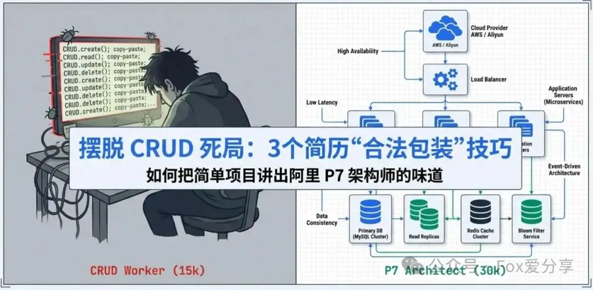
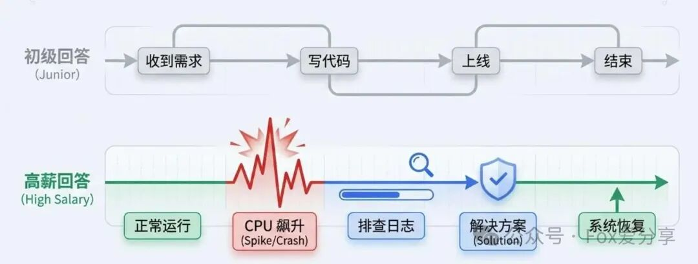
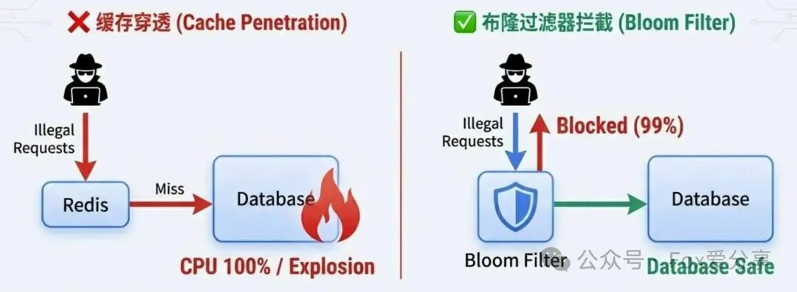
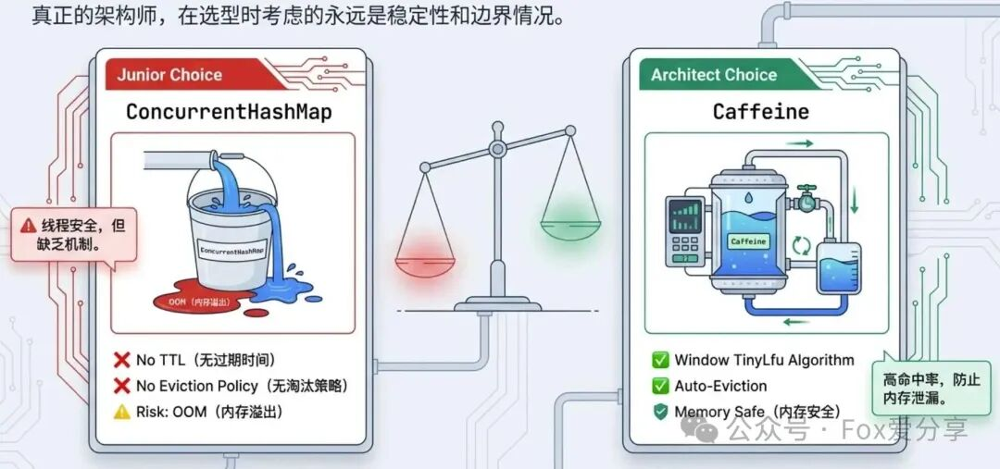
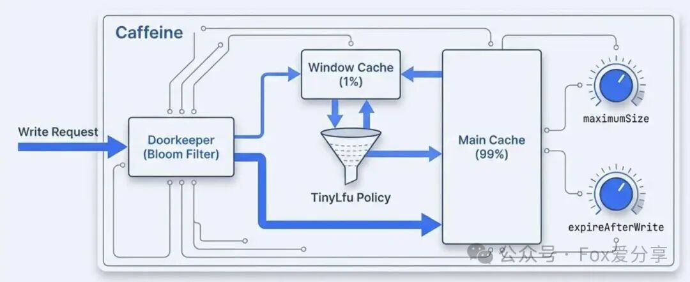
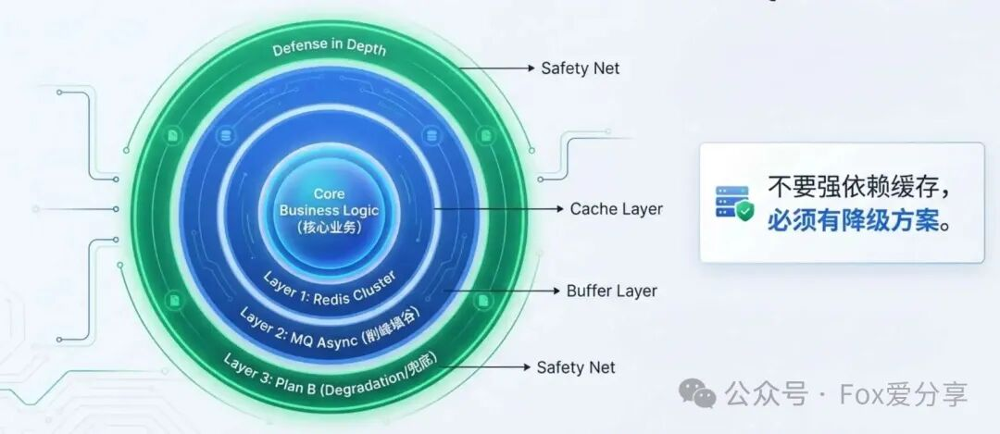
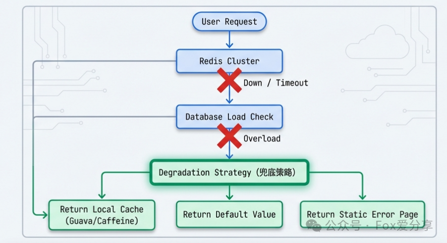
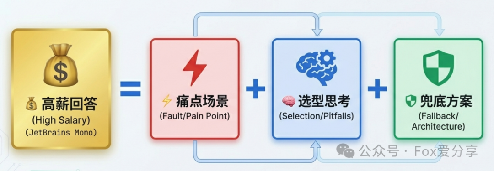
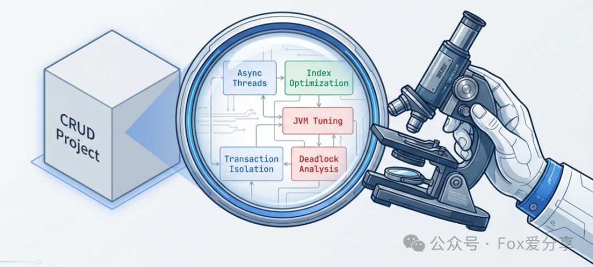

# 简历全是 CRUD？3 个 “合法包装” 技巧，让你的 Controller-Service-Dao 讲出阿里 P7 的味道！

## **写在开头**

最近帮大家改简历，我发现 90% 的 Java 程序员都面临同一个死局： **“Fox 老师，我工作 3 年了，每天都在写 Controller-Service-Dao，做的全是 ****CRUD****（增删改查）。简历上写不出东西，面试官问稍微深一点就挂，怎么破？”**

这其实是行业的**“隐性门槛”**。 面试官心里很清楚，绝大多数业务都是 CRUD。但为什么有的人能拿 30k，有的人只能拿 15k？ **区别不在于你“做了什么”，而在于你“挖了多深”。**

今天 Fox 不讲虚的，教你 3 个**“合法包装”**技巧。哪怕你做的只是最简单的管理后台，也能讲出**阿里 P7 架构师**的味道！

## **技巧一：把“功能实现”包装成“故障解决”**

面试官最烦的就是听流水账。如果你想让他眼前一亮，就得学会**“讲故事”**——而且是**“惊心动魄”**的故事。

**👇\*\*\*\* 一张图看懂话术区别：**

初级回答：我用了 Redis 加快查询。

**高薪回答：我解决了缓存穿透导致 DB CPU 飙升 100% 的事故。**

**✅\*\*\*\*高薪包装术（故障驱动法）：** 不要讲顺风顺水的故事，要讲生产事故。 面试官最喜欢听的是：**原本好好的 -> 突然出事了 -> 你怎么排查 -> 怎么解决**。

**话术模板：**

“面试官，这个项目虽然业务逻辑不复杂，但在高并发下遇到了**严重的缓存穿透问题**。 当时我发现数据库 CPU 突然飙升到 100%，排查日志发现是有黑产在疯狂请求不存在的商品 ID，导致 Redis 缓存完全失效，流量全部打穿到了 DB。

后来我没有简单地加防火墙，而是**引入了****布隆过滤器****（Bloom Filter）**，在缓存层之前拦截掉了 99% 的非法请求。同时，为了防止误判，我还设计了一套异步重建机制……”

## **技巧二：把“技术选型”包装成“架构思考”**

**❌\*\*\*\*初级回答（平庸）：**

“因为 ConcurrentHashMap 线程安全，所以我们用它做本地缓存。”

**💡\*\*\*\*面试官潜台词：** “这人没经验，不知道 Map 只进不出会导致 OOM 吗？”

**✅\*\*\*\*高薪包装术（防患于未然）：** 真正的架构师，在选型时考虑的永远是**稳定性**和**边界情况**。

**话术模板：**

“在设计本地缓存时，我没有盲目使用 <code>ConcurrentHashMap</code>。 虽然它线程安全，但我看过源码，它**缺乏自动过期（TTL）和内存淘汰机制**。在生产环境中，如果缓存数据持续增长，极易导致 **OOM（内存溢出）**。

所以我最终引入了 **Caffeine**（Spring Boot 默认缓存组件）。 我深入研究过它的 **Window TinyLfu 算法**，发现它比普通的 LRU 算法命中率更高。我配置了 <code>maximumSize</code> 和 <code>expireAfterWrite</code>，既保证了热点数据的高效读取，又完美规避了内存泄漏的风险。”

**👉\*\*\*\*核心逻辑：** 从“只会用 API”进阶到“考虑系统稳定性”。面试官一听就知道：**这人带过生产项目，懂坑在哪里。**

## **技巧三：把“简单业务”包装成“极限兜底”**

P6 看功能，P7 看兜底。 你要假设所有的中间件（Redis, MQ, DB）都会挂，然后展示你的**Plan B**。

**✅\*\*\*\*高薪包装术（面向失败编程）：**

**话术模板：**

“虽然我们的 Redis 集群有 99.99% 的可用性，但我始终认为**系统不能强依赖于缓存**。 我设计了一套**多级降级方案**，保证了即使中间件全崩，核心业务依然能活下来。”

**👇\*\*\*\*一张图看懂架构师的思维：**

**👉\*\*\*\*核心逻辑：** 展示你具备**“防御性编程”**和**“高可用架构”**的思维。这是大厂最看重的素质。

## **🚀\*\*\*\* 总结：万能面试“作弊条”**

下次面试被问到项目，别再像报菜名一样说技术栈了。 把下面这个公式刻在脑子里：

**💰\*\*\*\*高薪回答 = 痛点场景（故障） + 选型思考（避坑） + 兜底方案（架构）**

## **写在最后**

**所谓的“包装”，不是让你去编造没做过的事。** 而是让你学会**戴着“显微镜”看项目**。不要因为现在的 CRUD 而自卑，深挖下去，全是黄金。

**🔥****评论区互动福利****🔥**

**评论区留言：你的 CRUD 项目里，藏着什么可以深挖的技术点？** （比如：一个简单的导入功能，是不是用到了异步线程池？一个简单的查询，是不是用到了索引优化？）

**我会从评论区精选 3 位回答最走心的兄弟，免费为你一对一深度修改简历！**

觉得这篇干货对你有用的，**点个赞，转发**给身边正在找工作的兄弟。

我是Fox，关注公众号【**Fox 爱分享**】，只讲书上不写的实战坑、面试避坑技巧，带你少走弯路、轻松拿高薪！

> 更新: 2026-01-25 13:44:15  
> 原文: <https://www.yuque.com/tulingzhouyu/db22bv/apbcfyk28dhe7w38>