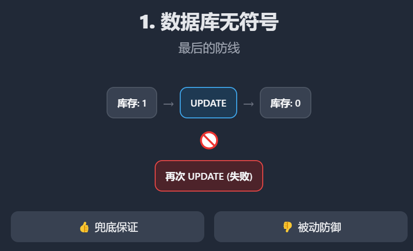
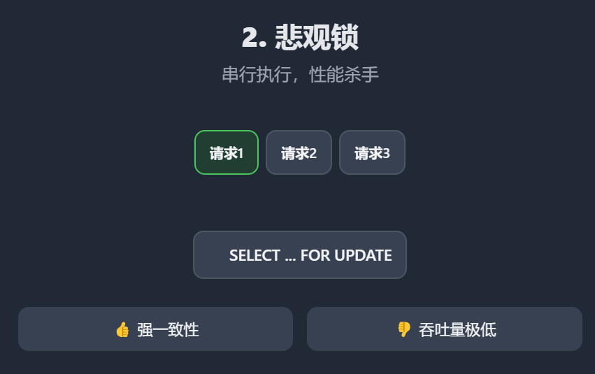
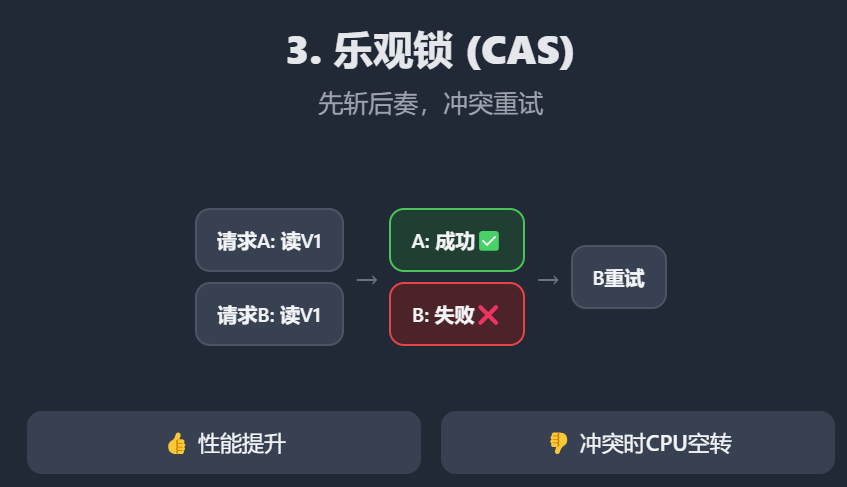
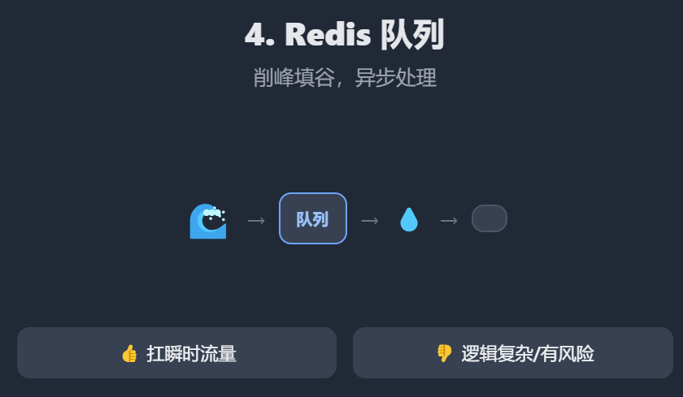
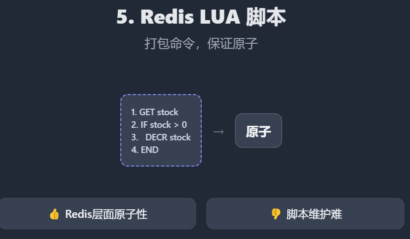
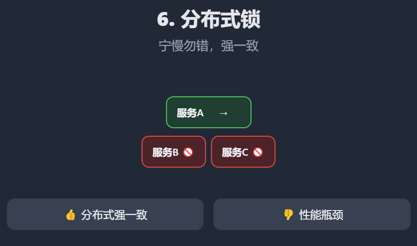
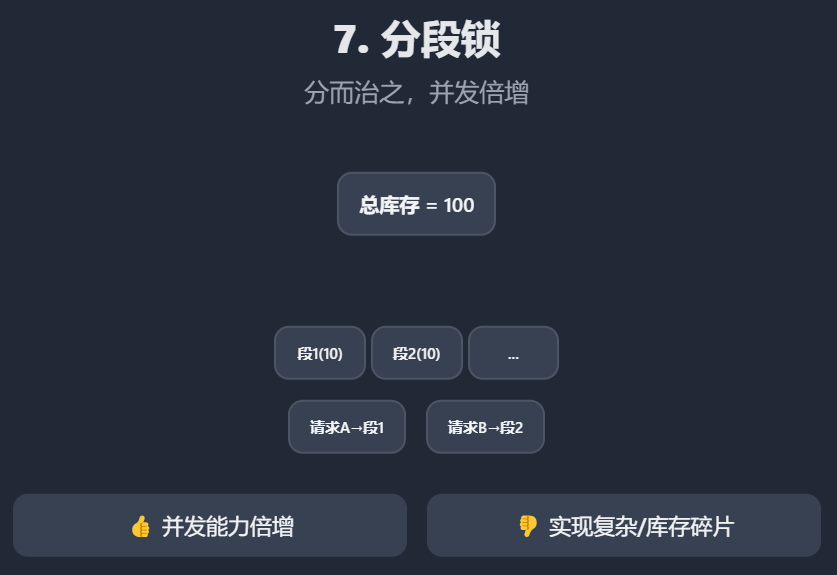

# 字节一面：库存超卖怎么办？

## <font style="color:rgb(38, 38, 38);">前言：一道让你与大厂失之交臂的题</font>

<font style="color:rgb(38, 38, 38);">“面字节电商岗，被问库存超卖，我只说了加锁，面试官直接摇头…” </font>

<font style="color:rgb(38, 38, 38);">“阿里二面，被追问‘超卖怎么兼顾并发和一致性’，我当场卡壳…”</font>

<font style="color:rgb(38, 38, 38);">这些令人窒息的场景，可能就是你面试的真实写照。</font>**<font style="color:rgb(38, 38, 38);">库存超卖</font>**<font style="color:rgb(38, 38, 38);">，这道看似简单的题目，早已不是纯粹的面试题，而是电商、秒杀、促销等高并发业务场景下的“生死线”。</font>

<font style="color:rgb(38, 38, 38);">去年一位朋友的公司，就因为618活动没防住超卖，多卖了2000单，最终导致了十几万的直接经济损失。可见，能否在技术层面优雅地解决超卖问题，已经成为衡量一个工程师技术深度和广度的重要标准。</font>

<font style="color:rgb(38, 38, 38);">今天，我们将通过一个7层方案模型，从最基础的数据库防御到大厂级别的高阶架构，层层递进，彻底讲透库存超卖的解决方案。掌握这套逻辑，下次面试再遇到它，你将游刃有余，让面试官对你刮目相看。</font>

## <font style="color:rgb(38, 38, 38);">第一层：数据库无符号字段（基础防御）</font>

<font style="color:rgb(38, 38, 38);">这是最基础，却也最容易被忽略的一道防线。将数据库中存储库存的字段（如</font><code><font style="color:rgb(38, 38, 38);background-color:rgba(175, 184, 193, 0.2);">stock</font></code><font style="color:rgb(38, 38, 38);">）类型设置为无符号整数（</font><code><font style="color:rgb(38, 38, 38);background-color:rgba(175, 184, 193, 0.2);">UNSIGNED INT</font></code><font style="color:rgb(38, 38, 38);">）。</font>



* **<font style="color:rgb(38, 38, 38);">原理</font>**<font style="color:rgb(38, 38, 38);">：当库存扣减到0后，如果再有扣减操作（</font><code><font style="color:rgb(38, 38, 38);background-color:rgba(175, 184, 193, 0.2);">stock = stock - 1</font></code><font style="color:rgb(38, 38, 38);">），数据库会直接抛出异常，阻止该SQL语句的执行，从而在数据库层面杜绝了库存变为负数的可能。</font>

```java
-- 库存字段设为无符号整型
CREATE TABLE goods (
    id INT PRIMARY KEY,
stock INT UNSIGNED NOT NULL DEFAULT 0 -- 关键：UNSIGNED
);

-- 扣减库存时，若stock-1＜0，直接报错
UPDATE goods SET stock = stock - 1 WHERE id = 1;
```

**<font style="color:rgb(89, 89, 89);">面试加分点：</font>**<font style="color:rgb(89, 89, 89);"> 当面试官问：“这能防住超卖吗？”</font>

**<font style="color:rgb(89, 89, 89);">标准回答</font>**<font style="color:rgb(89, 89, 89);">：“它能作为最后一道防线，防止库存出现负数，保证数据的最终正确性。但它属于‘被动防御’，无法解决高并发下的业务逻辑问题。例如，100个请求同时查询到库存为1，它们都会通过业务代码的判断逻辑，最终只有一个请求能成功执行SQL，其余99个都会收到数据库异常。这会导致大量请求失败，用户体验极差，因此这只是一个基础保障，不能作为主要的并发控制方案。”</font>

<font style="color:rgb(89, 89, 89);"></font>

## <font style="color:rgb(38, 38, 38);">第二层：数据库悲观锁（串行控制）</font>

<font style="color:rgb(38, 38, 38);">悲观锁的核心思想是“先锁定，再操作”，它假设并发冲突一定会发生，所以每次操作数据前都会先加锁，阻止其他事务的修改。</font>



* **<font style="color:rgb(38, 38, 38);">实现</font>**<font style="color:rgb(38, 38, 38);">：在SQL查询时使用</font><font style="color:rgb(38, 38, 38);"> </font><code><font style="color:rgb(38, 38, 38);background-color:rgba(175, 184, 193, 0.2);">FOR UPDATE</font></code><font style="color:rgb(38, 38, 38);"> </font><font style="color:rgb(38, 38, 38);">关键字。</font>

```sql
-- 开启事务
BEGIN;
-- 查询并锁定行，其他事务将被阻塞，直到本事务提交
SELECT stock FROM products WHERE id = 1 FOR UPDATE;
-- 业务逻辑判断库存...
UPDATE products SET stock = stock - 1 WHERE id = 1;
-- 提交事务，释放锁
COMMIT;
```

* **<font style="color:rgb(38, 38, 38);">优点</font>**<font style="color:rgb(38, 38, 38);">：实现简单，强一致性，能有效防止超卖。</font>
* **<font style="color:rgb(38, 38, 38);">缺点</font>**<font style="color:rgb(38, 38, 38);">：</font>**<font style="color:rgb(38, 38, 38);">性能极差</font>**<font style="color:rgb(38, 38, 38);">。在高并发场景下，大量请求会因为等待锁而被阻塞，导致事务积压、响应超时，数据库吞吐量急剧下降。这在秒杀等场景下是绝对无法接受的。</font>

**<font style="color:rgb(89, 89, 89);">面试加分点：</font>**<font style="color:rgb(89, 89, 89);"> 清晰地指出其适用场景：“这种方案适合并发量不大、且对数据一致性要求极高的场景，比如后台管理系统手动修改少量库存。对于C端高并发场景，悲观锁会成为性能瓶颈。”</font>

## <font style="color:rgb(38, 38, 38);">第三层：乐观锁（CAS机制）</font>

<font style="color:rgb(38, 38, 38);">与悲观锁相反，乐观锁假设冲突很少发生，它不会预先加锁，而是在更新数据时检查在此期间数据是否被其他事务修改过。</font>



* **<font style="color:rgb(38, 38, 38);">实现</font>**<font style="color:rgb(38, 38, 38);">：通常通过版本号（</font><code><font style="color:rgb(38, 38, 38);background-color:rgba(175, 184, 193, 0.2);">version</font></code><font style="color:rgb(38, 38, 38);">）或时间戳实现。</font>

```sql

-- 1. 查询出商品信息，包含版本号
SELECT stock, version FROM products WHERE id = 1;

-- 2. 业务代码判断库存后，执行更新
UPDATE products 
SET stock = stock - 1, version = version + 1 
WHERE id = 1 AND version = #{current_version};
```

<font style="color:rgb(38, 38, 38);">如果</font><code><font style="color:rgb(38, 38, 38);background-color:rgba(175, 184, 193, 0.2);">UPDATE</font></code><font style="color:rgb(38, 38, 38);">语句影响的行数为0，说明在你更新期间，</font><code><font style="color:rgb(38, 38, 38);background-color:rgba(175, 184, 193, 0.2);">version</font></code><font style="color:rgb(38, 38, 38);">已经被其他线程修改，本次更新失败。</font>

* **<font style="color:rgb(38, 38, 38);">优点</font>**<font style="color:rgb(38, 38, 38);">：不加锁，性能远高于悲观锁。</font>
* **<font style="color:rgb(38, 38, 38);">缺点</font>**<font style="color:rgb(38, 38, 38);">：在高并发下，冲突会变多，导致大量更新失败和重试，增加了CPU开销。</font>

**<font style="color:rgb(89, 89, 89);">面试加分点：</font>**<font style="color:rgb(89, 89, 89);"> 当面试官追问：“高并发下重试次数过多怎么办？”</font>

**<font style="color:rgb(89, 89, 89);">标准回答</font>**<font style="color:rgb(89, 89, 89);">：“可以引入重试机制，但必须设置合理的重试次数上限（例如3次）。如果超过上限仍然失败，应操作失败并向用户返回‘当前繁忙，请稍后再试’的提示，避免无限重试导致CPU空转和死循环。”</font>

## <font style="color:rgb(38, 38, 38);">第四层：Redis队列（削峰填谷）</font>

<font style="color:rgb(38, 38, 38);">利用Redis单线程执行命令的特性，将请求序列化，变并行处理为串行处理。</font>



* **<font style="color:rgb(38, 38, 38);">实现</font>**<font style="color:rgb(38, 38, 38);">：在秒杀活动开始前，根据库存数量（如1000件），在Redis的一个List中 </font><code><font style="color:rgb(38, 38, 38);background-color:rgba(175, 184, 193, 0.2);">LPUSH</font></code><font style="color:rgb(38, 38, 38);"> 1000个标识（例如"1"）。用户每下一个单，就执行一次 </font><code><font style="color:rgb(38, 38, 38);background-color:rgba(175, 184, 193, 0.2);">LPOP</font></code><font style="color:rgb(38, 38, 38);"> 操作。能</font><code><font style="color:rgb(38, 38, 38);background-color:rgba(175, 184, 193, 0.2);">LPOP</font></code><font style="color:rgb(38, 38, 38);">成功的用户才能继续后续的下单流程，如果返回</font><code><font style="color:rgb(38, 38, 38);background-color:rgba(175, 184, 193, 0.2);">nil</font></code><font style="color:rgb(38, 38, 38);">，则表示库存已空。</font>
* **<font style="color:rgb(38, 38, 38);">优点</font>**<font style="color:rgb(38, 38, 38);">：</font>
  1. **<font style="color:rgb(38, 38, 38);">性能极高</font>**<font style="color:rgb(38, 38, 38);">：Redis内存操作，速度飞快。</font>
  2. **<font style="color:rgb(38, 38, 38);">无需加锁</font>**<font style="color:rgb(38, 38, 38);">：天然的原子性操作，将并发压力转移到Redis。</font>
  3. **<font style="color:rgb(38, 38, 38);">削峰填谷</font>**<font style="color:rgb(38, 38, 38);">：平滑处理瞬时流量洪峰。</font>
* **<font style="color:rgb(38, 38, 38);">缺点</font>**<font style="color:rgb(38, 38, 38);">：</font>
  1. **<font style="color:rgb(38, 38, 38);">功能受限</font>**<font style="color:rgb(38, 38, 38);">：不适用于复杂的SKU场景或购物车批量购买。</font>
  2. **<font style="color:rgb(38, 38, 38);">数据一致性</font>**<font style="color:rgb(38, 38, 38);">：Redis中的库存与数据库中的库存需要额外机制来保证最终一致性。</font>

**<font style="color:rgb(89, 89, 89);">面试加分点：</font>**<font style="color:rgb(89, 89, 89);"> 指出该方案的局限性：“此方案适合单品秒杀，能扛住极高的瞬时并发。但需要考虑Redis故障或数据同步延迟可能导致的库存不一致问题，需要有后续的补偿和对账机制。”</font>

## <font style="color:rgb(38, 38, 38);">第五层：Redis Lua脚本（原子操作）</font>

<font style="color:rgb(38, 38, 38);">虽然Redis命令是原子的，但“查询库存”+“扣减库存”是两个独立的操作，在并发下依然存在原子性问题。Lua脚本可以将多个命令打包，作为一个原子单元执行。</font>



* **<font style="color:rgb(38, 38, 38);">实现</font>**<font style="color:rgb(38, 38, 38);">：编写一个Lua脚本，将“读取库存”和“判断并扣减”两个步骤合并。</font>

```plain
-- check_and_deduct.lua
local stock = tonumber(redis.call('GET', KEYS[1]))
if stock > 0 then
    redis.call('DECR', KEYS[1])
    return 1
end
return 0
```

<font style="color:rgb(38, 38, 38);">通过 </font><code><font style="color:rgb(38, 38, 38);background-color:rgba(175, 184, 193, 0.2);">EVAL</font></code><font style="color:rgb(38, 38, 38);"> 命令执行此脚本，Redis会保证脚本在执行期间不会被其他命令打断。</font>

* **<font style="color:rgb(38, 38, 38);">优点</font>**<font style="color:rgb(38, 38, 38);">：保证了在Redis层面的原子性，代码逻辑清晰，性能优异。</font>
* **<font style="color:rgb(38, 38, 38);">缺点</font>**<font style="color:rgb(38, 38, 38);">：如果业务逻辑复杂，Lua脚本会变得难以维护。同时，它依然面临Redis与数据库数据一致性的挑战。</font>

**<font style="color:rgb(89, 89, 89);">面试加fen点：</font>**<font style="color:rgb(89, 89, 89);"> 当面试官问：“Lua脚本为什么能保证原子性？”</font>

**<font style="color:rgb(89, 89, 89);">标准回答</font>**<font style="color:rgb(89, 89, 89);">：“因为Redis在执行Lua脚本时，会将其作为一个整体执行，期间不会插入执行其他客户端的命令，这类似于一个‘单线程’的执行模型，从而天然地保证了原子性。但同时也要考虑到，如果脚本过于耗时，会阻塞整个Redis服务。此外，需要配置合理的Redis持久化策略（如AOF），防止服务器宕机导致库存数据丢失。”</font>

## <font style="color:rgb(38, 38, 38);">第六层：“一锁二判三更新”（强一致性模式）</font>

<font style="color:rgb(38, 38, 38);">这是一个在分布式环境下保证强一致性的经典模式，常被大厂面试官考察。</font>



* **<font style="color:rgb(38, 38, 38);">流程</font>**<font style="color:rgb(38, 38, 38);">：</font>
  1. **<font style="color:rgb(38, 38, 38);">一锁</font>**<font style="color:rgb(38, 38, 38);">：通过分布式锁（如Redisson、ZooKeeper）锁定商品ID。</font>
  2. **<font style="color:rgb(38, 38, 38);">二判</font>**<font style="color:rgb(38, 38, 38);">：获取锁成功后，再次从数据库或缓存中查询库存，判断是否充足。</font>
  3. **<font style="color:rgb(38, 38, 38);">三更新</font>**<font style="color:rgb(38, 38, 38);">：如果库存充足，则执行扣减库存的操作，然后释放锁。</font>
* **<font style="color:rgb(38, 38, 38);">优点</font>**<font style="color:rgb(38, 38, 38);">：逻辑严谨，能够确保在分布式环境下的数据强一致性，完全杜绝超卖。</font>
* **<font style="color:rgb(38, 38, 38);">缺点</font>**<font style="color:rgb(38, 38, 38);">：</font>**<font style="color:rgb(38, 38, 38);">性能瓶颈</font>**<font style="color:rgb(38, 38, 38);">。由于引入了分布式锁，所有对同一商品的请求都变成了串行执行，吞吐量受限于锁的性能，并发能力较差。</font>

**<font style="color:rgb(89, 89, 89);">面试加分点：</font>**<font style="color:rgb(89, 89, 89);"> 强调其适用场景：“这个方案以牺牲性能为代价，换取了最高级别的一致性。它非常适合那些绝对不能超卖的场景，比如限量版奢侈品、高价值商品的秒杀，这些场景下用户对‘慢’的容忍度高于对‘超卖’的容忍度。”</font>

## <font style="color:rgb(38, 38, 38);">第七层：分布式锁 + 分段缓存（高性能模式）</font>

<font style="color:rgb(38, 38, 38);">这是对第六层方案的优化，也是字节、拼多多等公司处理大流量秒杀的常用方案，核心思想是“分而治之”。</font>



* **<font style="color:rgb(38, 38, 38);">实现</font>**<font style="color:rgb(38, 38, 38);">：</font>
  1. **<font style="color:rgb(38, 38, 38);">库存分段</font>**<font style="color:rgb(38, 38, 38);">：将总库存（如10000件）拆分成多个分片（Segment），存储在Redis中。例如，分成10片，每片1000件库存，存为</font><font style="color:rgb(38, 38, 38);"> </font><code><font style="color:rgb(38, 38, 38);background-color:rgba(175, 184, 193, 0.2);">goods:stock:1</font></code><font style="color:rgb(38, 38, 38);"> </font><font style="color:rgb(38, 38, 38);">到</font><font style="color:rgb(38, 38, 38);"> </font><code><font style="color:rgb(38, 38, 38);background-color:rgba(175, 184, 193, 0.2);">goods:stock:10</font></code><font style="color:rgb(38, 38, 38);">。</font>
  2. **<font style="color:rgb(38, 38, 38);">分流请求</font>**<font style="color:rgb(38, 38, 38);">：用户请求到来时，通过某种哈希算法（如</font><font style="color:rgb(38, 38, 38);"> </font><code><font style="color:rgb(38, 38, 38);background-color:rgba(175, 184, 193, 0.2);">userId % 10</font></code><font style="color:rgb(38, 38, 38);">）将其路由到某个库存分片上。</font>
  3. **<font style="color:rgb(38, 38, 38);">分片扣减</font>**<font style="color:rgb(38, 38, 38);">：在分片上使用分布式锁或Lua脚本进行库存扣减。如果当前分片库存不足，可以尝试在下一个分片上扣减（需要设计好流转机制）。</font>
* **<font style="color:rgb(38, 38, 38);">优点</font>**<font style="color:rgb(38, 38, 38);">：</font>
  1. **<font style="color:rgb(38, 38, 38);">并发倍增</font>**<font style="color:rgb(38, 38, 38);">：将对单个库存热点的竞争，分散到多个分片上，并发能力理论上可提升N倍（N为分片数量）。</font>
  2. **<font style="color:rgb(38, 38, 38);">热点分散</font>**<font style="color:rgb(38, 38, 38);">：有效避免了单一热点Key的问题。</font>
* **<font style="color:rgb(38, 38, 38);">缺点</font>**<font style="color:rgb(38, 38, 38);">：</font>
  1. **<font style="color:rgb(38, 38, 38);">实现复杂</font>**<font style="color:rgb(38, 38, 38);">：需要精心设计分片逻辑、跨分片扣减逻辑以及总库存的统计。</font>
  2. **<font style="color:rgb(38, 38, 38);">库存碎片</font>**<font style="color:rgb(38, 38, 38);">：可能出现总库存充足，但每个分片剩余少量库存，导致用户请求失败的情况。</font>

**<font style="color:rgb(89, 89, 89);">面试加分点：</font>**<font style="color:rgb(89, 89, 89);"> 清晰地指出方案的难点：“该方案最大的挑战在于如何处理‘库存碎片’和跨分片扣减的逻辑。例如，需要一个额外的计数器来大致跟踪总库存，或者在某个分片库存告急时，能平滑地将流量切换到其他分片，这对系统设计提出了更高的要求。”</font>

## <font style="color:rgb(38, 38, 38);">总结：没有银弹，只有权衡</font>

<font style="color:rgb(38, 38, 38);">在面试和实际工作中，切忌背诵方案。面试官更想考察的是你对不同方案优劣的理解，以及在特定业务场景下进行技术选型的能力。</font>

* **<font style="color:rgb(38, 38, 38);">中小企业/低并发</font>**<font style="color:rgb(38, 38, 38);">：</font>**<font style="color:rgb(38, 38, 38);">乐观锁</font>**<font style="color:rgb(38, 38, 38);"> </font><font style="color:rgb(38, 38, 38);">或</font><font style="color:rgb(38, 38, 38);"> </font>**<font style="color:rgb(38, 38, 38);">Redis队列</font>**<font style="color:rgb(38, 38, 38);"> </font><font style="color:rgb(38, 38, 38);">是性价比极高的选择。</font>
* **<font style="color:rgb(38, 38, 38);">大型企业/高并发秒杀</font>**<font style="color:rgb(38, 38, 38);">：</font>**<font style="color:rgb(38, 38, 38);">Redis Lua脚本</font>**<font style="color:rgb(38, 38, 38);"> </font><font style="color:rgb(38, 38, 38);">+</font><font style="color:rgb(38, 38, 38);"> </font>**<font style="color:rgb(38, 38, 38);">分段缓存</font>**<font style="color:rgb(38, 38, 38);"> </font><font style="color:rgb(38, 38, 38);">是兼顾性能和一致性的主流方案。</font>
* **<font style="color:rgb(38, 38, 38);">金融级/强一致性要求</font>**<font style="color:rgb(38, 38, 38);">：</font>**<font style="color:rgb(38, 38, 38);">“一锁二判三更新”</font>**<font style="color:rgb(38, 38, 38);"> </font><font style="color:rgb(38, 38, 38);">模式是最后的保障。</font>

<font style="color:rgb(38, 38, 38);">下次再被问到库存超卖，请务必按照这个逻辑，从场景出发，分析利弊，给出你的权衡。这不仅能展现你的技术深度，更能体现你的架构思维。</font>

***

**<font style="color:rgb(89, 89, 89);">最后，留个思考题：</font>**<font style="color:rgb(89, 89, 89);"> 如果使用Redis方案，如何解决Redis库存与数据库库存的最终一致性问题？欢迎在评论区留下你的见解！</font>


> 更新: 2026-01-15 15:18:35  
> 原文: <https://www.yuque.com/tulingzhouyu/db22bv/muvhom4oi6fz7t3y>