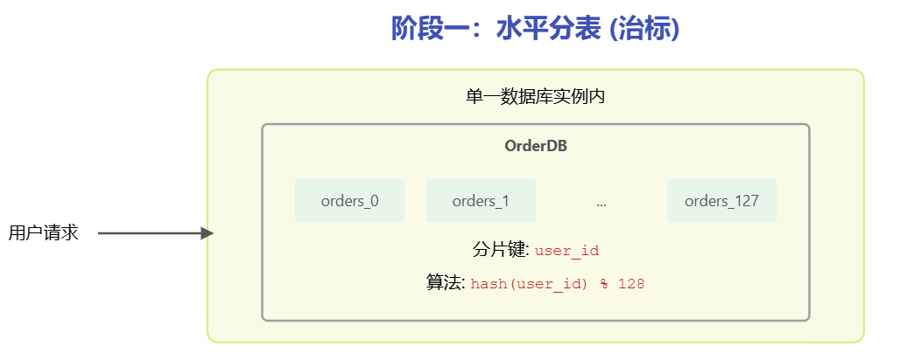
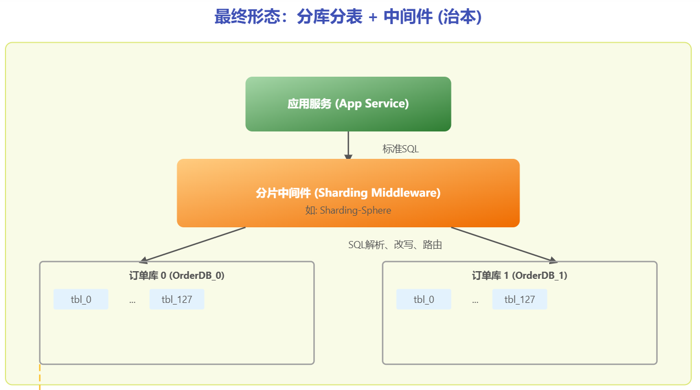
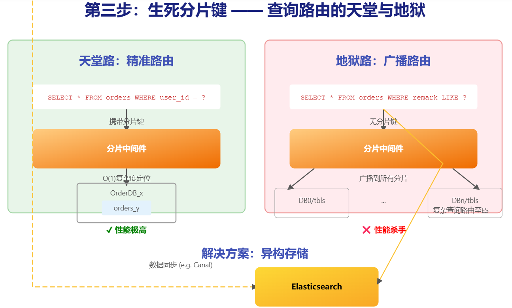
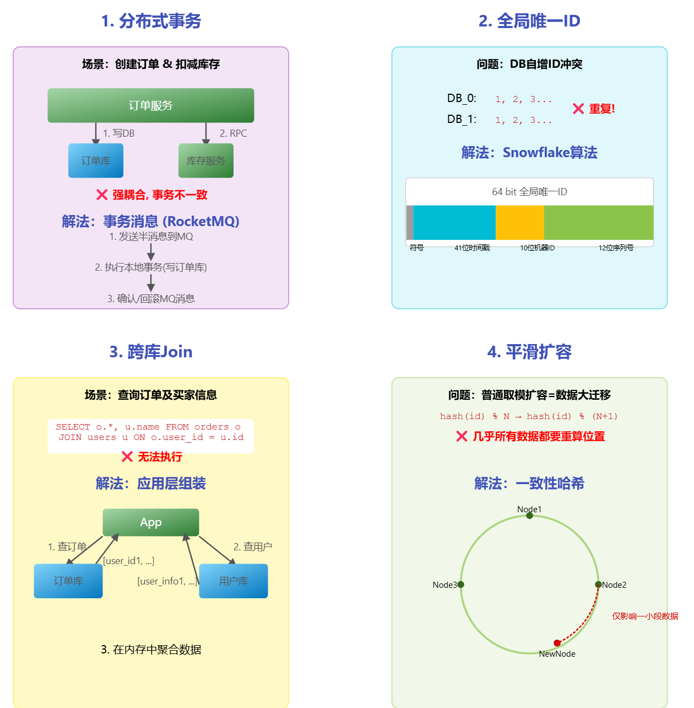

# 订单过亿，怎么分库分表？

面试官问：“订单过亿，怎么分库分表？”

如果你脑子里只蹦出“哈希取模”四个字，那这道题你可能只答了20分。这问题，其实是个连环坑，它真正想考察的是你对大型系统复杂度的理解能力。

一个平庸的回答是：“数据量大了，就分表呗。”

一个优秀的回答是：“别急，这事儿得分两头说。咱们今天就把这事儿彻底盘明白，从病根儿到下药，再到吃完药的‘副作用’怎么治，一套给你理清楚。”

***

#### **第一步：别急着动手，先把脉**

拿到一个慢查询的SQL，你总得先<code>EXPLAIN</code>一下吧？同理，面对“亿级订单”这个庞然大物，也得先诊断，搞清楚它到底“病”在哪。这病，其实是两种，得用两种药来治。

1. **为啥要分表？——治“胖”**
   * **病症：** 一张表塞了1亿条数据，就像一个胖子，行动迟缓。数据库索引的B+树变得死沉死沉的，层级又深，每次查找都得翻箱倒柜，磁盘I/O开销巨大。备份和修改表结构（DDL）更是想都不敢想，一动就得半天。
   * **药方：** **水平分表**。把这个大胖子，拆成一堆小瘦子。
2. **为啥要分库？——治“忙”**
   * **病症：** 能产生1亿订单的业务，并发量绝对不是闹着玩的。所有请求都往一个数据库实例上怼，CPU、内存、连接数分分钟给你干到100%。数据库自己都快忙死了，系统性能自然上不去。
   * **药方：** **分库**。别让一个人干所有活，多找几个兄弟一起扛。

**一句话总结：分表，是为了让数据“瘦身”，解决存储和查询的性能问题；分库，是为了拉一帮“兄弟”分摊压力，解决高并发的处理能力问题。** 对于亿级订单这种场景，这两件事，都得干。

***

#### **第二步：架构不是变魔术，是搭积木**

想清楚了病根，我们就可以开始“搭积木”了。一个好的架构，不是凭空变出来的，而是一步步演进出来的。

* **第一刀：水平切表** 最直接的一刀，先在库里把那张臃肿的<code>orders</code>表给切了。切成<code>orders_0</code>、<code>orders_1</code>...<code>orders_127</code>这样。按什么规则切？当然是按最常用的查询字段——<code>**user_id**</code>。用<code>hash(user_id) % 128</code>，保证同一个用户的订单落在同一张表里，查起来快。这一刀下去，单表数据量下来了，查询速度立马回春。

* **第二刀：垂直分库** 业务越来越复杂，用户、商品、订单、支付全挤在一个库里，互相抢资源。那就按业务垂直切开，搞出用户库、商品库、订单库。各家的事各家管，订单系统再忙，也别影响用户登录。

* **终极形态：分库分表 + 大管家（中间件）** 现在，把上面两招合在一起，再请个“大管家”——**分片中间件**（比如<code>Sharding-Sphere</code>）。 我们的应用服务不再傻乎乎地直连某个数据库，而是把所有SQL都丢给这个大管家。 大管家拿到SQL，比如<code>SELECT * FROM orders WHERE user_id = 666</code>，它心里门儿清：
  1. 拿出<code>user_id</code>=666。
  2. 算一下库：<code>hash(666) % 2</code> -> 嘿，在<code>order_db_0</code>库。
  3. 再算一下表：<code>hash(666) % 128</code> -> 哟，在<code>orders_42</code>表。
  4. 然后改写SQL，悄悄地把请求发给<code>order_db_0.orders_42</code>，拿到结果再原封不动地还给应用。 整个过程，应用层毫无察觉，舒服得很。

***

#### **第三步：分片键，决定生死的一条线**

分库分表之后，你的SQL写法，直接决定了系统的生与死。

* **天堂之路：查询带上**<code>**user_id**</code> 只要你的<code>WHERE</code>条件里带着分片键<code>user_id</code>，中间件就能像GPS一样精准导航，直达目标库表。这种查询，性能高到飞起。
* **地狱之路：查询不带**<code>**user_id**</code> 如果你想<code>SELECT * FROM orders WHERE remark LIKE '%急单%'</code>，那对不起了。中间件压根不知道这备注在哪张表里，它只能把这个查询请求发给**所有库的所有表**，然后把返回的一大堆结果在自己内存里合并。这叫“广播路由”，一次查询就可能引发一场数据库风暴，是绝对要避免的性能杀手。

**怎么办？** 后台运营想按手机号、备注查订单怎么办？记住，**别跟数据库死磕**。把订单数据同步一份到 **Elasticsearch** 里，让它去做这种复杂的、非核心链路的搜索工作。专业的事，交给专业的工具。

***

#### **第四步：恭喜，你解锁了四个新Boss**

解决了老问题，总会冒出新问题。当你把上面这些都聊得明明白白时，面试官会微微一笑，抛出终极追问：“这套架构，有什么新麻烦？”

别慌，这正是你展示深度的时候。主动告诉他，你已经准备好迎战这四个新Boss了：

1. **Boss 1：分布式事务**
   * **场景：** 用户付钱，要改订单库里的状态，也要在支付库里插流水。两个操作必须“同生共死”。
   * **武器：** 强一致性要求高就上 **Seata**；如果能接受最终一致性，用\*\*消息队列（RocketMQ/Kafka）\*\*做异步补偿或SAGA模式，对系统侵入更小，性能更好。
2. **Boss 2：跨库Join**
   * **场景：** 查订单列表，还想把每个订单的买家昵称也显示出来。<code>JOIN user_table</code>？别想了，订单库和用户库已经分家了。
   * **武器：** **应用层代码组装**。先查出订单，拿到一堆<code>user_id</code>，再去用户服务那儿一次性（<code>IN</code>查询）把所有用户信息捞出来，最后在内存里把它们“缝”在一起。
3. **Boss 3：全局唯一ID**
   * **场景：** 数据库自增ID没法用了，不然每个库都会从1开始，ID就冲突了。
   * **武器：** **雪花算法（Snowflake）**。这个算法生成的ID，自带时间戳和机器码，不仅全局唯一，还趋势递增，对数据库索引特别友好。自己搭个发号器服务，或者用开源框架里现成的。
4. **Boss 4：数据扩容**
   * **场景：** 业务发展太快，2个库又不够了，得扩成4个。数据怎么挪过去？
   * **武器：** **双写+数据迁移**。这是个精细活儿。先让程序“双写”，新数据一份写老库，一份按新规则写新库。同时跑个脚本，把老库里的历史数据慢慢地、按新规则迁移到新库。等数据都同步好了，再把读请求一点点切到新库上。

***

#### **写在最后**

看到这里，你会发现，分库分表从来不是一个简单的技术选项，而是一种架构思维的转变。

它逼着你从单机思维走向分布式思维，去思考事务、ID、查询、扩容等一系列在分布式世界里才会遇到的新问题。

当你能把这一整套逻辑，从“为什么”到“怎么做”，再到“怎么办”，都像聊天一样娓娓道来时，面试官基本就该和你聊薪资了。

> 更新: 2025-09-19 14:21:12  
> 原文: <https://www.yuque.com/tulingzhouyu/db22bv/brk23xg0dc477k9k>