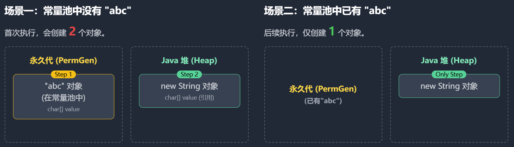
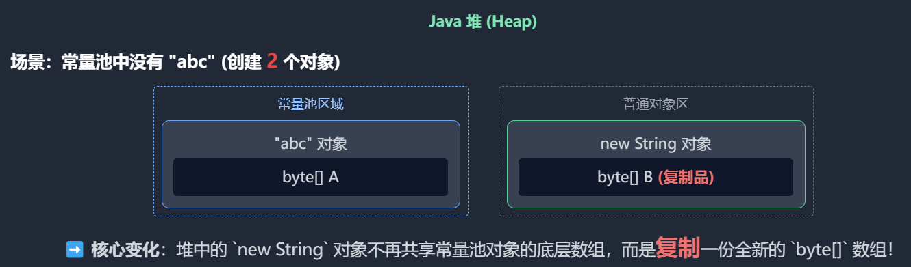
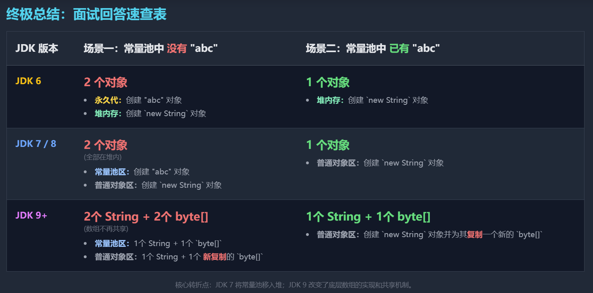

# 说说String s = new String ("abc") 创建了几个对象？

在 Java 面试中，这行看似简单的代码是衡量一位开发者对 JVM 内存模型、特别是字符串常量池（String Constant Pool）理解深度的“黄金问题”。如果你的回答仅仅是“一个”或“两个”，那么你可能已经掉入了面试官的陷阱。

**标准答案是：分情况、分版本讨论。**

这行代码的核心行为可以分解为两部分：

1. **字面量\*\*\*\* **<code>**"abc"**</code>：这部分会检查字符串常量池。如果池中不存在等值的 "abc"，就会在池中创建一个。
2. <code>**new String(...)**</code>：<code>new</code> 关键字的行为是明确的——它总会在堆内存中创建一个新的 <code>String</code> 对象。

问题的复杂性来源于字符串常量池（SCP）在不同 JDK 版本中存储位置的变迁，以及 JDK 9 之后底层实现的改变。

## 1. JDK 6 及之前：“永久代”的峥嵘岁月

在遥远的 JDK 6 时代，JVM 的方法区是使用“永久代”（Permanent Generation）实现的，而字符串常量池就位于其中，完全独立于 Java 堆。

#### **场景一：常量池中【没有】"abc"**

当代码首次执行时，会创建 **2 个对象**。

1. **检查常量池**：发现池中没有 "abc"。
2. **创建池中对象**：在 **永久代** 的常量池中创建一个 "abc" 字符串对象。
3. **创建堆中对象**：通过 <code>new</code> 关键字，在 **Java 堆** 中再创建一个 <code>String</code> 对象。这个堆中的对象会引用常量池中的 "abc" 对象（在 HotSpot VM 实现中，是共享其内部的 <code>char[]</code> 数组）。

#### **场景二：常量池中【已有】"abc"**

如果常量池中已经存在 "abc"（例如，在执行这行代码前有其他代码 <code>String x = "abc";</code>），那么只会创建 **1 个对象**。

1. **检查常量池**：发现池中已有 "abc"，不做任何操作。
2. **创建堆中对象**：通过 <code>new</code> 关键字，只在 **Java 堆** 中创建一个新的 <code>String</code> 对象。

***

## 2. JDK 7 / 8：常量池“搬家”入堆

为了解决永久代内存难以管理和容易溢出的问题，从 JDK 7 开始，Oracle 将字符串常量池从永久代中迁移到了 **Java 堆** 内部。JDK 8 则彻底移除了永久代，代之以元空间（Metaspace）。

这个改动意味着，此时常量池中的对象和我们普通创建的对象，都共享同一片内存区域——堆。

#### **场景一：常量池中【没有】"abc"**

此时仍然创建 **2 个对象**，但它们的位置都在 **Java 堆** 中。

1. **检查常量池**：发现堆内的常量池区域没有 "abc"。
2. **创建池中对象**：在 **堆的常量池区域** 创建一个 "abc" 对象。
3. **创建堆中对象**：在 **堆的普通对象区域** 创建一个新的 <code>String</code> 对象。

#### **场景二：常量池中【已有】"abc"**

同样，此场景下只会创建 **1 个对象**。

1. **检查常量池**：发现堆内的常量池区域已有 "abc"。
2. **创建堆中对象**：只在 **堆的普通对象区域** 创建一个新的 <code>String</code> 对象。

***

## 3. JDK 9+：字符串压缩与底层变革

从 JDK 9 开始，Java 引入了**字符串压缩（Compact Strings）**特性。为了节省内存，<code>String</code> 的底层存储从 <code>char[]</code> 变成了 <code>byte[]</code>。更重要的是，<code>new String("...")</code> 构造函数的行为也发生了根本性变化：**它不再共享字面量的底层数组，而是选择复制一份**。

#### **场景一：常量池中【没有】"abc"**

这个版本的答案变得更加复杂，总共涉及 **2 个 String 对象** 和 **2 个 **<code>**byte[]**</code>** 数组**。

1. **常量池部分**：在堆的常量池区域创建 1 个 <code>String</code> 对象 ("abc") 和 1 个用于存储其内容的 <code>byte[]</code> 数组。
2. **堆对象部分**：在堆的普通对象区域创建 1 个 <code>new String</code> 对象，并为它**复制一份全新的\*\*\*\* **<code>**byte[]**</code>** \*\*\*\*数组**。

#### **场景二：常量池中【已有】"abc"**

此时创建 **1 个 String 对象** 和 **1 个 **<code>**byte[]**</code>** 数组**。

1. **常量池部分**：常量池中已有 "abc"，无需操作。
2. **堆对象部分**：在堆的普通对象区域创建 1 个 <code>new String</code> 对象，并为其**复制一份全新的\*\*\*\* **<code>**byte[]**</code>** \*\*\*\*数组**。

***

## 终极总结：面试中的完美回答

当面试官抛出这个问题时，一个能覆盖所有情况的完美回答应该是结构化的，能充分展现你知识的广度和深度。

你可以这样组织你的回答：

"关于 <code>String s = new String("abc");</code> 创建了几个对象，这个问题的答案并不是固定的，它取决于代码执行的上下文以及所处的 JDK 版本。

1. **在 JDK 6 及以前**，由于字符串常量池在永久代，如果常量池中没有 "abc"，会创建 2 个对象（一个在永久代，一个在堆）；如果已有，则只在堆上创建 1 个。
2. **在 JDK 7 和 8 中**，常量池被移到了堆内。此时如果池中没有 "abc"，同样是创建 2 个对象，但它们都在堆内；如果已有，则还是只创建 1 个堆对象。
3. **从 JDK 9 开始**，由于字符串压缩和底层实现的改变，<code>new String</code> 会复制一个新的 <code>byte[]</code> 数组。因此，如果池中没有 "abc"，会创建 2 个 String 对象和 2 个 <code>byte[]</code> 数组；如果已有，则会创建 1 个 String 对象和 1 个新的 <code>byte[]</code> 数组。"

这样的回答，不仅准确，更能体现出你对 JVM 技术演进的深刻理解，无疑会给面试官留下深刻的印象。

> 更新: 2025-10-12 13:20:16  
> 原文: <https://www.yuque.com/tulingzhouyu/db22bv/bq3om0knf4g7w02o>