# Mysql慢SQL优化—索引8大原则

<font style="color:rgba(0, 0, 0, 0.96);">很多同学写SQL的时候，明明建了索引，但查询还是很慢，这是为什么呢？其实，</font>**<font style="color:rgba(0, 0, 0, 0.96);">索引失效</font>**<font style="color:rgba(0, 0, 0, 0.96);">是最常见的性能杀手。</font>

<font style="color:rgba(0, 0, 0, 0.96);">今天我会用</font>**<font style="color:rgba(0, 0, 0, 0.96);">B+树的底层原理</font>**<font style="color:rgba(0, 0, 0, 0.96);">，带大家深入理解：</font>

* <font style="color:rgba(0, 0, 0, 0.96);">为什么有些写法会让索引失效？</font>
* <font style="color:rgba(0, 0, 0, 0.96);">怎么写SQL才能充分利用索引？</font>

<font style="color:rgba(0, 0, 0, 0.96);">掌握这8大原则，你的SQL性能至少提升</font>**<font style="color:rgba(0, 0, 0, 0.96);">50%以上</font>**<font style="color:rgba(0, 0, 0, 0.96);">！让我们开始吧！</font>

***

## 

<font style="color:rgba(0, 0, 0, 0.96);">在正式开始之前，先给大家看一下今天要讲的</font>**<font style="color:rgba(0, 0, 0, 0.96);">8大索引优化原则</font>**<font style="color:rgba(0, 0, 0, 0.96);">：</font>

<font style="color:rgba(0, 0, 0, 0.96);">1️⃣</font><font style="color:rgba(0, 0, 0, 0.96);"> </font>**<font style="color:rgba(0, 0, 0, 0.96);">全值匹配</font>**<font style="color:rgba(0, 0, 0, 0.96);"> </font><font style="color:rgba(0, 0, 0, 0.96);">- 索引利用率最高的写法\ </font><font style="color:rgba(0, 0, 0, 0.96);">2️⃣</font><font style="color:rgba(0, 0, 0, 0.96);"> </font>**<font style="color:rgba(0, 0, 0, 0.96);">最左前缀</font>**<font style="color:rgba(0, 0, 0, 0.96);"> </font><font style="color:rgba(0, 0, 0, 0.96);">- 复合索引的黄金法则\ </font><font style="color:rgba(0, 0, 0, 0.96);">3️⃣</font><font style="color:rgba(0, 0, 0, 0.96);"> </font>**<font style="color:rgba(0, 0, 0, 0.96);">少计算</font>**<font style="color:rgba(0, 0, 0, 0.96);"> </font><font style="color:rgba(0, 0, 0, 0.96);">- 千万不要在索引列上做运算\ </font><font style="color:rgba(0, 0, 0, 0.96);">4️⃣</font><font style="color:rgba(0, 0, 0, 0.96);"> </font>**<font style="color:rgba(0, 0, 0, 0.96);">范围失效</font>**<font style="color:rgba(0, 0, 0, 0.96);"> </font><font style="color:rgba(0, 0, 0, 0.96);">- 范围查询后面的索引都会失效\ </font><font style="color:rgba(0, 0, 0, 0.96);">5️⃣</font><font style="color:rgba(0, 0, 0, 0.96);"> </font>**<font style="color:rgba(0, 0, 0, 0.96);">LIKE百分右</font>**<font style="color:rgba(0, 0, 0, 0.96);"> </font><font style="color:rgba(0, 0, 0, 0.96);">- 通配符位置很关键\ </font><font style="color:rgba(0, 0, 0, 0.96);">6️⃣</font><font style="color:rgba(0, 0, 0, 0.96);"> </font>**<font style="color:rgba(0, 0, 0, 0.96);">覆盖索引</font>**<font style="color:rgba(0, 0, 0, 0.96);"> </font><font style="color:rgba(0, 0, 0, 0.96);">- 避免回表是性能优化的核心\ </font><font style="color:rgba(0, 0, 0, 0.96);">7️⃣</font><font style="color:rgba(0, 0, 0, 0.96);"> </font>**<font style="color:rgba(0, 0, 0, 0.96);">避免失效</font>**<font style="color:rgba(0, 0, 0, 0.96);"> </font><font style="color:rgba(0, 0, 0, 0.96);">- 不等、空值、OR都是索引杀手\ </font><font style="color:rgba(0, 0, 0, 0.96);">8️⃣</font><font style="color:rgba(0, 0, 0, 0.96);"> </font>**<font style="color:rgba(0, 0, 0, 0.96);">加引号</font>**<font style="color:rgba(0, 0, 0, 0.96);"> </font><font style="color:rgba(0, 0, 0, 0.96);">- 字符串不加引号会导致隐式转换</font>

<font style="color:rgba(0, 0, 0, 0.96);">这8条原则，每一条背后都有B+树的底层逻辑支撑。接下来我们逐一详细讲解。</font>

***

## <font style="color:rgba(0, 0, 0, 0.96);">原则① - 全值匹配我最爱</font>

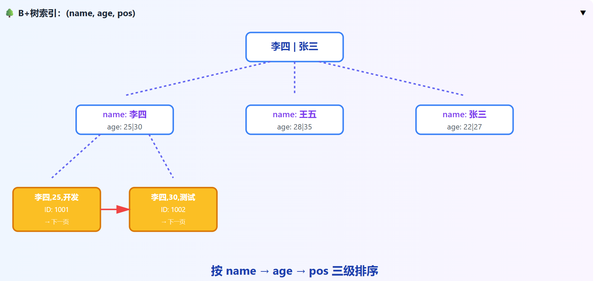

<font style="color:rgba(0, 0, 0, 0.96);">首先来看</font>**<font style="color:rgba(0, 0, 0, 0.96);">第一条原则：全值匹配我最爱</font>**<font style="color:rgba(0, 0, 0, 0.96);">。</font>

<font style="color:rgba(0, 0, 0, 0.96);">假设我们有一个复合索引：</font>**<font style="color:rgba(0, 0, 0, 0.96);">(name, age, pos)</font>**

<font style="color:rgba(0, 0, 0, 0.96);">先看一下这个索引在B+树中是怎么存储的。大家注意看这棵树：</font>

* **<font style="color:rgba(0, 0, 0, 0.96);">根节点</font>**<font style="color:rgba(0, 0, 0, 0.96);">按name分组，比如"李四"、"张三"</font>
* **<font style="color:rgba(0, 0, 0, 0.96);">第二层</font>**<font style="color:rgba(0, 0, 0, 0.96);">在name相同的情况下，再按age排序</font>
* **<font style="color:rgba(0, 0, 0, 0.96);">叶子节点</font>**<font style="color:rgba(0, 0, 0, 0.96);">存储完整数据，包含name、age、pos三个字段</font>

<font style="color:rgba(0, 0, 0, 0.96);">重点来了！这些数据是</font>**<font style="color:rgba(0, 0, 0, 0.96);">三级排序</font>**<font style="color:rgba(0, 0, 0, 0.96);">的：</font>

* <font style="color:rgba(0, 0, 0, 0.96);">首先按name排序</font>
* <font style="color:rgba(0, 0, 0, 0.96);">name相同时按age排序</font>
* <font style="color:rgba(0, 0, 0, 0.96);">name和age都相同时按pos排序</font>

<font style="color:rgba(0, 0, 0, 0.96);">所以，当我们写</font>**<font style="color:rgba(0, 0, 0, 0.96);">全值匹配</font>**<font style="color:rgba(0, 0, 0, 0.96);">的查询：</font>

```plain
WHERE name='李四' AND age=25 AND pos='开发'
```

<font style="color:rgba(0, 0, 0, 0.96);">MySQL会怎么做呢？</font>

1. <font style="color:rgba(0, 0, 0, 0.96);">先定位到name='李四'的范围 </font><font style="color:rgba(0, 0, 0, 0.96);">✅</font>
2. <font style="color:rgba(0, 0, 0, 0.96);">在这个范围内定位age=25 </font><font style="color:rgba(0, 0, 0, 0.96);">✅</font>
3. <font style="color:rgba(0, 0, 0, 0.96);">再精确匹配pos='开发' </font><font style="color:rgba(0, 0, 0, 0.96);">✅</font>

<font style="color:rgba(0, 0, 0, 0.96);">三层索引</font>**<font style="color:rgba(0, 0, 0, 0.96);">全部生效</font>**<font style="color:rgba(0, 0, 0, 0.96);">，直接命中目标数据，完全不需要扫描其他行！这就是</font>**<font style="color:rgba(0, 0, 0, 0.96);">全值匹配效率最高</font>**<font style="color:rgba(0, 0, 0, 0.96);">的原因。</font>

<font style="color:rgba(0, 0, 0, 0.96);">当然，如果你只用到部分条件，比如只有name和age，索引仍然有效，只是利用率没有那么高而已。</font>

<font style="color:rgba(0, 0, 0, 0.96);">但记住！如果你跳过了name，比如只查age和pos，那索引就</font>**<font style="color:rgba(0, 0, 0, 0.96);">完全失效</font>**<font style="color:rgba(0, 0, 0, 0.96);">了！为什么？我们马上在下一条原则中讲解。</font>

***

## <font style="color:rgba(0, 0, 0, 0.96);">原则② - 最左前缀要遵守</font>

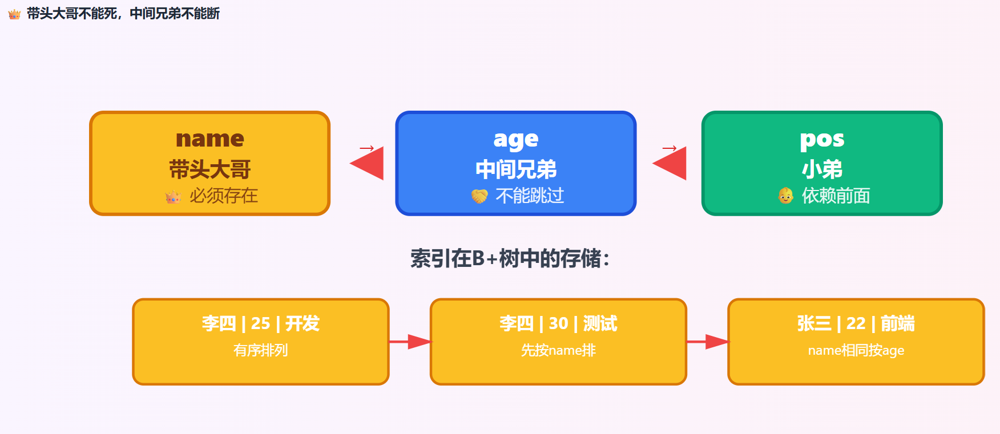

<font style="color:rgba(0, 0, 0, 0.96);">接下来是</font>**<font style="color:rgba(0, 0, 0, 0.96);">最重要的原则：最左前缀法则</font>**<font style="color:rgba(0, 0, 0, 0.96);">。</font>

<font style="color:rgba(0, 0, 0, 0.96);">我把它总结成一句话：</font>**<font style="color:rgba(0, 0, 0, 0.96);">带头大哥不能死，中间兄弟不能断</font>**<font style="color:rgba(0, 0, 0, 0.96);">。</font>

<font style="color:rgba(0, 0, 0, 0.96);">什么意思呢？看这张图：</font>

* **<font style="color:rgba(0, 0, 0, 0.96);">name</font>**<font style="color:rgba(0, 0, 0, 0.96);">是带头大哥 </font><font style="color:rgba(0, 0, 0, 0.96);">👑</font><font style="color:rgba(0, 0, 0, 0.96);"> 必须存在</font>
* **<font style="color:rgba(0, 0, 0, 0.96);">age</font>**<font style="color:rgba(0, 0, 0, 0.96);">是中间兄弟 </font><font style="color:rgba(0, 0, 0, 0.96);">🤝</font><font style="color:rgba(0, 0, 0, 0.96);"> 不能跳过</font>
* **<font style="color:rgba(0, 0, 0, 0.96);">pos</font>**<font style="color:rgba(0, 0, 0, 0.96);">是小弟 </font><font style="color:rgba(0, 0, 0, 0.96);">👶</font><font style="color:rgba(0, 0, 0, 0.96);"> 依赖前面两个</font>

<font style="color:rgba(0, 0, 0, 0.96);">为什么呢？我们从B+树的存储结构来看：</font>

<font style="color:rgba(0, 0, 0, 0.96);">索引数据在叶子节点中是这样排列的：</font>

```plain
李四,25,开发 → 李四,30,测试 → 张三,22,前端
```

<font style="color:rgba(0, 0, 0, 0.96);">注意！这个顺序是按照</font><font style="color:rgba(0, 0, 0, 0.96);"> </font>**<font style="color:rgba(0, 0, 0, 0.96);">name → age → pos</font>**<font style="color:rgba(0, 0, 0, 0.96);"> </font><font style="color:rgba(0, 0, 0, 0.96);">依次排列的。</font>

**<font style="color:rgba(0, 0, 0, 0.96);">场景1：跳过带头大哥</font>**

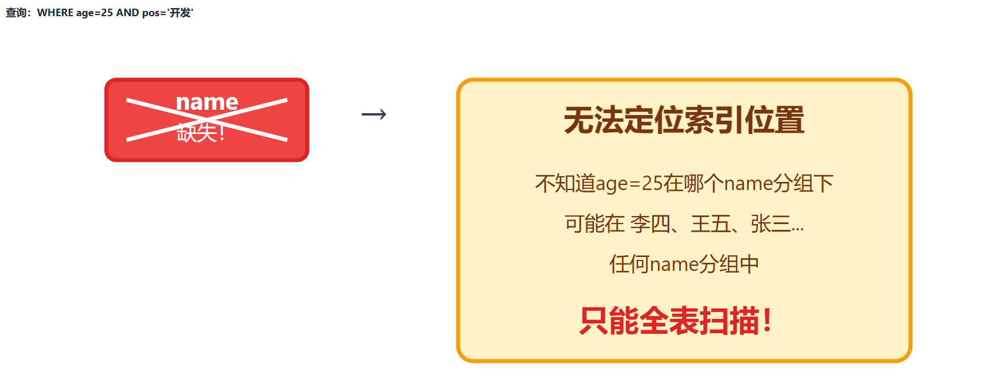<font style="color:rgba(0, 0, 0, 0.96);">\ </font><font style="color:rgba(0, 0, 0, 0.96);">如果你查询 </font><code><font style="color:rgba(0, 0, 0, 0.96);background-color:rgba(175, 184, 193, 0.2);">WHERE age=25 AND pos='开发'</font></code><font style="color:rgba(0, 0, 0, 0.96);">，会发生什么？</font>

<font style="color:rgba(0, 0, 0, 0.96);">因为没有name条件，MySQL不知道去哪个name分组里找age=25的数据：</font>

* <font style="color:rgba(0, 0, 0, 0.96);">李四下面可能有age=25</font>
* <font style="color:rgba(0, 0, 0, 0.96);">王五下面也可能有age=25</font>
* <font style="color:rgba(0, 0, 0, 0.96);">张三下面还可能有age=25</font>

<font style="color:rgba(0, 0, 0, 0.96);">每个name分组下，age才是有序的！没有name，age就是</font>**<font style="color:rgba(0, 0, 0, 0.96);">完全无序</font>**<font style="color:rgba(0, 0, 0, 0.96);">的，无法定位，只能</font>**<font style="color:rgba(0, 0, 0, 0.96);">全表扫描</font>**<font style="color:rgba(0, 0, 0, 0.96);">！</font>

**<font style="color:rgba(0, 0, 0, 0.96);">场景2：跳过中间兄弟</font>**

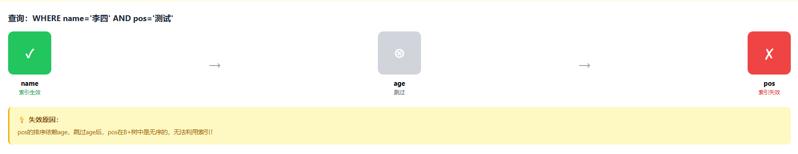<font style="color:rgba(0, 0, 0, 0.96);">\ </font><font style="color:rgba(0, 0, 0, 0.96);">如果你查询 </font><code><font style="color:rgba(0, 0, 0, 0.96);background-color:rgba(175, 184, 193, 0.2);">WHERE name='李四' AND pos='测试'</font></code><font style="color:rgba(0, 0, 0, 0.96);">：</font>

* <font style="color:rgba(0, 0, 0, 0.96);">name索引</font><font style="color:rgba(0, 0, 0, 0.96);">✅</font><font style="color:rgba(0, 0, 0, 0.96);"> 可以定位到"李四"的范围</font>
* <font style="color:rgba(0, 0, 0, 0.96);">age被跳过</font><font style="color:rgba(0, 0, 0, 0.96);">❌</font>
* <font style="color:rgba(0, 0, 0, 0.96);">pos索引</font><font style="color:rgba(0, 0, 0, 0.96);">❌</font><font style="color:rgba(0, 0, 0, 0.96);"> </font>**<font style="color:rgba(0, 0, 0, 0.96);">失效</font>**<font style="color:rgba(0, 0, 0, 0.96);">了！</font>

<font style="color:rgba(0, 0, 0, 0.96);">为什么pos失效？因为pos的排序依赖age！在"李四"这个分组下：</font>

```plain
李四,25,开发
李四,25,测试  
李四,30,运维
李四,30,测试
```

<font style="color:rgba(0, 0, 0, 0.96);">跳过age后，pos是</font>**<font style="color:rgba(0, 0, 0, 0.96);">分散无序</font>**<font style="color:rgba(0, 0, 0, 0.96);">的，无法利用索引，只能在"李四"的范围内逐行过滤！</font>

**<font style="color:rgba(0, 0, 0, 0.96);">记住这个口诀：带头大哥不能死，中间兄弟不能断！</font>**

***

## <font style="color:rgba(0, 0, 0, 0.96);">原则③ - 索引列上少计算</font>

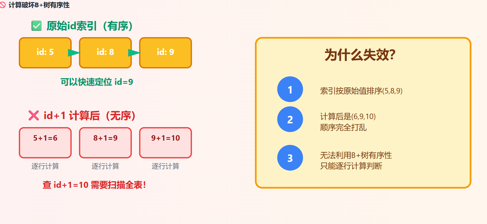

<font style="color:rgba(0, 0, 0, 0.96);">第三条原则：</font>**<font style="color:rgba(0, 0, 0, 0.96);">索引列上少计算</font>**<font style="color:rgba(0, 0, 0, 0.96);">。</font>

<font style="color:rgba(0, 0, 0, 0.96);">很多同学喜欢这样写SQL：</font>

```plain
WHERE id + 1 = 10
WHERE YEAR(create_time) = 2024
WHERE UPPER(name) = 'ZHANG'
```

<font style="color:rgba(0, 0, 0, 0.96);">这些写法全都会导致</font>**<font style="color:rgba(0, 0, 0, 0.96);">索引失效</font>**<font style="color:rgba(0, 0, 0, 0.96);">！为什么？</font>

<font style="color:rgba(0, 0, 0, 0.96);">我们来看B+树的原理。假设id字段有索引，在B+树中是这样存储的：</font>

```plain
id=5 → id=8 → id=9 → id=12 ...
```

<font style="color:rgba(0, 0, 0, 0.96);">这些数据按照</font>**<font style="color:rgba(0, 0, 0, 0.96);">原始值</font>**<font style="color:rgba(0, 0, 0, 0.96);">有序排列，所以查</font><font style="color:rgba(0, 0, 0, 0.96);"> </font><code><font style="color:rgba(0, 0, 0, 0.96);background-color:rgba(175, 184, 193, 0.2);">WHERE id=9</font></code><font style="color:rgba(0, 0, 0, 0.96);"> </font><font style="color:rgba(0, 0, 0, 0.96);">可以快速定位。</font>

<font style="color:rgba(0, 0, 0, 0.96);">但是！如果你写</font><font style="color:rgba(0, 0, 0, 0.96);"> </font><code><font style="color:rgba(0, 0, 0, 0.96);background-color:rgba(175, 184, 193, 0.2);">WHERE id+1=10</font></code><font style="color:rgba(0, 0, 0, 0.96);">，会发生什么？</font>

<font style="color:rgba(0, 0, 0, 0.96);">MySQL必须对每一行的id都加1再判断：</font>

```plain
5+1=6 ❌
8+1=9 ❌  
9+1=10 ✅ 找到了！
12+1=13 ❌
```

<font style="color:rgba(0, 0, 0, 0.96);">计算后的结果是</font><font style="color:rgba(0, 0, 0, 0.96);"> </font>**<font style="color:rgba(0, 0, 0, 0.96);">6, 9, 10, 13</font>**<font style="color:rgba(0, 0, 0, 0.96);">，完全打乱了原来的顺序！B+树的有序性被破坏了，索引就</font>**<font style="color:rgba(0, 0, 0, 0.96);">无法使用</font>**<font style="color:rgba(0, 0, 0, 0.96);">，只能逐行计算，变成</font>**<font style="color:rgba(0, 0, 0, 0.96);">全表扫描</font>**<font style="color:rgba(0, 0, 0, 0.96);">！</font>

**<font style="color:rgba(0, 0, 0, 0.96);">正确的写法是什么？</font>**

<font style="color:rgba(0, 0, 0, 0.96);">把计算移到</font>**<font style="color:rgba(0, 0, 0, 0.96);">右侧</font>**<font style="color:rgba(0, 0, 0, 0.96);">：</font>

```plain
❌ WHERE id + 1 = 10
✅ WHERE id = 9

❌ WHERE YEAR(create_time) = 2024  
✅ WHERE create_time BETWEEN '2024-01-01' AND '2024-12-31'

❌ WHERE salary * 1.1 > 10000
✅ WHERE salary > 9090.9
```

<font style="color:rgba(0, 0, 0, 0.96);">记住：</font>**<font style="color:rgba(0, 0, 0, 0.96);">左侧保持原样，计算放右边！</font>**

***

## <font style="color:rgba(0, 0, 0, 0.96);">原则④ - 范围之后全失效</font>

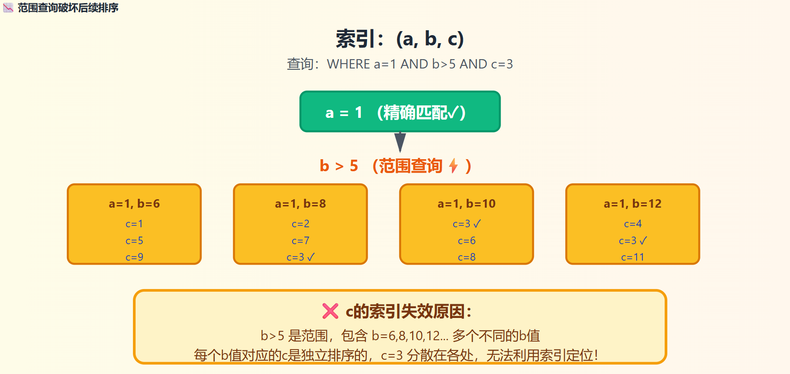

<font style="color:rgba(0, 0, 0, 0.96);">第四条原则：</font>**<font style="color:rgba(0, 0, 0, 0.96);">范围之后全失效</font>**<font style="color:rgba(0, 0, 0, 0.96);">。</font>

<font style="color:rgba(0, 0, 0, 0.96);">假设有索引</font><font style="color:rgba(0, 0, 0, 0.96);"> </font>**<font style="color:rgba(0, 0, 0, 0.96);">(a, b, c)</font>**<font style="color:rgba(0, 0, 0, 0.96);">，我们查询：</font>

```plain
WHERE a=1 AND b>5 AND c=3
```

<font style="color:rgba(0, 0, 0, 0.96);">大家猜一下，这三个条件，哪些能用上索引？</font>

<font style="color:rgba(0, 0, 0, 0.96);">答案是：</font>

* <font style="color:rgba(0, 0, 0, 0.96);">a=1 </font><font style="color:rgba(0, 0, 0, 0.96);">✅</font><font style="color:rgba(0, 0, 0, 0.96);"> 精确匹配，索引有效</font>
* <font style="color:rgba(0, 0, 0, 0.96);">b>5 </font><font style="color:rgba(0, 0, 0, 0.96);">⚡</font><font style="color:rgba(0, 0, 0, 0.96);"> 范围查询，索引有效</font>
* <font style="color:rgba(0, 0, 0, 0.96);">c=3 </font><font style="color:rgba(0, 0, 0, 0.96);">❌</font><font style="color:rgba(0, 0, 0, 0.96);"> </font>**<font style="color:rgba(0, 0, 0, 0.96);">索引失效</font>**<font style="color:rgba(0, 0, 0, 0.96);">！</font>

<font style="color:rgba(0, 0, 0, 0.96);">为什么c会失效？我们看B+树的存储结构：</font>

<font style="color:rgba(0, 0, 0, 0.96);">在 a=1 的范围内，b>5 包含了多个值：b=6, 8, 10, 12...</font>

<font style="color:rgba(0, 0, 0, 0.96);">对于每个不同的b值，对应的c是</font>**<font style="color:rgba(0, 0, 0, 0.96);">独立排序</font>**<font style="color:rgba(0, 0, 0, 0.96);">的：</font>

```plain
a=1, b=6: c=1, c=5, c=9
a=1, b=8: c=2, c=7, c=3 ✓
a=1, b=10: c=3 ✓, c=6, c=8
a=1, b=12: c=4, c=3 ✓, c=11
```

<font style="color:rgba(0, 0, 0, 0.96);">注意看！c=3</font><font style="color:rgba(0, 0, 0, 0.96);"> </font>**<font style="color:rgba(0, 0, 0, 0.96);">分散在各个b值对应的分组中</font>**<font style="color:rgba(0, 0, 0, 0.96);">，没有集中在一起！</font>

<font style="color:rgba(0, 0, 0, 0.96);">因为b是范围查询，包含多个不同的值，c在全局范围内是</font>**<font style="color:rgba(0, 0, 0, 0.96);">无序的</font>**<font style="color:rgba(0, 0, 0, 0.96);">，无法利用索引定位，只能逐行过滤判断！</font>

**<font style="color:rgba(0, 0, 0, 0.96);">对比一下精确查询：</font>**

```plain
WHERE a=1 AND b=5 AND c=3
```

* <font style="color:rgba(0, 0, 0, 0.96);">a=1 </font><font style="color:rgba(0, 0, 0, 0.96);">✅</font><font style="color:rgba(0, 0, 0, 0.96);"> 定位范围</font>
* <font style="color:rgba(0, 0, 0, 0.96);">b=5 </font><font style="color:rgba(0, 0, 0, 0.96);">✅</font><font style="color:rgba(0, 0, 0, 0.96);"> 精确定位到b=5这一组</font>
* <font style="color:rgba(0, 0, 0, 0.96);">c=3 </font><font style="color:rgba(0, 0, 0, 0.96);">✅</font><font style="color:rgba(0, 0, 0, 0.96);"> 在b=5这一组内，c是有序的，可以精确定位</font>

<font style="color:rgba(0, 0, 0, 0.96);">三层索引</font>**<font style="color:rgba(0, 0, 0, 0.96);">全部生效</font>**<font style="color:rgba(0, 0, 0, 0.96);">！</font>

**<font style="color:rgba(0, 0, 0, 0.96);">优化建议：</font>**

<font style="color:rgba(0, 0, 0, 0.96);">如果查询条件中既有精确匹配又有范围查询，建议把范围查询的字段放在索引的</font>**<font style="color:rgba(0, 0, 0, 0.96);">最后面</font>**<font style="color:rgba(0, 0, 0, 0.96);">：</font>

```plain
❌ 索引(a, b, c) → b是范围，c失效
✅ 索引(a, c, b) → 把范围列b放最后
```

***

## <font style="color:rgba(0, 0, 0, 0.96);">原则⑤ - LIKE百分写最右</font>

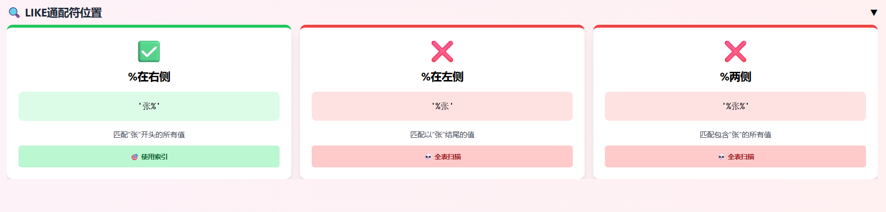

<font style="color:rgba(0, 0, 0, 0.96);">第五条原则：</font>**<font style="color:rgba(0, 0, 0, 0.96);">LIKE百分写最右</font>**<font style="color:rgba(0, 0, 0, 0.96);">。</font>

<font style="color:rgba(0, 0, 0, 0.96);">LIKE模糊查询时，通配符</font><font style="color:rgba(0, 0, 0, 0.96);"> </font>**<font style="color:rgba(0, 0, 0, 0.96);">%</font>**<font style="color:rgba(0, 0, 0, 0.96);"> </font><font style="color:rgba(0, 0, 0, 0.96);">的位置非常关键：</font>

<font style="color:rgba(0, 0, 0, 0.96);">✅</font><font style="color:rgba(0, 0, 0, 0.96);"> </font><code><font style="color:rgba(0, 0, 0, 0.96);background-color:rgba(175, 184, 193, 0.2);">LIKE '张%'</font></code><font style="color:rgba(0, 0, 0, 0.96);"> </font><font style="color:rgba(0, 0, 0, 0.96);">- %在右侧，</font>**<font style="color:rgba(0, 0, 0, 0.96);">可以使用索引</font>**<font style="color:rgba(0, 0, 0, 0.96);">\ </font><font style="color:rgba(0, 0, 0, 0.96);">❌</font><font style="color:rgba(0, 0, 0, 0.96);"> </font><code><font style="color:rgba(0, 0, 0, 0.96);background-color:rgba(175, 184, 193, 0.2);">LIKE '%张'</font></code><font style="color:rgba(0, 0, 0, 0.96);"> </font><font style="color:rgba(0, 0, 0, 0.96);">- %在左侧，</font>**<font style="color:rgba(0, 0, 0, 0.96);">全表扫描</font>**<font style="color:rgba(0, 0, 0, 0.96);">\ </font><font style="color:rgba(0, 0, 0, 0.96);">❌</font><font style="color:rgba(0, 0, 0, 0.96);"> </font><code><font style="color:rgba(0, 0, 0, 0.96);background-color:rgba(175, 184, 193, 0.2);">LIKE '%张%'</font></code><font style="color:rgba(0, 0, 0, 0.96);"> </font><font style="color:rgba(0, 0, 0, 0.96);">- %两侧，</font>**<font style="color:rgba(0, 0, 0, 0.96);">全表扫描</font>**

<font style="color:rgba(0, 0, 0, 0.96);">为什么？我们看B+树中name索引的存储：</font>

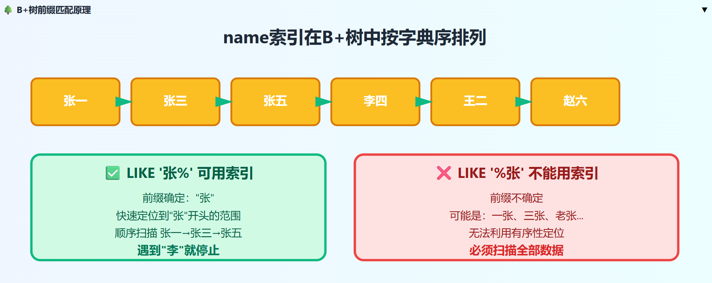

<font style="color:rgba(0, 0, 0, 0.96);">这些数据按照</font>**<font style="color:rgba(0, 0, 0, 0.96);">字典序排列</font>**<font style="color:rgba(0, 0, 0, 0.96);">，就像字典一样！</font>

**<font style="color:rgba(0, 0, 0, 0.96);">LIKE '张%' - 前缀确定</font>**

* <font style="color:rgba(0, 0, 0, 0.96);">前缀是"张"，MySQL可以快速定位到"张"开头的范围</font>
* <font style="color:rgba(0, 0, 0, 0.96);">顺序扫描：张一 → 张三 → 张五</font>
* <font style="color:rgba(0, 0, 0, 0.96);">遇到"李"就停止，因为后面肯定不是"张"开头了</font>
* <font style="color:rgba(0, 0, 0, 0.96);">利用了B+树的</font>**<font style="color:rgba(0, 0, 0, 0.96);">有序性</font>**<font style="color:rgba(0, 0, 0, 0.96);"> </font><font style="color:rgba(0, 0, 0, 0.96);">✅</font>

**<font style="color:rgba(0, 0, 0, 0.96);">LIKE '%张' - 前缀不确定</font>**

* <font style="color:rgba(0, 0, 0, 0.96);">可能匹配：一张、三张、老张、小张...</font>
* <font style="color:rgba(0, 0, 0, 0.96);">前缀完全不确定，可能以任何字符开头</font>
* <font style="color:rgba(0, 0, 0, 0.96);">无法利用B+树的有序性定位</font>
* <font style="color:rgba(0, 0, 0, 0.96);">只能</font>**<font style="color:rgba(0, 0, 0, 0.96);">逐行扫描</font>**<font style="color:rgba(0, 0, 0, 0.96);">全部数据 </font><font style="color:rgba(0, 0, 0, 0.96);">❌</font>

**<font style="color:rgba(0, 0, 0, 0.96);">记忆技巧：查字典找"张三"</font>**

* <font style="color:rgba(0, 0, 0, 0.96);">✅</font><font style="color:rgba(0, 0, 0, 0.96);"> 知道姓"张" → 直接翻到张字部</font>
* <font style="color:rgba(0, 0, 0, 0.96);">❌</font><font style="color:rgba(0, 0, 0, 0.96);"> 只知道名"三" → 全书翻遍</font>

<font style="color:rgba(0, 0, 0, 0.96);">所以记住：</font>**<font style="color:rgba(0, 0, 0, 0.96);">百分号写右边，前缀确定能用索引！</font>**

***

## <font style="color:rgba(0, 0, 0, 0.96);">原则⑥ - 覆盖索引不写\*</font>

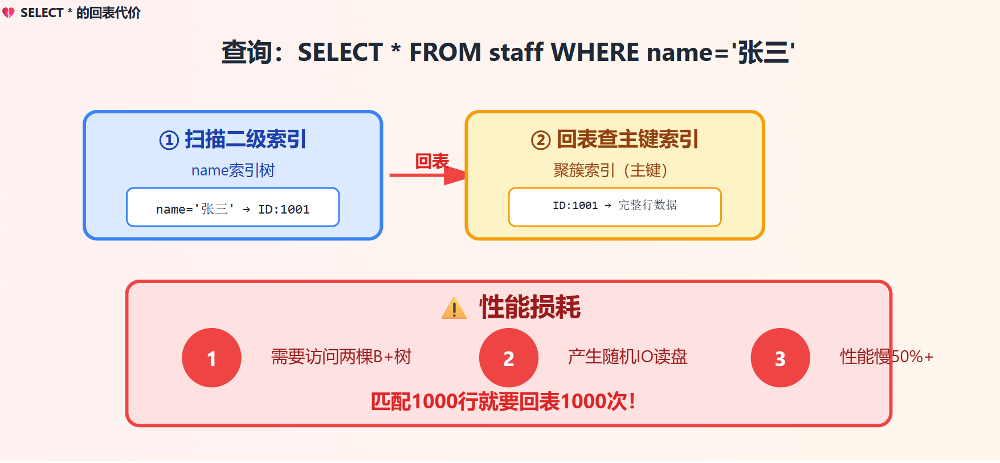

<font style="color:rgba(0, 0, 0, 0.96);">第六条原则：</font>**<font style="color:rgba(0, 0, 0, 0.96);">覆盖索引不写\*</font>**<font style="color:rgba(0, 0, 0, 0.96);">。</font>

<font style="color:rgba(0, 0, 0, 0.96);">这条非常重要！很多同学的SQL慢，就是因为</font>**<font style="color:rgba(0, 0, 0, 0.96);">回表</font>**<font style="color:rgba(0, 0, 0, 0.96);">次数太多！</font>

<font style="color:rgba(0, 0, 0, 0.96);">什么是回表？我们来看一个例子：</font>

<font style="color:rgba(0, 0, 0, 0.96);">假设有索引</font><font style="color:rgba(0, 0, 0, 0.96);"> </font>**<font style="color:rgba(0, 0, 0, 0.96);">(name)</font>**<font style="color:rgba(0, 0, 0, 0.96);">，执行查询：</font>

```plain
SELECT * FROM staff WHERE name='张三'
```

<font style="color:rgba(0, 0, 0, 0.96);">MySQL会进行</font>**<font style="color:rgba(0, 0, 0, 0.96);">两次查询</font>**<font style="color:rgba(0, 0, 0, 0.96);">：</font>

**<font style="color:rgba(0, 0, 0, 0.96);">第1步：扫描二级索引</font>**

* <font style="color:rgba(0, 0, 0, 0.96);">在name索引树中找到 name='张三'</font>
* <font style="color:rgba(0, 0, 0, 0.96);">拿到主键ID：1001</font>

**<font style="color:rgba(0, 0, 0, 0.96);">第2步：回表查主键索引</font>**

* <font style="color:rgba(0, 0, 0, 0.96);">用ID=1001去主键索引树中查询</font>
* <font style="color:rgba(0, 0, 0, 0.96);">读取完整的行数据</font>

<font style="color:rgba(0, 0, 0, 0.96);">这就是</font>**<font style="color:rgba(0, 0, 0, 0.96);">回表</font>**<font style="color:rgba(0, 0, 0, 0.96);">！每匹配一行就要回表一次：</font>

* <font style="color:rgba(0, 0, 0, 0.96);">匹配1000行 → 回表1000次</font>
* <font style="color:rgba(0, 0, 0, 0.96);">需要访问</font>**<font style="color:rgba(0, 0, 0, 0.96);">两棵B+树</font>**
* <font style="color:rgba(0, 0, 0, 0.96);">产生大量</font>**<font style="color:rgba(0, 0, 0, 0.96);">随机IO</font>**
* <font style="color:rgba(0, 0, 0, 0.96);">性能慢50%以上！</font>

**<font style="color:rgba(0, 0, 0, 0.96);">怎么优化？使用覆盖索引！</font>**


<font style="color:rgba(0, 0, 0, 0.96);">如果我们建立索引</font><font style="color:rgba(0, 0, 0, 0.96);"> </font>**<font style="color:rgba(0, 0, 0, 0.96);">(name, age, pos)</font>**<font style="color:rgba(0, 0, 0, 0.96);">，然后查询：</font>

```plain
SELECT name, age, pos FROM staff WHERE name='张三'
```

<font style="color:rgba(0, 0, 0, 0.96);">这时候，索引中</font>**<font style="color:rgba(0, 0, 0, 0.96);">已经包含了所需的全部列</font>**<font style="color:rgba(0, 0, 0, 0.96);">！</font>

* <font style="color:rgba(0, 0, 0, 0.96);">name、age、pos都在索引中</font>
* <font style="color:rgba(0, 0, 0, 0.96);">直接从索引树返回数据 </font><font style="color:rgba(0, 0, 0, 0.96);">✅</font>
* **<font style="color:rgba(0, 0, 0, 0.96);">无需回表</font>**<font style="color:rgba(0, 0, 0, 0.96);">，只访问一棵树！</font>
* <font style="color:rgba(0, 0, 0, 0.96);">性能提升50%以上！</font>

**<font style="color:rgba(0, 0, 0, 0.96);">对比一下：</font>**

<font style="color:rgba(0, 0, 0, 0.96);">❌</font><font style="color:rgba(0, 0, 0, 0.96);"> </font>**<font style="color:rgba(0, 0, 0, 0.96);">未使用覆盖索引</font>**

```plain
SELECT * FROM staff WHERE name='张三'
```

* <font style="color:rgba(0, 0, 0, 0.96);">扫描索引：1次</font>
* <font style="color:rgba(0, 0, 0, 0.96);">回表次数：N次</font>
* <font style="color:rgba(0, 0, 0, 0.96);">磁盘IO：1+N次</font>

<font style="color:rgba(0, 0, 0, 0.96);">✅</font><font style="color:rgba(0, 0, 0, 0.96);"> </font>**<font style="color:rgba(0, 0, 0, 0.96);">使用覆盖索引</font>**

```plain
SELECT name, age, pos FROM staff WHERE name='张三'
```

* <font style="color:rgba(0, 0, 0, 0.96);">扫描索引：1次</font>
* <font style="color:rgba(0, 0, 0, 0.96);">回表次数：0次</font>
* <font style="color:rgba(0, 0, 0, 0.96);">磁盘IO：1次</font>

<font style="color:rgba(0, 0, 0, 0.96);">所以，\*\*不要偷懒写SELECT \*\*\*，明确指定需要的列，让索引覆盖查询的所有字段！</font>

***

## <font style="color:rgba(0, 0, 0, 0.96);">原则⑦ - 不等空值还有OR</font>

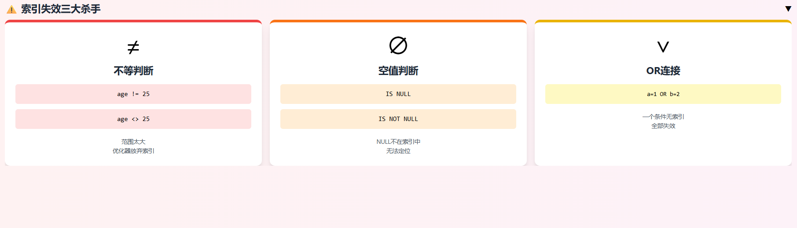

<font style="color:rgba(0, 0, 0, 0.96);">第七条原则：</font>**<font style="color:rgba(0, 0, 0, 0.96);">不等空值还有OR</font>**<font style="color:rgba(0, 0, 0, 0.96);"> </font><font style="color:rgba(0, 0, 0, 0.96);">- 这是索引失效的三大杀手！</font>

**<font style="color:rgba(0, 0, 0, 0.96);">1️⃣</font>\*\*\*\*<font style="color:rgba(0, 0, 0, 0.96);"> 不等判断（!= 或 <>）</font>**

```plain
WHERE age != 25
```

<font style="color:rgba(0, 0, 0, 0.96);">为什么失效？我们看一下数据分布：</font>

* <font style="color:rgba(0, 0, 0, 0.96);">假设有10000条数据</font>
* <font style="color:rgba(0, 0, 0, 0.96);">age=25 只有10条</font>
* <font style="color:rgba(0, 0, 0, 0.96);">age≠25 有9990条</font>

<font style="color:rgba(0, 0, 0, 0.96);">如果使用索引：需要扫描9990次\ </font><font style="color:rgba(0, 0, 0, 0.96);">如果全表扫描：只需要扫描1次</font>

<font style="color:rgba(0, 0, 0, 0.96);">MySQL优化器会判断：</font>**<font style="color:rgba(0, 0, 0, 0.96);">扫描索引的成本 > 全表扫描的成本</font>**<font style="color:rgba(0, 0, 0, 0.96);">，所以直接放弃索引！</font>

<font style="color:rgba(0, 0, 0, 0.96);">✅</font><font style="color:rgba(0, 0, 0, 0.96);"> </font>**<font style="color:rgba(0, 0, 0, 0.96);">优化方案：用范围代替不等</font>**

```plain
WHERE age < 25 OR age > 25
```

**<font style="color:rgba(0, 0, 0, 0.96);">2️⃣</font>\*\*\*\*<font style="color:rgba(0, 0, 0, 0.96);"> 空值判断（IS NULL / IS NOT NULL）</font>**

```plain
WHERE name IS NULL
```

<font style="color:rgba(0, 0, 0, 0.96);">NULL值一般不会存储在索引中，无法通过索引定位，只能全表扫描。</font>

<font style="color:rgba(0, 0, 0, 0.96);">✅</font><font style="color:rgba(0, 0, 0, 0.96);"> </font>**<font style="color:rgba(0, 0, 0, 0.96);">优化方案：设计时避免NULL</font>**

```plain
-- 建表时设置默认值
name VARCHAR(50) NOT NULL DEFAULT ''

-- 查询时
WHERE name = ''
```

**<font style="color:rgba(0, 0, 0, 0.96);">3️⃣</font>\*\*\*\*<font style="color:rgba(0, 0, 0, 0.96);"> OR连接</font>**

```plain
WHERE a=1 OR b=2
```

<font style="color:rgba(0, 0, 0, 0.96);">如果a和b都有索引，MySQL需要分别扫描两个索引再合并结果，成本很高。\ </font><font style="color:rgba(0, 0, 0, 0.96);">如果a或b有一个没有索引，那就只能全表扫描。</font>

<font style="color:rgba(0, 0, 0, 0.96);">✅</font><font style="color:rgba(0, 0, 0, 0.96);"> </font>**<font style="color:rgba(0, 0, 0, 0.96);">优化方案：用UNION拆分</font>**

```plain
SELECT * FROM table WHERE a=1
UNION
SELECT * FROM table WHERE b=2
```

<font style="color:rgba(0, 0, 0, 0.96);">记住：</font>**<font style="color:rgba(0, 0, 0, 0.96);">不等、空值、OR，都是索引杀手！</font>**

***

## <font style="color:rgba(0, 0, 0, 0.96);">原则⑧ - VARCHAR加引号</font>

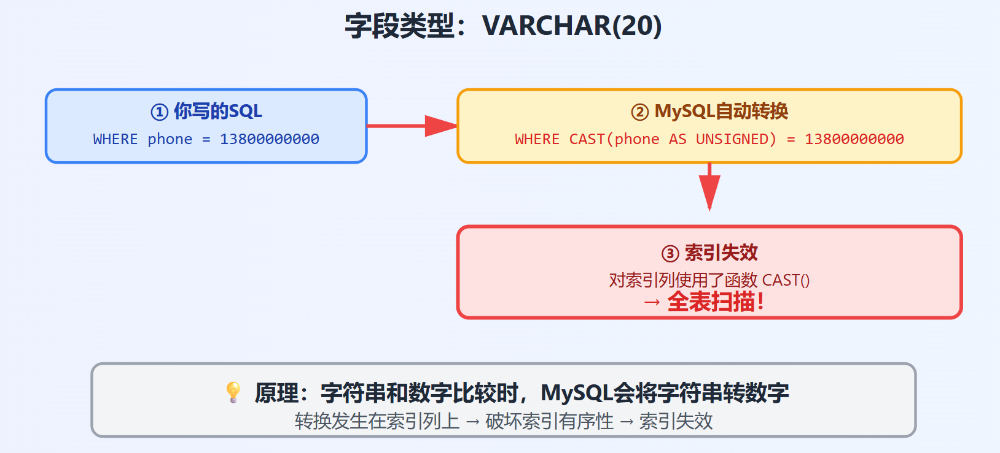

<font style="color:rgba(0, 0, 0, 0.96);">最后一条原则：</font>**<font style="color:rgba(0, 0, 0, 0.96);">VARCHAR加引号</font>**<font style="color:rgba(0, 0, 0, 0.96);">。</font>

<font style="color:rgba(0, 0, 0, 0.96);">这是很多新手最容易犯的错误！看这个例子：</font>

<font style="color:rgba(0, 0, 0, 0.96);">假设phone字段类型是</font><font style="color:rgba(0, 0, 0, 0.96);"> </font>**<font style="color:rgba(0, 0, 0, 0.96);">VARCHAR(20)</font>**<font style="color:rgba(0, 0, 0, 0.96);">，你写了这样的SQL：</font>

```plain
WHERE phone = 13800000000
```

<font style="color:rgba(0, 0, 0, 0.96);">看起来没问题，但实际上</font>**<font style="color:rgba(0, 0, 0, 0.96);">索引失效了</font>**<font style="color:rgba(0, 0, 0, 0.96);">！</font>

<font style="color:rgba(0, 0, 0, 0.96);">为什么？因为发生了</font>**<font style="color:rgba(0, 0, 0, 0.96);">隐式类型转换</font>**<font style="color:rgba(0, 0, 0, 0.96);">！</font>

**<font style="color:rgba(0, 0, 0, 0.96);">MySQL的执行过程：</font>**

<font style="color:rgba(0, 0, 0, 0.96);">第1步：你写的SQL</font>

```plain
WHERE phone = 13800000000
```

<font style="color:rgba(0, 0, 0, 0.96);">第2步：MySQL自动转换成</font>

```plain
WHERE CAST(phone AS UNSIGNED) = 13800000000
```

<font style="color:rgba(0, 0, 0, 0.96);">第3步：对索引列使用了函数，</font>**<font style="color:rgba(0, 0, 0, 0.96);">索引失效</font>**<font style="color:rgba(0, 0, 0, 0.96);">！</font>

<font style="color:rgba(0, 0, 0, 0.96);">还记得原则③吗？</font>**<font style="color:rgba(0, 0, 0, 0.96);">索引列上不能做计算</font>**<font style="color:rgba(0, 0, 0, 0.96);">！类型转换也是一种计算！</font>

**<font style="color:rgba(0, 0, 0, 0.96);">原理：</font>**

* <font style="color:rgba(0, 0, 0, 0.96);">字符串和数字比较时，MySQL会把字符串转成数字</font>
* <font style="color:rgba(0, 0, 0, 0.96);">转换发生在</font>**<font style="color:rgba(0, 0, 0, 0.96);">索引列</font>**<font style="color:rgba(0, 0, 0, 0.96);">上</font>
* <font style="color:rgba(0, 0, 0, 0.96);">破坏了B+树的有序性</font>
* <font style="color:rgba(0, 0, 0, 0.96);">索引失效，全表扫描！</font>

**<font style="color:rgba(0, 0, 0, 0.96);">正确的写法：</font>**

<font style="color:rgba(0, 0, 0, 0.96);">✅</font><font style="color:rgba(0, 0, 0, 0.96);"> VARCHAR类型 - 加引号</font>

```plain
WHERE phone = '13800000000'
```

<font style="color:rgba(0, 0, 0, 0.96);">✅</font><font style="color:rgba(0, 0, 0, 0.96);"> CHAR类型 - 加引号</font>

```plain
WHERE code = 'A123'
```

**<font style="color:rgba(0, 0, 0, 0.96);">记住口诀：字符串类型，必须加引号！不加引号 = 隐式转换 = 索引失效！</font>**

***

## <font style="color:rgba(0, 0, 0, 0.96);">总结</font>

<font style="color:rgba(0, 0, 0, 0.96);">好了，8大原则我们全部讲完了！我们来回顾一下：</font>

<font style="color:rgba(0, 0, 0, 0.96);">1️⃣</font><font style="color:rgba(0, 0, 0, 0.96);"> </font>**<font style="color:rgba(0, 0, 0, 0.96);">全值匹配我最爱</font>**<font style="color:rgba(0, 0, 0, 0.96);"> </font><font style="color:rgba(0, 0, 0, 0.96);">- 复合索引全部用上，效率最高</font>

<font style="color:rgba(0, 0, 0, 0.96);">2️⃣</font><font style="color:rgba(0, 0, 0, 0.96);"> </font>**<font style="color:rgba(0, 0, 0, 0.96);">最左前缀要遵守</font>**<font style="color:rgba(0, 0, 0, 0.96);"> </font><font style="color:rgba(0, 0, 0, 0.96);">- 带头大哥不能死，中间兄弟不能断</font>

<font style="color:rgba(0, 0, 0, 0.96);">3️⃣</font><font style="color:rgba(0, 0, 0, 0.96);"> </font>**<font style="color:rgba(0, 0, 0, 0.96);">索引列上少计算</font>**<font style="color:rgba(0, 0, 0, 0.96);"> </font><font style="color:rgba(0, 0, 0, 0.96);">- 函数、运算都会破坏有序性</font>

<font style="color:rgba(0, 0, 0, 0.96);">4️⃣</font><font style="color:rgba(0, 0, 0, 0.96);"> </font>**<font style="color:rgba(0, 0, 0, 0.96);">范围之后全失效</font>**<font style="color:rgba(0, 0, 0, 0.96);"> </font><font style="color:rgba(0, 0, 0, 0.96);">- 范围查询后面的索引无法使用</font>

<font style="color:rgba(0, 0, 0, 0.96);">5️⃣</font><font style="color:rgba(0, 0, 0, 0.96);"> </font>**<font style="color:rgba(0, 0, 0, 0.96);">LIKE百分写最右</font>**<font style="color:rgba(0, 0, 0, 0.96);"> </font><font style="color:rgba(0, 0, 0, 0.96);">- 前缀确定才能用索引</font>

<font style="color:rgba(0, 0, 0, 0.96);">6️⃣</font><font style="color:rgba(0, 0, 0, 0.96);"> </font>**<font style="color:rgba(0, 0, 0, 0.96);">覆盖索引不写星</font>**<font style="color:rgba(0, 0, 0, 0.96);"> </font><font style="color:rgba(0, 0, 0, 0.96);">- 避免回表是性能优化的核心</font>

<font style="color:rgba(0, 0, 0, 0.96);">7️⃣</font><font style="color:rgba(0, 0, 0, 0.96);"> </font>**<font style="color:rgba(0, 0, 0, 0.96);">不等空值还有OR</font>**<font style="color:rgba(0, 0, 0, 0.96);"> </font><font style="color:rgba(0, 0, 0, 0.96);">- 三大索引杀手要避免</font>

<font style="color:rgba(0, 0, 0, 0.96);">8️⃣</font><font style="color:rgba(0, 0, 0, 0.96);"> </font>**<font style="color:rgba(0, 0, 0, 0.96);">VARCHAR加引号</font>**<font style="color:rgba(0, 0, 0, 0.96);"> - 避免隐式类型转换</font>


> 更新: 2025-11-04 20:55:10  
> 原文: <https://www.yuque.com/tulingzhouyu/db22bv/dfndb67qzwbxtxle>