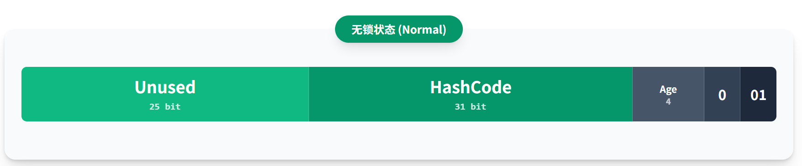
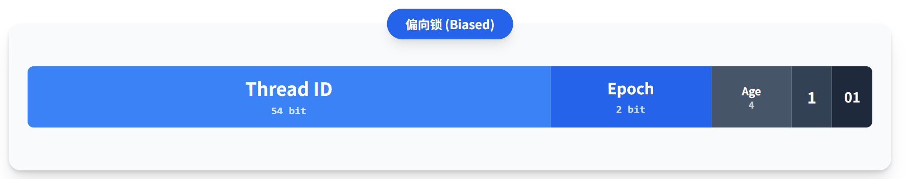
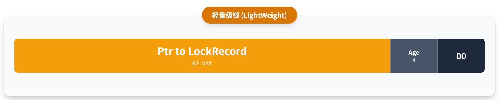
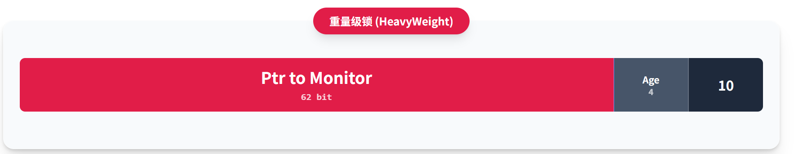

# synchronized锁升级是怎么回事？

# <font style="color:rgba(0, 0, 0, 0.96);">JVM 锁机制揭秘：对象头 MarkWord 与锁升级核心流程</font>

**<font style="color:rgb(87, 96, 106);">导读</font>**<font style="color:rgb(87, 96, 106);">：在 Java 并发编程中，synchronized 锁的性能一直备受关注。从 JDK 1.6 开始，HotSpot 虚拟机引入了</font>**<font style="color:rgb(87, 96, 106);">偏向锁、轻量级锁和重量级锁</font>**<font style="color:rgb(87, 96, 106);">的概念，它们通过对象头中的 MarkWord 来记录锁的状态，构成了一个精巧的</font>**<font style="color:rgb(87, 96, 106);">锁升级路径</font>**<font style="color:rgb(87, 96, 106);">。本文将深入揭秘这一机制，帮你理解为什么你的 synchronized 代码有时候很快，有时候又很慢。</font>

***

## <font style="color:rgba(0, 0, 0, 0.96);">一、对象头中的秘密：MarkWord 结构</font>

### <font style="color:rgba(0, 0, 0, 0.96);">什么是 MarkWord？</font>



<font style="color:rgba(0, 0, 0, 0.96);">每个 Java 对象都包含一个</font>**<font style="color:rgba(0, 0, 0, 0.96);">对象头</font>**<font style="color:rgba(0, 0, 0, 0.96);">，其中最核心的部分就是</font><font style="color:rgba(0, 0, 0, 0.96);"> </font>**<font style="color:rgba(0, 0, 0, 0.96);">MarkWord</font>**<font style="color:rgba(0, 0, 0, 0.96);">。在 64 位 JVM 中，MarkWord 占据 8 字节（64 位），记录了对象的所有元数据：</font>

### <font style="color:rgba(0, 0, 0, 0.96);">LockState 解读</font>

<font style="color:rgba(0, 0, 0, 0.96);">这 2 bit 就是锁状态的关键：</font>

* **<font style="color:rgba(0, 0, 0, 0.96);">01</font>**<font style="color:rgba(0, 0, 0, 0.96);"> </font><font style="color:rgba(0, 0, 0, 0.96);">→ 无锁状态（Normal）</font>
* **<font style="color:rgba(0, 0, 0, 0.96);">01</font>**<font style="color:rgba(0, 0, 0, 0.96);"> </font><font style="color:rgba(0, 0, 0, 0.96);">+</font><font style="color:rgba(0, 0, 0, 0.96);"> </font>**<font style="color:rgba(0, 0, 0, 0.96);">BiasFlag=1</font>**<font style="color:rgba(0, 0, 0, 0.96);"> </font><font style="color:rgba(0, 0, 0, 0.96);">→ 偏向锁状态（Biased）</font>
* **<font style="color:rgba(0, 0, 0, 0.96);">00</font>**<font style="color:rgba(0, 0, 0, 0.96);"> </font><font style="color:rgba(0, 0, 0, 0.96);">→ 轻量级锁状态（LightWeight）</font>
* **<font style="color:rgba(0, 0, 0, 0.96);">10</font>**<font style="color:rgba(0, 0, 0, 0.96);"> </font><font style="color:rgba(0, 0, 0, 0.96);">→ 重量级锁状态（HeavyWeight）</font>

**<font style="color:rgba(0, 0, 0, 0.96);">关键洞察</font>**<font style="color:rgba(0, 0, 0, 0.96);">：Java 对象天生就携带了锁的信息，不需要额外的数据结构来存储锁状态。这正是 synchronized 无锁优化的基础。</font>

***

## <font style="color:rgba(0, 0, 0, 0.96);">二、偏向锁：为懒人设计的锁</font>



### <font style="color:rgba(0, 0, 0, 0.96);">现象：大多数锁是偏心的</font>

<font style="color:rgba(0, 0, 0, 0.96);">在实际应用中，</font>**<font style="color:rgba(0, 0, 0, 0.96);">大多数对象的锁只会被同一个线程持久化地访问</font>**<font style="color:rgba(0, 0, 0, 0.96);">。以 HashMap 为例：</font>

```plain
// 单线程场景（99% 的情况）
HashMap<String, String> map = new HashMap<>();
synchronized(map) {
    map.put("key", "value");
}
// 再次使用
synchronized(map) {
    map.put("key2", "value2");
}
```

<font style="color:rgba(0, 0, 0, 0.96);">每次进入同步块，如果都要执行 CAS 操作，那就太浪费了。JVM 的设计者想到了这一点。</font>

### <font style="color:rgba(0, 0, 0, 0.96);">偏向锁的原理</font>

<font style="color:rgba(0, 0, 0, 0.96);">偏向锁的核心思想很简单：</font>**<font style="color:rgba(0, 0, 0, 0.96);">记住这个线程，下次它再来就不用加锁了</font>**<font style="color:rgba(0, 0, 0, 0.96);">。</font>

1. **<font style="color:rgba(0, 0, 0, 0.96);">第一次进入</font>**<font style="color:rgba(0, 0, 0, 0.96);">：线程 A 执行 CAS 操作，将自己的 ThreadID 写入 MarkWord</font>
2. **<font style="color:rgba(0, 0, 0, 0.96);">第二次进入</font>**<font style="color:rgba(0, 0, 0, 0.96);">：直接比对 MarkWord 中的 ThreadID，如果一致就放行 ✓（</font>**<font style="color:rgba(0, 0, 0, 0.96);">零开销</font>**<font style="color:rgba(0, 0, 0, 0.96);">）</font>
3. **<font style="color:rgba(0, 0, 0, 0.96);">其他线程来了</font>**<font style="color:rgba(0, 0, 0, 0.96);">：偏向被撤销，锁升级到轻量级锁</font>

```plain
// MarkWord 中会记录
[ThreadID: A] [Epoch: 0] [Age: 0] [BiasFlag: 1] [LockState: 01]
```

### <font style="color:rgba(0, 0, 0, 0.96);">偏向锁的陷阱</font>

<font style="color:rgba(0, 0, 0, 0.96);">⚠️</font><font style="color:rgba(0, 0, 0, 0.96);"> </font>**<font style="color:rgba(0, 0, 0, 0.96);">一旦对象调用了 hashCode()，偏向锁就永久失效了！</font>**

<font style="color:rgba(0, 0, 0, 0.96);">为什么？因为 MarkWord 中的空间是有限的，不能同时存储 ThreadID 和 HashCode。一旦存储了 HashCode，就没有地方放 ThreadID 了。</font>

```plain
Object obj = new Object();
obj.hashCode();  // 💥 偏向锁从此失效
synchronized(obj) {
    // 此时无法进入偏向锁，直接升级为轻量级锁
}
```

***

## <font style="color:rgba(0, 0, 0, 0.96);">三、轻量级锁：有竞争的时候</font>



### <font style="color:rgba(0, 0, 0, 0.96);">触发场景</font>

<font style="color:rgba(0, 0, 0, 0.96);">偏向被撤销后，如果还有线程竞争，就进入轻量级锁：</font>

```plain
线程 A 在临界区内，线程 B 在等待 → "交替执行"
→ 轻量级锁上场
```

### <font style="color:rgba(0, 0, 0, 0.96);">工作机制</font>

<font style="color:rgba(0, 0, 0, 0.96);">轻量级锁使用</font><font style="color:rgba(0, 0, 0, 0.96);"> </font>**<font style="color:rgba(0, 0, 0, 0.96);">CAS（Compare And Swap）+ 自旋</font>**<font style="color:rgba(0, 0, 0, 0.96);">：</font>

1. <font style="color:rgba(0, 0, 0, 0.96);">线程 B 在自己的</font>**<font style="color:rgba(0, 0, 0, 0.96);">栈帧</font>**<font style="color:rgba(0, 0, 0, 0.96);">中创建 Lock Record</font>
2. <font style="color:rgba(0, 0, 0, 0.96);">使用 CAS 尝试将 MarkWord 指向这个 Lock Record</font>
3. <font style="color:rgba(0, 0, 0, 0.96);">如果 CAS 成功 → 锁获取成功，继续执行</font>
4. <font style="color:rgba(0, 0, 0, 0.96);">如果 CAS 失败 → 进入</font>**<font style="color:rgba(0, 0, 0, 0.96);">适应性自旋</font>**<font style="color:rgba(0, 0, 0, 0.96);">（自动判断要自旋多少次）</font>

```plain
MarkWord: [Ptr to LockRecord] [LockState: 00]
              ↑
          指向栈帧上的 Lock Record
```

### <font style="color:rgba(0, 0, 0, 0.96);">自旋的艺术</font>

<font style="color:rgba(0, 0, 0, 0.96);">不是无限自旋！JVM 会根据历史信息自动调整：</font>

* <font style="color:rgba(0, 0, 0, 0.96);">前几次都成功 → 自旋次数多一点</font>
* <font style="color:rgba(0, 0, 0, 0.96);">前几次都失败 → 自旋次数少一点</font>
* <font style="color:rgba(0, 0, 0, 0.96);">一直失败 → 升级到重量级锁</font>

<font style="color:rgba(0, 0, 0, 0.96);">这就是</font>**<font style="color:rgba(0, 0, 0, 0.96);">适应性自旋</font>**<font style="color:rgba(0, 0, 0, 0.96);">。</font>

***

## <font style="color:rgba(0, 0, 0, 0.96);">四、重量级锁：竞争激烈的救世主</font>



### <font style="color:rgba(0, 0, 0, 0.96);">触发场景</font>

<font style="color:rgba(0, 0, 0, 0.96);">当轻量级锁无法高效解决问题时（自旋频繁失败），就需要重量级锁：</font>

```plain
线程 A 持有锁，线程 B 自旋失败，线程 C 也来抢...
→ CAS 连续失败 → 膨胀为 Monitor
```

### <font style="color:rgba(0, 0, 0, 0.96);">工作机制</font>

<font style="color:rgba(0, 0, 0, 0.96);">此时 JVM 会升级为</font><font style="color:rgba(0, 0, 0, 0.96);"> </font>**<font style="color:rgba(0, 0, 0, 0.96);">Monitor 对象（监视器）</font>**<font style="color:rgba(0, 0, 0, 0.96);">，这是一个真正的操作系统级别的互斥锁：</font>

```plain
MarkWord: [Ptr to Monitor] [LockState: 10]
               ↑
           指向堆上的 Monitor
```

<font style="color:rgba(0, 0, 0, 0.96);">Monitor 包含几个关键部分：</font>

| **<font style="color:rgba(0, 0, 0, 0.96);">部分</font>** | **<font style="color:rgba(0, 0, 0, 0.96);">作用</font>** |
| --- | --- |
| **<font style="color:rgba(0, 0, 0, 0.96);">Owner</font>** | <font style="color:rgba(0, 0, 0, 0.96);">记录获得锁的线程</font> |
| **<font style="color:rgba(0, 0, 0, 0.96);">EntryList</font>** | <font style="color:rgba(0, 0, 0, 0.96);">等待获得锁的线程队列</font> |
| **<font style="color:rgba(0, 0, 0, 0.96);">WaitSet</font>** | <font style="color:rgba(0, 0, 0, 0.96);">调用了 wait() 的线程队列</font> |

**<font style="color:rgba(0, 0, 0, 0.96);">关键行为</font>**<font style="color:rgba(0, 0, 0, 0.96);">：</font>

* <font style="color:rgba(0, 0, 0, 0.96);">竞争失败的线程进入</font><font style="color:rgba(0, 0, 0, 0.96);"> </font>**<font style="color:rgba(0, 0, 0, 0.96);">EntryList</font>**<font style="color:rgba(0, 0, 0, 0.96);">，从运行态变为</font><font style="color:rgba(0, 0, 0, 0.96);"> </font>**<font style="color:rgba(0, 0, 0, 0.96);">BLOCKED</font>**<font style="color:rgba(0, 0, 0, 0.96);"> </font><font style="color:rgba(0, 0, 0, 0.96);">态</font>
* <font style="color:rgba(0, 0, 0, 0.96);">由 OS 内核负责线程的调度和唤醒</font>
* <font style="color:rgba(0, 0, 0, 0.96);">开销大，但能精准控制</font>

***

## <font style="color:rgba(0, 0, 0, 0.96);">五、锁升级的完整流程图</font>

```plain
    ┌─ 无锁状态 (Normal) ─┐
    │  MarkWord: 001      │
    │  hashCode() 调用 ❌ │
    └──────────┬──────────┘
              │ synchronized 第一次进入
              ↓
    ┌─ 偏向锁 (Biased) ──┐
    │ MarkWord: ThreadID │
    │ 单线程，零开销 ✓    │
    └──────────┬──────────┘
              │ 其他线程来临
              ↓
    ┌─ 轻量级锁 (Light) ─┐
    │ MarkWord: LkRecord │
    │ CAS + 自旋         │
    │ 交替执行时最优 ✓   │
    └──────────┬──────────┘
              │ 竞争激烈，自旋失败
              ↓
    ┌─ 重量级锁 (Heavy) ─┐
    │ MarkWord: Monitor  │
    │ 线程阻塞，OS介入   │
    │ 竞争激烈时最优 ✓   │
    └────────────────────┘
```

**<font style="color:rgba(0, 0, 0, 0.96);">一旦升级，就不会降级！</font>**<font style="color:rgba(0, 0, 0, 0.96);"> </font><font style="color:rgba(0, 0, 0, 0.96);">这是 JVM 的设计决策。</font>

***

## <font style="color:rgba(0, 0, 0, 0.96);">六、性能启示录</font>

### <font style="color:rgba(0, 0, 0, 0.96);">什么时候锁最快？</font>

<font style="color:rgba(0, 0, 0, 0.96);">✅</font><font style="color:rgba(0, 0, 0, 0.96);"> </font>**<font style="color:rgba(0, 0, 0, 0.96);">偏向锁</font>**<font style="color:rgba(0, 0, 0, 0.96);"> </font><font style="color:rgba(0, 0, 0, 0.96);">< </font><font style="color:rgba(0, 0, 0, 0.96);">✅</font><font style="color:rgba(0, 0, 0, 0.96);"> </font>**<font style="color:rgba(0, 0, 0, 0.96);">轻量级锁</font>**<font style="color:rgba(0, 0, 0, 0.96);"> </font><font style="color:rgba(0, 0, 0, 0.96);">< </font><font style="color:rgba(0, 0, 0, 0.96);">⚠️</font><font style="color:rgba(0, 0, 0, 0.96);"> </font>**<font style="color:rgba(0, 0, 0, 0.96);">重量级锁</font>**<font style="color:rgba(0, 0, 0, 0.96);"> </font><font style="color:rgba(0, 0, 0, 0.96);">< </font><font style="color:rgba(0, 0, 0, 0.96);">❌</font><font style="color:rgba(0, 0, 0, 0.96);"> </font>**<font style="color:rgba(0, 0, 0, 0.96);">无锁</font>**

* <font style="color:rgba(0, 0, 0, 0.96);">单线程无竞争 → 偏向锁（2 ns 以内）</font>
* <font style="color:rgba(0, 0, 0, 0.96);">多线程轻度竞争 → 轻量级锁（几十 ns）</font>
* <font style="color:rgba(0, 0, 0, 0.96);">多线程激烈竞争 → 重量级锁（微秒级别）</font>
* <font style="color:rgba(0, 0, 0, 0.96);">没有同步 → 最快（内联优化）</font>

### <font style="color:rgba(0, 0, 0, 0.96);">实战建议</font>

#### <font style="color:rgba(0, 0, 0, 0.96);">1.</font><font style="color:rgba(0, 0, 0, 0.96);"> </font>**<font style="color:rgba(0, 0, 0, 0.96);">避免调用 hashCode()</font>**

```plain
// ❌ 坏的做法
Object obj = new Object();
System.out.println(obj.hashCode());  // 破坏了偏向锁资格
synchronized(obj) { ... }

// ✓ 好的做法
Object obj = new Object();
synchronized(obj) { 
    // 在这里才需要的话调用 hashCode
}
```

#### <font style="color:rgba(0, 0, 0, 0.96);">2.</font><font style="color:rgba(0, 0, 0, 0.96);"> </font>**<font style="color:rgba(0, 0, 0, 0.96);">用 ConcurrentHashMap 替代 HashMap</font>**

```plain
// ❌ 不好
Map<String, String> map = new HashMap<>();
synchronized(map) {
    map.put("key", "value");
}

// ✓ 更好
Map<String, String> map = new ConcurrentHashMap<>();
map.put("key", "value");  // 内部已经优化
```

#### <font style="color:rgba(0, 0, 0, 0.96);">3.</font><font style="color:rgba(0, 0, 0, 0.96);"> </font>**<font style="color:rgba(0, 0, 0, 0.96);">及时释放锁持有的资源</font>**

<font style="color:rgba(0, 0, 0, 0.96);">锁被持有的时间越长，其他线程竞争的概率越大，越容易升级到重量级锁。</font>

```plain
synchronized(obj) {
    // 只在这里做必要的工作
    dataList.add(item);
}
// 不要在 synchronized 块内做 IO 或耗时操作
```

#### <font style="color:rgba(0, 0, 0, 0.96);">4.</font><font style="color:rgba(0, 0, 0, 0.96);"> </font>**<font style="color:rgba(0, 0, 0, 0.96);">关注 JDK 版本差异</font>**

* **<font style="color:rgba(0, 0, 0, 0.96);">JDK 15+</font>**<font style="color:rgba(0, 0, 0, 0.96);">：偏向锁默认禁用</font>
* **<font style="color:rgba(0, 0, 0, 0.96);">JDK 6-14</font>**<font style="color:rgba(0, 0, 0, 0.96);">：偏向锁默认启用</font>
* <font style="color:rgba(0, 0, 0, 0.96);">可通过</font><font style="color:rgba(0, 0, 0, 0.96);"> </font><code><font style="color:rgba(0, 0, 0, 0.96);background-color:rgba(175, 184, 193, 0.2);">-XX:+UseBiasedLocking</font></code><font style="color:rgba(0, 0, 0, 0.96);"> </font><font style="color:rgba(0, 0, 0, 0.96);">启用/禁用</font>

***

## <font style="color:rgba(0, 0, 0, 0.96);">七、观察锁状态的方式</font>

<font style="color:rgba(0, 0, 0, 0.96);">想看看你的对象现在是什么锁吗？可以使用</font><font style="color:rgba(0, 0, 0, 0.96);"> </font><code><font style="color:rgba(0, 0, 0, 0.96);background-color:rgba(175, 184, 193, 0.2);">jol</font></code><font style="color:rgba(0, 0, 0, 0.96);"> </font><font style="color:rgba(0, 0, 0, 0.96);">库：</font>

```plain
<dependency>
    <groupId>org.openjdk.jol</groupId>
    <artifactId>jol-core</artifactId>
    <version>0.16</version>
</dependency>
```

```plain
import org.openjdk.jol.info.ClassLayout;

public class LockDemo {
    public static void main(String[] args) {
        Object obj = new Object();
        System.out.println(ClassLayout.parseInstance(obj).toPrintable());
        
        synchronized(obj) {
            System.out.println("在锁内:");
            System.out.println(ClassLayout.parseInstance(obj).toPrintable());
        }
    }
}
```

<font style="color:rgba(0, 0, 0, 0.96);">输出中的</font><font style="color:rgba(0, 0, 0, 0.96);"> </font><code><font style="color:rgba(0, 0, 0, 0.96);background-color:rgba(175, 184, 193, 0.2);">mark word</font></code><font style="color:rgba(0, 0, 0, 0.96);"> </font><font style="color:rgba(0, 0, 0, 0.96);">部分就是 MarkWord 的当前状态。</font>

***

## <font style="color:rgba(0, 0, 0, 0.96);">八、总结</font>

| **<font style="color:rgba(0, 0, 0, 0.96);">锁类型</font>** | **<font style="color:rgba(0, 0, 0, 0.96);">场景</font>** | **<font style="color:rgba(0, 0, 0, 0.96);">MarkWord</font>** | **<font style="color:rgba(0, 0, 0, 0.96);">性能</font>** | **<font style="color:rgba(0, 0, 0, 0.96);">CAS 操作</font>** |
| --- | --- | --- | --- | --- |
| <font style="color:rgba(0, 0, 0, 0.96);">无锁</font> | <font style="color:rgba(0, 0, 0, 0.96);">无竞争</font> | <font style="color:rgba(0, 0, 0, 0.96);">HashCode</font> | <font style="color:rgba(0, 0, 0, 0.96);">最快</font> | <font style="color:rgba(0, 0, 0, 0.96);">❌</font> |
| <font style="color:rgba(0, 0, 0, 0.96);">偏向</font> | <font style="color:rgba(0, 0, 0, 0.96);">单线程</font> | <font style="color:rgba(0, 0, 0, 0.96);">ThreadID</font> | <font style="color:rgba(0, 0, 0, 0.96);">极快</font> | <font style="color:rgba(0, 0, 0, 0.96);">1 次</font> |
| <font style="color:rgba(0, 0, 0, 0.96);">轻量</font> | <font style="color:rgba(0, 0, 0, 0.96);">轻度竞争</font> | <font style="color:rgba(0, 0, 0, 0.96);">LockRecord</font> | <font style="color:rgba(0, 0, 0, 0.96);">快</font> | <font style="color:rgba(0, 0, 0, 0.96);">N 次（自旋）</font> |
| <font style="color:rgba(0, 0, 0, 0.96);">重量</font> | <font style="color:rgba(0, 0, 0, 0.96);">激烈竞争</font> | <font style="color:rgba(0, 0, 0, 0.96);">Monitor</font> | <font style="color:rgba(0, 0, 0, 0.96);">慢</font> | <font style="color:rgba(0, 0, 0, 0.96);">转入阻塞</font> |

**<font style="color:rgba(0, 0, 0, 0.96);">核心认知</font>**<font style="color:rgba(0, 0, 0, 0.96);">：</font>

* <font style="color:rgba(0, 0, 0, 0.96);">synchronized 不是一成不变的，而是</font>**<font style="color:rgba(0, 0, 0, 0.96);">智能自适应</font>**<font style="color:rgba(0, 0, 0, 0.96);">的</font>
* <font style="color:rgba(0, 0, 0, 0.96);">锁的性能取决于</font>**<font style="color:rgba(0, 0, 0, 0.96);">竞争程度</font>**<font style="color:rgba(0, 0, 0, 0.96);">，而不是 synchronized 本身</font>
* <font style="color:rgba(0, 0, 0, 0.96);">大多数时候，偏向锁和轻量级锁已经足够高效</font>
* <font style="color:rgba(0, 0, 0, 0.96);">理解锁升级过程，能帮你写出更高效的并发代码</font>

***

**<font style="color:rgba(0, 0, 0, 0.96);">最后的话</font>**<font style="color:rgba(0, 0, 0, 0.96);">：</font>

<font style="color:rgba(0, 0, 0, 0.96);">下次再看到有人说"synchronized 很慢"时，你可以自信地说："那只是你没用好。" </font><font style="color:rgba(0, 0, 0, 0.96);">😎</font>

<font style="color:rgba(0, 0, 0, 0.96);">Java 的设计者通过对象头中的两个 bit，构建了一个精美的性能优化体系。这就是为什么 Java 能在企业级应用中屹立 20+ 年的原因之一。</font>


> 更新: 2025-11-25 22:34:47  
> 原文: <https://www.yuque.com/tulingzhouyu/db22bv/ve3rcc2ucqpwnh8b>