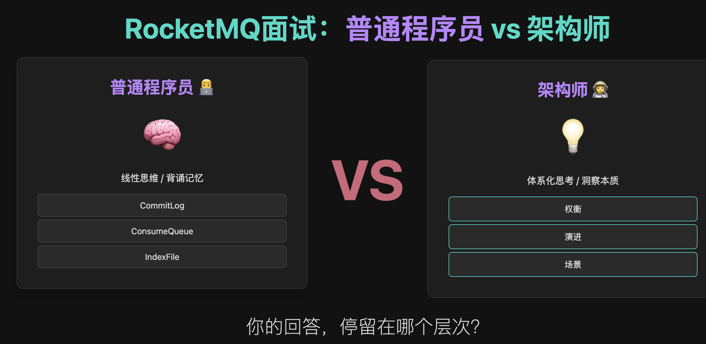
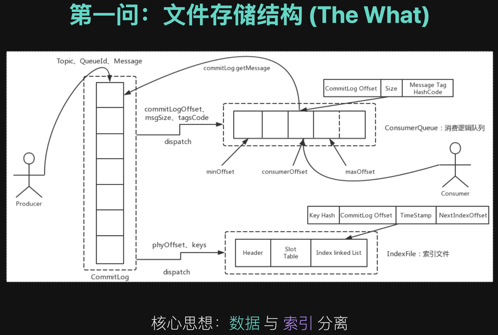
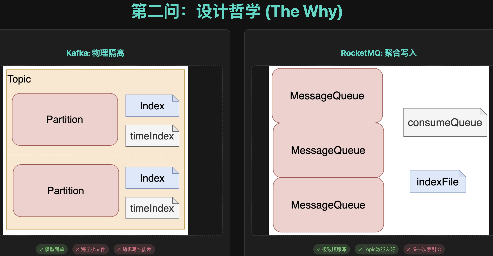
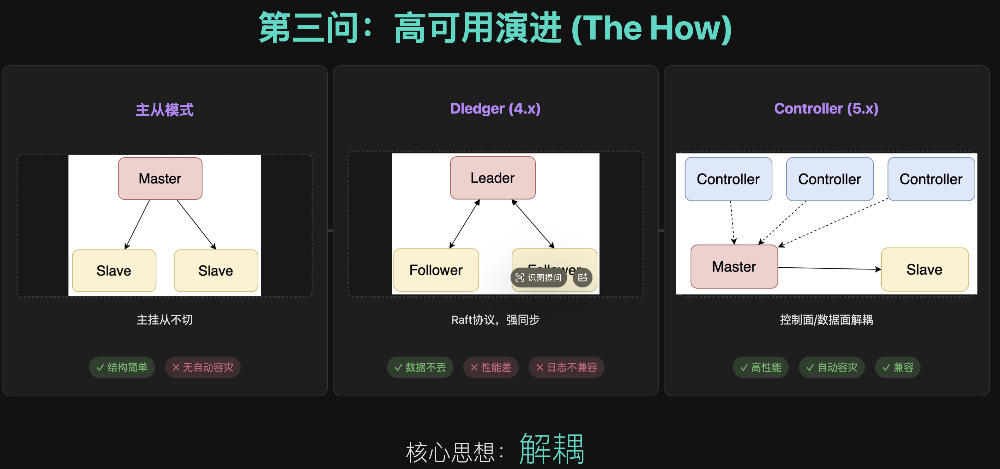
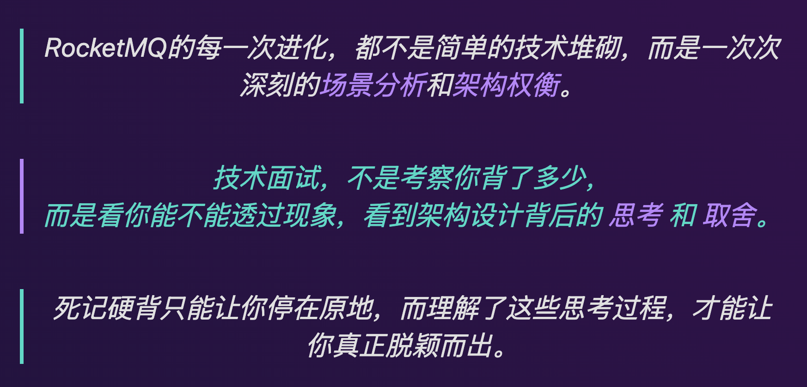

# RocektMQ文件存储，普通程序员VS架构师

面试官问你：看你简历上写了对RocketMQ有深入理解，那我们来聊聊他是怎么存储数据的把。你听完一愣，还只会干巴巴的背八股文，“CommitLog、ConsumeQueue、IndexFile。。。。”。停！这样回答，最多拿个及格分。现在这个大环境，你必须要展示出“架构师”的思想，才能争取到你想要的Offer。

我是楼兰，今天就用这一个问题，让你看看普通程序员和架构师的回答，到底差在哪里。

**第一个问题，讲讲 RocketMQ 的核心文件存储结构**

**这是最基础的面试八股了。 RocketMQ的存储核心由三大文件组成。CommitLog、ConsumeQueue和indexfile。**

1. **CommitLog 是“数据文件”**：当生产者发送消息到 Broker 时，无论这条消息属于哪个 Topic，都会被统一、不加区分地顺序写入到 CommitLog 这一个文件中。这保证了磁盘写入是完全的追加写入，性能非常高，这也是 RocketMQ 高吞吐量的一个关键设计。
2. **ConsumeQueue 是“消费者索引”**：主要是用来支持消费者以MessageQueue的形式消费消息。一个MessageQueue对应一个ConsumeQueue文件。文件中包含三个核心信息：消息在CommitLog中的偏移量Offset、消息的总长度以及消息Tag的哈希值。消费者会根据ConsumeQueue文件找到自己感兴趣的消息，再从CommitLog中读取到消息的具体内容。
3. IndexFile是“时间索引”：主要是为消息查询提供了一种通过key或者时间区间来查询消息的方法。

总结来说，RocketMQ 通过“数据”和“索引”分离的设计，用一次额外的索引查找，换来了极致的顺序写性能和对海量 Topic 的友好支持。

---

**到这，面试八股就算结束了。但面试官通常心里毫无波澜，因为面试过一千个人，都是这么背的。想让他眼前一亮，你必须主动升级问题，把思考过程亮出来。**

**面试官，其实要真正理解这个结构，就必须思考一个问题：为什么RocketMQ不学Kafka，而要自己设计一套这么复杂的结构。把这个问题分析清楚了，面试官绝对眼前一亮。**

**同样作为顶级的消息中间件，RocketMQ和Kafka的文件存储结构其实是很相似的，都是数据文件与索引文件分开，而且索引文件的设计也是这种数据索引加时间索引的形式。**

但这两者的设计哲学确实完全不同。

+ **Kafka 走的是“物理隔离，各自为政”的路线**：每个 Topic 的每个分区（Partition）都对应一个独立的物理日志文件。它的优点是模型非常简单，单个分区内的读写因为文件独立，局部性很好。但缺点也很明显，当 Topic 或分区数量变得非常多时，磁盘上会产生海量的小文件，这不仅会耗尽文件句柄，更重要的是，磁盘的磁头需要在这些不同文件间频繁移动，宏观上就从顺序写退化成了随机写，导致性能下降。
+ **而 RocketMQ 走的是“聚合写入，分散索引”的路线**：所有消息写入一个 CommitLog，索引分门别类放在不同的 ConsumeQueue。它的优点正好解决了 Kafka 的痛点：对 Topic 数量极其友好，无论多少 Topic，写入端永远是纯粹的顺序 I/O。当然，它的缺点就是读取时多了一次 I/O 寻址，需要先读索引再读数据。不过，由于 ConsumeQueue 文件很小，索引查找通常能被操作系统的 PageCache 高效缓存，所以实际影响很小。

所以，RocketMQ牺牲了一点点读的性能，换来了对海量Topic场景的完美支持和极致的写入吞吐量。这，就是**架构的权衡**！”

---

**当你讲出“权衡”两个字的时候，面试官就知道这是遇到宝了。接下来，如果你能再接住面试官的下一招，这个Offer绝对就稳了。**

**面试官继续问：** 好，单机存储模型算是清楚了。那在分布式系统下呢？**RocketMQ是如何保证集群的数据一致性的呢？**

**这就更有意思了。RocketMQ同样给出了不同场景下的“权衡”方案。**

+ **RocketMQ提供的最简单的集群方案就是主从架构。主节点负责写入数据，从节点负责同步主节点的数据。这种方式数据一致性是有保障的，但是主节点挂了后，从节点不会自动切换成主节点，没法保证高可用。**
+ **Rocket****MQ4.x版本中，提供的高可用方案叫做Dledger。****是一种基于Raft协议的高可用方案。**简单说，就是基于Raft协议，**强制要求**一条消息必须成功复制到半数以上的节点，才算成功。之后才向生产者返回消息写入成功。否则生产者认为消息写入失败，就可以进行重试。**他的优点是**：数据安全，不会丢。并且，当 Leader 宕机后，集群能自动、快速地选举出新的 Leader，实现自动故障转移。金融级场景的首选。**但它也有缺点**：由于每一次写操作都要等待多数派节点的网络确认，性能大打折扣。而且Dledger集群在记录日志时，需要在日志数据的头部补充Raft协议的相关数据，与原生RocketMQ文件结构不兼容。

---

**面试官再接着问：“**嗯，你提到了 Dledger 会牺牲写入性能。那高性能和高可用，就没办法两全其美吗？”

RocketMQ在5.x版本给出了答案，Controller模式，它的核心思想是“**解耦**”。

Controller 模式引入了一个独立的 Controller 组件集群。这个集群本身也基于 Raft 协议，但它的作用被大大简化了，只决定哪个Broker是主节点。当主节点发生故障时，会在存活的从节点中，根据谁的数据最新最完整，来选举产生一个新的主节点。

**最关键的区别就在于**：Controller 不参与任何消息数据的读写和复制！Broker 之间的数据复制，回归到了最高效、最传统的“主 -> 从”模式，可以是异步也可以是同步。

这样一来，**需要强一致性的“选举决策”和需要高性能的“数据读写”**，这两件事就彻底分开了。

Controller模式在保证了自动故障切换的同时，几乎不损失任何写入性能，还解决了日志兼容性问题。这才是大规模业务场景下的最优解！”

---

所以你看，从文件存储到高可用，RocketMQ的每一次进化，都不是简单的技术堆砌，而是一次次深刻的**场景分析**和**架构权衡**。

技术面试，从来不是考察你背了多少，而是看你能不能透过现象，看到架构设计背后的**思考和取舍**。你必须要能够站在架构师的层次造出飞机，才会有做为程序员拧螺丝的机会。

死记硬背只能让你停在原地，而理解了这些思考过程，才能让你真正脱颖而出。

我是楼兰，如果这个视频对你有帮助，赶紧点赞收藏，不然下次就刷不到了。大家听完还有什么问题欢迎交流，我这边给大家整理了一份120万字的项目场景面试宝典，里面有类似的几百个项目场景面试问题，最近要面试的同学留下888。

> 更新: 2025-09-28 13:42:05  
> 原文: <https://www.yuque.com/tulingzhouyu/db22bv/me1846yqgior3w00>