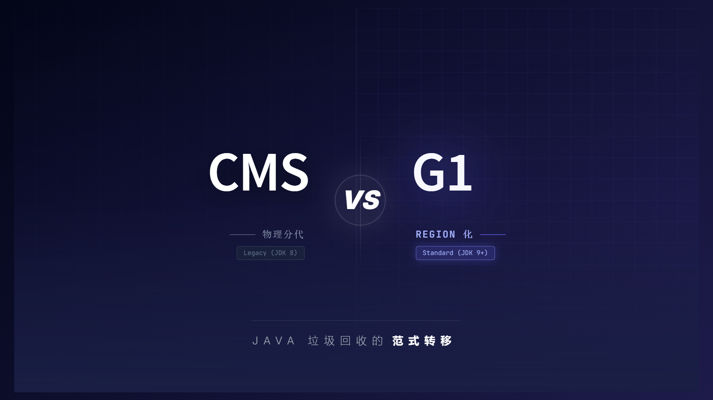
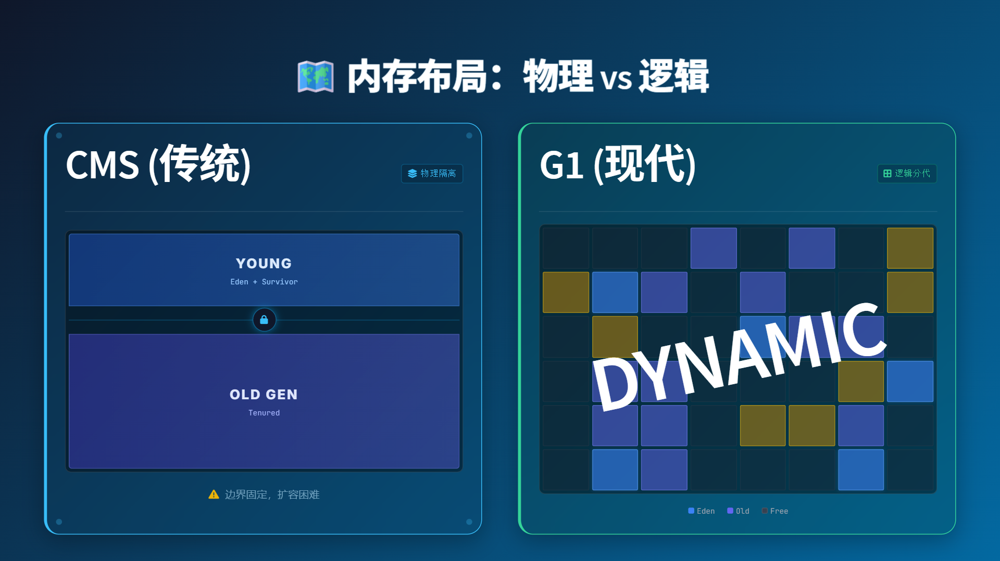
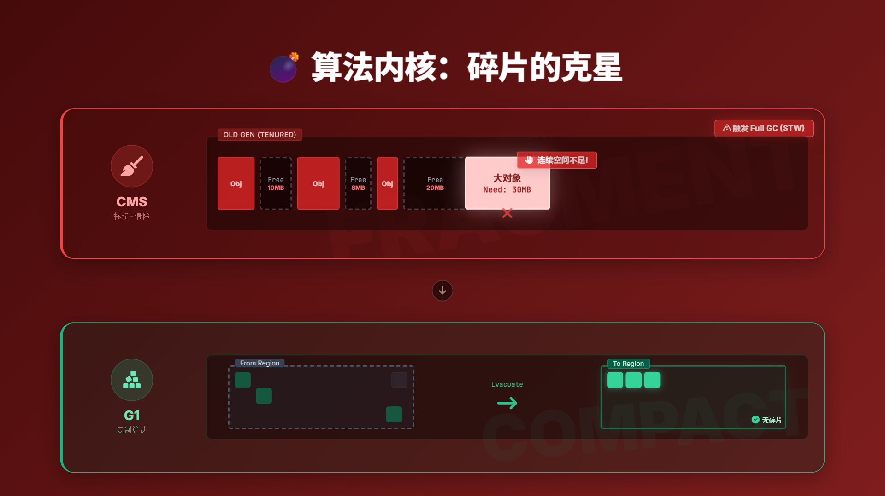
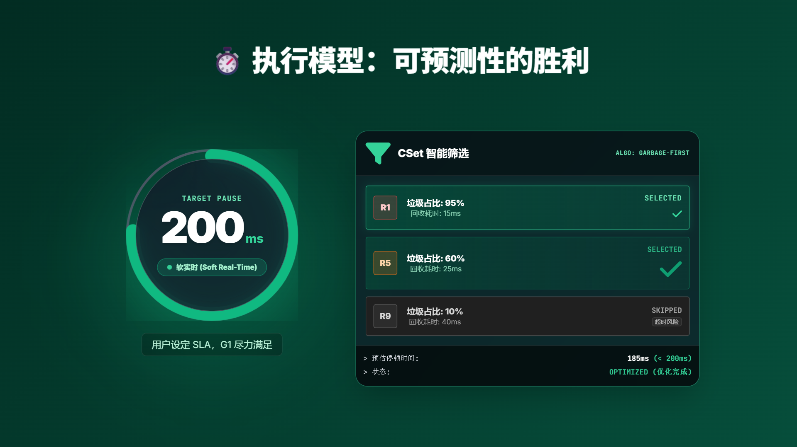
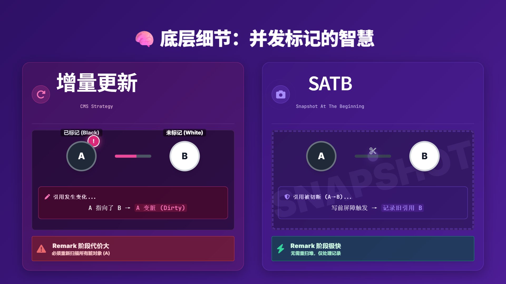

# JVM 垃圾回收的范式转移：从 CMS 到 G1 的底层进化

在 Java 性能调优的历史长河中，从 CMS (Concurrent Mark Sweep) 到 G1 (Garbage-First) 的过渡，不仅仅是算法的升级，更是一次内存管理思想的**范式转移**。本文将结合可视化的架构图，深入剖析这两代垃圾回收器在内存布局、算法内核及执行模型上的本质差异。

***

### 1. 核心冲突：物理分代 vs Region 化

在 JDK 8 时代，CMS 是低延迟场景的霸主；但随着堆内存突破 32GB 甚至更大，CMS 的弊端开始显现。JDK 9 之后，G1 正式成为默认收集器，标志着 JVM 进入了“大堆、可预测”的新时代。

***

### 2. 内存布局：打破僵化的边界

**CMS 的痛点：僵化的物理隔离** CMS 沿用了传统的物理分代模型。年轻代（Young）和老年代（Old）是连续的物理内存块，其边界在启动时（或通过 <code>-Xmn</code>）一旦划定，就难以动态调整。

* **扩容难题**：如果老年代空间不足，必须压缩年轻代空间，这种调整往往伴随着高昂的开销。
* **连续性要求**：为了保证指针碰撞（Bump Pointer）分配的高效性，必须要求内存地址连续，这限制了内存管理的灵活性。

**G1 的革新：逻辑分代与 Region** G1 将堆内存切分为数千个大小相等（1MB~32MB）的 **Region**。

* **角色动态分配**：一个 Region 上一秒可能是 Eden 区，回收净空后，下一秒就可以被分配为 Old 区。
* **化整为零**：这种设计彻底打破了物理隔离，使得 G1 能够根据当前的吞吐量或停顿时间目标，动态调整年轻代和老年代的比例（<code>-XX:G1NewSizePercent</code>），从而从容应对业务流量的波峰波谷。

***

### 3. 算法内核：彻底终结内存碎片

**CMS 的隐患：标记-清除（Mark-Sweep）** CMS 的核心算法是“标记-清除”。它只负责把垃圾对象标记出来并清理掉，**不进行内存整理**。

* **碎片化**：随着时间推移，老年代会像瑞士奶酪一样布满孔洞。
* **大对象分配失败**：当一个大对象需要分配时，虽然总剩余空间足够，但找不到一块连续的内存，被迫触发 **Full GC (Serial Old)**。这会导致长时间的 STW（Stop-The-World），是生产环境的噩梦。

**G1 的解法：标记-复制（Mark-Compact/Copying）** G1 在 Region 之间采用的是“复制”算法。

* **Evacuation（转移）**：G1 并不是原地清理垃圾，而是将存活对象从“From Region”复制到空的“To Region”。
* **天然整理**：在复制的过程中，对象会紧凑排列。因此，**G1 每次回收完毕，都在局部完成了内存整理**。这使得 G1 几乎不会因为碎片化问题而触发 Full GC，极大地提升了长期运行的稳定性。

***

### 4. 执行模型：建立可预测的 SLA

**软实时（Soft Real-Time）的承诺** CMS 的停顿时间是不可控的，它取决于堆的大小和垃圾的多少。而 G1 引入了 **“停顿时间模型”**。 开发者可以通过 <code>-XX:MaxGCPauseMillis</code>（默认 200ms）设置期望的停顿时间上限。

**智能筛选：CSet (Collection Set)** 为了达成这个 SLA 目标，G1 变身为一个精明的“理财师”：

1. **成本计算**：G1 会跟踪每个 Region 的回收耗时和垃圾占比。
2. **贪心算法**：在 Mixed GC 阶段，G1 不会回收所有老年代，而是根据允许的停顿时间，优先选择\*\*“回收收益最高、耗时最少”\*\*的 Region 加入回收集（CSet）。
3. **结果**：这就是 "Garbage-First" 名字的由来——**垃圾优先，按需回收**。

***

### 5. 并发标记：SATB vs 增量更新

在并发标记阶段，用户线程仍在运行，对象引用关系随时可能变化。如何保证标记的准确性？

**CMS：增量更新 (Incremental Update)**

* **机制**：当黑色对象（已标记）插入了对白色对象（未标记）的引用时，CMS 会将该黑色对象重置为灰色（Dirty）。
* **代价**：在最终的 Remark（重标记）阶段，CMS 必须**重新扫描**这些脏对象。在对象引用变化剧烈的应用中，Remark 阶段的 STW 时间可能会非常长。

**G1：原始快照 (SATB - Snapshot At The Beginning)**

* **机制**：G1 利用写前屏障（Pre-Write Barrier）。当引用关系被切断时（例如 <code>A.b = null</code>），G1 会把旧的引用对象记录下来。
* **优势**：G1 认为“在标记开始时存活的对象，在本次回收中都视为存活”。这种“快照”机制使得 Remark 阶段**无需重新扫描整个堆**，只需要处理记录队列，因此 G1 的 Remark 阶段通常比 CMS 快得多且更稳定。

***

### 6. 总结与选型建议

随着 JDK 版本的迭代，CMS 已在 JDK 9 中被标记为废弃（Deprecated），并在 JDK 14 中被彻底移除。对于现代 Java 应用架构师而言，选型逻辑已非常清晰：

1. **默认选择 G1**：适用于 JDK 11+ 环境，堆内存 > 6GB，追求吞吐量与延迟平衡的绝大多数 Web 应用和微服务。
2. **考虑 ZGC**：如果你的堆内存达到 TB 级别，或者业务对延迟极其敏感（要求 STW < 1ms），请尝试 ZGC（JDK 17+ 生产可用）。
3. **告别 CMS**：除非维护遗留的 JDK 8 系统且无法升级，否则不应再将 CMS 作为新项目的选择。

G1 的出现，通过 Region 化布局、可预测停顿模型和 SATB 算法，完美解决了大内存时代的 GC 痛点，是目前 JVM 生态中当之无愧的**中流砥柱**。

> 更新: 2025-12-09 20:22:54  
> 原文: <https://www.yuque.com/tulingzhouyu/db22bv/ehkrth2k904dhs4s>