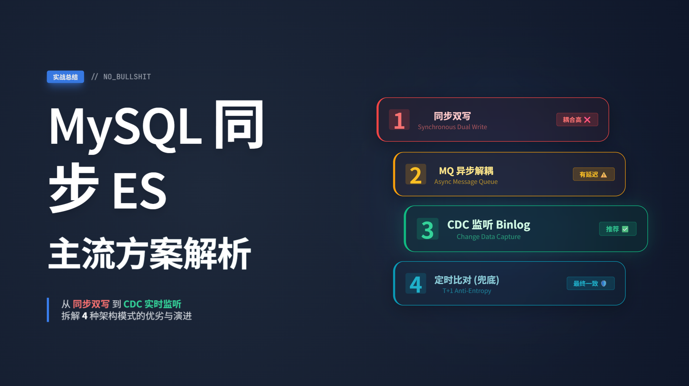
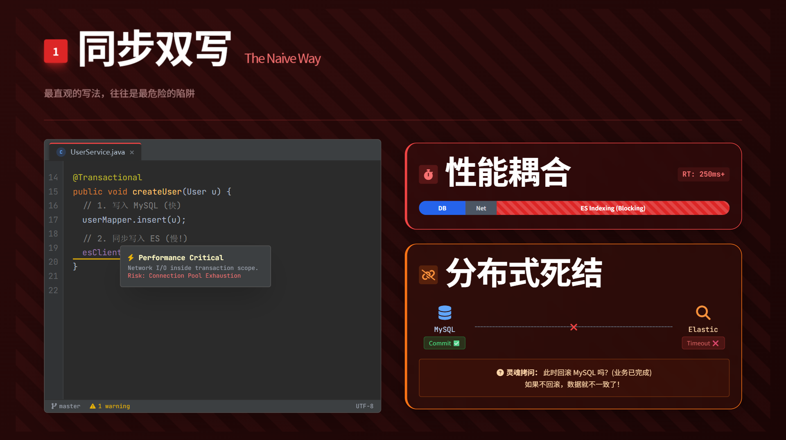
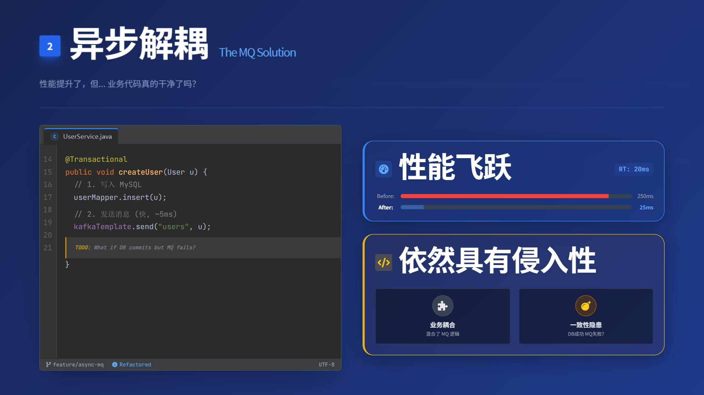
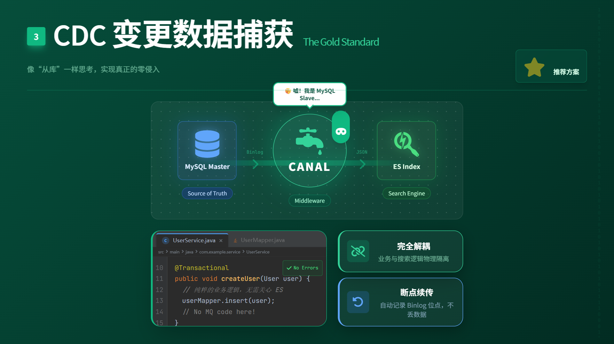
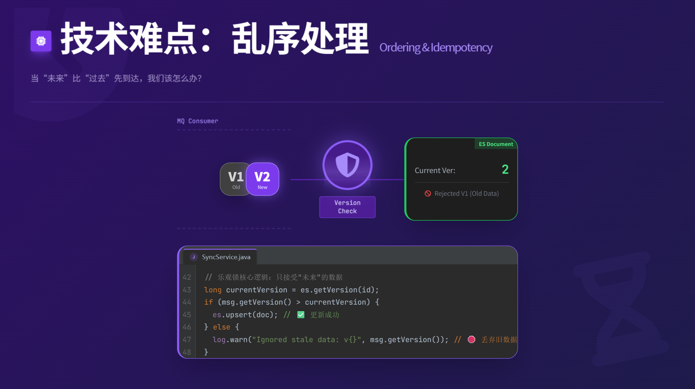
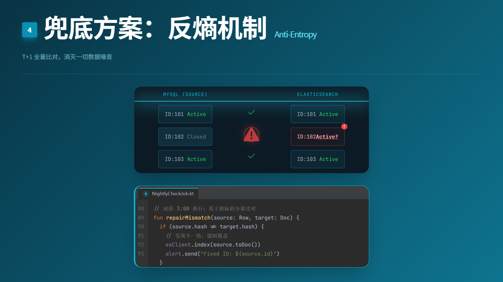
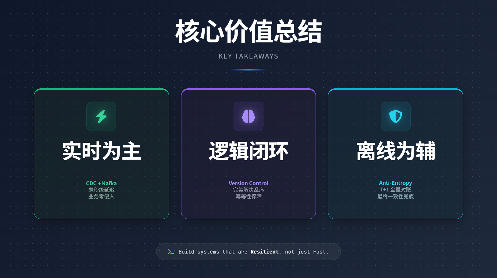

# MySQL 同步 ES 的 4种方案：从“双写”到“CDC”的避坑指南

在微服务架构中，**“关系型数据库（MySQL）做存储，搜索引擎（Elasticsearch）做检索”** 几乎是处理海量数据查询的标准范式。然而，如何保证两者之间的数据一致性，却是让无数架构师头秃的难题。

从早期的同步双写，到引入 MQ 解耦，再到如今主流的 CDC（Change Data Capture）方案，每一次架构演进的背后，都是对**性能、解耦**与**一致性**这三者之间平衡点的重新考量。

本文将结合生产环境的实战经验，拆解四种同步方案的优劣与演进路径。

***

## 一、 初始阶段：同步双写的诱惑与代价

在项目初期，数据量不大，开发周期紧，很多团队会选择最直观的“同步双写”方案。即在业务代码的事务逻辑中，直接调用 ES 的 SDK 进行写入。

### 1. 为什么它是“架构陷阱”？

看似简单的代码背后，隐藏着两个致命的系统性风险：

* **性能雪崩风险（Performance Critical）**： MySQL 的事务性能是极其宝贵的资源。如果在事务作用域内插入了 ES 的网络 I/O 操作，一旦 ES 集群发生 Full GC 卡顿或网络抖动，会导致 MySQL 的事务提交被阻塞。 这就好比在高速公路上设了一个红绿灯，瞬间会导致数据库连接池耗尽，进而拖垮整个主业务系统。
* **分布式一致性死结**： 在没有引入重型分布式事务（如 XA/Seata）的前提下，双写无法保证原子性。
  * 如果 MySQL 成功，ES 失败，你回滚吗？（业务明明成功了，回滚不合理）
  * 如果不回滚，数据就不一致了。 这种方案在流量稍微增大后，几乎必然导致数据漂移。

***

## 二、 过渡阶段：引入 MQ 进行异步解耦

为了解决“同步双写”带来的性能问题，引入消息队列（Kafka/RocketMQ）是自然的演进方向。主线程将变更事件写入 MQ 后立即返回，由消费者异步写入 ES。

### 1. 性能提升与新的痛点

引入 MQ 后，接口响应时间（RT）确实会从几百毫秒骤降至几十毫秒，系统的吞吐量得到了显著提升。但这只是把问题转移了，并未根除：

* **代码侵入性（Intrusiveness）**： 正如上图代码所示，业务 Service 层依然不纯粹。开发人员在写 <code>userMapper.insert</code> 的同时，必须时刻记得写一行 <code>kafkaTemplate.send</code>。这种**逻辑耦合**导致业务代码难以维护，且容易遗漏。
* **“双写”问题的变种**： 我们只是把“双写 MySQL + ES”变成了“双写 MySQL + MQ”。如果数据库事务提交了，但 MQ 发送失败（例如网络闪断），数据依然会丢失。虽然可以通过“本地消息表”来保证可靠投递，但这又引入了额外的开发和运维成本。

***

## 三、 成熟阶段：CDC 变更数据捕获

这是目前业界公认的“黄金标准”。CDC（Change Data Capture）技术的核心思想是：**不要让业务层感知同步逻辑，而是去监听数据库的“核心心跳”——Binlog。**

### 1. 像“从库”一样思考

利用 Canal、Debezium 或 Flink CDC 等组件，将自己伪装成 MySQL 的 Slave 节点。MySQL 发生任何变更，都会通过 Binlog 协议实时推送给消费者。

### 2. 核心优势

* **真正的零侵入（Zero Intrusion）**： 业务代码回归纯净（如上图代码所示），只关注数据库操作。同步逻辑与业务逻辑在物理上完全隔离，实现了关注点分离。
* **断点续传能力**： Binlog 拥有严格的顺序和位点（Position/Offset）。即使同步服务宕机，重启后依然可以从上次中断的位点继续消费，理论上保证了“至少一次（At Least Once）”的投递。

***

## 四、 深度挑战：乱序与幂等性设计

选择了 CDC + MQ 的链路，就意味着选择了分布式系统的复杂性。其中最棘手的问题就是**消息乱序（Ordering）**。

### 1. 场景复现

假设用户在极短时间内连续修改了两次数据：

1. <code>v1</code>: name = "Alice"
2. <code>v2</code>: name = "Bob"

在网络传输中，<code>v1</code> 包可能因为路由拥塞迟到了，导致 ES 先收到了 <code>v2</code>，后收到了 <code>v1</code>。如果不做处理，ES 的数据最终会被覆盖为 "Alice"（旧数据），导致严重的数据回退。

### 2. 解决方案：乐观锁与版本控制

解决乱序问题的核心在于**“只接受未来的数据”**。我们需要在 ES 文档中维护一个外部版本号字段（如 <code>update_time</code> 或 Binlog 的 <code>offset</code>）。

* **写入前检查**：消费者在处理消息时，对比消息中的版本号与 ES 现有文档的版本号。
* **策略执行**：
  * 如果 <code>Msg.version > Doc.version</code>：执行更新（Upsert）。
  * 如果 <code>Msg.version <= Doc.version</code>：说明是过期数据，直接丢弃（Ack & Ignore）。

***

## 五、 兜底防线：反熵（Anti-Entropy）机制

即便架构设计得再完美，也无法避免“黑天鹅”事件：Binlog 意外被清理、代码逻辑 Bug、人为误删数据等。因此，系统必须具备**自我修复能力**。

### 1. T+1 全量比对

我们需要引入一个“反熵”机制（Anti-Entropy），通常是一个定时运行的批处理任务：

* **游标扫描**：利用主键 ID 或时间游标，分批次拉取 MySQL 和 ES 的数据。
* **高效比对**：不需要比对所有字段，通常比对 <code>update_time</code> 或关键字段的 Hash 值即可。
* **强制修复**：一旦发现不一致（如图中红色的异常数据），以 MySQL 为“Source of Truth”（唯一真理源），强制覆盖 ES 数据。

这道防线保证了系统在经历任何故障后，都能在 T+1 时间内回归一致，实现了**最终一致性**。

***

## 六、 总结

构建一个生产级的高可靠同步架构，并非一蹴而就，而是一个不断做减法和加法的过程：

1. **做减法**：通过 **CDC** 去掉业务代码中的同步逻辑，实现解耦。
2. **做加法**：通过 **版本控制** 增加对乱序的处理能力。
3. **做保障**：通过 **反熵机制** 增加系统的容错底线。

最终，我们得到的是一个既具备**实时性（CDC+MQ）**，又具备**逻辑闭环（Version Control）**，且拥有**安全底线（Anti-Entropy）**的健壮架构。

> 更新: 2025-12-24 19:31:36  
> 原文: <https://www.yuque.com/tulingzhouyu/db22bv/gz0olxp5ikyu96p1>