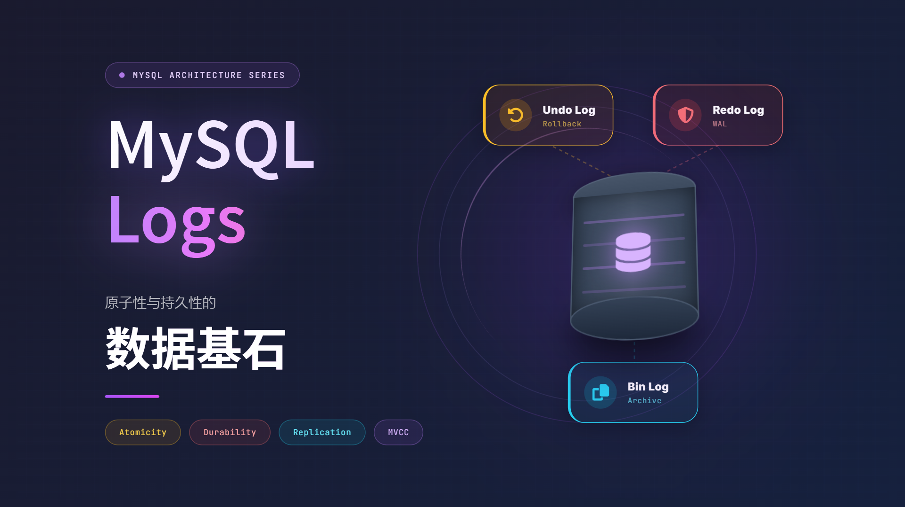
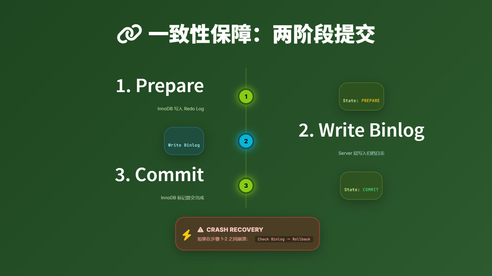

# MySQL 日志架构深度解析：原子性与数据一致性的基石

在数据库系统的设计权衡中，性能与可靠性往往是一对矛盾体。为了解决内存读写速度与磁盘持久化之间的巨大鸿沟，同时保证事务的 ACID 特性，MySQL 构建了一套精密的日志系统。

本文将以可视化的方式，逐层拆解支撑 MySQL 核心运行机制的三大日志体系。

## 1. 核心架构概览

上图展示了 MySQL 的三大核心日志，它们并非简单的备份文件，而是深度参与到数据处理流程中的关键组件。

* **设计初衷**：数据库为了性能，通常会在内存（Buffer Pool）中修改数据。如果每次修改都直接同步到磁盘数据文件（.ibd），随机 I/O 会导致性能急剧下降。
* **协作机制**：为了解决上述问题，MySQL 引入了\*\*WAL（Write-Ahead Logging，预写日志）\*\*机制。
  * **Redo Log** 保证了“内存数据不丢失”。
  * **Undo Log** 保证了“事务执行不彻底时可回退”。
  * **Binlog** 则负责将数据变更“广播”给下游系统（如从库或大数据平台）。

***

## 2. 架构分层：逻辑日志与物理日志的边界

MySQL 的“Server 层 + 插件式存储引擎”架构决定了日志的异构性：

1. **Server 层 - Binlog（归档日志）**：
   * **特性**：它是**逻辑日志**，记录的是 SQL 语句的原始逻辑（Statement 格式）或行数据的变更前后值（Row 格式）。
   * **独立性**：Binlog 不依赖于具体的存储引擎。无论你使用 InnoDB 还是 MyISAM，Binlog 都能记录数据变更。这使得它成为数据恢复（Point-in-Time Recovery）和主从复制的标准载体。
2. **Engine 层 - Redo/Undo（引擎日志）**：
   * **Redo Log**：它是**物理日志**，记录的是“在某个数据页（Page）上做了什么修改”。与 Binlog 的追加写不同，Redo Log 采用**循环写**（Circular Write）模式，空间固定，用完即覆盖。这意味着它只关注“崩溃恢复”这一短期目标，而不负责长期归档。
   * **关键差异**：当数据库发生宕机重启时，Server 层无法通过 Binlog 恢复内存中未刷盘的脏页，必须依赖 InnoDB 特有的 Redo Log 进行重放。

***

## 3. 原子性与隔离性：Undo Log 的多维价值

Undo Log 的作用远不止于“回滚”。如图所示，当执行 <code>UPDATE</code> 时，它记录了数据的旧值（OLD\_VALUE）。这一机制支撑了两个核心特性：

1. **原子性（Atomicity）**： 事务执行过程中若发生异常或显式执行 <code>ROLLBACK</code>，引擎会利用 Undo Log 中的反向操作（如将 insert 回滚为 delete），将数据恢复至事务开始前的状态，确保操作的不可分割性。
2. **MVCC（多版本并发控制）**： 这是 Undo Log 经常被忽视的重要功能。在**高并发读取**场景下（如 Read Committed 或 Repeatable Read 隔离级别），如果一行数据正在被修改，查询请求不会被阻塞，而是顺着 Undo Log 链（版本链）读取该行数据之前的快照版本。
   * **意义**：这种“快照读”机制极大地提升了数据库的并发吞吐量，实现了读写操作的非阻塞并行。

***

## 4. 一致性保障：两阶段提交 (2PC) 的必要性

为什么需要两阶段提交？本质上是为了解决**主从数据一致性**问题。 如果 Redo Log 和 Binlog 的写入是独立的，可能出现以下极端情况：

* **场景**：Redo Log 写完（主库数据已生效），但在写 Binlog 前系统宕机。
* **后果**：重启后主库通过 Redo Log 恢复了数据，但由于 Binlog 缺失，从库无法同步这条更新。最终导致主库有数据，从库无数据。

**2PC 流程解析**： 为了避免上述“脑裂”，MySQL 强制将 Redo Log 的提交过程与 Binlog 的写入绑定：

1. **Prepare 阶段**：Redo Log 写入并持久化，携带 XID（事务ID），状态设为 Prepare。
2. **Binlog 写入**：写入完整的逻辑日志。
3. **Commit 阶段**：在 Redo Log 中写入 Commit 标记。

**崩溃恢复策略**： 当实例重启检查日志时，只有同时满足“Redo Log 处于 Prepare 状态”且“Binlog 完整存在（通过 XID 匹配）”时，才会提交事务；否则一律回滚。这确保了由 Binlog 决定的下游数据与由 Redo Log 决定的上游数据严格保持一致。

***

## 5. 总结

理解 MySQL 日志系统，关键在于把握它们各自解决的特定问题：

* **Redo Log (物理日志)**：解决的是**I/O 性能与持久性**的矛盾。它保证了即使数据库发生宕机，已提交的事务修改也绝不会丢失。
* **Undo Log (逻辑日志)**：解决的是**执行异常与并发控制**的问题。它确保了事务可以随时回退，并为高并发读取提供了多版本支持。
* **Bin Log (逻辑归档)**：解决的是**数据分发与灾备**的问题。它是 MySQL 生态系统中数据流转的源头。

掌握这三者，便掌握了 MySQL 数据安全的命脉。

> 更新: 2025-12-01 13:30:45  
> 原文: <https://www.yuque.com/tulingzhouyu/db22bv/ehm6h9r3038021e6>