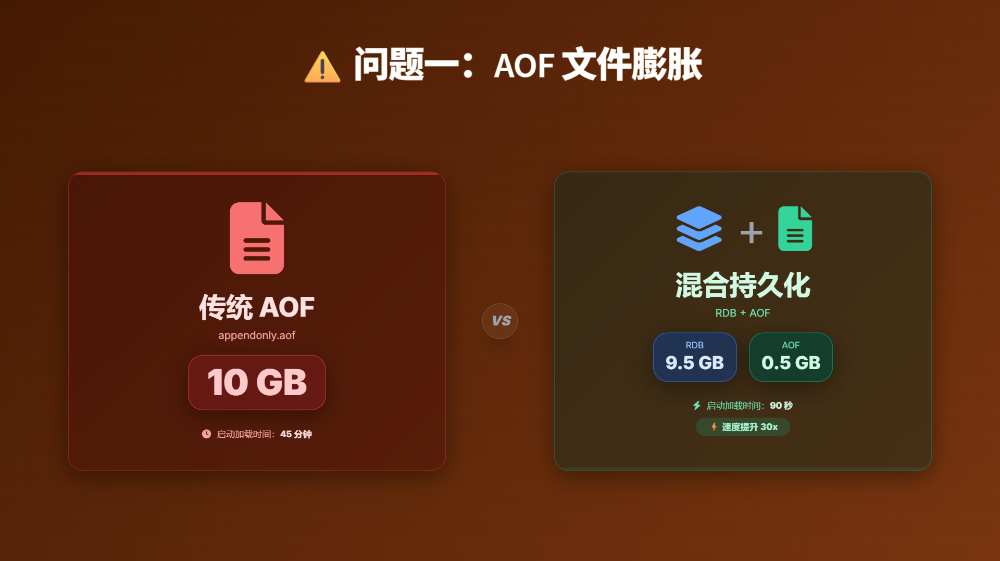
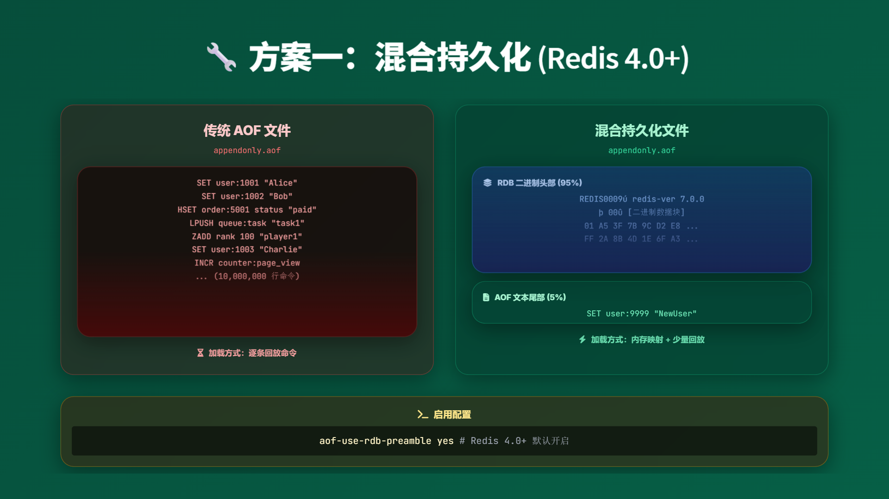
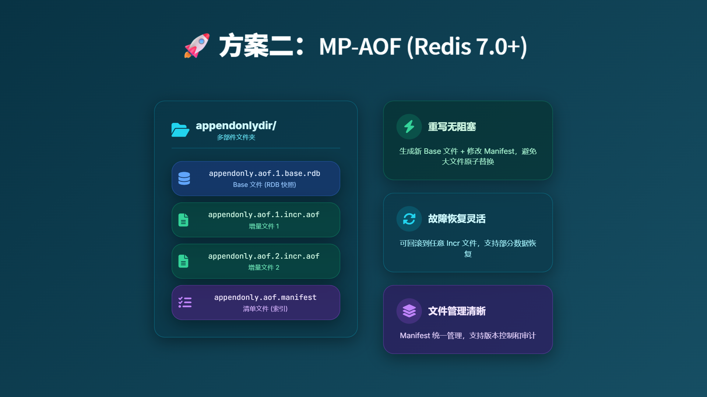
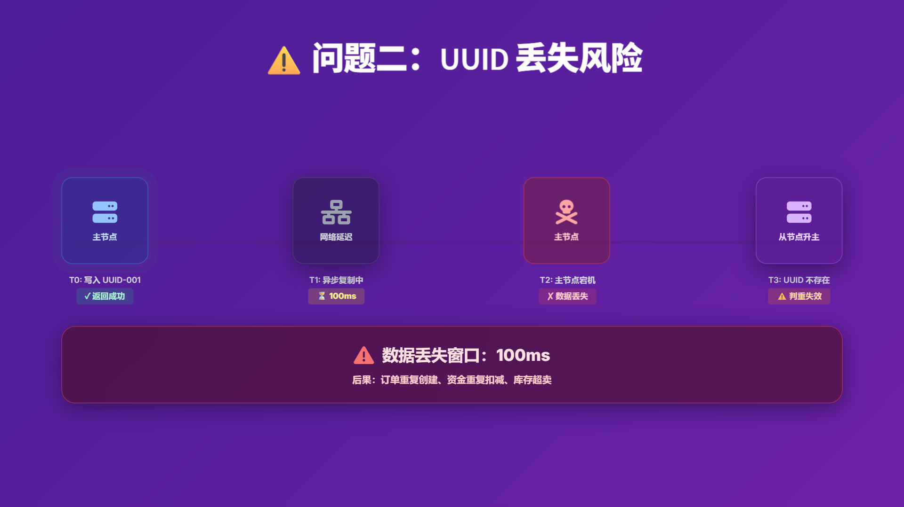
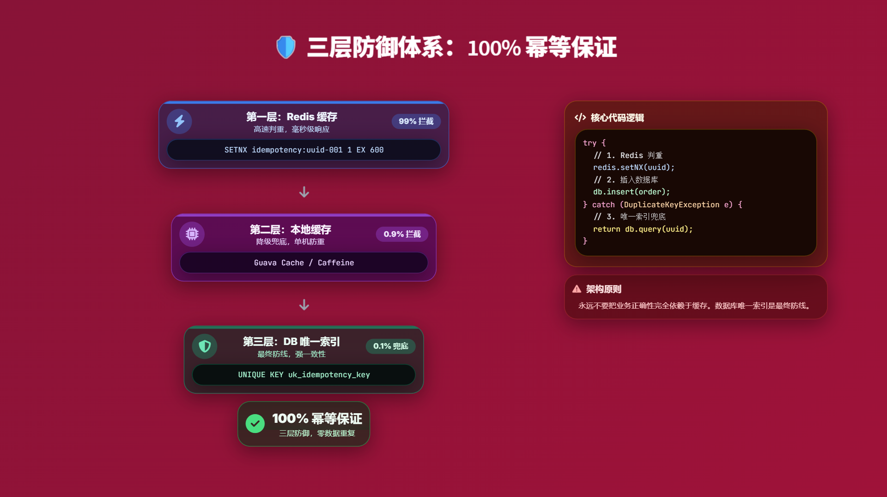
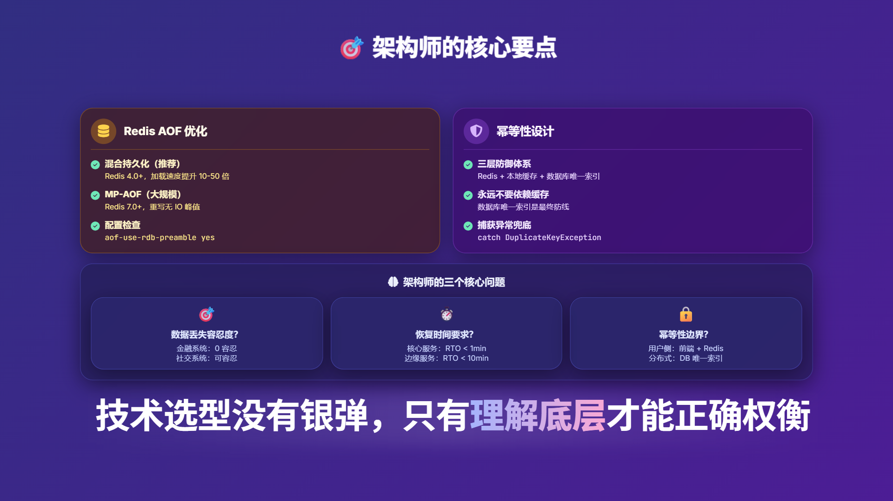

# Redis 底层存储演进与分布式幂等性架构

#### **引言**

在现代分布式系统中，Redis 凭借其卓越的性能成为缓存和消息队列等场景的首选。然而，随着业务规模的扩大，两个经典问题逐渐浮出水面，成为许多架构师挥之不去的梦魇：“**Redis 重启要 45 分钟？**” 和 “**数据丢了怎么办？**”。前者关乎系统的高可用性（HA），后者则直指数据一致性的生命线。本文将深入剖析这两个问题的根源，并基于 Redis 的底层存储演进和分布式设计原则，提供一套从根源上解决问题的生产级架构方案。

本文将围绕两大核心主题展开：

1. **AOF 性能瓶颈与演进**：如何将 Redis 的重启时间从 45 分钟优化到 90 秒。
2. **分布式幂等性挑战**：如何构建三层防御体系，实现 100% 的幂等性保证。

***

### **一、 AOF 性能瓶颈与演进：从 45 分钟到 90 秒**

#### **1.1 问题：AOF 文件膨胀导致的启动灾难**

传统的 AOF (Append-Only File) 持久化机制通过记录所有写命令来保证数据。但当实例运行日久，AOF 文件会急剧膨胀。一个体积达到 10GB 的 AOF 文件，在实例重启时需要逐条回放数千万甚至上亿条命令，这个过程耗时惊人，45 分钟的加载时间在生产环境中屡见不鲜，这对于要求高可用的服务是不可接受的。

如图所示，传统 AOF 模式下的巨大文件体积直接导致了漫长的恢复时间（RTO）。这促使 Redis 社区对持久化机制进行了一次关键的革新。

#### **1.2 方案一：混合持久化 (Redis 4.0+)**

为了解决 AOF 重放过慢的问题，Redis 4.0 引入了混合持久化。它巧妙地结合了 RDB 和 AOF 的优点。在进行 AOF 重写时，不再简单地合并旧的 AOF 文件，而是将当前内存中的数据以 RDB 的二进制格式写入 AOF 文件的开头，后续增量的写命令则继续以 AOF 格式追加在文件末尾。

这种结构带来的好处是革命性的。重启加载时，Redis 只需加载头部的 RDB 部分（通过内存映射，速度极快），然后回放尾部少量的 AOF 增量命令即可。这使得启动速度相比纯 AOF 模式提升了 10-50 倍。在我们的案例中，启动时间从 45 分钟骤降至 90 秒。该功能在 Redis 4.0 及以上版本通过 <code>aof-use-rdb-preamble yes</code> 配置（默认开启）来启用。

#### **1.3 方案二：MP-AOF 多部件 AOF (Redis 7.0+)**

进入 Redis 7.0 时代，AOF 机制再次进化，引入了 MP-AOF (Multi-Part AOF)。它将 AOF 文件拆分为一个目录（<code>appendonlydir/</code>），其中包含一个基础文件（<code>base.rdb</code>）、多个增量文件（<code>incr.aof</code>）和一个清单文件（<code>manifest</code>）。

MP-AOF 的核心优势在于**重写过程几乎无阻塞**。它通过创建新的 Base 文件和增量文件，最后原子性地更新 Manifest 文件来完成重写，避免了传统 AOF 重写时对单个大文件进行操作所带来的 IO 峰值和潜在阻塞。这种精细化的文件管理也为数据恢复提供了更大的灵活性。

***

### **二、 分布式幂等性的挑战与三层防御**

#### **2.1 问题：主从复制中的数据丢失风险**

解决了性能问题，我们再来看数据一致性。在分布式系统中，保证接口幂等性是防止重复操作（如重复扣款、重复下单）的关键。许多方案依赖 Redis 的 <code>SETNX</code> 命令来判断请求是否重复。但在标准的 Redis 主从异步复制架构中，存在一个致命的数据丢失窗口。

如上图所示的场景：

1. **T0**: 客户端请求成功写入主节点（Master），<code>SETNX</code> 成功，客户端收到成功响应。
2. **T1**: 主节点在将数据异步复制到从节点（Slave）的过程中，存在网络延迟。
3. **T2**: 在数据完全同步前，主节点突然宕机。
4. **T3**: 哨兵（Sentinel）将从节点提升为新的主节点。但此时，新的主节点上并**不存在**刚刚写入的幂等性 Key。

当原始请求因为超时等原因重试时，它会访问新的主节点，<code>SETNX</code> 会再次成功，导致业务逻辑被重复执行，引发严重的生产事故。

#### **2.2 方案：构建无法被击穿的三层防御体系**

为了实现 100% 的幂等保证，单一的 Redis 判重是不可靠的。我们必须建立一个纵深防御体系。

这个体系如一个层层过滤的漏斗，确保任何重复请求都无法穿透：

* **第一层：Redis 缓存 (拦截 99%)**
  * **机制**: 使用 <code>SETNX idempotency:uuid <value> EX <timeout></code>。
  * **作用**: 作为主要防线，利用 Redis 的高性能处理绝大多数（99%）的重复请求，响应速度在毫秒级。这是效率最高的一层。
* **第二层：本地缓存 (拦截 0.9%)**
  * **机制**: 使用 Guava Cache 或 Caffeine。
  * **作用**: 作为降级兜底方案。当 Redis 发生故障或 Key 因内存淘汰策略被逐出时，本地缓存可以防止在单机内部的并发重复请求。
* **第三层：数据库唯一索引 (兜底 0.1%)**
  * **机制**: 在存储幂等性 Key 的数据表字段上建立唯一索引（<code>UNIQUE KEY</code>）。
  * **作用**: 这是**最终防线**。即使前两层缓存全部失效（例如，Redis 和应用实例同时重启），数据库的唯一性约束也能保证数据不会被重复插入。此时，代码逻辑会捕获 <code>DuplicateKeyException</code> 异常，并根据业务需求返回之前处理成功的结果。

这个方案的核心思想在右侧的代码逻辑和架构原则中得到了体现：**永远不要把业务正确性完全依赖于缓存，数据库是保证数据一致性的最后、也是最可靠的堡垒。**

***

### **总结：架构师的核心要点**

通过对 Redis 底层存储和分布式幂等性的探讨，我们可以提炼出架构师在设计高可用、高一致性系统时的核心要点。

1. **AOF 优化是高可用的基础**：对于 Redis 4.0+，务必开启混合持久化。对于大规模、高并发场景，升级到 Redis 7.0+ 并利用 MP-AOF 是更优选择。
2. **幂等性设计必须有纵深**：依赖单一组件实现幂等性是脆弱的。**“Redis + 本地缓存 + DB 唯一索引”** 的三层防御模型是经过生产环境反复验证的可靠方案。
3. **回归架构决策的本质**：在做技术选型时，需要反复拷问自己三个核心问题：系统对**数据丢失的容忍度**是多少？**服务恢复时间（RTO）**要求多高？**幂等性需要保证到哪个边界**？

技术选型没有银弹。只有深刻理解其底层原理、优势和局限，我们才能在复杂的业务场景中做出最精准的权衡与决策。

> 更新: 2025-12-02 20:06:30  
> 原文: <https://www.yuque.com/tulingzhouyu/db22bv/xozi6999zarzngu3>