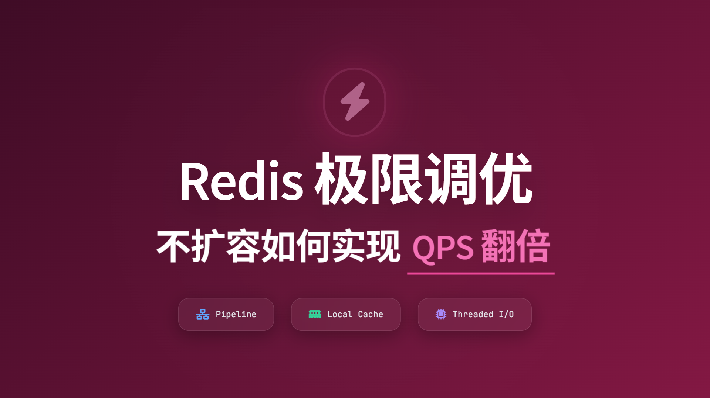
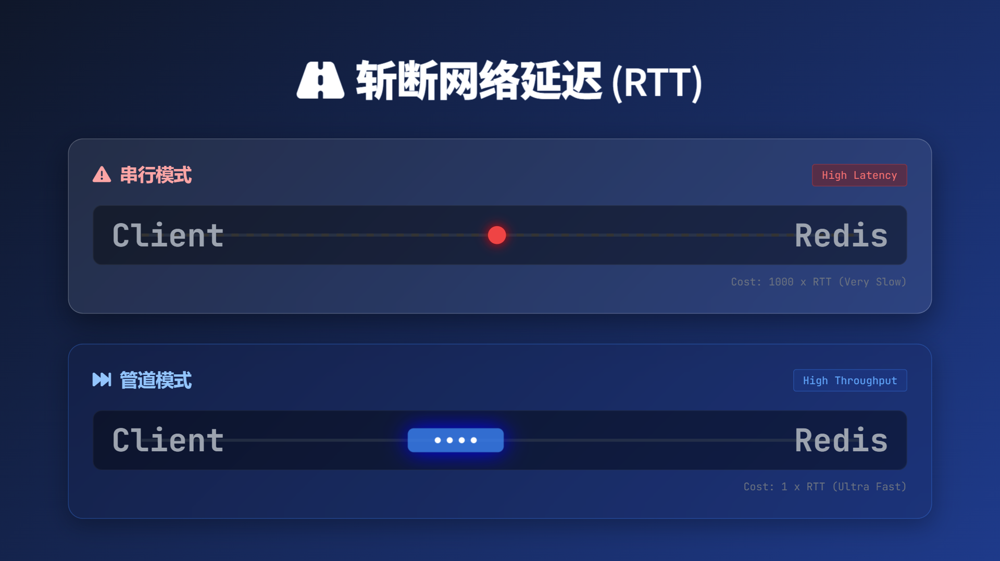
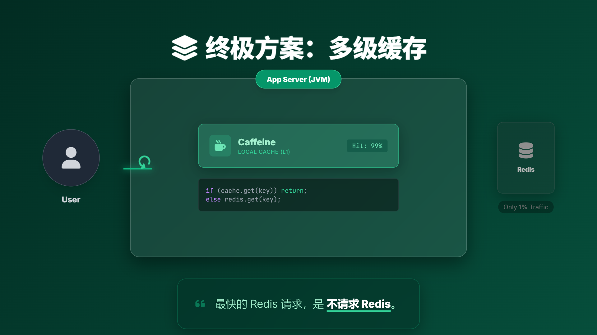
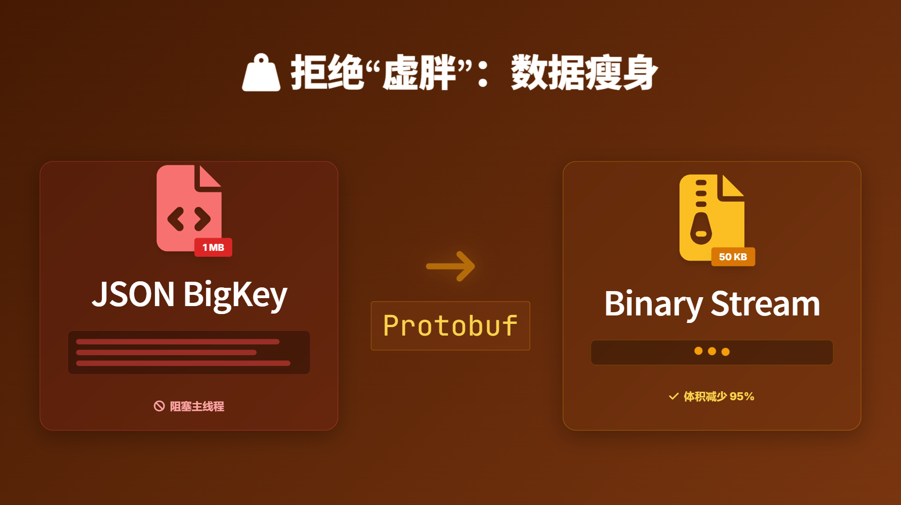
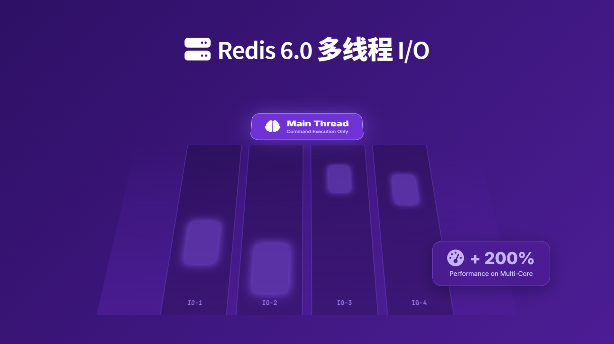
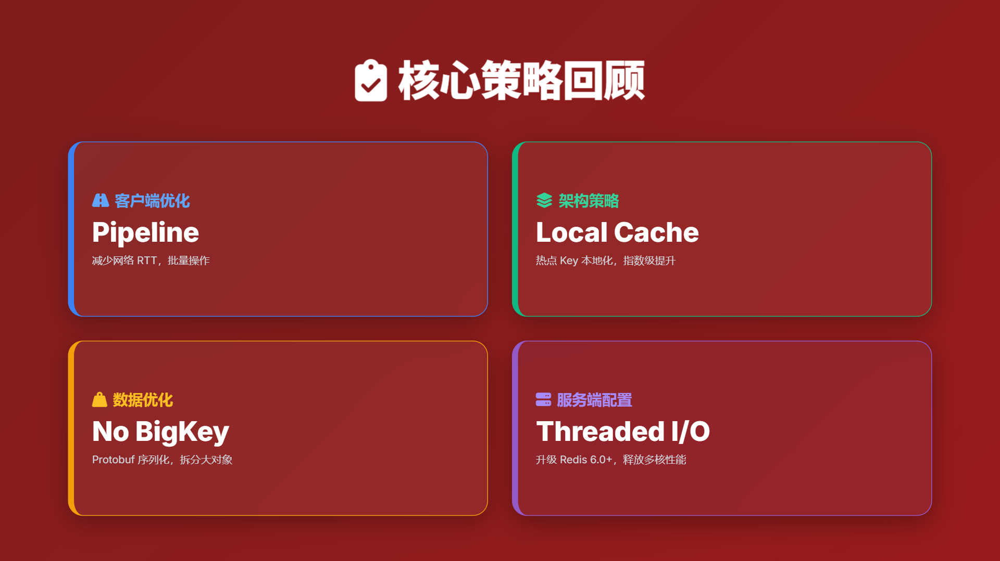

# Redis 极限调优：如何在不扩容的情况下实现 QPS 翻倍？

## 1. 引言：从“资源堆砌”到“架构压榨”

大家好。面对“不扩容、不加机器、QPS 翻倍”这个命题，初级工程师可能会觉得是刁难，但对于架构师来说，这正是**审视系统熵增**的最佳时机。

今天我们不谈那些虚无缥缈的理论，我将从**网络模型、内存架构、数据协议、线程模型**四个维度，为大家拆解一套在生产环境验证过的“组合拳”。

***

## 2. 第一刀：斩断网络延迟 (Pipeline & Batching)

大家先看屏幕上的对比。这看似简单的“打包”，背后隐藏着 Redis 性能最大的杀手——**RTT（往返时延）与系统调用开销**。

* **表象**：如上图所示，串行模式下，Client 和 Server 像是在打乒乓球，大量时间浪费在“路上”。
* **深度解析**：
  * **系统调用（Syscall）**：每一次 Redis 请求，应用服务器都要进行 <code>write</code> 和 <code>read</code> 系统调用，意味着要发生两次**用户态与内核态的上下文切换**。如果你执行 1000 次 SET，就是 2000 次上下文切换，这比 Redis 执行命令本身的开销大得多。
  * **Pipeline 的本质**：它不仅仅是减少网络包，更是将 N 次系统调用合并为 1 次。
* **实战建议**：
  * **不要贪杯**：Pipeline 虽然好，但不要一次打包几万条命令，这会导致网络缓冲区溢出，甚至造成 Head-of-line blocking（队头阻塞）。建议控制在 **50-100 条** 为一组。
  * **区分场景**：如果是集群模式（Cluster），要注意 Pipeline 中的 Key 必须落在同一个 Slot，否则需要客户端（如 Jedis/Lettuce）进行复杂的计算和分发。

***

## 3. 第二刀：空间换时间，架构降维 (Local Cache)

如果网络层优化到了极致，瓶颈依然存在，我们就必须引入架构层面的核武器——**多级缓存（Near Cache）**。

* **架构哲学**：**最快的 Redis 请求，是根本不发请求。**
* **深度解析**：
  * **L1 (JVM 堆内)**：访问速度是纳秒级（ns）。
  * **L2 (Redis)**：访问速度是毫秒级（ms）。
  * 两者相差 **1000 倍**。
* **关键权衡 (Trade-off)**：引入本地缓存最大的挑战是**数据一致性**。
  * **解决方案**：我们通常采用“**短 TTL + 惰性更新**”策略。对于热点 Key（如秒杀商品的库存、配置开关），设置 1-3 秒的过期时间。
  * **W-TinyLFU 算法**：建议使用 Caffeine 而不是 Guava Cache，因为 Caffeine 引入了 Window TinyLFU 算法，能更精准地识别出那些“刚进来就变冷”的伪热点数据，防止本地内存被污染。
* **收益**：这不仅是 QPS 的翻倍，更是对 Redis 的一种**保护机制**，防止热点 Key 击穿压垮整个集群。

***

## 4. 第三刀：拒绝“虚胖”，协议瘦身 (Serialization)

解决了“怎么取”的问题，我们再来看“取什么”。

* **生产痛点**：我见过太多系统，为了图方便，直接把巨大的 Java 对象转成 JSON 扔进 Redis。
* **深度解析**：
  * **带宽瓶颈**：在万兆网卡普及的今天，带宽依然昂贵。一个 1MB 的 BigKey，并发 1000 就是 1GB/s 的流量，瞬间打满网卡。
  * **主线程阻塞**：Redis 是单线程处理命令的。**大 Key 的分配（Malloc）和释放（Free）**，以及从内核态拷贝数据到用户态，都会长时间占用主线程。
* **实战建议**：
  * **序列化选型**：放弃 Java 原生序列化和纯文本 JSON。推荐使用 **Protobuf**、**MsgPack** 或 **Kryo**。它们不仅体积小（通常减少 50%-80%），而且\*\*编解码速度（CPU Cost）\*\*也更快。
  * **压缩策略**：对于超过 1KB 的文本数据，开启 Snappy 或 Gzip 压缩，以 CPU 换带宽是划算的。

***

## 5. 第四刀：引擎升级，释放多核 (Threaded I/O)

最后，我们深入到 Redis 引擎的演进。

* **历史包袱**：Redis 6.0 之前之所以坚持单线程，是因为 CPU 不是瓶颈，内存和网络才是。但随着网络硬件（10G/40G网卡）的发展，**网络中断处理和协议解析** 成了新的瓶颈。
* **技术内幕**：
  * 请注意，Redis 6.0 的多线程是 **I/O Thread**，而不是 Execution Thread。
  * **Main Thread** 依然负责命令的执行（保证了原子性，无需锁机制）。
  * **IO Threads** 负责从 Socket 读取数据、解析协议、以及将结果写回 Socket。
* **配置指南**：
  * 在 <code>redis.conf</code> 中设置 <code>io-threads 4</code>（建议设置为 CPU 核数的 3/4）。
  * 必须显式开启 <code>io-threads-do-reads yes</code>。
* **预期收益**：在重 I/O（大包、高并发）场景下，这能让 Redis 突破单核性能天花板，QPS 提升 **100% - 200%**。

***

## 6. 总结：架构师的决策树

最后，总结一下这套组合拳的决策逻辑：

1. **低成本、高收益**：优先检查客户端，上 **Pipeline**，这是最快见效的。
2. **抗高并发、防击穿**：必须上 **Local Cache**，这是架构稳定性的基石。
3. **降本增效**：优化 **序列化协议**，消灭 BigKey，节省带宽和内存。
4. **压榨硬件**：升级 **Redis 6.0+**，开启多线程 I/O，吃满 CPU 红利。

技术没有银弹，但有最佳实践。希望这些方案能为各位的系统优化提供弹药。谢谢。

> 更新: 2025-11-28 15:36:55  
> 原文: <https://www.yuque.com/tulingzhouyu/db22bv/yo0mhznqfy6wir00>