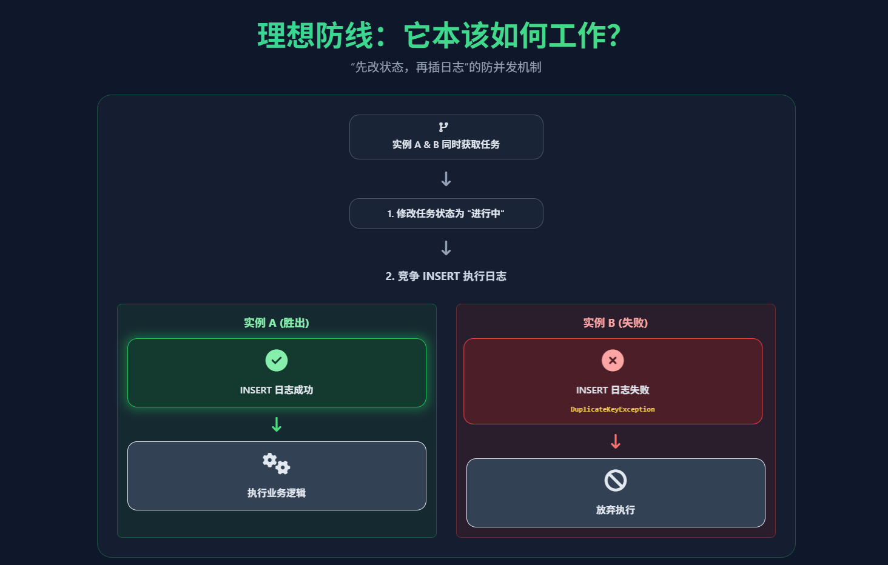
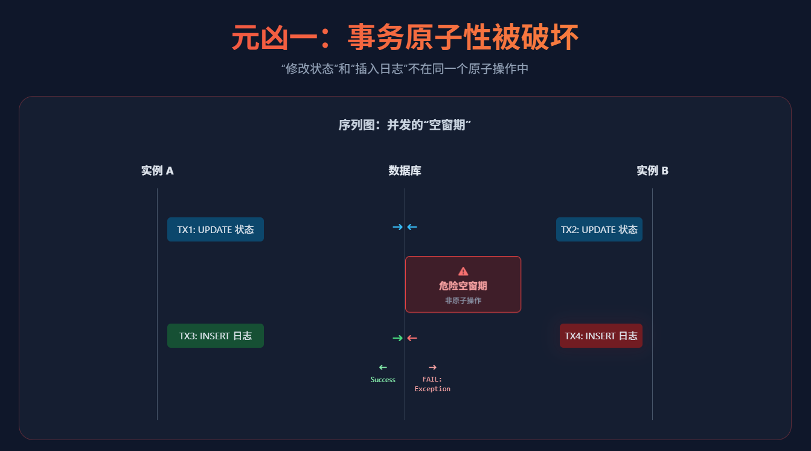
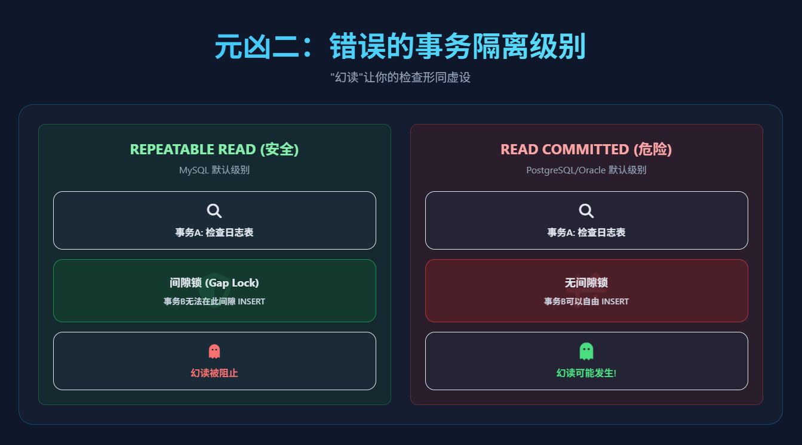
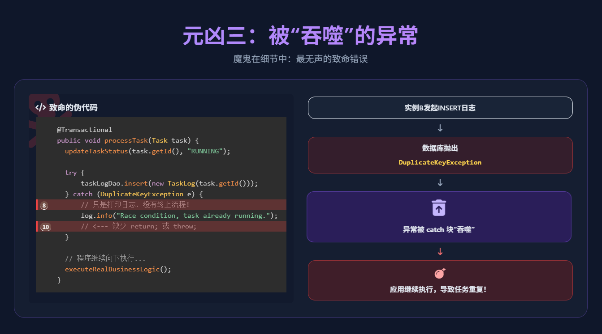

# XXL-Job 分布式锁疑云：为何主键约束在高并发下“失效”？

### <font style="color:rgb(38, 38, 38);">引言：一个“本不该发生”的并发问题</font>

<font style="color:rgb(38, 38, 38);">在分布式任务调度领域，XXL-Job 以其轻量和易用性广受欢迎。其核心机制之一，是通过数据库的“主键唯一约束”来实现分布式锁，确保在多实例部署时，同一个任务不会被重复执行。其经典实现逻辑为“</font>**<font style="color:rgb(38, 38, 38);">先修改任务状态，再插入执行日志</font>**<font style="color:rgb(38, 38, 38);">”。理论上，这道防线坚不可摧。</font>

<font style="color:rgb(38, 38, 38);">然而，在高并发的生产环境中，我们却遇到了一个棘手的问题：两个 XXL-Job 实例竟然同时执行了同一个任务，导致了数据重复处理。这表明，那道看似牢固的“唯一约束”防线，在特定条件下被离奇地击穿了。</font>


<font style="color:rgb(38, 38, 38);">本文将化身侦探，通过层层剖析，揪出导致这起并发“悬案”的三个核心元凶，并最终给出一套“亡羊补牢”的终极解决方案。</font>

### <font style="color:rgb(38, 38, 38);">理想防线：它本该如何工作？</font>

<font style="color:rgb(38, 38, 38);">在探寻元凶之前，我们首先需要明确，这套基于数据库的锁机制在理想状态下是如何运作的。</font>



<font style="color:rgb(38, 38, 38);">其工作流程如下：</font>

1. **<font style="color:rgb(38, 38, 38);">任务触发</font>**<font style="color:rgb(38, 38, 38);">：实例 A 和实例 B 同时被调度中心触发，开始执行同一个任务（例如 Task ID: 100）。</font>
2. **<font style="color:rgb(38, 38, 38);">状态更新</font>**<font style="color:rgb(38, 38, 38);">：两个实例都尝试执行第一步操作，即</font><font style="color:rgb(38, 38, 38);"> </font><code><font style="color:rgb(38, 38, 38);background-color:rgba(175, 184, 193, 0.2);">UPDATE task_table SET status = 'RUNNING' WHERE id = 100</font></code><font style="color:rgb(38, 38, 38);">。</font>
3. **<font style="color:rgb(38, 38, 38);">日志插入竞争</font>**<font style="color:rgb(38, 38, 38);">：接着，两个实例进入关键的第二步，尝试向</font><font style="color:rgb(38, 38, 38);"> </font><code><font style="color:rgb(38, 38, 38);background-color:rgba(175, 184, 193, 0.2);">task_log</font></code><font style="color:rgb(38, 38, 38);"> </font><font style="color:rgb(38, 38, 38);">表中插入一条唯一的执行日志，例如</font><font style="color:rgb(38, 38, 38);"> </font><code><font style="color:rgb(38, 38, 38);background-color:rgba(175, 184, 193, 0.2);">INSERT INTO task_log (task_id, ...) VALUES (100, ...)</font></code><font style="color:rgb(38, 38, 38);">。由于</font><font style="color:rgb(38, 38, 38);"> </font><code><font style="color:rgb(38, 38, 38);background-color:rgba(175, 184, 193, 0.2);">task_id</font></code><font style="color:rgb(38, 38, 38);"> </font><font style="color:rgb(38, 38, 38);">字段上存在唯一约束（UNIQUE KEY），这里必然会产生竞争。</font>
4. **<font style="color:rgb(38, 38, 38);">胜负已分</font>**<font style="color:rgb(38, 38, 38);">：</font>
   * **<font style="color:rgb(38, 38, 38);">胜者（实例 A）</font>**<font style="color:rgb(38, 38, 38);">：成功插入日志，获得执行权，继续执行核心业务逻辑。</font>
   * **<font style="color:rgb(38, 38, 38);">败者（实例 B）</font>**<font style="color:rgb(38, 38, 38);">：插入日志时，因违反唯一约束而立即收到</font><font style="color:rgb(38, 38, 38);"> </font><code><font style="color:rgb(38, 38, 38);background-color:rgba(175, 184, 193, 0.2);">DuplicateKeyException</font></code><font style="color:rgb(38, 38, 38);"> </font><font style="color:rgb(38, 38, 38);">异常。根据设计，它应该捕获此异常，并优雅地放弃执行，从而避免任务重复。</font>

<font style="color:rgb(38, 38, 38);">这套机制简洁而高效，但在我们的场景中，它失效了。问题出在哪里？</font>

### <font style="color:rgb(38, 38, 38);">元凶一：被破坏的事务原子性</font>

<font style="color:rgb(38, 38, 38);">第一个，也是最直接的元凶，在于“修改状态”和“插入日志”这两个本应是“原子”的操作，被分割在了两个独立的数据库事务中。</font>



<font style="color:rgb(38, 38, 38);">上图清晰地揭示了并发执行下的“危险空窗期”：</font>

1. **<font style="color:rgb(38, 38, 38);">T1 时刻</font>**<font style="color:rgb(38, 38, 38);">：实例 A 开启事务 TX1，成功将任务状态更新为 "RUNNING" 并提交。</font>
2. **<font style="color:rgb(38, 38, 38);">T2 时刻</font>**<font style="color:rgb(38, 38, 38);">：几乎在同时，实例 B 也开启事务 TX2，同样成功将任务状态更新为 "RUNNING" 并提交。由于这只是一个</font><font style="color:rgb(38, 38, 38);"> </font><code><font style="color:rgb(38, 38, 38);background-color:rgba(175, 184, 193, 0.2);">UPDATE</font></code><font style="color:rgb(38, 38, 38);"> </font><font style="color:rgb(38, 38, 38);">操作，且没有行锁竞争，所以两个实例都能成功。</font>
3. **<font style="color:rgb(38, 38, 38);">危险空窗期</font>**<font style="color:rgb(38, 38, 38);">：此时，从两个实例的角度看，它们都“合法”地完成了第一步。它们都认为自己有权继续执行，并准备进行下一步的日志插入。</font>
4. **<font style="color:rgb(38, 38, 38);">T3/T4 时刻</font>**<font style="color:rgb(38, 38, 38);">：实例 A 和实例 B 分别开启新事务 TX3 和 TX4 来插入执行日志。最终，只有一个实例（如实例 A）能成功，而另一个（实例 B）会因主键冲突而失败。</font>

**<font style="color:rgb(38, 38, 38);">问题核心</font>**<font style="color:rgb(38, 38, 38);">：虽然实例 B 的日志插入最终失败了，但由于它的状态更新操作早已成功提交，且与日志插入不在同一个事务中，应用代码如果没有对此进行恰当处理，就可能产生灾难性的后果。</font>

### <font style="color:rgb(38, 38, 38);">元凶二：错误的事务隔离级别</font>

<font style="color:rgb(38, 38, 38);">如果说原子性破坏是程序设计层面的失误，那么错误的事务隔离级别则是数据库层面的“帮凶”。这个问题尤其在使用 PostgreSQL 或 Oracle（默认隔离级别为 </font><code><font style="color:rgb(38, 38, 38);background-color:rgba(175, 184, 193, 0.2);">READ COMMITTED</font></code><font style="color:rgb(38, 38, 38);">）时更为突出。</font>



<font style="color:rgb(38, 38, 38);">在 </font><code><font style="color:rgb(38, 38, 38);background-color:rgba(175, 184, 193, 0.2);">READ COMMITTED</font></code><font style="color:rgb(38, 38, 38);"> 隔离级别下，事务只能读到已经提交的数据，并且不会产生“脏读”，但它无法阻止“幻读”（Phantom Read）。</font>

* **<font style="color:rgb(38, 38, 38);">场景复现</font>**<font style="color:rgb(38, 38, 38);">：假设我们的业务逻辑是“先 </font><code><font style="color:rgb(38, 38, 38);background-color:rgba(175, 184, 193, 0.2);">SELECT</font></code><font style="color:rgb(38, 38, 38);"> 检查日志是否存在，如果不存在则 </font><code><font style="color:rgb(38, 38, 38);background-color:rgba(175, 184, 193, 0.2);">INSERT</font></code><font style="color:rgb(38, 38, 38);">”。在 </font><code><font style="color:rgb(38, 38, 38);background-color:rgba(175, 184, 193, 0.2);">READ COMMITTED</font></code><font style="color:rgb(38, 38, 38);"> 级别下，实例 A 的事务（TX\_A）检查发现日志不存在。此时，实例 B 的事务（TX\_B）插入了一条日志并提交。随后，TX\_A 尝试插入日志，就会失败。更糟糕的是，如果 TX\_A 在检查后，TX\_B 插入并提交，然后 TX\_A 再次检查，它会发现凭空多出了一行，如同“幻影”，这就是幻读。</font>
* **<font style="color:rgb(38, 38, 38);">MySQL 的优势</font>**<font style="color:rgb(38, 38, 38);">：相比之下，MySQL 的默认隔离级别 </font><code><font style="color:rgb(38, 38, 38);background-color:rgba(175, 184, 193, 0.2);">REPEATABLE READ</font></code><font style="color:rgb(38, 38, 38);"> 通过</font>**<font style="color:rgb(38, 38, 38);">间隙锁（Gap Lock）</font>**<font style="color:rgb(38, 38, 38);"> 机制，有效避免了幻读。当一个事务尝试查询某个范围时，MySQL 会锁定这个“间隙”，阻止其他事务在这个间隙中插入新的数据，直到该事务结束。这就从根源上杜绝了“检查通过、但插入失败”的并发问题。</font>

<font style="color:rgb(38, 38, 38);">因此，如果你的数据库隔离级别设置不当，即使代码逻辑看起来没问题，也可能被“幻读”问题击穿防线。</font>

### <font style="color:rgb(38, 38, 38);">元凶三：被“吞噬”的异常</font>

<font style="color:rgb(38, 38, 38);">这是最隐蔽，也最致命的元凶。它源于开发人员对异常处理的疏忽。即使前两个问题都存在，只要能正确处理 </font><code><font style="color:rgb(38, 38, 38);background-color:rgba(175, 184, 193, 0.2);">DuplicateKeyException</font></code><font style="color:rgb(38, 38, 38);">，重复执行仍然可以被阻止。然而，在真实代码中，我们常常看到如下的致命写法：</font>



```java
@Transactional
public void processTask(Task task) {
    updateTaskStatus(task.getId(), "RUNNING"); // 操作一
    
    try {
        // 操作二：在一个新的事务中执行（假设传播机制为 REQUIRES_NEW）
        taskLogDao.insert(new TaskLog(task.getId()));
    } catch (DuplicateKeyException e) {
        // 致命错误：只是打印日志，没有终止流程!
        log.info("Race condition, task already running, this instance will quit.");
        // 此处缺少 return; 或 throw new RuntimeException();
    }
    
    // 程序继续向下执行...
    executeRealBusinessLogic(); // <--- 重复执行的根源！
}
```

<font style="color:rgb(38, 38, 38);">上图中的代码和流程清晰地展示了灾难是如何发生的：当实例 B 插入日志失败并抛出 </font><code><font style="color:rgb(38, 38, 38);background-color:rgba(175, 184, 193, 0.2);">DuplicateKeyException</font></code><font style="color:rgb(38, 38, 38);"> 时，</font><code><font style="color:rgb(38, 38, 38);background-color:rgba(175, 184, 193, 0.2);">catch</font></code><font style="color:rgb(38, 38, 38);"> 块仅仅打印了一行日志，然后就</font>**<font style="color:rgb(38, 38, 38);">正常结束</font>**<font style="color:rgb(38, 38, 38);">了。程序流程继续向下，执行了核心业务逻辑，导致了任务的重复执行。这个 </font><code><font style="color:rgb(38, 38, 38);background-color:rgba(175, 184, 193, 0.2);">catch</font></code><font style="color:rgb(38, 38, 38);"> 块就像一个黑洞，将本该中断程序的关键异常信号“吞噬”了。</font>

### <font style="color:rgb(38, 38, 38);">亡羊补牢：重建坚固防线</font>

<font style="color:rgb(38, 38, 38);">在揪出三大元凶后，我们可以对症下药，重建防线。以下是不同解决方案的决策矩阵。</font>


1. **<font style="color:rgb(38, 38, 38);">保证原子性</font>**<font style="color:rgb(38, 38, 38);">：这是首要任务。使用Spring等框架时，确保“修改状态”和“插入日志”的完整逻辑被 </font><code><font style="color:rgb(38, 38, 38);background-color:rgba(175, 184, 193, 0.2);">@Transactional</font></code><font style="color:rgb(38, 38, 38);"> 注解包裹，并置于同一个方法中。</font>
2. **<font style="color:rgb(38, 38, 38);">严肃处理异常</font>**<font style="color:rgb(38, 38, 38);">：对 </font><code><font style="color:rgb(38, 38, 38);background-color:rgba(175, 184, 193, 0.2);">DuplicateKeyException</font></code><font style="color:rgb(38, 38, 38);"> 保持敬畏。在 </font><code><font style="color:rgb(38, 38, 38);background-color:rgba(175, 184, 193, 0.2);">catch</font></code><font style="color:rgb(38, 38, 38);"> 到这个异常后，必须立即终止当前任务的执行逻辑。记录日志是必要的，但终止流程是必须的。</font>
3. **<font style="color:rgb(38, 38, 38);">核查并设置正确的隔离级别</font>**<font style="color:rgb(38, 38, 38);">：对于需要强一致性的分布式锁场景，推荐使用 </font><code><font style="color:rgb(38, 38, 38);background-color:rgba(175, 184, 193, 0.2);">REPEATABLE READ</font></code><font style="color:rgb(38, 38, 38);"> 或更高的隔离级别。</font>
4. **<font style="color:rgb(38, 38, 38);">考虑更专业的方案</font>**<font style="color:rgb(38, 38, 38);">：虽然数据库锁简单易用，但在超高并发场景下，可以考虑使用更专业的分布式锁实现，如基于 </font>**<font style="color:rgb(38, 38, 38);">Redis (SETNX/RedLock)</font>**<font style="color:rgb(38, 38, 38);"> 或 </font>**<font style="color:rgb(38, 38, 38);">Zookeeper (临时有序节点)</font>**<font style="color:rgb(38, 38, 38);"> 的方案。</font>

### <font style="color:rgb(38, 38, 38);">结论</font>

<font style="color:rgb(38, 38, 38);">XXL-Job 的“唯一键约束失效”事件，通常不是数据库或XXL-Job本身的Bug，而更像一面镜子，映照出我们在应用层面对分布式事务和并发控制的理解深度。它提醒我们：</font>

* **<font style="color:rgb(38, 38, 38);">原子性是生命线</font>**<font style="color:rgb(38, 38, 38);">：跨越多步的写操作（如先改状态再插日志），必须用事务捆绑。</font>
* **<font style="color:rgb(38, 38, 38);">异常处理决定生死</font>**<font style="color:rgb(38, 38, 38);">：被忽略的异常是埋在系统深处的定时炸弹。</font>
* **<font style="color:rgb(38, 38, 38);">信任但要核实</font>**<font style="color:rgb(38, 38, 38);">：不要想当然地认为框架或数据库会帮你搞定一切。</font>

<font style="color:rgb(38, 38, 38);">下一次，当遇到类似的“灵异事件”时，不妨从这三个角度切入，或许就能迅速找到那个隐藏在代码深处的“魔鬼”。</font>


> 更新: 2025-10-24 13:11:17  
> 原文: <https://www.yuque.com/tulingzhouyu/db22bv/lfgs8qbq2pawghcw>