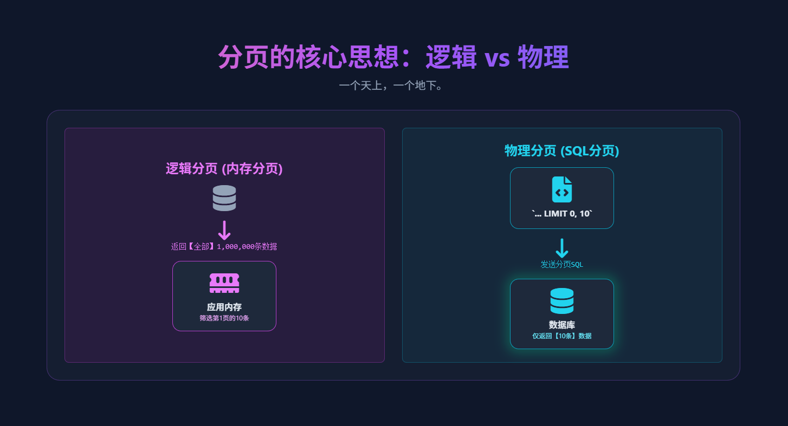

# 【高频面试】：MyBatis是如何进行分页的？


## <font style="color:rgb(38, 38, 38);">一、引言：为什么分页如此重要？</font>

<font style="color:rgb(38, 38, 38);">在几乎所有的业务系统中，数据查询都是核心功能。当数据量只有几十、几百条时，我们可以一次性将其全部加载到前端展示。但想象一下，当一个数据表拥有上百万，甚至上千万条记录时（例如用户表、订单表），一次性查询所有数据将是一场灾难。这不仅会消耗大量的数据库资源和网络带宽，更可能直接导致应用程序因内存溢出（OOM）而崩溃。</font>

<font style="color:rgb(38, 38, 38);">因此，</font>**<font style="color:rgb(38, 38, 38);">分页</font>**<font style="color:rgb(38, 38, 38);">（Pagination）应运而生。它是一种将海量数据拆分成小块（页）进行分批次查询和展示的技术，是所有后端开发者必须熟练掌握的基本功，也是衡量系统性能和稳定性的关键指标之一。</font>

<font style="color:rgb(38, 38, 38);">MyBatis作为业界主流的持久层框架，提供了多种分页实现方式。理解它们的原理和优劣，是写出高性能、高可用数据接口的前提。</font>

## <font style="color:rgb(38, 38, 38);">二、MyBatis分页的核心思想：两种模式的对决</font>

<font style="color:rgb(38, 38, 38);">在深入具体实现之前，我们必须先理解分页的两种根本不同的核心思想：</font>**<font style="color:rgb(38, 38, 38);">逻辑分页</font>**<font style="color:rgb(38, 38, 38);">和</font>**<font style="color:rgb(38, 38, 38);">物理分页</font>**<font style="color:rgb(38, 38, 38);">。</font>

* **<font style="color:rgb(38, 38, 38);">逻辑分页 (Logical Pagination)</font>**<font style="color:rgb(38, 38, 38);">：这是一种“伪分页”。它会从数据库中查询出</font>**<font style="color:rgb(38, 38, 38);">所有</font>**<font style="color:rgb(38, 38, 38);">符合条件的数据，然后将这些数据全部加载到应用程序的内存中，最后由代码（例如Java）根据分页参数（如页码、每页大小）截取出一小部分数据返回。</font>
* **<font style="color:rgb(38, 38, 38);">物理分页 (Physical Pagination)</font>**<font style="color:rgb(38, 38, 38);">：这是一种“真分页”。它会利用不同数据库自身提供的原生分页语法（如MySQL的</font><code><font style="color:rgb(38, 38, 38);background-color:rgba(175, 184, 193, 0.2);">LIMIT</font></code><font style="color:rgb(38, 38, 38);">，Oracle的</font><code><font style="color:rgb(38, 38, 38);background-color:rgba(175, 184, 193, 0.2);">ROWNUM</font></code><font style="color:rgb(38, 38, 38);">），在执行SQL查询时就直接告诉数据库：“我只需要第X页的Y条数据”。数据库只查询、返回指定范围的数据，开销极小。</font>



<font style="color:rgb(38, 38, 38);">显而易见，</font>**<font style="color:rgb(38, 38, 38);">物理分页</font>**<font style="color:rgb(38, 38, 38);">在性能上远胜于逻辑分页，是处理大数据量时的唯一正确选择。</font>

## <font style="color:rgb(38, 38, 38);">三、MyBatis分页的四种实现方式</font>

<font style="color:rgb(38, 38, 38);">MyBatis社区在漫长的发展中，演化出了四种主流的分页实现方式，它们体现了从原始到优雅的进化过程。</font>

### <font style="color:rgb(38, 38, 38);">方式一：在Mapper XML中直接编写SQL</font>

<font style="color:rgb(38, 38, 38);">这是最原始、最直接的方式。开发者需要在Mapper.xml文件中手动编写带有具体数据库分页语法的SQL语句。</font>

```plsql
<select id="selectUsersByPage" resultType="User">
  SELECT * FROM user
  LIMIT #{offset}, #{limit}
</select>
```

* **<font style="color:rgb(38, 38, 38);">优点</font>**<font style="color:rgb(38, 38, 38);">：</font>
  * <font style="color:rgb(38, 38, 38);">简单直观，易于理解。</font>
  * <font style="color:rgb(38, 38, 38);">无需任何额外配置或依赖。</font>
* **<font style="color:rgb(38, 38, 38);">缺点</font>**<font style="color:rgb(38, 38, 38);">：</font>
  * **<font style="color:rgb(38, 38, 38);">硬编码，维护成本高</font>**<font style="color:rgb(38, 38, 38);">：SQL与特定数据库（此处为MySQL）强绑定，若要更换数据库，所有分页SQL都需重写。</font>
  * **<font style="color:rgb(38, 38, 38);">参数繁琐</font>**<font style="color:rgb(38, 38, 38);">：需要手动计算并传入</font><code><font style="color:rgb(38, 38, 38);background-color:rgba(175, 184, 193, 0.2);">offset</font></code><font style="color:rgb(38, 38, 38);">（偏移量）和</font><code><font style="color:rgb(38, 38, 38);background-color:rgba(175, 184, 193, 0.2);">limit</font></code><font style="color:rgb(38, 38, 38);">（每页数量）等参数。</font>
  * **<font style="color:rgb(38, 38, 38);">代码重复</font>**<font style="color:rgb(38, 38, 38);">：每个需要分页的查询都需要重复编写类似的分页逻辑。</font>

### <font style="color:rgb(38, 38, 38);">方式二：使用</font><font style="color:rgb(38, 38, 38);"> </font><code><font style="color:rgb(38, 38, 38);background-color:rgba(175, 184, 193, 0.2);">RowBounds</font></code><font style="color:rgb(38, 38, 38);"> </font><font style="color:rgb(38, 38, 38);">对象</font>

<font style="color:rgb(38, 38, 38);">MyBatis提供了一个名为</font><code><font style="color:rgb(38, 38, 38);background-color:rgba(175, 184, 193, 0.2);">RowBounds</font></code><font style="color:rgb(38, 38, 38);">的内置对象，试图在不改变SQL的情况下实现分页。</font>

```java
// Service层调用
List<User> users = userMapper.selectAll(new RowBounds(10, 10)); // 获取第二页，每页10条

// Mapper接口
List<User> selectAll(); // SQL本身不含分页逻辑
```


* **<font style="color:rgb(38, 38, 38);">优点</font>**<font style="color:rgb(38, 38, 38);">：</font>
  * <font style="color:rgb(38, 38, 38);">无需在SQL中硬编码分页逻辑，实现了SQL的解耦。</font>
* **<font style="color:rgb(38, 38, 38);">缺点</font>**<font style="color:rgb(38, 38, 38);">：</font>
  * **<font style="color:rgb(38, 38, 38);">本质是逻辑分页</font>**<font style="color:rgb(38, 38, 38);">：它会加载所有数据到内存中，然后通过</font><code><font style="color:rgb(38, 38, 38);background-color:rgba(175, 184, 193, 0.2);">ResultSet.absolute()</font></code><font style="color:rgb(38, 38, 38);">和</font><code><font style="color:rgb(38, 38, 38);background-color:rgba(175, 184, 193, 0.2);">FetchSize</font></code><font style="color:rgb(38, 38, 38);">等JDBC特性进行数据截取。在数据量大时，依然会引发致命的内存溢出问题。</font>
  * **<font style="color:rgb(38, 38, 38);">仅适用于小数据量场景</font>**<font style="color:rgb(38, 38, 38);">：只适合于确定数据量极小（如几百条）的查询。</font>

### <font style="color:rgb(38, 38, 38);">方式三：使用</font><font style="color:rgb(38, 38, 38);"> </font><code><font style="color:rgb(38, 38, 38);background-color:rgba(175, 184, 193, 0.2);">Interceptor</font></code><font style="color:rgb(38, 38, 38);"> </font><font style="color:rgb(38, 38, 38);">拦截器</font>

<font style="color:rgb(38, 38, 38);">为了解决以上问题，MyBatis提供了强大的</font><code><font style="color:rgb(38, 38, 38);background-color:rgba(175, 184, 193, 0.2);">Interceptor</font></code><font style="color:rgb(38, 38, 38);">（拦截器）机制。它允许开发者在SQL执行的生命周期（如参数处理、SQL执行、结果集处理）中插入自定义逻辑，这为实现统一的物理分页提供了可能。</font>

<font style="color:rgb(38, 38, 38);">实现逻辑通常如下：</font>

1. **<font style="color:rgb(38, 38, 38);">定义拦截器</font>**<font style="color:rgb(38, 38, 38);">：创建一个类实现MyBatis的</font><code><font style="color:rgb(38, 38, 38);background-color:rgba(175, 184, 193, 0.2);">Interceptor</font></code><font style="color:rgb(38, 38, 38);">接口。</font>
2. **<font style="color:rgb(38, 38, 38);">拦截目标SQL</font>**<font style="color:rgb(38, 38, 38);">：配置拦截器，使其在SQL执行前触发。</font>
3. **<font style="color:rgb(38, 38, 38);">动态改写SQL</font>**<font style="color:rgb(38, 38, 38);">：在拦截方法中，获取原始SQL，判断是否需要分页，如果需要，则根据数据库类型动态地在原始SQL末尾拼接上物理分页子句（如</font><code><font style="color:rgb(38, 38, 38);background-color:rgba(175, 184, 193, 0.2);">LIMIT</font></code><font style="color:rgb(38, 38, 38);">）。</font>
4. **<font style="color:rgb(38, 38, 38);">执行新SQL</font>**<font style="color:rgb(38, 38, 38);">：将改写后的SQL交由MyBatis继续执行。</font>


* **<font style="color:rgb(38, 38, 38);">优点</font>**<font style="color:rgb(38, 38, 38);">：</font>
  * **<font style="color:rgb(38, 38, 38);">实现真正的物理分页</font>**<font style="color:rgb(38, 38, 38);">，性能高。</font>
  * **<font style="color:rgb(38, 38, 38);">逻辑统一</font>**<font style="color:rgb(38, 38, 38);">：将分页逻辑从业务代码中抽离，实现了一次配置，全局生效。</font>
* **<font style="color:rgb(38, 38, 38);">缺点</font>**<font style="color:rgb(38, 38, 38);">：</font>
  * **<font style="color:rgb(38, 38, 38);">实现复杂</font>**<font style="color:rgb(38, 38, 38);">：需要深入理解MyBatis的内部执行原理，如</font><code><font style="color:rgb(38, 38, 38);background-color:rgba(175, 184, 193, 0.2);">Executor</font></code><font style="color:rgb(38, 38, 38);">、</font><code><font style="color:rgb(38, 38, 38);background-color:rgba(175, 184, 193, 0.2);">StatementHandler</font></code><font style="color:rgb(38, 38, 38);">等核心组件，开发门槛较高，容易出错。</font>

### <font style="color:rgb(38, 38, 38);">方式四：使用分页插件（如 PageHelper）- </font><font style="color:rgb(38, 38, 38);">⭐</font><font style="color:rgb(38, 38, 38);">生产首选</font><font style="color:rgb(38, 38, 38);">⭐</font>

<font style="color:rgb(38, 38, 38);">既然基于</font><code><font style="color:rgb(38, 38, 38);background-color:rgba(175, 184, 193, 0.2);">Interceptor</font></code><font style="color:rgb(38, 38, 38);">实现统一物理分页是最佳思路，但手写又很复杂，那么成熟的开源插件便应运而生。</font>**<font style="color:rgb(38, 38, 38);">PageHelper</font>**<font style="color:rgb(38, 38, 38);">是其中最著名、使用最广泛的实现。</font>

<font style="color:rgb(38, 38, 38);">它将所有复杂的拦截器逻辑都封装好了，开发者只需引入依赖，进行简单配置，然后通过一行静态代码即可开启分页。</font>

```java
// 1. 引入依赖 & 配置插件

// 2. 在业务代码中调用
PageHelper.startPage(1, 10); // 紧跟其后的第一条MyBatis查询会自动被分页
List<User> users = userMapper.selectAll(); // SQL本身依然是干净的
PageInfo<User> pageInfo = new PageInfo<>(users); // PageInfo包含了总数、总页数等丰富信息
```


* **<font style="color:rgb(38, 38, 38);">优点</font>**<font style="color:rgb(38, 38, 38);">：</font>
  * **<font style="color:rgb(38, 38, 38);">集大成者</font>**<font style="color:rgb(38, 38, 38);">：拥有</font><code><font style="color:rgb(38, 38, 38);background-color:rgba(175, 184, 193, 0.2);">Interceptor</font></code><font style="color:rgb(38, 38, 38);">方案的所有优点，且规避了其实现复杂的缺点。</font>
  * **<font style="color:rgb(38, 38, 38);">使用极其简单</font>**<font style="color:rgb(38, 38, 38);">：非侵入式设计，对现有代码影响极小。</font>
  * **<font style="color:rgb(38, 38, 38);">功能强大</font>**<font style="color:rgb(38, 38, 38);">：自动进行</font><code><font style="color:rgb(38, 38, 38);background-color:rgba(175, 184, 193, 0.2);">count</font></code><font style="color:rgb(38, 38, 38);">查询获取总记录数，返回的</font><code><font style="color:rgb(38, 38, 38);background-color:rgba(175, 184, 193, 0.2);">PageInfo</font></code><font style="color:rgb(38, 38, 38);">对象包含完整的的分页信息。</font>
  * **<font style="color:rgb(38, 38, 38);">智能适配</font>**<font style="color:rgb(38, 38, 38);">：能自动识别数据库类型，生成对应的分页SQL。</font>

## <font style="color:rgb(38, 38, 38);">四、如何选择最佳方案？决策矩阵</font>


## <font style="color:rgb(38, 38, 38);">五、结论</font>

<font style="color:rgb(38, 38, 38);">MyBatis的分页实现经历了从手动到自动，从逻辑分页到物理分页的演进。在现代项目开发中，我们应该毫不犹豫地选择像</font>**<font style="color:rgb(38, 38, 38);">PageHelper</font>**<font style="color:rgb(38, 38, 38);">这样的成熟分页插件。它不仅能保证最佳的查询性能，还能极大地提升开发效率，让我们专注于业务逻辑本身。</font>

**<font style="color:rgb(38, 38, 38);">面试核心答案</font>**<font style="color:rgb(38, 38, 38);">：当被问及MyBatis如何分页时，标准的回答应该覆盖“逻辑分页与物理分页的区别”，并点明“插件（如PageHelper）利用Interceptor机制实现自动化物理分页是当前业界的最佳实践”。</font>


> 更新: 2025-11-07 17:05:21  
> 原文: <https://www.yuque.com/tulingzhouyu/db22bv/vwkg57qvyfnitnpx>