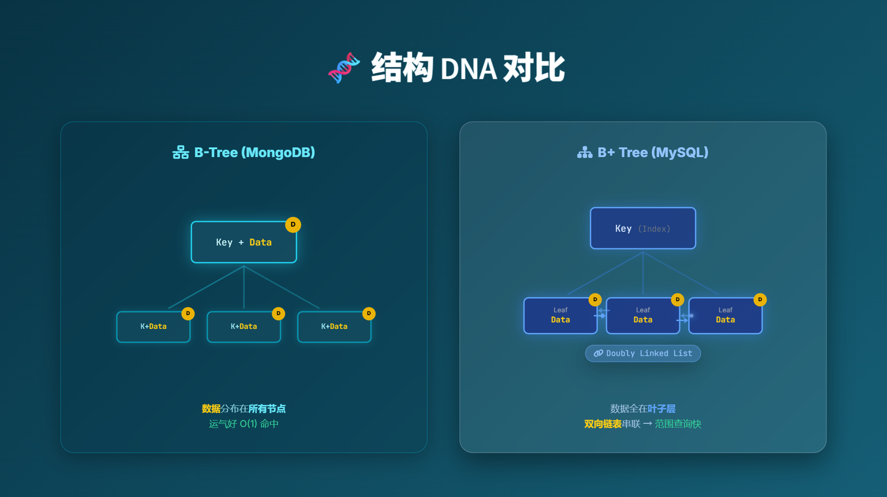
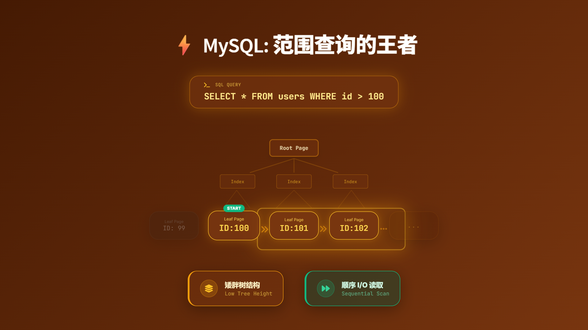
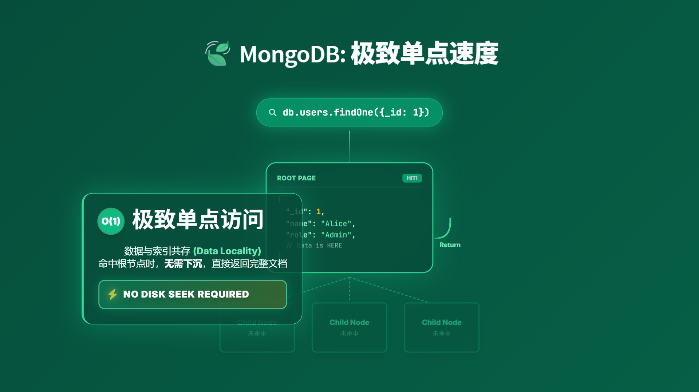

# 为什么MySQL用B+树，MongoDB用B树

很多开发者在面试或选型时，常把 MySQL 和 MongoDB 的区别简单归结为“关系型 vs 非关系型”。但作为架构师，我们需要向下再挖一层：**它们底层的数据结构差异，究竟决定了怎样的 I/O 命运？**

本文将结合可视化图解，带你彻底看清 B+ 树与 B 树的本质区别。

***

### 1. 结构 DNA：数据究竟存在哪？

如上图所示，这两种树最直观的区别在于**“数据（Data）”存放的位置**：

* **MongoDB (理论模型 B-Tree)**：它崇尚**“众生平等”**。无论是根节点、中间节点还是叶子节点，都同时存储着索引（Key）和实际数据（Value）。
  * *隐喻*：这就像去图书馆，目录卡片背面直接贴着书的内容。如果你运气好，查目录时直接就拿到了书。
* **MySQL (InnoDB B+ Tree)**：它有着严格的**“阶级分层”。**非叶子节点（根与中间层）只存索引，不存数据；所有的数据都沉淀在最底层的**叶子节点**。
  * *隐喻*：目录就是目录，书库就是书库。你必须通过目录层层索引，最后走进书库才能拿到书。

**这种结构差异带来了什么？** MySQL 的非叶子节点因为不存数据，单页（Page）能容纳的索引数量远多于 B 树。这意味着在同等数据量下，**B+ 树更加“矮胖”**，磁盘 I/O 的层数更少、更稳定。

***

### 2. MySQL 的杀手锏：为什么范围查询它是王？

当你执行 <code>SELECT * FROM users WHERE id > 100</code> 时，MySQL 展示了它的统治力。

看上图底部的叶子层，B+ 树的所有叶子节点通过**双向链表**（Doubly Linked List）相互连接。

1. **定位**：通过索引快速找到 <code>id=100</code> 的叶子节点。
2. **横扫**：一旦找到起点，引擎根本不需要再回溯到上层节点，直接顺着链表指针向右“顺藤摸瓜”。

**物理意义：顺序 I/O (Sequential I/O)** 这是磁盘最喜欢的操作。相比于在树中跳来跳去的随机读取，这种顺着链表读取的方式，能最大化利用磁盘吞吐量和操作系统的预读（Read-Ahead）机制。这就是为什么做报表、跑复杂分析，MySQL 依然是首选。

***

### 3. MongoDB 的极致：单点读取的 O(1) 诱惑

既然 B+ 树这么好，为什么 B 树（MongoDB 的理论原型）还有立足之地？请看上图的“高光时刻”。

当我们查询 <code>db.users.findOne({_id: 1})</code> 时，如果这个 ID 恰好位于**根节点**：

* **B+ 树**：必须一路向下，直到叶子节点才能拿到数据（通常需要 3 次 I/O）。
* **B 树**：**直接命中，立即返回！**（仅需 1 次 I/O）。

**物理意义：数据局部性 (Data Locality)** B 树的设计哲学是“把相关的数据放在一起”。对于热点数据的单条记录查询（Key-Value 风格），B 树在最好的情况下拥有 **O(1)** 的惊人速度。这非常契合 MongoDB “文档存储”的初衷——作为一个大 JSON 对象，拿了就走。

***

### 4. 架构师的真相时刻：理论 vs 现实

这里有一个反直觉的事实，也是本文最大的“反转”。

虽然教科书上说 MongoDB 使用 B 树，但 MongoDB 默认的存储引擎 **WiredTiger** 在磁盘上的实现，其实**变种的 B+ 树**。

**为什么工业界最终向 B+ 树妥协？** 上图揭示了原因——**物理定律**。

1. **内存与磁盘的鸿沟**：虽然 B 树在内存中查找很快，但数据库的瓶颈通常在磁盘。
2. **页缓存（Page Cache）**：操作系统读取磁盘是按“页（4KB/16KB）”加载的。B+ 树紧凑的索引结构能让一次 I/O 加载更多的索引，极大地提高了缓存命中率。
3. **写放大与分裂**：B+ 树的叶子节点分裂和顺序写入特性，对现代 SSD 和文件系统更加友好。

所以，MongoDB 在内存中可能使用 SkipList 或 B-Tree 变种来加速，但在落盘那一刻，它依然选择了 B+ 树的结构优势。

***

### 5. 终极总结：如何选型？

抛开底层实现细节，从应用层来看，两者的性能特征总结如下：

* **选择 MySQL (InnoDB)**：
  * 如果你有大量的**范围查询**（<code>BETWEEN</code>, <code>></code>, <code><</code>）、排序（<code>ORDER BY</code>）和复杂聚合。
  * 你需要极其稳定的查询响应时间（树高固定）。
  * 你的业务强依赖事务和数据一致性。
* **选择 MongoDB**：
  * 你的数据模型是**离散的**（文档型），且多为单点读写或基于 ID 的查询。
  * 你需要灵活的 Schema（无需频繁 <code>ALTER TABLE</code>）。
  * 你需要原生的分片（Sharding）支持来处理海量数据。

**一句话结语：** MySQL 赢在**“有序与稳定”，**MongoDB 赢在“**灵活与离散”**。理解了 B+ 树与 B 树的区别，你选的不仅是数据库，更是数据在磁盘上的“居住方式”。

> 更新: 2025-12-10 19:50:57  
> 原文: <https://www.yuque.com/tulingzhouyu/db22bv/hzcgigs9ixa139nq>